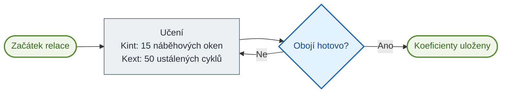

# 🧠 Auto TPI: Automatické učení

> [!NOTE]
> Tato funkce je primárně určena pro systémy vytápění typu **Switch** (On/Off), jako jsou elektrické radiátory, kotle, podlahové vytápění nebo peletová kamna. Přizpůsobení pro termostatické radiátorové ventily (TRV) zůstává problematické kvůli jejich nelinearitě: dodávané teplo není úměrné otevření ventilu.

**Auto TPI** umožňuje vašemu termostatu naučit se tepelné chování vaší místnosti samo. Automaticky upravuje koeficienty $K_{int}$ (vnitřní) a $K_{ext}$ (vnější), aby dosáhl a udržel vaši požadovanou hodnotu.

> [!TIP]
> **Pro pokročilé uživatele**: Podrobná technická dokumentace vysvětlující algoritmy, vzorce a vnitřní mechanismy je k dispozici zde: [Technická dokumentace Auto TPI](feature-autotpi-technical.md).

---

## 🔄 Cyklus relace

Auto TPI pracuje prostřednictvím **učebních relací**. Během relace systém sleduje vaši místnost a oba koeficienty upravuje v malých krocích, vždy v situaci, ve které lze měřit spolehlivě.

1.  **Začátek**: Relace začíná od koeficientů vaší konfigurace.
2.  **Učení**: Kint a Kext se upravují nezávisle na sobě (viz níže).
3.  **Uložení**: Jakmile je Kint upraven během **15 náběhových oken** a Kext během **50 cyklů**, relace skončí: koeficienty se uloží do vaší konfigurace a odešle se oznámení.

### Kdy se upravují Kint a Kext?

| Koeficient | Situace při učení | Vysvětlení |
| :--- | :--- | :--- |
| **Kint** (vnitřní) | Během **nárůstu teploty**, když je místnost alespoň o **0,3 °C** pod požadovanou hodnotou a topení není vypnuté ani na 100 %. Nárůst se sleduje v oknech dlouhých 10 až 30 minut (u pomalých topných těles déle), podle rychlosti nárůstu. | Kint určuje, jak silně topení reaguje na odchylku. Upravuje se tak, aby místnost odchylku uzavírala cílovou rychlostí odvozenou od **doby ohřevu** vašeho topného tělesa. |
| **Kext** (vnější) | Když je místnost **ustálená blízko požadované hodnoty**: určitý čas po poslední změně požadované hodnoty, jakmile se místnost vrátila do 0,3 °C od požadované hodnoty. | Kext kompenzuje tepelné ztráty směrem ven. Upravuje se tak, aby zbylá odchylka zmizela. |

> [!TIP]
> Kint lze učit pouze tehdy, když musí místnost dohnat požadovanou hodnotu. K vytvoření těchto situací stačí naplánované změny požadované hodnoty (noční útlum, předvolby).

> [!NOTE]
> **Nasycené cykly**: Cykly při **0%** nebo **100%** výkonu jsou **ignorovány**, protože nic neříkají o tom, jak by měl být výkon upravený.

---

## 🚀 Spuštění učení

Jakmile je funkce **Auto TPI** povolena a nastavena pro váš termostat, učení se nespouští automaticky. Musíte je spustit ručně:

1.  **Pomocí vyhrazené karty (doporučeno)**: Použijte tlačítko "Play" na [kartě Auto TPI Learning](https://github.com/KipK/auto-tpi-learning-card).
2.  **Pomocí služby "Set Auto TPI Mode"**: Zavolejte tuto službu (`set_auto_tpi_mode`) z vývojářských nástrojů. Tato služba spouští nebo zastavuje relaci Auto TPI. S `reinitialise: true` relace začne znovu od nakonfigurovaných koeficientů; jinak naváže na předchozí.

---

## ⚙️ Konfigurace

Při zapnutí Auto TPI jsou k dispozici tyto parametry:

| Parametr | Popis |
| :--- | :--- |
| **Heating Time** | Doba, kterou vaše topidlo potřebuje, aby po zapnutí dosáhlo plného výkonu. Určuje cílovou rychlost odezvy regulace: čím pomalejší topné těleso, tím jemněji se Kint vyladí. |
| **Continuous Kext Learning** | Pokračuje v úpravě Kext i po skončení relace (viz níže). |

Referenční hodnoty doby ohřevu:

| Typ vytápění | Doba ohřevu |
| :--- | :--- |
| Elektrický radiátor | 5 min |
| Vodní radiátor | 15 min |
| Podlahové vytápění | 30 min |

---

## 💡 Osvědčené postupy

### Vyhněte se vnějším vlivům
Během relace učení se snažte vyhnout:
-   Přímému slunečnímu záření na teplotní čidlo.
-   Použití sekundárního zdroje tepla (krb, kamna).
-   Dlouho otevřeným oknům nebo dveřím.

Tyto faktory mění teplotu místnosti bez vazby na topení a systém by je považoval za vlastnost místnosti.

### Vyhněte se extrémním podmínkám

> [!CAUTION]
> **Nespouštějte učení, pokud jsou vaše topidla nasycená** (trvale 100% výkon). K tomu obvykle dochází během výjimečných mrazových period, kdy topení již nedokáže dosáhnout požadované hodnoty. Nasycené cykly se ignorují, takže relace by nepostupovala. Počkejte na mírnější počasí a teprve potom spusťte relaci učení.

### Ideální průběh relace

1.  **Spuštění**: Spusťte relaci učení a ponechte svůj obvyklý časový plán. Každý náběh po nižší požadované hodnotě (noc, nepřítomnost) poskytne okna pro učení Kint; každé ustálené období poskytne cykly pro Kext.
2.  **Urychlení, je-li třeba**: Pokud se vaše požadovaná hodnota mění jen zřídka, na několik hodin ji snižte o 1 až 2 °C a pak ji vraťte zpět: náběh poskytne okna pro učení Kint.
3.  **Konec**: Relace se ukončí sama, jakmile oba koeficienty získají dostatek pozorování.

> [!NOTE]
> **K překmitu (překročení požadované hodnoty)**: Mírný překmit po náběhu je u pomalého topného tělesa normální. Pokud překmity **přetrvávají** i po skončení relace, zkontrolujte **dobu ohřevu** ve své konfiguraci: příliš krátká hodnota pro dané topné těleso dělá regulaci příliš rychlou.

---

## 🔄 Průběžné učení Kext

Funkce **Průběžné učení Kext** umožňuje termostatu sledovat pomalé změny tepelných ztrát (roční období, vítr, způsob využívání budovy) i po skončení učební relace, aniž by se musela spustit nová.

### Jak to funguje
Jakmile je funkce zapnuta, systém průběžně kontroluje zbývající odchylku, když je místnost ustálená blízko požadované hodnoty. Pokud odchylka zůstává na stejné straně (např. místnost je za chladného počasí stále o 0,2 °C pod požadovanou hodnotou), upraví Kext malými kroky s pevným vyhlazovacím faktorem (exponenciální klouzavý průměr, alfa 0,04).

### Vlastnosti
- **Pasivní přizpůsobení**: Funguje na pozadí, dokud termostat běží.
- **Bezpečnost**: Aktivní pouze tehdy, když výkon není nasycen a místnost je ustálená blízko požadované hodnoty.
- **Vyžaduje první relaci**: Průběžné učení se spustí až po alespoň jednom cyklu učení Kext v běžné relaci.

---

## 📊 Vizuální sledování

Pro sledování vývoje učení v reálném čase se důrazně doporučuje nainstalovat vlastní kartu **Auto TPI Learning Card**.

### Instalace přes HACS

Nebo ručně přidejte vlastní repozitář: [https://github.com/KipK/auto-tpi-learning-card](https://github.com/KipK/auto-tpi-learning-card)

### Vlastnosti karty

-   📈 Průběh učení v reálném čase
-   🔢 Vypočítávané koeficienty `Kint` a `Kext`
-   ▶️ Ovládací tlačítko pro spuštění/zastavení relace
-   🔧 Volba resetu relace
