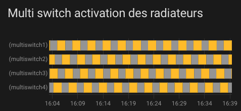

# Termostat typu `over_switch`

- [Termostat typu `over_switch`](#termostat-typu-over_switch)
  - [Předpoklady](#předpoklady)
  - [Konfigurace](#konfigurace)
    - [Podkladová zařízení](#podkladová-zařízení)
    - [Keep-Alive](#keep-alive)
    - [AC režim](#ac-režim)
    - [Inverze příkazů](#inverze-příkazů)
    - [Přizpůsobení příkazů](#přizpůsobení-příkazů)

## Předpoklady

Instalace by měla vypadat takto:

1. Uživatel nebo automatizace, nebo Scheduler, nastaví setpoint prostřednictvím preset nebo přímo pomocí teploty.
2. Periodicky vnitřní teploměr (2) nebo vnější teploměr (2b) pošle naměřenou teplotu. Vnitřní teploměr by měl být umístěn na relevantním místě pro pohodlí uživatele: ideálně uprostřed obytného prostoru. Vyhněte se umístění příliš blízko okna nebo příliš blízko radiátoru.
3. Na základě hodnot setpointu, různých teplot a parametrů algoritmu TPI (viz [TPI](algorithms.md#algoritmus-tpi)), VTherm vypočítá procento času zapnutí.
4. Poté bude pravidelně ovládat zapínání a vypínání podkladových entit `switch` (nebo `select` nebo `climate`).
5. Tyto podkladové entity budou ovládat fyzické zařízení.
6. Fyzický spínač zapne nebo vypne radiátor.

> Procento času zapnutí se přepočítává každý cyklus, což umožňuje regulaci teploty místnosti.

## Konfigurace

Nejprve nakonfigurujte hlavní nastavení společná pro všechny _VTherm_ (viz [hlavní nastavení](base-attributes.md)).
Poté nakonfigurujte podkladová zařízení. Při vytváření _VTherm_ je průvodce zobrazí po hlavních atributech. Později vyberte v menu "Podřízená zařízení". Toto menu obsahuje:
- "Společná nastavení": nastavení sdílená všemi zařízeními (algoritmus, keep-alive, AC režim, inverze příkazů),
- jednu položku pro každé ovládané zařízení s jeho entitou a příkazy,
- "Přidat zařízení".

### Podkladová zařízení

"Přidat zařízení" se nejprve zeptá na entitu k ovládání. Akceptovány jsou pouze entity typu `switch`, `input_boolean`, `select`, `input_select` nebo `climate`. Další obrazovka zobrazí nastavení tohoto zařízení: jeho [vlastní příkazy](#přizpůsobení-příkazů).

Otevření zařízení v seznamu zobrazí stejná nastavení a navíc dvě pole: "Nahradit entitu" pro ovládání jiné entity místo této a "Odebrat toto zařízení".

Pole "Algoritmus" ve společných nastaveních vybírá regulační algoritmus: vestavěný TPI, nebo algoritmus nainstalovaný jako plugin. Viz [algoritmy](algorithms.md).
Pokud je nakonfigurováno více entit, termostat rozloží aktivace, aby minimalizoval počet spínačů zapnutých v danou chvíli. To umožňuje lepší distribuci výkonu, protože každý radiátor se zapne postupně.

VTherm bude vyhlazovat spotřebovaný výkon co nejvíce střídáním aktivací. Příklad rozložených aktivací:

Samozřejmě, pokud je požadovaný výkon (`on_percent`) příliš vysoký, dojde k překrytí aktivací.

### Keep-Alive

Některá zařízení vyžadují periodickou aktivaci, aby se zabránilo bezpečnostnímu vypnutí. Známá jako "keep-alive", tato funkce může být aktivována zadáním nenulového počtu sekund do pole intervalu keep-alive termostatu. Pro zakázání funkce nebo pokud si nejste jisti, nechte pole prázdné nebo zadejte nulu (výchozí hodnota).

### AC režim

Je možné vybrat `thermostat_over_switch` pro ovládání klimatizace zaškrtnutím políčka "AC režim". V tomto případě bude viditelný pouze chladicí režim.

### Inverze příkazů

Pokud je vaše zařízení ovládáno pilotním drátem s diodou, možná budete muset zaškrtnout políčko "Invertovat příkaz". To nastaví spínač na `On`, když potřebujete vypnout zařízení, a na `Off`, když jej potřebujete zapnout. Časy cyklů budou s touto možností invertovány.

### Přizpůsobení příkazů

Příkazy zapnutí a vypnutí zasílané zařízení se zadávají v nastavení tohoto zařízení:
- pro `switch` nebo `input_boolean` jsou volitelné a seskupené ve sbalené sekci "Vlastní příkazy". Bez nich se použijí standardní příkazy `turn_on` a `turn_off`,
- pro `select`, `input_select` nebo `climate` jsou pole "Příkaz zapnutí" a "Příkaz vypnutí" povinná.

Příkazy zadejte pomocí formátu `příkaz[/atribut[:hodnota]]`.
Dostupné příkazy závisí na typu podkladového zařízení:

| Typ podkladového zařízení   | Možné příkazy zapnutí                 | Možné příkazy vypnutí                          | Platí pro                         |
| --------------------------- | ------------------------------------- | ---------------------------------------------- | --------------------------------- |
| `switch` nebo `input_boolean` | `turn_on`                             | `turn_off`                                     | Všechny spínače                   |
| `select` nebo `input_select`  | `select_option/option:comfort`        | `select_option/option:frost_protection`        | Nodon SIN-4-FP-21 a podobné (*) |
| `climate` (hvac_mode)       | `set_hvac_mode/hvac_mode:heat`        | `set_hvac_mode/hvac_mode:off`                  | eCosy (přes Tuya Local)           |
| `climate` (preset)          | `set_preset_mode/preset_mode:comfort` | `set_preset_mode/preset_mode:frost_protection` | Heatzy (*)                        |

(*) Zkontrolujte hodnoty akceptované vaším zařízením v **Developer Tools / States** a vyhledejte vaše zařízení. Uvidíte možnosti, které podporuje. Musí být identické, včetně rozlišování velkých a malých písmen.

Samozřejmě tyto příklady lze přizpůsobit vašemu konkrétnímu případu.

Příklad pro Nodon SIN-4-FP-21 (entita `select`): příkaz zapnutí je `select_option/option:comfort` a příkaz vypnutí je `select_option/option:frost_protection`.

Platí následující pravidla:
1. Každý příkaz musí následovat formát `příkaz[/atribut[:hodnota]]` (např. `select_option/option:comfort` nebo `turn_on`) bez mezer nebo speciálních znaků kromě `_`. Jinak nastavení zařízení zobrazí chybu "Konfigurace virtuálního spínače je nesprávná".
2. Příkazy se zadávají pro všechna zařízení, nebo pro žádné. Je možné míchat různé typy podkladových zařízení, ale jakmile jedno zařízení není `switch` nebo má jedno zařízení vlastní příkazy, potřebuje své příkazy každé zařízení, včetně entit `switch`. Zařízení bez příkazů je v seznamu podkladových zařízení označeno ⚠ a možnost "Konfigurace není kompletní" k němu vede.
