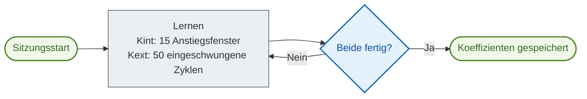

# 🧠 Auto TPI: Automatisches Lernen

> [!NOTE]
> Dieses Feature ist primär für **Schalt**-Heizsysteme (An/Aus) konzipiert, wie z.B. Elektroheizkörper, Heizkessel, Fußbodenheizungen oder Pelletöfen. Die Anpassung für thermostatische Heizkörperventile (TRV) bleibt aufgrund ihrer Nichtlinearität problematisch: Die abgegebene Wärme ist nicht proportional zur Ventilöffnung.

**Auto TPI** ermöglicht es Ihrem Thermostat, das thermische Verhalten Ihres Raumes selbstständig zu erlernen. Es passt die Koeffizienten $K_{int}$ (intern) und $K_{ext}$ (extern) automatisch an, um Ihren Sollwert zu erreichen und zu halten.

> [!TIP]
> **Für fortgeschrittene Benutzer**: Eine detaillierte technische Dokumentation, die die Algorithmen, Formeln und internen Mechanismen erklärt, finden Sie hier: [Auto TPI Technische Dokumentation](feature-autotpi-technical.md).

---

## 🔄 Sitzungszyklus

Auto TPI arbeitet in **Lernsitzungen**. Während einer Sitzung beobachtet das System Ihren Raum und passt die beiden Koeffizienten in kleinen Schritten an, jeweils in der Situation, in der sie zuverlässig gemessen werden können.

1.  **Start**: Die Sitzung beginnt mit den Koeffizienten Ihrer Konfiguration.
2.  **Lernen**: Kint und Kext werden unabhängig voneinander angepasst (siehe unten).
3.  **Speichern**: Sobald Kint über **15 Anstiegsfenster** und Kext über **50 Zyklen** angepasst wurde, endet die Sitzung (später, wenn sich Kint noch in dieselbe Richtung bewegt): Die Koeffizienten werden in Ihrer Konfiguration gespeichert und eine Benachrichtigung wird gesendet.

### Wann werden Kint und Kext angepasst?

| Koeffizient | Lernsituation | Erklärung |
| :--- | :--- | :--- |
| **Kint** (intern) | Während eines **Temperaturanstiegs**, wenn der Raum mindestens **0,3 °C** unter dem Sollwert liegt und die Heizung weder abgeschaltet ist noch bei 100 % läuft. Der Anstieg wird in Fenstern von 10 bis 30 Minuten beobachtet (bei trägen Heizkörpern länger), abhängig von der Anstiegsgeschwindigkeit. | Kint legt fest, wie stark die Heizung auf eine Abweichung reagiert. Es wird so angepasst, dass der Raum die Abweichung mit einer Zielgeschwindigkeit ausgleicht, die von der **Heizzeit** Ihres Heizkörpers abgeleitet ist. |
| **Kext** (extern) | Wenn der Raum **nahe am Sollwert eingeschwungen** ist: einige Zeit nach der letzten Sollwertänderung, sobald der Raum wieder innerhalb von 0,3 °C des Sollwerts liegt. | Kext kompensiert die Wärmeverluste nach außen. Es wird so angepasst, dass die verbleibende Abweichung verschwindet. |

> [!TIP]
> Kint kann nur gelernt werden, wenn der Raum den Sollwert erst erreichen muss. Geplante Sollwertänderungen (Nachtabsenkung, Presets) reichen aus, um solche Situationen zu schaffen.

> [!NOTE]
> **Gesättigte Zyklen**: Zyklen mit **0 %** oder **100 %** Leistung werden **ignoriert**, da sie nichts darüber aussagen, wie die Leistung angepasst werden sollte.

---

## 🚀 Start des Lernens

Sobald das Feature **Auto TPI** für Ihr Thermostat aktiviert und konfiguriert ist, startet das Lernen nicht automatisch. Sie müssen es manuell starten:

1.  **Über die dedizierte Karte (empfohlen)**: Verwenden Sie die Schaltfläche "Play" auf der [Auto TPI Learning Card](https://github.com/KipK/auto-tpi-learning-card).
2.  **Über den Dienst "Set Auto TPI Mode"**: Rufen Sie diesen Dienst (`set_auto_tpi_mode`) aus den Entwicklerwerkzeugen auf. Er startet oder stoppt eine Auto-TPI-Sitzung. Mit `reinitialise: true` beginnt die Sitzung erneut mit den konfigurierten Koeffizienten; andernfalls wird die vorherige Sitzung fortgesetzt.

---

## ⚙️ Konfiguration

Beim Aktivieren von Auto TPI stehen folgende Parameter zur Verfügung:

| Parameter | Beschreibung |
| :--- | :--- |
| **Heating Time** | Zeit, die Ihr Heizkörper benötigt, um nach dem Einschalten die volle Leistung zu erreichen. Sie legt die Zielgeschwindigkeit der Regelung fest: Je träger der Heizkörper, desto sanfter wird Kint eingestellt. |
| **Continuous Kext Learning** | Passt Kext auch nach dem Ende der Sitzung weiter an (siehe unten). |

Richtwerte für die Heizzeit:

| Heizungsart | Heizzeit |
| :--- | :--- |
| Elektroheizkörper | 5 Min. |
| Wasserheizkörper | 15 Min. |
| Fußbodenheizung | 30 Min. |

---

## 💡 Best Practices

### Externe Störungen vermeiden
Versuchen Sie während einer Lernsitzung Folgendes zu vermeiden:
-   Direkte Sonneneinstrahlung auf den Temperatursensor.
-   Die Nutzung einer zusätzlichen Wärmequelle (Kamin, Ofen).
-   Lange geöffnete Fenster oder Türen.

Diese Faktoren verändern die Raumtemperatur ohne Zusammenhang mit der Heizung, und das System würde sie als Eigenschaft des Raumes werten.

### Extreme Bedingungen vermeiden

> [!CAUTION]
> **Starten Sie das Lernen nicht, wenn Ihre Heizkörper gesättigt sind** (dauerhaft 100 % Leistung). Dies tritt typischerweise bei außergewöhnlichen Kälteperioden auf, wenn die Heizung den Sollwert nicht mehr erreichen kann. Gesättigte Zyklen werden ignoriert, die Sitzung würde also keinen Fortschritt machen. Warten Sie auf mildere Wetterbedingungen, um eine Lernsitzung zu starten.

### Idealer Sitzungsablauf

1.  **Starten**: Starten Sie die Lernsitzung und behalten Sie Ihren üblichen Zeitplan bei. Jeder Anstieg nach einem niedrigeren Sollwert (Nacht, Abwesenheit) liefert Lernfenster für Kint; jeder eingeschwungene Zeitraum liefert Zyklen für Kext.
2.  **Bei Bedarf beschleunigen**: Ändert sich Ihr Sollwert selten, senken Sie ihn für einige Stunden um 1 bis 2 °C und stellen Sie ihn dann wieder ein: Der Anstieg liefert Lernfenster für Kint.
3.  **Ende**: Die Sitzung endet von selbst, sobald beide Koeffizienten genügend Beobachtungen haben.

> [!NOTE]
> **Zum Overshoot (Überschreiten des Sollwerts)**: Ein kleiner Overshoot nach einem Anstieg ist bei einem trägen Heizkörper normal. Falls Overshoots **nach dem Ende der Sitzung anhalten**, prüfen Sie die **Heizzeit** Ihrer Konfiguration: Ein zu kurzer Wert für den Heizkörper macht die Regelung zu schnell.

---

## 🔄 Kontinuierliches Kext-Lernen

Das Feature **Continuous Kext Learning** ermöglicht es dem Thermostat, langsame Änderungen der Wärmeverluste (Jahreszeit, Wind, Nutzung des Gebäudes) nach der Lernsitzung zu verfolgen, ohne eine neue Sitzung zu starten.

### So funktioniert es
Nach der Aktivierung prüft das System kontinuierlich die verbleibende Abweichung, wenn der Raum nahe am Sollwert eingeschwungen ist. Bleibt die Abweichung auf derselben Seite (z. B. liegt der Raum bei kaltem Wetter immer 0,2 °C unter dem Sollwert), korrigiert es Kext in kleinen Schritten mit einem festen Glättungsfaktor (exponentieller gleitender Mittelwert, Alpha 0,04).

### Eigenschaften
- **Passive Anpassung**: Läuft im Hintergrund, solange das Thermostat aktiv ist.
- **Sicherheit**: Nur aktiv, wenn die Leistung nicht gesättigt ist und der Raum nahe am Sollwert eingeschwungen ist.
- **Erfordert eine erste Sitzung**: Das kontinuierliche Lernen beginnt erst, nachdem mindestens ein Kext-Lernzyklus in einer Standardsitzung durchgeführt wurde.

---

## 📊 Visuelle Überwachung

Um den Lernfortschritt in Echtzeit zu verfolgen, wird dringend empfohlen, die benutzerdefinierte Karte **Auto TPI Learning Card** zu installieren.

### Installation über HACS

Oder fügen Sie das benutzerdefinierte Repository manuell hinzu: [https://github.com/KipK/auto-tpi-learning-card](https://github.com/KipK/auto-tpi-learning-card)

### Funktionen der Karte

-   📈 Lernfortschritt in Echtzeit
-   🔢 Berechnung der Koeffizienten `Kint` und `Kext`
-   ▶️ Schaltfläche zum Starten/Stoppen der Sitzung
-   🔧 Option zum Zurücksetzen der Sitzung
