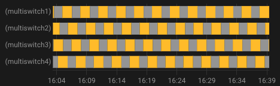

# `over_switch` Thermostattyp

- [`over_switch` Thermostattyp](#over_switch-thermostattyp)
  - [Voraussetzungen](#voraussetzungen)
  - [Konfiguration](#konfiguration)
    - [Die zugehörigen Geräte](#die-zugehörigen-geräte)
    - [Aufrechterhaltung/Keep-Alive](#aufrechterhaltungkeep-alive)
    - [Klimaanelagenmodus/AC Modus](#klimaanelagenmodusac-modus)
    - [Befehlsumkehr](#befehlsumkehr)
    - [Befehlsanpassung](#befehlsanpassung)
  - [Nächster Schritt](#nächster-schritt)

## Voraussetzungen

Die elektrischen Heizgeräte, die von einem `over_switch`-_VTherm_ gesteuert werden können, sind im [Gerätekatalog](https://www.versatile-thermostat.org/de/devices/?type=electric) aufgeführt.

Die Installation sollte in etwa so aussehen:

1. Der Sollwert wird direkt über die Temperatur durch einen Benutzer, einer Automation oder einen Zeitplan eingestellt.
2. In regelmäßigen Abständen sendet das Innenthermometer (2) oder das Außenthermometer (2b) die gemessene Temperatur. Das interne Thermometer sollte an einer für den Komfort des Benutzers relevanten Stelle angebracht werden: idealerweise in der Mitte des Wohnraums. Vermeiden Sie es, es zu nah an einem Fenster oder in der Nähe eines Heizkörpers zu platzieren.
3. Auf der Grundlage der Sollwerte, der verschiedenen Temperaturen und der Parameter des TPI-Algorithmus (siehe [TPI](algorithms.md#der-tpi-algorithmus) oder die [weiteren Algorithmen](algorithms.md#weitere-algorithmen-plugins)) berechnet VTherm einen Prozentsatz der Einschaltdauer.
4. Es wird dann regelmäßig das Ein- und Ausschalten der zugehörigen `Schalter` (oder `select` oder `climate`) veranlassen.
5. Diese zugehörigen Entitäten steuern das physische Gerät.
6. Der physische Schalter schaltet den Heizkörper ein oder aus.

> Der prozentuale Anteil der Einschaltdauer wird bei jedem Zyklus neu berechnet, was die Regulierung der Raumtemperatur ermöglicht.

## Konfiguration

Konfigurieren Sie zunächst die Haupteinstellungen, die für alle _VTherms_ gelten (siehe [Haupteinstellung](base-attributes.md)).
Konfigurieren Sie dann die zugehörigen Geräte. Beim Erstellen des _VTherm_ zeigt der Assistent sie nach den wichtigsten Eigenschaften an. Später wählen Sie „Basiswerte“ im Menü. Dieses Menü enthält:
- „Gemeinsame Einstellungen“: die Einstellungen, die für alle Geräte gelten (Algorithmus, Keep-Alive, AC-Modus, Befehlsumkehr),
- einen Eintrag für jedes gesteuerte Gerät, mit seiner Entity und seinen Befehlen,
- „Gerät hinzufügen“.

### Die zugehörigen Geräte

„Gerät hinzufügen“ fragt zuerst nach der zu steuernden Entity. Es werden nur Entities des Typs `switch`, `input_boolean`, `select`, `input_select` oder `climate` akzeptiert. Der nächste Bildschirm zeigt die Einstellungen dieses Geräts: seine [angepassten Befehle](#befehlsanpassung).

Wenn Sie ein Gerät in der Liste öffnen, sehen Sie dieselben Einstellungen mit zwei zusätzlichen Feldern: „Entität ersetzen“, um stattdessen eine andere Entity zu steuern, und „Dieses Gerät entfernen“.

Im Feld „Algorithmus“ der gemeinsamen Einstellungen wählen Sie den Regelalgorithmus: den integrierten TPI oder einen als Plugin installierten Algorithmus. Siehe [Algorithmen](algorithms.md).
Wenn mehrere Einheiten konfiguriert sind, staffelt der Thermostat die Aktivierungen, um die Anzahl der eingeschalteten Schalter zu einem bestimmten Zeitpunkt zu minimieren. Dies ermöglicht eine bessere Energieverteilung, da sich jeder Heizkörper nacheinander einschaltet.

VTherm glättet die verbrauchte Leistung so weit wie möglich durch abwechselnde Aktivierungen. Beispiel für gestaffelte Aktivierungen:

Wenn die geforderte Leistung (`on_percent`) zu hoch ist, kommt es natürlich zu einer Überschneidung von Aktivierungen.

### Aufrechterhaltung/Keep-Alive

Einige Geräte erfordern eine regelmäßige Aktivierung, um eine Sicherheitsabschaltung zu verhindern. Diese als "Keep-Alive" bekannte Funktion kann durch Eingabe einer von Null abweichenden Anzahl von Sekunden in das Feld "Keep-Alive-Intervall" des Thermostats aktiviert werden. Um die Funktion zu deaktivieren oder im Zweifelsfall, lassen Sie das Feld leer oder geben Sie Null ein (Standardwert).

### Klimaanelagenmodus/AC Modus

Es ist möglich, einen `thermostat_over_switch` zur Steuerung einer Klimaanlage zu wählen, indem man das Kästchen "AC Modus" ankreuzt. In diesem Fall wird nur der Kühlmodus angezeigt.

### Befehlsumkehr

Wenn Ihr Gerät über einen Pilotdraht mit einer Diode gesteuert wird, müssen Sie möglicherweise das Kästchen "Befehlsumkehrung" aktivieren. Dadurch wird der Schalter auf `Ein` gestellt, wenn Sie das Gerät ausschalten müssen, und auf `Aus`, wenn Sie es einschalten müssen. Die Zykluszeiten werden mit dieser Option invertiert.

### Befehlsanpassung

Die Ein- und Ausschaltbefehle, die an ein Gerät gesendet werden, werden in den Einstellungen dieses Geräts festgelegt:
- für einen `switch` oder einen `input_boolean` sind sie optional und im eingeklappten Abschnitt „Benutzerdefinierte Befehle“ zusammengefasst. Ohne sie werden die Standardbefehle `turn_on` und `turn_off` verwendet,
- für einen `select`, einen `input_select` oder ein `climate` sind die Felder „Einschaltbefehl“ und „Ausschaltbefehl“ erforderlich.

Geben Sie die Befehle im Format `Befehl[/Attribut[:Wert]]` an.
Die verfügbaren Befehle hängen von der Art des zugehörigen Geräts ab:

| zugehöriger Gerätetyp        | Mögliche Einschaltbefehle             | Mögliche Ausschaltbefehle                      | Betrifft                          |
| ---------------------------- | ------------------------------------- | ---------------------------------------------- | --------------------------------- |
| `switch` odr `input_boolean` | `turn_on`                             | `turn_off`                                     | Alle Schalter                     |
| `select` oder `input_select` | `select_option/option:comfort`        | `select_option/option:frost_protection`        | Nodon SIN-4-FP-21 und ähnlich (*) |
| `climate` (HKL-Modus)        | `set_hvac_mode/hvac_mode:heat`        | `set_hvac_mode/hvac_mode:off`                  | eCosy (via Tuya Local)            |
| `climate` (Voreinstellung)   | `set_preset_mode/preset_mode:comfort` | `set_preset_mode/preset_mode:frost_protection` | Heizkörper mit Voreinstellungen (*) |

(*) Um diesen Fall nutzen zu können, ist es wichtig sicherzustellen, dass der Zustand der zugrunde liegenden Entität mit dem Preset übereinstimmt. Andernfalls hat VTherm keine Möglichkeit zu wissen, ob Ihr Gerät ein- oder ausgeschaltet ist. Um dies zu überprüfen, gehen Sie zu Entwicklerwerkzeuge / Zustände, suchen Sie Ihre zugrunde liegende Entität und prüfen Sie, ob ihr Zustand mit dem Namen eines Presets übereinstimmt. Wenn Sie 'heat', 'off' oder 'cool' sehen, sind dies keine Presets, und diese Konfiguration wird nicht funktionieren. In diesem Fall müssen Sie einen virtuellen Schalter verwenden. Beispiele für virtuelle Schalter finden Sie auf der Seite Fehlerbehebung. Wenn Sie dennoch mit dieser Konfiguration fortfahren möchten, überprüfen Sie sorgfältig die von Ihrem Gerät akzeptierten Werte in Entwicklerwerkzeuge / Zustände und suchen Sie Ihr Gerät. Sie werden die Optionen sehen, die es akzeptiert. Diese müssen identisch sein, einschließlich der Groß- und Kleinschreibung. Der Heatzy erfüllt diese Bedingung nicht: Verwenden Sie einen virtuellen Schalter, wie auf seiner [Seite im Gerätekatalog](https://www.versatile-thermostat.org/de/devices/heatzy/) beschrieben.

Natürlich können diese Beispiele an Ihren speziellen Fall angepasst werden.

Beispiel für ein Nodon SIN-4-FP-21 (`select`-Entity): Der Einschaltbefehl ist `select_option/option:comfort` und der Ausschaltbefehl ist `select_option/option:frost_protection`.

Es gelten die folgenden Regeln:
1. Jeder Befehl muss dem Format `Befehl[/Attribut[:Wert]]` folgen (z.B. `select_option/option:comfort` oder `turn_on`) ohne Leer- oder Sonderzeichen außer `_`. Andernfalls zeigen die Einstellungen des Geräts den Fehler „Die Konfiguration der Befehlsanpassung ist falsch“ an.
2. Die Befehle werden für alle Geräte oder für keines angegeben. Es ist möglich, verschiedene Typen von zugeordneten Geräten zu mischen, aber sobald ein Gerät kein `switch` ist oder ein Gerät angepasste Befehle hat, benötigt jedes Gerät seine Befehle, einschließlich der `switch`-Entities. Ein Gerät ohne seine Befehle wird in der Liste des Menüs „Basiswerte“ mit ⚠ markiert, und „Konfiguration unvollständig“ führt zu ihm.

## Nächster Schritt

[Die TPI-Koeffizienten](algorithms.md#konfigurieren-der-tpi-algorithmusfaktoren): den Regelalgorithmus einstellen (Menü „TPI-Parameter“). Ohne zentrale Konfiguration ist dieser Schritt erforderlich, um die Erstellung abzuschließen.

Wenn Sie einen Algorithmus aus einem Plugin verwenden, etwa SmartPI, folgen Sie dessen Dokumentation und gehen Sie dann direkt zu den [Voreinstellungen](feature-presets.md).
