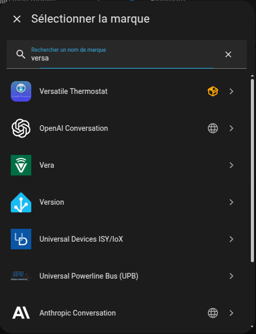
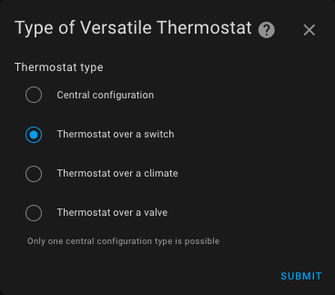

# Choosing a VTherm

- [Choosing a VTherm](#choosing-a-vtherm)
  - [Creating a New Versatile Thermostat](#creating-a-new-versatile-thermostat)
  - [Choosing a VTherm Type](#choosing-a-vtherm-type)
    - [Centralized configuration](#centralized-configuration)
    - [VTherm over a switch](#vtherm-over-a-switch)
    - [VTherm over another thermostat](#vtherm-over-another-thermostat)
    - [VTherm over a valve](#vtherm-over-a-valve)
  - [Making the right choice](#making-the-right-choice)
  - [Reference Article](#reference-article)
  - [Next Step](#next-step)

>  _*Notes*_
>
> There are three ways to work with VTherms:
> 1. Each Versatile Thermostat is fully configured independently. Choose this option if you do not want any centralized configuration or management.
> 2. Some aspects are configured centrally. For example, you can define the minimum/maximum temperatures, open window detection parameters, etc., at a single central instance. For each VTherm you configure, you can then choose to use the central configuration or override it with custom parameters.
> 3. In addition to centralized configuration, all VTherms can be controlled by a single `select` entity called `central_mode`. This feature allows you to stop/start/set frost protection/etc. for all VTherms at once. For each VTherm, you can specify if it is affected by this `central_mode`.

## Creating a New Versatile Thermostat

Click on "Add Integration" on the integration page (or click 'Add device' in the integration page)

then search for "versatile thermostat" integration:

and choose your thermostat type:

The configuration can be modified via the same interface. Simply select the thermostat to modify, press "Configure," and you will be able to change some parameters or settings.

Follow the configuration steps by selecting the menu option to configure.

>  _*Central configuration*_
> Most configuration pages (main attributes, TPI parameters, presets, advanced parameters...) have a "Use central configuration" box: when it is checked, these settings come from the _VTherm_ of type "Central Configuration". If a central configuration exists, these boxes are checked by default. Otherwise they are unchecked, the settings must be entered on each _VTherm_, and checking one of them causes an error when saving the page. To share settings between several _VTherm_, create the central configuration first: it is unique, and offered in the list of types as long as it does not exist.

## Choosing a VTherm Type

### Centralized configuration
This option allows you to configure certain repetitive aspects for all VTherms at once, such as:
1. Parameters for different algorithms (TPI, open window detection, motion detection, power sensors for your home, presence detection). These parameters apply across all VTherms. You only need to enter them once in `Centralized Configuration`. This configuration does not create a VTherm itself but centralizes parameters that would be tedious to re-enter for each VTherm. Note that you can override these parameters on individual VTherms to specialize them if needed.
2. Configuration for controlling a central heating system,
3. Certain advanced parameters, such as safety settings.

### VTherm over a switch
This VTherm type controls a switch that turns a radiator on or off. The switch can be a physical switch directly controlling a radiator (often electric) or a virtual switch that can perform any action when turned on or off. The latter type can, for example, control pilot wire switches or DIY pilot wire solutions with diodes. VTherm modulates the proportion of time the radiator is on (`on_percent`) to achieve the desired temperature. If it is cold, it turns on more frequently (up to 100%); if it is warm, it reduces the on time.

The underlying entities for this type are `switches` or `input_booleans`.

### VTherm over another thermostat
When your device is controlled by a `climate` entity in Home Assistant and you only have access to this, you should use this VTherm type. In this case, VTherm simply adjusts the target temperature of the underlying `climate` entity.

This type also includes advanced self-regulation features to adjust the setpoint sent to the underlying device, helping to achieve the target temperature faster and mitigating poor internal regulation. For example, if the device's internal thermometer is too close to the heating element, it may incorrectly assume the room is warm while the setpoint is far from being achieved in other areas.

Since version 6.8, this VTherm type can also regulate directly by controlling the valve. Ideal for controllable TRVs, as Sonoff TRVZB, this type is recommended if you have such devices.

The underlying entities for this VTherm type are exclusively `climate`.

### VTherm over a valve
If the only entity available to regulate your radiator's temperature is a `number` entity, you should use the `over_valve` type. VTherm adjusts the valve opening based on the difference between the target temperature and the actual room temperature (and the outdoor temperature, if available).

This type can be used for TRVs without an associated `climate` entity or other DIY solutions exposing a `number` entity.

## Making the right choice

The type cannot be changed after the _VTherm_ is created: choose it according to the controlled equipment and the way it appears in Home Assistant.

| Equipment | Entity in Home Assistant | _VTherm_ type | Regulation |
|---|---|---|---|
| Heat pump, air conditioner, HVAC system | `climate` | [`over_climate`](over-climate.md) | by the device, corrected if needed by [self-regulation](self-regulation.md) |
| Thermostatic radiator valve (TRV) whose opening can be controlled | `climate` and opening `number` | [`over_climate`](over-climate.md) with [direct valve control](self-regulation.md#self-regulation-by-direct-valve-control) | by _VTherm_: TPI or plugin algorithm (SmartPI...) |
| Simple TRV | `climate` | [`over_climate`](over-climate.md) | by the valve, corrected if needed by [self-regulation](self-regulation.md) |
| Electric radiator controlled by a switch | `switch`, `input_boolean` | [`over_switch`](over-switch.md) | by _VTherm_: TPI or plugin algorithm |
| Electric radiator with a pilot wire | `select`, `input_select` or `climate`, with [custom commands](over-switch.md#command-customization) | [`over_switch`](over-switch.md) | by _VTherm_: TPI or plugin algorithm |
| Valve alone, without a `climate` entity | `number`, `input_number` | [`over_valve`](over-valve.md) | by _VTherm_: TPI or plugin algorithm |
| Pellet stove | `switch` | [`over_switch`](over-switch.md) with the [VTherm Pellet stove](https://www.versatile-thermostat.org/en/plugins/#jmcollin78/vtherm_pellet_stove) plugin | by the plugin |

The [device catalog](https://www.versatile-thermostat.org/en/devices/) gives the recommended type for each tested device.

When several types fit, choose according to the regulation you want. If the device regulates well by itself (air conditioner, some valves), `over_climate` keeps its regulation. If _VTherm_ must regulate from your own thermometer, placed where you live, prefer `over_switch`, `over_valve` or `over_climate` with direct valve control.

## Reference Article
For more information on these concepts, refer to this article (in French): https://www.hacf.fr/optimisation-versatile-thermostat/#optimiser-vos-vtherm

## Next Step

[Choosing Basic Attributes](base-attributes.md): give the _VTherm_ a name, choose its temperature sensors and the features to enable ("Main attributes" and "Features" menus).
