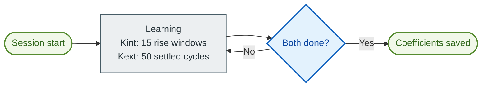

# 🧠 Auto TPI: Automatic Learning

> [!NOTE]
> This feature is primarily designed for **Switch** (On/Off) heating systems, such as electric radiators, boilers, underfloor heating, or pellet stoves. Adaptation for thermostatic radiator valves (TRV) remains problematic due to their non-linearity: the heat delivered is not proportional to the valve opening.

**Auto TPI** enables your thermostat to learn the thermal behavior of your room by itself. It automatically adjusts the $K_{int}$ (indoor) and $K_{ext}$ (outdoor) coefficients to reach and maintain your setpoint.

> [!TIP]
> **For advanced users**: A detailed technical documentation explaining the algorithms, formulas and internal mechanisms is available here: [Auto TPI Technical Documentation](feature-autotpi-technical.md).

---

## 🔄 Session Cycle

Auto TPI operates through **learning sessions**. During a session, the system observes your room and adjusts the two coefficients in small steps, each one in the situation where it can be measured reliably.

1.  **Start**: The session starts from the coefficients of your configuration.
2.  **Learning**: Kint and Kext are adjusted independently (see below).
3.  **Saving**: Once Kint has been adjusted over **15 rise windows** and Kext over **50 cycles**, the session ends: the coefficients are saved to your configuration and a notification is sent.

### When are Kint and Kext adjusted?

| Coefficient | Learning Situation | Explanation |
| :--- | :--- | :--- |
| **Kint** (indoor) | During a **temperature rise**, when the room is at least **0.3°C** below the setpoint and the heating is neither stopped nor at 100%. The rise is observed over windows of at least 30 minutes. | Kint sets how strongly the heating reacts to a gap. It is adjusted so that the room closes the gap at a target speed, derived from the **heating time** of your emitter. |
| **Kext** (outdoor) | When the room is **settled near the setpoint**: some time after the last setpoint change, once the room came back within 0.3°C of the setpoint. | Kext compensates for the heat losses to the outside. It is adjusted so that the remaining gap disappears. |

> [!TIP]
> Kint can only be learned when the room has to catch up to the setpoint. Scheduled setpoint changes (night setback, presets) are enough to provide these situations.

> [!NOTE]
> **Saturated cycles**: Cycles at **0%** or **100%** power are **ignored**, as they say nothing about how the power should be adjusted.

---

## 🚀 Starting the Learning

Once the **Auto TPI** feature is enabled and configured for your thermostat, learning does not start automatically. You must launch it manually:

1.  **Via the dedicated card (Recommended)**: Use the "Play" button on the [Auto TPI Learning Card](https://github.com/KipK/auto-tpi-learning-card).
2.  **Via the "Set Auto TPI Mode" service**: Call this service (`set_auto_tpi_mode`) from the developer tools. This service starts or stops an Auto TPI session. With `reinitialise: true`, the session starts again from the configured coefficients; otherwise it resumes the previous one.

---

## ⚙️ Configuration

When enabling Auto TPI, the following parameters are available:

| Parameter | Description |
| :--- | :--- |
| **Heating Time** | Time required for your heater to reach full power after it is switched on. It sets the target response speed of the regulation: the slower the emitter, the more gently Kint is tuned. |
| **Continuous Kext Learning** | Keeps adjusting Kext after the end of the session (see below). |

Reference values for the heating time:

| Heating Type | Heating Time |
| :--- | :--- |
| Electric radiator | 5 min |
| Water radiator | 15 min |
| Underfloor heating | 30 min |

---

## 💡 Best Practices

### Avoid External Disturbances
During a learning session, try to avoid:
-   Direct sunlight on the temperature sensor.
-   Using a secondary heat source (fireplace, stove).
-   Long open windows or doors.

These factors change the room temperature without any link to the heating, and the system would take them for a property of the room.

### Avoid Extreme Conditions

> [!CAUTION]
> **Do not start learning if your heaters are saturated** (100% power constantly). This typically occurs during exceptional cold snaps when heating can no longer reach the setpoint. Saturated cycles are ignored, so the session would make no progress. Wait for milder weather conditions to start a learning session.

### Ideal Session Flow

1.  **Launch**: Start the learning session and keep your usual schedule. Each rise after a lower setpoint (night, absence) gives Kint learning windows; each settled period gives Kext cycles.
2.  **Speed up if needed**: If your setpoint rarely changes, lower it by 1 to 2°C for a few hours, then set it back: the rise provides Kint learning windows.
3.  **End**: The session stops on its own once both coefficients have enough observations.

> [!NOTE]
> **About overshoot (setpoint exceeding)**: A small overshoot after a rise is normal with a slow emitter. If overshoots **persist** after the end of the session, check the **heating time** of your configuration: a value too short for the emitter makes the regulation too fast.

---

## 🔄 Continuous Kext Learning

The **Continuous Kext Learning** feature lets the thermostat follow slow changes of the heat losses (season, wind, building use) after the learning session, without starting a new one.

### How it works
Once enabled, the system keeps checking the remaining gap when the room is settled near the setpoint. If the gap stays on the same side (e.g., the room is always 0.2°C below the setpoint during cold weather), it corrects Kext by small steps, with a fixed smoothing factor (exponential moving average, alpha 0.04).

### Features
- **Passive Adaptation**: Operates in the background as long as the thermostat is running.
- **Safety**: Only active when the power is not saturated and the room is settled near the setpoint.
- **Requires a first session**: Continuous learning only starts after at least one Kext learning cycle has been performed in a standard session.

---

## 📊 Visual Monitoring

To follow the learning evolution in real-time, it is highly recommended to install the **Auto TPI Learning Card** custom card.

### Installation via HACS

Or manually add the custom repository: [https://github.com/KipK/auto-tpi-learning-card](https://github.com/KipK/auto-tpi-learning-card)

### Card Features

-   📈 Real-time learning progress
-   🔢 `Kint`, `Kext` coefficients being calculated
-   ▶️ Control button to start/stop the session
-   🔧 Option to reset the session
