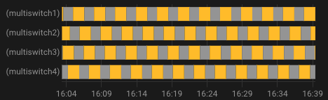

# `over_switch` Type Thermostat

- [`over_switch` Type Thermostat](#over_switch-type-thermostat)
  - [Prerequisites](#prerequisites)
  - [Configuration](#configuration)
    - [The underlying devices](#the-underlying-devices)
    - [Keep-Alive](#keep-alive)
    - [AC Mode](#ac-mode)
    - [Command Inversion](#command-inversion)
    - [Command Customization](#command-customization)
  - [Next Step](#next-step)

## Prerequisites

The electric heating devices that can be controlled by an `over_switch` _VTherm_ are listed in the [device catalog](https://www.versatile-thermostat.org/en/devices/?type=electric).

The installation should look like this:

1. The user or automation, or the Scheduler, sets a setpoint via a preset or directly using a temperature.
2. Periodically, the internal thermometer (2) or external thermometer (2b) sends the measured temperature. The internal thermometer should be placed in a relevant spot for the user's comfort: ideally in the middle of the living space. Avoid placing it too close to a window or too near the radiator.
3. Based on the setpoint values, the different temperatures, and the TPI algorithm parameters (see [TPI](algorithms.md#the-tpi-algorithm) or the [other algorithms](algorithms.md#other-algorithms-plugins)), VTherm will calculate a percentage of the on-time.
4. It will then regularly command the turning on and off of the underlying `switch` (or `select` or `climate`) entities.
5. These underlying entities will control the physical device.
6. The physical switch will turn the radiator on or off.

> The on-time percentage is recalculated each cycle, which is what allows regulating the room temperature.

## Configuration

First, configure the main settings common to all _VTherms_ (see [main settings](base-attributes.md)).
Then configure the underlyings. When the _VTherm_ is created, the wizard shows them after the main attributes. Afterwards, select "Underlyings" in the menu. This menu lists:
- "Common settings": the settings shared by all the devices (algorithm, keep-alive, AC mode, command inversion),
- one entry for each controlled device, with its entity and its commands,
- "Add a device".

### The underlying devices

"Add a device" first asks for the entity to control. Only entities of type `switch`, `input_boolean`, `select`, `input_select`, or `climate` are accepted. The next screen shows the settings of this device: its [custom commands](#command-customization).

Opening a device in the list shows the same settings, with two more fields: "Replace entity", to control another entity instead, and "Remove this device".

The "Algorithm" field of the common settings selects the regulation algorithm: the built-in TPI, or an algorithm installed as a plugin. See [algorithms](algorithms.md).
If multiple entities are configured, the thermostat staggers the activations to minimize the number of switches on at any given time. This allows for better power distribution, as each radiator will turn on in turn.

VTherm will smooth the consumed power as much as possible by alternating activations. Example of staggered activations:

Of course, if the requested power (`on_percent`) is too high, there will be an overlap of activations.

### Keep-Alive

Some equipment requires periodic activation to prevent a safety shutdown. Known as "keep-alive," this function can be activated by entering a non-zero number of seconds in the thermostat's keep-alive interval field. To disable the function or if in doubt, leave it empty or enter zero (default value).

### AC Mode

It is possible to choose a `thermostat_over_switch` to control an air conditioner by checking the "AC Mode" box. In this case, only the cooling mode will be visible.

### Command Inversion

If your equipment is controlled by a pilot wire with a diode, you may need to check the "Invert the Command" box. This will set the switch to `On` when you need to turn off the equipment and to `Off` when you need to turn it on. The cycle times will be inverted with this option.

### Command Customization

The on and off commands sent to a device are set in the settings of this device:
- for a `switch` or an `input_boolean`, they are optional and grouped in the collapsed "Custom commands" section. Without them, the standard `turn_on` and `turn_off` commands are used,
- for a `select`, an `input_select` or a `climate`, the "Turn on command" and "Turn off command" fields are required.

Specify the commands using the format `command[/attribute[:value]]`.
The available commands depend on the type of underlying device:

| Underlying Device Type      | Possible On Commands                  | Possible Off Commands                          | Applies To                        |
| --------------------------- | ------------------------------------- | ---------------------------------------------- | --------------------------------- |
| `switch` or `input_boolean` | `turn_on`                             | `turn_off`                                     | All switches                      |
| `select` or `input_select`  | `select_option/option:comfort`        | `select_option/option:frost_protection`        | Nodon SIN-4-FP-21 and similar (*) |
| `climate` (hvac_mode)       | `set_hvac_mode/hvac_mode:heat`        | `set_hvac_mode/hvac_mode:off`                  | eCosy (via Tuya Local)            |
| `climate` (preset)          | `set_preset_mode/preset_mode:comfort` | `set_preset_mode/preset_mode:frost_protection` | Heaters with presets (*)          |

(*) To use this case, it is important to ensure that the state of the underlying entity matches the preset. Otherwise, VTherm has no way of knowing whether your equipment is on or off. To verify this, go to Developer Tools / States, search for your underlying entity, and check if its state matches the name of a preset. If you see 'heat', 'off', or 'cool', these are not presets, and this configuration will not work. In this case, you must use a virtual switch. Examples of virtual switches can be found on the troubleshooting page. If you insist on using this configuration, carefully check the values accepted by your equipment in Developer Tools / States and search for your equipment. You will see the options it accepts. They must be identical, including case sensitivity. The Heatzy does not meet this condition: use a virtual switch, as described on its [page in the device catalog](https://www.versatile-thermostat.org/en/devices/heatzy/).

Of course, these examples can be adapted to your specific case.

Example for a Nodon SIN-4-FP-21 (`select` entity): the turn on command is `select_option/option:comfort` and the turn off command is `select_option/option:frost_protection`.

The following rules apply:
1. Each command must follow the format `command[/attribute[:value]]` (e.g., `select_option/option:comfort` or `turn_on`) without spaces or special characters except `_`. Otherwise, the settings of the device show the error "The command customization configuration is incorrect".
2. The commands are set for all the devices or for none. It is possible to mix different types of underlying devices, but as soon as one device is not a `switch`, or one device has custom commands, every device needs its commands, including the `switch` entities. A device without its commands is marked with ⚠ in the list of the underlyings, and "Configuration not complete" leads to it.

## Next Step

[The TPI coefficients](algorithms.md#configuring-the-tpi-algorithm-coefficients): tune the regulation algorithm ("TPI parameters" menu). Without a central configuration, this step is required to finalize the creation.

If you use an algorithm provided by a plugin, such as SmartPI, follow its documentation, then go directly to the [presets](feature-presets.md).
