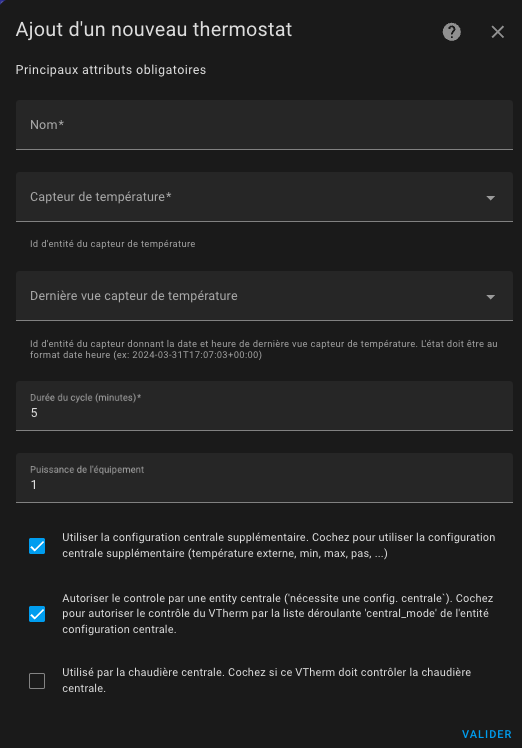
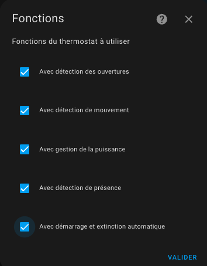

- [Choix des attributs de base](#choix-des-attributs-de-base)
  - [Choix des fonctions utilisées](#choix-des-fonctions-utilisées)
  - [Étape suivante](#étape-suivante)

# Choix des attributs de base

Choisisez le menu "Principaux attributs".

| Attribut | Description | Nom d'attribut |
| --------- | ----------- | -------------- |
| **Nom** | Nom de l'entité (cela sera le nom de l'intégration et de l'entité `climate`). | |
| **Capteur de température** | Identifiant du capteur donnant la température de la pièce où l'appareil est installé. N'importe quel capteur de température disponible dans Home Assistant peut être utilisé ; quelques-uns sont listés dans le [catalogue des matériels](https://www.versatile-thermostat.org/fr/devices/?type=sensor). | |
| **Capteur dernière mise à jour (optionnel)** | Évite les mises en sécurité quand la température est stable et que le capteur ne remonte plus. (cf. [troubleshooting](troubleshooting.md#pourquoi-mon-versatile-thermostat-se-met-en-securite-)) | |
| **Durée de cycle** | Durée en minutes entre chaque calcul. Pour `over_switch` : modulation du temps allumé. Pour `over_valve` : calcul ouverture vanne. Pour `over_climate` : contrôles et recalcul coefficients auto-régulation. Avec les types `over_switch` et `over_valve`, les calculs sont effectués à chaque cycle. Donc en cas de changement de conditions, il faudra attendre le prochain cycle pour voir un changement. Pour cette raison, le cycle ne doit pas être trop long. 5 min est une bonne valeur mais doit être adapté à votre type de chauffage. Plus l'inertie est grande et plus le cycle doit être long. Cf. [Exemples de réglages](tuning-examples.md). Si le cycle est trop court, l'appareil ne pourra jamais atteindre la température cible. Pour le radiateur à accumulation par exemple il sera sollicité inutilement. | `cycle_min` |
| **Puissance de l'équipement** | Active capteurs puissance/énergie. Indiquer total si plusieurs équipements (même unité que autres VTherm et capteurs). (cf. fonction de délestage) | `device_power` |
| **Unité de puissance** | Unité de la puissance de l'équipement : W ou kW. | `power_unit` |
| **Paramètres complémentaires centralisés** | Utilise température extérieure, min/max/pas de température de la configuration centrale. Si la case est décochée, une page supplémentaire demande le capteur de température extérieure et les températures minimale, maximale et le pas (par défaut `7`, `35` et `0.1` °C). | |
| **Contrôle centralisé** | Permet contrôle centralisé du thermostat. Nécessite la configuration centrale. Cf. [contrôle centralisé](feature-central-mode.md) | `is_controlled_by_central_mode` |
| **Déclencheur de chaudière centrale** | Case à cocher pour utiliser ce VTherm comme déclencheur de chaudière centrale. | `is_used_by_central_boiler` |

## Choix des fonctions utilisées

Choisissez le menu "Fonctions".

| Fonction | Description | Nom d'attribut |
| --------- | ----------- | -------------- |
| **Avec détection d'ouvertures** | Stoppe le chauffage à l'ouverture de portes/fenêtres. (cf. [gestion des ouvertures](feature-window.md)) | `is_window_configured` |
| **Avec détection de mouvement** | Adapte la consigne de température à la détection de mouvement dans la pièce. (cf. [détection du mouvement](feature-motion.md)) | `is_motion_configured` |
| **Avec gestion de la puissance** | Stoppe l'équipement si la puissance consommée dépasse un seuil. (cf. [gestion du délestage](feature-power.md)) | `is_power_configured` |
| **Avec détection de présence** | Change la température de consigne selon présence/absence. Diffère de la détection de mouvement (habitation vs pièce). (cf. [gestion de la présence](feature-presence.md)) | `is_presence_configured` |
| **Avec arrêt/démarrage automatique** | Pour `over_climate` uniquement, sans contrôle direct de la vanne : arrête/rallume l'équipement selon prévision via courbe de température. (cf. [gestion de l'arrêt/démarrage automatique](feature-auto-start-stop.md)) | `is_auto_start_stop_configured` |
| **Avec détection de panne de chauffage** | Pour `over_switch`, `over_valve` et `over_climate` avec contrôle direct de la vanne : détecte que la température ne suit pas la commande de chauffe. (cf. [détection d'anomalie de chauffe](feature-heating-failure-detection.md)) | `is_heating_failure_detection_configured` |

>  _*Notes*_
> 1. La liste des fonctions disponibles s'adapte à votre type de VTherm.
> 2. Lorsque vous cochez une fonction, une nouvelle entrée menu s'ajoute pour configurer la fonction.
> 3. Vous ne pourrez pas valider la création d'un VTherm si tous les paramètres de toutes les fonctions n'ont pas été saisis.

## Étape suivante

Configurez les équipements pilotés (menu « Sous-jacents ») sur la page du type choisi :

- [Thermostat de type `over_switch`](over-switch.md) : radiateurs électriques commandés par un interrupteur ou un fil pilote,
- [Thermostat de type `over_climate`](over-climate.md) : pompes à chaleur, climatisations et vannes thermostatiques exposées par une entité `climate`,
- [Thermostat de type `over_valve`](over-valve.md) : vannes pilotables par une entité `number`.
