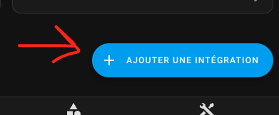
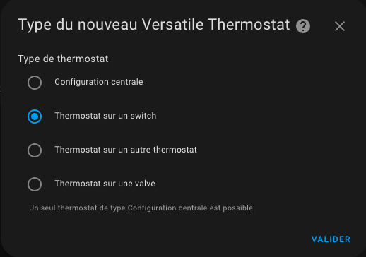

# Choix du VTherm

- [Choix du VTherm](#choix-du-vtherm)
  - [Création d'un nouveau Versatile Thermostat](#création-dun-nouveau-versatile-thermostat)
  - [Choix d'un type de VTherm](#choix-dun-type-de-vtherm)
    - [Configuration centralisée](#configuration-centralisée)
    - [VTherm sur un switch](#vtherm-sur-un-switch)
    - [VTherm sur un autre thermostat](#vtherm-sur-un-autre-thermostat)
    - [VTherm sur une vanne](#vtherm-sur-une-vanne)
  - [Le bon choix](#le-bon-choix)
  - [Article en référence](#article-en-référence)
  - [Étape suivante](#étape-suivante)

>  _*Notes*_
>
> Trois façons de travailler avec les _VTherm_ sont disponibles :
> 1. Chaque Versatile Thermostat est entièrement configurée de manière indépendante. Choisissez cette option si vous ne souhaitez avoir aucune configuration ou gestion centrale.
> 2. Certains aspects peuvent être configurés de manière centralisée. Cela permet par ex. définir la température min/max, les paramètres de détection de fenêtre ouverte,… au niveau d'une instance centrale et unique. Pour chaque VTherm que vous configurez, vous pouvez alors choisir d'utiliser la configuration centrale ou de la remplacer par des paramètres personnalisés.
> 3. En plus de cette configuration centralisée, tous les VTherm peuvent être contrôlées par une seule entité de type `select`. Cette fonction est nommé `central_mode`. Cela permet de stopper / démarrer / mettre en hors gel / etc tous les _VTherm_ en une seule fois. Pour chaque VTherm, l'utilisateur indique si il est concerné par ce `central_mode`.

## Création d'un nouveau Versatile Thermostat

Cliquez sur le bouton Ajouter une intégration dans la page d'intégration (ou cliquez directement sur 'Ajouter un appareil' depuis la page de configuration de l'intégration)

Puis recherchez l'integration "Versatile Thermostat" :

et choisissez votre type de thermostat :

La configuration peut être modifiée via la même interface. Sélectionnez simplement le thermostat à modifier, appuyez sur "Configurer" et vous pourrez modifier certains paramètres ou la configuration.

Suivez ensuite les étapes de configuration en sélectionnant dans le menu l'option à configurer.

>  _*Configuration centrale*_
> La plupart des pages de configuration (principaux attributs, paramètres TPI, pré-réglages, paramètres avancés...) ont une case « Utiliser la configuration centrale » : cochée, elle reprend ces réglages du _VTherm_ de type « Configuration centrale ». Si une configuration centrale existe, ces cases sont cochées par défaut. Sinon, elles sont décochées, les réglages se saisissent sur chaque _VTherm_, et cocher l'une d'elles provoque une erreur à l'enregistrement de la page. Pour partager des réglages entre plusieurs _VTherm_, créez d'abord la configuration centrale : elle est unique, et proposée dans la liste des types tant qu'elle n'existe pas.

## Choix d'un type de VTherm

### Configuration centralisée
Ce choix permet de configurer une fois pour tous les _VTherm_ certains aspects qui peuvent être répétitifs comme :
1. les paramètres des différents algorithmes (TPI, détection d'ouvertures, détection de mouvements, capteurs de puissance de votre habitation, la détection de présence). Tous ces paramètres sont transverses à tous les _VTherm_. Vous pouvez donc ne les saisir qu'une seule fois dans la `Configuration centralisée`. Cette configuration ne crée pas de VTherm à proprement parler. Elle permet juste de mettre en commun des paramètres qu'il serait fastidieux de resaisir pour chaque VTherm. Noter que vous pouvez surcharger les paramètres sur les _VTherm_ pour les spécialiser au besoin,
2. la configuration de la commande d'un chauffage central,
3. certains paramètres avancés comme la mise en sécurité

### VTherm sur un switch
Ce VTherm permet de contrôler un interrupteur qui allume ou éteint un radiateur. Cet interrupteur peut être un interrupteur physique qui allume ou éteint directement un radiateur (souvent électrique) ou un interrupteur virtuel qui pourra effectuer les actions que vous voulez sur demande d'allumage ou extinction. Ce dernier type permet par exemple de commander des switchs avec fil pilote ou des DIY avec diode pour fil pilote. VTherm va moduler la proportion de temps allumé vs éteint pour obtenir la température souhaitée. Si il fait froid, il allume plus souvent (jusqu'à 100%), si il fait chaud il baisse le pourcentage d'allumage. Ce pourcentage d'allumage est nommé `on_percent`.

Les entités sous-jacentes sont donc des `switchs` ou des `input_boolean`.

### VTherm sur un autre thermostat
Lorsque votre équipement est contrôlé par une entité de type `climate` dans Home Assistant et que vous n'avez que ça à disposition, vous devez utiliser ce type de VTherm. Dans ce cas, le VTherm va simplement commander la température de consigne du `climate` sous-jacent.
Ce type est aussi équipé de fonctions d'auto-régulation avancées permettant de moduler la consigne donnée aux sous-jacents pour atteindre plus vite la consigne et de s'affranchir de la régulation interne de ces équipements qui est parfois mauvaise. C'est le cas, si le thermomètre interne de l'équipement est trop proche du corps de chauffe. L'équipement peut croire qu'il fait chaud alors qu'au bout de la pièce, la consigne n'est pas du tout atteinte.

Depuis la version 6.8, ce type de VTherm permet aussi de réguler avec une action directe sur la vanne. Idéal pour les _TRV_ pour lesquels la vanne est commandable, comme les Sonoff TRVZB, ce type est recommandé si vous êtes équipés.

Les entités sous-jacentes de ce type de VTherm sont donc des `climate` exclusivement.

### VTherm sur une vanne
Lorsque tout ce que vous avez à disposition pour réguler la température de votre radiateur est une entité de type `number` vous devez utiliser le type `over_valve`. VTherm ouvre ou ferme la vanne en fonction de l'écart entre la consigne et la température réelle de la pièce (et de la température extérieure).

Ce type peut être utilisé pour les _TRV_ qui n'ont pas de `climate` associé ou tout autre solution type DIY qui expose une entité `number`.

## Le bon choix

Le type ne peut plus être modifié après la création du _VTherm_ : choisissez-le d'après l'équipement piloté et la façon dont il apparaît dans Home Assistant.

| Équipement | Entité dans Home Assistant | Type de _VTherm_ | Régulation |
|---|---|---|---|
| Radiateur électrique commandé par un interrupteur | `switch`, `input_boolean` | [`over_switch`](over-switch.md) | par _VTherm_ : TPI ou algorithme en plugin (SmartPI...) |
| Radiateur électrique avec fil pilote | `select`, `input_select` ou `climate`, avec des [commandes personnalisées](over-switch.md#la-personnalisation-des-commandes) | [`over_switch`](over-switch.md) | par _VTherm_ : TPI ou algorithme en plugin |
| Poêle à granulés | `switch` | [`over_switch`](over-switch.md) avec le plugin [VTherm Pellet stove](https://www.versatile-thermostat.org/fr/plugins/#jmcollin78/vtherm_pellet_stove) | par le plugin |
| Pompe à chaleur, climatisation, système HVAC | `climate` | [`over_climate`](over-climate.md) | par l'équipement, corrigée si besoin par l'[auto-régulation](self-regulation.md) |
| Vanne thermostatique (TRV) dont l'ouverture est pilotable | `climate` et `number` d'ouverture | [`over_climate`](over-climate.md) avec [contrôle direct de la vanne](self-regulation.md#auto-régulation-par-contrôle-direct-de-la-vanne) | par _VTherm_ : TPI ou algorithme en plugin |
| Vanne thermostatique simple | `climate` | [`over_climate`](over-climate.md) | par la vanne, corrigée si besoin par l'[auto-régulation](self-regulation.md) |
| Vanne seule, sans entité `climate` | `number`, `input_number` | [`over_valve`](over-valve.md) | par _VTherm_ : TPI ou algorithme en plugin |

Le [catalogue des matériels](https://www.versatile-thermostat.org/fr/devices/) indique le type recommandé pour chaque matériel testé.

Quand plusieurs types conviennent, choisissez selon la régulation souhaitée. Si l'équipement régule bien lui-même (climatisation, certaines vannes), `over_climate` conserve sa régulation. Si _VTherm_ doit réguler à partir de votre thermomètre, placé là où vous vivez, préférez `over_switch`, `over_valve` ou `over_climate` avec contrôle direct de la vanne.

## Article en référence
Un article permettant d'aller plus loin sur les concepts est visible ici (en Français) : https://www.hacf.fr/optimisation-versatile-thermostat/#optimiser-vos-vtherm

## Étape suivante

[Choix des attributs de base](base-attributes.md) : donner un nom au _VTherm_, choisir ses capteurs de température et les fonctions à activer (menus « Principaux Attributs » et « Fonctions »).
