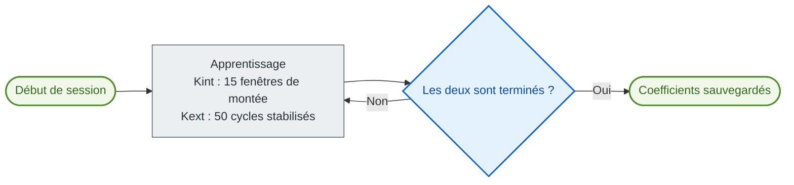

# 🧠 Auto TPI : Apprentissage automatique

> [!NOTE]
> Cette fonctionnalité est principalement conçue pour les systèmes de chauffage de type **Switch** (Tout ou rien), comme les radiateurs électriques, les chaudières, le chauffage par le sol ou les poêles à granulés. L'adaptation aux vannes thermostatiques (TRV) reste problématique en raison de leur non-linéarité : la chaleur délivrée n'est pas proportionnelle à l'ouverture de la vanne.

**Auto TPI** permet à votre thermostat d'apprendre seul le comportement thermique de votre pièce. Il ajuste automatiquement les coefficients $K_{int}$ (intérieur) et $K_{ext}$ (extérieur) pour atteindre et maintenir votre consigne.

> [!TIP]
> **Pour les utilisateurs avancés** : une documentation technique détaillée expliquant les algorithmes, les formules et les mécanismes internes est disponible ici : [Documentation technique Auto TPI](feature-autotpi-technical.md).

---

## 🔄 Cycle de session

Auto TPI fonctionne par **sessions d'apprentissage**. Pendant une session, le système observe votre pièce et ajuste les deux coefficients par petits pas, chacun dans la situation où il peut être mesuré de façon fiable.

1.  **Début** : la session part des coefficients de votre configuration.
2.  **Apprentissage** : Kint et Kext sont ajustés indépendamment (voir ci-dessous).
3.  **Sauvegarde** : une fois Kint ajusté sur **15 fenêtres de montée** et Kext sur **50 cycles**, la session se termine : les coefficients sont enregistrés dans votre configuration et une notification est envoyée.

### Quand Kint et Kext sont-ils ajustés ?

| Coefficient | Situation d'apprentissage | Explication |
| :--- | :--- | :--- |
| **Kint** (intérieur) | Pendant une **montée en température**, lorsque la pièce est à au moins **0,3°C** en dessous de la consigne et que le chauffage n'est ni arrêté ni à 100 %. La montée est observée sur des fenêtres d'au moins 30 minutes. | Kint règle la vigueur de la réaction du chauffage à un écart. Il est ajusté pour que la pièce comble l'écart à une vitesse cible, dérivée du **temps de chauffe** de votre émetteur. |
| **Kext** (extérieur) | Lorsque la pièce est **stabilisée autour de la consigne** : un certain temps après le dernier changement de consigne, une fois la pièce revenue à moins de 0,3°C de la consigne. | Kext compense les **pertes thermiques** vers l'extérieur. Il est ajusté pour que l'écart restant disparaisse. |

> [!TIP]
> Kint ne peut être appris que lorsque la pièce doit rattraper la consigne. Les changements de consigne programmés (réduit de nuit, presets) suffisent à fournir ces situations.

> [!NOTE]
> **Cycles saturés** : les cycles à **0%** ou **100%** de puissance sont **ignorés**, car ils ne disent rien sur la manière dont la puissance doit être ajustée.

---

## 🚀 Démarrer l'apprentissage

Une fois la fonctionnalité **Auto TPI** activée et configurée pour votre thermostat, l'apprentissage ne démarre pas automatiquement. Vous devez le lancer manuellement :

1.  **Via la carte dédiée (recommandé)** : utilisez le bouton "Play" de la [carte Auto TPI Learning](https://github.com/KipK/auto-tpi-learning-card).
2.  **Via le service "Définir le mode Auto TPI"** : appelez ce service (`set_auto_tpi_mode`) depuis les outils de développement. Ce service démarre ou arrête une session Auto TPI. Avec `reinitialise: true`, la session repart des coefficients configurés ; sinon elle reprend la session précédente.

---

## ⚙️ Configuration

Lors de l'activation de l'Auto TPI, les paramètres suivants sont disponibles :

| Paramètre | Description |
| :--- | :--- |
| **Temps de chauffe** | Temps nécessaire à votre chauffage pour atteindre sa pleine puissance après sa mise en marche. Il fixe la vitesse de réponse visée de la régulation : plus l'émetteur est lent, plus Kint est réglé en douceur. |
| **Apprentissage continu du Kext** | Continue d'ajuster Kext après la fin de la session (voir ci-dessous). |

Valeurs de référence pour le temps de chauffe :

| Type de chauffage | Temps de chauffe |
| :--- | :--- |
| Radiateur électrique | 5 min |
| Radiateur à eau | 15 min |
| Chauffage par le sol | 30 min |

---

## 💡 Bonnes pratiques

### Éviter les perturbations externes
Pendant une session d'apprentissage, essayez d'éviter :
-   Le soleil direct sur le capteur de température.
-   L'utilisation d'une source de chaleur secondaire (cheminée, poêle).
-   Les fenêtres ou portes longtemps ouvertes.

Ces facteurs font varier la température de la pièce sans lien avec le chauffage, et le système les prendrait pour une propriété de la pièce.

### Éviter les conditions extrêmes

> [!CAUTION]
> **Ne lancez pas d'apprentissage si vos chauffages sont saturés** (100 % de puissance en permanence). Cela se produit typiquement lors de vagues de froid exceptionnelles, où le chauffage n'arrive plus à atteindre la consigne. Les cycles saturés sont ignorés, donc la session ne progresserait pas. Attendez des conditions météo plus clémentes pour lancer une session d'apprentissage.

### Déroulement idéal d'une session

1.  **Lancement** : démarrez la session d'apprentissage et gardez vos horaires habituels. Chaque montée après une consigne plus basse (nuit, absence) fournit des fenêtres d'apprentissage de Kint ; chaque période stabilisée fournit des cycles de Kext.
2.  **Accélérer si besoin** : si votre consigne change rarement, baissez-la de 1 à 2°C pendant quelques heures, puis remontez-la : la montée fournit des fenêtres d'apprentissage de Kint.
3.  **Fin** : la session s'arrête d'elle-même dès que les deux coefficients ont suffisamment d'observations.

> [!NOTE]
> **À propos du dépassement de consigne (overshoot)** : un léger dépassement après une montée est normal avec un émetteur lent. Si les dépassements **persistent** après la fin de la session, vérifiez le **temps de chauffe** de votre configuration : une valeur trop courte pour l'émetteur rend la régulation trop rapide.

---

## 🔄 Apprentissage continu du Kext

La fonctionnalité **Apprentissage continu du Kext** permet au thermostat de suivre les lentes évolutions des pertes thermiques (saison, vent, usage du bâtiment) après la session d'apprentissage, sans en lancer une nouvelle.

### Fonctionnement
Une fois activé, le système continue de vérifier l'écart restant lorsque la pièce est stabilisée autour de la consigne. Si l'écart reste du même côté (par exemple, la pièce est toujours 0,2°C sous la consigne par temps froid), il corrige Kext par petits pas, avec un facteur de lissage fixe (moyenne mobile exponentielle, alpha 0,04).

### Points clés
- **Adaptation passive** : fonctionne en arrière-plan tant que le thermostat est actif.
- **Sécurité** : actif uniquement lorsque la puissance n'est pas saturée et que la pièce est stabilisée autour de la consigne.
- **Nécessite une première session** : l'apprentissage continu ne démarre qu'après au moins un cycle d'apprentissage de Kext effectué dans une session standard.

---

## 📊 Suivi visuel

Pour suivre l'évolution de l'apprentissage en temps réel, il est fortement recommandé d'installer la carte personnalisée **Auto TPI Learning Card**.

### Installation via HACS

Ou ajoutez manuellement le dépôt personnalisé : [https://github.com/KipK/auto-tpi-learning-card](https://github.com/KipK/auto-tpi-learning-card)

### Fonctionnalités de la carte

-   📈 Progression de l'apprentissage en temps réel
-   🔢 Coefficients `Kint`, `Kext` en cours de calcul
-   ▶️ Bouton de contrôle pour démarrer/arrêter la session
-   🔧 Option pour réinitialiser la session
