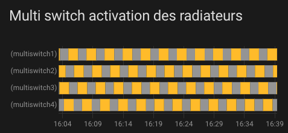

# Thermostat de type ```over_switch```

- [Thermostat de type ```over_switch```](#thermostat-de-type-over_switch)
  - [Pré-requis](#pré-requis)
  - [Configuration](#configuration)
    - [les sous-jacents](#les-sous-jacents)
    - [Le keep-alive](#le-keep-alive)
    - [Le mode AC](#le-mode-ac)
    - [L'inversion de la commande](#linversion-de-la-commande)
    - [La personnalisation des commandes](#la-personnalisation-des-commandes)
  - [Étape suivante](#étape-suivante)

## Pré-requis

Les équipements de chauffage électrique pilotables par un _VTherm_ `over_switch` sont listés dans le [catalogue des matériels](https://www.versatile-thermostat.org/fr/devices/?type=electric).

L'installation doit ressembler à ça :


1. L'utilisateur ou une automatisation ou le Scheduler programme une consigne (setpoint) par le biais d'un pré-réglage ou directement d'une température,
2. régulièrement le thermomètre intérieur (2) ou extérieur (2b) envoie la température mesurée. Le thermomètre interieur doit être placé à une place pertinente pour le ressenti de l'utilisateur : idéalement au milieu du lieu de vie. Evitez de le mettre trop près d'une fenêtre ou trop proche du radiateur,
3. avec les valeurs de consigne, les différentes températures et des paramètres de l'algorithme TPI (cf. [TPI](algorithms.md#lalgorithme-tpi) ou les [autres algorithmes](algorithms.md#autres-algorithmes-plugins)), VTherm va calculer un pourcentage de temps d'allumage,
4. et va régulièrement commander l'allumage et l'extinction du ou des entités `switch` (ou `select` ou `climate`) sous-jacentes,
5. ces entités sous-jacentes vont alors commander l'équipement physique
6. la commande du switch physique allumera ou éteindra le radiateur.

> Le pourcentage d'allumage est recalculé à chaque cycle et c'est ce qui permet de réguler la température de la pièce.

## Configuration

Configurez d'abord les paramètres principaux et communs à tous les _VTherm_ (cf. [paramètres principaux](base-attributes.md)).
Configurez ensuite les sous-jacents. À la création du _VTherm_, l'assistant les affiche après les principaux attributs. Ensuite, choisissez « Sous-jacents » dans le menu. Ce menu liste :
- « Réglages communs » : les réglages partagés par tous les appareils (algorithme, keep-alive, mode AC, inversion de la commande),
- une entrée par appareil piloté, avec son entité et ses commandes,
- « Ajouter un appareil ».

### les sous-jacents
« Ajouter un appareil » demande d'abord l'entité à piloter. Seules les entités de type `switch`, `input_boolean`, `select`, `input_select` ou `climate` sont acceptées. L'écran suivant affiche les réglages de cet appareil : ses [commandes personnalisées](#la-personnalisation-des-commandes).

Ouvrir un appareil dans la liste affiche les mêmes réglages, avec deux champs en plus : « Remplacer l'entité », pour piloter une autre entité à sa place, et « Supprimer cet appareil ».

Le champ « Algorithme » des réglages communs permet de choisir l'algorithme de régulation : le TPI intégré, ou un algorithme installé sous forme de plugin. Voir [les algorithmes](algorithms.md).
Si plusieurs entités de type sont configurées, la thermostat décale les activations afin de minimiser le nombre de switch actif à un instant t. Ca permet une meilleure répartition de la puissance puisque chaque radiateur va s'allumer à son tour.

VTherm va donc lisser la puissance consommée le plus possible en alternant les activations. Exemple d'activations décalées :



Evidemment si la puissance demandée (`on_percent`) est trop forte, alors il y aura un recouvrement des activations.

### Le keep-alive

Certains équipements nécessitent d'être périodiquement sollicités pour empêcher un arrêt de sécurité. Connu sous le nom de "keep-alive" cette fonction est activable en entrant un nombre de secondes non nul dans le champ d'intervalle keep-alive du thermostat. Pour désactiver la fonction ou en cas de doute, laissez-le vide ou entrez zéro (valeur par défaut).

### Le mode AC

Il est possible de choisir un thermostat over switch qui commande une climatisation en cochant la case "AC Mode". Dans ce cas, seul le mode refroidissement sera visible.

### L'inversion de la commande

Si votre équipement est commandé par un fil pilote avec une diode, vous aurez certainement besoin de cocher la case "Inverser la case". Elle permet de mettre le switch à `On` lorsqu'on doit éteindre l'équipement et à `Off` lorsqu'on doit l'allumer. Les temps de cycle sont donc inversés avec cette option.

### La personnalisation des commandes

Les commandes d'allumage et d'extinction envoyées à un appareil se règlent dans les réglages de cet appareil :
- pour un `switch` ou un `input_boolean`, elles sont facultatives et regroupées dans la section repliée « Commandes personnalisées ». Sans elles, les commandes classiques `turn_on` et `turn_off` sont utilisées,
- pour un `select`, un `input_select` ou un `climate`, les champs « Commande d'allumage » et « Commande d'extinction » sont obligatoires.

Donnez les commandes avec le format `commande[/attribut[:valeur]]`.
Les commandes possibles dépendent du type de sous-jacents :

| type de sous-jacent         | commandes d'allumage possibles        | commandes d'extinction possibles               | S'applique à                       |
| --------------------------- | ------------------------------------- | ---------------------------------------------- | ---------------------------------- |
| `switch` ou `input_boolean` | `turn_on`                             | `turn_off`                                     | tous les switchs                   |
| `select` ou `input_select`  | `select_option/option:comfort`        | `select_option/option:frost_protection`        | Nodon SIN-4-FP-21 et assimilés (*) |
| `climate` (hvac_mode)       | `set_hvac_mode/hvac_mode:heat`        | `set_hvac_mode/hvac_mode:off`                  | eCosy (via Tuya Local)             |
| `climate` (preset)          | `set_preset_mode/preset_mode:comfort` | `set_preset_mode/preset_mode:frost_protection` | Radiateurs à presets (*)           |

(*) Pour pouvoir utiliser ce cas, il est important de vérifier que l'état de sous-jacent est égal au preset Sinon _VTherm_ n'a aucun moyen de savoir si votre équipement est en allumé ou éteint. Pour être sur de cela, il faut aller dans Outils de dev / Etats, rechercher votre sous-jacent et regarder si son état est bien le nom d'un preset. Si vous voyez 'heat' ou 'off' ou 'cool' ce ne sont pas des presets et donc cette configuration ne fonctionnera pas. Vous devez alors utiliser un switch virtuel. Il y a des exemples de switch virtuels dans la page [dépannage](./troubleshooting.md#utilisation-dun-heatzy). Si vous perséverez avec cette configuration, vérifiez bien les valeurs acceptées par votre équipement dans Outils de developpement / Etat et recherchez votre équipement. Vous verrez les options qu'il accepte. Il faut qu'elles soient identiques y compris la casse. Le Heatzy ne remplit pas cette condition : utilisez un interrupteur virtuel, comme décrit sur sa [page du catalogue des matériels](https://www.versatile-thermostat.org/fr/devices/heatzy/).

Evidemment, tous ces exemples peuvent être adaptés à votre cas.

Exemple pour un Nodon SIN-4-FP-21 (entité `select`) : la commande d'allumage est `select_option/option:comfort` et la commande d'extinction est `select_option/option:frost_protection`.

Les règles à respecter sont les suivantes :
1. chaque commande doit avoir le format `commande[/attribut[:valeur]]` (ex: `select_option/option:comfort` ou `turn_on`) sans blanc et sans caractères spéciaux sauf '_'. Sinon, les réglages de l'appareil affichent l'erreur « La configuration de la personnalisation des commandes est incorrecte »,
2. les commandes se donnent pour tous les appareils ou pour aucun. Il est possible de mélanger des sous-jacents de types différents, mais dès qu'un appareil n'est pas un `switch`, ou qu'un appareil a des commandes personnalisées, chaque appareil doit avoir ses commandes, y compris les `switchs`. Un appareil sans ses commandes est marqué ⚠ dans la liste des sous-jacents, et « Configuration incomplète » y mène.

## Étape suivante

[Les coefficients du TPI](algorithms.md#configurez-les-coefficients-de-lalgorithme-tpi) : régler l'algorithme de régulation (menu « Paramètres TPI »). Sans configuration centrale, cette étape est nécessaire pour finaliser la création.

Si vous utilisez un algorithme en plugin, comme SmartPI, suivez sa documentation, puis passez directement aux [presets](feature-presets.md).
