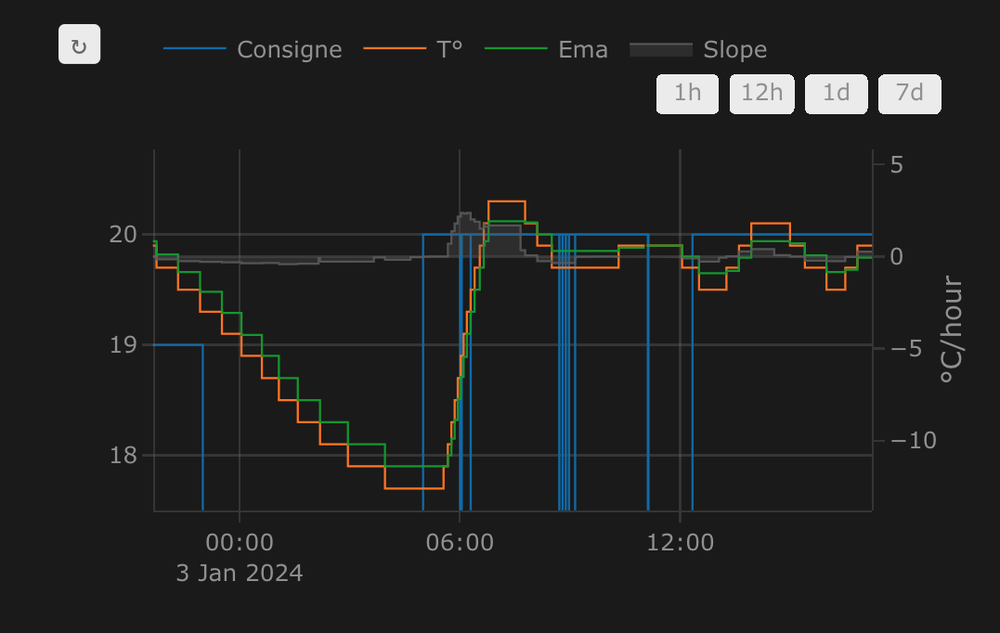

# Parę istotnych dodatków

Dodatki do _VTherm_ znajdziesz w [katalogu wtyczek](https://www.versatile-thermostat.org/en/plugins/).

- [Parę istotnych dodatków](#parę-istotnych-dodatków)
  - [Karta _*Versatile Thermostat UI Card*_](#karta-versatile-thermostat-ui-card)
  - [Holm Climate Card](#holm-climate-card)
  - [Graficzny harmonogram](#graficzny-harmonogram)
  - [Krzywe regulacji na wykresie _*Plotly*_ do precyzyjnego dostrajania termostatu](#krzywe-regulacji-na-wykresie-plotly-do-precyzyjnego-dostrajania-termostatu)
  - [Powiadamianie o zdarzeniach za pomocą _*AppDaemon NOTIFIER*_](#powiadamianie-o-zdarzeniach-za-pomocą-appdaemon-notifier)
  - [Odczuwalna temperatura w pomieszczeniu i efekt „wilgotnego zimna”](#odczuwalna-temperatura-w-pomieszczeniu-i-efekt-wilgotnego-zimna)
  - [Integracja uzupełniająca IHP, przewidująca zmiany ustawień parametrów](#integracja-uzupełniająca-ihp-przewidująca-zmiany-ustawień-parametrów)

## Karta _*Versatile Thermostat UI Card*_
Opracowano dedykowaną kartę dla termostatu _*VTherm*_ (bazującą na *Better Thermostat*). Jest ona dostępna tutaj: [karta Versatile Thermostat UI Card](https://github.com/jmcollin78/versatile-thermostat-ui-card) i oferuje nowoczesny widok wszystkich statusów termostatu _*VTherm*_:


## Holm Climate Card

[Holm Climate Card](https://www.versatile-thermostat.org/en/plugins/#kaaribou/climate-card-holm) to karta pulpitu kompatybilna z _VTherm_.

Integracja [SmartPI](https://www.versatile-thermostat.org/en/plugins/#kipk/vtherm_smartpi) jest również dostępna w katalogu wtyczek.

## Graficzny harmonogram

[Graficzny harmonogram ha-chauffage](https://www.versatile-thermostat.org/en/plugins/#armellarcier/ha-chauffage) umożliwia tworzenie tygodniowych planów dla _VTherm_ za pomocą wizualnej karty Lovelace.


## Krzywe regulacji na wykresie _*Plotly*_ do precyzyjnego dostrajania termostatu
Można uzyskać krzywą podobną do tej pokazanej na rysunku [Trochę wyników...](../../README-pl.MD#some-results) używając konfiguracji wykresu *Plotly*, wykorzystując opisane niestandardowe atrybuty termostatu [tutaj](reference.md#custom-attributes):

Wstaw między nawiasy kwadratowe `[[ ]]` swoje własne wartości.
<details>

```yaml
- type: custom:plotly-graph
  entities:
    - entity: '[[climate]]'
      attribute: temperature
      yaxis: y1
      name: Consigne
    - entity: '[[climate]]'
      attribute: current_temperature
      yaxis: y1
      name: T°
    - entity: '[[climate]]'
      attribute: ema_temp
      yaxis: y1
      name: Ema
    - entity: '[[climate]]'
      attribute: on_percent
      yaxis: y2
      name: Power percent
      fill: tozeroy
      fillcolor: rgba(200, 10, 10, 0.3)
      line:
        color: rgba(200, 10, 10, 0.9)
    - entity: '[[slope]]'
      name: Slope
      fill: tozeroy
      yaxis: y9
      fillcolor: rgba(100, 100, 100, 0.3)
      line:
        color: rgba(100, 100, 100, 0.9)
  hours_to_show: 4
  refresh_interval: 10
  height: 800
  config:
    scrollZoom: true
  layout:
    margin:
      r: 50
    legend:
      x: 0
      'y': 1.2
      groupclick: togglegroup
      title:
        side: top right
    yaxis:
      visible: true
      position: 0
    yaxis2:
      visible: true
      position: 0
      fixedrange: true
      range:
        - 0
        - 1
    yaxis9:
      visible: true
      fixedrange: false
      range:
        - -2
        - 2
      position: 1
    xaxis:
      rangeselector:
        'y': 1.1
        x: 0.7
        buttons:
          - count: 1
            step: hour
          - count: 12
            step: hour
          - count: 1
            step: day
          - count: 7
            step: day
```
</details>

Przykład krzywych uzyskanych z _*Plotly*_:



## Powiadamianie o zdarzeniach za pomocą _*AppDaemon NOTIFIER*_
Ta automatyzacja wykorzystuje doskonałą aplikację *AppDaemon NOTIFIER*, opracowaną przez *Horizon Domotique*, prezentowaną [tutaj](https://www.youtube.com/watch?v=chJylIK0ASo&ab_channel=HorizonDomotique), a której kod dostępny jest [tutaj](https://github.com/jlpouffier/home-assistant-config/blob/master/appdaemon/apps/notifier.py). Umożliwia ona Użytkownikowi otrzymywanie powiadomień o zdarzeniach związanych z bezpieczeństwem dowolnego termostatu *VTherm*.

Oto doskonały przykład użycia funkcji powiadomienia o zdarzeniu opisanym [tutaj](reference.md#events).
<details>

```yaml
alias: Monitorowanie trybu bezpiecznego ogrzewania
description: Wysyłanie powiadomienia, gdy termostat przejdzie w tryb bezpieczny
trigger:
  - platform: event
    event_type: versatile_thermostat_safety_event
    id: versatile_thermostat_safety_event
  - platform: event
    event_type: versatile_thermostat_power_event
    id: versatile_thermostat_power_event
  - platform: event
    event_type: versatile_thermostat_temperature_event
    id: versatile_thermostat_temperature_event
condition: []
action:
  - choose:
      - conditions:
          - condition: trigger
            id: versatile_thermostat_safety_event
        sequence:
          - event: NOTIFIER
            event_data:
              action: send_to_jmc
              title: >-
                Grzejnik {{ trigger.event.data.name }} - {{
                trigger.event.data.type }} Bezpieczeństwo
              message: >-
                Grzejnik {{ trigger.event.data.name }} przeszedł w tryb bezpieczny {{
                trigger.event.data.type }} ponieważ termometr przestał reagować.\n{{ trigger.event.data }}
              callback:
                - title: Wyłączenie ogrzewania
                  event: stopper_chauffage
              image_url: /media/local/alerte-securite.jpg
              click_url: /lovelace-chauffage/4
              icon: mdi:radiator-off
              tag: radiateur_security_alerte
              persistent: true
      - conditions:
          - condition: trigger
            id: versatile_thermostat_power_event
        sequence:
          - event: NOTIFIER
            event_data:
              action: send_to_jmc
              title: >-
                Grzejnik {{ trigger.event.data.name }} - {{
                trigger.event.data.type }} Redukcja obciążenia
              message: >-
                Grzejnik {{ trigger.event.data.name }} przeszedł w tryb redukcji obciążenia {{
                trigger.event.data.type }} z powodu przekroczenia mocy maksymalnej.\n{{ trigger.event.data }}
              callback:
                - title: Wyłączenie ogrzewania
                  event: stopper_chauffage
              image_url: /media/local/alerte-delestage.jpg
              click_url: /lovelace-chauffage/4
              icon: mdi:radiator-off
              tag: radiateur_power_alerte
              persistent: true
      - conditions:
          - condition: trigger
            id: versatile_thermostat_temperature_event
        sequence:
          - event: NOTIFIER
            event_data:
              action: send_to_jmc
              title: >-
                Termometr grzejnika {{ trigger.event.data.name }} nie odpowiada
              message: >-
                Termometr grzejnika {{ trigger.event.data.name }} od dłuższego
                czasu nie odpowiada.\n{{ trigger.event.data }}
              image_url: /media/local/thermometre-alerte.jpg
              click_url: /lovelace-chauffage/4
              icon: mdi:radiator-disabled
              tag: radiateur_thermometre_alerte
              persistent: true
mode: queued
max: 30
```
</details>

## Odczuwalna temperatura w pomieszczeniu i efekt „wilgotnego zimna”
W zależności od warunków pogodowych, takich jak wilgotność powietrza czy wiatr, można wymusić wyższą temperaturę docelową.
Opis tego pomysłu znajduje się [tutaj](https://github.com/jmcollin78/versatile_thermostat/discussions/1211).

## Integracja uzupełniająca IHP, przewidująca zmiany ustawień parametrów
Integracja _Intelligent Heating Pilot (IHP)_ oferuje przewidywanie zmian ustawień harmonogramu w taki sposób, aby temperatura docelowa była osiągana już w momencie zmiany harmonogramu. Uczy się ona zachowania termostatu _*VTherm*_ (prędkość i czas narastania temperatury) i stosuje algorytm predykcyjny, aby przewidzieć zmianę harmonogramu w nadchodzącej przyszłości na podstawie obserwacji z przeszłości.
To interesujące podejście stanowi doskonałe uzupełnienie dla integracji _VTherm Termostat_.

Integracja uzupełniająca IHP dostępna jest [tutaj](https://github.com/RastaChaum/Intelligent-Heating-Pilot).
