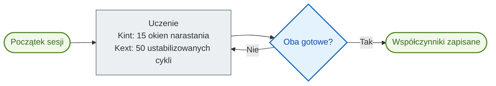

# 🧠 Auto TPI: Automatyczne uczenie

> [!NOTE]
> Ta funkcja jest przeznaczona głównie dla systemów grzewczych typu **Switch** (Włącz/Wyłącz), takich jak grzejniki elektryczne, kotły, ogrzewanie podłogowe lub piece na pellet. Adaptacja dla termostatycznych zaworów grzejnikowych (TRV) pozostaje problematyczna ze względu na ich nieliniowość: dostarczane ciepło nie jest proporcjonalne do otwarcia zaworu.

**Auto TPI** pozwala termostatowi samodzielnie nauczyć się zachowania cieplnego pomieszczenia. Automatycznie dostosowuje współczynniki $K_{int}$ (wewnętrzny) i $K_{ext}$ (zewnętrzny), aby osiągnąć i utrzymać zadaną temperaturę.

> [!TIP]
> **Dla zaawansowanych użytkowników**: Szczegółowa dokumentacja techniczna wyjaśniająca algorytmy, wzory i mechanizmy wewnętrzne jest dostępna tutaj: [Dokumentacja techniczna Auto TPI](feature-autotpi-technical.md).

---

## 🔄 Cykl sesji

Auto TPI działa poprzez **sesje uczenia**. Podczas sesji system obserwuje pomieszczenie i dostosowuje oba współczynniki małymi krokami, za każdym razem w sytuacji, w której można je wiarygodnie zmierzyć.

1.  **Start**: Sesja rozpoczyna się od współczynników z Twojej konfiguracji.
2.  **Uczenie**: Kint i Kext są dostosowywane niezależnie (patrz poniżej).
3.  **Zapis**: Gdy Kint zostanie dostosowany w ciągu **15 okien narastania**, a Kext w ciągu **50 cykli**, sesja się kończy (później, jeśli Kint wciąż zmienia się w tym samym kierunku): współczynniki są zapisywane w konfiguracji i wysyłane jest powiadomienie.

### Kiedy dostosowywane są Kint i Kext?

| Współczynnik | Sytuacja uczenia | Wyjaśnienie |
| :--- | :--- | :--- |
| **Kint** (wewnętrzny) | Podczas **wzrostu temperatury**, gdy pomieszczenie jest co najmniej o **0,3°C** poniżej nastawy, a grzanie nie jest wyłączone ani na 100%. Wzrost jest obserwowany w oknach trwających od 10 do 30 minut (w przypadku wolnych źródeł ciepła dłużej), dobieranych według szybkości wzrostu. | Kint określa, jak mocno ogrzewanie reaguje na odchylenie. Jest dostosowywany tak, aby pomieszczenie zmniejszało odchylenie z docelową prędkością, wyprowadzoną z **czasu nagrzewania** Twojego grzejnika. |
| **Kext** (zewnętrzny) | Gdy pomieszczenie jest **ustabilizowane blisko nastawy**: pewien czas po ostatniej zmianie nastawy, gdy temperatura wróciła w granice 0,3°C od nastawy. | Kext kompensuje straty ciepła na zewnątrz. Jest dostosowywany tak, aby pozostałe odchylenie zniknęło. |

> [!TIP]
> Kint można nauczyć się tylko wtedy, gdy pomieszczenie musi dogonić nastawę. Zaplanowane zmiany nastawy (nocne obniżenie, profile) wystarczają, aby zapewnić takie sytuacje.

> [!NOTE]
> **Cykle nasycone**: Cykle przy mocy **0%** lub **100%** są **ignorowane**, ponieważ nic nie mówią o tym, jak powinna być dostosowana moc.

---

## 🚀 Rozpoczęcie uczenia

Gdy funkcja **Auto TPI** jest włączona i skonfigurowana dla Twojego termostatu, uczenie nie rozpoczyna się automatycznie. Musisz uruchomić je ręcznie:

1.  **Za pomocą dedykowanej karty (zalecane)**: Użyj przycisku "Play" na [karcie Auto TPI Learning](https://github.com/KipK/auto-tpi-learning-card).
2.  **Za pomocą usługi "Set Auto TPI Mode"**: Wywołaj tę usługę (`set_auto_tpi_mode`) z narzędzi deweloperskich. Usługa uruchamia lub zatrzymuje sesję Auto TPI. Z ustawieniem `reinitialise: true` sesja zaczyna się od nowa od skonfigurowanych współczynników; w przeciwnym razie wznawia poprzednią.

---

## ⚙️ Konfiguracja

Przy włączaniu Auto TPI dostępne są następujące parametry:

| Parametr | Opis |
| :--- | :--- |
| **Heating Time** | Czas, w którym Twój grzejnik osiąga pełną moc po włączeniu. Określa docelową szybkość reakcji regulacji: im wolniejsze źródło ciepła, tym łagodniej dostrajany jest Kint. |
| **Continuous Kext Learning** | Dalsze dostosowywanie Kext po zakończeniu sesji (patrz poniżej). |

Wartości referencyjne czasu nagrzewania:

| Typ ogrzewania | Czas nagrzewania |
| :--- | :--- |
| Grzejnik elektryczny | 5 min |
| Grzejnik wodny | 15 min |
| Ogrzewanie podłogowe | 30 min |

---

## 💡 Dobre praktyki

### Unikaj zewnętrznych zakłóceń
Podczas sesji uczenia staraj się unikać:
-   Bezpośredniego światła słonecznego na czujniku temperatury.
-   Użycia dodatkowego źródła ciepła (kominek, piec).
-   Długo otwartych okien lub drzwi.

Te czynniki zmieniają temperaturę pomieszczenia bez związku z ogrzewaniem, a system uznałby je za właściwość pomieszczenia.

### Unikaj ekstremalnych warunków

> [!CAUTION]
> **Nie rozpoczynaj uczenia, jeśli Twoje grzejniki są nasycone** (stale 100% mocy). Zwykle dzieje się tak podczas wyjątkowych mrozów, gdy ogrzewanie nie jest już w stanie osiągnąć nastawy. Cykle nasycone są ignorowane, więc sesja nie wykazywałaby postępu. Poczekaj na łagodniejsze warunki pogodowe, aby rozpocząć sesję uczenia.

### Idealny przebieg sesji

1.  **Uruchomienie**: Rozpocznij sesję uczenia i zachowaj swój zwykły harmonogram. Każdy wzrost po niższej nastawie (noc, nieobecność) daje okna uczenia dla Kint; każdy ustabilizowany okres daje cykle dla Kext.
2.  **Przyspieszenie, jeśli trzeba**: Jeśli nastawa rzadko się zmienia, obniż ją o 1 do 2°C na kilka godzin, a następnie przywróć: wzrost dostarczy okna uczenia dla Kint.
3.  **Koniec**: Sesja zatrzymuje się sama, gdy oba współczynniki będą miały wystarczającą liczbę obserwacji.

> [!NOTE]
> **O przekroczeniu (przekroczeniu nastawy)**: Niewielkie przekroczenie po wzroście jest normalne przy wolnym źródle ciepła. Jeśli przekroczenia **utrzymują się** po zakończeniu sesji, sprawdź **czas nagrzewania** w swojej konfiguracji: zbyt krótka wartość dla danego źródła ciepła powoduje, że regulacja jest zbyt szybka.

---

## 🔄 Ciągłe uczenie Kext

Funkcja **Continuous Kext Learning** pozwala termostatowi śledzić powolne zmiany strat ciepła (pora roku, wiatr, sposób użytkowania budynku) po zakończeniu sesji uczenia, bez rozpoczynania nowej.

### Jak to działa
Po włączeniu system stale sprawdza pozostałe odchylenie, gdy pomieszczenie jest ustabilizowane blisko nastawy. Jeśli odchylenie utrzymuje się po tej samej stronie (np. w mroźnej pogodzie pomieszczenie jest stale o 0,2°C poniżej nastawy), koryguje Kext małymi krokami, ze stałym współczynnikiem wygładzania (wykładnicza średnia ruchoma, alfa 0,04).

### Cechy
- **Pasywne dostosowanie**: Działa w tle, dopóki termostat jest uruchomiony.
- **Bezpieczeństwo**: Aktywne tylko wtedy, gdy moc nie jest nasycona, a pomieszczenie jest ustabilizowane blisko nastawy.
- **Wymaga pierwszej sesji**: Ciągłe uczenie rozpoczyna się dopiero po co najmniej jednym cyklu uczenia Kext w standardowej sesji.

---

## 📊 Monitorowanie wizualne

Aby na bieżąco śledzić postęp uczenia, zdecydowanie zaleca się zainstalowanie niestandardowej karty **Auto TPI Learning Card**.

### Instalacja przez HACS

Lub ręcznie dodaj niestandardowe repozytorium: [https://github.com/KipK/auto-tpi-learning-card](https://github.com/KipK/auto-tpi-learning-card)

### Funkcje karty

-   📈 Postęp uczenia w czasie rzeczywistym
-   🔢 Obliczane współczynniki `Kint`, `Kext`
-   ▶️ Przycisk sterowania do uruchamiania/zatrzymywania sesji
-   🔧 Opcja resetu sesji
