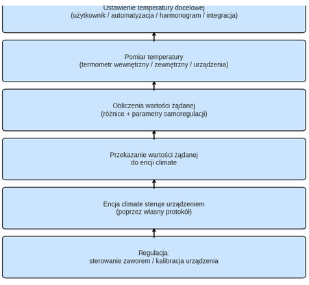

# Typ termostatu: `Termostat na Klimacie`

- [Typ termostatu: `Termostat na Klimacie`](#typ-termostatu-termostat-na-klimacie)
  - [Wymagania wstępne](#wymagania-wstępne)
  - [Konfiguracja](#konfiguracja)
    - [Encje podstawowe](#encje-podstawowe)
    - [Tryb AC](#tryb-ac)
    - [Synchronization of the internal temperature of underlying entities](#synchronization-of-the-internal-temperature-of-underlying-entities)
    - [Samoregulacja](#samoregulacja)
    - [Autowentylacja](#autowentylacja)
    - [Kompensacja temperatury wewnętrznej urządzeń bazowych](#kompensacja-temperatury-wewnętrznej-urządzeń-bazowych)
  - [Funkcje specyficzne](#funkcje-specyficzne)
  - [Śledzenie zmian temperatury bazowej](#śledzenie-zmian-temperatury-bazowej)

## Wymagania wstępne

Instalacja powinna wyglądać następująco:

1. Ustawienia temperatury docelowej pomieszczenia mogą być realizowane przez użytkownika, automatyzacje, wcześniej zdefiniowany harmonogram, lub mogą pochodzić z presetów w samej integracji.
2. Termometr wewnętrzny (2), termometr zewnętrzny (2b) lub wewnętrzny termometr urządzenia (2c) okresowo odczytują temperaturę. Termometr wewnętrzny powinien być umieszczony w odpowiednim miejscu — najlepiej na środku pomieszczenia. Unikaj umieszczania go zbyt blisko okna, termostatu lub grzejnika.
3. Na podstawie wartości zadanych, różnic i parametrów samoregulacji (zobacz [samoregulacja](self-regulation.md)), termostat obliczy wartość żądaną i prześle ją do encji `climate`.
4. Encja `climate` steruje urządzeniem za pomocą własnego protokołu.
5. W zależności od wybranych opcji regulacji termostat może bezpośrednio sterować otwarciem zaworu termostatycznego lub kalibrować urządzenie tak, aby jego wewnętrzna temperatura odzwierciedlała temperaturę w pomieszczeniu.

Diagram pokazuje, że _VTherm_ działa w cyklu zamkniętym: **ustawienie → pomiar → obliczenia → sterowanie → korekta**. Dzięki temu system może utrzymywać stabilną temperaturę w pomieszczeniu, unikając przegrzewania lub wychładzania.

## Konfiguracja

W pierwszej kolejności skonfiguruj ustawienia główne, wspólne dla wszystkich termostatów _VTherms_ (patrz: [główne ustawienia](base-attributes.md)).
Następnie skonfiguruj urządzenia. Podczas tworzenia termostatu _VTherm_ kreator wyświetla je po atrybutach podstawowych. Później wybierz z menu opcję "Urządzenia". To menu zawiera:
- "Ustawienia wspólne": ustawienia wspólne dla wszystkich urządzeń (tryb AC, synchronizacja temperatury wewnętrznej, samoregulacja, autowentylacja...). Przy [bezpośrednim sterowaniu zaworem](self-regulation.md#samoregulacja-z-bezpośrednim-sterowaniem-zaworem) lub [synchronizacji temperatury wewnętrznej](feature-sync_device_temp.md) następuje po nich druga strona o nazwie "Regulacja zaworem i synchronizacja", z ustawieniami tych funkcji wspólnymi dla wszystkich urządzeń,
- po jednej pozycji dla każdego sterowanego urządzenia, z jego encją i własnymi ustawieniami,
- "Dodaj urządzenie".

### Encje podstawowe
"Dodaj urządzenie" najpierw pyta o encję `climate` do sterowania. Akceptowane są tu jedynie encje typu `climate`. Następnie:
- przy bezpośrednim sterowaniu zaworem kolejny ekran pyta o encje zaworu i stopnie otwarcia tego urządzenia,
- przy synchronizacji temperatury wewnętrznej pyta o encję synchronizacji tego urządzenia,
- w pozostałych przypadkach urządzenie jest dodawane od razu.

Encje należące do tego samego urządzenia fizycznego są podpowiadane. Wybranie urządzenia na liście pokazuje jego ustawienia oraz pola "Zamień encję" i "Usuń to urządzenie".

### Tryb AC

Możesz wybrać `termostat na klimacie` do sterowania klimatyzacją (odwracalną lub nie), zaznaczając opcję "Tryb AC". Jeśli urządzenie na to pozwala, oba tryby: 'Grzanie" i Chłodzenie' będą dostępne.

### Synchronization of the internal temperature of underlying entities
This function allows for much better regulation as it synchronizes the internal thermometer of the underlying `climate` entities with the room temperature measured by _VTherm_. It is described [here](feature-sync_device_temp.md).

### Samoregulacja

W trybie `termostat na klimacie` urządzenie korzysta z własnego algorytmu regulacji: załącza się/wyłącza i zatrzymuje automatycznie na podstawie wartości zadanej odebranej przez termostat VTherm za pośrednictwem encji `climate`. Wykorzystuje swój wewnętrzny termometr oraz odczytaną wartość zadaną.

W zależności od urządzenia jakość tej wewnętrznej regulacji może się różnić. W dużej mierze zależy to od jakości samego urządzenia, funkcjonalności jego wewnętrznego termometru oraz algorytmu regulacji. Aby poprawić działanie urządzeń, które słabo regulują temperaturę, VTherm oferuje możliwość dostosowania odczytywanej wartości zadanej poprzez jej zwiększenie lub zmniejszenie na podstawie temperatury pomieszczenia mierzonej przez termostat VTherm, a nie t

Opcje samoregulacji są szczegółowo opisane [tutaj](self-regulation.md).

Aby uniknąć przeciążenia sterowanego urządzenia (niektóre mogą wydawać nieprzyjemne dźwięki, inne działają na baterie itp.), dostępne są dwa progi ograniczające liczbę wysyłanych żądań:
1. Próg regulacji: próg w ° (lub %), poniżej którego nowa wartość zadana nie zostanie wysłana. Jeśli ostatnia wartość zadana wynosiła 22°, kolejna będzie wynosić 22° ± próg regulacji. Jeśli stosowana jest bezpośrednia regulacja zaworu (`termostat na zaworze` lub `termostat na klimacie` z bezpośrednią regulacją zaworu), wartość ta powinna być wyrażona w procentach i nie powinna być niższa niż 3% dla Sonoff TRVZB (w przeciwnym razie Sonoff TRVZB może utracić kalibrację).
2. Minimalny okres regulacji (w min.): minimalny odstęp czasu, poniżej którego nowa wartość zadana nie zostanie przekazana. Jeśli ostatnia wartość zadana została przekazana o 11:00, kolejna nie może zostać wysłana przed 11:00 + minimalny okres regulacji.

Nieprawidłowe ustawienie tych progów może uniemożliwić prawidłową samoregulację, ponieważ nowe wartości zadane nie będą przekazywane.

### Autowentylacja

Ten tryb, wprowadzony w wersji 4.3, wymusza użycie wentylacji, jeśli różnica temperatur jest znacząca. Aktywując wentylację, rozprowadzanie ciepła następuje szybciej, co pomaga szybciej osiągnąć temperaturę docelową.
Możesz wybrać poziom wentylacji do aktywacji spośród następujących opcji: Niski, Średni, Wysoki, Turbo.

Oczywiście Twoje urządzenie musi posiadać funkcję wentylacji i musi być sterowalne, aby ten tryb działał. Jeśli urządzenie nie obsługuje trybu Turbo, zostanie użyty tryb 'Wysoki'High. Gdy różnica temperatur ponownie stanie się niewielka, wentylacja przełączy się na tryb 'normalny, który zależy od Twojego urządzenia (w kolejności): `Mute`, `Quiet`, `Auto`, `Low`. Zostanie wybrany pierwszy dostępny tryb dla Twojego sprzętu.

>  _*Wtyczka zewnętrzna*_
> Rozszerzona wersja autowentylacji jest dostępna jako wtyczka zewnętrzna. Ta wtyczka oferuje dodatkowe opcje konfiguracji i dokładniejszą kontrolę automatycznej wentylacji. Sprawdź stronę [wtyczki](https://www.versatile-thermostat.org/fr/plugins/), aby poznać tę wtyczkę.

### Kompensacja temperatury wewnętrznej urządzeń bazowych

_Ostrzeżenie_:
Tej opcji nie należy używać z regulacją bezpośredniego sterowania zaworem, jeśli została podana encja kalibracyjna.

Czasami wewnętrzny termometr sterowanego urządzenia (TRV, klimatyzator itp.) jest na tyle niedokładny, że samoregulacja okazuje się niewystarczająca. Dzieje się tak, gdy termometr wewnętrzny znajduje się zbyt blisko źródła ciepła. Temperatura wewnętrzna rośnie znacznie szybciej niż temperatura w środku pomieszczeniu, co prowadzi do błędów regulacji.
Przykład:
1. Temperatura w pomieszczeniu wynosi 18°, wartość żądana to 20°.
2. Temperatura wewnętrzna urządzenia wynosi 22°.
3. Jeśli termostat wyśle wartość zadaną 21° (= 20° + 1° samoregulacji), urządzenie nie będzie grzało, ponieważ jego temperatura wewnętrzna (22°) jest wyższa niż wartość zadana (21°).

Aby temu zaradzić, w wersji 5.4 dodano nową opcjonalną funkcję:

Po aktywacji funkcja ta dodaje różnicę między temperaturą wewnętrzną a temperaturą w pomieszczeniu do wartości żądanej, aby wymusić grzanie.
W powyższym przykładzie różnica wynosi +4° (22° - 18°), więc termostat wyśle do urządzenia wartość 25° (21° + 4°), wymuszając grzanie.

Różnica ta jest obliczana dla każdego sterowanego urządzenia indywidualnie, ponieważ każde ma własną temperaturę wewnętrzną, np. termostat podłączony do trzech TRV, z których każdy ma własny termometr.

Skutkuje to znacznie bardziej efektywną samoregulacją, która eliminuje problemy wynikające z dużych różnic temperatur wewnętrznych spowodowanych wadliwymi wartościami sensorów.
Należy jednak pamiętać, że niektóre temperatury wewnętrzne zmieniają się tak szybko i niedokładnie, że całkowicie zaburzają obliczenia. W takim przypadku lepiej wyłączyć tę opcję.

Porady dotyczące prawidłowego dostosowania tych ustawień znajdziesz na stronie [Samoregulacja](self-regulation.md)

>  _*Wskazówki*_
> Bardzo rzadko zachodzi potrzeba zaznaczenia tej opcji. W większości przypadków samoregulacja rozwiązuje problemy. Rezultaty w dużej mierze zależą od urządzenia i zachowania się jego temperatury wewnętrznej. Daltego z opcji tej należy korzystać rozsądnie i tylko wtedy, gdy wszystkie inne metody zawiodły..

## Funkcje specyficzne

Specyficzne funkcje można skonfigurować za pomocą dedykowanej opcji w menu.

Funkcje wymagające konfiguracji dla tego typu termostatu to:
> 1. AutoSTART/autoSTOP: Automatyczne uruchamianie i zatrzymywanie termostatu na podstawie prognoz użytkowania. Opis znajduje się [tutaj](feature-auto-start-stop.md).
> 2. Jeśli wybrano regulację zaworu, konfiguracja algorytmu TPI jest dostępna z poziomu menu (patrz: [Algorytmy](algorithms.md)).
> 3. Jeśli wybrano regulację zaworu, możesz ustawić termostat w tryb uśpienia. Tryb uśpienia jest specyficzny dla tego typu termostatu i pozwala wyłączyć go, pozostawiając zawór całkowicie otwarty (100%). Istnieją dwa sposoby aktywacji trybu uśpienia:
>    1. za pomocą [karty VTherm UI Card](additions.md#versatile-thermostat-ui-card), naciskając przycisk trybu 'Zzz',
>    2. wywołując akcję o nazwie `service_set_hvac_mode_sleep`. Zobacz [Akcje](reference.md#actions-services)

## Śledzenie zmian temperatury bazowej

Niektórzy użytkownicy chcą nadal korzystać ze swojego urządzenia, jak dotychczas (bez _VTherm_). Na przykład, mogą chcieć użyć przewodu sterującego z diodą do _PAC_ lub obrócić pokrętło w _TRV_.
W takim przypadku do urządzenia _VTherm_ dodano sensor "Śledzenie zmiany temperatury bazowej”:

Gdy ta opcja jest włączona, zmiany trybu HVAC są nadal śledzone. Śledzenie temperatury zadanej działa od uruchomienia, nawet jeśli _VTherm_ nie wysłał jeszcze polecenia do TRV. Nowo zgłoszona temperatura zadana jest zapisywana jako kandydat i przyjmowana, jeśli pozostaje stabilna przez pięć sekund; każda nowa, inna wartość rozpoczyna oczekiwanie od nowa. Duplikaty nie wydłużają tego czasu. Jeśli _VTherm_ wysłał już temperaturę zadaną, równe lub zbliżone wartości są uznawane za niejednoznaczne i nie są automatycznie przyjmowane. Bez odniesienia do wysłanej temperatury zadanej stary, odmienny sygnał zwrotny może zostać błędnie uznany za ręczną zmianę.

Dozwolona zmiana na TRV jest traktowana jak ręczna zmiana temperatury docelowej: _VTherm_ przechodzi na ręczną temperaturę zadaną (`NONE`). Jeśli skonfigurowano [czas ręcznego nadpisania](feature-timed-preset.md#ręczne-nadpisanie-z-automatycznym-powrotem), uruchamia ono ręczne nadpisanie, po którego zakończeniu przywracany jest poprzedni preset. Bez takiego czasu bieżący preset czasowy jest anulowany bez przywracania poprzedniego żądania. Priorytety okien i zabezpieczeń pozostają bez zmian. W stanie OFF żądanie zostaje zapisane bez włączania termostatu i bez anulowania wymuszonego OFF.

Budżet śledzenia to jeden wspólny licznik dla każdego _VTherm_. Zlicza każdą faktycznie przyjętą zmianę żądanego trybu lub temperatury z urządzenia bazowego, a także każdą wychodzącą próbę polecenia `climate` wywołaną przez śledzenie. Przyjęcie zmiany i wynikające z niego polecenie mogą więc zużyć dwie jednostki. Samo zaobserwowanie kandydata lub oczekiwanie na jego ustabilizowanie nie jest zliczane. Wywołania usług `number` używane przez bezpośrednią regulację zaworu nie są uwzględniane.

Po osiągnięciu trzech jednostek śledzenie zostaje zawieszone. Jeśli trzecią jednostką jest wychodząca próba, to polecenie zostaje wysłane, a następna próba jest blokowana. Jeśli przyjęcie zmiany podniesie licznik do trzech, zmiana zostaje zachowana, ale kolejne polecenia wywołane przez śledzenie są blokowane. Bezpośrednie sterowanie z _VTherm_ pozostaje dostępne. Licznik jest ponownie uzbrajany po otrzymaniu nowego polecenia przez interfejs _VTherm_ lub usługę Home Assistant. Fizyczne zmiany na urządzeniu bazowym i zwykłe cykle regulacji go nie resetują; reset czasowy nie występuje. Automatyzacja wysyłająca nowe polecenie do _VTherm_ po każdej zmianie może ponownie uzbrajać licznik przy każdym przebiegu, dlatego limit obowiązuje między odebranymi poleceniami, a nie dla całej pętli. Po ponownym uruchomieniu Home Assistant lub przeładowaniu integracji licznik zaczyna od zera, a śledzenie zostaje ponownie uzbrojone.

**Uważaj** — jeśli korzystasz z tej funkcji, Twoje urządzenie jest sterowane na dwa sposoby: przez termostat _VTherm_ oraz bezpośrednio przez Ciebie. Polecenia mogą się wzajemnie wykluczać, co może prowadzić do niejednoznaczności aktualnego stanu urządzenia.
Termostat _VTherm_ posiada mechanizm opóźnienia, który zapobiega zapętleniom: użytkownik ustawia żądaną wartość, termostat _VTherm_ ją przechwytuje i odpowiednio zmienia wartość. To opóźnienie może powodować zignorowanie zmiany dokonanej bezpośrednio na urządzeniu, jeśli nastąpi w zbyt krótkim czasie.

Niektóre urządzenia (np. Daikin) zmieniają stan samodzielnie. Jeśli zaznaczono tę opcję, może to spowodować wyłączenie termostatu _VTherm_, mimo że nie było to zamierzone. Dlatego lepiej jej nie używać — generuje to wiele niejasności i niepotrzebnych zapytań o wsparcie techniczne.

Te ograniczenia są celowym kompromisem między bezpieczeństwem a wygodą użytkowania. Z założenia są restrykcyjne i nie można ich konfigurować. Nie zostaną zmienione; trzeba będzie zaakceptować te ograniczenia.

