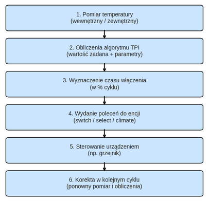
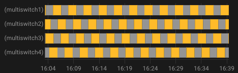

# Typ termostatu: `Termostat na Przełączniku`

- [Typ termostatu: `Termostat na Przełączniku`](#typ-termostatu-termostat-na-przełączniku)
  - [Wymagania wstępne](#wymagania-wstępne)
  - [Konfiguracja](#konfiguracja)
    - [Podstawowe urządzenia](#podstawowe-urządzenia)
    - [Podtrzymanie aktywności (keep-alive)](#podtrzymanie-aktywności-keep-alive)
    - [Tryb AC](#tryb-ac)
    - [Inwersja poleceń](#inwersja-poleceń)
    - [Dostosowywanie poleceń](#dostosowywanie-poleceń)

## Wymagania wstępne

Instalacja powinna wyglądać następująco:

1. Ustawienia temperatury docelowej pomieszczenia mogą być realizowane przez użytkownika, automatyzacje, wcześniej zdefiniowany harmonogram, lub mogą pochodzić z presetów w samej integracji.
2. Termometr wewnętrzny (2) lub termometr zewnętrzny (2b) okresowo odczytują temperaturę. Termometr wewnętrzny powinien być umieszczony w odpowiednim miejscu — najlepiej na środku pomieszczenia. Unikaj umieszczania go zbyt blisko okna, termostatu lub grzejnika.
3. Na podstawie wartości zadanych, różnicy temperatur oraz parametrów algorytmu **TPI** (zobacz: [TPI](algorithms.md#lalgorithme-tpi), termostat _VTherm_ obliczy procentowy czas włączenia.
4. Następnie w regularnych odstępach czasu termostat _VTherm_ będzie wydawał polecenia załączania i wyłączania dla encji podrzędnych typu `switch`, `select` lub `climate`.
5. Te encje podrzędne będą sterować fizycznym urządzeniem.
6. Fizyczny przełącznik będzie włączał lub wyłączał grzejnik.

Wartość `on-time` jest przeliczana przy każdym cyklu na nowo, co umozliwia regulację temperatury pomieszczenia.

Ten schemat pokazuje, że VTherm działa cyklicznie – każdorazowo mierzy temperaturę, oblicza czas włączenia i steruje urządzeniem. Dzięki temu możliwe jest precyzyjne utrzymanie komfortu cieplnego w pomieszczeniu, bez przegrzewania ani wychładzania.

## Konfiguracja

W pierwszej kolejności skonfiguruj ustawienia główne, wspólne dla wszystkich termostatów _VTherm_ (patrz: [ustawienia główne](base-attributes.md)). Następnie skonfiguruj urządzenia. Podczas tworzenia termostatu _VTherm_ kreator wyświetla je po atrybutach podstawowych. Później wybierz z menu opcję "Urządzenia". To menu zawiera:
- "Ustawienia wspólne": ustawienia wspólne dla wszystkich urządzeń (algorytm, podtrzymanie aktywności, tryb AC, inwersja poleceń),
- po jednej pozycji dla każdego sterowanego urządzenia, z jego encją i poleceniami,
- "Dodaj urządzenie".

### Podstawowe urządzenia

"Dodaj urządzenie" najpierw pyta o encję do sterowania. Akceptowane są tu jedynie encje typu `switch`, `input_boolean`, `select`, `input_select`, lub `climate`. Następny ekran pokazuje ustawienia tego urządzenia: jego [polecenia niestandardowe](#dostosowywanie-poleceń).

Wybranie urządzenia na liście pokazuje te same ustawienia oraz dwa dodatkowe pola: "Zamień encję", aby sterować inną encją, i "Usuń to urządzenie".

Pole "Algorytm" w ustawieniach wspólnych wybiera algorytm regulacji: wbudowany TPI lub algorytm zainstalowany jako wtyczka. Zobacz: [algorytmy](algorithms.md).
Jeśli skonfigurowano wiele encji, termostat przeplata ich aktywacje, aby zminimalizować liczbę jednocześnie włączonych przełączników. Pozwala to na lepsze rozłożenie mocy, ponieważ każdy grzejnik włącza się po kolei.

VTherm będzie jak najlepiej wygładzać zużycie energii poprzez naprzemienne aktywacje.
Oto przykład przeplatania aktywacji:

Oczywiście, jeśli żądana moc (`on_percent`) jest zbyt wysoka, nastąpi nakładanie się aktywacji.

### Podtrzymanie aktywności (keep-alive)

Niektóre urządzenia wymagają okresowej aktywacji, aby zapobiegać wyłączeniu awaryjnemu. Funkcja ta, znana jako 'podtrzymywanie aktywności (keep-alive)', może zostać aktywowana poprzez wprowadzenie wartości innej niż zero w polu interwału utrzymywania aktywności termostatu. Aby wyłączyć tę funkcję lub w razie wątpliwości, pozostaw to pole puste lub wpisz zero (wartość domyślna).

### Tryb AC

Można wybrać `termostat na przełączniku` do sterowania klimatyzatorem, zaznaczając pole `Tryb AC`. W takim przypadku widoczny będzie tylko tryb chłodzenia.

### Inwersja poleceń

Jeśli urządzenie jest sterowane przewodem sterującym z diodą, może być konieczne zaznaczenie pola 'Odwróć polecenie'. Spowoduje to ustawienie przełącznika w pozycji załączonej, gdy urządzenie jest wyłączane, i w pozycji wyłączonej, gdy jest załączane. Po wybraniu tej opcji czasy cykli zostaną odwrócone.

### Dostosowywanie poleceń

Polecenia włączania i wyłączania wysyłane do urządzenia ustawia się w ustawieniach tego urządzenia:
- dla encji `switch` lub `input_boolean` są opcjonalne i zgrupowane w zwiniętej sekcji "Polecenia niestandardowe". Bez nich używane są standardowe polecenia `turn_on` i `turn_off`,
- dla encji `select`, `input_select` lub `climate` pola "Polecenie włączenia" i "Polecenie wyłączenia" są wymagane.

Polecenia podaj w formacie `polecenie[/atrybut[:wartość]]`.
Dostępne polecenia zależą od typu urządzenia bazowego:

| Typ urządzenia bazowego      | Polecenie załączenia                  | Poleenie wyłączenia                            | Zastosowanie                    |
| ---------------------------- | ------------------------------------- | ---------------------------------------------- | ------------------------------- |
| `switch` lub `input_boolean` | `turn_on`                             | `turn_off`                                     | Wszystkie przełączniki          |
| `select` lub `input_select`  | `select_option/option:comfort`        | `select_option/option:frost_protection`        | Nodon SIN-4-FP-21 i podobne (*) |
| `climate` (hvac_mode)        | `set_hvac_mode/hvac_mode:heat`        | `set_hvac_mode/hvac_mode:off`                  | eCosy (via Tuya Local)          |
| `climate` (preset)           | `set_preset_mode/preset_mode:comfort` | `set_preset_mode/preset_mode:frost_protection` | Heatzy (*)                      |

(*) Aby skorzystać z tego rozwiązania, należy upewnić się, że stan encji bazowej jest zgodny z presetem. W przeciwnym razie _VTherm_ nie będzie w stanie stwierdzić, czy urządzenie jest włączone, czy wyłączone. Aby to sprawdzić, przejdź do zakładki _Narzędzia deweloperskie -> Stany_ w HA, wyszukaj encję bazową i sprawdź, czy jej stan odpowiada nazwie presetu. Jeśli widzisz `„ogrzewanie”`, `„wyłączone”` lub `„chłodzenie”`, nie są to dozwolone presety i taka konfiguracja nie zadziała. W takim przypadku należy użyć przełącznika wirtualnego. Przykłady przełączników wirtualnych można znaleźć na stronie rozwiązywania problemów. Jeśli nalegasz na użycie tej konfiguracji, sprawdź dokładnie wartości akceptowane przez urządzenie w _Narzędzia deweloperskie -> Stany_ i wyszukaj swoje urządzenie, aby zobaczyć akceptowane opcje. Muszą być one **identyczne**, łącznie z uwzględnieniem wielkości liter.

Przykład dla Nodon SIN-4-FP-21 (encja `select`): polecenie włączenia to `select_option/option:comfort`, a polecenie wyłączenia to `select_option/option:frost_protection`.

Obowiązują następujące zasady:
1. Każde polecenie musi być zgodne z formatem `polecenie[/atrybut[:wartość]]` (np. `select_option/option:comfort` lub `turn_on`) bez spacji ani znaków specjalnych z wyjątkiem _. W przeciwnym razie ustawienia urządzenia pokazują błąd "Błąd konfiguracji poleceń własnych".
2. Polecenia podaje się dla wszystkich urządzeń albo dla żadnego. Możliwe jest mieszanie różnych typów urządzeń bazowych, ale gdy tylko jedno urządzenie nie jest przełącznikiem `switch` albo jedno urządzenie ma polecenia niestandardowe, każde urządzenie potrzebuje swoich poleceń, także przełączniki `switch`. Urządzenie bez poleceń jest oznaczone ⚠ na liście urządzeń, a opcja "Konfiguracja niekompletna" prowadzi bezpośrednio do niego.
