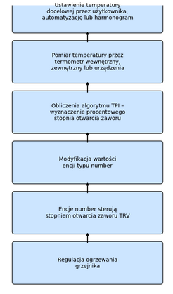

# Typ termostatu: `Termostat na Zaworze`

>  _*Wskazówki*_
> 1. Typ `termostat na zaworze` type jest często mylony z typem `termostat na klimacie` wyposżonym w funkcje samoregulacji z bezpośrednim sterowaniem zaworem.
> 2. Ten typ należy wybrać tylko wtedy, gdy nie masz encji `climate` dla _TRV_ w Home Assistant i jeśli masz tylko encję typu `number` do sterowania procentem otwarcia zaworu. Typ `termostat na klimacie` z automatyczną regulacją zaworu jest znacznie bardziej wydajny niż typ `termostat na zaworze`.

## Wymagania wstępne

Instalacja powinna być zbliżona do konfiguracji `termostat na przełączniku`, z tym wyjątkiem, że sprzęt jest sterowany bezpośrednio zaworem _TRV_:

1. Ustawienia temperatury docelowej pomieszczenia mogą być realizowane przez użytkownika, automatyzacje, wcześniej zdefiniowany harmonogram, lub mogą pochodzić z presetów w samej integracji.
2. Termometr wewnętrzny (2), termometr zewnętrzny (2b) lub wewnętrzny termometr urządzenia (2c) okresowo odczytują temperaturę. Termometr wewnętrzny powinien być umieszczony w odpowiednim miejscu — najlepiej na środku pomieszczenia. Unikaj umieszczania go zbyt blisko okna, termostatu lub grzejnika.
3. Na podstawie wartości zadanych, różnicy temperatur oraz parametrów algorytmu **TPI** (patrz: [TPI](algorithms.md#lalgorithme-tpi)), _VTherm_ obliczy procentowy stopień otwarcia zaworu.
4. Następnie VTherm zmodyfikuje wartość encji typu `number`.
5. Te encje podrzędne będą kontrolować stopień otwarcia zaworu w _TRV_.
6. W ten sposób regulowane będzie ogrzewanie grzejnika.

Wartość procentowa otwarcia zaworu jest przeliczana przy każdym cyklu na nowo, co umozliwia regulację temperatury pomieszczenia.

Ten schemat pokazuje, że VTherm działa w cyklu zamkniętym: od ustawienia temperatury, przez pomiar i obliczenia, aż po sterowanie zaworem i korektę w kolejnym cyklu. Dzięki temu system może precyzyjnie regulować ogrzewanie, zapewniając komfort cieplny i optymalne zużycie energii.

## Konfiguracja

W pierwszej kolejności skonfiguruj ustawienia główne, wspólne dla wszystkich termostatów VTherm (patrz: [ustawienia główne](base-attributes.md)). Następnie skonfiguruj urządzenia. Podczas tworzenia termostatu _VTherm_ kreator wyświetla je po atrybutach podstawowych. Później wybierz z menu opcję "Urządzenia". To menu zawiera:
- "Ustawienia wspólne": ustawienia wspólne dla wszystkich zaworów (algorytm, tryb AC, próg i okres regulacji, próg otwarcia, maksymalne zamknięcie),
- po jednej pozycji dla każdego sterowanego zaworu, z jego encją i stopniami otwarcia,
- "Dodaj urządzenie".

"Dodaj urządzenie" najpierw pyta o encję `number` zaworu. Akceptowane są tu jedynie encje typu `number` i `input_number`. Następny ekran pokazuje ustawienia tego zaworu: jego minimalne i maksymalne otwarcie (patrz: [Sterowanie otwarciem zaworu](#sterowanie-otwarciem-zaworu)). Wybranie zaworu na liście pokazuje te same ustawienia oraz pola "Zamień encję" i "Usuń to urządzenie".

Pole "Algorytm" w ustawieniach wspólnych wybiera algorytm regulacji: wbudowany TPI lub algorytm zainstalowany jako wtyczka. Zobacz: [algorytmy](algorithms.md).

### Sterowanie otwarciem zaworu

`over_valve` może dostosować polecenie otwarcia TPI do fizycznych ograniczeń
każdego zaworu. Próg `opening_threshold_degree` jest oceniany na podstawie
surowej wartości procentowej TPI. Poniżej progu wartość zadana wynosi
`100 - max_closing_degree`. Następnie stosowany jest minimalny stopień
otwarcia, a potem maksymalny stopień otwarcia. `opening_threshold_degree` i
`max_closing_degree` dotyczą całego termostatu i znajdują się w ustawieniach
wspólnych. Przy wartościach domyślnych
wysłane polecenie jest zgodne z surowym procentem TPI.

Fizyczne polecenie nigdy nie spada poniżej `100 - max_closing_degree`, również
gdy surowe zapotrzebowanie TPI osiąga `opening_threshold_degree`, i nie maleje
wraz ze wzrostem zapotrzebowania. Zapotrzebowanie na ogrzewanie jest określane
na podstawie dodatniego surowego procentu TPI równego progowi lub większego;
obserwowany zawór jest aktywny tylko powyżej skutecznego fizycznego minimum,
ograniczonego także minimum encji. Przy uruchomieniu lub ponownym załadowaniu
zawór bez zapotrzebowania wraca do tego minimum.

Każdy zawór ma własne minimalne i maksymalne otwarcie, ustawiane w jego
ustawieniach:
1. "Minimalne otwarcie (%)" (`min_opening_degrees`): stosowane, gdy tylko
	próg zostanie osiągnięty. Wartość domyślna to `0`.
2. "Maksymalne otwarcie (%)" (`max_opening_degrees`): zawór nigdy nie otwiera
	się bardziej niż ta wartość. Nie może ona przekraczać maksimum
	obsługiwanego przez encję `number`, które jest wartością domyślną.

Przy wartościach domyślnych (próg `0`, minimum `0`, maksimum zaworu,
maksymalne zamknięcie `100`) polecenie wysyłane do zaworu jest zgodne z
surowym procentem TPI.

Możliwy jest wybór `termostatu na zaworze` do sterowania klimatyzatorem, jeśli dodatkowo wybierzesz opcję `Tryb AC`. W takm wypadku dostępny będzie jedynie tryb chłodzenia.

### Tryb uśpienia

`over_valve` obsługuje tryb uśpienia. Wybranie `sleep` lub wywołanie akcji
`versatile_thermostat.set_hvac_mode_sleep` pokazuje VTherm jako wyłączony, a
jednocześnie wysyła surowe żądanie otwarcia 100% do każdego zaworu podrzędnego.
Zachowany zostaje zwykły mechanizm przeliczenia sterowania otwarciem:
`max_opening_degrees` oraz ograniczenia encji `number` mogą więc ograniczyć
fizyczne otwarcie. Tryb uśpienia nie żąda ogrzewania z centralnego kotła; stan
ten identyfikuje atrybut `is_sleeping`.
