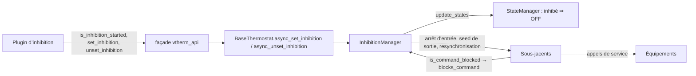
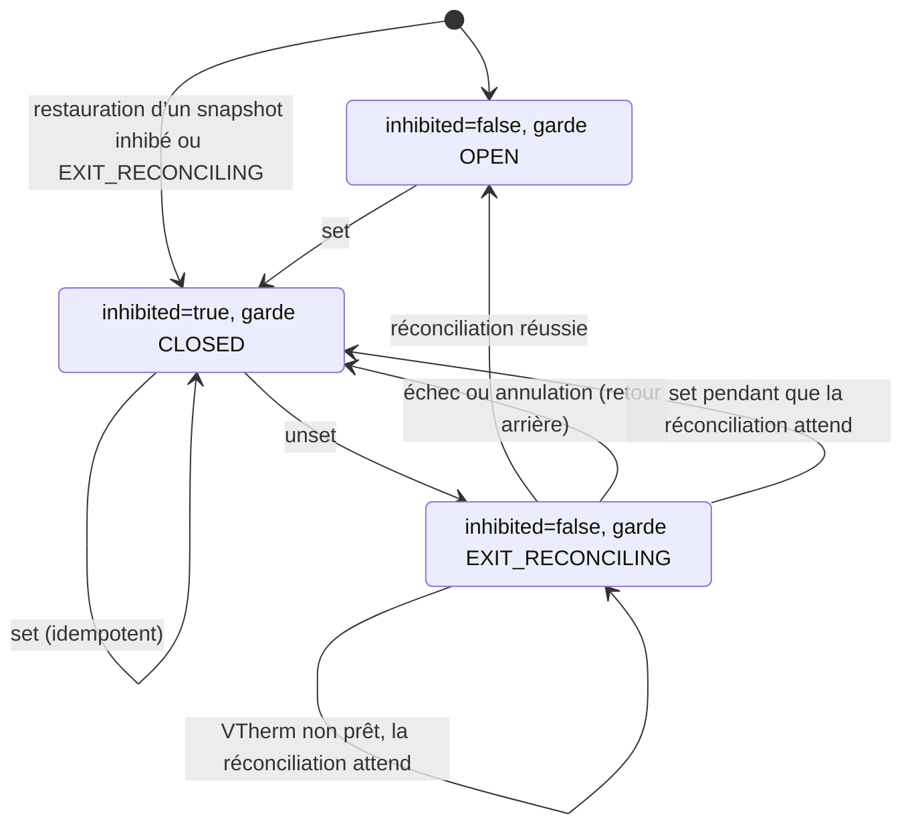

# InhibitionManager — Documentation technique

> English version: [inhibition_manager.md](inhibition_manager.md).
> Ce que la fonction doit faire est dans la [spécification](../specs/issue-2087-inhibition-spec.md) ; pourquoi elle est conçue ainsi est dans la [conception](issue-2087-inhibition-design.md). Ce document explique **comment fonctionne `inhibition_manager.py`**, pour pouvoir lire et modifier le code sans risque.

## 1. L’idée en une minute

Un *plugin d’inhibition* (par exemple [vtherm_inhibition](https://github.com/alexlenk/vtherm_inhibition)) décide **quand** un VTherm doit cesser de piloter ses équipements, par exemple pendant qu’une pompe à chaleur chauffe la pièce. Le core se contente d’exécuter ce qu’on lui demande :

- `set_inhibition(vtherm_entity_id, stop_underlyings)` : « ne pilote plus tes équipements à partir de maintenant » (et, si `stop_underlyings` vaut vrai, « éteins-les une fois ») ;
- `unset_inhibition(vtherm_entity_id)` : « reprends la main et remets les équipements là où tu les veux ».

Avant d’appeler, le plugin vérifie `is_inhibition_started(vtherm_entity_id)` (section 5.1). Les trois sont sur la façade `vtherm_api` (≥ 0.6.2).

`InhibitionManager` est le petit objet, un par VTherm, qui exécute ces deux ordres. Il possède trois choses :

1. un **drapeau**, `inhibited` : le mode HVAC effectif du VTherm est `OFF` tant qu’il est vrai (le mode, le preset et la consigne demandés par l’utilisateur restent intacts) ;
2. une **garde** entre le VTherm et ses équipements (`OPEN`, `CLOSED` ou `EXIT_RECONCILING`) : tant qu’elle n’est pas ouverte, toute commande que le VTherm enverrait à un équipement est abandonnée ;
3. deux **transactions**, les seules opérations autorisées à traverser une garde non ouverte : l’*arrêt d’entrée* et la *réconciliation de sortie*.

Tout le reste du fichier sert à garder ces trois éléments corrects malgré les redémarrages, les appels concurrents, les annulations et les équipements lents ou indisponibles.

## 2. Où il se situe

| Point de contact | Où | Rôle |
| --- | --- | --- |
| Création | `BaseThermostat.__init__` | `self._inhibition = InhibitionManager(self)`, un par VTherm. |
| Points d’entrée de l’API | `BaseThermostat.async_set_inhibition` / `async_unset_inhibition`, propriété `is_inhibition_started` | Transmettent à `async_set` / `async_unset` / `is_restored`. La façade valide ses arguments, trouve l’entité et les appelle. |
| Démarrage | premières lignes de `BaseThermostat.async_startup` | `restore_state(old_state)`, avant le démarrage de tout manager ou sous-jacent. |
| VTherm prêt | `BaseThermostat.init_underlyings_completed` | `async_on_vtherm_ready()` : exécute ce qui attendait que le VTherm soit prêt. |
| Résolution HVAC | `StateManager.calculate_current_hvac_mode` | Première branche : `is_inhibited` ⇒ `OFF` avec la raison `hvac_off_inhibition`. |
| La garde | `UnderlyingEntity.hass_services_async_call` et le début de `UnderlyingSwitch.turn_on/turn_off` | Appellent `is_command_blocked()`, qui interroge `blocks_command()`. Une commande bloquée est abandonnée sans exception. |
| État publié | `BaseThermostat.update_custom_attributes` | `specific_states.inhibition = as_dict()`, dès que l’inhibition a été utilisée. |

Le manager ne décide jamais *si* un VTherm doit être inhibé : c’est le rôle du plugin. Il ne parle jamais non plus directement à un équipement : il le demande aux sous-jacents (section 7).

## 3. L’état, champ par champ

| Champ | Signification | Persisté |
| --- | --- | --- |
| `_inhibited` | La contrainte est active : le mode effectif est `OFF`. | oui (`inhibited`) |
| `_gate` | `OPEN`, `CLOSED` ou `EXIT_RECONCILING` (section 4). | oui (`command_gate`) |
| `_entry_stop_requested` | Le plugin a demandé l’arrêt unique (`stop_underlyings=true`). | oui |
| `_entry_stop_completed` | Cet arrêt a été envoyé. Évite un second arrêt après un redémarrage. | oui |
| `_last_transition_at` | Date de la dernière transition (diagnostic). | oui |
| `_last_error_code` | `entry_stop_failed`, `exit_reconcile_failed`, `exit_reconcile_cancelled` ou `None`. | oui |
| `_is_used` | L’inhibition a servi au moins une fois : le snapshot n’est publié qu’à partir de là. | non (repositionné quand un snapshot est restauré) |
| `_is_restored` | La restauration au démarrage a eu lieu : `set`/`unset` sont refusés avant (section 5.1). Exposé comme `is_inhibition_started`. | non |
| `_lock` | Sérialise `set`, `unset` et `async_on_vtherm_ready` (jamais `update_states`, qui peut être réentrant). | non |
| `_transaction` | `(type, jeton, tâche)` de la transaction en cours, sinon `None`. | non |
| `_exit_pending` | `unset` a été accepté mais le VTherm n’est pas prêt : la réconciliation attend. | non |
| `_exit_future` | La sortie en cours, pour qu’un second `unset` la rejoigne au lieu d’en lancer une autre. | non |
| `_blocked_during_exit` | Un autre code a vu une commande abandonnée pendant la sortie (section 5.5). | non |
| `_warned` | Les couples (équipement, service) qui ont déjà journalisé leur avertissement. | non |
| `_dump_scheduled`, `_dump_task` | Suivi de la persistance (section 8). | non |

La partie persistée est exactement `as_dict()`, publiée sous `specific_states.inhibition` avec `schema_version: 1`.

## 4. La garde

### 4.1 Les trois positions

| Garde | Quand | Ce qui passe |
| --- | --- | --- |
| `OPEN` | Fonctionnement normal (aussi sans aucun plugin). | Tout : le manager est invisible. |
| `CLOSED` | Inhibé. | Seulement la transaction d’**arrêt d’entrée**. |
| `EXIT_RECONCILING` | `unset` est en cours : le VTherm n’est plus inhibé, mais les équipements n’ont pas encore été remis en état. | Seulement la transaction de **réconciliation de sortie** (et le seed de sortie, qui en fait partie). |

`OPEN` n’est atteint qu’après une réconciliation réussie. C’est la raison de la troisième position : pendant la sortie, le VTherm recalcule déjà son état normal, mais rien d’autre que la réconciliation ne doit agir tant que les équipements ne sont pas cohérents.

### 4.2 Une seule garde, à la frontière des équipements

Toute commande d’un VTherm vers un équipement passe par l’un de deux endroits : `UnderlyingEntity.hass_services_async_call` (climates, vannes, numbers) ou `UnderlyingSwitch.turn_on/turn_off` (interrupteurs, qui appellent le service directement). Les deux interrogent d’abord `is_command_blocked()`. Placer le contrôle ici, plutôt que dans chaque fonctionnalité (cycles, keep-alive, réparation, régulation, recalibrage, timers, …), évite à chaque fonctionnalité de connaître l’inhibition, et une nouvelle fonctionnalité est couverte automatiquement.

Une commande bloquée est abandonnée sans exception, comme si elle avait été envoyée. Journaux : `DEBUG` en général ; un seul `WARNING` par inhibition, équipement et service pour la ventilation, l’oscillation et l’humidité (réglages utilisateur qui ne font pas partie de l’état demandé ; l’auto-fan renvoie le mode de ventilation à chaque cycle, d’où l’avertissement unique). Le recalibrage des vannes journalise son propre avertissement à l’appel du service lorsque le VTherm est inhibé.

Effets de bord dans `UnderlyingSwitch` : tout `turn_on`/`turn_off` abandonné annule quand même le keep-alive, car l’annulation a lieu avant le contrôle de la garde (la resynchronisation et `on_inhibition_gate_opened()` le réarment). Un `turn_off` abandonné alors que la garde est fermée (`CLOSED`) libère quand même la réservation de puissance centrale (le VTherm est `OFF`) ; pendant `EXIT_RECONCILING`, non, car la réconciliation vient peut-être de la réserver. Un `turn_on` abandonné ne réserve rien.

### 4.3 Comment la garde reconnaît une transaction

`blocks_command()` ne laisse passer une commande à travers une garde non ouverte que si les **trois** conditions sont vraies :

1. la transaction en cours est celle autorisée dans cette position (`ENTRY_STOP` pour `CLOSED`, `EXIT_RECONCILE` pour `EXIT_RECONCILING`, voir `_GATE_TRANSACTION`) ;
2. le `ContextVar` `_ACTIVE_TRANSACTION` de l’appelant contient le jeton de cette transaction ;
3. l’appelant s’exécute dans la tâche même qui a ouvert la transaction.

`_transaction_scope(kind)` positionne les trois le temps d’un bloc `with` et les remet ensuite à zéro.

Pourquoi si strict ? Parce que tout le reste doit rester bloqué même pendant une transaction :

- la condition 2 seule ne suffit pas : une tâche ou un timer créé *dans* la transaction (un keep-alive réarmé par un `turn_on`, un renvoi différé, un recalcul) copie le contexte de l’appelant ; il porte le jeton et pourrait passer tant que la transaction est en cours (par exemple pendant qu’elle attend un appel de service). La condition 3 le rejette ;
- la condition 2 marque explicitement la chaîne d’appel (défense en profondeur) ; le code exécuté après le bloc `with` est bloqué de toute façon, car `_transaction` est remis à zéro et chaque transaction reçoit un nouveau jeton ;
- un drapeau global « transaction en cours » laisserait passer un keep-alive, un timer de cycle ou un recalibrage pendant la transaction.

Une commande ne passe donc que si elle vient de la chaîne d’appel de la transaction elle-même, pendant que la transaction s’exécute.

## 5. Les flux

### 5.1 Démarrage : `restore_state(old_state)`

Appelé tout au début d’`async_startup`, avant le démarrage des managers et des sous-jacents : un VTherm qui était inhibé est bloqué avant de pouvoir envoyer quoi que ce soit.

1. Il ne s’exécute **qu’une fois par entité** : une mise à jour de configuration peut exécuter `async_startup` deux fois, et le second passage ne doit pas défaire ce qui s’est passé entre-temps.
2. Il positionne d’abord `_is_restored`. Avant cela, `async_set` et `async_unset` lèvent `InhibitionNotStartedError` (définie dans `vtherm_api`) et ne changent rien, et `is_inhibition_started` (sur l’entité et sur la façade) vaut `False`. Le plugin le vérifie avant d’appeler et vérifie à nouveau au prochain changement d’état du VTherm : rien ne peut se perdre entre un appel et la restauration.
3. Pas d’état précédent, pas de snapshot ou une autre version de schéma : rien à restaurer.
4. Un snapshot ni inhibé, ni enregistré avec une garde fermée ou en réconciliation : seuls les diagnostics sont repris (`_is_used`, dernière transition, dernière erreur).
5. Un snapshot inhibé : `inhibited=true`, garde `CLOSED`, et les indicateurs d’arrêt d’entrée sont restaurés, pour ne pas renvoyer un arrêt déjà envoyé.
6. Un snapshot enregistré **pendant** une sortie (`EXIT_RECONCILING`) est traité comme un échec de sortie : inhibé, `CLOSED`, et l’arrêt d’entrée est marqué non fait (s’il avait été demandé), car la réconciliation interrompue a pu rallumer des équipements. Contrairement à un retour arrière, `last_error_code` garde sa valeur enregistrée. Le plugin rappelle `unset`.

### 5.2 Entrée : `async_set(stop_underlyings)`

1. Refusé avant la restauration (`InhibitionNotStartedError`).
2. `_exit_future = None` avant de prendre le verrou : « le dernier appel gagne ». Un `unset` qui arrive *après* ce `set` doit lancer une nouvelle sortie, pas rejoindre une plus ancienne.
3. Sous le verrou : si déjà inhibé, rien ne se passe (idempotent ; une nouvelle valeur de `stop_underlyings` s’applique à l’entrée suivante).
4. Sinon l’état bascule aussitôt : `inhibited=true`, garde `CLOSED`, indicateurs d’arrêt, erreur effacée, avertissements remis à zéro ; le snapshot est publié (`_persist`).
5. `_async_resolve_inhibited_state()` : `update_states(force=True)` calcule le `OFF` effectif. Toute commande d’équipement qui en résulte est abandonnée par la garde : le VTherm *affiche* `OFF` mais n’envoie rien. (Si le VTherm n’est pas encore prêt, `update_states` rend la main aussitôt et `OFF` est résolu quand il le devient ; la garde est déjà fermée.)
6. `_async_entry_stop_if_ready()` : si un arrêt a été demandé et pas encore fait, et que le VTherm est prêt, le cycle en cours est annulé, puis chaque sous-jacent reçoit son arrêt dans une transaction `ENTRY_STOP` (section 7). Une exception pendant l’arrêt d’un équipement (erreur du core, ou erreur de service d’un interrupteur) est journalisée et positionne `entry_stop_failed` ; les erreurs de service des climates, vannes et numbers sont seulement journalisées par `hass_services_async_call`. L’arrêt compte comme fait dans tous les cas. Si le VTherm n’est pas prêt, l’arrêt attend `async_on_vtherm_ready`.
7. Publication, puis attente de l’écriture des états restaurables (`_async_flush`), puis retour.

Une annulation (tâche de l’appelant annulée) pendant les étapes 5 et 6 ne laisse rien à moitié fait : les étapes sont terminées d’abord, puis l’annulation est relancée. Une annulation pendant l’attente de l’étape 7 est propagée aussitôt ; l’écriture elle-même se termine.

### 5.3 Sortie : `async_unset()`

1. Refusé avant la restauration.
2. Si une sortie est déjà en cours, la rejoindre : attendre son résultat (`asyncio.shield`, pour que l’annulation du second appelant n’annule pas la sortie) et le renvoyer, succès ou exception. Si cette sortie a été annulée (et que l’appelant lui-même n’est pas en cours d’annulation), regarder à nouveau : rejoindre une sortie lancée entre-temps, ou en lancer une nouvelle.
3. Sinon, créer `_exit_future`, prendre le verrou et exécuter `_async_exit()` ; attendre l’écriture des états restaurables ; puis résoudre le future pour que les appelants qui l’ont rejoint reçoivent le même résultat.

### 5.4 `_async_exit()` : passage en `EXIT_RECONCILING`

1. Non inhibé et garde ouverte : rien à faire. Sortie déjà en attente : rien de plus à faire.
2. `inhibited=false`, garde `EXIT_RECONCILING`, publication. À partir d’ici, le VTherm recalcule son état normal, mais seule la réconciliation peut atteindre les équipements.
3. **Seed de sortie**, dans une transaction `EXIT_RECONCILE` : chaque sous-jacent exécute `async_inhibition_exit_seed()`. Seule la régulation de vanne fait quelque chose : elle relance le seed de bootstrap #2049. C’est fait *avant* le test « prêt » exprès. Après un redémarrage en inhibition, la garde fermée a abandonné le seed du démarrage ; un degré de vanne resté `unknown` empêche le VTherm d’être *prêt*, donc attendre « prêt » avant le seed attendrait indéfiniment.
4. VTherm non prêt : `_exit_pending = True`, retour. L’appel du plugin réussit ; la réconciliation s’exécute depuis `async_on_vtherm_ready` dès que le VTherm est prêt.
5. Sinon, réconciliation immédiate.

### 5.5 `_async_exit_reconcile()` : remettre les équipements en état

Dans une seule transaction `EXIT_RECONCILE`, jusqu’à `MAX_EXIT_RECONCILE_WALKS` (3) parcours :

1. **Resynchronisation** (`async_inhibition_resync()` sur chaque sous-jacent). Pendant l’inhibition, les commandes abandonnées ont quand même mis à jour les caches « dernière valeur envoyée » des sous-jacents (ouverture de vanne, mode HVAC et consigne du climate). Une commande d’interrupteur abandonnée a laissé le keep-alive annulé, et l’indicateur de marche de l’interrupteur peut ne plus correspondre à l’équipement. Quelqu’un a aussi pu changer un équipement à la main. Sans resynchronisation, la déduplication des sous-jacents sauterait des commandes nécessaires (« déjà à 19 °C » alors que le TRV est à 25 °C).
2. **Forcer un parcours complet** : `requested_state` et `current_state` sont marqués modifiés, pour que `update_states(force=True)` applique l’état à *chaque* sous-jacent, même si le mode effectif ne change pas (`OFF` → `OFF` doit quand même fermer une vanne ouverte à la main).
3. **Vérifier les interférences** : si un autre code a vu une commande abandonnée pendant le parcours (`_blocked_during_exit`), il a pu modifier l’état courant ou les caches entre-temps : nouveau parcours.

Ensuite la garde s’ouvre, les indicateurs d’arrêt et l’erreur sont effacés, et le snapshot est publié. Si des commandes étaient encore abandonnées après le troisième parcours, la garde s’ouvre quand même (le cycle suivant applique l’état) et `on_inhibition_gate_opened()` réarme ce qu’une commande abandonnée avait annulé (le keep-alive de l’interrupteur).

### 5.6 Échec ou annulation : `_async_rollback_exit(err)`

Si le seed de sortie ou la réconciliation lève une exception, ou si la tâche est annulée :

1. retour à un état sûr : `inhibited=true`, garde `CLOSED`, `last_error_code` = `exit_reconcile_failed` ou `exit_reconcile_cancelled`, publié ;
2. si un arrêt d’entrée avait été demandé, il est marqué non fait ; `OFF` est résolu à nouveau et l’arrêt est renvoyé (tout de suite si le VTherm est prêt, sinon quand il le devient) : la réconciliation partielle a pu rallumer des équipements. Une annulation pendant ce retour arrière est seulement journalisée ;
3. l’erreur (ou l’annulation) est propagée vers l’appelant : le plugin le sait et réessaie.

Ce qui compte comme échec : une exception dans le chemin core, ou une annulation. Un équipement indisponible, non (Home Assistant ignore les entités indisponibles) ; les erreurs de service des climates, vannes et numbers sont journalisées par `hass_services_async_call`, comme aujourd’hui. Une erreur de service d’un interrupteur autre que `ServiceNotFound` remonte, comme hors inhibition, et fait échouer la sortie.

L’échec d’une sortie *différée* (section 5.4, étape 4) ne peut pas être remonté : l’appel du plugin est déjà terminé. Il est journalisé, publié dans `last_error_code` avec `inhibited=true`, et le plugin, qui compare l’état publié à son dernier appel, rappelle `unset`.

### 5.7 `async_on_vtherm_ready()`

Appelé depuis `init_underlyings_completed`. Il exécute, sous le verrou, ce qui attendait : la réconciliation de sortie en attente, ou l’arrêt d’entrée en attente. Ses exceptions ne sont pas propagées (personne ne les attend) ; elles sont dans le snapshot. Une annulation est quand même propagée.

## 6. La concurrence en bref

| Situation | Comportement |
| --- | --- |
| `set` et `unset` en même temps | Sérialisés par `_lock`. |
| Deux `unset` en même temps | Le second rejoint le premier et reçoit son résultat. |
| Un `set` arrive pendant une sortie, puis un autre `unset` | Le nouvel `unset` lance sa propre sortie après le `set` (le dernier appel gagne). |
| `set` annulé après la fermeture de la garde | L’entrée est terminée (état, arrêt, persistance), puis l’annulation est relancée. |
| `unset` annulé pendant la réconciliation | Retour à l’inhibition (section 5.6). Un appelant qui avait rejoint une sortie annulée lance la sienne. |
| Un keep-alive, un timer ou un cycle se déclenche pendant une transaction | Bloqué : ce n’est pas la chaîne d’appel de la transaction (section 4.3). |
| `update_states` réentrant (délestage) | Jamais verrouillé par le manager, donc pas d’interblocage. |

## 7. Ce que fait chaque sous-jacent

Le manager appelle quatre hooks ; leurs versions par défaut sont dans `UnderlyingEntity`.

| Hook | Interrupteur | Climate | Vanne | Régulation de vanne |
| --- | --- | --- | --- | --- |
| `async_inhibition_stop()` (arrêt d’entrée) | `turn_off` | `set_hvac_mode(OFF)` même s’il se dit `off` ; renvois différés annulés | fermeture (`set_value` avec la position fermée) même si elle se dit fermée | fermeture (degrés d’ouverture et de fermeture) |
| `async_inhibition_exit_seed()` | — | — | — | relance le seed de bootstrap #2049 |
| `async_inhibition_resync()` | suit l’état réel marche/arrêt ; réarme le keep-alive | suit le mode HVAC et la consigne réels ; renvois différés annulés | suit l’ouverture réelle | garde le pourcentage brut seulement si les degrés réels correspondent encore |
| `on_inhibition_gate_opened()` | réarme le keep-alive | — | — | — |

L’arrêt d’entrée est inconditionnel : il ne dépend pas de ce que l’équipement rapporte, pour ne pas rater un allumage encore en cours.

## 8. Persistance

Home Assistant n’écrit les états restaurables (les attributs qu’un VTherm retrouve après un redémarrage) que toutes les 15 minutes ou lors d’un arrêt propre. Une inhibition doit survivre à un crash juste après une transition, donc :

- `_persist()` publie les attributs immédiatement et programme un `async_dump_states()` ; les transitions d’un même tour de boucle partagent ce dump unique ;
- `set` et `unset` attendent le dernier dump programmé (`_async_flush()`) avant de rendre la main : quand l’appel du plugin se termine, l’état est sur disque (sauf si l’écriture a échoué, ce qui est journalisé en avertissement) ;
- le travail différé (`async_on_vtherm_ready`) programme son dump mais ne l’attend pas.

## 9. Guide de lecture du fichier source

| Partie | Contenu | À lire pour |
| --- | --- | --- |
| début | constantes, `InhibitionNotStartedError`, `CommandGate`, `InhibitionTransaction`, `_ACTIVE_TRANSACTION`, `_GATE_TRANSACTION` | le vocabulaire |
| `__init__` … `as_dict` | état et snapshot publié | section 3 |
| `restore_state` | démarrage | section 5.1 |
| `blocks_command`, `_transaction_scope` | la garde | section 4 |
| `async_set`, `async_unset`, `_check_restored`, `async_on_vtherm_ready`, `_is_entry_stop_pending` | transitions publiques | sections 5.2, 5.3, 5.7, 6 |
| `_async_resolve_inhibited_state`, `_async_entry_stop_if_ready` | entrée | section 5.2 |
| `_async_exit`, `_async_exit_reconcile`, `_async_rollback_exit` | sortie | sections 5.4 à 5.6 |
| `_touch`, `_persist`, `_async_flush`, `_async_dump` | persistance | section 8 |
| `_is_current_task_cancelling` (niveau module) | l’appelant lui-même est-il en cours d’annulation ? | section 5.3 |

**Si vous modifiez …**

- **un endroit qui envoie des commandes à un équipement** : vérifiez qu’il passe par `hass_services_async_call` ou `UnderlyingSwitch.turn_on/turn_off`, sinon la garde ne le voit pas ;
- **un nouveau type de sous-jacent** : vérifiez `async_inhibition_stop` (par défaut : `turn_off()`) ; surchargez-le si `turn_off` saute la commande selon l’état rapporté, ou n’existe pas. Si le type mémorise ce qu’il a envoyé, implémentez `async_inhibition_resync` (voir `base-classes.md`) ;
- **le démarrage** : `restore_state` doit rester avant tout ce qui peut commander un équipement ;
- **`update_states`** : l’entrée et la sortie comptent sur le fait qu’`update_states(force=True)` parcourt chaque sous-jacent quand `requested_state` et `current_state` sont marqués modifiés.

## 10. Tests

Tous dans `tests/test_inhibition.py`. La plupart comptent les appels de service réels qui atteignent les entités interrupteur, climate, vanne et number (`test_state_manager_*` testent directement la résolution).

| Domaine | Tests (préfixe) |
| --- | --- |
| Sans plugin, façade | `test_no_inhibition_*`, `test_api_facade_contract` |
| Par type d’équipement | `test_switch_*`, `test_climate_*`, `test_valve_*`, `test_climate_valve_*`, `test_entry_stop_is_sent_even_if_reported_off` |
| Redémarrage et restauration | `test_restart_*`, `test_second_startup_*`, `test_call_before_restore_*`, `test_restore_happens_before_the_managers_start`, `test_gate_closed_before_the_managers_start` |
| VTherm prêt | `test_set_and_unset_before_ready_are_deferred`, `test_set_before_ready_defers_the_entry_stop`, `test_climate_valve_restart_inhibited_unknown_degree_seeded_at_unset` |
| Concurrence et annulation | `test_cancelled_*`, `test_joiner_of_a_cancelled_exit_runs_its_own_exit`, `test_last_call_wins_when_set_is_queued_during_exit` |
| Interférences pendant la sortie | `test_*_change_during_exit_is_reconciled`, `test_switch_command_during_exit_reconciliation_is_blocked`, `test_switch_keep_alive_rearmed_after_exit_with_dropped_command` |
| Puissance et persistance | `test_*power_reservation*`, `test_set_and_unset_return_after_the_dump`, `test_dumps_are_coalesced` |
| Ordre de résolution | `test_state_manager_*` |
