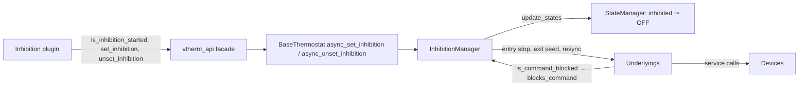
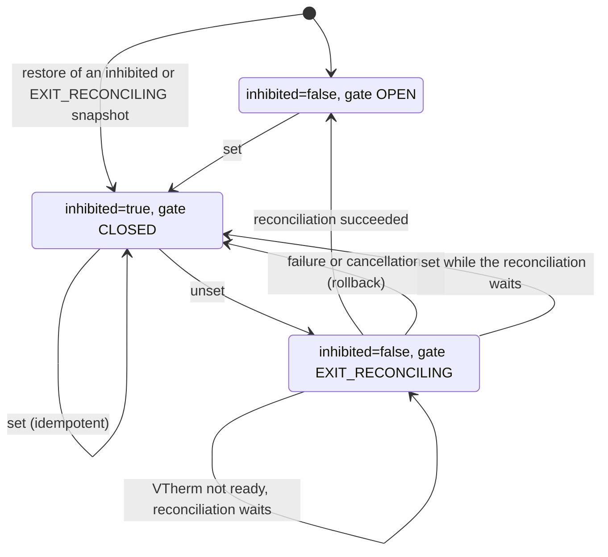

# InhibitionManager — Technical Documentation

> French version: [inhibition_manager-fr.md](inhibition_manager-fr.md).
> What the feature must do is in the [specification](../specs/issue-2087-inhibition-spec.md); why it is designed this way is in the [design](issue-2087-inhibition-design.md). This document explains **how `inhibition_manager.py` works**, so that the code can be read and changed safely.

## 1. The idea in one minute

An *inhibition plugin* (for example [vtherm_inhibition](https://github.com/alexlenk/vtherm_inhibition)) decides **when** a VTherm must stop controlling its devices, for instance while a heat pump heats the room. The core only does what it is told:

- `set_inhibition(vtherm_entity_id, stop_underlyings)`: "stop controlling your devices from now on" (and, if `stop_underlyings` is true, "switch them off once");
- `unset_inhibition(vtherm_entity_id)`: "take control back, and put the devices where you want them".

Before calling, the plugin checks `is_inhibition_started(vtherm_entity_id)` (section 5.1). All three are on the `vtherm_api` facade (≥ 0.6.2).

`InhibitionManager` is the small object, one per VTherm, that carries out these two orders. It owns three things:

1. a **flag**, `inhibited`: the VTherm's effective HVAC mode is `OFF` while it is true (the user's requested mode, preset and setpoint are kept untouched);
2. a **gate** between the VTherm and its devices (`OPEN`, `CLOSED` or `EXIT_RECONCILING`): while it is not open, every command the VTherm would send to a device is dropped;
3. two **transactions**, the only operations allowed through a gate that is not open: the *entry stop* and the *exit reconciliation*.

Everything else in the file exists to make these three things correct across restarts, concurrent calls, cancellations and devices that are slow or unavailable.

## 2. Where it sits

| Touchpoint | Where | What it does |
| --- | --- | --- |
| Creation | `BaseThermostat.__init__` | `self._inhibition = InhibitionManager(self)`, one per VTherm. |
| API entry points | `BaseThermostat.async_set_inhibition` / `async_unset_inhibition`, property `is_inhibition_started` | Forward to `async_set` / `async_unset` / `is_restored`. The facade validates its arguments, finds the entity and calls them. |
| Startup | first lines of `BaseThermostat.async_startup` | `restore_state(old_state)`, before any manager or underlying starts. |
| Readiness | `BaseThermostat.init_underlyings_completed` | `async_on_vtherm_ready()`: runs what was deferred until the VTherm is ready. |
| HVAC resolution | `StateManager.calculate_current_hvac_mode` | First branch: `is_inhibited` ⇒ `OFF` with reason `hvac_off_inhibition`. |
| The gate | `UnderlyingEntity.hass_services_async_call` and the top of `UnderlyingSwitch.turn_on/turn_off` | Call `is_command_blocked()`, which asks `blocks_command()`. A blocked command is dropped without an exception. |
| Published state | `BaseThermostat.update_custom_attributes` | `specific_states.inhibition = as_dict()`, once the inhibition was used. |

The manager never decides *whether* a VTherm should be inhibited: that is the plugin's job. It also never talks to a device directly: it asks the underlyings to do it (section 7).

## 3. The state, field by field

| Field | Meaning | Persisted |
| --- | --- | --- |
| `_inhibited` | The constraint is active: the effective mode is `OFF`. | yes (`inhibited`) |
| `_gate` | `OPEN`, `CLOSED` or `EXIT_RECONCILING` (section 4). | yes (`command_gate`) |
| `_entry_stop_requested` | The plugin asked for the one-time stop (`stop_underlyings=true`). | yes |
| `_entry_stop_completed` | That stop has been sent. Prevents a second stop after a restart. | yes |
| `_last_transition_at` | When the last transition happened (diagnostics). | yes |
| `_last_error_code` | `entry_stop_failed`, `exit_reconcile_failed`, `exit_reconcile_cancelled` or `None`. | yes |
| `_is_used` | Inhibition was used at least once: only then is the snapshot published. | no (set again when a snapshot is restored) |
| `_is_restored` | The startup restore has run: `set`/`unset` are refused before (section 5.1). Exposed as `is_inhibition_started`. | no |
| `_lock` | Serializes `set`, `unset` and `async_on_vtherm_ready` (never `update_states`, which can be re-entered). | no |
| `_transaction` | `(kind, token, task)` of the transaction running now, else `None`. | no |
| `_exit_pending` | `unset` was accepted but the VTherm is not ready: the reconciliation waits. | no |
| `_exit_future` | The exit in progress, so that a second `unset` joins it instead of starting another. | no |
| `_blocked_during_exit` | Some other code had a command dropped during the exit (section 5.5). | no |
| `_warned` | Which (device, service) pairs already logged their "dropped" warning. | no |
| `_dump_scheduled`, `_dump_task` | Persistence bookkeeping (section 8). | no |

The persisted part is exactly `as_dict()`, published under `specific_states.inhibition` with `schema_version: 1`.

## 4. The gate

### 4.1 The three positions

| Gate | When | What passes |
| --- | --- | --- |
| `OPEN` | Normal operation (also without any plugin). | Everything: the manager is invisible. |
| `CLOSED` | Inhibited. | Only the **entry stop** transaction. |
| `EXIT_RECONCILING` | `unset` is running: the VTherm is no longer inhibited, but the devices have not been brought back yet. | Only the **exit reconciliation** transaction (and the exit seed, which is part of it). |

`OPEN` is reached only after a successful reconciliation. This is why the gate has a third position: during the exit, the VTherm already computes its normal state, but nothing except the reconciliation may act on it until the devices are consistent.

### 4.2 One gate, at the device boundary

Every command a VTherm sends to a device goes through one of two places: `UnderlyingEntity.hass_services_async_call` (climates, valves, numbers) or `UnderlyingSwitch.turn_on/turn_off` (switches, which call the service directly). Both ask `is_command_blocked()` first. Putting the check there, instead of in each feature (cycles, keep-alive, repair, regulation, recalibration, timers, ...), means no feature needs to know about inhibition, and a new feature is covered automatically.

A blocked command is dropped without an exception, as if it had been sent. Logs: `DEBUG` in general; a single `WARNING` per inhibition, device and service for fan, swing and humidity (user settings that are not part of the requested state; the auto-fan resends the fan mode every cycle, hence the once-only warning). Valve recalibration logs its own warning when the service is called while the VTherm is inhibited.

Side effects in `UnderlyingSwitch`: any dropped `turn_on`/`turn_off` still cancels the keep-alive, because the cancel runs before the gate check (the resync and `on_inhibition_gate_opened()` re-arm it). A dropped `turn_off` while the gate is `CLOSED` still releases the central power reservation (the VTherm is `OFF`); while `EXIT_RECONCILING` it does not, because the reconciliation may just have reserved it. A dropped `turn_on` reserves nothing.

### 4.3 How the gate recognizes a transaction

`blocks_command()` lets a command through a non-open gate only if **all three** checks pass:

1. the running transaction is the one allowed in this gate position (`ENTRY_STOP` for `CLOSED`, `EXIT_RECONCILE` for `EXIT_RECONCILING`, see `_GATE_TRANSACTION`);
2. the `ContextVar` `_ACTIVE_TRANSACTION` of the caller holds that transaction's token;
3. the caller runs in the very task that opened the transaction.

`_transaction_scope(kind)` sets all three for the duration of a `with` block and resets them afterwards.

Why so strict? Because everything else must stay blocked even while a transaction runs:

- check 2 alone is not enough: a task or a timer created *inside* the transaction (a keep-alive re-armed by a `turn_on`, a delayed resend, a recalculation) copies the caller's context, so it carries the token and could pass while the transaction is still running (for example while it awaits a service call). Check 3 rejects it;
- check 2 marks the call chain explicitly (defense in depth); code that runs after the `with` block is blocked anyway, because `_transaction` is reset and every transaction gets a new token;
- a global "transaction running" flag would let a keep-alive, a cycle timer or a recalibration slip through while the transaction is in progress.

So a command passes only if it comes from the transaction's own call chain, while the transaction runs.

## 5. The flows

### 5.1 Startup: `restore_state(old_state)`

Called at the very beginning of `async_startup`, before the managers and the underlyings start, so a VTherm that was inhibited is gated before it can send anything.

1. It runs **once per entity**: a configuration update can run `async_startup` twice, and the second run must not undo what happened in between.
2. It sets `_is_restored` first. Until then, `async_set` and `async_unset` raise `InhibitionNotStartedError` (defined in `vtherm_api`) and change nothing, and `is_inhibition_started` (on the entity and on the facade) is `False`. The plugin checks it before calling and checks again at the VTherm's next state change, so nothing can be lost between a call and the restore.
3. No previous state, no snapshot or another schema version: nothing to restore.
4. A snapshot that is neither inhibited nor saved with a closed or reconciling gate: only the diagnostics are kept (`_is_used`, last transition, last error).
5. An inhibited snapshot: `inhibited=true`, gate `CLOSED`, and the entry-stop flags are restored, so a stop already sent is not sent again.
6. A snapshot saved **during** an exit (`EXIT_RECONCILING`) is treated like a failed exit: inhibited, `CLOSED`, and the entry stop is marked as not done (if it was requested), because the interrupted reconciliation may have switched devices back on. Unlike a rollback, `last_error_code` keeps its saved value. The plugin calls `unset` again.

### 5.2 Entering: `async_set(stop_underlyings)`

1. Refused before the restore (`InhibitionNotStartedError`).
2. `_exit_future = None` before taking the lock: "the last call wins". An `unset` that arrives *after* this `set` must start a new exit, not join an older one.
3. Under the lock: if already inhibited, nothing happens (idempotent; a new `stop_underlyings` value applies from the next entry).
4. Otherwise the state switches at once: `inhibited=true`, gate `CLOSED`, entry-stop flags, error cleared, warnings reset; the snapshot is published (`_persist`).
5. `_async_resolve_inhibited_state()`: `update_states(force=True)` computes the effective `OFF`. Every device command this produces is dropped by the gate: the VTherm *shows* `OFF` but sends nothing. (If the VTherm is not ready yet, `update_states` returns at once and `OFF` is resolved when it becomes ready; the gate is already closed.)
6. `_async_entry_stop_if_ready()`: if a stop was requested and not done yet, and the VTherm is ready, the running cycle is cancelled, then each underlying receives its stop inside an `ENTRY_STOP` transaction (section 7). An exception during a device's stop (a core error, or a switch service error) is logged and sets `entry_stop_failed`; climate, valve and number service errors are only logged by `hass_services_async_call`. The stop counts as done either way. If the VTherm is not ready, the stop waits for `async_on_vtherm_ready`.
7. Publish and wait for the restore states to be written (`_async_flush`), then return.

A cancellation (the caller's task cancelled) in steps 5–6 does not leave things half done: the steps are finished first, then the cancellation is raised again. A cancellation during the wait of step 7 is raised at once; the dump itself still completes.

### 5.3 Leaving: `async_unset()`

1. Refused before the restore.
2. If an exit is already running, join it: wait for its outcome (`asyncio.shield`, so the joiner's own cancellation does not cancel the exit) and return it, success or exception. If that exit was cancelled (and the joiner itself is not being cancelled), look again: join an exit started meanwhile, or start a new one.
3. Otherwise, create `_exit_future`, take the lock and run `_async_exit()`; then wait for the restore states to be written; then settle the future so that joiners get the same outcome.

### 5.4 `_async_exit()`: switching to `EXIT_RECONCILING`

1. Not inhibited and gate open: nothing to do. Exit already pending: nothing more to do.
2. `inhibited=false`, gate `EXIT_RECONCILING`, publish. From here the VTherm computes its normal state again, but only the reconciliation may reach the devices.
3. **Exit seed**, inside an `EXIT_RECONCILE` transaction: each underlying runs `async_inhibition_exit_seed()`. Only valve regulation does something: it re-runs the #2049 bootstrap seed. This happens *before* the readiness check on purpose. After a restart while inhibited, the closed gate dropped the startup seed; a valve degree left `unknown` keeps the VTherm *not ready*, so waiting for "ready" before seeding would wait forever.
4. VTherm not ready: `_exit_pending = True`, return. The plugin's call succeeds; the reconciliation runs from `async_on_vtherm_ready` once the VTherm is ready.
5. Otherwise run the reconciliation now.

### 5.5 `_async_exit_reconcile()`: bringing the devices back

Inside one `EXIT_RECONCILE` transaction, up to `MAX_EXIT_RECONCILE_WALKS` (3) walks:

1. **Resync** (`async_inhibition_resync()` on each underlying). While inhibited, the dropped commands still updated the underlyings' "last sent" caches (valve opening, climate HVAC mode and setpoint). A dropped switch command left the keep-alive cancelled, and the switch's on flag may no longer match the device. Someone may also have changed a device by hand. Without a resync, the deduplication in the underlyings would skip commands that are actually needed ("already at 19 °C" when the TRV is at 25 °C).
2. **Force a full walk**: `requested_state` and `current_state` are marked changed, so `update_states(force=True)` applies the state to *every* underlying, even when the effective mode does not change (`OFF` → `OFF` must still close a valve opened by hand).
3. **Check for interference**: if some other code had a command dropped during the walk (`_blocked_during_exit`), it may have changed the current state or the caches meanwhile: walk again.

Then the gate opens, the entry-stop flags and the error are cleared, and the snapshot is published. If commands were still dropped after the third walk, the gate opens anyway (the next cycle applies the state) and `on_inhibition_gate_opened()` re-arms what a dropped command cancelled (the switch keep-alive).

### 5.6 Failure or cancellation: `_async_rollback_exit(err)`

If the exit seed or the reconciliation raises, or the task is cancelled:

1. back to a safe state: `inhibited=true`, gate `CLOSED`, `last_error_code` = `exit_reconcile_failed` or `exit_reconcile_cancelled`, published;
2. if an entry stop had been requested, it is marked not done; `OFF` is resolved again and the stop is sent again (now if the VTherm is ready, otherwise when it becomes ready): the partial reconciliation may have switched devices on. A cancellation during this rollback is only logged;
3. the error (or cancellation) is raised to the caller, so the plugin knows and retries.

What counts as a failure: an exception in the core path, or a cancellation. An unavailable device does not (Home Assistant skips unavailable entities); service errors of climates, valves and numbers are logged by `hass_services_async_call`, as today. A switch service error other than `ServiceNotFound` propagates, as it does outside inhibition, and fails the exit.

A failure of a *deferred* exit (section 5.4, step 4) cannot be raised: the plugin's call has already returned. It is logged, published in `last_error_code` with `inhibited=true`, and the plugin, which compares the published state with its last call, calls `unset` again.

### 5.7 `async_on_vtherm_ready()`

Called from `init_underlyings_completed`. It runs, under the lock, whichever was waiting: the pending exit reconciliation, or the pending entry stop. Its exceptions are not raised (nobody is waiting for them); they are in the snapshot. A cancellation still propagates.

## 6. Concurrency in short

| Situation | Behavior |
| --- | --- |
| `set` and `unset` at the same time | Serialized by `_lock`. |
| Two `unset` at the same time | The second joins the first and gets its outcome. |
| `set` arrives while an exit runs, then another `unset` | The new `unset` starts its own exit after the `set` (last call wins). |
| `set` cancelled after the gate closed | The entry is completed (state, stop, persistence), then the cancellation is raised. |
| `unset` cancelled during the reconciliation | Rollback to inhibited (section 5.6). A joiner of a cancelled exit runs its own. |
| A keep-alive, timer or cycle fires during a transaction | Blocked: it is not the transaction's own call chain (section 4.3). |
| `update_states` re-entered (overpowering) | Never locked by the manager, so it cannot deadlock. |

## 7. What each underlying does

The manager calls four hooks; their defaults live in `UnderlyingEntity`.

| Hook | Switch | Climate | Valve | Valve regulation |
| --- | --- | --- | --- | --- |
| `async_inhibition_stop()` (entry stop) | `turn_off` | `set_hvac_mode(OFF)` even if it reports `off`; delayed resends cancelled | close (`set_value` with the closed position) even if it reports closed | close (opening and closing degrees) |
| `async_inhibition_exit_seed()` | — | — | — | re-run the #2049 bootstrap seed |
| `async_inhibition_resync()` | follow the real on/off state; re-arm keep-alive | follow the real HVAC mode and setpoint; delayed resends cancelled | follow the real opening | keep the raw percentage only if the real degrees still match it |
| `on_inhibition_gate_opened()` | re-arm keep-alive | — | — | — |

The entry stop is unconditional: it does not depend on what the device reports, so a turn-on still in flight is not missed.

## 8. Persistence

Home Assistant writes the restore states (the attributes a VTherm gets back after a restart) only every 15 minutes or at a clean shutdown. An inhibition must survive a crash right after a transition, so:

- `_persist()` publishes the attributes at once and schedules one `async_dump_states()`; transitions in the same event-loop turn share that single dump;
- `set` and `unset` wait for the last scheduled dump (`_async_flush()`) before returning: when the plugin's call returns, the state is on disk (unless the dump failed, which is logged as a warning);
- deferred work (`async_on_vtherm_ready`) schedules its dump but does not wait for it.

## 9. Reading guide for the source file

| Part | Contents | Read it for |
| --- | --- | --- |
| top | constants, `InhibitionNotStartedError`, `CommandGate`, `InhibitionTransaction`, `_ACTIVE_TRANSACTION`, `_GATE_TRANSACTION` | the vocabulary |
| `__init__` … `as_dict` | state and the published snapshot | section 3 |
| `restore_state` | startup | section 5.1 |
| `blocks_command`, `_transaction_scope` | the gate | section 4 |
| `async_set`, `async_unset`, `_check_restored`, `async_on_vtherm_ready`, `_is_entry_stop_pending` | public transitions | sections 5.2, 5.3, 5.7, 6 |
| `_async_resolve_inhibited_state`, `_async_entry_stop_if_ready` | entry | section 5.2 |
| `_async_exit`, `_async_exit_reconcile`, `_async_rollback_exit` | exit | sections 5.4–5.6 |
| `_touch`, `_persist`, `_async_flush`, `_async_dump` | persistence | section 8 |
| `_is_current_task_cancelling` (module level) | is the caller itself being cancelled? | section 5.3 |

**If you change …**

- **a place that sends commands to a device**: make sure it goes through `hass_services_async_call` or `UnderlyingSwitch.turn_on/turn_off`, otherwise the gate does not see it;
- **a new underlying type**: check `async_inhibition_stop` (default: `turn_off()`); override it if `turn_off` skips the command based on the reported state, or does not exist. If the type caches what it last sent, implement `async_inhibition_resync` (see `base-classes.md`);
- **startup**: `restore_state` must stay before anything that can command a device;
- **`update_states`**: the entry and the exit rely on `update_states(force=True)` walking every underlying when `requested_state` and `current_state` are marked changed.

## 10. Tests

All in `tests/test_inhibition.py`. Most of them count the real service calls that reach switch, climate, valve and number entities (`test_state_manager_*` test the resolution directly).

| Area | Tests (prefix) |
| --- | --- |
| No plugin, facade | `test_no_inhibition_*`, `test_api_facade_contract` |
| Per device type | `test_switch_*`, `test_climate_*`, `test_valve_*`, `test_climate_valve_*`, `test_entry_stop_is_sent_even_if_reported_off` |
| Restart and restore | `test_restart_*`, `test_second_startup_*`, `test_call_before_restore_*`, `test_restore_happens_before_the_managers_start`, `test_gate_closed_before_the_managers_start` |
| Readiness | `test_set_and_unset_before_ready_are_deferred`, `test_set_before_ready_defers_the_entry_stop`, `test_climate_valve_restart_inhibited_unknown_degree_seeded_at_unset` |
| Concurrency and cancellation | `test_cancelled_*`, `test_joiner_of_a_cancelled_exit_runs_its_own_exit`, `test_last_call_wins_when_set_is_queued_during_exit` |
| Interference during the exit | `test_*_change_during_exit_is_reconciled`, `test_switch_command_during_exit_reconciliation_is_blocked`, `test_switch_keep_alive_rearmed_after_exit_with_dropped_command` |
| Power and persistence | `test_*power_reservation*`, `test_set_and_unset_return_after_the_dump`, `test_dumps_are_coalesced` |
| Resolution order | `test_state_manager_*` |
