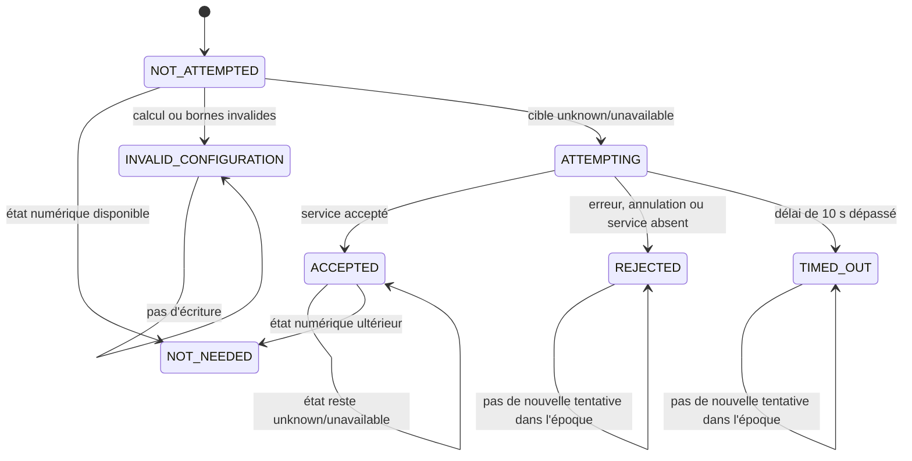
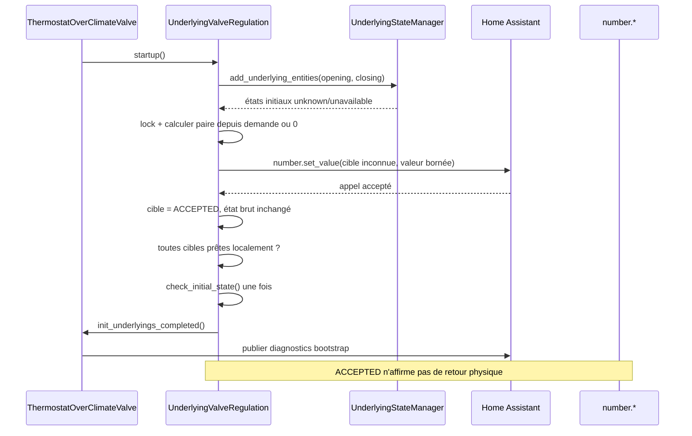

# Conception technique — Issue #2049 : amorçage ciblé des degrés de régulation de vanne

- **Statut :** proposé pour revue avant développement ; ce document ne modifie ni code produit, ni configuration, ni dépendance, ni état Home Assistant.
- **Version :** 1.2 — cycle de convergence 3 (final)
- **Date :** 2026-10-10
- **Propriétaire :** Projet Versatile Thermostat
- **Périmètre :** `over_climate` configuré avec `auto_regulation_valve`.
- **Sources normatives :** [revue de l’issue](issue-2049-review.md) et [spécification fonctionnelle bilingue](issue-2049-specification.md).
- **Code et tests inspectés :** [underlying_state_manager.py](../../custom_components/versatile_thermostat/underlying_state_manager.py), [underlyings.py](../../custom_components/versatile_thermostat/underlyings.py), [thermostat_climate_valve.py](../../custom_components/versatile_thermostat/thermostat_climate_valve.py), [base_thermostat.py](../../custom_components/versatile_thermostat/base_thermostat.py), [opening_degree_algorithm.py](../../custom_components/versatile_thermostat/opening_degree_algorithm.py), [test_check_initial_state.py](../../tests/test_check_initial_state.py) et [test_overclimate_valve.py](../../tests/test_overclimate_valve.py).

## 1. Objectif, périmètre et traçabilité

L’issue #2049 expose une dépendance circulaire au démarrage ou au rechargement : `UnderlyingStateManager` attend une valeur exploitable pour les nombres configurés comme degrés d’ouverture et de fermeture, tandis que certains appareils n’émettront cette valeur qu’après réception d’une consigne. Le thermostat reste alors durablement `not_initialized` et ne peut pas envoyer la commande qui le débloquerait.

La solution proposée introduit une **reconnaissance locale d’amorçage accepté** dans `UnderlyingValveRegulation`. Elle permet de poursuivre l’initialisation uniquement lorsque la consigne sûre a été acceptée par Home Assistant pour l’un des nombres explicitement configurés dans `auto_regulation_valve`. Les états bruts `unknown` et `unavailable` restent visibles ; ils ne sont ni réécrits ni considérés comme disponibles par `UnderlyingStateManager`.

Sont couverts : FR-001 à FR-010, BR-001 à BR-007, AC-001 à AC-010, ainsi que T-001 à T-015 de la spécification. Les compléments explicités dans la version anglaise — FR-006a à FR-006c, BR-006a à BR-006c, AC-003a, AC-003b, AC-004a et AC-011 — sont couverts respectivement par DEC-002/003/004, les sections 6 et 7.1, et T-006/T-017/T-019/T-021/T-022. Les décisions DEC-001 à DEC-004 sont résolues dans la section 4 et restent des **décisions proposées** jusqu’à l’approbation de cette conception ; DEC-005 est respectée par le contrat de timeout proposé.

Sont exclus : toute exception globale dans `UnderlyingStateManager`, la détection de marque ou firmware, une modification de l’algorithme TPI, des seuils, de Zigbee2MQTT, du cache radio, de la configuration utilisateur ou des services publics.

## 2. Faits vérifiés, hypothèses et conséquences de conception

| Catégorie    | Élément                                                                                                                                             | Conséquence                                                                                                                                                               |
| ------------ | --------------------------------------------------------------------------------------------------------------------------------------------------- | ------------------------------------------------------------------------------------------------------------------------------------------------------------------------- |
| Fait vérifié | `UnderlyingStateManager.is_all_states_initialized` refuse `None`, `unknown` et `unavailable`.                                                       | Cette règle globale est conservée sans modification.                                                                                                                      |
| Fait vérifié | `UnderlyingValveRegulation.startup()` suit `opening_degree` et, s’il existe, `closing_degree`.                                                      | Le périmètre d’amorçage peut être établi exclusivement à partir de ces deux identifiants déjà configurés.                                                                 |
| Fait vérifié | `UnderlyingEntity._underlying_changed()` ne lance `check_initial_state()` et la notification du thermostat qu’après initialisation du gestionnaire. | `UnderlyingValveRegulation` doit disposer de son propre prédicat local de préparation et de son propre chemin de finalisation ; le gestionnaire ne doit pas être modifié. |
| Fait vérifié | `send_percent_open()` applique déjà `OpeningClosingDegreeCalculation` et envoie l’ouverture, puis la fermeture si configurée.                       | La valeur d’amorçage doit utiliser ce calcul existant pour respecter les mêmes limites que les commandes nominales.                                                       |
| Fait vérifié | `hass_services_async_call()` journalise les exceptions mais ne retourne pas un succès/échec explicite.                                              | L’amorçage requiert un petit appel de service spécialisé, avec résultat explicite, plutôt que d’inférer un succès depuis `_last_sent_opening_value`.                      |
| Fait vérifié | `ThermostatOverClimateValve.is_initialized` exige le thermostat parent et chaque `UnderlyingValveRegulation` initialisés.                           | Une écriture acceptée doit pouvoir débloquer seulement l’underlying concerné ; les autres préconditions restent exigées.                                                  |
| Fait vérifié | Les attributs actuels exposent les valeurs envoyées et limites de chaque valve, mais pas le motif ni le résultat de l’amorçage.                     | Les diagnostics nouveaux se limitent à cet état opérationnel ciblé.                                                                                                       |
| Hypothèse    | Certains `number` sont des consignes sans retour d’état durable après un redémarrage.                                                               | Un accusé d’acceptation du service est suffisant pour autoriser le flux de consigne, mais ne prouve pas une position physique.                                            |
| Hypothèse    | Une valeur `valve_open_percent` calculée peut être indisponible dans une phase précoce.                                                             | Le repli doit être déterministe et sûr : commande de fermeture calculée depuis une demande brute de `0`.                                                                  |

La dernière hypothèse ne doit pas être présentée comme un retour d’état de l’appareil. Les tests proposés vérifient précisément le cas où l’état Home Assistant demeure `unknown` après un service accepté.

## 3. Architecture minimale proposée

### 3.1 Composants et responsabilités

| Composant                         | Responsabilité après implémentation                                                                                                                                                      | Hors responsabilité                                                                                        |
| --------------------------------- | ---------------------------------------------------------------------------------------------------------------------------------------------------------------------------------------- | ---------------------------------------------------------------------------------------------------------- |
| `UnderlyingStateManager`          | Continuer à mémoriser et qualifier les états réels de toutes les entités.                                                                                                                | Savoir qu’une entité est une consigne de vanne, envoyer une commande ou assouplir `unknown`/`unavailable`. |
| `UnderlyingValveRegulation`       | Identifier ses deux cibles, sélectionner la paire sûre, écrire une seule fois par cible et par époque de démarrage, mémoriser le résultat et appliquer le prédicat local de préparation. | Déclarer l’appareil physiquement positionné ou modifier le calcul TPI.                                     |
| `UnderlyingEntity`                | Conserver son contrat actuel pour tous les autres sous-jacents.                                                                                                                          | Porter un indicateur générique d’amorçage.                                                                 |
| `ThermostatOverClimateValve`      | Démarrer les sous-jacents, exiger leur préparation et publier des diagnostics consolidés.                                                                                                | Réessayer indéfiniment ou masquer l’indisponibilité réelle d’un autre sous-jacent.                         |
| `OpeningClosingDegreeCalculation` | Calculer la paire ouverture/fermeture existante.                                                                                                                                         | Être modifié pour l’issue.                                                                                 |
| Services `number.set_value`       | Accepter ou rejeter la demande d’écriture.                                                                                                                                               | Garantir un retour de position physique.                                                                   |

### 3.2 Fichiers prévus pour l’implémentation

| Fichier                                                                                                 | Zone                                                 | Modification minimale proposée                                                                                                                                                                                             |
| ------------------------------------------------------------------------------------------------------- | ---------------------------------------------------- | -------------------------------------------------------------------------------------------------------------------------------------------------------------------------------------------------------------------------- |
| [underlyings.py](../../custom_components/versatile_thermostat/underlyings.py)                           | `UnderlyingValveRegulation`                          | Ajouter l’état transitoire d’amorçage, le verrou d’exécution, le calcul de paire, l’écriture à résultat explicite et un prédicat local de préparation. Surcharger localement le traitement d’état/finalisation nécessaire. |
| [thermostat_climate_valve.py](../../custom_components/versatile_thermostat/thermostat_climate_valve.py) | `update_custom_attributes()`                         | Exposer le diagnostic d’amorçage par sous-jacent, sans changer le contrat existant de `specific_states.not_initialized_entities`.                                                                                          |
| [test_overclimate_valve.py](../../tests/test_overclimate_valve.py)                                      | Nouveaux tests d’intégration d’`over_climate_valve`. | Couvrir amorçage, démarrage, rechargement et commandes nominales.                                                                                                                                                          |
| [test_check_initial_state.py](../../tests/test_check_initial_state.py)                                  | Tests unitaires des sous-jacents.                    | Couvrir le prédicat local, les erreurs et l’absence d’incidence sur les classes non ciblées.                                                                                                                               |

`underlying_state_manager.py`, `opening_degree_algorithm.py`, les schémas de configuration, les traductions et les fichiers de configuration Home Assistant sont des dépendances inspectées mais **ne doivent pas être modifiés** par cette issue.

## 4. Décisions de conception proposées

### DEC-001 — Valeur d’amorçage : paire dérivée de la demande courante, sinon fermeture sûre, avec bornes obligatoires

**Décision proposée :** déterminer une demande brute $d$ selon l’ordre strict suivant :

1. valider **avant tout calcul et tout appel** les bornes configurées requises : `opening_threshold`, `min_opening_degree`, `max_opening_degree` et `max_closing_degree`, ainsi que les attributs `min` et `max` de chaque cible à écrire ;
2. vérifier que ces bornes sont numériques, finies et cohérentes avec les relations attendues par `OpeningClosingDegreeCalculation` et avec l’intervalle de la cible ;
3. si `thermostat.valve_open_percent` est numérique et se trouve dans les bornes validées de la demande, utiliser cette valeur ; sinon utiliser $d = 0$ comme demande de fermeture sûre ;
4. appeler le calcul existant `OpeningClosingDegreeCalculation.calculate_opening_closing_degree(d, min_opening_degree, max_closing_degree, max_opening_degree, opening_threshold)`.

La paire produite $(o, c)$ est donc exactement celle qu’une commande nominale produirait pour la même demande. Pour le repli, le calcul existant applique notamment $o = 100 - max\_closing\_degree$ et $c = max\_closing\_degree$ : la fermeture respecte ainsi la configuration, sans inventer une valeur « dernière connue » qui n’existe pas dans les données restaurées de `UnderlyingValveRegulation`.

Chaque composante est validée avant envoi : valeur numérique entière après le calcul, comprise dans les limites configurées de régulation et dans l’intervalle `min`/`max` de l’entité. **Aucun repli implicite $[0,100]$ n’est autorisé** pour une borne requise absente, non numérique ou incohérente. Dans ce cas, toutes les cibles encore à amorcer passent à `INVALID_CONFIGURATION`, aucun `number.set_value` n’est appelé et l’underlying reste non initialisé. Cette règle est normative pour DEC-001 et T-015.

**Justification :** cette stratégie réutilise une formule existante, respecte les seuils et ne suppose pas que la valeur de l’entité est fiable. Elle conserve la demande de chauffage déjà calculée lorsqu’elle existe, tout en privilégiant la fermeture sûre lorsqu’elle n’est pas encore calculable, sans inventer de plage de sécurité.

### DEC-002 — Déclencheur, limite et délai : une tentative bornée par cible et par époque

**Décision proposée :** lancer l’amorçage une fois, immédiatement après l’enregistrement des écouteurs dans `UnderlyingValveRegulation.startup()`, puis une fois lors de chaque nouvelle instance de l’underlying créée par un rechargement du config entry. Aucun temporisateur, polling ou second essai automatique n’est ajouté. Le budget de **10 s par cible** est un **paramètre de conception candidat**, à valider par T-019 et ajustable avec ses tests avant implémentation ou livraison ; il ne redéfinit pas la décision fonctionnelle DEC-005, qui impose qu’un timeout soit un échec terminal, diagnostiqué et sans reprise automatique.

Conditions cumulatives pour une cible :

1. elle est exactement `opening_degree_entity_id` ou `closing_degree_entity_id` de cette instance ;
2. son état actuellement mis en cache est absent, `unknown` ou `unavailable` ;
3. son statut d’amorçage de l’époque vaut `NOT_ATTEMPTED` ;
4. la paire de DEC-001 est valide ;
5. l’underlying n’a pas été supprimé pendant l’exécution.

Un verrou `asyncio.Lock` local sérialise l’amorçage, les événements d’état initiaux et toute finalisation. Chaque appel `hass.services.async_call` est enveloppé, dans la proposition courante, par `asyncio.wait_for(..., timeout=10 s)`. Le statut passe irréversiblement de `NOT_ATTEMPTED` à `ACCEPTED`, `REJECTED`, `TIMED_OUT` ou `INVALID_CONFIGURATION` pour cette époque. Une cible numérique à l’enregistrement est `NOT_NEEDED` et n’est jamais réécrite. Ainsi, même si plusieurs événements arrivent ou si `startup()` est rappelé par erreur, au plus un appel `number.set_value` est émis par cible pour l’époque concernée ; quel que soit le budget validé, son dépassement est un échec terminal et ne déclenche aucun second appel.

Cette décision rend le comportement idempotent au niveau des effets : une époque ne provoque qu’une seule tentative par cible. Un rechargement explicite crée une nouvelle époque et peut légitimement retenter une fois, conformément au besoin de récupération après rechargement.

### DEC-003 — Échec, état durablement inconnu et persistance

**Décision proposée :** l’accusé d’acceptation de `number.set_value` est le seul succès de transport. Il ne modifie pas l’état réel stocké par `UnderlyingStateManager` et ne prétend pas que la vanne a atteint une position.

| Résultat de l’appel ou de la validation                          | Statut local            | Initialisation locale                                                                                                                               | Reprise                                                                                                |
| ---------------------------------------------------------------- | ----------------------- | --------------------------------------------------------------------------------------------------------------------------------------------------- | ------------------------------------------------------------------------------------------------------ |
| Service accepté dans les 10 s                                    | `ACCEPTED`              | La cible est *traitée comme amorcée* seulement dans le prédicat local de `UnderlyingValveRegulation`, même si l’état reste `unknown`/`unavailable`. | Les futures commandes nominales restent possibles seulement si toutes les cibles requises sont prêtes. |
| `ServiceNotFound`, `HomeAssistantError`, exception ou annulation | `REJECTED`              | Bloquante ; `is_initialized` reste faux.                                                                                                            | Aucune boucle. Rechargement explicite ou redémarrage : une nouvelle tentative unique.                  |
| Appel non terminé après 10 s                                     | `TIMED_OUT`             | Bloquante ; résultat global `BOOTSTRAP_FAILED`, `is_initialized` reste faux.                                                                        | Annuler l’attente, journaliser `timeout`, ne pas réessayer dans l’époque.                              |
| Calcul, bornes ou type invalides                                 | `INVALID_CONFIGURATION` | Bloquante ; aucune écriture.                                                                                                                        | Correction de la configuration, puis nouveau chargement.                                               |
| État déjà numérique                                              | `NOT_NEEDED`            | Satisfait par le mécanisme normal.                                                                                                                  | Aucun appel supplémentaire.                                                                            |

La persistance est **volontairement absente** : ne pas persister `ACCEPTED` évite de masquer une indisponibilité après un redémarrage ultérieur et force une nouvelle vérification/écriture bornée dans la nouvelle époque. Les données restaurées existantes ne fournissent pas de dernière paire de commande fiable par sous-jacent ; ajouter une nouvelle persistance dépasserait le correctif minimal et créerait un contrat de migration non requis.

La classe doit employer pour l’amorçage une routine privée qui appelle `hass.services.async_call` et retourne explicitement `True` seulement lorsque Home Assistant accepte l’appel dans le délai borné. Il ne faut pas déduire le succès de l’absence d’exception dans le wrapper générique actuel, lequel journalise et absorbe les erreurs. Le service reste non bloquant comme les commandes existantes : le succès signifie exclusivement **acceptation du service par Home Assistant**, sans retour d’état, sans feedback de l’appareil et sans mouvement de vanne confirmés.

### DEC-004 — Diagnostics : statut explicite, sans faux état sain

**Décision proposée :** ajouter pour chaque sous-jacent régulé une structure stable sous l’attribut existant `vtherm_over_climate_valve.underlying_valves.<opening_entity_id>` :

| Champ proposé                                          | Valeurs                                                                                     | Signification                                                               |
| ------------------------------------------------------ | ------------------------------------------------------------------------------------------- | --------------------------------------------------------------------------- |
| `bootstrap_status`                                     | `not_needed`, `accepted`, `rejected`, `timed_out`, `invalid_configuration`, `not_attempted` | Résultat de l’époque d’initialisation en cours.                             |
| `bootstrap_targets`                                    | liste d’identifiants ciblés et de leur statut                                               | Permet de distinguer ouverture et fermeture.                                |
| `bootstrap_demand_percent`                             | entier $0..100$ ou `null`                                                                   | Demande brute effectivement utilisée, sans masquer le repli à $0$.          |
| `bootstrap_opening_degree`, `bootstrap_closing_degree` | entier ou `null`                                                                            | Paire proposée par le calcul existant.                                      |
| `bootstrap_error`                                      | code borné, sans trace ni secret                                                            | `service_error`, `timeout`, `invalid_configuration`, `cancelled` ou `null`. |

Les journaux proposés sont : `info` pour une tentative acceptée avec les identifiants et la paire, `warning` pour un rejet, un timeout ou une configuration invalide, et `debug` pour le cas nominal sans besoin. Aucun journal ne doit qualifier la position physique de confirmée. Les états bruts `unknown`/`unavailable` restent consultables dans Home Assistant et dans `not_initialized_entities` lorsqu’un rejet ou un timeout rend l’underlying non initialisé.

## 5. Modèle d’état, invariants et contrats

### 5.1 États par cible

Une époque commence à `startup()` de l’instance et se termine à sa suppression. Les états sont en mémoire uniquement. Le passage `ACCEPTED → NOT_NEEDED` est seulement une amélioration diagnostique lorsque l’état réel devient numérique ; il ne déclenche pas de commande.

### 5.2 Prédicat local de préparation

Pour une cible $e$, définir :

$$
ready(e) = numeric\_state(e) \lor bootstrap\_status(e) = ACCEPTED
$$

L’underlying de régulation est prêt si et seulement si **toutes** ses cibles configurées satisfont `ready(e)` ; une acceptation partielle ne déclenche jamais la reprise. Les autres sous-jacents suivent inchangés le prédicat global `UnderlyingStateManager.is_all_states_initialized`.

Invariants obligatoires :

| ID        | Invariant                                                                                                                           |
| --------- | ----------------------------------------------------------------------------------------------------------------------------------- |
| I-2049-01 | Aucun état `unknown`/`unavailable` n’est modifié ou requalifié dans `UnderlyingStateManager`.                                       |
| I-2049-02 | Seuls `opening_degree_entity_id` et `closing_degree_entity_id` de `UnderlyingValveRegulation` peuvent être amorcés.                 |
| I-2049-03 | Une cible numérique ne reçoit aucune écriture due à l’amorçage.                                                                     |
| I-2049-04 | Une cible n’émet au plus qu’un `number.set_value` d’amorçage par époque.                                                            |
| I-2049-05 | `ACCEPTED` prouve l’acceptation de service, jamais la position physique ni la disponibilité de l’état.                              |
| I-2049-06 | `REJECTED` et `INVALID_CONFIGURATION` maintiennent l’underlying non initialisé et n’envoient pas de nouvelle tentative automatique. |
| I-2049-07 | Les calculs et limites utilisés sont ceux de `OpeningClosingDegreeCalculation`; l’amorçage ne crée aucune formule distincte.        |
| I-2049-08 | `TIMED_OUT` maintient l’underlying non initialisé, expose `timeout` et n’émet pas de seconde commande dans l’époque.                |
| I-2049-09 | La reprise exige que chaque cible requise soit numérique ou `ACCEPTED`; `ACCEPTED` ne prouve ni feedback ni mouvement physique.     |

### 5.3 Contrat de la routine privée proposée

La routine interne, par exemple `async_bootstrap_unavailable_degrees()`, reste privée à `UnderlyingValveRegulation`.

| Élément       | Contrat                                                                                                                                                                                                                                                                                     |
| ------------- | ------------------------------------------------------------------------------------------------------------------------------------------------------------------------------------------------------------------------------------------------------------------------------------------- |
| Entrées       | Cibles déjà configurées, état du gestionnaire, demande `valve_open_percent`, limites existantes et contexte Home Assistant.                                                                                                                                                                 |
| Préconditions | Époque active, lock acquis, instance non supprimée, cibles non numériques, statut `NOT_ATTEMPTED`.                                                                                                                                                                                          |
| Sortie        | Mise à jour atomique sous lock des statuts et du diagnostic ; éventuellement un appel `number.set_value` par cible éligible.                                                                                                                                                                |
| Succès        | Appel de service accepté par Home Assistant dans les 10 s ; statut `ACCEPTED`, sans assertion sur le feedback ni le mouvement.                                                                                                                                                              |
| Échec         | Exception de service, annulation, suppression ou validation impossible : `REJECTED`/`INVALID_CONFIGURATION`; dépassement de 10 s : `TIMED_OUT`.                                                                                                                                             |
| Idempotence   | Après un statut terminal, un nouvel appel dans la même époque ne fait rien.                                                                                                                                                                                                                 |
| Délai         | Dans la proposition courante, `asyncio.wait_for` borne chaque appel à 10 s ; T-019 valide ou ajuste ce paramètre. Quel que soit le budget retenu, son dépassement produit `TIMED_OUT` et `bootstrap_error=timeout`, annule l’attente et interdit toute reprise ou répétition dans l’époque. |

Les deux nombres constituent une paire logique, mais les écritures restent indépendantes afin de ne jamais réécrire une composante déjà numérique. Si l’ouverture est inconnue et la fermeture disponible, seul `opening_degree` reçoit $o$ ; symétriquement, seul `closing_degree` reçoit $c$. L’échec de l’une bloque l’initialisation de cet underlying : il n’existe pas de succès partiel présenté comme préparation complète.

## 6. Flux de contrôle

### 6.1 Démarrage ou rechargement avec cibles inconnues

1. Le thermostat démarre normalement ses climats, puis les `UnderlyingValveRegulation`.
2. Chaque underlying ajoute les cibles à son gestionnaire et observe leur état initial réel.
3. Si toutes les cibles sont numériques, le flux existant demeure le seul exécuté ; aucun amorçage.
4. Pour chaque cible inconnue, l’underlying acquiert son verrou, sélectionne $d$, calcule $(o,c)$ et valide la composante à écrire.
5. Il appelle `number.set_value` pour la seule cible inconnue. Une réponse acceptée place cette cible dans `ACCEPTED`, même si elle ne publie pas de nouvel état.
6. Quand toutes les cibles sont numériques ou `ACCEPTED`, le chemin local déclenche exactement une fois `check_initial_state()`, puis notifie le thermostat si son initialisation globale est satisfaite.
7. Le thermostat reprend ensuite ses commandes existantes. Une commande normale recalculera et enverra les deux composantes comme avant.

Le contrôle de concurrence doit empêcher un événement d’état numérique survenant entre les étapes 4 et 6 de provoquer une double finalisation. Un booléen local de finalisation, protégé par le même lock, est requis en plus de `_is_initialized` afin que seule la première tâche exécute `check_initial_state()`.

### 6.2 État disponible ou retour de position

Si les deux états sont numériques au premier enregistrement, `UnderlyingStateManager` conserve sa sémantique ; le callback initial existant initialise l’underlying. Si une cible initialement inconnue devient numérique avant l’acquisition du lock, elle passe à `NOT_NEEDED` et n’est pas écrite. Si elle devient numérique après un `ACCEPTED`, son diagnostic évolue, sans réécriture. Ce flux garantit l’absence de commande parasite sur les appareils disposant d’un retour de position.

### 6.3 Erreur, annulation et suppression

| Situation                                                   | Traitement                                                                                                                                   | État final                                                                        |
| ----------------------------------------------------------- | -------------------------------------------------------------------------------------------------------------------------------------------- | --------------------------------------------------------------------------------- |
| `number.set_value` lève une exception ou est refusé         | Capturer, journaliser le code sans détail sensible, marquer la seule cible `REJECTED`.                                                       | Underlying non prêt ; thermostat conserve `not_initialized`.                      |
| `number.set_value` dépasse 10 s                             | Laisser `asyncio.wait_for` arrêter l’attente, marquer la seule cible `TIMED_OUT` et journaliser `timeout`.                                   | `BOOTSTRAP_FAILED` ; underlying non prêt ; aucune seconde commande dans l’époque. |
| Une première cible est acceptée puis la seconde est refusée | Conserver les deux résultats distincts ; ne pas annuler la première écriture.                                                                | Underlying non prêt ; diagnostic de succès partiel, sans faux succès global.      |
| Configuration invalide avant tout service                   | Ne rien appeler ; marquer la ou les cibles concernées `INVALID_CONFIGURATION`.                                                               | Underlying non prêt.                                                              |
| `remove_entity()` pendant la tâche                          | Annuler la tâche si elle est suivie, ou tester le drapeau de suppression avant la finalisation ; ne pas appeler le parent après suppression. | `cancelled`, sans relance.                                                        |
| État demeure `unknown` après `ACCEPTED`                     | Ne pas réessayer et conserver l’état brut inchangé.                                                                                          | Underlying prêt localement ; diagnostic explicite `accepted`.                     |

L’annulation ne doit pas émettre une commande compensatoire : celle-ci pourrait être plus dangereuse que l’absence de commande et ne serait pas exigée par la spécification.

### 6.4 Commandes usuelles après amorçage et changement de mode

Les opérations de chauffage, d’arrêt, de changement de HVAC et de recalcul conservent `UnderlyingValveRegulation.send_percent_open()`. Elles doivent encore appeler le calcul de paire existant et envoyer ouverture puis fermeture selon le code actuel. L’amorçage ne doit pas modifier `_percent_open`, `valve_open_percent`, les coefficients TPI, le seuil d’ouverture, ni les formules de `hvac_action`.

Après une finalisation d’amorçage réussie, un changement de mode (notamment `HVAC OFF` ou retour au mode chauffage) suit **une seule** exécution du flux nominal correspondant. Il ne doit ni relancer l’amorçage, ni déclencher une seconde finalisation, ni envoyer une paire de commandes en double : la commande observée est uniquement celle attendue pour le nouveau mode et la demande calculée à cet instant.

## 7. Observabilité, sécurité et exploitation

- **Sécurité chauffage :** le repli à $d=0$ utilise les limites de fermeture configurées ; aucune valeur arbitrairement ouverte n’est créée. Lorsque la demande est disponible, la consigne reproduit le calcul déjà employé par le thermostat.
- **Défaillances réelles :** une erreur de service reste bloquante. L’exception ne s’applique ni à la `climate` associée ni aux capteurs ni aux autres `number` de l’intégration.
- **État réel contre consigne :** `accepted` signifie « Home Assistant a accepté la consigne » et non « la vanne est ouverte/fermée ». Cette distinction est obligatoire dans les attributs et journaux.
- **Confidentialité :** seuls les identifiants d’entité, statuts finis et degrés déjà manipulés par VTherm sont journalisés ; aucun secret, état radio brut ou attribut externe complet n’est ajouté.
- **Performance :** au plus deux appels de service au démarrage/rechargement par underlying de régulation, sans boucle, polling, délai planifié ou travail par cycle TPI.
- **Retour arrière :** un retour au changement local dans `UnderlyingValveRegulation` supprime la logique d’amorçage sans migration, persistance à nettoyer ni modification de `UnderlyingStateManager`.

### 7.1 Livrable documentaire planifié et contrôle de publication

L’implémentation devra mettre à jour exactement les deux guides utilisateur suivants : [documentation/fr/over-climate.md](../fr/over-climate.md) et [documentation/en/over-climate.md](../en/over-climate.md). Chaque version devra contenir une section dédiée à `over_climate` avec `auto_regulation_valve` qui :

1. identifie les appareils ou intégrations sans retour fiable comme un cas compatible, sans promettre une liste exhaustive de matériels ;
2. définit `accepted` comme l’acceptation de `number.set_value` par Home Assistant, explicitement sans feedback d’état ni mouvement physique confirmés ;
3. décrit les diagnostics `rejected`, `timed_out`, `invalid_configuration` et l’échec partiel, avec les actions de récupération : vérifier les bornes, l’entité et le service, puis recharger ou redémarrer après correction ;
4. rappelle que les deux cibles requises doivent réussir avant toute reprise.

La livraison ajoute une vérification documentaire automatisée ou de revue bloquante qui contrôle la présence de ces quatre rubriques et leur équivalence fonctionnelle entre les deux fichiers. Cette vérification ne modifie ni l’état Home Assistant ni la configuration utilisateur.

## 8. Stratégie de tests et matrice intensive de non-régression

Les tests doivent isoler le service `number.set_value`, attendre les tâches Home Assistant et contrôler à la fois l’état brut de l’entité, l’état d’initialisation de l’underlying et les diagnostics. Un test qui vérifie seulement qu’un service a été appelé est insuffisant : il doit établir que l’amorçage n’élargit pas la sémantique globale.

| ID    | Fichier cible                                                          | Scénario et préparation                                                                 | Assertions obligatoires                                                                                                                    | Exigences                   |
| ----- | ---------------------------------------------------------------------- | --------------------------------------------------------------------------------------- | ------------------------------------------------------------------------------------------------------------------------------------------ | --------------------------- |
| T-001 | [test_overclimate_valve.py](../../tests/test_overclimate_valve.py)     | Les deux nombres sont numériques au démarrage.                                          | Zéro appel supplémentaire d’amorçage, démarrage nominal, valeurs existantes préservées.                                                    | AC-001, BR-002              |
| T-002 | [test_overclimate_valve.py](../../tests/test_overclimate_valve.py)     | `opening_degree=unknown`, fermeture numérique, demande calculée disponible.             | Une écriture de l’ouverture égale à $o$ ; aucune écriture de fermeture ; underlying et thermostat peuvent devenir prêts après acceptation. | AC-002, AC-003, DEC-001/002 |
| T-003 | [test_overclimate_valve.py](../../tests/test_overclimate_valve.py)     | Ouverture numérique, `closing_degree=unavailable`.                                      | Une écriture de fermeture égale à $c$ ; ouverture inchangée ; aucune exception globale.                                                    | AC-002, BR-001              |
| T-004 | [test_overclimate_valve.py](../../tests/test_overclimate_valve.py)     | Les deux nombres sont indisponibles.                                                    | Deux appels au plus, une paire cohérente, diagnostics individuels `accepted`, absence de boucle.                                           | AC-002, AC-009              |
| T-005 | [test_check_initial_state.py](../../tests/test_check_initial_state.py) | Le service lève une erreur pour une cible inconnue.                                     | `rejected`, une tentative unique, underlying non initialisé, aucun faux état prêt.                                                         | AC-004, FR-006/007          |
| T-006 | [test_overclimate_valve.py](../../tests/test_overclimate_valve.py)     | Service accepté mais état Home Assistant reste `unknown`.                               | `accepted`, état brut toujours inconnu, initialisation locale permise, attribut et journal ne prétendent pas à une position connue.        | AC-003, AC-010, BR-006      |
| T-007 | [test_check_initial_state.py](../../tests/test_check_initial_state.py) | Capteur ou climate non ciblé à `unknown`.                                               | Règle globale inchangée, aucun `number.set_value`, thermostat non prêt.                                                                    | AC-005, FR-009              |
| T-008 | [test_check_initial_state.py](../../tests/test_check_initial_state.py) | Autre sous-jacent à `unavailable`.                                                      | Même résultat que T-007.                                                                                                                   | AC-005, FR-009              |
| T-009 | [test_overclimate_valve.py](../../tests/test_overclimate_valve.py)     | Amorçage accepté, puis chauffage nominal.                                               | Les valeurs TPI attendues sont calculées et envoyées comme avant aux deux degrés.                                                          | AC-006, FR-008              |
| T-010 | [test_overclimate_valve.py](../../tests/test_overclimate_valve.py)     | Amorçage accepté, puis `HVAC OFF`.                                                      | Paire de fermeture issue du calcul existant, climate sous-jacente arrêtée selon le flux actuel.                                            | AC-006, BR-004              |
| T-011 | [test_overclimate_valve.py](../../tests/test_overclimate_valve.py)     | Valeur à `opening_threshold` et `min_opening_degree`.                                   | Aucun sous-dépassement ; valeur d’amorçage et commande nominale dans les bornes.                                                           | AC-007                      |
| T-012 | [test_overclimate_valve.py](../../tests/test_overclimate_valve.py)     | Demande $100$ avec `max_opening_degree` et `max_closing_degree` configurés.             | Jamais au-delà des maxima ; paire identique au calcul direct.                                                                              | AC-007                      |
| T-013 | [test_overclimate_valve.py](../../tests/test_overclimate_valve.py)     | Appareil avec retour de position : valeurs numériques initiales et mises à jour d’état. | Aucun amorçage, aucune réécriture parasite, comportements `hvac_action` et réparation existants inchangés.                                 | AC-008                      |
| T-014 | [test_overclimate_valve.py](../../tests/test_overclimate_valve.py)     | Démarrage puis deux rechargements/instances successifs avec cible encore inconnue.      | Exactement une tentative par cible et par époque ; aucune tentative supplémentaire dans une même époque.                                   | AC-009, DEC-002             |
| T-015 | [test_check_initial_state.py](../../tests/test_check_initial_state.py) | Bornes absentes ou incohérentes simulées.                                               | `invalid_configuration`, zéro service, underlying non prêt, diagnostic exploitable.                                                        | BR-005, matrice T-015       |
| T-016 | [test_check_initial_state.py](../../tests/test_check_initial_state.py) | Événement numérique concurrent avec l’amorçage.                                         | Une seule exécution de `check_initial_state()` et de la notification parent ; zéro double commande.                                        | FR-005, robustesse          |
| T-017 | [test_overclimate_valve.py](../../tests/test_overclimate_valve.py)     | Une cible acceptée, l’autre rejetée.                                                    | Diagnostics séparés, thermostat non prêt, aucune seconde tentative automatique sur la cible acceptée ni rejetée.                           | FR-006/007                  |
| T-018 | [test_check_initial_state.py](../../tests/test_check_initial_state.py) | `UnderlyingSwitch` et `UnderlyingValve` directs inconnus.                               | Les tests existants restent verts ; aucune voie d’amorçage hors `UnderlyingValveRegulation`.                                               | FR-001, FR-009              |
| T-019 | [test_check_initial_state.py](../../tests/test_check_initial_state.py) | Le service d’amorçage ne se termine pas avant 10 s (temps simulé).                      | `timed_out`, diagnostic `timeout`, underlying non prêt, aucune seconde commande ni reprise.                                                | DEC-002, FR-006/007         |
| T-020 | [test_overclimate_valve.py](../../tests/test_overclimate_valve.py)     | Amorçage complet accepté, puis changement de mode `HVAC OFF` et retour chauffage.       | Une seule commande nominale par changement, aucune relance d’amorçage ni double commande/finalisation ; paire conforme au calcul existant. | AC-006, FR-005/008          |
| T-021 | [test_overclimate_valve.py](../../tests/test_overclimate_valve.py)     | Deux cibles requises, l’une acceptée et l’autre rejetée ou en timeout.                  | Aucune reprise avant succès de toutes les cibles ; statut individuel conservé et aucun faux succès global.                                 | FR-006/007, DEC-003         |
| T-022 | Revue/documentation                                                    | Guides français et anglais prévus publiés avec les quatre rubriques de la section 7.1.  | Compatibilité sans retour, sens de `accepted`, diagnostic/récupération et condition de réussite complète sont présents et équivalents.     | FR-010, DEC-004             |

La livraison doit exécuter au minimum les deux fichiers de tests ciblés, puis la suite de tests pertinente du dépôt. Les tests T-001, T-005, T-007 à T-013, T-018, T-019, T-020, T-021 et T-022 constituent le verrou de non-régression : leur échec bloque la livraison même si les scénarios d’amorçage réussissent.

## 9. Risques résiduels, alternatives et questions ouvertes

| Sujet                                            | Décision proposée                            | Risque résiduel / justification                                                                                                                   |
| ------------------------------------------------ | -------------------------------------------- | ------------------------------------------------------------------------------------------------------------------------------------------------- |
| Dernière valeur envoyée/restaurée comme amorçage | Écartée.                                     | Elle n’est pas persistée de façon fiable par underlying et pourrait représenter une demande obsolète.                                             |
| Recalcul TPI obligatoire avant amorçage          | Écarté.                                      | Il ajouterait une dépendance de cycle et risque de reproduire le blocage ; la demande existante est utilisée si disponible, sinon fermeture sûre. |
| Ignorer globalement `unknown`/`unavailable`      | Écarté.                                      | Masquerait les pannes de tous les autres sous-jacents.                                                                                            |
| Réessais temporisés jusqu’au retour d’état       | Écartés.                                     | Risque de boucle, de trafic radio et de commandes répétées ; contraire à DEC-002.                                                                 |
| Repli implicite de bornes                        | Écarté.                                      | Toute borne requise absente ou incohérente produit `INVALID_CONFIGURATION`, sans appel de service.                                                |
| Timeout de l’appel de service                    | 10 s par cible, état `TIMED_OUT`.            | Un périphérique déconnecté peut ne jamais répondre ; l’attente est bornée, l’underlying reste non prêt et aucune répétition n’est faite.          |
| Succès après appel de service                    | Acceptation Home Assistant uniquement.       | Un périphérique déconnecté peut accepter la consigne sans mouvement réel ; le diagnostic l’expose et l’état brut reste inconnu.                   |
| Reprise après succès partiel                     | Écartée.                                     | Toutes les cibles requises doivent être numériques ou acceptées ; une cible rejetée ou en timeout bloque la reprise.                              |
| Paire partiellement inconnue                     | Écrire seulement la composante indisponible. | Une courte incohérence de paire est possible jusqu’à la prochaine commande nominale, mais réécrire une valeur disponible violerait BR-002.        |

### Questions ouvertes

1. **Non bloquante :** confirmer pendant l’implémentation les classes d’exception exactes à capturer selon la version Home Assistant testée, sans absorber `CancelledError` de façon incorrecte.
2. **Non bloquante :** valider sur le matériel du rapport que `number.set_value` est bien accepté lorsque l’état demeure `unknown`; cette validation affine les journaux, pas le périmètre.
3. **Non bloquante :** confirmer le libellé final des attributs de diagnostic pour préserver la stabilité de l’API de diagnostic non documentée.
4. **À décider avant implémentation :** valider par T-019 que 10 s est le budget de délai opérationnel acceptable pour l’appel de service sur les plateformes Home Assistant prises en charge, ou ajuster ce paramètre et les tests de façon cohérente. Dans les deux cas, le timeout reste un échec terminal, sans reprise automatique, conformément à DEC-005 de la spécification.

**Aucune contradiction bloquante** n’a été trouvée entre la revue, la spécification et le code inspecté. Une nuance est explicitement résolue ici : « sortir de l’état non initialisé » signifie qu’une consigne ciblée est acceptée, non que l’état physique soit devenu disponible. Cette nuance est nécessaire pour satisfaire simultanément AC-003, AC-004, BR-006 et l’interdiction de faux état sain.

## 10. Conclusion et matrice de couverture

| Spécification          | Couverture de conception                                                                                     |
| ---------------------- | ------------------------------------------------------------------------------------------------------------ |
| FR-001/002, BR-001/003 | Périmètre strict de `UnderlyingValveRegulation`, section 3 ; invariant I-2049-02.                            |
| FR-003/004, BR-004/005 | DEC-001, bornes obligatoires sans repli implicite, `INVALID_CONFIGURATION` et T-015.                         |
| FR-005, AC-009         | DEC-002, états terminaux, délai de 10 s, lock et T-014/T-016/T-019.                                          |
| FR-006/007, AC-004     | DEC-003, acceptation de service seulement, réussite complète obligatoire, flux d’erreurs, T-005/T-017/T-021. |
| FR-008, AC-006/007     | Commandes nominales conservées, section 6.4 et T-009 à T-012.                                                |
| FR-009, AC-005         | Aucune modification de `UnderlyingStateManager`, T-007, T-008 et T-018.                                      |
| FR-010, AC-010         | DEC-004, diagnostics, livrable documentaire bilingue et T-006/T-022.                                         |
| AC-001/008             | Chemin nominal et appareils avec retour, section 6.2, T-001 et T-013.                                        |

La solution est minimale et techniquement testable : elle localise l’exception dans `UnderlyingValveRegulation`, s’appuie sur le calcul de degrés existant, interdit tout repli implicite de bornes, borne chaque écriture à une tentative et au budget candidat de 10 s par cible et par époque, validable ou ajustable par T-019, ne persiste aucun faux état et maintient la sémantique générale de `UnderlyingStateManager` pour toutes les autres entités. La reprise exige toutes les cibles requises, et `ACCEPTED` signifie seulement l’acceptation du service par Home Assistant, sans feedback ni mouvement confirmés. Quel que soit le budget validé, son timeout demeure terminal, sans reprise automatique ; le périmètre et les critères de la spécification sont couverts, sous réserve de cette validation opérationnelle et de l’exécution des tests et de la documentation planifiés.