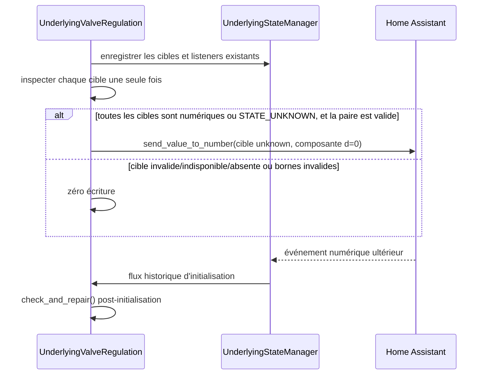

# Conception technique — issue #2049 : seed minimal des degrés de vanne

| Métadonnée            | Valeur                                                                                                         |
| --------------------- | -------------------------------------------------------------------------------------------------------------- |
| Statut                | Proposition alignée sur la spécification 1.0, prête pour revue avant développement                             |
| Version               | 2.1 — convergence normative ; remplace le prototype de bootstrap complexe                                      |
| Date                  | 2026-10-10                                                                                                     |
| Propriétaire          | Projet Versatile Thermostat                                                                                    |
| Périmètre             | `over_climate` avec `auto_regulation_valve`                                                                    |
| Modification réalisée | Documentation uniquement ; aucun code, test, configuration, dépendance ou état Home Assistant n’a été modifié. |

## 1. Sources, besoin et décision normative

### Sources analysées

- [Spécification fonctionnelle bilingue — issue #2049](issue-2049-specification.md).
- [Revue de l’issue](issue-2049-review.md).
- [Gestionnaire d’état](../../custom_components/versatile_thermostat/underlying_state_manager.py), [underlyings](../../custom_components/versatile_thermostat/underlyings.py), [thermostat de vanne](../../custom_components/versatile_thermostat/thermostat_climate_valve.py) et [algorithme de degrés](../../custom_components/versatile_thermostat/opening_degree_algorithm.py).
- [Tests d’état initial](../../tests/test_check_initial_state.py) et [tests `over_climate_valve`](../../tests/test_overclimate_valve.py).

L’issue concerne une dépendance circulaire : des `number` de consigne de vanne restent à `unknown` après un redémarrage et empêchent l’initialisation qui, elle-même, empêche la première commande. La correction doit rompre cette boucle **sans** déclarer l’appareil prêt sur la seule acceptation d’un service.

### Décision utilisateur retenue

Le prototype actuel de bootstrap à états locaux est abandonné. La solution est un **seed one-shot minimal** qui :

1. conserve strictement `UnderlyingStateManager` comme unique autorité de readiness, sans état local d’acceptation ni finalisation parallèle ;
2. conserve le démarrage, les listeners et le traitement historique des événements ;
3. juste après l’enregistrement des listeners, inspecte seulement les deux cibles configurées `opening_degree` et `closing_degree` ;
4. calcule la paire de fermeture avec le calcul existant et $d=0$, puis n’écrit, au plus une fois par cible et par instance, que les composantes dont l’état est exactement `STATE_UNKNOWN` ;
5. applique la règle atomique : une cible configurée `STATE_UNAVAILABLE`, absente/`None`, invalide, non numérique hors `STATE_UNKNOWN`, ou ayant des bornes invalides interdit toute écriture de la paire ;
6. attend ensuite le retour d’un événement numérique traité par `UnderlyingStateManager` ; en son absence, le sous-jacent demeure non prêt.

Cette décision prévaut sur les propositions antérieures d’acceptation locale, de délai de service, de finalisation parallèle, de timeout, de retry et de reprise sans feedback.

## 2. Éléments existants vérifiés et invariants

| Fait vérifié                                                                                           | Conséquence obligatoire                                                                                                        |
| ------------------------------------------------------------------------------------------------------ | ------------------------------------------------------------------------------------------------------------------------------ |
| `UnderlyingStateManager.is_all_states_initialized` refuse `None`, `unknown` et `unavailable`.          | Ne pas modifier ce prédicat ni le compléter par un état de bootstrap.                                                          |
| `UnderlyingValveRegulation.startup()` enregistre `opening_degree` et, si présent, `closing_degree`.    | Le seed est ajouté après cet enregistrement, sans remplacer les listeners existants.                                           |
| `send_percent_open()` emploie `OpeningClosingDegreeCalculation` puis les helpers d’écriture existants. | Le seed réutilise le même calcul et `send_value_to_number()` ; il ne crée pas un second chemin direct vers `number.set_value`. |
| `check_and_repair()` compare une valeur lue à la dernière valeur envoyée.                              | Il reste inchangé et exclusivement post-initialisation ; le seed ne l’appelle jamais.                                          |

### Invariants de sécurité

- Seules les entités configurées pour l’instance comme `opening_degree_entity_id` et `closing_degree_entity_id` sont admissibles.
- `STATE_UNKNOWN` est le seul état ouvrant droit à une écriture. `STATE_UNAVAILABLE`, `None`, absent et tout état non numérique non égal à `unknown` sont bloquants et sans écriture.
- L’acceptation ou l’absence d’exception du service ne prouve ni feedback, ni mouvement physique, ni readiness.
- Un état numérique préexistant suit le chemin nominal, sans réécriture.
- Aucun capteur, `climate`, autre `number` ou autre underlying n’est exempté de la règle générale.

## 3. Conception minimale

### 3.1 Responsabilités

| Composant                                               | Responsabilité après implémentation                                                                                                                                                                                                  | Hors responsabilité                                                                                                                         |
| ------------------------------------------------------- | ------------------------------------------------------------------------------------------------------------------------------------------------------------------------------------------------------------------------------------ | ------------------------------------------------------------------------------------------------------------------------------------------- |
| `UnderlyingStateManager`                                | Stocker les états réels, écouter leurs événements et décider seul si tous les états requis sont initialisés.                                                                                                                         | Amorcer, masquer ou requalifier un état.                                                                                                    |
| `UnderlyingValveRegulation`                             | Après le listener historique, évalue atomiquement l’ensemble des cibles configurées et, seulement si elles sont toutes numériques ou exactement `unknown` avec des bornes valides, envoie une fois les seules composantes `unknown`. | Déclarer le sous-jacent prêt, accepter un service comme feedback, réparer, relancer une commande ou créer un second chemin de finalisation. |
| Flux d’état historique                                  | Réagir aux événements numériques avec la logique existante, y compris l’initialisation.                                                                                                                                              | Connaître le seed.                                                                                                                          |
| `OpeningClosingDegreeCalculation`                       | Fournir la paire cohérente ouverture/fermeture.                                                                                                                                                                                      | Être modifié pour cette issue.                                                                                                              |
| `send_value_to_number()` / `hass_services_async_call()` | Porter l’écriture selon le chemin de service déjà utilisé par les commandes nominales et journaliser les erreurs existantes.                                                                                                         | Transformer une acceptation en feedback.                                                                                                    |

### 3.2 Point d’intégration et séquence

Le seul ajout fonctionnel se situe dans `UnderlyingValveRegulation.startup()`, immédiatement après `add_underlying_entities(...)` et l’installation effective des listeners. Il appelle une routine privée, par exemple `_seed_unknown_degrees_once()`.

La routine effectue une seule inspection par instance. Elle évalue l’ensemble de la paire avant toute écriture. L’idempotence est un marqueur en mémoire par cible, positionné **avant** l’appel du helper, uniquement après l’acceptation de toutes les préconditions atomiques.

## 4. Valeur sûre et contrat d’écriture

### 4.1 Paire sûre déterministe

La paire sûre est la paire de fermeture produite par le calcul existant avec la demande brute $d=0$ :

$$
(opening, closing) = calculate\_opening\_closing\_degree(0, min\_opening, max\_closing, max\_opening, opening\_threshold)
$$

Dans l’algorithme vérifié, cela donne :

$$
opening = 100 - max\_closing\_degree, \qquad closing = max\_closing\_degree
$$

Ce choix est minimal, déterministe et sûr : il n’invente ni dernière valeur persistée ni demande TPI précoce ; il reprend la représentation de fermeture déjà utilisée par le calcul normal. Il ne modifie pas `_percent_open`, `valve_open_percent`, les coefficients TPI, le mode HVAC ou les données persistées.

### 4.2 Préconditions d’émission

Avant toute écriture, l’implémentation doit vérifier, pour l’ensemble de la paire :

1. les limites de régulation requises sont numériques, finies et cohérentes : $0 \le min\_opening < max\_opening \le 100$, $0 \le max\_closing \le 100$, $0 \le opening\_threshold \le 100$ ;
2. **chaque cible configurée** existe dans l’état mis en cache du gestionnaire, et son état est soit numérique fini, soit exactement `STATE_UNKNOWN` ; `STATE_UNAVAILABLE`, `None`, absent et tout état non numérique distinct de `unknown` invalident la paire ;
3. les attributs `min` et `max` de **chaque cible configurée**, y compris une cible déjà numérique qui ne sera pas réécrite, existent, sont numériques, finis et vérifient $min \le max$ ;
4. chaque composante calculée appartient à l’intervalle `min`/`max` de sa cible correspondante ;
5. chaque cible `unknown` n’a pas déjà reçu son unique tentative dans l’instance.

La paire est calculée une seule fois, avec $d=0$. Si une précondition échoue pour une seule cible, aucune composante n’est envoyée : une écriture partielle avec une paire non admissible est interdite. Si, et seulement si, toutes les cibles sont numériques ou exactement `unknown` et toutes les préconditions sont valides, seules les composantes des cibles `unknown` sont écrites ; les cibles numériques ne sont jamais réécrites.

### 4.3 Contrat minimal de `_seed_unknown_degrees_once()`

| Élément                     | Contrat                                                                                                                                                                                                                |
| --------------------------- | ---------------------------------------------------------------------------------------------------------------------------------------------------------------------------------------------------------------------- |
| Entrées                     | Identifiants configurés, états en cache, bornes existantes et helpers existants.                                                                                                                                       |
| Précondition                | Listeners enregistrés ; instance vivante ; toutes les cibles configurées sont numériques ou exactement `unknown`, leurs bornes et la paire sont valides ; inspection non encore consommée pour chaque cible `unknown`. |
| Effet                       | Au plus une invocation de `send_value_to_number(entity_id, value)` par cible `unknown` de la paire entièrement admissible.                                                                                             |
| Erreur de helper/service    | Laisser le helper journaliser selon son contrat ; exposer un diagnostic `service_error` sans timeout ni réessai.                                                                                                       |
| Retour numérique            | Aucun traitement spécial : le listener historique décide de la readiness.                                                                                                                                              |
| Absence de retour numérique | Le gestionnaire reste non initialisé ; aucune autre écriture n’est planifiée.                                                                                                                                          |
| Idempotence                 | Un marqueur en mémoire par cible interdit tout second envoi de seed durant la même instance, même si `startup()` est rappelé ou si plusieurs événements arrivent. Il ne remplace pas le contrôle atomique de la paire. |
| Persistance                 | Aucune. Une nouvelle instance créée par rechargement repart avec un budget one-shot neuf.                                                                                                                              |

L’écriture via les helpers existants ne constitue pas une transition de disponibilité. Le flux reste non prêt jusqu’à l’événement numérique observé par `UnderlyingStateManager`.

## 5. Flux nominaux, erreurs et reprise

| Cas                                                                                                     | Seed                                                                  | Readiness et suite                                                                       |
| ------------------------------------------------------------------------------------------------------- | --------------------------------------------------------------------- | ---------------------------------------------------------------------------------------- |
| Deux degrés numériques au démarrage                                                                     | Aucune écriture.                                                      | Les callbacks historiques initialisent normalement.                                      |
| Un degré exactement `unknown`, l’autre numérique, paire valide                                          | Une seule écriture sur le degré `unknown`.                            | Attendre le retour numérique du degré seedé ; l’instance reste non prête jusque-là.      |
| Deux degrés exactement `unknown`, paire valide                                                          | Une écriture par cible, une seule fois.                               | Les deux événements numériques sont nécessaires au flux normal.                          |
| Une cible `STATE_UNAVAILABLE`                                                                           | Zéro écriture sur toute la paire, y compris si l’autre est `unknown`. | Bloquant jusqu’à un événement numérique ; pas de timeout ni retry.                       |
| Une cible absente ou état `None`                                                                        | Zéro écriture sur toute la paire.                                     | Bloquant ; diagnostic de cible absente.                                                  |
| Une cible non numérique invalide ou des bornes manquantes, non finies, incohérentes ou paire hors plage | Zéro écriture sur toute la paire.                                     | Bloquant ; correction de configuration nécessaire.                                       |
| Helper/service lève ou refuse                                                                           | Une tentative déjà consommée ; zéro retry.                            | L’état demeure non prêt jusqu’à un événement numérique réel ou une nouvelle instance.    |
| État durablement `unknown` après l’écriture                                                             | Zéro nouvelle écriture.                                               | Reste non prêt.                                                                          |
| Événement numérique après seed                                                                          | Aucun envoi additionnel.                                              | Le listener existant réévalue le manager et peut poursuivre l’initialisation historique. |

`check_and_repair()` demeure post-initialisation : il ne participe ni au seed, ni à la qualification d’un état, ni à une récupération sans feedback. Il n’existe aucun chemin parallèle de `UnderlyingValveRegulation` vers `_is_initialized`, `check_initial_state()` ou la finalisation parent : après un événement numérique, le seul chemin est `UnderlyingStateManager` puis le flux historique. Les commandes de chauffage, d’arrêt et de changement de mode ne changent pas ; elles conservent le calcul et les helpers normaux une fois l’initialisation réellement terminée.

## 6. Diagnostic, observabilité et sécurité

Le diagnostic de seed doit être journalisé, sans nouvel attribut qui prétend qu’une vanne est prête. Une ligne structurée ou un message stable contient : l’identifiant de thermostat, la cible, l’action `seed_attempted`/`seed_skipped`, et un motif borné.

| Niveau    | Motif                                                                                         | Données minimales                                                                     |
| --------- | --------------------------------------------------------------------------------------------- | ------------------------------------------------------------------------------------- |
| `debug`   | cible numérique, aucune action requise                                                        | cible, `already_numeric`                                                              |
| `info`    | seed envoyé via helper                                                                        | cible, valeur sûre, `unknown_seeded`                                                  |
| `warning` | cible indisponible/absente/invalide, bornes invalides, valeur hors plage ou erreur de service | paire et cible causale, code de motif ; aucune trace de secret                        |
| `debug`   | état toujours `unknown` après un seed                                                         | cible, `awaiting_numeric_event` ; ne pas le qualifier d’échec d’initialisation résolu |

Codes proposés : `state_unavailable`, `state_absent`, `invalid_target_state`, `invalid_bounds`, `value_out_of_range`, `service_error`, `awaiting_numeric_event`. Les états bruts et `not_initialized_entities` restent la source de vérité visible. Les journaux ne doivent jamais affirmer un mouvement physique, une acceptation comme succès fonctionnel, ni un état sain.

## 7. Matrice complète de tests anti-régression

| ID    | Scénario                                                                                               | Assertions obligatoires                                                                                                            |
| ----- | ------------------------------------------------------------------------------------------------------ | ---------------------------------------------------------------------------------------------------------------------------------- |
| T-001 | Ouverture et fermeture numériques au démarrage.                                                        | Zéro seed, listeners et initialisation historiques inchangés.                                                                      |
| T-002 | Ouverture `unknown`, fermeture numérique, bornes valides.                                              | Une écriture d’ouverture via le helper, valeur $100-max\_closing$ ; non prêt tant qu’aucun événement numérique ne revient.         |
| T-003 | Ouverture numérique, fermeture `unknown`, bornes valides.                                              | Une écriture de fermeture via le helper, valeur $max\_closing$ ; même attente du flux historique.                                  |
| T-004 | Deux cibles `unknown`, bornes valides.                                                                 | Deux écritures au plus, une par cible ; paire cohérente ; aucune écriture supplémentaire.                                          |
| T-005 | Ouverture ou fermeture `STATE_UNAVAILABLE`.                                                            | Zéro écriture sur **toute** la paire ; thermostat non prêt.                                                                        |
| T-006 | Entité absente / état `None` sur une cible.                                                            | Zéro écriture sur toute la paire ; diagnostic `state_absent` ; manager reste autorité.                                             |
| T-007 | État non numérique distinct de `unknown` et `unavailable` sur une cible.                               | Zéro écriture sur toute la paire, non prêt, aucun assouplissement de règle.                                                        |
| T-008 | `min`/`max` absents, non numériques, non finis ou inversés sur une cible, y compris numérique.         | Zéro écriture sur les deux composantes ; diagnostic `invalid_bounds`.                                                              |
| T-009 | Limites de régulation incohérentes ou paire calculée hors intervalle de cible.                         | Zéro écriture ; aucune valeur de repli arbitraire.                                                                                 |
| T-010 | Le helper/service lève une erreur.                                                                     | Une tentative maximum, diagnostic `service_error`, zéro retry et non prêt jusqu’à événement réel.                                  |
| T-011 | Écriture effectuée mais état reste `unknown`.                                                          | Aucun second envoi ; l’instance reste non prête.                                                                                   |
| T-012 | Événement numérique après seed sur une seule cible alors que l’autre reste `unknown`.                  | Pas de finalisation ; manager reste faux.                                                                                          |
| T-013 | Événements numériques après seed sur toutes les cibles requises.                                       | Le flux historique initialise une seule fois l’instance ; `check_and_repair()` reste post-initialisation.                          |
| T-014 | Événement numérique simultané ou très proche du seed.                                                  | Ni double service ni finalisation locale/parallèle ; l’unique chemin de readiness est le manager.                                  |
| T-015 | `startup()` est appelé deux fois pour une même instance.                                               | Une seule tentative par cible ; listeners demeurent fonctionnels.                                                                  |
| T-016 | Rechargement créant une nouvelle instance, cible encore `unknown`.                                     | Nouveau budget one-shot autorisé seulement dans la nouvelle instance ; pas de persistance.                                         |
| T-017 | Capteur, `climate`, `UnderlyingSwitch`, `UnderlyingValve` ou autre `number` à `unknown`/`unavailable`. | Aucune écriture de seed ; sémantique globale inchangée.                                                                            |
| T-018 | Appareil avec feedback numérique.                                                                      | Aucun seed parasite ; comportement nominal et `check_and_repair()` inchangés.                                                      |
| T-019 | Après une initialisation réelle, chauffage nominal.                                                    | Formule TPI et paires habituelles conservées.                                                                                      |
| T-020 | Après une initialisation réelle, `HVAC OFF` puis retour chauffage.                                     | Une seule commande nominale par transition ; pas de seed ni de double commande.                                                    |
| T-021 | Seuil minimal, maximum d’ouverture et maximum de fermeture.                                            | Les valeurs seedées et nominales restent dans les bornes, sans sous-dépassement.                                                   |
| T-022 | Contrôle de conformité du seed.                                                                        | Seules les cibles `unknown` admissibles reçoivent une écriture via les helpers ; la disponibilité dépend d’un événement numérique. |

Le seuil de livraison exige au minimum T-001 à T-015, T-017, T-018, T-021 et T-022, puis l’exécution des tests ciblés existants. Une écriture pour `unavailable`/absent, une écriture répétée ou une disponibilité sans événement numérique bloque la livraison.

## 8. Livraison, risques, questions et traçabilité

### 8.1 Livrables de livraison obligatoires

La livraison comprend, en plus du code et des tests, une mise à jour synchronisée de la documentation utilisateur **française et anglaise**. Elle doit documenter :

1. les profils de compatibilité effectivement vérifiés, sans déduire une compatibilité d’une marque, d’un firmware ou d’une intégration non testés ;
2. la condition stricte d’amorçage : paire $d=0$, atomique, cibles toutes numériques ou exactement `unknown`, et une seule écriture des seules composantes `unknown` ;
3. le dépannage : états `unavailable`/absent/invalide, bornes `min`/`max`, erreur de service et absence durable de feedback numérique ;
4. l’action de reprise après correction (nouvelle instance par rechargement ou redémarrage), sans promettre de timeout, retry, fallback ou readiness sur acceptation de service.

Les documents [français](../fr/over-climate.md) et [anglais](../en/over-climate.md) existants sont des cibles de livraison à corriger lors de l’implémentation. Ils ne constituent pas un comportement vérifié de la branche actuelle : leurs références à la demande courante, à `accepted`, à un timeout ou à une reprise sur cette base sont incompatibles avec la présente conception et doivent être supprimées.

### 8.2 Risques et questions

| Sujet                          | Décision                                                     | Risque résiduel / action                                                                                                                              |
| ------------------------------ | ------------------------------------------------------------ | ----------------------------------------------------------------------------------------------------------------------------------------------------- |
| Appareil sans feedback durable | Il reste non prêt après le seed, conformément à la décision. | Le blocage n’est pas masqué ; l’utilisateur doit restaurer un retour numérique ou corriger l’intégration.                                             |
| Seed de fermeture              | Demande brute $0$ et algorithme existant.                    | Peut envoyer une consigne de fermeture ; c’est voulu et borné. À valider sur matériel réel.                                                           |
| Erreur de service              | Une seule tentative, diagnostic, pas de retry.               | L’erreur peut être transitoire ; une nouvelle instance recrée un budget one-shot.                                                                     |
| Sémantique des helpers actuels | Réutilisée telle quelle.                                     | Certains helpers absorbent des exceptions ; le diagnostic doit distinguer l’invocation de l’obtention d’un retour numérique, sans inventer de succès. |
| Documentation utilisateur      | Livrable obligatoire FR/EN de la livraison.                  | Les profils réellement vérifiés et la procédure de dépannage doivent être validés avant publication.                                                  |

### Validations de livraison non bloquantes

1. Valider sur le matériel de l’issue que la paire de fermeture $(100-max\_closing, max\_closing)$ est acceptée et provoque bien, lorsque l’intégration le permet, un événement numérique.
2. Confirmer le format final des diagnostics, limité au journal ou à un attribut strictement descriptif.

### 8.3 Traçabilité et confirmation de couverture

| Exigence / décision                                                                                       | Couverture                                            |
| --------------------------------------------------------------------------------------------------------- | ----------------------------------------------------- |
| Ciblage strict `opening_degree` / `closing_degree`                                                        | Sections 2 à 4 ; T-002 à T-004 et T-017.              |
| `UnderlyingStateManager` seule autorité de readiness                                                      | Sections 2, 3 et 5 ; T-011 à T-014 et T-022.          |
| Startup/listener historique conservé                                                                      | Section 3 ; T-001, T-013 à T-015.                     |
| Seed seulement pour `STATE_UNKNOWN`                                                                       | Sections 2, 4 et 5 ; T-002 à T-007.                   |
| Atomicité : aucune écriture si une cible est indisponible, absente/`None`, invalide ou à bornes invalides | Sections 3 à 5 ; T-005 à T-009.                       |
| Toutes cibles numériques ou exactement `unknown` : seules les composantes `unknown` sont écrites          | Sections 3 et 4 ; T-001 à T-004 et T-022.             |
| Paire de fermeture calculée à $d=0$                                                                       | Section 4 ; T-002 à T-004 et T-021.                   |
| Paire sûre, bornée et via helpers existants                                                               | Section 4 ; T-002 à T-004, T-008, T-009 et T-021.     |
| Idempotence one-shot                                                                                      | Sections 3 et 4 ; T-010, T-014 à T-016.               |
| `UnderlyingStateManager` seule autorité, sans chemin parallèle                                            | Sections 2, 3 et 5 ; T-011 à T-014.                   |
| Attente d’événements numériques et non-readiness sans timeout, retry ni fallback                          | Section 5 ; T-010 à T-013.                            |
| `check_and_repair` post-initialisation                                                                    | Sections 2 et 5 ; T-018 à T-020.                      |
| Documentation de compatibilité et dépannage FR/EN au plan de livraison                                    | Section 8.1 ; vérification documentaire de livraison. |

La conception couvre donc la décision de simplification et les exigences de non-régression. Sa limite assumée est qu’elle ne transforme pas une consigne sans feedback en sous-jacent prêt : la seule transition de readiness demeure un état numérique observé par `UnderlyingStateManager`. Aucun blocage de décision ne subsiste ; la validation matérielle et l’identification des profils compatibles restent des activités de livraison, non une permission d’assouplir les règles ci-dessus.