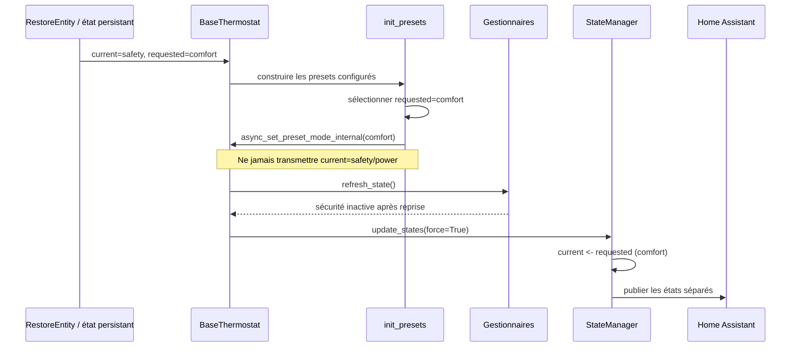

# Conception technique — Issue #2084 : préservation du préréglage demandé face aux surcharges cachées

- **Statut :** proposée pour implémentation ; ce document ne modifie ni code produit, ni configuration, ni dépendance, ni environnement Home Assistant
- **Version :** 1.1
- **Date :** 2026-10-10
- **Propriétaire :** Projet Versatile Thermostat
- **Sources normatives :** [rapport approuvé](issue-2084-review.md), [spécification fonctionnelle française](../specs/issue-2084_fr.md) et [functional specification](../specs/issue-2084_en.md)
- **Code et tests inspectés :** [base_thermostat.py](../../custom_components/versatile_thermostat/base_thermostat.py), [state_manager.py](../../custom_components/versatile_thermostat/state_manager.py), [vtherm_preset.py](../../custom_components/versatile_thermostat/vtherm_preset.py), [vtherm_central_api.py](../../custom_components/versatile_thermostat/vtherm_central_api.py), [number.py](../../custom_components/versatile_thermostat/number.py), [feature_safety_manager.py](../../custom_components/versatile_thermostat/feature_safety_manager.py), [vtherm_state.py](../../custom_components/versatile_thermostat/vtherm_state.py), [test_state_manager.py](../../tests/test_state_manager.py), [test_safety.py](../../tests/test_safety.py), [test_last_seen.py](../../tests/test_last_seen.py) et [test_temp_number.py](../../tests/test_temp_number.py)

## 1. Objectif, périmètre et exigences couvertes

La correction empêche qu'un préréglage caché présent dans `current_state.preset` devienne le choix persistant dans `requested_state.preset` lorsque les préréglages sont réinitialisés. Elle couvre strictement les chemins communs de démarrage et de rechargement des températures de préréglages centrales.

Les exigences couvertes sont FR-001 à FR-009, BR-001 à BR-007 et AC-001 à AC-010 des deux spécifications. AC-010 est couvert par la décision D-2084-02 et par le scénario de test d'historique irrécupérable de la section 7. Le résultat attendu est le suivant :

| Élément                  | Rôle contractuel après correction                                                                                                                                             |
| ------------------------ | ----------------------------------------------------------------------------------------------------------------------------------------------------------------------------- |
| `requested_state.preset` | Dernier choix utilisateur réutilisable : valeur visible configurée, ou `none`. Il ne reçoit jamais `safety` ou `power` du seul fait que cette valeur est dans l'état courant. |
| `current_state.preset`   | Préréglage effectivement appliqué ; il peut temporairement être `safety` ou `power`, calculé par les surcharges existantes.                                                   |
| `HIDDEN_PRESETS`         | Liste générique des surcharges à protéger, aujourd'hui `power` et `safety`. Aucune logique ad hoc limitée à `safety` n'est admise.                                            |

Sont explicitement exclus : TPI, seuils et délais de sécurité, restauration de l'état actif de sécurité, commandes publiques de préréglage, nouvelle migration, nouveau paramètre, automatisation, accès externe ou changement de configuration utilisateur.

## 2. État vérifié et dépendances

| Élément                                                    | Fait vérifié                                                                                                                                                                                                                    | Conséquence de conception                                                                                                                                     |
| ---------------------------------------------------------- | ------------------------------------------------------------------------------------------------------------------------------------------------------------------------------------------------------------------------------- | ------------------------------------------------------------------------------------------------------------------------------------------------------------- |
| `BaseThermostat.get_my_previous_state()`                   | Restaure séparément les attributs persistés `current_state` et `requested_state`. En l'absence de `requested_state`, le format historique du mode/preset alimente les deux.                                                     | Le chemin de restauration actuel préserve déjà un choix visible lorsqu'il est disponible ; il ne doit pas être élargi par une migration implicite.            |
| `BaseThermostat.async_startup()`                           | Appelle `get_my_previous_state()` avant `init_presets()`, puis l'initialisation complète force un recalcul d'état après l'actualisation des gestionnaires.                                                                      | Le point de correction partagé est la réapplication dans `init_presets()`, pas l'algorithme de sécurité.                                                      |
| `BaseThermostat.init_presets()`                            | Construit les préréglages disponibles, puis appelle aujourd'hui `async_set_preset_mode_internal(current_state.preset)` hors `none`.                                                                                             | C'est l'écriture qui peut contaminer l'état demandé. Elle doit utiliser uniquement une valeur demandée admissible.                                            |
| `async_set_preset_mode_internal()`                         | Accepte les valeurs présentes dans les modes configurés **ou** dans `HIDDEN_PRESETS`, puis écrit `requested_state.preset`.                                                                                                      | Il ne faut pas durcir globalement cette API interne : les flux existants de surcharge peuvent continuer à l'employer. La garde est locale à la réapplication. |
| `StateManager.calculate_current_preset()`                  | Applique `power`, puis `safety`, puis un préréglage temporisé ; sans surcharge, il copie `requested_state.preset` dans l'état courant.                                                                                          | Le retour à `comfort`/`boost` après la disparition de la surcharge reste obtenu par le calcul existant.                                                       |
| `FeatureSafetyManager`                                     | L'état actif de sécurité n'est pas restauré ; après actualisation il devient notamment `off` lorsqu'il ne doit pas être redéclenché.                                                                                            | La correction doit conserver le choix demandé pendant cette transition, sans tenter de persister la sécurité.                                                 |
| `VersatileThermostatAPI.init_vtherm_preset_with_central()` | Pour chaque thermostat utilisant les températures centrales, appelle `init_presets()`, force l'état demandé à changer puis appelle `update_states(True)`. Un changement de `TemperatureNumber` central déclenche cette méthode. | Une seule correction dans `init_presets()` couvre démarrage et rechargement central.                                                                          |
| `HIDDEN_PRESETS`                                           | Contient exactement `VThermPreset.POWER` et `VThermPreset.SAFETY`.                                                                                                                                                              | Les tests doivent être paramétrés ou dupliqués pour les deux valeurs.                                                                                         |

Les diagnostics existants de l'éditeur dans le code inspecté concernent des éléments hors périmètre (`under_entity_id` inutilisé, `pass` redondant et import `logging` inutilisé). Cette conception ne les modifie pas.

## 3. Décision de conception recommandée

### 3.1 Point d'interception minimal

Modifier uniquement la phase finale de `BaseThermostat.init_presets()` : après avoir reconstruit `_presets`, `_attr_preset_modes` et `_vtherm_preset_modes`, la réapplication ne doit plus prendre `current_state.preset` comme source.

Elle doit lire `requested_state.preset` et appeler le mécanisme interne existant **seulement** lorsque cette valeur est un préréglage visible actuellement configuré. Le prédicat de garde est explicitement : `requested_state.preset in _vtherm_preset_modes and requested_state.preset not in HIDDEN_PRESETS`. `none` conserve le comportement existant de non-réapplication. Une valeur appartenant à `HIDDEN_PRESETS` ne doit pas être passée à `async_set_preset_mode_internal()` depuis ce chemin, même si une évolution future la rendait présente dans les modes reconstruits.

Cette décision est plus sûre qu'un simple filtre sur `current_state` : elle rend la source de la réapplication cohérente avec le modèle d'état, conserve une valeur visible restaurée, et supprime la dépendance à l'état effectif temporaire. Elle ne modifie ni la signature ni le contrat de `async_set_preset_mode_internal()`.

### 3.2 Contrat de réapplication proposé

| Précondition sur `requested_state.preset` après construction des modes             | Action de `init_presets()`                                                                          | Effet sur les deux états                                                                                                   |
| ---------------------------------------------------------------------------------- | --------------------------------------------------------------------------------------------------- | -------------------------------------------------------------------------------------------------------------------------- |
| Valeur visible présente dans `_vtherm_preset_modes` et absente de `HIDDEN_PRESETS` | Réappliquer cette même valeur via le mécanisme interne existant.                                    | `requested_state` reste identique ; le recalcul ultérieur peut réaligner `current_state` si aucune surcharge n'est active. |
| `none` ou valeur absente                                                           | Ne pas réappliquer.                                                                                 | Aucun effet nouveau ; comportement actuel conservé pour l'absence de preset.                                               |
| Valeur de `HIDDEN_PRESETS`                                                         | Ne pas la réappliquer depuis l'initialisation ; journal d'avertissement recommandé, voir section 6. | La réinitialisation ne crée ni nouvelle contamination ni réécriture supplémentaire.                                        |
| Valeur visible, mais non configurée après rechargement                             | Ne pas appeler l'API interne afin d'éviter son `ValueError`; journal d'avertissement recommandé.    | Aucun choix de remplacement n'est inventé.                                                                                 |

Le contrat est idempotent : deux initialisations successives avec le même `requested_state.preset` visible ne changent pas sa valeur. Il est sans délai propre : les délais de sécurité, l'ordonnancement des gestionnaires et le recalcul existant restent applicables.

### 3.3 Fichiers impactés à l'implémentation

| Fichier                                                                                               | Symbole / zone                                                  | Modification prévue                                                                                                                                                                                                                                       |
| ----------------------------------------------------------------------------------------------------- | --------------------------------------------------------------- | --------------------------------------------------------------------------------------------------------------------------------------------------------------------------------------------------------------------------------------------------------- |
| [base_thermostat.py](../../custom_components/versatile_thermostat/base_thermostat.py)                 | `BaseThermostat.init_presets()`                                 | Remplacer la source `current_state.preset` par une validation explicite de `requested_state.preset`; ignorer les valeurs cachées ou non configurées. Ajout facultatif, mais recommandé, d'un journal d'avertissement ciblé pour un historique incohérent. |
| [test_state_manager.py](../../tests/test_state_manager.py)                                            | Tests de restauration et nouveau test de réapplication          | Couvrir les couples persistants `current=safety`, `requested=comfort` et `current=power`, `requested=comfort`, puis la réapplication et le calcul sans surcharge.                                                                                         |
| [test_temp_number.py](../../tests/test_temp_number.py)                                                | Nouveau scénario de changement d'un `TemperatureNumber` central | Couvrir l'appel API de rechargement central qui traverse `init_vtherm_preset_with_central()`.                                                                                                                                                             |
| [test_safety.py](../../tests/test_safety.py) et/ou [test_last_seen.py](../../tests/test_last_seen.py) | Assertions des scénarios d'entrée/sortie existants              | Vérifier explicitement que `requested_state.preset` reste le choix utilisateur pendant que le preset courant vaut `safety`.                                                                                                                               |

`state_manager.py`, `feature_safety_manager.py`, `vtherm_central_api.py`, `number.py`, les schémas de configuration et les traductions sont des dépendances vérifiées, mais ne doivent pas être modifiés par cette issue.

## 4. Flux de contrôle et états

### 4.1 Démarrage après sécurité active

1. `get_my_previous_state()` lit les deux snapshots. Le cas nominal restauré est `current_state.preset=safety` et `requested_state.preset=comfort`.
2. `init_presets()` reconstruit les températures puis sélectionne `requested_state.preset`, soit `comfort`; il ne lit pas l'état courant comme source de commande.
3. Lors de `init_underlyings_completed()`, l'actualisation de `FeatureSafetyManager` fixe l'état à `off` lorsque les conditions de sécurité ne sont plus réunies.
4. `update_states(force=True)` appelle `StateManager.calculate_current_preset()`. Sans surcharge `power`, `safety` ni temporisée, le calcul remet `current_state.preset` à `comfort`.
5. La publication persiste alors un état non contaminé.

### 4.2 Sécurité ou puissance encore active

1. `requested_state.preset` demeure visible, par exemple `comfort`.
2. Le gestionnaire concerné est encore détecté lors de l'actualisation.
3. `calculate_current_preset()` conserve la priorité actuelle : `power` avant `safety`; il écrit exclusivement `current_state.preset`.
4. La publication peut donc afficher `power` ou `safety` comme état courant tout en conservant `requested_state.preset=comfort`.

Il n'existe aucune annulation nouvelle : la fin de la surcharge utilise le recalcul existant. La correction ne modifie pas les événements, les consignes, les cycles TPI ni les actions sur les sous-jacents.

### 4.3 Rechargement des préréglages centraux

1. Une modification de `TemperatureNumber.async_set_native_value()` planifie `init_vtherm_preset_with_central()`.
2. L'API appelle `init_presets()` pour chaque thermostat utilisant la température centrale.
3. La même sélection fondée sur `requested_state.preset` évite toute copie de la surcharge courante.
4. L'API marque l'état demandé modifié et exécute `update_states(True)` ; sans surcharge active, le courant revient au préréglage demandé et prend les températures centrales rechargées.

## 5. Modèle de données et invariants

Les deux états sont déjà enregistrés dans les attributs Home Assistant ; aucune clé, entité, service, événement, migration ou persistance supplémentaire n'est requis.

| Invariant | Vérification attendue                                                                                                                 |
| --------- | ------------------------------------------------------------------------------------------------------------------------------------- |
| I-2084-01 | Aucun appel de `init_presets()` ne passe `current_state.preset` à l'écriture de `requested_state.preset`.                             |
| I-2084-02 | Pour une valeur visible restaurée, `requested_state.preset` reste inchangé pendant et après `init_presets()`.                         |
| I-2084-03 | Une surcharge active peut écrire `safety` ou `power` dans `current_state.preset`, jamais dans le choix demandé par le chemin corrigé. |
| I-2084-04 | Sans surcharge active, le premier recalcul applicable aligne le courant sur le demandé.                                               |
| I-2084-05 | Le rechargement central réutilise exactement la même règle que le démarrage.                                                          |
| I-2084-06 | Les valeurs inconnues, cachées ou devenues non configurées n'entraînent pas de valeur utilisateur substituée automatiquement.         |

## 6. Historique déjà corrompu, erreurs et observabilité

### 6.1 Politique explicite de récupération

Un historique est déjà corrompu lorsqu'aucun choix utilisateur fiable n'est présent, notamment si `requested_state.preset` est `safety` ou `power`, ou si le format historique ne contient qu'un `preset_mode` caché. `current_state.preset` ne peut pas servir à le réparer : il peut représenter la sécurité, la puissance, un préréglage temporisé ou un autre effet calculé, et en déduire un choix utilisateur inventerait un état métier.

**Décision D-2084-02 : ne pas effectuer de migration automatique de cet historique.** La correction :

1. empêche toute nouvelle corruption à l'initialisation et au rechargement central ;
2. conserve les valeurs persistées lorsqu'aucune source visible fiable n'existe ;
3. n'appelle pas la réapplication interne avec une valeur cachée depuis `init_presets()` ;
4. laisse la prochaine commande explicite d'un utilisateur ou d'une automatisation restaurer un préréglage visible, puis persister l'état sain ;
5. recommande un journal `warning` unique par initialisation indiquant que le choix demandé restauré est caché ou non configuré et n'est pas inféré.

Cette stratégie est volontairement conservatrice : elle ne promet pas de restaurer un choix que les données ne contiennent plus. Elle répond à BR-007 sans modifier une donnée utilisateur silencieusement.

### 6.2 Erreurs et reprise

| Situation                                      | Traitement conçu                                                                  | Reprise                                                      |
| ---------------------------------------------- | --------------------------------------------------------------------------------- | ------------------------------------------------------------ |
| Préréglage demandé visible configuré           | Appel interne existant.                                                           | Idempotent ; le recalcul normal termine l'alignement.        |
| Préréglage demandé caché                       | Ignorer à l'initialisation et journaliser l'incohérence.                          | Commande visible explicite ultérieure.                       |
| Préréglage demandé absent ou non configuré     | Ignorer et journaliser sans déclencher `ValueError`.                              | Choix explicite ultérieur ou prochaine configuration valide. |
| Surcharge encore active                        | Aucun traitement d'erreur : les gestionnaires existants gardent le courant caché. | Fin de surcharge suivie du calcul existant.                  |
| Échec de chargement des températures centrales | Hors mécanisme nouveau ; conserver les valeurs et journaux existants.             | Rechargement central suivant selon les mécanismes actuels.   |

Le journal proposé ne contient ni secret, ni température, ni donnée personnelle nouvelle ; il doit inclure l'identité du thermostat et la valeur de preset ignorée pour le diagnostic. Aucun compteur, événement ou attribut additionnel n'est nécessaire.

## 7. Plan de tests concret

Les tests doivent contrôler les valeurs internes `current_state.preset` et `requested_state.preset`; se limiter à `preset_mode` ne suffit pas, car il représente le courant effectif. Les tests asynchrones attendent les tâches Home Assistant nécessaires avant les assertions et évitent le temps réel quand les utilitaires existants permettent de piloter les horodatages.

| Test proposé                               | Fichier cible                                                                                      | Préparation et action                                                                                                                                                                                                                                                                                                                           | Assertions obligatoires                                                                                                                                                                                                                                       | Exigences / critères                    |
| ------------------------------------------ | -------------------------------------------------------------------------------------------------- | ----------------------------------------------------------------------------------------------------------------------------------------------------------------------------------------------------------------------------------------------------------------------------------------------------------------------------------------------- | ------------------------------------------------------------------------------------------------------------------------------------------------------------------------------------------------------------------------------------------------------------- | --------------------------------------- |
| Restauration Safety saine                  | [test_safety.py](../../tests/test_safety.py)                                                       | Créer un `ThermostatOverSwitch` avec les configurations de sécurité existantes ; fournir à sa restauration un snapshot complet avec `current=safety`, `requested=comfort`, HVAC et consignes valides ; démarrer avec sécurité inactive puis attendre que le thermostat soit prêt.                                                               | Après restauration et réinitialisation, demandé `comfort`; après le premier calcul, courant `comfort`; aucune écriture de `safety` dans le demandé.                                                                                                           | FR-001 à FR-005, AC-002, AC-003, AC-008 |
| Restauration Power saine                   | [test_state_manager.py](../../tests/test_state_manager.py)                                         | Restaurer le même snapshot avec `current=power`, `requested=comfort`, puis appeler `init_presets()` et `calculate_current_preset()` avec une surcharge de puissance inactive.                                                                                                                                                                   | Même séparation et même retour à `comfort`; le test cible aussi explicitement le prédicat `not in HIDDEN_PRESETS`.                                                                                                                                            | FR-003, FR-007, AC-006, AC-008          |
| Conservation d'une surcharge Safety active | [test_safety.py](../../tests/test_safety.py) ou [test_last_seen.py](../../tests/test_last_seen.py) | Réutiliser le scénario existant qui déclenche la sécurité puis, le cas échéant, changer le préréglage visible pendant la surcharge.                                                                                                                                                                                                             | Courant `safety`; demandé égal au dernier choix visible (`comfort` ou `boost`); à la fin de sécurité, le courant reprend ce même choix.                                                                                                                       | FR-008, AC-001, AC-005, AC-007          |
| Rechargement central Safety                | [test_temp_number.py](../../tests/test_temp_number.py)                                             | Créer un `ThermostatOverSwitch` utilisant les préréglages centraux, mettre `current=safety`, `requested=comfort`, sécurité inactive, puis modifier un `TemperatureNumber` central. Attendre la condition observable de fin (température centrale appliquée et état courant recalculé) avec `wait_for_local_condition`, sans temporisation fixe. | `requested` reste `comfort`; `current` revient à `comfort`; les températures centrales mises à jour sont prises en compte.                                                                                                                                    | FR-006, AC-004, AC-008                  |
| Rechargement central Power                 | [test_temp_number.py](../../tests/test_temp_number.py)                                             | Même montage avec `current=power`, demandé visible et puissance inactive ; attendre la même condition observable après la tâche créée par le changement de nombre central.                                                                                                                                                                      | Aucun `power` copié dans le demandé ; retour courant au visible.                                                                                                                                                                                              | FR-006, FR-007, AC-006                  |
| Historique irrécupérable                   | [test_state_manager.py](../../tests/test_state_manager.py)                                         | Fournir séparément les historiques `current=safety`, `requested=safety` et `current=power`, `requested=power`, puis appeler `init_presets()` et émettre ultérieurement une commande explicite vers un préréglage visible.                                                                                                                       | À l'initialisation, aucune valeur visible n'est inventée et aucun préréglage caché n'est réappliqué ; après la commande explicite, le préréglage visible devient le moyen de rétablissement. Avertissement attendu si D-2084-02 est implémentée avec journal. | BR-007, AC-003, AC-010                  |
| Préréglage visible non configuré           | [test_state_manager.py](../../tests/test_state_manager.py)                                         | Restaurer un demandé visible absent des modes reconstruits.                                                                                                                                                                                                                                                                                     | Pas de `ValueError`, pas de réécriture arbitraire, avertissement éventuel.                                                                                                                                                                                    | Robustesse de D-2084-01                 |
| Non-régression du calcul des surcharges    | [test_state_manager.py](../../tests/test_state_manager.py)                                         | Conserver et exécuter le test paramétré de `calculate_current_preset()`.                                                                                                                                                                                                                                                                        | Priorité `power > safety`, états OFF et retour vers le demandé inchangés.                                                                                                                                                                                     | FR-008, AC-007                          |

La validation minimale d'implémentation exécute les fichiers ciblés, puis la suite de tests du dépôt selon sa procédure habituelle. Aucune vérification Home Assistant manuelle, aucun démarrage de l'environnement et aucune modification de fichier de configuration ne sont requis pour cette phase de conception.

## 8. Sécurité, performance et exploitation

- **Sécurité et confidentialité :** aucun accès, permission, secret, réseau, donnée personnelle, entité ou service nouveau.
- **Performance :** une vérification d'appartenance à la liste des modes et à `HIDDEN_PRESETS` au démarrage ou rechargement ; aucun travail par cycle TPI supplémentaire.
- **Concurrence :** la correction reste dans le chemin séquentiel déjà utilisé par `init_presets()`. Le rechargement central force déjà un recalcul après l'initialisation ; aucun verrou ni tâche supplémentaire n'est proposé.
- **Observabilité :** les attributs existants `current_state` et `requested_state` restent la preuve principale de séparation. Le journal d'avertissement proposé est limité à l'historique incohérent et ne remplace pas les journaux de sécurité ou de puissance existants.
- **Retour arrière :** revenir au changement local de `init_presets()` restaure exactement le comportement antérieur. Il n'existe pas de migration de données à annuler.

## 9. Risques, alternatives et décisions

| Sujet                                                           | Décision                                                  | Justification                                                                                                          |
| --------------------------------------------------------------- | --------------------------------------------------------- | ---------------------------------------------------------------------------------------------------------------------- |
| Source de réapplication                                         | `requested_state.preset` visible et configuré uniquement. | C'est la source de vérité fonctionnelle et elle couvre les deux chemins communs.                                       |
| Filtre sur le seul `current_state`                              | Écarté.                                                   | Il masque le cas présent mais n'affirme pas la source correcte de la commande.                                         |
| Refus global des cachés dans `async_set_preset_mode_internal()` | Écarté.                                                   | L'API accepte aujourd'hui les cachés pour des flux internes ; changer son contrat élargirait le risque hors périmètre. |
| Réparation automatique d'un historique corrompu                 | Écartée.                                                  | Aucune valeur fiable ne permet de distinguer un choix utilisateur d'une surcharge ou d'un effet temporaire.            |
| Journal d'historique incohérent                                 | Recommandé, non constitutif du correctif fonctionnel.     | Aide au support sans modifier les états ni ajouter de télémétrie.                                                      |

### Questions ouvertes et bloqueurs

- **Aucun bloqueur de conception identifié.** Les spécifications française et anglaise sont cohérentes avec la décision D-2084-01 et avec la politique D-2084-02.
- **Question non bloquante :** valider en revue d'implémentation le niveau du journal d'historique (`warning` recommandé) et son éventuelle limitation pour éviter une répétition à chaque rechargement central.
- **Question non bloquante :** confirmer par le test central que la tâche créée après un changement de `TemperatureNumber` peut être attendue de façon déterministe avec les utilitaires du dépôt.

## 10. Traçabilité et conclusion

| Exigence                                                | Décision ou preuve de conception                                                                                                                                                                                                        |
| ------------------------------------------------------- | --------------------------------------------------------------------------------------------------------------------------------------------------------------------------------------------------------------------------------------- |
| FR-001, FR-002, BR-001, BR-002                          | D-2084-01 sépare explicitement source demandée et état courant dans `init_presets()`.                                                                                                                                                   |
| FR-003, FR-004, FR-005, BR-003 à BR-005, AC-002, AC-003 | Le flux de démarrage restaure `comfort`, ignore toute surcharge cachée comme source, puis laisse le calcul existant réaligner le courant.                                                                                               |
| FR-006, AC-004                                          | Le rechargement central appelle déjà le même `init_presets()` ; aucun second mécanisme n'est créé.                                                                                                                                      |
| FR-007, BR-006, AC-006                                  | Le prédicat exclut explicitement `HIDDEN_PRESETS` et les tests couvrent `safety` et `power`.                                                                                                                                            |
| FR-008, AC-001, AC-005, AC-007                          | `StateManager` et les gestionnaires restent inchangés ; les tests confirment les surcharges actives et leur sortie.                                                                                                                     |
| FR-009, AC-008                                          | Le tableau de la section 7 fournit des scénarios de régression automatisables, leurs assertions et les fichiers de test ciblés.                                                                                                         |
| BR-007, AC-010                                          | D-2084-02 interdit toute réparation, sélection visible ou réapplication cachée automatiques lorsque les deux états persistés sont cachés ; le test « Historique irrécupérable » vérifie aussi le rétablissement par commande explicite. |
| AC-009                                                  | Les sections 1, 3.3 et 8 excluent explicitement toute modification de TPI, de la configuration utilisateur et de l'environnement Home Assistant.                                                                                        |

La solution recommandée est donc une correction locale de `BaseThermostat.init_presets()` fondée sur `requested_state.preset` visible et configuré, complétée par des tests de restauration, de surcharge active, de rechargement central et d'historique déjà corrompu. Elle interdit la copie de `safety`/`power` de l'état courant vers l'état demandé, sans modifier les comportements de sécurité, de puissance ou de régulation existants.