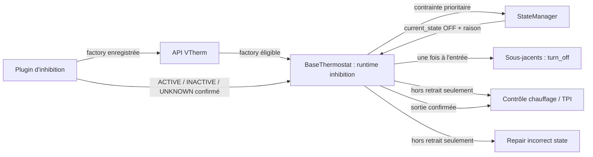
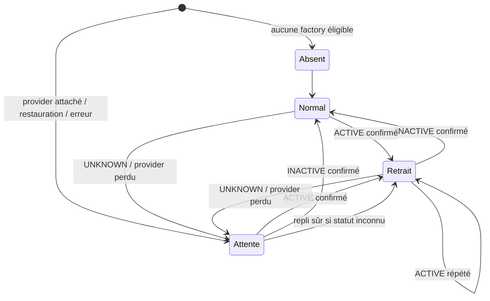
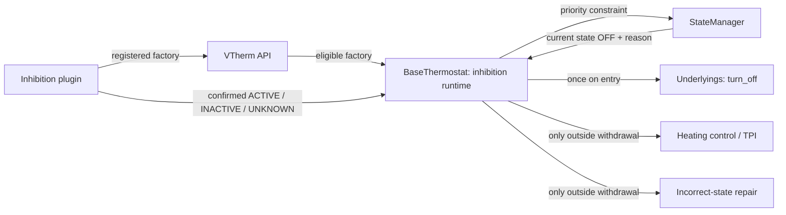
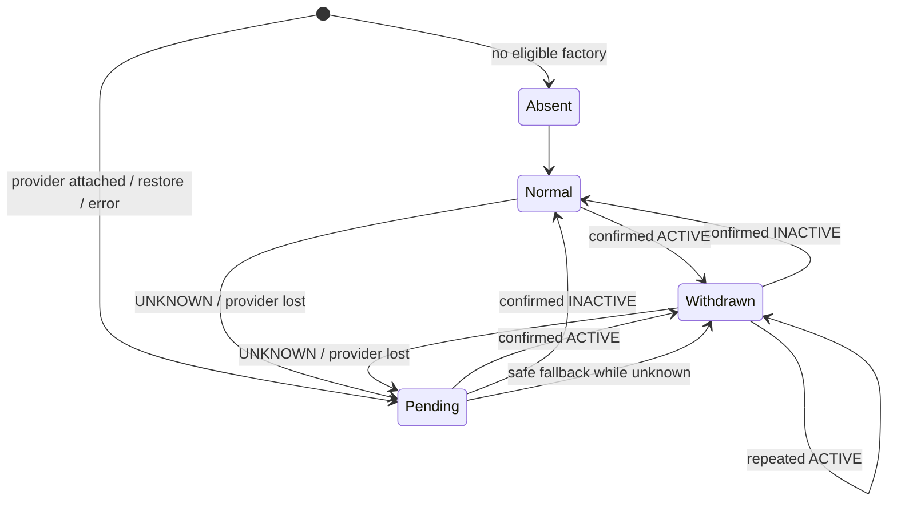

# Conception logicielle détaillée — Issue #2087 : inhibition extensible d’un VTherm

| Champ                       | Valeur                                                                                                                                                                                          |
| --------------------------- | ----------------------------------------------------------------------------------------------------------------------------------------------------------------------------------------------- |
| Statut                      | Proposition de conception convergée avec la spécification 1.2 — validation mainteneur requise avant développement                                                                               |
| Version                     | 1.1                                                                                                                                                                                             |
| Date                        | 2026-10-11                                                                                                                                                                                      |
| Propriétaire                | Projet Versatile Thermostat                                                                                                                                                                     |
| Issue                       | [#2087 — Add an "inhibit" sensor to pause a VTherm](https://github.com/jmcollin78/versatile_thermostat/issues/2087)                                                                             |
| Sources normatives          | [Revue validée](issue-2087-review.md), [spécification bilingue](../specs/issue-2087-inhibition-spec.md)                                                                                         |
| Éléments vérifiés           | `state_manager.py`, `base_thermostat.py`, `prop_handler_tpi.py`, `feature_repair_incorrect_state_manager.py`, `underlyings.py`, `vtherm_state.py`, et l’API `vtherm_api` cités dans les sources |
| Hors périmètre documentaire | Toute modification de code, de configuration, de dépendance ou de test                                                                                                                          |

> **Statuts utilisés.** « Vérifié » décrit le dépôt lu le 2026-10-11. « Décision de conception » est une proposition normative pour l’implémentation de l’issue. « Hypothèse » doit être validée si elle conditionne une livraison. Aucun élément proposé n’est présenté comme déjà disponible.

## 1. Objectif, périmètre et exigences couvertes

L’issue introduit un mécanisme d’inhibition **extensible**, non une fonctionnalité utilisateur complète dans le core. Un plugin détecte une condition externe et, après ses propres délais, signale son statut et sa politique effective. Le core conserve l’intention utilisateur dans `requested_state`, résout l’état effectif à `OFF`, retire le contrôle des sous-jacents et suspend les ordres VTherm jusqu’à la sortie. Le plugin fournit, pour chaque VTherm, la politique demandant ou non l’arrêt physique unique à l’entrée : son défaut et son repli sûr sont « éteindre ». Seule cette émission physique est conditionnelle ; le retrait, la suspension et la résolution `OFF` le sont toujours.

La conception couvre FR-001 à FR-016, BR-001 à BR-010 et AC-001 à AC-014 de la spécification. Elle respecte les exclusions V1 : pas d’état `inhibited` dans `VThermState`, aucune configuration ou service utilisateur d’inhibition dans le core, pas de multi-provider actif, et aucun mode forcé autre que `OFF`.

### Invariants V1

1. `requested_state` reste la seule source de l’intention durable HVAC, preset et consigne.
2. `current_state` reste l’état calculé ; l’inhibition est une contrainte de calcul et non un champ de `VThermState`.
3. Le plugin ne commande ni `climate.set_hvac_mode`, ni les sous-jacents.
4. Seul le core exécute l’arrêt d’entrée et la réconciliation de sortie.
5. Une période de retrait `ACTIVE` ou `UNKNOWN` avec provider attaché suspend toute commande de régulation, TPI, scheduler et réparation ; les commandes externes ne sont donc pas annulées par le VTherm.
6. Une sortie ne reconstruit jamais une ancienne intention : elle repart du `requested_state` courant.

$$
current\_state = f(requested\_state, contraintes\ actives)
$$

## 2. État existant vérifié et dépendances

| Élément vérifié       | Fait constaté                                                                                                                                                                  | Conséquence de conception                                                                                                                                      |
| --------------------- | ------------------------------------------------------------------------------------------------------------------------------------------------------------------------------ | -------------------------------------------------------------------------------------------------------------------------------------------------------------- |
| API de plugin         | `VThermAPI` possède des registres de factories d’algorithmes proportionnels et de feature managers ; l’enregistrement actuel remplace une factory de même nom.                 | Ajouter un registre dédié, sans détourner les feature managers ni modifier leurs priorités existantes.                                                         |
| Chargement externe    | `BaseThermostat` charge les feature managers externes dans `post_init()` puis réessaie dans `async_startup()`.                                                                 | Reprendre le principe de détection tardive, avec un cycle de vie dédié à l’inhibition.                                                                         |
| Résolution HVAC       | `StateManager.calculate_current_hvac_mode()` applique actuellement central/sécurité, fenêtre, auto-start/stop et modes centraux avant l’état demandé.                          | Insérer l’inhibition après l’arrêt central et la sécurité, avant fenêtre et auto-start/stop.                                                                   |
| Application d’état    | `BaseThermostat.update_states()` envoie normalement le HVAC calculé à chaque sous-jacent et appelle ensuite le contrôle.                                                       | Ajouter un chemin d’entrée/sortie d’inhibition qui publie l’état VTherm sans laisser ce chemin générique piloter les sous-jacents pendant le retrait.          |
| Boucle de contrôle    | `async_control_heating()` appelle la logique spécifique puis le refresh des plugins et `check_and_repair()`. Le TPI peut renvoyer un arrêt lorsque le HVAC effectif est `OFF`. | Le garde de retrait doit être placé avant `_control_heating_specific()`, le refresh des managers externes et le repair afin d’empêcher les ordres périodiques. |
| Réparation            | `FeatureRepairIncorrectStateManager.check_and_repair()` peut réémettre des commandes vers chaque sous-jacent.                                                                  | Elle est explicitement court-circuitée durant le retrait.                                                                                                      |
| Persistance existante | `get_my_previous_state()` restaure `current_state`, `requested_state`, raisons HVAC et états de managers depuis les attributs de l’entité.                                     | Persister l’état core d’inhibition dans les attributs restaurables, séparément de `VThermState`.                                                               |
| Sous-jacents          | `async_underlying_entity_turn_off()` annule le cycle puis appelle `turn_off()` sur les sous-jacents.                                                                           | Cette opération est la seule voie physique d’arrêt d’entrée proposée ; la voie HVAC générique est inhibée pendant ce passage.                                  |

Aucune source lue ne fournit déjà un contrat `InhibitionProvider`, une factory `register_inhibition_provider_factory(factory)`, une raison `hvac_off_inhibition` ou un état de retrait core.

## 3. Vue d’ensemble et responsabilités



| Composant                                  | Responsabilité V1                                                                                                                                     | Interdictions et limites                                                                  |
| ------------------------------------------ | ----------------------------------------------------------------------------------------------------------------------------------------------------- | ----------------------------------------------------------------------------------------- |
| API publique                               | Exposer le contrat, enregistrer les factories et signaler les conflits.                                                                               | Ne détecte pas de capteur et ne pilote aucun VTherm.                                      |
| Factory d’inhibition                       | Déterminer l’éligibilité d’un runtime VTherm et créer au plus un provider candidat.                                                                   | Ne choisit pas les priorités HVAC et ne crée pas plusieurs providers pour le même VTherm. |
| `InhibitionProvider` plugin                | Observer les sources, appliquer ses délais/bypass, produire un statut confirmé, exposer la politique effective par VTherm et notifier une transition. | Ne modifie pas `requested_state`, `current_state`, les sous-jacents ou le HVAC.           |
| Runtime d’inhibition dans `BaseThermostat` | Sérialiser les transitions, conserver le retrait, exécuter conditionnellement l’arrêt d’entrée et décider de la reprise.                              | Ne contient aucune source, délai, bypass ou configuration utilisateur d’inhibition.       |
| `StateManager`                             | Imposer `OFF` et la raison dédiée lorsque le retrait est confirmé actif ou en attente sûre, tout en gardant les contraintes supérieures.              | Ne transmet pas de service aux sous-jacents.                                              |
| `BaseThermostat` / prop handler / repair   | Ne pas exécuter de régulation, TPI, scheduler, refresh externe ou repair tant que le contrôle est retiré.                                             | Ne doit pas réémettre `OFF` à chaque cycle.                                               |
| Sous-jacents                               | Reçoivent l’arrêt d’entrée seulement si la politique vaut `TURN_OFF`, puis la commande normale de réconciliation à la sortie.                         | Restent autrement sous contrôle direct de l’utilisateur ou d’une autre intégration.       |

## 4. Contrats et protocoles proposés

### 4.1 API publique et factory

**D-2087-01 — API dédiée.** Le package public `vtherm_api` expose exactement `register_inhibition_provider_factory(factory)`. Une fonction symétrique de désenregistrement est nécessaire pour le cycle de vie plugin, mais ne remplace pas la fonction exigée. Les deux délèguent au registre dédié de l’instance API, distinct des registres de proportional handlers et de feature managers.

| Contrat                                         | Entrées et préconditions                                                             | Résultat et erreurs                                                                                                                                                      |
| ----------------------------------------------- | ------------------------------------------------------------------------------------ | ------------------------------------------------------------------------------------------------------------------------------------------------------------------------ |
| `register_inhibition_provider_factory(factory)` | Factory non nulle, `name` non vide et stable. Appel effectué par le setup du plugin. | Enregistre la factory. Un nom déjà enregistré par une autre instance produit `ValueError` explicite ; aucun remplacement silencieux n’est admis.                         |
| `unregister_inhibition_provider_factory(name)`  | Nom précédemment enregistré.                                                         | Retire l’inscription ; les runtimes déjà attachés passent d’abord par la politique `UNKNOWN` décrite en D-2087-06. Une absence est idempotente.                          |
| `factory.supports(thermostat)`                  | Vue runtime en lecture seule. Méthode pure, synchrone et sans service HA.            | `True` signifie « candidate » ; `False` signifie « non applicable ». Une exception est journalisée et traitée comme candidate défaillante, pas comme `False` silencieux. |
| `factory.create(thermostat)`                    | Factory unique retenue et thermostat non supprimé.                                   | Retourne un provider lié à un seul VTherm. Une exception laisse le VTherm en statut `UNKNOWN`, avec observabilité d’erreur.                                              |

Une factory fournit au minimum un identifiant `name`, `supports(thermostat)` et `create(thermostat)`. Le protocole s’appuie sur les vues runtime existantes : il privilégie `entity_id` et `unique_id`, jamais un identifiant de périphérique pour décider l’éligibilité ou l’écoute.

### 4.2 Contrat `InhibitionProvider`

**D-2087-02 — Statut ternaire obligatoire.** Un booléen seul ne distingue pas absence de détection et absence de confirmation. Le provider expose donc le statut stable suivant :

| Valeur     | Signification                                                                                                        | Autorisation donnée au core                                          |
| ---------- | -------------------------------------------------------------------------------------------------------------------- | -------------------------------------------------------------------- |
| `ACTIVE`   | La condition est confirmée active après délais/bypass plugin.                                                        | Entrer ou rester en retrait.                                         |
| `INACTIVE` | La condition est confirmée inactive après délais/bypass plugin.                                                      | Sortir ou rester hors retrait.                                       |
| `UNKNOWN`  | Source indisponible, initialisation incomplète, erreur de lecture, arrêt/rechargement, ou délai non encore confirmé. | Ne pas déduire une transition active/inactive ; appliquer D-2087-06. |

Le protocole minimal proposé est : identité stable `name`, `post_init(entry_infos)`, `async_start_listening()`, `stop_listening()`, `restore_state(old_state)`, `async_refresh_state()`, lecture de `status`, lecture de `physical_stop_policy` **[nom à confirmer]**, et enregistrement d’un callback asynchrone de transition. La politique est une valeur normalisée du provider, proposée sous `TURN_OFF` ou `DO_NOT_TURN_OFF` **[noms et valeurs sérialisées à confirmer]**. Le provider fournit `TURN_OFF` lorsque son option est absente ou invalide; le core adopte la même valeur en l’absence de provider exploitable ou de politique connue. `async_refresh_state()` et le callback ne rapportent que les états **confirmés** ; une source brute ou une temporisation n’est jamais publiée comme une transition métier.

Le callback transmet au minimum : le nouveau statut, l’ancien statut, l’horodatage du provider, l’identifiant de provider et la politique effective. Les appels redondants même-valeur sont autorisés mais doivent être idempotents côté core. Le callback ne transmet ni entité source, ni valeur brute, ni détail de bypass ; ces diagnostics restent plugin-specific. Le runtime capture la politique à l’entrée et la conserve jusqu’à la sortie : une modification pendant le retrait s’applique à l’entrée suivante, sans arrêt tardif ni reprise anticipée **[décision de granularité à confirmer]**.

### 4.3 Contrat core/provider

| Règle                     | Contrat exécutable                                                                                                                                                                                                   |
| ------------------------- | -------------------------------------------------------------------------------------------------------------------------------------------------------------------------------------------------------------------- |
| Sérialisation             | Le runtime `BaseThermostat` possède un verrou/tâche de transition par VTherm. Une transition, une modification utilisateur et un unload ne peuvent pas appliquer des commandes concurrentes.                         |
| Accusé de prise en compte | Le callback est considéré traité seulement après mise à jour du runtime, recalcul du `StateManager`, publication d’attributs et planification de l’action autorisée.                                                 |
| Idempotence               | `ACTIVE → ACTIVE`, `INACTIVE → INACTIVE` et tout replay d’un même identifiant de transition ne produisent aucune commande physique supplémentaire.                                                                   |
| Délai                     | Aucun délai core n’est ajouté. Les délais de détection sont entièrement une responsabilité plugin. Les délais de service des sous-jacents sont ceux déjà existants, sans nouvelle garantie temporelle.               |
| Erreur provider           | L’erreur est journalisée avec VTherm et nom de provider, expose `UNKNOWN`, conserve la politique persistée ou applique le repli `TURN_OFF`, puis suit D-2087-06. Elle ne doit pas faire tomber la boucle globale HA. |

### 4.4 Unicité et conflits

**D-2087-03 — Premier candidat retenu, conflit explicite.** L’ordre d’inscription dans le registre dédié est conservé ; il ne doit pas être remplacé par l’ordre alphabétique utilisé ailleurs dans l’API. Pour un VTherm donné :

1. aucune factory éligible : aucun provider, comportement VTherm historique ;
2. une factory éligible : son provider est attaché ;
3. plusieurs factories éligibles : la première enregistrée reste l’unique provider attaché, chaque candidate suivante est rejetée pour ce VTherm et produit une erreur structurée comprenant le VTherm, le provider retenu et le provider rejeté.

Ce choix préserve le « premier provider reste autorisé » de la spécification tout en rendant le conflit visible. Aucune priorité numérique ni agrégation core de providers n’est introduite en V1. Un plugin qui a plusieurs sources les agrège derrière son unique provider.

## 5. Modèle d’état, persistance et priorités

### 5.1 État runtime proposé

Le runtime de `BaseThermostat` introduit un objet interne distinct de `VThermState`.

| Champ runtime           | Type                                                            | Signification                                                                                  |
| ----------------------- | --------------------------------------------------------------- | ---------------------------------------------------------------------------------------------- |
| `provider_name`         | chaîne ou `null`                                                | Provider effectivement attaché ; `null` sans provider éligible.                                |
| `provider_status`       | `ACTIVE` / `INACTIVE` / `UNKNOWN` / `ABSENT`                    | Dernier statut reçu ; `ABSENT` est différent de `UNKNOWN`.                                     |
| `withdrawal_active`     | booléen                                                         | Le VTherm a retiré son contrôle des sous-jacents.                                              |
| `effective_stop_policy` | `TURN_OFF` / `DO_NOT_TURN_OFF`                                  | Politique effective capturée à l’entrée; le défaut et le repli sont `TURN_OFF`.                |
| `entry_handled`         | booléen                                                         | La garde de retrait a été accomplie pour l’activation courante, y compris sans arrêt physique. |
| `physical_stop_emitted` | booléen                                                         | L’unique tentative d’arrêt physique a été soumise; il est distinct de `entry_handled`.         |
| `physical_stop_result`  | `not_required` / `sent` / `failed_or_unknown` **[à confirmer]** | Diagnostic d’émission, sans prétendre connaître l’état réel du matériel.                       |
| `awaiting_confirmation` | booléen                                                         | `UNKNOWN` bloque une reprise ; il rend le repli observable.                                    |
| `last_transition_at`    | date ISO ou `null`                                              | Diagnostic de dernière transition core traitée.                                                |
| `last_error_code`       | chaîne ou `null`                                                | Code stable d’erreur de factory/provider/service, sans donnée de source.                       |

L’état persistant est proposé sous `specific_states.inhibition` avec `schema_version: 1` **[emplacement/format à confirmer]** et les champs ci-dessus utiles au redémarrage. Il est restauré par le core dans `get_my_previous_state()` avant la première réconciliation. `requested_state` et `current_state` restent sérialisés exactement selon leur format actuel ; **`inhibited` n’est ajouté ni à `VThermState`, ni à leurs dictionnaires.**

Les détails plugin (entités observées, temps de debounce, bypass, valeur brute) ne sont pas recopiés par le core. Le provider peut persister ses propres éléments selon son domaine, mais ce n’est pas un contrat du core.

### 5.2 Machine d’états core



`Attente` est un état d’observabilité ; son effet opérationnel est un **retrait sûr**. Il ne prétend pas que l’inhibition est active. Ainsi l’UI et les journaux distinguent une détection `ACTIVE` d’un provider non confirmé.

### 5.3 Résolution HVAC et priorité

**D-2087-04 — Ordre V1.** Dans `StateManager.calculate_current_hvac_mode()`, l’ordre devient :

1. arrêt central et sécurité ;
2. inhibition confirmée `ACTIVE`, ou retrait préventif `UNKNOWN` avec provider attaché ;
3. fenêtre ;
4. auto-start/stop ;
5. modes centraux restants et état demandé existant.

L’inhibition résout toujours le HVAC effectif à `OFF`, y compris si `requested_state.hvac_mode` vaut déjà `OFF`. Lorsque cette contrainte gagne sur les contraintes inférieures, elle propose la raison stable `hvac_off_inhibition` pour `hvac_off_reason` et `hvac_mode_reason` **[format exact de coexistence avec une raison manuelle à confirmer]**. Dans tous les cas, le snapshot d’inhibition rend le retrait visible. Central et sécurité conservent leur raison prioritaire lorsqu’ils gagnent la résolution.

Les règles de preset et de température existantes restent inchangées. Leur évolution pendant le retrait met seulement à jour l’intention et les attributs ; aucune commande de sous-jacent n’en résulte.

## 6. Séquencement et lifecycle

### 6.1 Bootstrap, démarrage et provider chargé tardivement

**D-2087-05 — Gating avant reprise.** Le démarrage ne peut jamais reprendre le contrôle tant qu’un provider attaché n’a pas confirmé `INACTIVE` ou que la politique sûre n’a pas été appliquée.

1. `post_init()` cherche un candidat déjà inscrit, sans démarrer de listener.
2. `async_startup()` refait cette recherche pour couvrir un plugin enregistré tardivement, puis initialise et démarre le provider avant la restauration complète.
3. `get_my_previous_state()` restaure `requested_state`, le snapshot `specific_states.inhibition`, puis donne l’ancien état au provider si le contrat le requiert.
4. Le provider fait un refresh initial et retourne `ACTIVE`, `INACTIVE` ou `UNKNOWN`.
5. Le runtime réconcilie snapshot et statut : active confirmée maintient le retrait ; inactive confirmée le libère ; inconnue applique D-2087-06.
6. `init_underlyings_completed()` peut calculer et publier l’état, mais son chemin générique est gardé tant que le runtime est en retrait ou attente.

Un plugin arrivant après l’initialisation déclenche le même chemin de rattachement. Si le VTherm est alors en fonctionnement normal, il entre immédiatement en `UNKNOWN` puis dans le retrait sûr jusqu’à la première confirmation : il ne bénéficie d’aucune reprise optimiste.

Au retrait de l’intégration plugin, à `stop_listening()`, à l’unload ou à une exception de lecture, le runtime reçoit explicitement `UNKNOWN` avant de détacher les callbacks. Cela évite qu’un provider disparu soit silencieusement interprété comme `INACTIVE`.

### 6.2 Entrée confirmée : `INACTIVE → ACTIVE`

```mermaid
sequenceDiagram
    participant P as Provider plugin
    participant B as BaseThermostat
    participant S as StateManager
    participant U as Sous-jacents

    P->>B: transition ACTIVE confirmée
    B->>B: verrouiller; withdrawal_active=true
    B->>S: recalculer avec contrainte inhibition
    S-->>B: current HVAC=OFF, raison inhibition
    B->>B: mémoriser politique, retrait et entrée traitée
    alt politique TURN_OFF
        B->>U: async_underlying_entity_turn_off() une fois
        B->>B: physical_stop_emitted=true
    else politique DO_NOT_TURN_OFF
        B->>B: aucun turn_off physique
    end
    B->>B: suspendre contrôle/TPI/repair
    B-->>P: transition prise en compte
```

La commande physique est émise par une voie dédiée, au plus une fois pour l’activation courante, **si et seulement si** la politique effective vaut `TURN_OFF`; cela inclut le cas où le HVAC effectif était déjà `OFF` mais qu’un sous-jacent est actif. Avec `DO_NOT_TURN_OFF`, l’entrée est néanmoins traitée, le contrôle retiré et aucune commande `turn_off` n’est soumise. Pendant cette transition, `update_states()` ne doit pas aussi parcourir `under.set_hvac_mode(OFF)` : cela éviterait le double arrêt. Il publie le nouvel état VTherm et ses raisons, mais délègue l’arrêt physique exclusivement à `async_underlying_entity_turn_off()`.

### 6.3 Maintien : retrait actif ou en attente

| Point d’entrée existant                                 | Comportement conçu pendant retrait                                                                                                                                                                   |
| ------------------------------------------------------- | ---------------------------------------------------------------------------------------------------------------------------------------------------------------------------------------------------- |
| Cycle `async_control_heating()`                         | Retour contrôlé avant `_control_heating_specific()`, avant le TPI et avant le refresh des feature managers externes qui peuvent agir. Les listeners passifs continuent de fournir leurs transitions. |
| `prop_handler_tpi.control_heating()`                    | N’est pas appelé ; son arrêt périodique `OFF` ne peut donc pas écraser une commande directe.                                                                                                         |
| `FeatureRepairIncorrectStateManager.check_and_repair()` | N’est pas appelé ; ses compteurs ne sont pas modifiés par les cycles suspendus.                                                                                                                      |
| Modification HVAC/preset/consigne                       | Met à jour `requested_state`, recalcule et publie l’état VTherm, mais ne transmet aucun HVAC ni cycle aux sous-jacents.                                                                              |
| Commande directe externe                                | Aucun listener VTherm n’émet de correction, de réparation ou d’arrêt périodique.                                                                                                                     |
| Événement sécurité/central                              | Les capteurs et états peuvent rester observés ; la résolution et la raison supérieure sont mises à jour sans restaurer le contrôle de sous-jacent.                                                   |

Le garde doit englober le scheduler et tout handler spécialisé, pas uniquement le cas `vtherm_hvac_mode == OFF`. Sinon TPI ou repair réintroduiraient exactement le conflit que l’issue élimine.

### 6.4 Sortie confirmée : `ACTIVE/UNKNOWN → INACTIVE`

1. Sérialiser la transition et annuler l’état d’attente/retrait avant la réconciliation.
2. Mettre `withdrawal_active=false`, `awaiting_confirmation=false` et réinitialiser la garde d’arrêt pour une future entrée.
3. Forcer un nouveau calcul à partir du `requested_state` **courant**, puis appliquer les autres contraintes encore actives.
4. Emprunter une seule fois le chemin normal `update_states(force=True)` : transmission HVAC aux sous-jacents, recalcul et contrôle spécialisé si l’état effectif l’autorise.
5. Si l’intention est `OFF`, le chemin normal conserve `OFF` et ne réactive aucun sous-jacent.

Cette sortie est idempotente : un `INACTIVE` répété ne lance pas une deuxième réconciliation.

### 6.5 Rechargement et redémarrage

| Situation                                                         | Politique proposée                                                                                                                                       |
| ----------------------------------------------------------------- | -------------------------------------------------------------------------------------------------------------------------------------------------------- |
| Redémarrage, snapshot `withdrawal_active=true`, provider `ACTIVE` | Rester retiré ; si `physical_stop_emitted=true`, ne pas renvoyer l’arrêt.                                                                                |
| Redémarrage, snapshot actif, provider `INACTIVE`                  | Sortie unique vers le `requested_state` restauré.                                                                                                        |
| Redémarrage, snapshot actif, provider `UNKNOWN`                   | Conserver retrait et absence de commandes périodiques ; la politique persistée décide d’une émission inconnue.                                           |
| Redémarrage, snapshot inactif, provider `INACTIVE`                | Chemin normal existant.                                                                                                                                  |
| Redémarrage, snapshot inactif/absent, provider `UNKNOWN`          | Retrait préventif : arrêter au plus une fois seulement si la politique effective ou son repli vaut `TURN_OFF`, puis attendre confirmation.               |
| Reload du plugin pendant un retrait                               | Passer à `UNKNOWN`, maintenir retrait et garde; seul un `INACTIVE` confirmé autorise la reprise. Aucun `turn_off` si la politique est `DO_NOT_TURN_OFF`. |

### 6.6 Limite d’exactly-once

Une commande HA vers un sous-jacent et l’écriture persistée de la garde ne sont pas transactionnelles. Par conséquent, « une fois » signifie : **une seule émission logique par activation dans un processus sain**, et aucune réémission après redémarrage lorsque `physical_stop_emitted=true` a été restauré. Une panne brutale entre l’appel de service et la persistance peut rendre impossible une garantie end-to-end exactement-une-fois sans transaction idempotente supportée par chaque sous-jacent.

La conception retient une persistance après succès de l’appel pour privilégier l’arrêt sûr ; au prochain démarrage, un marqueur `pending` peut nécessiter une tentative de récupération, potentiellement redondante. Cette limite doit être explicitement acceptée comme risque technique ; elle ne concerne pas AC-007 lorsque l’arrêt déjà effectué a bien été persisté.

## 7. Politique explicite pour provider indisponible ou non confirmé

**D-2087-06 — Politique sûre convergée : retrait observable, arrêt conditionnel.** Cette décision applique BR-010/AC-010 sans interpréter silencieusement `UNKNOWN` comme `ACTIVE` ou `INACTIVE` :

- `UNKNOWN` est un statut distinct et publiquement observable ; il n’est pas une détection active.
- Si un provider est attaché mais est `UNKNOWN`, le core interdit toute reprise ou commande de régulation/TPI/repair. Il passe en état `awaiting_confirmation=true`, résout `OFF` et applique le même garde de retrait que `ACTIVE`.
- Lorsqu’aucune émission physique n’est connue pour cette période, le core exécute une unique coupure de précaution **seulement si** `effective_stop_policy=TURN_OFF`. Si la politique est `DO_NOT_TURN_OFF`, il n’envoie jamais `turn_off`, y compris en `UNKNOWN`.
- Si une émission physique déjà faite est restaurée, le core n’envoie pas une seconde coupure. Si la politique est absente ou le provider inexploitable, le repli sûr est `TURN_OFF`.
- Seule une confirmation explicite `INACTIVE` autorise la reprise normale. `ACTIVE` confirme le retrait ; il ne redouble pas la coupure.
- Si aucune factory ne supporte le VTherm (`ABSENT`), le comportement historique est conservé : le repli sûr ne s’applique pas.

Cette politique évite une reprise silencieuse du VTherm pendant une inhibition potentiellement réelle, tout en respectant explicitement le choix plugin de ne pas éteindre physiquement. L’attribut `awaiting_confirmation`, la politique effective, le statut et le journal d’erreur doivent rendre ce coût immédiatement diagnostiquable. Cette sémantique est convergée avec la spécification; elle n’est plus un bloqueur de gouvernance.

## 8. Erreurs, annulations, sécurité et observabilité

### 8.1 Erreurs et conflits

| Cas                               | Réaction core                                                                                     | Observable                             | Effet sur les sous-jacents                                                                         |
| --------------------------------- | ------------------------------------------------------------------------------------------------- | -------------------------------------- | -------------------------------------------------------------------------------------------------- |
| Nom de factory vide ou dupliqué   | Refus d’enregistrement explicite.                                                                 | Exception et journal API.              | Aucun.                                                                                             |
| Plusieurs factories éligibles     | Première conservée, suivantes refusées pour ce VTherm.                                            | Erreur structurée avec les deux noms.  | Le provider retenu reste seul décisionnaire.                                                       |
| `supports()` ou `create()` échoue | Provider en erreur/`UNKNOWN`.                                                                     | Code d’erreur, log, attribut runtime.  | Retrait; coupure unique seulement si la politique persistée ou le repli vaut `TURN_OFF`.           |
| Callback obsolète après unload    | Ignoré par génération/identifiant de provider sous verrou.                                        | Debug tracé, pas d’erreur utilisateur. | Aucun ordre tardif.                                                                                |
| `turn_off()` échoue               | Conserver retrait, `entry_handled=true`, `physical_stop_emitted`/résultat incertain, journaliser. | Code de service et résultat physique.  | Ne jamais reprendre automatiquement ni réémettre périodiquement; récupération contrôlée seulement. |
| Réconciliation de sortie échoue   | Réactiver le garde de retrait, signaler échec.                                                    | Erreur et attribut d’état.             | Pas de commandes de contrôle supplémentaires tant que non stabilisé.                               |

Une annulation de transition (suppression d’entité, unload, annulation de tâche) libère listeners et scheduler existants sans envoyer une commande de reprise. Elle laisse l’état persisté décrivant le dernier retrait sûr connu.

### 8.2 Attributs, journaux et événements internes

Le core ajoute uniquement des diagnostics génériques, par exemple :

| Emplacement                  | Valeurs minimales                                                                                                                                                                                         |
| ---------------------------- | --------------------------------------------------------------------------------------------------------------------------------------------------------------------------------------------------------- |
| `specific_states.inhibition` | version, provider_name, provider_status, withdrawal_active, awaiting_confirmation, effective_stop_policy, entry_handled, physical_stop_emitted, physical_stop_result, last_transition_at, last_error_code |
| Raisons existantes           | `hvac_off_reason` et `hvac_mode_reason` prennent la valeur stable `hvac_off_inhibition` lorsque la contrainte gagne.                                                                                      |
| Journal                      | rattachement/détachement, entrée/sortie, arrêt d’entrée envoyé ou ignoré, provider `UNKNOWN`, conflit et erreur. Les messages incluent VTherm/provider, pas les valeurs de capteur.                       |
| Callback interne             | transition de provider, traitée sous verrou ; aucun nouvel événement Home Assistant public n’est requis en V1.                                                                                            |

Les attributs de retrait doivent rester enregistrables car ils constituent la mémoire restaurable exigée. Les attributs de détail du plugin restent sous sa responsabilité. Cette conception n’ajoute ni secret, ni permission, ni accès réseau, ni identifiant de périphérique ; elle recommande des `entity_id` uniquement lorsque le plugin doit déclarer ses sources.

## 9. Stratégie de tests et critères de vérification

Les tests futurs doivent couvrir API, runtime core et plugin séparément. Une suite sans provider est une non-régression obligatoire.

| Niveau       | Scénarios                                                                                                                        | Assertions principales                                                                                                  | Exigences                                      |
| ------------ | -------------------------------------------------------------------------------------------------------------------------------- | ----------------------------------------------------------------------------------------------------------------------- | ---------------------------------------------- |
| API          | Enregistrement valide, nom vide, doublon, désenregistrement.                                                                     | Erreurs explicites ; ordre d’inscription conservé.                                                                      | FR-001, FR-003, AC-009                         |
| Factory      | Aucune/une/deux candidates éligibles, `supports` et `create` en erreur.                                                          | Au plus un provider ; conflit visible ; échec vers `UNKNOWN`.                                                           | FR-002, FR-003, BR-009                         |
| StateManager | `ACTIVE`, `UNKNOWN`, `INACTIVE`, `OFF` demandé, central/sécurité, fenêtre et auto-start/stop.                                    | Priorité exacte et raison `hvac_off_inhibition` seulement lorsqu’applicable.                                            | FR-006, FR-013, BR-003                         |
| Entrée       | Politique `TURN_OFF` et `DO_NOT_TURN_OFF`; HVAC effectif déjà OFF avec sous-jacent actif, plusieurs sous-jacents, ACTIVE répété. | Retrait traité dans les deux cas; ordre logique unique seulement avec `TURN_OFF`, aucun `turn_off` désactivé.           | FR-007–FR-009, FR-013, AC-001, AC-001b, AC-011 |
| Suspension   | Cycles TPI, scheduler, repair, refresh plugin agissant, commande manuelle directe.                                               | Aucun ordre VTherm après l’entrée ; compteurs repair inchangés.                                                         | FR-008, FR-009, AC-002, AC-003                 |
| Intention    | HVAC, preset, consigne, puis `OFF` manuel pendant retrait.                                                                       | `requested_state` évolue ; aucune reprise anticipée ; `OFF` respecté à la sortie.                                       | FR-005, FR-010, FR-011, AC-004, AC-005         |
| Sortie       | `ACTIVE→INACTIVE`, `UNKNOWN→INACTIVE`, contraintes fenêtre/central restantes.                                                    | Une réconciliation ; application de l’intention actuelle soumise aux contraintes restantes.                             | FR-010, BR-006, AC-006, AC-012                 |
| Persistance  | Redémarrage actif avec entrée/émission connues, actif sans émission, inactif, provider tardif.                                   | Pas de seconde émission connue ; pas de reprise avant confirmation; politique restaurée.                                | FR-013, AC-007, AC-008, AC-014                 |
| `UNKNOWN`    | Démarrage non confirmé, source indisponible, erreur provider, reload, politique activée/désactivée/absente.                      | Statut distinct et retrait dans tous les cas; arrêt unique seulement avec `TURN_OFF`; reprise seulement sur `INACTIVE`. | BR-010, AC-010, D-2087-06                      |
| Régression   | Aucun provider, fenêtre, auto-start/stop, TPI, repair et sous-jacents climat/switch/valve.                                       | Comportement actuel préservé hors provider.                                                                             | FR-015 et exclusions V1                        |

Les doubles de test doivent compter les appels à `turn_off`, `set_hvac_mode`, scheduler et `check_and_repair`, plutôt que seulement l’état HVAC final. Les tests vérifient séparément `effective_stop_policy`, `entry_handled` et `physical_stop_emitted`; les tests de crash documentent la limite d’exactly-once de la section 6.6.

## 10. Compatibilité, livraison et traçabilité

### 10.1 Compatibilité

- **Configurations existantes :** sans factory éligible, aucun changement de comportement ni migration de configuration.
- **Plugins actuels :** aucun feature manager existant ne devient provider implicitement ; un plugin doit adopter explicitement la nouvelle factory.
- **État restauré ancien :** l’absence de `specific_states.inhibition` est interprétée comme snapshot V0 sans provider attaché. Si une factory est désormais éligible, le statut initial est `UNKNOWN`, jamais `INACTIVE` implicite.
- **API :** l’ajout est compatible de façon additive. Le registre spécifique ne modifie pas le remplacement silencieux historiquement présent dans les autres registres.
- **Entities/services :** aucune entité ou service core ne s’ajoute en V1. Un plugin peut en fournir sous sa propre responsabilité.

### 10.2 Découpage de livraison proposé

| Lot                     | Contenu                                                                                                  | Précondition et preuve                                                      |
| ----------------------- | -------------------------------------------------------------------------------------------------------- | --------------------------------------------------------------------------- |
| 1 — API                 | Types publics, enum de statut, registre, fonctions register/unregister et tests API.                     | D-2087-01 à D-2087-03 approuvées ; tests de conflit.                        |
| 2 — Core                | Runtime, persistance, `StateManager`, garde `BaseThermostat`, TPI/repair et tests unitaires/intégration. | D-2087-04 à D-2087-06 approuvées ; matrice entrée/sortie/redémarrage verte. |
| 3 — Plugin              | Sources, délais, bypass éventuel, diagnostics, configuration et tests plugin.                            | API/core publiées ; provider respecte le contrat ternaire.                  |
| 4 — Validation intégrée | Test de plugin réel, scénario utilisateur, documentation utilisateur séparée.                            | Lots 1–3 ; vérification de non-régression des VTherm sans plugin.           |

Le plugin ne doit pas être livré avant l’API/core dont dépend sa sémantique. Le bypass n’est pas requis pour le lot 2 ; s’il est livré au lot 3, il doit seulement influencer le statut confirmé du provider.

### 10.3 Traçabilité des exigences

| Source                               | Décision de conception / preuve                                                                       |
| ------------------------------------ | ----------------------------------------------------------------------------------------------------- |
| FR-001–FR-004, FR-015                | Sections 4.1–4.4 : API dédiée, factory, protocole et responsabilité plugin.                           |
| FR-005, BR-001–BR-002, BR-008        | Sections 1 et 5 : aucune mutation de `requested_state`/`VThermState`.                                 |
| FR-006–FR-013, BR-003–BR-007         | Sections 5 et 6 : ordre de résolution, retrait, arrêt conditionnel, suspension et réconciliation.     |
| FR-007–FR-009, FR-013                | Sections 4.2, 5.1, 6.2 et 7 : politique effective, entrée traitée et émission physique distinctes.    |
| FR-012–FR-013, AC-007–AC-008, AC-014 | Sections 5.1 et 6.5 : snapshot persistant, restauration et limite exactly-once.                       |
| FR-014                               | Section 8.2 : diagnostics génériques et raison stable.                                                |
| BR-009, AC-009                       | Section 4.4 : provider unique et conflit explicite.                                                   |
| BR-010, AC-010                       | Section 7 : `UNKNOWN` distinct, retrait observable et arrêt strictement conditionné par la politique. |
| AC-001–AC-014                        | Section 9 : matrice de scénarios vérifiables.                                                         |

## 11. Hypothèses, risques, questions et décisions à confirmer

| Catégorie              | Élément                                                                                                                                                 | Statut                                                                 |
| ---------------------- | ------------------------------------------------------------------------------------------------------------------------------------------------------- | ---------------------------------------------------------------------- |
| Décision proposée      | Nom stable `hvac_off_inhibition`.                                                                                                                       | À confirmer par mainteneur.                                            |
| Décision convergée     | `UNKNOWN` : retrait, `OFF` et suspensions dans tous les cas; coupure unique seulement si la politique vaut `TURN_OFF`; aucune reprise avant `INACTIVE`. | Conforme à la spécification; non bloquante.                            |
| Décision proposée      | Politique effective capturée à l’entrée; une modification pendant retrait s’applique à l’entrée suivante.                                               | À confirmer.                                                           |
| Décision proposée      | Conflit : premier provider inscrit retenu, suivants refusés et tracés pour le VTherm.                                                                   | À confirmer.                                                           |
| Hypothèse              | Un provider peut déterminer son statut initial après démarrage de ses listeners.                                                                        | À vérifier lors de l’implémentation plugin.                            |
| Risque                 | Une indisponibilité plugin retire temporairement le contrôle; elle ne coupe physiquement que selon D-2087-06 et la politique effective.                 | Diagnostic obligatoire.                                                |
| Risque                 | Exactement-une-fois physique n’est pas garanti lors d’un crash entre service et persistance.                                                            | Limite documentée, tests de récupération requis.                       |
| Question non bloquante | Le bypass est-il inclus dans le premier plugin ?                                                                                                        | Peut être reporté sans modifier le core.                               |
| Question non bloquante | Critères précis d’éligibilité par type de VTherm.                                                                                                       | Définis par la première factory/plugin ; aucun changement core requis. |

Aucun autre bloqueur architectural n’est identifié. Les confirmations restantes concernent les noms exacts, la sérialisation des trois indicateurs runtime et le nom/les valeurs migrées de l’option plugin; elles n’introduisent aucune configuration utilisateur dans le core.

---

# Detailed Software Design — Issue #2087: Extensible VTherm Inhibition

| Field             | Value                                                                                                                                                                                  |
| ----------------- | -------------------------------------------------------------------------------------------------------------------------------------------------------------------------------------- |
| Status            | Design proposal converged with specification 1.2 — maintainer approval required before development                                                                                     |
| Version           | 1.1                                                                                                                                                                                    |
| Date              | 2026-10-11                                                                                                                                                                             |
| Owner             | Versatile Thermostat project                                                                                                                                                           |
| Issue             | [#2087 — Add an "inhibit" sensor to pause a VTherm](https://github.com/jmcollin78/versatile_thermostat/issues/2087)                                                                    |
| Normative sources | [Validated review](issue-2087-review.md), [bilingual specification](../specs/issue-2087-inhibition-spec.md)                                                                            |
| Verified elements | `state_manager.py`, `base_thermostat.py`, `prop_handler_tpi.py`, `feature_repair_incorrect_state_manager.py`, `underlyings.py`, `vtherm_state.py`, and the referenced `vtherm_api` API |
| Documentary scope | No code, configuration, dependency, or test change                                                                                                                                     |

> **Status vocabulary.** “Verified” describes the repository read on 2026-10-11. “Design decision” is a normative implementation proposal for this issue. “Assumption” must be confirmed if it conditions delivery. Nothing proposed is presented as already available.

## 1. Objective, scope, and covered requirements

The issue introduces an **extensible** inhibition mechanism, not a complete core user feature. A plugin detects an external condition and, after its own delays, reports status and effective policy. Core keeps user intent in `requested_state`, resolves effective state to `OFF`, withdraws underlying control, and suspends VTherm orders until exit. Per VTherm, the plugin supplies the policy requesting or declining the one physical stop on entry: its default and safe fallback are **turn off**. Only that physical emission is conditional; withdrawal, suspension, and `OFF` resolution always apply.

The design covers FR-001 through FR-016, BR-001 through BR-010, and AC-001 through AC-014 from the specification. It preserves V1 exclusions: no `inhibited` state in `VThermState`, no core user inhibition configuration or service, no active multi-provider arrangement, and no forced mode other than `OFF`.

### V1 invariants

1. `requested_state` remains the sole durable HVAC, preset, and setpoint intent.
2. `current_state` remains computed state; inhibition is a calculation constraint, not a `VThermState` field.
3. The plugin never commands `climate.set_hvac_mode` or any underlying.
4. Only the core executes the entry stop and exit reconciliation.
5. An `ACTIVE` or attached-provider `UNKNOWN` withdrawal period suspends regulation, TPI, scheduler, and repair commands; external commands are therefore not cancelled by VTherm.
6. Exit never rebuilds an old intent: it starts from the current `requested_state`.

$$
current\_state = f(requested\_state, active\ constraints)
$$

## 2. Verified existing state and dependencies

| Verified element     | Observed fact                                                                                                                                         | Design consequence                                                                                                                         |
| -------------------- | ----------------------------------------------------------------------------------------------------------------------------------------------------- | ------------------------------------------------------------------------------------------------------------------------------------------ |
| Plugin API           | `VThermAPI` has proportional-handler and feature-manager factory registries; current registration replaces a same-name factory.                       | Add a dedicated registry without reusing feature managers or changing their existing priorities.                                           |
| External loading     | `BaseThermostat` loads external feature managers in `post_init()` and retries in `async_startup()`.                                                   | Reuse late-plugin discovery, with a dedicated inhibition lifecycle.                                                                        |
| HVAC resolution      | `StateManager.calculate_current_hvac_mode()` currently applies central/safety, window, auto-start/stop, and central modes before requested state.     | Insert inhibition after central stop and safety, before window and auto-start/stop.                                                        |
| State application    | `BaseThermostat.update_states()` normally sends calculated HVAC to every underlying and then invokes control.                                         | Add an inhibition entry/exit path that publishes VTherm state without allowing this generic path to command underlyings during withdrawal. |
| Control loop         | `async_control_heating()` calls the specific logic, then plugin refresh and `check_and_repair()`. TPI can resend a stop when effective HVAC is `OFF`. | Put the withdrawal guard before `_control_heating_specific()`, external-manager refresh, and repair to prevent periodic orders.            |
| Repair               | `FeatureRepairIncorrectStateManager.check_and_repair()` may resend commands to every underlying.                                                      | Explicitly bypass it during withdrawal.                                                                                                    |
| Existing persistence | `get_my_previous_state()` restores `current_state`, `requested_state`, HVAC reasons, and manager state from entity attributes.                        | Persist core inhibition state in restorable attributes, separately from `VThermState`.                                                     |
| Underlyings          | `async_underlying_entity_turn_off()` cancels the cycle and calls `turn_off()` on underlyings.                                                         | This is the proposed sole physical entry-stop path; generic HVAC application is inhibited during it.                                       |

No source read already provides an `InhibitionProvider` contract, `register_inhibition_provider_factory(factory)`, an `hvac_off_inhibition` reason, or core withdrawal state.

## 3. Overview and component responsibilities



| Component                                | V1 responsibility                                                                                                               | Prohibitions and limits                                                           |
| ---------------------------------------- | ------------------------------------------------------------------------------------------------------------------------------- | --------------------------------------------------------------------------------- |
| Public API                               | Expose the contract, register factories, and report conflicts.                                                                  | Does not detect a sensor or command any VTherm.                                   |
| Inhibition factory                       | Decide runtime VTherm eligibility and create at most one provider candidate.                                                    | Does not choose HVAC priorities or create multiple providers for the same VTherm. |
| Plugin `InhibitionProvider`              | Observe sources, apply delays/bypass, produce confirmed status, expose per-VTherm effective policy, and notify a transition.    | Does not modify `requested_state`, `current_state`, underlyings, or HVAC.         |
| `BaseThermostat` inhibition runtime      | Serialize transitions, retain withdrawal, conditionally execute entry stop, and decide resumption.                              | Contains no source, delay, bypass, or user inhibition configuration.              |
| `StateManager`                           | Enforce `OFF` and the dedicated reason when confirmed or safely pending inhibition applies, while retaining higher constraints. | Does not send services to underlyings.                                            |
| `BaseThermostat` / prop handler / repair | Do not run regulation, TPI, scheduler work, external refresh, or repair while control is withdrawn.                             | Must not periodically resend `OFF`.                                               |
| Underlyings                              | Receive the entry stop only when policy is `TURN_OFF`, then normal reconciliation command at exit.                              | Otherwise remain directly controllable by a user or another integration.          |

## 4. Proposed contracts and protocols

### 4.1 Public API and factory

**D-2087-01 — Dedicated API.** The public `vtherm_api` package exposes exactly `register_inhibition_provider_factory(factory)`. A symmetric unregister function is needed for plugin lifecycle, but does not replace the required function. Both delegate to a dedicated API-instance registry, separate from proportional-handler and feature-manager registries.

| Contract                                        | Inputs and preconditions                                              | Result and errors                                                                                                                           |
| ----------------------------------------------- | --------------------------------------------------------------------- | ------------------------------------------------------------------------------------------------------------------------------------------- |
| `register_inhibition_provider_factory(factory)` | Non-null factory; non-empty, stable `name`; called by plugin setup.   | Registers factory. A name already registered by another instance raises explicit `ValueError`; silent replacement is forbidden.             |
| `unregister_inhibition_provider_factory(name)`  | Previously registered name.                                           | Removes registration; already-attached runtimes first move through `UNKNOWN` policy in D-2087-06. Absence is idempotent.                    |
| `factory.supports(thermostat)`                  | Read-only runtime view. Pure, synchronous, no HA service side effect. | `True` means candidate; `False` means not applicable. An exception is logged and treated as a failing candidate, never silently as `False`. |
| `factory.create(thermostat)`                    | Unique selected factory and non-removed thermostat.                   | Returns a provider bound to one VTherm. An exception leaves VTherm `UNKNOWN`, with observable error.                                        |

A factory supplies at least stable `name`, `supports(thermostat)`, and `create(thermostat)`. The protocol uses existing runtime views: it favors `entity_id` and `unique_id`, never a device identifier, for eligibility or subscriptions.

### 4.2 `InhibitionProvider` contract

**D-2087-02 — Mandatory three-state status.** A boolean cannot distinguish no detection from no confirmation. A provider therefore exposes this stable status:

| Value      | Meaning                                                                                               | Permission granted to core                                |
| ---------- | ----------------------------------------------------------------------------------------------------- | --------------------------------------------------------- |
| `ACTIVE`   | Condition is confirmed active after plugin delays/bypass.                                             | Enter or remain withdrawn.                                |
| `INACTIVE` | Condition is confirmed inactive after plugin delays/bypass.                                           | Exit or remain outside withdrawal.                        |
| `UNKNOWN`  | Source unavailable, initialization incomplete, read failure, stop/reload, or delay not yet confirmed. | Do not infer active/inactive transition; apply D-2087-06. |

The proposed minimum protocol is: stable `name`, `post_init(entry_infos)`, `async_start_listening()`, `stop_listening()`, `restore_state(old_state)`, `async_refresh_state()`, readable `status`, readable `physical_stop_policy` **[name to confirm]**, and asynchronous transition-callback registration. Policy is a provider-normalized value, proposed as `TURN_OFF` or `DO_NOT_TURN_OFF` **[names and serialized values to confirm]**. Provider supplies `TURN_OFF` when its option is absent or invalid; core uses the same value when no usable provider or known policy exists. `async_refresh_state()` and callbacks report only **confirmed** states; raw input or a debounce timer is never published as a business transition.

The callback carries at least new status, old status, provider timestamp, provider identifier, and effective policy. Same-value calls are allowed but must be core-idempotent. The callback carries no source entity, raw value, or bypass detail; those diagnostics remain plugin-specific. Runtime captures policy at entry and retains it until exit: a change while withdrawn applies to the next entry, with neither late stop nor early resumption **[granularity decision to confirm]**.

### 4.3 Core/provider contract

| Rule           | Executable contract                                                                                                                                                        |
| -------------- | -------------------------------------------------------------------------------------------------------------------------------------------------------------------------- |
| Serialization  | `BaseThermostat` has one transition lock/task per VTherm. A transition, user change, and unload cannot apply concurrent commands.                                          |
| Acknowledgment | A callback is handled only after runtime update, `StateManager` recalculation, attribute publication, and scheduling of the permitted action.                              |
| Idempotence    | `ACTIVE → ACTIVE`, `INACTIVE → INACTIVE`, and a replay of the same transition identifier produce no additional physical command.                                           |
| Delay          | The core adds no delay. Detection delays remain entirely plugin responsibility. Underlying service delays remain existing behavior; no new timing guarantee is introduced. |
| Provider error | Log VTherm and provider name, expose `UNKNOWN`, retain persisted policy or use `TURN_OFF` fallback, then apply D-2087-06. It must not break the global HA loop.            |

### 4.4 Uniqueness and conflicts

**D-2087-03 — First candidate retained, explicit conflict.** Dedicated-registry registration order is preserved; it must not be replaced with alphabetical order used elsewhere in the API. For one VTherm:

1. no eligible factory: no provider and historic VTherm behavior;
2. one eligible factory: attach its provider;
3. multiple eligible factories: retain the first registered as the single attached provider; reject each subsequent candidate for that VTherm and raise a structured error containing VTherm, retained provider, and rejected provider.

This preserves the specification’s “first provider remains allowed” intent while making conflicts visible. V1 introduces neither numeric priority nor core aggregation of providers. A plugin aggregates multiple sources behind its sole provider.

## 5. State model, persistence, and priorities

### 5.1 Proposed runtime state

`BaseThermostat` gets an internal runtime object distinct from `VThermState`.

| Runtime field           | Type                                                           | Meaning                                                                        |
| ----------------------- | -------------------------------------------------------------- | ------------------------------------------------------------------------------ |
| `provider_name`         | string or `null`                                               | Actually attached provider; `null` when no eligible provider.                  |
| `provider_status`       | `ACTIVE` / `INACTIVE` / `UNKNOWN` / `ABSENT`                   | Last received state; `ABSENT` differs from `UNKNOWN`.                          |
| `withdrawal_active`     | boolean                                                        | VTherm has relinquished control of underlyings.                                |
| `effective_stop_policy` | `TURN_OFF` / `DO_NOT_TURN_OFF`                                 | Policy captured at entry; default and fallback are `TURN_OFF`.                 |
| `entry_handled`         | boolean                                                        | Withdrawal guard completed for current activation, including no physical stop. |
| `physical_stop_emitted` | boolean                                                        | Single physical-stop attempt was submitted; distinct from `entry_handled`.     |
| `physical_stop_result`  | `not_required` / `sent` / `failed_or_unknown` **[to confirm]** | Emission diagnostic without claiming actual hardware state.                    |
| `awaiting_confirmation` | boolean                                                        | `UNKNOWN` blocks resumption and makes fallback observable.                     |
| `last_transition_at`    | ISO date or `null`                                             | Diagnostic timestamp of last handled core transition.                          |
| `last_error_code`       | string or `null`                                               | Stable factory/provider/service error code without source data.                |

Persist state under `specific_states.inhibition`, with `schema_version: 1` **[location/format to confirm]** and the fields needed on restart. Restore it in core `get_my_previous_state()` before first reconciliation. `requested_state` and `current_state` remain serialized in their current format; **`inhibited` is added to neither `VThermState` nor its dictionaries.**

Plugin detail (observed entities, debounce time, bypass, raw value) is not copied by core. A provider may persist its own data under its domain, but that is outside the core contract.

### 5.2 Core state machine



`Pending` is an observability state; its operational effect is **safe withdrawal**. It does not claim inhibition is active. UI and logs therefore distinguish confirmed `ACTIVE` detection from an unconfirmed provider.

### 5.3 HVAC resolution and priority

**D-2087-04 — V1 order.** `StateManager.calculate_current_hvac_mode()` becomes:

1. central stop and safety;
2. confirmed `ACTIVE` inhibition, or defensive `UNKNOWN` withdrawal with an attached provider;
3. window;
4. auto-start/stop;
5. remaining existing central modes and requested state.

Inhibition always resolves effective HVAC to `OFF`, including when `requested_state.hvac_mode` already is `OFF`. When this constraint wins over lower constraints, it proposes stable `hvac_off_inhibition` for `hvac_off_reason` and `hvac_mode_reason` **[exact coexistence format with a manual reason to confirm]**. In every case, inhibition snapshot exposes withdrawal. Central and safety retain their higher-priority reason when they win resolution.

Existing preset and temperature rules are unchanged. Their evolution during withdrawal updates only intent and attributes; it issues no underlying command.

## 6. Sequencing and lifecycle

### 6.1 Bootstrap, startup, and late provider loading

**D-2087-05 — Gate before resumption.** Startup may never resume control while an attached provider has not confirmed `INACTIVE` or the safe policy has not been applied.

1. `post_init()` finds an already-registered candidate without starting a listener.
2. `async_startup()` retries discovery for a late plugin, then initializes and starts the provider before complete restoration.
3. `get_my_previous_state()` restores `requested_state`, `specific_states.inhibition` snapshot, then provides prior state to the provider if the contract needs it.
4. Provider performs initial refresh and returns `ACTIVE`, `INACTIVE`, or `UNKNOWN`.
5. Runtime reconciles snapshot and status: confirmed active retains withdrawal; confirmed inactive releases it; unknown applies D-2087-06.
6. `init_underlyings_completed()` may calculate and publish VTherm state, but its generic path remains guarded while runtime is withdrawn or pending.

A plugin arriving after initialization follows the same attach path. If VTherm was operating normally, it immediately enters `UNKNOWN` and safe withdrawal until first confirmation; it gets no optimistic resumption.

On plugin removal, `stop_listening()`, unload, or a read exception, runtime receives explicit `UNKNOWN` before callbacks detach. This prevents silently treating a missing provider as `INACTIVE`.

### 6.2 Confirmed entry: `INACTIVE → ACTIVE`

```mermaid
sequenceDiagram
    participant P as Plugin provider
    participant B as BaseThermostat
    participant S as StateManager
    participant U as Underlyings

    P->>B: confirmed ACTIVE transition
    B->>B: lock; withdrawal_active=true
    B->>S: recalculate with inhibition constraint
    S-->>B: current HVAC=OFF, inhibition reason
    B->>B: retain policy, withdrawal, and handled entry
    alt TURN_OFF policy
        B->>U: async_underlying_entity_turn_off() once
        B->>B: physical_stop_emitted=true
    else DO_NOT_TURN_OFF policy
        B->>B: no physical turn_off
    end
    B->>B: suspend control/TPI/repair
    B-->>P: transition acknowledged
```

The physical command is sent through a dedicated path at most once per current activation **if and only if** effective policy is `TURN_OFF`, including if effective HVAC was already `OFF` while an underlying is active. With `DO_NOT_TURN_OFF`, entry is nevertheless handled, control is withdrawn, and no `turn_off` is submitted. During this transition, `update_states()` must not also walk `under.set_hvac_mode(OFF)`; that would double-stop. It publishes new VTherm state and reasons but delegates physical stop exclusively to `async_underlying_entity_turn_off()`.

### 6.3 Holding: active or pending withdrawal

| Existing entry point                                    | Designed behavior during withdrawal                                                                                                                               |
| ------------------------------------------------------- | ----------------------------------------------------------------------------------------------------------------------------------------------------------------- |
| `async_control_heating()` cycle                         | Controlled return before `_control_heating_specific()`, TPI, and external feature-manager refresh that can act. Passive listeners continue to supply transitions. |
| `prop_handler_tpi.control_heating()`                    | Is not called; its periodic `OFF` stop cannot overwrite a direct command.                                                                                         |
| `FeatureRepairIncorrectStateManager.check_and_repair()` | Is not called; its counters are not changed by suspended cycles.                                                                                                  |
| HVAC/preset/setpoint change                             | Updates `requested_state`, recalculates, and publishes VTherm state, but sends no HVAC or cycle to underlyings.                                                   |
| Direct external command                                 | No VTherm listener emits correction, repair, or periodic stop.                                                                                                    |
| Safety/central event                                    | Sensors and state may remain observed; calculation and higher reason update without restoring underlying control.                                                 |

The guard covers scheduler and every specialized handler, not merely `vtherm_hvac_mode == OFF`. Otherwise TPI or repair would reintroduce the conflict this issue removes.

### 6.4 Confirmed exit: `ACTIVE/UNKNOWN → INACTIVE`

1. Serialize transition and clear pending/withdrawal before reconciliation.
2. Set `withdrawal_active=false`, `awaiting_confirmation=false`, and reset the stop guard for a later entry.
3. Force a fresh calculation from **current** `requested_state`, applying remaining constraints.
4. Take normal `update_states(force=True)` exactly once: send HVAC to underlyings, recalculate, and invoke specialized control if effective state permits it.
5. If intent is `OFF`, normal path retains `OFF` and reactivates no underlying.

This exit is idempotent: repeated `INACTIVE` does not run another reconciliation.

### 6.5 Reload and restart

| Situation                                                     | Proposed policy                                                                                                                     |
| ------------------------------------------------------------- | ----------------------------------------------------------------------------------------------------------------------------------- |
| Restart, `withdrawal_active=true` snapshot, provider `ACTIVE` | Remain withdrawn; when `physical_stop_emitted=true`, do not resend stop.                                                            |
| Restart, active snapshot, provider `INACTIVE`                 | Single exit to restored `requested_state`.                                                                                          |
| Restart, active snapshot, provider `UNKNOWN`                  | Keep withdrawal and no periodic commands; persisted policy decides unknown emission.                                                |
| Restart, inactive snapshot, provider `INACTIVE`               | Existing normal path.                                                                                                               |
| Restart, inactive/absent snapshot, provider `UNKNOWN`         | Defensive withdrawal: stop at most once only if effective policy or fallback is `TURN_OFF`, then await confirmation.                |
| Plugin reload during withdrawal                               | Move to `UNKNOWN`, retain withdrawal and guard; only confirmed `INACTIVE` permits resumption. No `turn_off` with `DO_NOT_TURN_OFF`. |

### 6.6 Exactly-once limitation

An HA service call to an underlying and persistent guard write are not transactional. Consequently, “once” means: **one logical emission per activation in a healthy process**, and no re-emission after restart when restored `physical_stop_emitted=true`. A hard failure between service call and persistence makes end-to-end exactly-once impossible without an idempotent transaction supported by every underlying.

The design persists after service success to favor safe stopping; on next startup, a `pending` marker may require one recovery attempt and can be redundant. This limitation requires explicit acceptance as a technical risk; it does not affect AC-007 when an already-completed stop was persisted.

## 7. Explicit policy for unavailable or unconfirmed provider

**D-2087-06 — Converged safe policy: observable withdrawal, conditional stop.** This applies BR-010/AC-010 without silently interpreting `UNKNOWN` as `ACTIVE` or `INACTIVE`:

- `UNKNOWN` is distinct and publicly observable; it is not active detection.
- When an attached provider is `UNKNOWN`, core forbids every resumption, regulation, TPI, and repair command. It sets `awaiting_confirmation=true`, resolves `OFF`, and applies the same withdrawal guard as `ACTIVE`.
- Where no physical emission is known for that period, core sends one precautionary stop **only if** `effective_stop_policy=TURN_OFF`. With `DO_NOT_TURN_OFF`, it never sends `turn_off`, including in `UNKNOWN`.
- Where an already-emitted physical stop is restored, core sends no second stop. When policy is absent or provider is unusable, safe fallback is `TURN_OFF`.
- Only explicit confirmed `INACTIVE` allows normal resumption. `ACTIVE` confirms withdrawal and does not duplicate the stop.
- When no factory supports a VTherm (`ABSENT`), historic behavior remains; safe fallback does not apply.

This prevents silent VTherm resumption while inhibition might actually apply, while explicitly respecting the plugin choice not to physically turn off. `awaiting_confirmation`, effective policy, status, and error log must make this cost immediately diagnosable. This semantics is converged with the specification and is no longer a governance blocker.

## 8. Errors, cancellation, security, and observability

### 8.1 Errors and conflicts

| Case                               | Core response                                                                                   | Observable                          | Underlying effect                                                        |
| ---------------------------------- | ----------------------------------------------------------------------------------------------- | ----------------------------------- | ------------------------------------------------------------------------ |
| Empty or duplicate factory name    | Explicit registration refusal.                                                                  | API exception and log.              | None.                                                                    |
| Multiple eligible factories        | Keep first; reject subsequent candidates for this VTherm.                                       | Structured error with both names.   | Retained provider remains sole decision maker.                           |
| `supports()` or `create()` failure | Error/`UNKNOWN` provider state.                                                                 | Error code, log, runtime attribute. | Withdrawal; one stop only if persisted policy or fallback is `TURN_OFF`. |
| Stale callback after unload        | Ignore by provider generation/identifier under lock.                                            | Traced debug; no user error.        | No late order.                                                           |
| `turn_off()` fails                 | Retain withdrawal, `entry_handled=true`, uncertain `physical_stop_emitted`/result, log failure. | Service code and physical result.   | Never auto-resume or periodically resend; controlled recovery only.      |
| Exit reconciliation fails          | Re-enable withdrawal guard and report failure.                                                  | Error and state attribute.          | No additional control order until stable.                                |

Transition cancellation (entity removal, unload, task cancellation) releases listeners and existing scheduler resources without issuing a resume command. It retains persisted information about last safe withdrawal.

### 8.2 Attributes, logs, and internal events

Core adds only generic diagnostics, for example:

| Location                     | Minimum values                                                                                                                                                                                            |
| ---------------------------- | --------------------------------------------------------------------------------------------------------------------------------------------------------------------------------------------------------- |
| `specific_states.inhibition` | version, provider_name, provider_status, withdrawal_active, awaiting_confirmation, effective_stop_policy, entry_handled, physical_stop_emitted, physical_stop_result, last_transition_at, last_error_code |
| Existing reasons             | `hvac_off_reason` and `hvac_mode_reason` use stable `hvac_off_inhibition` whenever this constraint wins.                                                                                                  |
| Log                          | Attach/detach, entry/exit, sent/skipped entry stop, `UNKNOWN`, conflict, and error. Messages include VTherm/provider, never sensor values.                                                                |
| Internal callback            | Provider transition handled under lock; V1 requires no new public Home Assistant event.                                                                                                                   |

Withdrawal attributes remain recorder-eligible because they are required restart memory. Plugin-detail attributes stay plugin-owned. This design adds no secret, permission, network access, or device identifier; it recommends `entity_id` only where a plugin declares sources.

## 9. Test strategy and verification criteria

Future tests cover API, core runtime, and plugin separately. A no-provider suite is mandatory regression coverage.

| Level        | Scenarios                                                                                                                           | Main assertions                                                                                          | Requirements                                   |
| ------------ | ----------------------------------------------------------------------------------------------------------------------------------- | -------------------------------------------------------------------------------------------------------- | ---------------------------------------------- |
| API          | Valid registration, empty name, duplicate, unregister.                                                                              | Explicit errors; registration order retained.                                                            | FR-001, FR-003, AC-009                         |
| Factory      | No/one/two eligible candidates; `supports`/`create` failure.                                                                        | At most one provider; visible conflict; failure becomes `UNKNOWN`.                                       | FR-002, FR-003, BR-009                         |
| StateManager | `ACTIVE`, `UNKNOWN`, `INACTIVE`, requested `OFF`, central/safety, window, auto-start/stop.                                          | Exact priority and `hvac_off_inhibition` only when applicable.                                           | FR-006, FR-013, BR-003                         |
| Entry        | `TURN_OFF` and `DO_NOT_TURN_OFF` policies; effective HVAC already OFF with active underlying, several underlyings, repeated ACTIVE. | Withdrawal handled in both cases; one logical order only with `TURN_OFF`, no disabled-policy `turn_off`. | FR-007–FR-009, FR-013, AC-001, AC-001b, AC-011 |
| Suspension   | TPI cycle, scheduler, repair, acting plugin refresh, direct manual command.                                                         | No VTherm order after entry; repair counters unchanged.                                                  | FR-008, FR-009, AC-002, AC-003                 |
| Intent       | HVAC, preset, setpoint, then manual `OFF` during withdrawal.                                                                        | `requested_state` changes; no early resumption; `OFF` retained at exit.                                  | FR-005, FR-010, FR-011, AC-004, AC-005         |
| Exit         | `ACTIVE→INACTIVE`, `UNKNOWN→INACTIVE`, remaining window/central constraints.                                                        | One reconciliation; current intent applied subject to remaining constraints.                             | FR-010, BR-006, AC-006, AC-012                 |
| Persistence  | Active restart with known entry/emission, active without emission, inactive, late provider restoration.                             | No second known emission; no resumption before confirmation; restored policy.                            | FR-013, AC-007, AC-008, AC-014                 |
| `UNKNOWN`    | Unconfirmed startup, unavailable source, provider error, reload, enabled/disabled/missing policy.                                   | Distinct status and withdrawal in every case; stop only with `TURN_OFF`; resume only on `INACTIVE`.      | BR-010, AC-010, D-2087-06                      |
| Regression   | No provider, window, auto-start/stop, TPI, repair, climate/switch/valve underlyings.                                                | Existing behavior preserved without provider.                                                            | FR-015 and V1 exclusions                       |

Test doubles must count `turn_off`, `set_hvac_mode`, scheduler, and `check_and_repair` calls, not just final HVAC state. Tests separately verify `effective_stop_policy`, `entry_handled`, and `physical_stop_emitted`; crash tests document the section 6.6 exactly-once limitation.

## 10. Compatibility, delivery, and traceability

### 10.1 Compatibility

- **Existing configurations:** no eligible factory means no behavior change and no configuration migration.
- **Existing plugins:** no feature manager implicitly becomes a provider; a plugin explicitly adopts the new factory.
- **Old restored state:** missing `specific_states.inhibition` is V0 snapshot with no attached provider. If a factory now becomes eligible, initial state is `UNKNOWN`, never implicit `INACTIVE`.
- **API:** additive change. Dedicated registry does not alter historic silent replacement in other registries.
- **Entities/services:** no core entity or service in V1. A plugin may provide its own.

### 10.2 Proposed delivery split

| Increment                 | Content                                                                                                       | Prerequisite and evidence                                              |
| ------------------------- | ------------------------------------------------------------------------------------------------------------- | ---------------------------------------------------------------------- |
| 1 — API                   | Public types, status enum, registry, register/unregister functions, API tests.                                | D-2087-01 through D-2087-03 approved; conflict tests.                  |
| 2 — Core                  | Runtime, persistence, `StateManager`, `BaseThermostat` guard, TPI/repair integration, unit/integration tests. | D-2087-04 through D-2087-06 approved; green entry/exit/restart matrix. |
| 3 — Plugin                | Sources, delays, optional bypass, diagnostics, configuration, plugin tests.                                   | API/core released; provider honors three-state contract.               |
| 4 — Integrated validation | Real plugin test, user scenario, separate user documentation.                                                 | Increments 1–3; no-provider VTherm regression validation.              |

Plugin must not ship before the API/core semantics it depends on. Bypass is not required for increment 2; if shipped in increment 3, it only influences provider-confirmed status.

### 10.3 Requirement traceability

| Source                               | Design decision / evidence                                                                        |
| ------------------------------------ | ------------------------------------------------------------------------------------------------- |
| FR-001–FR-004, FR-015                | Sections 4.1–4.4: dedicated API, factory, protocol, and plugin responsibility.                    |
| FR-005, BR-001–BR-002, BR-008        | Sections 1 and 5: no mutation of `requested_state`/`VThermState`.                                 |
| FR-006–FR-013, BR-003–BR-007         | Sections 5 and 6: resolution order, withdrawal, conditional stop, suspension, and reconciliation. |
| FR-007–FR-009, FR-013                | Sections 4.2, 5.1, 6.2, and 7: effective policy, handled entry, distinct physical emission.       |
| FR-012–FR-013, AC-007–AC-008, AC-014 | Sections 5.1 and 6.5: persistent snapshot, restoration, and exactly-once limit.                   |
| FR-014                               | Section 8.2: generic diagnostics and stable reason.                                               |
| BR-009, AC-009                       | Section 4.4: unique provider and explicit conflict.                                               |
| BR-010, AC-010                       | Section 7: distinct `UNKNOWN`, observable withdrawal, policy-strict physical stop.                |
| AC-001–AC-014                        | Section 9: verifiable scenario matrix.                                                            |

## 11. Assumptions, risks, questions, and decisions to confirm

| Category              | Item                                                                                                                                  | Status                                                    |
| --------------------- | ------------------------------------------------------------------------------------------------------------------------------------- | --------------------------------------------------------- |
| Proposed decision     | Stable name `hvac_off_inhibition`.                                                                                                    | Maintainer confirmation required.                         |
| Converged decision    | `UNKNOWN`: withdrawal, `OFF`, and suspension in every case; one stop only when policy is `TURN_OFF`; no resumption before `INACTIVE`. | Conforms to specification; non-blocking.                  |
| Proposed decision     | Effective policy is captured at entry; a change while withdrawn applies at next entry.                                                | To confirm.                                               |
| Proposed decision     | Conflict: retain first registered provider; reject and trace later providers for that VTherm.                                         | To confirm.                                               |
| Assumption            | A provider can determine initial status after its listeners start.                                                                    | Verify in plugin implementation.                          |
| Risk                  | Plugin unavailability temporarily withdraws control; it physically stops only under D-2087-06 and effective policy.                   | Diagnostics mandatory.                                    |
| Risk                  | Physical exactly-once is not guaranteed across crash between service and persistence.                                                 | Documented limit; recovery tests required.                |
| Non-blocking question | Is bypass included in the first plugin?                                                                                               | May be deferred without core change.                      |
| Non-blocking question | Precise eligibility per VTherm type.                                                                                                  | Defined by first factory/plugin; no core change required. |

No further architectural blocker is identified. Remaining confirmations concern exact names, serialization of the three runtime facts, and the migrated plugin-option name/values; they introduce no core user configuration.
