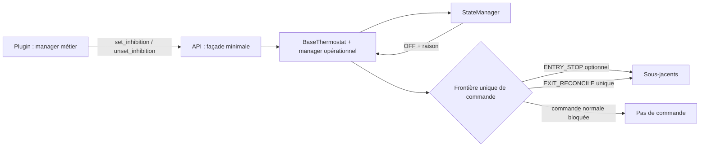
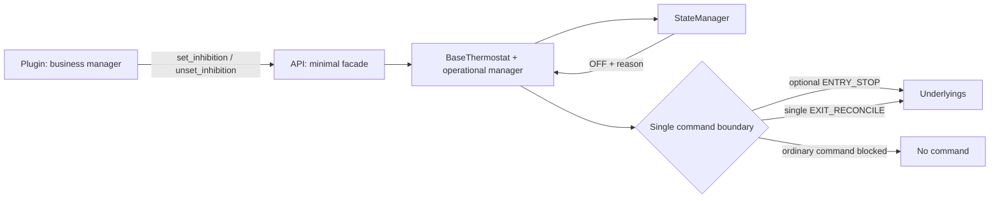
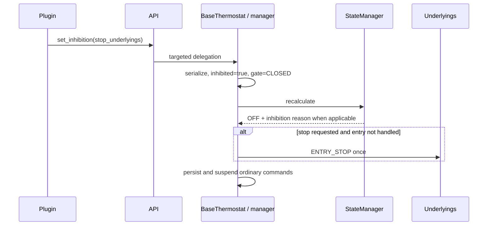
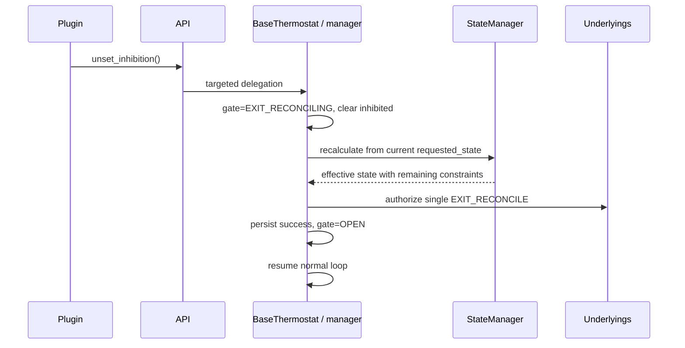

# Conception logicielle détaillée — Issue #2087 : inhibition d’un VTherm

| Champ        | Valeur                                                                                                                                                                                                             |
| ------------ | ------------------------------------------------------------------------------------------------------------------------------------------------------------------------------------------------------------------ |
| Statut       | Décision validée par le mainteneur et implémentée (PR #2101) ; les notes d’implémentation du §10 décrivent l’état du code |
| Version      | 2.1 |
| Date         | 2026-10-15 |
| Propriétaire | Projet Versatile Thermostat                                                                                                                                                                                        |
| Issue        | [#2087 — Add an "inhibit" sensor to pause a VTherm](https://github.com/jmcollin78/versatile_thermostat/issues/2087)                                                                                                |
| Sources      | [Spécification bilingue](../specs/issue-2087-inhibition-spec.md), revue de l’issue, `base_thermostat.py`, `state_manager.py`, `underlyings.py`, `prop_handler_tpi.py`, `feature_repair_incorrect_state_manager.py` |

> « Vérifié » désigne les éléments cités dans les sources. « Décision » définit le contrat à implémenter. Une question ouverte n’est pas un comportement existant.

## 1. Objectif, périmètre et exigences couvertes

L’inhibition permet à un plugin de retirer temporairement au VTherm le contrôle de ses sous-jacents. Le VTherm conserve l’intention utilisateur dans `requested_state`, résout l’état effectif à `OFF` avec une raison dédiée et ne transmet plus de commande normale pendant le retrait.

Cette conception couvre entrée, sortie, suspension, reprise, persistance, erreurs, redémarrage et non-régression sans plugin. Elle ne crée ni entité, ni service, ni option utilisateur d’inhibition dans le core.

### Invariants

1. Le **Core** est `BaseThermostat`, complété par un manager minimal d’état opérationnel et persisté.
2. L’**API** est une façade minimale : `set_inhibition(stop_underlyings: bool)` et `unset_inhibition()`.
3. Le **Plugin** contient le manager complet : sources, configuration, délais, bypass, lifecycle, `ACTIVE` / `INACTIVE` / `UNKNOWN`, politique et persistance métier.
4. Le Plugin appelle l’API. Le Core ne connaît ni provider, ni factory, ni registre, ni callback, ni statut ternaire.
5. Le Core possède un intercepteur unique à la frontière des commandes de sous-jacent. Il bloque toute commande VTherm pendant l’inhibition.
6. Seules `ENTRY_STOP`, optionnelle, et `EXIT_RECONCILE`, obligatoire à la sortie, traversent une barrière fermée.
7. `UNKNOWN` appartient au Plugin : il maintient ou appelle `set_inhibition`. Seul `INACTIVE` confirmé appelle `unset_inhibition`.
8. Sans Plugin, aucune opération API n’est appelée et le comportement actuel reste inchangé.

$$
current\_state = f(requested\_state, contraintes\ actives)
$$

L’inhibition est une contrainte de calcul et de commande. Elle n’est pas ajoutée à `VThermState` et ne modifie pas `requested_state`.

## 2. Éléments existants vérifiés et dépendances

| Élément                 | Fait vérifié                                                                                                              | Conséquence de conception                                                                                     |
| ----------------------- | ------------------------------------------------------------------------------------------------------------------------- | ------------------------------------------------------------------------------------------------------------- |
| Résolution HVAC         | `StateManager.calculate_current_hvac_mode()` calcule l’état effectif depuis l’état demandé et les contraintes existantes. | Ajouter une contrainte `OFF` et la raison `hvac_off_inhibition`, sous réserve des priorités déjà supérieures. |
| Application et contrôle | `BaseThermostat.update_states()` et les chemins de contrôle envoient normalement des commandes aux sous-jacents.          | Les faire converger vers une frontière de commande unique.                                                    |
| Boucles périodiques     | TPI, scheduler et réparation peuvent émettre des commandes.                                                               | Ne pas y ajouter de gardes locales ; la frontière unique bloque leurs commandes.                              |
| Arrêt dédié             | `async_underlying_entity_turn_off()` annule le cycle puis appelle `turn_off()` sur les sous-jacents.                      | Candidat vérifié pour `ENTRY_STOP`.                                                                           |
| Persistance             | L’entité restaure déjà états demandés/effectifs, raisons HVAC et états spécifiques.                                       | Le Core persiste son snapshot opérationnel ; le Plugin persiste son état métier séparément.                   |

**Décision.** Les détails obsolètes de runtime/provider/factory, registre, découverte tardive, callback et statut ternaire dans le Core sont supprimés. Les gardes `if` réparties dans TPI, scheduler, repair ou handlers sont remplacées par la frontière unique.

## 3. Vue d’ensemble et responsabilités

| Module           | Responsabilités                                                                                                                                                | Hors responsabilité                                                                                               |
| ---------------- | -------------------------------------------------------------------------------------------------------------------------------------------------------------- | ----------------------------------------------------------------------------------------------------------------- |
| **Core**         | État opérationnel/persisté minimal ; résolution `OFF` et raison ; suspension/reprise ; sérialisation ; intercepteur unique ; `ENTRY_STOP` et `EXIT_RECONCILE`. | Sources, configuration, délais, bypass, provider/factory, registre/callback, politique métier et statut ternaire. |
| **API**          | Déléguer `set_inhibition(stop_underlyings)` et `unset_inhibition()` vers le VTherm ciblé.                                                                      | État, arbitre, provider, factory, callback, statut, politique, service HA ou détection.                           |
| **Plugin**       | Sources, délais, bypass, lifecycle, `ACTIVE`/`INACTIVE`/`UNKNOWN`, politique, appels API, persistance et diagnostics métier.                                   | Commande directe des sous-jacents, mutation de `requested_state`, calcul HVAC effectif, réconciliation Core.      |
| **Sous-jacents** | Exécuter les services autorisés par le Core.                                                                                                                   | Décider ou connaître l’inhibition.                                                                                |

### Synthèse des impacts

| Module | Ajout ou changement conçu                                                                                     |
| ------ | ------------------------------------------------------------------------------------------------------------- |
| Core   | Manager minimal, snapshot persistant, contrainte `OFF`, raison dédiée, suspension/reprise et barrière unique. |
| API    | `set_inhibition(stop_underlyings)` et `unset_inhibition()` seulement.                                         |
| Plugin | Manager autonome complet, incluant incertitude, politique, délais et lifecycle.                               |

## 4. Modèle d’entités, données persistées et états

Le manager Core est distinct de `VThermState` et ne contient aucun détail de sources Plugin.

| Champ                  | Type                                 | Rôle                                                       |
| ---------------------- | ------------------------------------ | ---------------------------------------------------------- |
| `inhibited`            | booléen                              | Contrainte d’inhibition active.                            |
| `entry_stop_requested` | booléen                              | `ENTRY_STOP` autorisé pour l’activation courante.          |
| `entry_stop_completed` | booléen                              | Évite une seconde émission logique dans le même processus. |
| `command_gate`         | `OPEN`, `CLOSED`, `EXIT_RECONCILING` | État de la frontière de commande.                          |
| `last_transition_at`   | date ISO ou `null`                   | Diagnostic et restauration.                                |
| `last_error_code`      | chaîne ou `null`                     | Erreur de transaction Core, sans détail Plugin.            |

Le snapshot Core est persistant, par exemple sous `specific_states.inhibition` avec `schema_version`. Les formats de `requested_state` et `current_state` ne changent pas. Le Plugin persiste séparément sources, statut, délais, bypass, politique et diagnostics.

## 5. Interfaces, événements et contrats d’échange

### 5.1 Façade API

| Opération                                | Précondition                                                                                            | Effet Core                                                                                         | Idempotence et erreur                                                                                |
| ---------------------------------------- | ------------------------------------------------------------------------------------------------------- | -------------------------------------------------------------------------------------------------- | ---------------------------------------------------------------------------------------------------- |
| `set_inhibition(stop_underlyings: bool)` | Le Plugin cible un VTherm existant. Le booléen décrit seulement l’action physique de l’entrée courante. | Ferme la barrière, active la contrainte, résout `OFF` et mémorise l’autorisation d’arrêt d’entrée. | Répété : maintien sans seconde transaction d’entrée. Cible absente : erreur API explicite au Plugin. |
| `unset_inhibition()`                     | Le Plugin a confirmé `INACTIVE`.                                                                        | Prépare puis exécute `EXIT_RECONCILE`; ouvre seulement après succès.                               | Hors inhibition : inactif. Pendant une sortie : joint la transaction. Erreur : barrière fermée.      |

L’API ne renvoie aucun statut ternaire et n’expose ni provider, ni factory, ni callback. `stop_underlyings` n’est pas un statut métier : il autorise seulement `ENTRY_STOP` pour l’activation en cours.

### 5.2 Frontière unique de commande

**D-2087-01 — Barrière unique.** Toute commande VTherm vers un sous-jacent, quelle que soit son origine (`update_states`, TPI, scheduler, repair, changement HVAC/preset/consigne, initialisation ou réconciliation), passe par un même intercepteur avant tout service.

| État de barrière   | Commande VTherm normale       | `ENTRY_STOP`                   | `EXIT_RECONCILE`                                |
| ------------------ | ----------------------------- | ------------------------------ | ----------------------------------------------- |
| `OPEN`             | Autorisée                     | Non applicable                 | Non applicable                                  |
| `CLOSED`           | Refusée sans appel de service | Autorisée une fois si demandée | Non applicable                                  |
| `EXIT_RECONCILING` | Refusée sans appel de service | Refusée                        | Autorisée uniquement pour la transaction active |

La barrière remplace les gardes dispersées. Les composants périodiques peuvent calculer, journaliser et recevoir des événements passifs, mais aucune de leurs commandes VTherm ne traverse la frontière. Une commande extérieure à VTherm n’est ni annulée ni réparée.

### 5.3 Résolution HVAC

**D-2087-02 — Résolution.** Lorsque `inhibited=true`, le Core propose `OFF` et `hvac_off_inhibition`. L’inhibition est la première contrainte (ordre : inhibition, mode central, sécurité, fenêtre ; décision du mainteneur, revue de la PR #2101) : elle remplace le comportement du VTherm, sa raison l’emporte donc sur l’arrêt central et la sécurité, qui donnent aussi `OFF`. Un VTherm inhibé ne rapporte pas de raison de sécurité. Les contraintes inférieures ne peuvent pas autoriser une commande si la barrière est fermée.

Pendant l’inhibition, HVAC, preset et consigne modifient `requested_state` et les attributs, mais jamais un sous-jacent. La sortie recalcule toujours depuis le `requested_state` courant, jamais depuis une intention sauvegardée à l’entrée.

## 6. Flux nominaux, erreurs, annulations et reprise

### 6.1 Entrée : `set_inhibition`

Le manager sérialise l’appel avec les modifications utilisateur, l’unload et une sortie éventuelle. Avec `stop_underlyings=true`, il autorise une seule transaction `ENTRY_STOP` via `async_underlying_entity_turn_off()` ou l’équivalent centralisé retenu. Avec `false`, aucune commande physique n’est envoyée ; suspension et barrière restent identiques. Les appels `set` suivants maintiennent le retrait, sans arrêt tardif ni seconde émission.

### 6.2 Maintien et `UNKNOWN`

Pendant `CLOSED`, le Core continue d’enregistrer l’intention utilisateur. TPI, scheduler, repair et chaque handler peuvent effectuer leurs opérations non commandantes selon les conventions existantes, mais aucune commande de sous-jacent ne traverse la barrière. Il n’existe pas de `if inhibited` local.

Le Plugin gère la totalité de son cycle : `ACTIVE` appelle ou maintient `set_inhibition`; `UNKNOWN` appelle ou maintient aussi `set_inhibition`; **seul** `INACTIVE` confirmé appelle `unset_inhibition`. Le Core ignore si l’appel résulte d’une source active, inconnue, en délai, en bypass ou en reload.

### 6.3 Sortie : `unset_inhibition`

**D-2087-03 — Sortie transactionnelle.** À `unset_inhibition`, le Core lève d’abord l’inhibition HVAC pour calculer l’intention effective. Il garde cependant la barrière en `EXIT_RECONCILING` et bloque toutes les commandes normales jusqu’à la fin de `EXIT_RECONCILE`.

Cette transaction applique une seule fois l’état recalculé aux sous-jacents, puis reprend le contrôle normal. En cas d’échec du chemin core (voir « Échec de sortie » au §10), le Core revient à un état sûr (`inhibited=true`, `CLOSED`), expose l’erreur et ne reprend pas sa boucle. Un `unset` répété n’exécute pas une seconde réconciliation.

### 6.4 Redémarrage, reload et unload

| Situation                              | Décision                                                                                                                                                                   |
| -------------------------------------- | -------------------------------------------------------------------------------------------------------------------------------------------------------------------------- |
| Redémarrage avec snapshot inhibé       | Restaurer inhibition, indicateurs d’entrée et barrière fermée avant toute commande. Le Plugin relance son lifecycle et maintient l’inhibition jusqu’à `INACTIVE` confirmé. |
| Redémarrage sans snapshot              | Comportement historique Core. Un Plugin peut ensuite appeler `set`; aucune présomption de statut Core.                                                                     |
| Redémarrage pendant `EXIT_RECONCILING` | Restaurer fermé et inhibé (comme un échec de sortie), renvoyer l’arrêt d’entrée une fois le VTherm prêt s’il avait été demandé, et exiger un nouvel `unset` confirmé du Plugin pour une réconciliation complète. |
| Reload Plugin                          | Le Plugin restaure son état métier et maintient/appelle `set` tant qu’il n’a pas confirmé `INACTIVE`. Le Core ne déduit rien d’un composant disparu.                       |
| Unload Plugin                          | Le Plugin maintient l’inhibition ou appelle `unset` seulement après `INACTIVE` confirmé. Un unload ne vaut jamais `INACTIVE` implicite.                                    |
| Suppression VTherm / annulation        | Annuler les transactions sans commande de reprise ; conserver le dernier snapshot sûr lorsque restaurable.                                                                 |

## 7. Sécurité, observabilité et contraintes opérationnelles

### 7.1 Persistance et limite d’émission unique

Le Core écrit son snapshot après fermeture, entrée traitée, début/fin de sortie et erreur. Un service HA et l’écriture persistante ne sont pas transactionnels : « une fois » signifie une émission logique par activation dans un processus sain et aucune réémission lorsque `entry_stop_completed` est restauré.

Une panne entre service et persistance laisse une ambiguïté. La reprise privilégie la barrière fermée et exige une sortie confirmée Plugin ; elle ne peut garantir exactement-une-fois de bout en bout sans support idempotent de chaque sous-jacent.

### 7.2 Erreurs et comportement sûr

| Événement                           | Réaction Core                                                                    | Attente Plugin                                                |
| ----------------------------------- | -------------------------------------------------------------------------------- | ------------------------------------------------------------- |
| Échec `ENTRY_STOP`                  | Garder `inhibited=true`, barrière fermée et aucune commande périodique.          | Maintenir son état ; pas de `unset` sans `INACTIVE` confirmé. |
| Échec `EXIT_RECONCILE`              | Revenir à l’inhibition opérationnelle, fermer la barrière et exposer une erreur. | Réessayer selon sa politique et sa confirmation.              |
| Source indisponible / erreur métier | Aucune interprétation Core.                                                      | Passer à `UNKNOWN` et maintenir/appeler `set`.                |
| Cible API absente                   | Aucun changement Core ; erreur explicite.                                        | Journaliser et gérer le lifecycle.                            |
| Commande normale fermée             | Rejet sans service sous-jacent.                                                  | Sans objet.                                                   |

Le Core expose sous `specific_states.inhibition` seulement des diagnostics génériques : version, inhibition, état de barrière, indicateurs d’entrée, horodatage et dernier code d’erreur. Les journaux couvrent entrée, arrêt envoyé/ignoré, réconciliation, commande bloquée et erreur, sans valeur brute de capteur ni détail de bypass. La conception n’ajoute ni secret, ni permission, ni appel réseau ; un Plugin utilise des `entity_id` lorsqu’il référence Home Assistant.

## 8. Stratégie de tests et critères de vérification

| Niveau            | Scénarios                                                                               | Vérifications                                                                                                        |
| ----------------- | --------------------------------------------------------------------------------------- | -------------------------------------------------------------------------------------------------------------------- |
| Core — résolution | `set`, `unset`, intention `OFF`, central/sécurité, fenêtre, auto-start/stop.            | Intention inchangée ; `OFF`/raison lorsque pertinente ; priorités existantes préservées.                             |
| Core — barrière   | `update_states`, TPI, scheduler, repair et handlers pendant fermeture.                  | Point unique ; zéro appel de service normal vers les sous-jacents.                                                   |
| Entrée            | `stop_underlyings` vrai/faux, sous-jacent actif, `set` répété.                          | `ENTRY_STOP` une fois seulement si autorisé ; état fermé dans tous les cas.                                          |
| Sortie            | `unset`, contraintes restantes, répétition, erreur de service.                          | Fermeture durant `EXIT_RECONCILING` ; une réconciliation ; ouverture après succès seulement ; retour sûr sur erreur. |
| Persistance       | Redémarrage après entrée, pendant sortie, sans snapshot.                                | Restauration fermée sûre ; pas de réémission connue ; chemin historique sans Plugin.                                 |
| API               | Ciblage, paramètres, cible absente, idempotence.                                        | Aucune factory/provider/callback/statut ternaire.                                                                    |
| Plugin            | Sources actives/inactives/inconnues, délais, bypass, reload/unload, persistance métier. | `ACTIVE` et `UNKNOWN` font/maintiennent `set` ; seul `INACTIVE` confirmé fait `unset`; pas de commande directe.      |
| Régression        | Sans Plugin, sous-jacents climate/switch/valve et fonctions existantes.                 | Comportement intact ; aucune barrière active sans appel API.                                                         |

Les doubles comptent `turn_off`, changement HVAC, réparation et scheduler, pas seulement l’état final. Les tests d’intégration prouvent le blocage des commandes normales durant `EXIT_RECONCILING`, pas seulement durant l’inhibition HVAC.

## 9. Hypothèses, décisions, risques, questions ouvertes et traçabilité

| Catégorie | Élément                                                                              | Statut                                             |
| --------- | ------------------------------------------------------------------------------------ | -------------------------------------------------- |
| Décision  | Core minimal : état, résolution, suspension/reprise, barrière unique.                | Normative.                                         |
| Décision  | API limitée à `set_inhibition(stop_underlyings)` et `unset_inhibition`.              | Normative.                                         |
| Décision  | Plugin complet ; `UNKNOWN` maintient/set, seul `INACTIVE` confirmé unset.            | Normative.                                         |
| Décision  | `ENTRY_STOP` optionnel ; `EXIT_RECONCILE` unique ; ouverture seulement après succès. | Normative.                                         |
| Risque    | Panne entre service et persistance : aucune garantie exactly-once end-to-end.        | Tests de reprise requis.                           |
| Risque    | Plugin durablement `UNKNOWN` : contrôle VTherm durablement retiré.                   | Coût de sûreté assumé ; diagnostics Plugin requis. |
| Décision  | Snapshot `specific_states.inhibition` (`schema_version: 1`), raison `hvac_off_inhibition`. | Validée (PR #2101, Q7). |
| Décision  | API asynchrone `set_inhibition(vtherm_entity_id, stop_underlyings)` / `unset_inhibition(vtherm_entity_id)`, erreur explicite si la cible manque. | Validée (PR #2101, Q5). |

| Besoin                                 | Sections    |
| -------------------------------------- | ----------- |
| Conservation de l’intention et `OFF`   | 1, 4, 5.3   |
| Répartition Core/API/Plugin            | 3, 5.1      |
| Suspension des commandes VTherm        | 5.2, 6.2    |
| Entrée physique optionnelle            | 5.1, 6.1    |
| Sortie sûre et reprise                 | 6.3, 6.4    |
| `UNKNOWN` Plugin / `INACTIVE` confirmé | 1, 6.2, 6.4 |
| Persistance, erreurs, redémarrage      | 4, 6.4, 7   |
| Non-régression et vérification         | 1, 8        |

## 10. Notes d’implémentation (v2)

Implémentation core sur la branche `feat/2087-inhibition-core`, avec `vtherm_api>=0.6.2` (façade `set_inhibition` / `unset_inhibition`, vérification `is_inhibition_started` et exception `InhibitionNotStartedError`). Le fonctionnement d’`inhibition_manager.py` (garde, transactions, flux, concurrence, persistance) est expliqué pas à pas dans [inhibition_manager-fr.md](inhibition_manager-fr.md).

| Sujet | Décision implémentée |
| ----- | -------------------- |
| API core | Méthodes asynchrones de l’entité VTherm : `async_set_inhibition(stop_underlyings: bool)` et `async_unset_inhibition()`. `set` répété : idempotent (aucun second arrêt). `unset` hors inhibition : sans effet. Avant la restauration au démarrage, les deux lèvent `InhibitionNotStartedError` (voir « Persistance ») ; le plugin le sait par la façade `is_inhibition_started(vtherm_entity_id)`, qui lit la propriété `is_inhibition_started` de l’entité VTherm. `unset` concurrent : rejoint la sortie en cours et en reçoit le résultat réel (exception de la sortie, ou, si la sortie meneuse a été annulée, il exécute sa propre sortie). Le dernier appel gagne : un `set` invalide la sortie joignable, un `unset` ultérieur ne rejoint donc pas une sortie lancée avant ce `set`. Un `asyncio.Lock` sérialise uniquement `set`/`unset`, jamais `update_states()` (réentrant via le délestage). Un `set` annulé après la fermeture de la garde termine son entrée (résolution `OFF`, arrêt d’entrée, persistance) puis relève l’annulation. |
| Manager | `inhibition_manager.py` (`InhibitionManager`) : état, garde, transactions, snapshot. Aucun provider, factory ni callback. |
| Résolution | `StateManager.calculate_current_hvac_mode` : branche `OFF` + `hvac_off_inhibition` en premier, avant arrêt central (`STOPPED`), sécurité et fenêtre (seule la raison change : ces contraintes donnent aussi `OFF`). `requested_state` n’est jamais modifié. Constante `HVAC_OFF_REASON_INHIBITION` (non traduite, comme les autres raisons). |
| Garde unique | `UnderlyingEntity.hass_services_async_call()` et le début de `UnderlyingSwitch.turn_on()/turn_off()` (juste après `self._keep_alive.cancel()`, avant la comptabilité de puissance ; appel direct et gestion d’erreur inchangés). Aucun autre chemin ne commande un sous-jacent (keep-alive via `turn_on/turn_off`) ; le service de chaudière centrale et les notifications ne sont pas des commandes de sous-jacent. |
| Identification des transactions | `ContextVar` de module portant le jeton de la transaction active, **et** liaison à la tâche qui exécute la transaction : une tâche ou un timer créé pendant la transaction hérite du `ContextVar` et ne doit pas passer (écart : précision ajoutée au mécanisme convenu). Aucun drapeau global. |
| Commandes bloquées | Abandonnées sans exception, journal debug. Ventilation, oscillation (verticale/horizontale) et humidité : journal WARNING une fois par inhibition, sous-jacent et service, puis debug (l’auto-fan les réémet à chaque cycle). Pas de refus dans `async_set_fan_mode`. Recalibrage des vannes : WARNING à l’appel du service (journal seul), ses commandes sont abandonnées par la garde. La synchronisation de température du TRV (entité de calibration) est aussi bloquée. Un `turn_off` d’interrupteur bloqué garde fermée (`CLOSED`) libère quand même la réservation de puissance centrale (le VTherm est `OFF`) ; pas pendant `EXIT_RECONCILING` (la réconciliation a pu la réserver) ; un `turn_on` bloqué n’en réserve pas. Si une commande d’une autre chaîne est bloquée pendant `EXIT_RECONCILING` (elle a pu changer l’état courant et les caches), la réconciliation complète (resynchronisation, états forcés, `update_states(force=True)`) est rejouée avant l’ouverture de la garde, au plus 3 parcours ; au-delà, la garde s’ouvre avec un WARNING et le keep-alive des interrupteurs est réarmé. |
| `ENTRY_STOP` | Arrêt centralisé par type, indépendant de l’état rapporté : interrupteur `turn_off`, vanne fermée (`set_value`), climate `set_hvac_mode(OFF)` (le climate n’a pas de `turn_off`), vanne de régulation fermée (ouverture/fermeture). Le cycle en cours est annulé avant la transaction. `stop_underlyings=false` : rien n’est envoyé. Si le VTherm n’est pas prêt, l’arrêt est différé jusqu’à `init_underlyings_completed`. Un échec par sous-jacent est journalisé (`last_error_code=entry_stop_failed`), sans réessai ni exception (écart mineur). |
| `EXIT_RECONCILE` | Garde = `EXIT_RECONCILING`, `inhibited=false`, puis dans la transaction : resynchronisation des caches avec l’état réel (climate : `_hvac_mode`, `_last_sent_temperature` ; vanne : `_percent_open`/`_last_sent_opening_value` dans l’échelle contrôlée ; vanne de régulation : `_percent_open` (échelle brute) conservé seulement si les degrés réels correspondent, sinon renvoi forcé ; interrupteur : `_is_on_part_running` selon l’état réel et réarmement du keep-alive), `requested_state` et `current_state` forcés modifiés (parcours de tous les sous-jacents même OFF→OFF), `update_states(force=True)`, puis ouverture et persistance. |
| Seed #2049 à la sortie | À l’appel de `unset`, juste après le passage en `EXIT_RECONCILING` et avant le test « prêt » : le seed de bootstrap des vannes de régulation est réexécuté (cibles tentées remises à zéro) dans une transaction `EXIT_RECONCILE`. Après un redémarrage en inhibition, la garde fermée a abandonné le seed du démarrage, et un degré resté `unknown` empêche le VTherm d’être prêt : une réconciliation attendant « prêt » ne s’exécuterait jamais. Échec ou annulation : même retour arrière que la réconciliation. |
| VTherm non prêt | `set` : `OFF` résolu immédiatement, arrêt d’entrée différé jusqu’à ce que le VTherm soit prêt. `unset` exécute le seed puis laisse `EXIT_RECONCILING` en attente ; la réconciliation est faite depuis `init_underlyings_completed` dès que le VTherm est prêt. Un échec de cette sortie différée ne peut pas être remonté au plugin (son appel est terminé) : il est seulement journalisé et exposé par `last_error_code`, le VTherm redevenant inhibé ; le plugin compare `specific_states.inhibition` à son dernier appel et rappelle `unset`. |
| Échec de sortie | Seule une exception du chemin core compte, ainsi qu’une annulation de la tâche. Un équipement indisponible n’est pas un échec (Home Assistant ignore les entités indisponibles), et les erreurs de service des climates, vannes et numbers sont journalisées comme aujourd’hui ; une erreur de service d’un interrupteur autre que `ServiceNotFound` (par exemple un délai dépassé de l’intégration) remonte comme aujourd’hui et fait donc échouer la sortie. Retour à `inhibited=true` + `CLOSED` (jamais bloqué en `EXIT_RECONCILING`), `last_error_code=exit_reconcile_failed` ou `exit_reconcile_cancelled`, persistance, puis l’exception (ou l’annulation) est relevée par `async_unset_inhibition()` pour que le plugin réessaie. Si l’arrêt d’entrée avait été demandé, il est renvoyé (dans une transaction `ENTRY_STOP`) pour arrêter les équipements relancés par la réconciliation partielle. La sortie n’est jamais déportée dans une autre tâche (la garde est liée à la tâche). |
| Fenêtre éco/hors-gel | Correctif : avec `CONF_WINDOW_ECO_TEMP`/`CONF_WINDOW_FROST_TEMP`, la fenêtre ne change que la consigne ; la branche fenêtre ne traite plus que `turn_off`/`fan_only`, l’éco/hors-gel poursuit la chaîne (auto-start/stop, modes centraux) puis applique le mode demandé avec `hvac_mode_reason` fenêtre. Avant, la branche ne fixait aucun mode : un VTherm sorti d’`OFF` fenêtre ouverte restait `OFF` avec une raison périmée. **Changement de comportement aussi sans plugin, validé par le mainteneur le 2026-10-15** : avant (main), fenêtre ouverte en éco/hors-gel, le mode courant restait figé à sa valeur à l’ouverture (un changement de mode demandé, la fin d’une sécurité ou d’un auto-stop ou un changement de mode central n’étaient appliqués qu’à la fermeture) ; après, le mode est recalculé normalement (mode demandé, auto-start/stop, modes centraux) et seule la consigne est changée par la fenêtre. |
| Persistance | `specific_states.inhibition` avec `schema_version: 1`, `inhibited`, `entry_stop_requested`, `entry_stop_completed`, `command_gate`, `last_transition_at`, `last_error_code`. Restauré au tout début d’`async_startup()`, avant le démarrage des managers et des sous-jacents (garde fermée avant toute commande). `set_inhibition` / `unset_inhibition` appelés avant cette restauration (l’entité existe avant son démarrage) lèvent `InhibitionNotStartedError` et ne changent rien ; le plugin rappelle une fois le VTherm démarré (`is_inhibition_started` de la façade). Il attend seulement la restauration, pas `is_ready` : `is_ready` attend aussi que chaque sous-jacent ait publié un état, et le core diffère déjà l’arrêt d’entrée et la réconciliation de sortie jusqu’à `is_ready`. Un VTherm qui n’était pas inhibé avant un redémarrage démarre donc normalement jusqu’à l’arrivée du `set` du plugin (un VTherm qui était inhibé est protégé par son snapshot restauré). Le snapshot n’est restauré qu’une fois par vie de l’entité (une mise à jour de configuration peut exécuter `async_startup` deux fois). Redémarrage pendant `EXIT_RECONCILING` : traité comme un échec de sortie, restauré `CLOSED` + inhibé, et l’arrêt d’entrée, s’il avait été demandé, est renvoyé une fois quand le VTherm est prêt (la réconciliation partielle a pu relancer des équipements). Arrêt demandé mais non accompli au redémarrage : envoyé une fois quand le VTherm est prêt. Chaque transition publie l’attribut et programme un `async_dump_states()` ; les transitions d’un même tour de boucle partagent un seul dump, et `set`/`unset` ne rendent la main qu’après la fin du dernier dump programmé (une sortie différée terminée depuis `init_underlyings_completed` n’attend pas son dump, un arrêt d’entrée différé non plus). Publié seulement si l’inhibition a été utilisée. |

Décidé avec le mainteneur (2026-10-15) : avec `follow_underlying_temp_change` (over_climate), un changement externe du mode HVAC (hors `OFF`) d’un climate pendant l’inhibition est toujours adopté dans `requested_state` ; un changement de consigne ne l’est pas, le mode effectif étant `OFF` (comme pour un VTherm `OFF` aujourd’hui). Comportement existant, non modifié. Un snapshot inhibé reste inhibé tant qu’aucun plugin n’appelle `unset` (plugin désinstallé compris) : pas d’action core, la récupération est documentée dans le plugin (spécification BR-020).

---

# Detailed Software Design — Issue #2087: VTherm Inhibition

| Field   | Value                                                                                                                                                                                                           |
| ------- | --------------------------------------------------------------------------------------------------------------------------------------------------------------------------------------------------------------- |
| Status  | Decision validated by the maintainer and implemented (PR #2101); the §10 implementation notes describe the code |
| Version | 2.1 |
| Date    | 2026-10-15 |
| Owner   | Versatile Thermostat project                                                                                                                                                                                    |
| Issue   | [#2087 — Add an "inhibit" sensor to pause a VTherm](https://github.com/jmcollin78/versatile_thermostat/issues/2087)                                                                                             |
| Sources | [Bilingual specification](../specs/issue-2087-inhibition-spec.md), issue review, `base_thermostat.py`, `state_manager.py`, `underlyings.py`, `prop_handler_tpi.py`, `feature_repair_incorrect_state_manager.py` |

> “Verified” identifies elements cited in sources. A “Decision” defines the implementation contract. An open question is not existing behavior.

## 1. Objective, scope, and covered requirements

Inhibition lets a plugin temporarily withdraw VTherm control of its underlyings. VTherm retains user intent in `requested_state`, resolves effective state to `OFF` with a dedicated reason, and no longer forwards ordinary commands while withdrawn.

This design covers entry, exit, suspension, resumption, persistence, errors, restart, and no-plugin regression. It creates no core user entity, service, or inhibition option.

### Invariants

1. **Core** is `BaseThermostat` plus a minimal internal operational and persisted state manager.
2. **API** is a minimal facade: `set_inhibition(stop_underlyings: bool)` and `unset_inhibition()`.
3. **Plugin** owns the full manager: sources, configuration, delays, bypass, lifecycle, `ACTIVE` / `INACTIVE` / `UNKNOWN`, policy, and business persistence.
4. Plugin calls API. Core knows no provider, factory, registry, callback, or three-state status.
5. Core owns one interceptor at the underlying command boundary. It blocks every VTherm command during inhibition.
6. Only optional `ENTRY_STOP` and mandatory exit `EXIT_RECONCILE` cross a closed gate.
7. `UNKNOWN` belongs to Plugin: it retains or calls `set_inhibition`. Only confirmed `INACTIVE` calls `unset_inhibition`.
8. With no Plugin, no API operation is called and current behavior is unchanged.

$$
current\_state = f(requested\_state, active\ constraints)
$$

Inhibition is a calculation and command constraint. It is not added to `VThermState` and does not modify `requested_state`.

## 2. Verified existing elements and dependencies

| Element                 | Verified fact                                                                                                       | Design consequence                                                                        |
| ----------------------- | ------------------------------------------------------------------------------------------------------------------- | ----------------------------------------------------------------------------------------- |
| HVAC resolution         | `StateManager.calculate_current_hvac_mode()` derives effective state from requested state and existing constraints. | Add an `OFF` constraint and `hvac_off_inhibition`, subject to existing higher priorities. |
| Application and control | `BaseThermostat.update_states()` and control paths normally send commands to underlyings.                           | Make them converge on one command boundary.                                               |
| Periodic loops          | TPI, scheduler, and repair can issue commands.                                                                      | Do not add local guards; the single boundary blocks their commands.                       |
| Dedicated stop          | `async_underlying_entity_turn_off()` cancels the cycle then calls `turn_off()` on underlyings.                      | Verified candidate for `ENTRY_STOP`.                                                      |
| Persistence             | Entity already restores requested/effective state, HVAC reasons, and specific state.                                | Core persists operational snapshot; Plugin persists business state separately.            |

**Decision.** Obsolete Core runtime/provider/factory, registry, late-discovery, callback, and three-state-status details are removed. Distributed `if` guards in TPI, scheduler, repair, or handlers are replaced by the single boundary.

## 3. Overview and responsibilities

| Module          | Responsibilities                                                                                                                                     | Outside responsibility                                                                                                |
| --------------- | ---------------------------------------------------------------------------------------------------------------------------------------------------- | --------------------------------------------------------------------------------------------------------------------- |
| **Core**        | Minimal operational/persisted state; `OFF` resolution and reason; suspend/resume; serialization; one interceptor; `ENTRY_STOP` and `EXIT_RECONCILE`. | Sources, configuration, delays, bypass, provider/factory, registry/callback, business policy, and three-state status. |
| **API**         | Delegate `set_inhibition(stop_underlyings)` and `unset_inhibition()` to target VTherm.                                                               | State, arbitration, provider, factory, callback, status, policy, HA service, or detection.                            |
| **Plugin**      | Sources, delays, bypass, lifecycle, `ACTIVE`/`INACTIVE`/`UNKNOWN`, policy, API calls, business persistence and diagnostics.                          | Direct underlying commands, `requested_state` mutation, effective-HVAC calculation, Core reconciliation.              |
| **Underlyings** | Execute Core-authorized services.                                                                                                                    | Decide or know inhibition.                                                                                            |

### Impact summary

| Module | Designed addition or change                                                                        |
| ------ | -------------------------------------------------------------------------------------------------- |
| Core   | Minimal manager, persisted snapshot, `OFF` constraint, dedicated reason, suspend/resume, one gate. |
| API    | Only `set_inhibition(stop_underlyings)` and `unset_inhibition()`.                                  |
| Plugin | Complete autonomous manager, including uncertainty, policy, delays, and lifecycle.                 |

## 4. Entity model, persisted data, and states

Core manager state is separate from `VThermState` and contains no Plugin-source detail.

| Field                  | Type                                 | Role                                                |
| ---------------------- | ------------------------------------ | --------------------------------------------------- |
| `inhibited`            | boolean                              | Active inhibition constraint.                       |
| `entry_stop_requested` | boolean                              | `ENTRY_STOP` allowed for current activation.        |
| `entry_stop_completed` | boolean                              | Avoids second logical emission in the same process. |
| `command_gate`         | `OPEN`, `CLOSED`, `EXIT_RECONCILING` | Command-boundary state.                             |
| `last_transition_at`   | ISO date or `null`                   | Diagnostics and restoration.                        |
| `last_error_code`      | string or `null`                     | Core transaction error without Plugin detail.       |

Core snapshot is persisted, for example under `specific_states.inhibition` with `schema_version`. `requested_state` and `current_state` formats do not change. Plugin separately persists sources, status, delays, bypass, policy, and diagnostics.

## 5. Interfaces, events, and exchange contracts

### 5.1 API facade

| Operation                                | Precondition                                                                                 | Core effect                                                                              | Idempotence and error                                                                                   |
| ---------------------------------------- | -------------------------------------------------------------------------------------------- | ---------------------------------------------------------------------------------------- | ------------------------------------------------------------------------------------------------------- |
| `set_inhibition(stop_underlyings: bool)` | Plugin targets an existing VTherm. Boolean describes physical action for current entry only. | Closes gate, activates constraint, resolves `OFF`, and records entry-stop authorization. | Repeated: retains state with no second entry transaction. Missing target: explicit API error to Plugin. |
| `unset_inhibition()`                     | Plugin has confirmed `INACTIVE`.                                                             | Prepares and performs `EXIT_RECONCILE`; opens only on success.                           | Outside inhibition: no-op. During exit: joins transaction. Error: gate closed.                          |

API returns no three-state status and exposes no provider, factory, or callback. `stop_underlyings` is not business status: it only authorizes `ENTRY_STOP` for the activation in progress.

### 5.2 Single command boundary

**D-2087-01 — Single gate.** Every VTherm command to an underlying, whatever its origin (`update_states`, TPI, scheduler, repair, HVAC/preset/setpoint change, initialization, or reconciliation), passes through the same interceptor before any service call.

| Gate state         | Ordinary VTherm command       | `ENTRY_STOP`                | `EXIT_RECONCILE`                    |
| ------------------ | ----------------------------- | --------------------------- | ----------------------------------- |
| `OPEN`             | Allowed                       | Not applicable              | Not applicable                      |
| `CLOSED`           | Rejected without service call | Allowed once when requested | Not applicable                      |
| `EXIT_RECONCILING` | Rejected without service call | Rejected                    | Allowed only for active transaction |

The gate replaces distributed guards. Periodic components may calculate, log, and receive passive events, but none of their VTherm commands crosses the boundary. A command external to VTherm is neither cancelled nor repaired.

### 5.3 HVAC resolution

**D-2087-02 — Resolution.** When `inhibited=true`, Core proposes `OFF` and `hvac_off_inhibition`. Inhibition is the first constraint (order: inhibition, central mode, safety, window; maintainer decision in the PR #2101 review): it overrides the VTherm behavior, so its reason wins over central stop and safety, which also resolve `OFF`. An inhibited VTherm reports no safety reason. Lower constraints cannot authorize an underlying command while gate is closed.

During inhibition, HVAC, preset, and setpoint changes update `requested_state` and attributes, but never an underlying. Exit always recalculates from current `requested_state`, never from intent saved at entry.

## 6. Normal flows, errors, cancellation, and recovery

### 6.1 Entry: `set_inhibition`

Manager serializes the call with user changes, unload, and an eventual exit. With `stop_underlyings=true`, it authorizes one `ENTRY_STOP` through `async_underlying_entity_turn_off()` or the centralized equivalent selected at implementation. With `false`, no physical command is sent; suspension and gate behavior are identical. Later `set` calls retain withdrawal, with no late stop or second emission.

### 6.2 Holding state and `UNKNOWN`

While `CLOSED`, Core continues recording user intent. TPI, scheduler, repair, and handlers may perform non-command work under existing conventions, but no underlying command crosses the gate. There is no local `if inhibited`.

Plugin owns its full lifecycle: `ACTIVE` calls or retains `set_inhibition`; `UNKNOWN` also calls or retains `set_inhibition`; **only** confirmed `INACTIVE` calls `unset_inhibition`. Core does not know whether an API call originates in an active or unknown source, delay, bypass, or reload.

### 6.3 Exit: `unset_inhibition`

**D-2087-03 — Transactional exit.** At `unset_inhibition`, Core first clears HVAC inhibition to calculate effective intent. It keeps gate `EXIT_RECONCILING` and blocks every ordinary command until `EXIT_RECONCILE` completes.

The transaction applies recalculated state once to underlyings, then resumes ordinary control. On a failure of the core path (see "Exit failure" in §10), Core returns to a safe state (`inhibited=true`, `CLOSED`), exposes error, and does not resume the loop. Repeated `unset` does not run a second reconciliation.

### 6.4 Restart, reload, and unload

| Situation                         | Decision                                                                                                                                               |
| --------------------------------- | ------------------------------------------------------------------------------------------------------------------------------------------------------ |
| Restart with inhibited snapshot   | Restore inhibition, entry indicators, and closed gate before any command. Plugin restarts lifecycle and retains inhibition until confirmed `INACTIVE`. |
| Restart without snapshot          | Historic Core behavior. Plugin may call `set` later; Core assumes no status.                                                                           |
| Restart during `EXIT_RECONCILING` | Restore closed and inhibited (like a failed exit), send the entry stop again once the VTherm is ready if it was requested, and require a new confirmed Plugin `unset` for complete reconciliation. |
| Plugin reload                     | Plugin restores business state and retains/calls `set` until it confirms `INACTIVE`. Core infers nothing from a disappeared component.                 |
| Plugin unload                     | Plugin retains inhibition or calls `unset` only after confirmed `INACTIVE`. Unload never implies `INACTIVE`.                                           |
| VTherm removal / cancellation     | Cancel transactions without a resume command; retain last safe snapshot where restorable.                                                              |

## 7. Security, observability, and operational constraints

### 7.1 Persistence and single-emission limit

Core writes snapshot after close, handled entry, exit start/end, and error. An HA service and persistent write are not transactional: “once” means one logical emission per activation in a healthy process, and no re-emission when `entry_stop_completed` was restored.

A crash between service and persistence leaves ambiguity. Recovery favors the closed gate and requires confirmed Plugin exit; it cannot guarantee end-to-end exactly-once without idempotent support from every underlying.

### 7.2 Errors and safe behavior

| Event                               | Core response                                                | Plugin expectation                                     |
| ----------------------------------- | ------------------------------------------------------------ | ------------------------------------------------------ |
| `ENTRY_STOP` failure                | Keep `inhibited=true`, gate closed, and no periodic command. | Retain state; no `unset` without confirmed `INACTIVE`. |
| `EXIT_RECONCILE` failure            | Restore operational inhibition, close gate, expose error.    | Retry according to policy and confirmation.            |
| Unavailable source / business error | No Core interpretation.                                      | Move to `UNKNOWN` and retain/call `set`.               |
| Missing API target                  | No Core change; explicit error.                              | Log and manage lifecycle.                              |
| Ordinary command while closed       | Reject with no underlying service.                           | Not applicable.                                        |

Core exposes only generic diagnostics under `specific_states.inhibition`: version, inhibition, gate state, entry indicators, timestamp, and last error code. Logs cover entry, sent/skipped stop, reconciliation, blocked command, and error, without raw sensor value or bypass detail. Design adds no secret, permission, or network call; Plugin uses `entity_id` when referencing Home Assistant.

## 8. Test strategy and verification criteria

| Level             | Scenarios                                                                    | Verification                                                                                          |
| ----------------- | ---------------------------------------------------------------------------- | ----------------------------------------------------------------------------------------------------- |
| Core — resolution | `set`, `unset`, requested `OFF`, central/safety, window, auto-start/stop.    | Intent unchanged; `OFF`/reason when applicable; existing priorities retained.                         |
| Core — gate       | `update_states`, TPI, scheduler, repair, handlers while closed.              | One point; zero ordinary underlying service call.                                                     |
| Entry             | `stop_underlyings` true/false, active underlying, repeated `set`.            | `ENTRY_STOP` once only when allowed; closed state in every case.                                      |
| Exit              | `unset`, remaining constraints, repeated call, service failure.              | Closed through `EXIT_RECONCILING`; one reconciliation; open only after success; safe failure return.  |
| Persistence       | Restart after entry, during exit, without snapshot.                          | Safe closed restoration; no known re-emission; historic no-Plugin path.                               |
| API               | Targeting, parameters, missing target, idempotence.                          | No factory/provider/callback/three-state status.                                                      |
| Plugin            | Active/inactive/unknown sources, delays, bypass, reload/unload, persistence. | `ACTIVE` and `UNKNOWN` retain/call `set`; only confirmed `INACTIVE` calls `unset`; no direct command. |
| Regression        | No Plugin, climate/switch/valve underlyings, existing features.              | Current behavior intact; no active gate without API call.                                             |

Doubles count `turn_off`, HVAC change, repair, and scheduler calls rather than only final state. Integration tests prove normal commands are blocked during `EXIT_RECONCILING`, not only HVAC inhibition.

## 9. Assumptions, decisions, risks, open questions, and traceability

| Category | Item                                                                         | Status                                             |
| -------- | ---------------------------------------------------------------------------- | -------------------------------------------------- |
| Decision | Minimal Core: state, resolution, suspend/resume, one gate.                   | Normative.                                         |
| Decision | API limited to `set_inhibition(stop_underlyings)` and `unset_inhibition`.    | Normative.                                         |
| Decision | Complete Plugin; `UNKNOWN` retains/sets; only confirmed `INACTIVE` unsets.   | Normative.                                         |
| Decision | Optional `ENTRY_STOP`; single `EXIT_RECONCILE`; open only after success.     | Normative.                                         |
| Risk     | Crash between service and persistence: no end-to-end exactly-once guarantee. | Recovery tests required.                           |
| Risk     | Permanently `UNKNOWN` Plugin keeps VTherm control withdrawn.                 | Accepted safety cost; Plugin diagnostics required. |
| Decision | Snapshot `specific_states.inhibition` (`schema_version: 1`), reason `hvac_off_inhibition`. | Validated (PR #2101, Q7). |
| Decision | Async API `set_inhibition(vtherm_entity_id, stop_underlyings)` / `unset_inhibition(vtherm_entity_id)`, explicit error when the target is missing. | Validated (PR #2101, Q5). |

| Need                                    | Sections    |
| --------------------------------------- | ----------- |
| Intent preservation and `OFF`           | 1, 4, 5.3   |
| Core/API/Plugin split                   | 3, 5.1      |
| VTherm-command suspension               | 5.2, 6.2    |
| Optional physical entry                 | 5.1, 6.1    |
| Safe exit and resumption                | 6.3, 6.4    |
| Plugin `UNKNOWN` / confirmed `INACTIVE` | 1, 6.2, 6.4 |
| Persistence, errors, restart            | 4, 6.4, 7   |
| No-Plugin regression and verification   | 1, 8        |

## 10. Implementation notes (v2)

Core implementation on branch `feat/2087-inhibition-core`, with `vtherm_api>=0.6.2` (facade `set_inhibition` / `unset_inhibition`, the check `is_inhibition_started` and the exception `InhibitionNotStartedError`). How `inhibition_manager.py` works (gate, transactions, flows, concurrency, persistence) is explained step by step in [inhibition_manager.md](inhibition_manager.md).

| Topic | Implemented decision |
| ----- | -------------------- |
| Core API | Async methods on the VTherm entity: `async_set_inhibition(stop_underlyings: bool)` and `async_unset_inhibition()`. Repeated `set`: idempotent (no second stop). `unset` outside inhibition: no-op. Before the startup restore, both raise `InhibitionNotStartedError` (see "Persistence"); the plugin knows it through the facade `is_inhibition_started(vtherm_entity_id)`, which reads the VTherm entity's `is_inhibition_started` property. Concurrent `unset`: joins the running exit and gets its real outcome (the exit exception, or, if the leading exit was cancelled, it runs its own exit). Last call wins: a `set` invalidates the joinable exit, so a later `unset` never joins an exit started before that `set`. An `asyncio.Lock` serializes `set`/`unset` only, never `update_states()` (re-entered through overpowering). A `set` cancelled after the gate closed completes its entry (`OFF` resolution, entry stop, persistence), then re-raises the cancellation. |
| Manager | `inhibition_manager.py` (`InhibitionManager`): state, gate, transactions, snapshot. No provider, factory, or callback. |
| Resolution | `StateManager.calculate_current_hvac_mode`: `OFF` + `hvac_off_inhibition` branch first, before central `STOPPED`, safety and window (only the reason changes: these constraints also resolve `OFF`). `requested_state` is never changed. Constant `HVAC_OFF_REASON_INHIBITION` (not translated, like the other reasons). |
| Single gate | `UnderlyingEntity.hass_services_async_call()` and the top of `UnderlyingSwitch.turn_on()/turn_off()` (right after `self._keep_alive.cancel()`, before power accounting; their direct service call and error handling are unchanged). No other path commands an underlying (keep-alive goes through `turn_on/turn_off`); the central boiler service and notifications are not underlying commands. |
| Transaction identification | Module-level `ContextVar` holding the active transaction token, **and** bound to the task running the transaction: a task or timer created during the transaction inherits the `ContextVar` and must not pass (deviation: refinement of the agreed mechanism). No global flag. |
| Blocked commands | Dropped without exception, debug log. Fan, swing (vertical/horizontal) and humidity: WARNING once per inhibition, underlying and service, then debug (auto-fan resends them every cycle). No refusal in `async_set_fan_mode`. Valve recalibration: WARNING at the service call (log only); its commands are dropped by the gate. TRV temperature synchronization (calibration entity) is blocked too. A switch `turn_off` dropped while `CLOSED` still releases the central power reservation (the VTherm is `OFF`), not while `EXIT_RECONCILING` (the reconciliation may have reserved it); a dropped `turn_on` reserves nothing. If a command of another call chain is dropped during `EXIT_RECONCILING` (it may have changed the current state and the caches), the full reconciliation (resync, forced states, `update_states(force=True)`) runs again before the gate opens, at most 3 walks; beyond that, the gate opens with a WARNING and the switch keep-alive is re-armed. |
| `ENTRY_STOP` | Centralized per-type stop, independent of the reported state: switch `turn_off`, valve closed (`set_value`), climate `set_hvac_mode(OFF)` (climates have no `turn_off`), regulation valve closed (opening/closing). The running cycle is cancelled before the transaction. `stop_underlyings=false`: nothing is sent. If the VTherm is not ready, the stop is deferred to `init_underlyings_completed`. A per-underlying failure is logged (`last_error_code=entry_stop_failed`), with no retry and no exception (minor deviation). |
| `EXIT_RECONCILE` | Gate = `EXIT_RECONCILING`, `inhibited=false`, then inside the transaction: resync the caches with the real state (climate: `_hvac_mode`, `_last_sent_temperature`; valve: `_percent_open`/`_last_sent_opening_value` in the controlled scale; regulation valve: `_percent_open` (raw scale) kept only if the real degrees match it, else forced resend; switch: `_is_on_part_running` from the real state and keep-alive re-armed), force `requested_state` and `current_state` changed (walks every underlying even OFF→OFF), `update_states(force=True)`, then open and persist. |
| #2049 seed at exit | At the `unset` call, right after the switch to `EXIT_RECONCILING` and before the readiness check: the regulation-valve bootstrap seed runs again (attempted targets reset) inside an `EXIT_RECONCILE` transaction. After a restart while inhibited, the closed gate dropped the startup seed, and a degree left `unknown` keeps the VTherm not ready: a reconciliation waiting for ready would never run. Failure or cancellation: same rollback as the reconciliation. |
| VTherm not ready | `set`: `OFF` resolved at once, entry stop deferred until the VTherm is ready. `unset` runs the seed, then leaves `EXIT_RECONCILING` pending; the reconciliation runs from `init_underlyings_completed` once ready. A failure of this deferred exit cannot be raised to the plugin (its call has returned): it is only logged and exposed through `last_error_code`, and the VTherm is inhibited again; the plugin compares `specific_states.inhibition` with its last call and calls `unset` again. |
| Exit failure | Only an exception in the core path counts, plus a cancellation of the task. An unavailable device is not a failure (Home Assistant skips unavailable entities), and service errors of climates, valves and numbers are logged as today; a switch service error other than `ServiceNotFound` (for example an integration timeout) propagates as today and therefore fails the exit. Back to `inhibited=true` + `CLOSED` (never stuck in `EXIT_RECONCILING`), `last_error_code=exit_reconcile_failed` or `exit_reconcile_cancelled`, persisted, then the exception (or cancellation) is raised by `async_unset_inhibition()` so that the plugin can retry. If the entry stop was requested, it is sent again (in an `ENTRY_STOP` transaction) to stop the devices restarted by the partial reconciliation. The exit never runs in another task (the gate is bound to the task). |
| Window eco/frost | Fix: with `CONF_WINDOW_ECO_TEMP`/`CONF_WINDOW_FROST_TEMP` the window only changes the setpoint; the window branch now handles `turn_off`/`fan_only` only, eco/frost continue down the chain (auto-start/stop, central modes) then apply the requested mode with the window `hvac_mode_reason`. Before, that branch set no mode: a VTherm leaving `OFF` with an open window stayed `OFF` with a stale reason. **Behavior change also without a plugin, validated by the maintainer on 2026-10-15**: before (main), with an eco/frost window open, the current mode stayed frozen at its value when the window opened (a requested mode change, the end of a safety or auto-stop, or a central mode change applied only once the window closed); after, the mode is recalculated normally (requested mode, auto-start/stop, central modes) and the window only changes the setpoint. |
| Persistence | `specific_states.inhibition` with `schema_version: 1`, `inhibited`, `entry_stop_requested`, `entry_stop_completed`, `command_gate`, `last_transition_at`, `last_error_code`. Restored at the very start of `async_startup()`, before the managers and the underlyings start (gate closed before any command). `set_inhibition` / `unset_inhibition` called before this restore (the entity exists before its startup) raise `InhibitionNotStartedError` and change nothing; the plugin calls again once the VTherm has started (the facade's `is_inhibition_started`). It waits for the restore only, not for `is_ready`: `is_ready` also waits for every underlying to report a state, and the core already defers the entry stop and the exit reconciliation until `is_ready`. A VTherm that was not inhibited before a restart therefore starts normally until the plugin's `set` arrives (a VTherm that was inhibited is protected by its restored snapshot). The snapshot is restored once per entity lifetime (a config entry update can run `async_startup` twice). Restart during `EXIT_RECONCILING`: handled like a failed exit, restored `CLOSED` + inhibited, and the entry stop, if it was requested, is sent again once the VTherm is ready (the partial reconciliation may have restarted devices). Stop requested but not completed at restart: sent once when the VTherm is ready. Each transition publishes the attribute and schedules an `async_dump_states()`; the transitions of one loop turn share one dump, and `set`/`unset` return only once the last scheduled dump has completed (a deferred exit completed from `init_underlyings_completed` does not wait for its dump, nor does a deferred entry stop). Published only once inhibition was used. |

Decided with the maintainer (2026-10-15): with `follow_underlying_temp_change` (over_climate), an external change of a climate's HVAC mode (other than `OFF`) during inhibition is still adopted into `requested_state`; a setpoint change is not, as the effective mode is `OFF` (as for an `OFF` VTherm today). Existing behavior, unchanged. An inhibited snapshot stays inhibited until a plugin calls `unset` (uninstalled plugin included): no core action, the recovery is documented in the plugin (specification BR-020).
