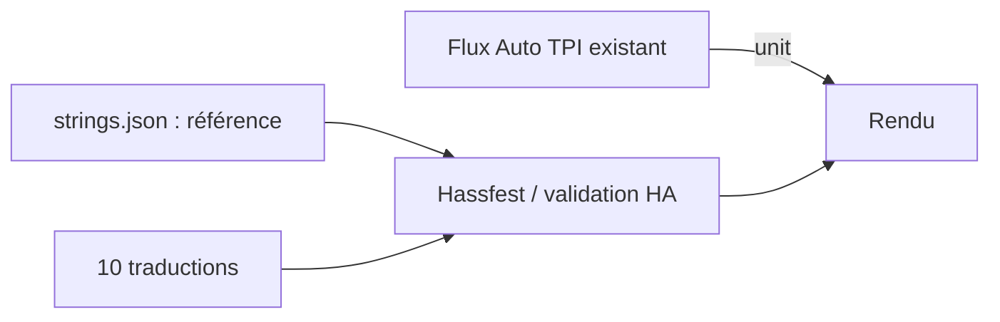
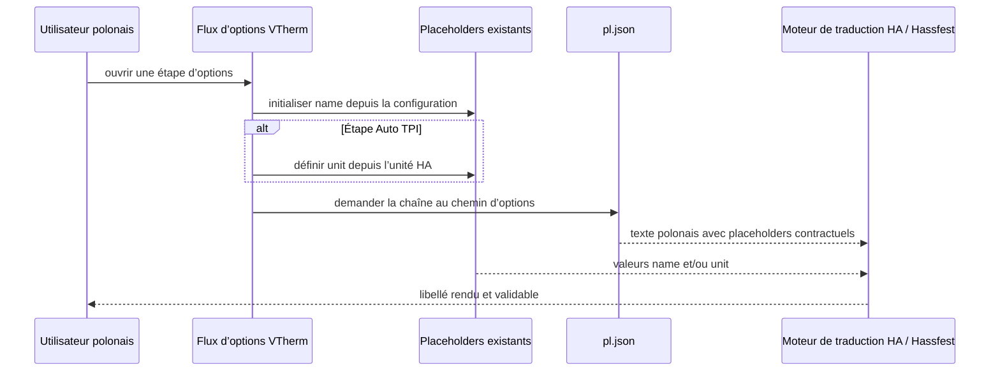

# Conception technique — Issue #2091 : extension `auto_tpi_cooling_rate`

- **Statut :** proposée pour implémentation ; aucun code ni fichier de traduction n’est modifié par ce document
- **Version :** 2.1
- **Date :** 2026-10-10
- **Propriétaire :** Projet Versatile Thermostat
- **Sources :** [spécification française](../specs/issue-2091_fr.md), [spécification anglaise](../specs/issue-2091_en.md), [rapport](issue-2091-review.md), [référence](../../custom_components/versatile_thermostat/strings.json), [traductions](../../custom_components/versatile_thermostat/translations/), [flux](../../custom_components/versatile_thermostat/config_flow.py) et [CI](../../.github/workflows/pull.yml)

> L’annexe 1.0 est archivée et non normative. La présente section 2.1 est la seule conception applicable à l’extension `auto_tpi_cooling_rate`.

## 1. Objectif, périmètre et décision source

L’extension ajoute `auto_tpi_cooling_rate` aux quatre chemins suivants de chacune des dix locales présentes (`cs`, `de`, `el`, `en`, `fr`, `it`, `pl`, `ru`, `sk`, `zh-Hans`) :

1. `config.step.auto_tpi_configuration.data.auto_tpi_cooling_rate` ;
2. `config.step.auto_tpi_configuration.data_description.auto_tpi_cooling_rate` ;
3. `options.step.auto_tpi_configuration.data.auto_tpi_cooling_rate` ;
4. `options.step.auto_tpi_configuration.data_description.auto_tpi_cooling_rate`.

Chaque valeur contient `{unit}` exactement une fois. Les valeurs `data_description` indiquent que `0` maintient l’apprentissage automatique (« bootstrap »). Le flux Auto TPI, les entités, services, événements, données persistées, dépendances et configurations utilisateur ne changent pas.

**D-2091-01 — FR-010 et BR-008 sont appliquées sans réserve : `strings.json` fait partie du changement d’implémentation.** Il recevra les quatre feuilles de référence :

| Chemin source                                               | Valeur canonique proposée                                                                                 |
| ----------------------------------------------------------- | --------------------------------------------------------------------------------------------------------- |
| `config...data` et `options...data`                         | `Cooling Rate ({unit}/h)`                                                                                 |
| `config...data_description` et `options...data_description` | `Radiator temperature cooling capacity ({unit} per hour). Leave at 0 for automatic learning (bootstrap).` |

Cette décision fait de la clé et de `{unit}` un contrat vérifiable par Home Assistant et Hassfest. Une clé dans les seules locales ne serait pas une référence contractuelle. FR-010 prescrit explicitement ces quatre feuilles et interdit uniquement toute autre modification de `strings.json`.

## 2. État vérifié, composants et contrats

| Élément                   | Fait vérifié                                                                        | Responsabilité / impact                                                  |
| ------------------------- | ----------------------------------------------------------------------------------- | ------------------------------------------------------------------------ |
| `strings.json`            | Les sections Auto TPI existent dans `config` et `options`, mais la clé est absente. | Ajouter les 4 références de D-2091-01.                                   |
| `config_flow.py`          | Le flux existant fournit `unit` à l’étape Auto TPI.                                 | Aucun changement ; `{unit}` est le contrat unique.                       |
| `translations/*.json`     | Dix locales sont présentes.                                                         | Ajouter uniquement les feuilles manquantes, sans écraser une occurrence. |
| Home Assistant / Hassfest | Chargent, substituent et valident les traductions.                                  | Aucun changement.                                                        |

Il n’y a ni nouveau modèle d’état ni migration : la solution est déclarative et idempotente. Le redémarrage ou rechargement relit les ressources selon le mécanisme existant.

## 3. Audit réel et plan exact par locale

Le constat fourni (« `cs`/`fr` complets ») ne correspond pas à l’arbre contrôlé : `cs` ne contient que les deux valeurs `config`, `fr` les deux valeurs `options`, et `pl` seulement `options.data`. Ce résultat vérifié prévaut pour éviter d’écraser une valeur ou de supposer un état inexistant. Les sections absentes ci-dessous sont `auto_tpi_configuration`, non les racines `config` ou `options`.

| Locale    | État des 4 chemins (config data / description ; options data / description) | Libellé proposé                                                  | Description proposée                                                                                                             | Opération exacte                                                                                                                                                                  |
| --------- | --------------------------------------------------------------------------- | ---------------------------------------------------------------- | -------------------------------------------------------------------------------------------------------------------------------- | --------------------------------------------------------------------------------------------------------------------------------------------------------------------------------- |
| `cs`      | présent / présent ; absent / absent                                         | `Rychlost chlazení ({unit}/h)`                                   | `Kapacita poklesu teploty radiátoru ({unit} za hodinu). Ponechejte na 0 pro automatické učení (bootstrap).`                      | Ajouter les 2 chemins `options`; préserver les 2 valeurs `config` exactement.                                                                                                     |
| `de`      | absent / absent ; absent / absent                                           | `Abkühlrate ({unit}/h)`                                          | `Abkühlleistung des Heizkörpers ({unit} pro Stunde). Für automatisches Lernen (Bootstrap) auf 0 belassen.`                       | Ajouter les 4 chemins.                                                                                                                                                            |
| `el`      | section absente ; section absente                                           | `Ρυθμός ψύξης ({unit}/h)`                                        | `Ικανότητα ψύξης του καλοριφέρ ({unit} ανά ώρα). Αφήστε την τιμή στο 0 για αυτόματη εκμάθηση (bootstrap).`                       | Créer les 2 sections, puis les 4 chemins.                                                                                                                                         |
| `en`      | absent / absent ; absent / absent                                           | `Cooling Rate ({unit}/h)`                                        | `Radiator temperature cooling capacity ({unit} per hour). Leave at 0 for automatic learning (bootstrap).`                        | Ajouter les 4 chemins.                                                                                                                                                            |
| `fr`      | absent / absent ; présent / présent                                         | `Taux de refroidissement ({unit}/h)`                             | `Capacité de descente en température du radiateur ({unit} par heure). Laisser à 0 pour l'apprentissage automatique (bootstrap).` | Ajouter les 2 chemins `config`; préserver les 2 valeurs `options` exactement.                                                                                                     |
| `it`      | absent / absent ; absent / absent                                           | `Velocità di raffreddamento ({unit}/h)`                          | `Capacità di raffreddamento del radiatore ({unit} all'ora). Lasciare a 0 per l'apprendimento automatico (bootstrap).`            | Ajouter les 4 chemins.                                                                                                                                                            |
| `pl`      | section absente ; présent / absent                                          | `Szybkość chłodzenia ({unit}/h)` — uniquement pour `config.data` | `Zdolność chłodzenia grzejnika ({unit} na godzinę). Pozostaw 0 dla automatycznego uczenia (bootstrap).`                          | Créer `config` et ses 2 chemins, créer `options.data_description`; préserver exactement, sans rétablissement ni modification, `options.data` : `Szybkość wystudzania ({unit}/h)`. |
| `ru`      | section absente ; section absente                                           | `Скорость охлаждения ({unit}/ч)`                                 | `Способность радиатора к охлаждению ({unit} в час). Оставьте 0 для автоматического обучения (bootstrap).`                        | Créer les 2 sections, puis les 4 chemins.                                                                                                                                         |
| `sk`      | section absente ; section absente                                           | `Rýchlosť chladenia ({unit}/h)`                                  | `Schopnosť chladiča ochladzovať ({unit} za hodinu). Pre automatické učenie (bootstrap) ponechajte hodnotu 0.`                    | Créer les 2 sections, puis les 4 chemins.                                                                                                                                         |
| `zh-Hans` | absent / absent ; absent / absent                                           | `冷却速率 ({unit}/小时)`                                         | `散热器降温能力（每小时 {unit}）。保留为 0 以进行自动学习（bootstrap）。`                                                        | Ajouter les 4 chemins.                                                                                                                                                            |

Les propositions sont des valeurs de conception explicites pour toutes les feuilles manquantes ; elles ne sont pas présentées comme des valeurs déjà présentes dans les fichiers. Une relecture linguistique peut améliorer ultérieurement ces textes, mais ne bloque pas l’implémentation technique de ces valeurs proposées.

## 4. Flux, erreurs et préservation

### Flux nominal

1. Appliquer D-2091-01 et les valeurs localisées proposées par la présente conception.
2. Ajouter les 4 références anglaises à `strings.json`.
3. Ajouter exclusivement les chemins manquants de la ligne locale concernée.
4. Home Assistant injecte la valeur existante de `unit` lors du rendu.
5. Hassfest compare les locales à la référence et vérifie le contrat.

### Invariants et erreurs

- Chaque nouvelle feuille est une chaîne contenant exactement `{unit}` une fois ; aucune unité fixe ne la remplace.
- Les occurrences préexistantes sont identiques octet pour octet, notamment `cs.config.*`, `fr.options.*` et `pl.options.data`.
- Le correctif polonais historique de `auto_tpi_heating_rate` et `heating_failure_detection.title` demeure distinct et ne peut pas être écrasé.
- Si JSON est invalide, si un chemin ou un placeholder diffère, ou si Hassfest échoue, le diff est rejeté/revenu au dernier état valide puis seul le chemin défaillant est corrigé. Une remarque linguistique est un risque résiduel facultatif et ne modifie pas ce critère de rejet. Aucun état runtime ni donnée utilisateur n’exige une reprise.

## 5. Sécurité, observabilité et validations

Aucun secret, permission, accès réseau, donnée personnelle, journal, métrique ou événement n’est ajouté. Les erreurs sont observables par les validateurs JSON, Home Assistant et Hassfest. Les tests de régulation Python ne sont pas requis : aucun code ne change.

| Contrôle     | Critère de réussite                                                                                                                                                  |
| ------------ | -------------------------------------------------------------------------------------------------------------------------------------------------------------------- |
| Référence    | `strings.json` a les 4 feuilles ; chacune contient `{unit}` une fois.                                                                                                |
| JSON         | Les 11 JSON modifiés (source plus 10 locales) sont valides en UTF-8.                                                                                                 |
| Parité       | Les 10 locales résolvent les 4 chemins ; chaque valeur est une chaîne.                                                                                               |
| Placeholders | Ensemble et compte exacts : `{unit}` / 1 pour chacune des 40 feuilles localisées et les 4 références.                                                                |
| Préservation | Snapshot avant/après identique pour toute occurrence préexistante, notamment `cs.config.*`, `fr.options.*` et `pl.options.data` (`Szybkość wystudzania ({unit}/h)`). |
| Diff         | Seulement `strings.json`, les 10 traductions visées et la documentation autorisée ; aucun Python, configuration ou dépendance.                                       |
| Intégration  | Hassfest local et CI ne signalent aucune erreur liée à la clé.                                                                                                       |
| Linguistique | Relecture native facultative, consignée si elle est réalisée ; elle ne bloque pas la validation technique.                                                           |

Critères de diff : 4 feuilles dans `strings.json`; `cs` +2, `fr` +2, `pl` +3; `de`, `en`, `it`, `zh-Hans` +4 chacun; `el`, `ru`, `sk` : deux sections minimales et +4 feuilles chacun. Aucun déplacement, suppression, reformatage global ou remplacement d’occurrence existante n’est autorisé.

## 6. Traçabilité, risques et cohérence

| Exigence                   | Décision / preuve                                                                                                           |
| -------------------------- | --------------------------------------------------------------------------------------------------------------------------- |
| FR-006, BR-006, AC-007     | Quatre chemins par locale ; parcours de parité.                                                                             |
| FR-007, AC-010             | Préservation explicite et snapshots avant/après.                                                                            |
| FR-008, BR-007, AC-008/009 | `{unit}` exactement une fois ; extraction de placeholders.                                                                  |
| FR-009                     | Les valeurs proposées sont explicites et versionnées ; aucune traduction n’est inventée silencieusement à l’implémentation. |
| BR-008, AC-011             | Référence dans `strings.json`, puis Hassfest local et CI.                                                                   |

Risques : état `cs`/`fr` différent de l’audit annoncé (ré-auditer avant édition), traduction perfectible (relecture native facultative), ou écrasement d’une valeur partielle (snapshots et revue de diff).

**Conclusion de cohérence :** les spécifications française et anglaise 2.1 convergent avec cette conception pour FR-006 à FR-010, BR-006 à BR-009 et AC-007 à AC-012 : `strings.json` est explicitement inclus, les quatre chemins sont requis, la valeur polonaise autorisée est préservée, et JSON/placeholders/Hassfest sont des validations obligatoires. Les valeurs localisées proposées constituent la base autorisée de l’implémentation ; une relecture linguistique native demeure recommandée, mais non bloquante.

---

# Annexe A — Conception 1.0 retirée (archive historique, sans effet normatif)

> Cette archive documente le périmètre initial, antérieur à l’extension `auto_tpi_cooling_rate`. Elle ne constitue ni une exigence, ni un statut, ni une assertion applicable à la conception 2.1. Les décisions, le périmètre et la convergence applicables sont exclusivement ceux des sections 1 à 7 ci-dessus.

- **Statut :** proposée pour implémentation après validation de conception
- **Version :** 1.0
- **Date :** 2026-10-10
- **Propriétaire :** Projet Versatile Thermostat
- **Issue :** [#2091 — Translation error](https://github.com/jmcollin78/versatile_thermostat/issues/2091)
- **Sources normatives :** [revue de l’issue #2091](issue-2091-review.md), [spécification française #2091](../specs/issue-2091_fr.md), [spécification anglaise #2091](../specs/issue-2091_en.md)
- **Éléments techniques vérifiés :** [référence de traduction](../../custom_components/versatile_thermostat/strings.json), [traduction polonaise](../../custom_components/versatile_thermostat/translations/pl.json), [flux d’options](../../custom_components/versatile_thermostat/config_flow.py), [CI de pull request](../../.github/workflows/pull.yml)
- **Périmètre de modification fonctionnelle :** exclusivement deux valeurs de [pl.json](../../custom_components/versatile_thermostat/translations/pl.json). Ce document est la seule autre modification prévue dans cette phase de conception.

## 1. Objectif, périmètre et exigences couvertes

Cette conception corrige les deux écarts de contrat de placeholders que Home Assistant signale pour la locale polonaise lors du rendu du flux d’options VTherm :

1. `options.step.auto_tpi_configuration.data.auto_tpi_heating_rate` doit recevoir l’unité de température dynamique par `{unit}` ;
2. `options.step.heating_failure_detection.title` doit recevoir le nom du VTherm par `{name}`.

Elle couvre les exigences **FR-001 à FR-005**, les règles **BR-001 à BR-004** et les critères **AC-001 à AC-006** de la spécification. Elle ne crée ni entité Home Assistant, ni service, ni événement, ni migration de données.

### Exclus explicitement

- toute chaîne autre que les deux chemins ci-dessus dans `pl.json` ;
- `strings.json`, `config_flow.py`, la logique de thermostat, les tests Python et les configurations utilisateur ;
- les locales `el`, `ru` et `sk`, y compris les écarts connexes documentés dans la revue ;
- toute révision linguistique générale de la traduction polonaise.

## 2. État existant vérifié et dépendances

| Élément                                   | État vérifié                                                                                                                          | Conséquence de conception                                                        |
| ----------------------------------------- | ------------------------------------------------------------------------------------------------------------------------------------- | -------------------------------------------------------------------------------- |
| Référence canonique                       | La référence `options` de `strings.json` porte `Heating Rate ({unit}/h)` et `Heating failure detection - {name}`.                     | Les ensembles de placeholders attendus sont respectivement `{unit}` et `{name}`. |
| Traduction polonaise actuelle             | La vitesse de chauffe est `Szybkość nagrzewania (°C/h)` et le titre est `Wykrywanie awarii ogrzewania`, sans les placeholders requis. | Deux valeurs, et seulement deux, doivent être modifiées.                         |
| Initialisation des placeholders d’options | `async_step_init` initialise `name` depuis la configuration du VTherm.                                                                | Le titre polonais peut rendre `{name}` sans changement du flux.                  |
| Étape Auto TPI                            | `async_step_auto_tpi_configuration` affecte l’unité de température de Home Assistant à `unit` avant l’appel de l’étape générique.     | Le libellé polonais peut rendre `{unit}` sans unité codée en dur.                |
| Étape de détection de panne               | Les chemins central et spécifique appellent tous deux l’étape générique `heating_failure_detection`.                                  | Un unique titre localisé avec `{name}` couvre les parcours concernés.            |
| Validation CI                             | Le workflow de pull request exécute Hassfest.                                                                                         | Hassfest est la validation d’intégration de référence des placeholders.          |

Aucune modification de l’état ou de la configuration d’une instance Home Assistant n’est prévue. Le contrôle actuel de l’éditeur ne relève pas d’erreur JSON dans `pl.json`.

## 3. Architecture et flux pertinent

La correction est entièrement déclarative : le code existant fournit les valeurs de substitution, tandis que Home Assistant charge la chaîne de la locale sélectionnée et vérifie son contrat par rapport à la référence. Aucune donnée saisie par l’utilisateur n’est transformée ou persistée par cette modification.

### Responsabilités inchangées

| Composant                 | Responsabilité existante                                      | Changement conçu                                  |
| ------------------------- | ------------------------------------------------------------- | ------------------------------------------------- |
| `config_flow.py`          | Prépare les schémas d’options et les valeurs `name` / `unit`. | Aucun.                                            |
| `strings.json`            | Définit la référence de structure et de placeholders.         | Aucun.                                            |
| `translations/pl.json`    | Fournit les textes polonais associés aux mêmes clés.          | Modification de deux valeurs de chaîne seulement. |
| Home Assistant / Hassfest | Rend et valide les traductions contre la référence.           | Aucun.                                            |

## 4. Modèle de données et modifications proposées

Les chemins, le type JSON (`string`), la hiérarchie `options.step`, l’encodage UTF-8 et les virgules environnantes sont conservés. Il n’existe aucune donnée persistée supplémentaire, aucune nouvelle clé et aucune suppression de clé.

| Chemin JSON                                                      | Valeur actuelle vérifiée       | Valeur proposée                         | Contrat de placeholder                             |
| ---------------------------------------------------------------- | ------------------------------ | --------------------------------------- | -------------------------------------------------- |
| `options.step.auto_tpi_configuration.data.auto_tpi_heating_rate` | `Szybkość nagrzewania (°C/h)`  | `Szybkość nagrzewania ({unit}/h)`       | Ensemble exact : `{unit}` ; l’unité est dynamique. |
| `options.step.heating_failure_detection.title`                   | `Wykrywanie awarii ogrzewania` | `Wykrywanie awarii ogrzewania - {name}` | Ensemble exact : `{name}` ; le nom est dynamique.  |

### Invariants de données

1. Les clés JSON et la structure de `pl.json` restent identiques avant et après correction.
2. Les deux valeurs modifiées restent des chaînes JSON valides.
3. La première valeur ne contient plus d’unité `°C` imposée à la place de `{unit}`.
4. La seconde valeur conserve le texte polonais existant et lui ajoute seulement le suffixe nécessaire ` - {name}`.
5. Aucune autre occurrence, locale ou donnée utilisateur ne fait partie du diff fonctionnel.

## 5. Interfaces, contrats et compatibilité

### Contrats d’échange existants conservés

| Contrat                                 | Producteur                                                                 | Consommateur                      | Exigence après correction                                                                             |
| --------------------------------------- | -------------------------------------------------------------------------- | --------------------------------- | ----------------------------------------------------------------------------------------------------- |
| `unit`                                  | Flux d’options Auto TPI, depuis l’unité de température Home Assistant      | Chaîne `auto_tpi_heating_rate`    | Le placeholder `{unit}` est présent une fois et peut recevoir toute unité fournie par Home Assistant. |
| `name`                                  | Initialisation du flux d’options, depuis le nom de la configuration VTherm | Titre `heating_failure_detection` | Le placeholder `{name}` est présent une fois et peut recevoir le nom existant.                        |
| Structure et placeholders de traduction | `strings.json`                                                             | `pl.json`, Hassfest               | Les clés et l’ensemble des placeholders des deux chaînes correspondent à la référence.                |

Les substitutions sont réalisées par les mécanismes existants de Home Assistant ; le correctif ne modifie ni leur signature, ni leur délai, ni leur idempotence. La modification est idempotente au sens du dépôt : réappliquer les deux mêmes valeurs produit le même fichier et n’entraîne aucun effet sur les données de configuration.

### Compatibilité

- **Unités :** `{unit}` remplace correctement l’unité codée en dur pour les installations utilisant une unité différente de `°C`, tout en conservant un rendu Celsius lorsque Home Assistant fournit `°C`.
- **Noms :** `{name}` préserve l’affichage du nom de la configuration pour les flux d’options qui initialisent déjà ce placeholder.
- **Versions et migration :** aucune migration de configuration, de registre d’entités ou de données n’est requise ; les configurations existantes restent inchangées.
- **Locales :** seule `pl` est impactée. `el`, `ru` et `sk` demeurent volontairement inchangées et hors contrat de cette issue.
- **Repli et annulation :** il n’existe aucun état partiellement appliqué ; le repli consiste à restaurer les deux anciennes chaînes si une régression de traduction était démontrée. Cette conception ne prévoit aucun mécanisme runtime d’annulation.

## 6. Validation et stratégie de test

Cette issue ne justifie pas l’ajout de test de régulation : le correctif ne change aucun chemin Python. La preuve attendue combine une vérification syntaxique locale, une vérification ciblée des valeurs et Hassfest.

| Niveau               | Action de validation                                                                                     | Résultat attendu                                                                     | Exigences / critères couverts                           |
| -------------------- | -------------------------------------------------------------------------------------------------------- | ------------------------------------------------------------------------------------ | ------------------------------------------------------- |
| JSON                 | Analyser `pl.json` avec un parseur JSON strict.                                                          | Fichier JSON valide.                                                                 | FR-004, AC-003                                          |
| Ciblé — structure    | Comparer avant/après les clés et limiter le diff de traduction aux deux chemins conçus.                  | Aucune clé ajoutée, supprimée ou déplacée ; aucune autre locale changée.             | FR-003, FR-004, FR-005, AC-003, AC-006                  |
| Ciblé — placeholders | Lire les deux valeurs et contrôler les ensembles exacts `{unit}` puis `{name}`.                          | Chaque valeur porte exclusivement le placeholder requis pour son contrat.            | FR-001, FR-002, BR-001 à BR-003, AC-001, AC-002, AC-005 |
| Hassfest local / CI  | Exécuter la validation Hassfest du dépôt ; la CI l’exécute également à chaque pull request.              | Absence des deux erreurs de validation signalées dans #2091.                         | FR-004, AC-004                                          |
| Revue manuelle       | Ouvrir les deux étapes d’options avec la locale `pl`, si un environnement Home Assistant est disponible. | L’étiquette Auto TPI affiche l’unité configurée ; le titre affiche le nom du VTherm. | BR-002, BR-003                                          |

### Cas limites et pannes

- **Unité non Celsius :** une unité Home Assistant différente de `°C` doit être rendue telle quelle par `{unit}` ; aucune constante `°C` ne doit être introduite dans la chaîne corrigée.
- **Nom contenant des caractères Unicode :** le moteur existant doit substituer `{name}` sans modification de l’encodage JSON.
- **Échec JSON ou Hassfest :** arrêter l’intégration du correctif, identifier si l’échec concerne les deux chemins prévus, puis corriger exclusivement la valeur concernée. Un écart hors périmètre ne doit pas entraîner de modification des locales exclues sans nouvelle décision.
- **Indisponibilité d’un environnement Home Assistant local :** les validations JSON, de diff ciblé et Hassfest restent les preuves minimales ; le test manuel est complémentaire, non substitutif.

## 7. Observabilité, sécurité et contraintes opérationnelles

- **Observabilité :** les erreurs de placeholder sont observables par Hassfest et par les messages de validation Home Assistant. Aucun nouveau journal, compteur, événement ou attribut n’est introduit.
- **Sécurité et confidentialité :** aucune permission, secret, donnée personnelle, appel réseau ou service Home Assistant n’est ajouté. `{name}` est déjà une donnée du flux d’options ; cette conception n’en augmente ni la collecte ni la diffusion.
- **Performance :** la taille du fichier et le mécanisme de chargement restent inchangés à l’échelle fonctionnelle.
- **Déploiement :** le changement est livré avec le paquet de l’intégration suivant les mécanismes existants du dépôt ; aucun redémarrage ou ordre de déploiement particulier n’est conçu au-delà du rechargement normal de l’intégration.

## 8. Plan d’implémentation

1. Ouvrir [pl.json](../../custom_components/versatile_thermostat/translations/pl.json) et ne modifier que les deux valeurs du tableau de la section 4.
2. Préserver l’ordre, l’indentation, les clés et toutes les autres chaînes du fichier.
3. Valider la syntaxe JSON avec un parseur strict.
4. Vérifier les deux ensembles de placeholders et contrôler le diff pour confirmer l’absence de changement hors des deux chaînes.
5. Lancer Hassfest selon la procédure du dépôt, puis laisser la CI de pull request répéter cette validation.
6. Si disponible, effectuer la vérification manuelle en polonais des deux étapes d’options.
7. Ne pas corriger `el`, `ru` ou `sk` dans cette livraison ; consigner tout constat supplémentaire dans une issue distincte.

## 9. Risques, hypothèses, décisions et questions ouvertes

### Hypothèses vérifiées par les sources

- Le flux d’options prépare déjà `name` au démarrage et `unit` avant l’étape Auto TPI.
- Les valeurs de référence anglaises définissent les placeholders contractuels à conserver.
- Hassfest est exécuté par la CI de pull request.

### Risques et mesures

| Risque                                                               | Niveau                 | Mesure                                                                                       |
| -------------------------------------------------------------------- | ---------------------- | -------------------------------------------------------------------------------------------- |
| Un placeholder est mal orthographié, dupliqué ou oublié.             | Moyen avant validation | Contrôle ciblé des ensembles de placeholders et Hassfest.                                    |
| Le JSON est invalide après édition.                                  | Faible                 | Analyse JSON stricte avant soumission.                                                       |
| Un changement non prévu étend le diff aux autres chaînes ou locales. | Faible                 | Revue de diff limitée aux deux chemins et exclusion explicite de `el` / `ru` / `sk`.         |
| Une formulation polonaise est contestée.                             | Faible                 | Conserver le texte existant et ne remplacer que `°C` par `{unit}`, puis ajouter ` - {name}`. |

### Questions ouvertes et décisions

- **Question non bloquante :** une relecture par un locuteur polonais est-elle souhaitée avant fusion ? Elle peut améliorer la formulation, mais aucune source ne demande de modifier davantage le texte existant.
- **Décision déjà fixée par le périmètre :** les écarts de `el`, `ru` et `sk` ne sont pas traités ici.
- **Aucun bloqueur de conception identifié.**

## 10. Vérification de cohérence et traçabilité

La spécification française et sa version anglaise sont cohérentes entre elles : elles prescrivent les mêmes deux chemins, les mêmes placeholders, la préservation de la structure JSON, les validations JSON et Hassfest, et l’exclusion de `el`, `ru` et `sk`. La présente conception ne propose aucune exigence contradictoire ou élargissement de périmètre.

| Source / exigence        | Décision de conception                                                                                       | Preuve de validation                                              |
| ------------------------ | ------------------------------------------------------------------------------------------------------------ | ----------------------------------------------------------------- |
| FR-001 / AC-001 / BR-002 | Insérer `{unit}` dans `auto_tpi_heating_rate` à la place de l’unité fixe.                                    | Contrôle ciblé du placeholder, rendu manuel facultatif, Hassfest. |
| FR-002 / AC-002 / BR-003 | Ajouter ` - {name}` au titre `heating_failure_detection`.                                                    | Contrôle ciblé du placeholder, rendu manuel facultatif, Hassfest. |
| FR-003                   | Préserver les libellés polonais hors remplacement minimal de placeholder.                                    | Revue du diff exact des deux valeurs.                             |
| FR-004 / AC-003 / AC-006 | Limiter le correctif fonctionnel à `pl.json`, sans clé ajoutée ni autre locale.                              | Diff de fichier, comparaison de structure et analyse JSON.        |
| FR-005                   | Ne modifier ni flux, ni régulation, ni données utilisateur.                                                  | Diff sans fichiers de code ou de configuration utilisateur.       |
| BR-001 / AC-004 / AC-005 | Aligner les ensembles de placeholders avec `strings.json` et supprimer les valeurs codées en dur concernées. | Hassfest sans les deux erreurs #2091.                             |
| BR-004                   | Ne pas modifier `el`, `ru` ou `sk`.                                                                          | Diff excluant ces trois fichiers.                                 |

**Conclusion historique retirée :** cette conclusion concerne uniquement le correctif polonais initial et n’est pas applicable à l’extension 2.1. La conclusion de cohérence applicable figure dans la section 7.
