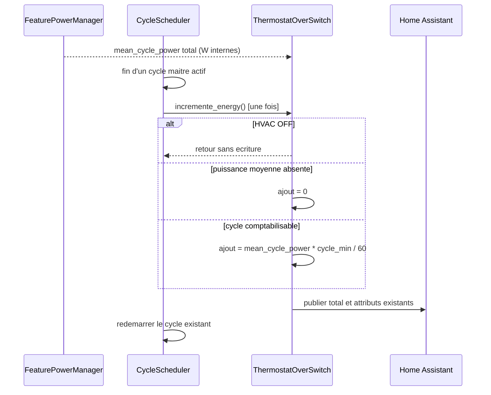
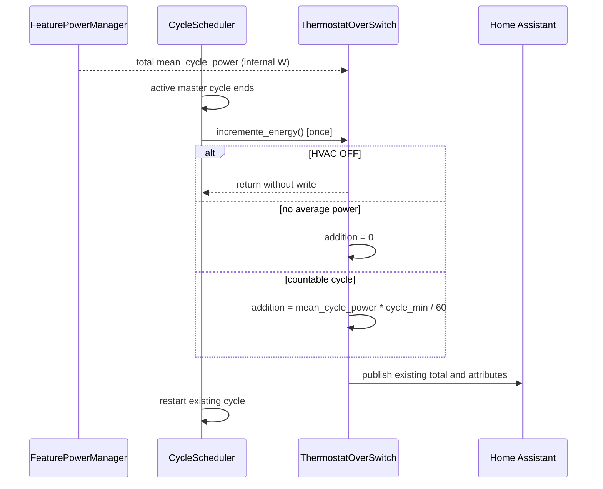

# Conception technique / Technical Design - Issue #2109, point 1.1 / item 1.1

- **Statut / Status :** Proposee pour validation avant developpement / Proposed for approval before development
- **Version :** 1.0
- **Date :** 2026-10-13
- **Proprietaire / Owner :** Projet Versatile Thermostat / Versatile Thermostat project
- **Perimetre / Scope :** Issue #2109, point 1.1 uniquement / item 1.1 only
- **Sources normatives / Normative sources :** [rapport valide](issue-2109-review.md), [specification fonctionnelle francaise](../specs/issue-2109-energy-multi-relay_fr.md), [functional specification](../specs/issue-2109-energy-multi-relay_en.md)
- **Code et tests inspectes / Inspected code and tests :** [thermostat_switch.py](../../custom_components/versatile_thermostat/thermostat_switch.py), [cycle_scheduler.py](../../custom_components/versatile_thermostat/cycle_scheduler.py), [feature_power_manager.py](../../custom_components/versatile_thermostat/feature_power_manager.py), [test_power.py](../../tests/test_power.py), [test_cycle_scheduler.py](../../tests/test_cycle_scheduler.py) et [test_sensors.py](../../tests/test_sensors.py)

---

## Francais

### 1. Objectif, perimetre et couverture

Cette conception corrige exclusivement le sous-comptage d'energie d'un thermostat `over_switch` ayant plusieurs relais. Elle ne decrit aucun developpement dans ce document : elle prescrit une modification locale ulterieure et les tests qui devront la verifier.

Le comportement cible est que chaque fin de cycle maitre ajoute l'energie correspondant a la puissance moyenne **totale** du thermostat pendant la duree du cycle :

$$
energie\_ajoutee = mean\_cycle\_power \times cycle\_min / 60
$$

`device_power` est la puissance totale des relais controles. `mean_cycle_power`, derivee de cette valeur, est donc elle aussi totale. Aucune division supplementaire par `nb_underlying_entities` ne doit intervenir dans le comptage d'energie.

Sont couverts : FR-001 a FR-008, BR-001 a BR-006 et AC-001 a AC-009 des specifications francaise et anglaise. Les points 1.2 et 2 de l'issue #2109, les reservations du gestionnaire de puissance, les autres types de thermostat et toute correction retrospective d'historique sont explicitement hors perimetre.

### 2. Faits verifies, dependances et hypotheses

| Type                               | Element                                    | Constat et consequence de conception                                                                                                                                                                                                                                                                                 |
| ---------------------------------- | ------------------------------------------ | -------------------------------------------------------------------------------------------------------------------------------------------------------------------------------------------------------------------------------------------------------------------------------------------------------------------- |
| Fait verifie                       | `ThermostatOverSwitch.incremente_energy()` | Hors HVAC `OFF`, le compteur initialise ou ajoute `_total_energy`, met a jour les attributs et publie l'etat. Son calcul contient actuellement `mean_cycle_power * cycle_min / 60 / nb_underlying_entities`. C'est le seul calcul a modifier.                                                                        |
| Fait verifie                       | `CycleScheduler._on_master_cycle_end()`    | Lorsque le cycle est actif, cette methode appelle `self._thermostat.incremente_energy()` une fois, puis redemarre le cycle. Les tests existants affirment deja cet appel unique avec un thermostat simule. Aucun appel a `incremente_energy()` depuis `thermostat_switch.py` autre que sa definition n'a ete trouve. |
| Fait verifie                       | `FeaturePowerManager.mean_cycle_power`     | Le gestionnaire normalise `device_power` en watts internes. Avec un algorithme proportionnel, il retourne `device_power * on_percent`; ce n'est pas une puissance unitaire de relais.                                                                                                                                |
| Fait verifie                       | Unites                                     | `FeaturePowerManager` expose W ou kW et l'unite d'energie correspondante Wh ou kWh. La conversion et la persistance d'unite existent hors de la methode cible; elles ne doivent pas etre modifiees. Des tests de capteur existent pour l'unite kWh.                                                                  |
| Fait verifie                       | Divisions du gestionnaire de puissance     | Les divisions par le nombre de relais dans les calculs de reservation et de puissance maximale ont un contrat different. Elles sont necessaires au point 2 potentiel et ne font pas partie de cette correction.                                                                                                      |
| Fait verifie                       | Tests actuels                              | Le scenario multi-relais de `test_power.py` appelle directement `incremente_energy()` et encode actuellement une division par deux. Il doit etre aligne, mais ne prouve pas a lui seul le chemin ordonnanceur.                                                                                                       |
| Hypothese a verifier par les tests | Chemins d'appel actifs                     | Le scenario d'integration devra confirmer qu'un cycle multi-relais passant par la fin de cycle maitre ne produit qu'un seul increment. Cette conception ne suppose aucun nouveau mecanisme d'appel par relais.                                                                                                       |

Il n'y a pas de contradiction bloquante entre le rapport valide, les deux specifications et le code inspecte : ils decrivent tous `device_power` et `mean_cycle_power` comme des grandeurs totales, et un seul appel de fin de cycle.

### 3. Solution recommandee et responsabilites

#### 3.1 Modification minimale prevue

La seule modification fonctionnelle prevue est dans `ThermostatOverSwitch.incremente_energy()` : retirer de la formule d'energie l'operande final `/ self.nb_underlying_entities` ainsi que le commentaire historique qui justifie cette repartition par relais.

La formule utilisee apres correction sera :

```text
added_energy = power_manager.mean_cycle_power * float(_cycle_min) / 60.0
```

Les gardes et effets existants restent inchanges : retour immediat en HVAC `OFF`, increment nul lorsque `mean_cycle_power` vaut `None`, initialisation de `_total_energy` lorsqu'il vaut `None`, addition sinon, mise a jour des attributs et publication Home Assistant.

#### 3.2 Composants et contrats conserves

| Composant                        | Responsabilite apres correction                                                                                  | Modification prevue                                                 |
| -------------------------------- | ---------------------------------------------------------------------------------------------------------------- | ------------------------------------------------------------------- |
| `ThermostatOverSwitch`           | Convertir une puissance moyenne totale interne en energie de cycle et mettre a jour le compteur.                 | Oui : suppression d'une unique division dans `incremente_energy()`. |
| `CycleScheduler`                 | Declencher une seule fois l'increment a la fin d'un cycle maitre actif, puis relancer ce cycle.                  | Non.                                                                |
| `FeaturePowerManager`            | Normaliser la puissance, calculer `mean_cycle_power`, exposer les unites et gerer les reservations de puissance. | Non.                                                                |
| Capteur d'energie Home Assistant | Exposer le total et l'unite existante a Home Assistant et a ses statistiques.                                    | Non.                                                                |
| Tests                            | Corriger l'attente multi-relais directe et apporter une preuve de bout en bout ordonnanceur plus thermostat.     | Oui.                                                                |

### 4. Modele de donnees, etats et invariants

| Donnee ou etat                  | Source ou proprietaire                                   | Regle de conception                                                                                                                        |
| ------------------------------- | -------------------------------------------------------- | ------------------------------------------------------------------------------------------------------------------------------------------ |
| `device_power`                  | Configuration, normalisee par `FeaturePowerManager`      | Pour plusieurs relais, represente la puissance totale. Elle n'est ni reinterpretee ni migree.                                              |
| `mean_cycle_power`              | `FeaturePowerManager`                                    | Puissance moyenne totale en watts internes, egale a `device_power * on_percent` lorsque l'algorithme proportionnel fournit un pourcentage. |
| `cycle_min`                     | Thermostat                                               | Duree du cycle en minutes; la division par 60 la convertit en heures.                                                                      |
| `nb_underlying_entities`        | Thermostat                                               | Sert a representer les relais et reste disponible pour les contrats de reservation. Il ne participe plus au calcul d'energie de cycle.     |
| `_total_energy`                 | Thermostat, persiste/expose par les mecanismes existants | Total cumulatif. Les valeurs deja stockees ne sont jamais recalculees.                                                                     |
| Unite de puissance et d'energie | `FeaturePowerManager` et capteurs existants              | La chaine existante doit continuer a associer W avec Wh et kW avec kWh sans appliquer de facteur 1 000 supplementaire.                     |

Invariants obligatoires a l'implementation :

1. Pour tout cycle actif avec une puissance moyenne definie, l'ajout est independant du nombre de relais : $E = P_{moyenne} \times cycle\_min / 60$.
2. Un cycle maitre actif appelle le compteur une fois, jamais une fois par relais.
3. Un thermostat mono-relais conserve exactement la meme formule effective qu'avant la correction.
4. Un thermostat HVAC `OFF` ne publie aucun nouvel increment via cette methode.
5. Une puissance moyenne absente ne cree pas d'increment positif.
6. Les contrats W/Wh et kW/kWh, les attributs exposes et les historiques existants ne changent pas.
7. Aucune logique de reservation, de delestage ou de puissance maximale n'est modifiee.

### 5. Interfaces et flux de controle

Le contrat interne du point de calcul devient :

| Entree                   | Precondition                   | Sortie                                                   | Erreur, delai et idempotence                                                                                                      |
| ------------------------ | ------------------------------ | -------------------------------------------------------- | --------------------------------------------------------------------------------------------------------------------------------- |
| `mean_cycle_power`       | Valeur interne en W, ou `None` | Puissance moyenne totale de cycle                        | `None` produit un ajout nul. Aucun delai nouveau.                                                                                 |
| `_cycle_min`             | Duree configuree en minutes    | Facteur de temps en heures (`/ 60`)                      | Aucun nouveau controle de saisie dans ce point de correction.                                                                     |
| `vtherm_hvac_mode`       | Etat courant du thermostat     | Retour sans ecriture si `OFF`; sinon compteur mis a jour | Appeler la methode deux fois represente deux increments, comme aujourd'hui; la prevention d'une rafale releve du point 1.2 exclu. |
| `_on_master_cycle_end()` | Cycle actif                    | Un appel a `incremente_energy()`, puis relance           | Le contrat d'appel unique et de reprise est conserve; aucun retry additionnel n'est introduit.                                    |



### 6. Flux nominaux, erreurs, annulations et reprise

#### 6.1 Cycle multi-relais nominal

1. La configuration fournit une puissance totale, par exemple 4 300 W pour trois relais.
2. L'algorithme proportionnel fournit la puissance moyenne totale; dans l'exemple, elle vaut 4 300 W.
3. A la fin du cycle de cinq minutes, l'ordonnanceur declenche une seule fois `incremente_energy()`.
4. Le thermostat ajoute $4\,300 \times 5 / 60 = 358,33$ Wh, sans division par trois.
5. Le total est publie avec les attributs existants; le cycle suivant est planifie par l'ordonnanceur existant.

#### 6.2 Cas mono-relais

Avec un relais, supprimer la division par un ne change pas le resultat. Il n'y a donc ni adaptation de configuration ni branche de compatibilite.

#### 6.3 Puissance nulle, absente ou thermostat arrete

- HVAC `OFF` : retour avant toute initialisation, addition ou publication de compteur dans cette methode.
- `mean_cycle_power is None` : le comportement existant initialise ou conserve le total avec un ajout nul; aucun ajout positif n'est produit.
- `mean_cycle_power == 0` : aucun ajout d'energie; le comportement est deja exerce par le test de puissance existant.

#### 6.4 Annulation, redemarrage et exceptions

La correction ne modifie ni `CycleScheduler.cancel_cycle()`, ni son redemarrage force, ni le traitement d'erreur des commandes de relais. La fin d'un cycle non actif continue de retourner avant l'appel d'increment. Aucun nouveau verrou, appel asynchrone, delai, mecanisme de retry ou exception n'est ajoute. Une rafale ou plusieurs appels d'increment eventuels restent le sujet distinct du point 1.2 et ne doivent pas etre masques dans cette livraison.

### 7. Compatibilite, migration, securite et observabilite

- **Compatibilite fonctionnelle :** les installations multi-relais verront les nouveaux increments corriges, donc plus eleves du facteur auparavant errone. Les installations mono-relais ne changent pas fonctionnellement.
- **Configuration et entites :** aucun parametre, identifiant d'entite, service, evenement, attribut public ou dependance ne change. `device_power` conserve son contrat de puissance totale.
- **Migration et persistance :** aucune migration de configuration ou de donnees. Les statistiques et historiques Home Assistant deja enregistres ne sont pas recalcules ni modifies; seule l'energie future est calculee correctement.
- **Unites :** aucun changement de la normalisation interne ou de l'exposition d'unite. Les tests doivent garantir qu'aucun facteur 1 000 n'apparait entre les cas W/Wh et kW/kWh.
- **Securite et confidentialite :** aucune permission, communication reseau, secret, acces externe ou donnee personnelle nouvelle.
- **Observabilite :** les journaux existants d'`incremente_energy()` continuent d'indiquer l'ajout et le total. Aucun journal, compteur ou evenement de diagnostic nouveau n'est necessaire.
- **Retour arriere :** revertir la ligne de formule restaure le comportement anterieur; aucune donnee migree n'est a restaurer.

### 8. Strategie de tests precise

Les tests d'implementation devront etre automatises et ne pas dependre d'attentes temporelles reelles. Ils doivent laisser intactes les reservations du gestionnaire de puissance et les tests qui les couvrent.

| Test prevu                             | Fichier cible                                                                           | Montage et action                                                                                                                                                                                                           | Assertions precises                                                                                                                                                                                 | Exigences et criteres                                     |
| -------------------------------------- | --------------------------------------------------------------------------------------- | --------------------------------------------------------------------------------------------------------------------------------------------------------------------------------------------------------------------------- | --------------------------------------------------------------------------------------------------------------------------------------------------------------------------------------------------- | --------------------------------------------------------- |
| Alignement du test direct multi-relais | `tests/test_power.py`                                                                   | Reutiliser le thermostat `over_switch` a deux relais, `device_power=100 W`, cycle de cinq minutes et `on_percent=1`, puis appeler deux fois `incremente_energy()`.                                                          | Premier total : `100 * 5 / 60`; second total : `2 * 100 * 5 / 60`. Adapter egalement les attentes a `on_percent=0,3`; aucune formule ne contient `/ 2`.                                             | FR-001, FR-002, FR-004, BR-001, BR-002, AC-001, AC-004.   |
| Exemple de regression a trois relais   | `tests/test_power.py`                                                                   | Creer ou parametrer un `over_switch` avec trois relais, `device_power=4 300 W`, cycle de cinq minutes et puissance moyenne de 4 300 W. Declencher un seul increment.                                                        | Delta et total initial arrondis a environ `358,33 Wh`, jamais `119,44 Wh`.                                                                                                                          | FR-001 a FR-004, BR-001 a BR-003, AC-001, AC-002, AC-004. |
| Integration ordonnanceur plus compteur | `tests/test_power.py` ou nouveau scenario adjacent dans `tests/test_cycle_scheduler.py` | Employer un vrai `ThermostatOverSwitch` multi-relais ou un double qui delegue a sa vraie methode; configurer un `CycleScheduler` actif et appeler `_on_master_cycle_end(None)`. Espionner l'appel sans remplacer le calcul. | `incremente_energy()` est appele exactement une fois; le delta observe est celui de la formule totale; le redemarrage du cycle reste effectue.                                                      | FR-002, FR-003, BR-003, AC-003, AC-004.                   |
| Non-regression mono-relais             | `tests/test_power.py`                                                                   | Configurer un seul relais avec les memes puissance, duree et pourcentage que le scenario direct.                                                                                                                            | Delta identique a la formule historique `mean_cycle_power * cycle_min / 60`; unite inchangee.                                                                                                       | FR-005, BR-002, AC-005.                                   |
| Contrat W/Wh et kW/kWh                 | `tests/test_power.py` et/ou `tests/test_sensors.py`                                     | Reprendre les fixtures d'unite existantes une fois en W et une fois en kW, avec deux relais ou plus. Comparer des valeurs physiquement equivalentes.                                                                        | Les totaux exposes respectent Wh pour W et kWh pour kW; les valeurs equivalentes different seulement par le facteur d'unite attendu, jamais par un facteur 1 000 errone ni par le nombre de relais. | FR-006, BR-004, AC-006.                                   |
| Gardes absence de puissance et arret   | `tests/test_power.py`                                                                   | Reutiliser les chemins actuels a puissance moyenne nulle ou absente et mettre le thermostat en HVAC `OFF`.                                                                                                                  | Aucun increment positif; aucun appel de comptage via le chemin `OFF`; comportement de total existant conserve.                                                                                      | BR-005, AC-007.                                           |
| Non-regression hors perimetre          | Suite existante ciblee                                                                  | Executer les tests de reservations et de puissance maximale existants, sans changer leurs assertions.                                                                                                                       | Les divisions de reservation, les comportements de puissance et les tests du point 2 restent inchanges.                                                                                             | FR-008, AC-009.                                           |
| Historique                             | Verification de non-migration                                                           | Demarrer les tests sans ecrire de migration ni restaurer de valeurs historique.                                                                                                                                             | Aucun test ni code ne modifie une valeur historique deja enregistree; seuls les deltas apres correction sont verifies.                                                                              | FR-007, BR-006, AC-008.                                   |

La validation minimale apres implementation executera les tests cibles `tests/test_power.py`, `tests/test_cycle_scheduler.py` et les tests de capteur/unite pertinents, puis la suite de tests du depot selon sa commande habituelle. Cette conception ne lance aucun service Home Assistant et ne modifie aucun etat Home Assistant.

### 9. Decisions, risques, questions et faisabilite

| Sujet                                 | Decision ou constat                                                    | Justification                                                                                        |
| ------------------------------------- | ---------------------------------------------------------------------- | ---------------------------------------------------------------------------------------------------- |
| Point de correction                   | Retirer seulement la division de la formule de `ThermostatOverSwitch`. | Le scheduler n'appelle qu'une fois et la puissance moyenne est deja totale.                          |
| Repartition par relais                | Ecartee.                                                               | Elle correspond au modele historique de #877, qui ne correspond pas au chemin actuel d'appel unique. |
| Modification de l'ordonnanceur        | Ecartee.                                                               | Elle multiplierait les ecritures et elargirait le risque sans corriger la cause.                     |
| Modification de `FeaturePowerManager` | Ecartee.                                                               | Les normalisations et divisions de reservation ont un contrat distinct et sont hors point 1.1.       |
| Option de compatibilite               | Ecartee.                                                               | Elle maintiendrait un calcul incorrect et ajouterait une surface de configuration inutile.           |

Risques connus : les nouveaux compteurs multi-relais augmenteront par rapport aux anciens increments sous-comptes; ce changement est attendu. Le risque de retour a un comptage par relais est contenu par le test d'integration. Le risque de confusion d'unite est contenu par les tests W/Wh et kW/kWh. Aucun risque securite ou confidentialite supplementaire n'est identifie.

**Questions ou ecarts bloquants : aucun.** Question non bloquante pour la revue d'implementation : choisir si le test d'integration vit dans `test_power.py`, avec le vrai thermostat et le calcul reel, ou dans `test_cycle_scheduler.py`, auquel cas il doit relier le scheduler au calcul reel pour ne pas seulement verifier un mock. La premiere option est recommandee car elle couvre le critere AC-003 et le resultat energetique dans le meme scenario.

La solution est techniquement realisable et testable : elle est locale, conserve les interfaces existantes et possede des points de verification automatises directement exploitables.

### 10. Tracabilite exhaustive

| Exigence ou critere    | Section(s) et preuve de conception                                                                     |
| ---------------------- | ------------------------------------------------------------------------------------------------------ |
| FR-001, BR-001         | Sections 1, 2 et 4 : `device_power` et `mean_cycle_power` sont des valeurs totales; test multi-relais. |
| FR-002, BR-002, AC-001 | Sections 1 et 3.1 : formule exacte sans repartition; tests direct et d'integration.                    |
| FR-003, BR-003, AC-003 | Sections 2, 5 et 8 : appel unique de `_on_master_cycle_end()` et scenario d'integration.               |
| FR-004                 | Sections 2 et 4 : provenance de `mean_cycle_power`; test 4 300 W.                                      |
| FR-005, AC-005         | Sections 4 et 6.2; test mono-relais.                                                                   |
| FR-006, BR-004, AC-006 | Sections 2, 4, 7 et test W/Wh, kW/kWh de la section 8.                                                 |
| FR-007, BR-006, AC-008 | Sections 1 et 7; absence explicite de migration et test de non-migration.                              |
| FR-008, AC-009         | Sections 1, 2, 3.2, 7 et test de non-regression hors perimetre.                                        |
| BR-005, AC-007         | Sections 3.1, 4 et 6.3; tests des gardes existantes.                                                   |
| AC-002                 | Section 6.1 et scenario a trois relais de la section 8.                                                |
| AC-004                 | Sections 1, 3.1, 4 et assertions des deux scenarios multi-relais.                                      |

**Confirmation explicite :** le perimetre est strictement le meme que les specifications, toutes les exigences et tous les criteres d'acceptation FR-001 a FR-008, BR-001 a BR-006 et AC-001 a AC-009 sont couverts, aucune contradiction bloquante n'a ete identifiee, et la solution proposee est techniquement realisable et testable.

---

## English

### 1. Objective, scope, and coverage

This design exclusively addresses under-counted energy for a multi-relay `over_switch` thermostat. It does not implement anything: it specifies one later, local change and the tests required to verify it.

The target behavior is that each master-cycle end adds energy for the thermostat's **total** average power during its duration:

$$
added\_energy = mean\_cycle\_power \times cycle\_min / 60
$$

`device_power` is the controlled relays' total power. `mean_cycle_power`, derived from it, is consequently total as well. The energy calculation must not divide it again by `nb_underlying_entities`.

This covers FR-001 to FR-008, BR-001 to BR-006, and AC-001 to AC-009 in both specifications. Issue #2109 items 1.2 and 2, power-manager reservations, other thermostat types, and any retrospective history correction are expressly out of scope.

### 2. Verified facts, dependencies, and assumptions

| Type                | Item                                       | Finding and design consequence                                                                                                                                                                                                                                                 |
| ------------------- | ------------------------------------------ | ------------------------------------------------------------------------------------------------------------------------------------------------------------------------------------------------------------------------------------------------------------------------------ |
| Verified fact       | `ThermostatOverSwitch.incremente_energy()` | Outside HVAC `OFF`, it initializes or adds `_total_energy`, refreshes attributes, and publishes state. Its current formula is `mean_cycle_power * cycle_min / 60 / nb_underlying_entities`. This is the only calculation to change.                                            |
| Verified fact       | `CycleScheduler._on_master_cycle_end()`    | When a cycle is active, it calls `self._thermostat.incremente_energy()` once and restarts the cycle. Existing tests already assert that single call using a mock thermostat. No call to `incremente_energy()` from `thermostat_switch.py` other than its definition was found. |
| Verified fact       | `FeaturePowerManager.mean_cycle_power`     | The manager normalizes `device_power` to internal watts. For a proportional algorithm it returns `device_power * on_percent`; it is not a per-relay power.                                                                                                                     |
| Verified fact       | Units                                      | `FeaturePowerManager` exposes W or kW and the matching Wh or kWh energy unit. Unit conversion and persistence occur outside the target method and must not change. Existing sensor tests cover kWh.                                                                            |
| Verified fact       | Power-manager divisions                    | Divisions by the relay count in reservation and maximum-consumption calculations have a distinct contract. They belong to the possible item 2 work and are not changed here.                                                                                                   |
| Verified fact       | Current tests                              | The multi-relay scenario in `test_power.py` calls `incremente_energy()` directly and currently encodes division by two. It must be updated but does not itself prove the scheduler path.                                                                                       |
| Testable assumption | Active call paths                          | The integration test must confirm that a multi-relay cycle through master-cycle end produces one increment only. No new per-relay call mechanism is assumed.                                                                                                                   |

There is no blocking contradiction between the approved review, both specifications, and the inspected implementation: they all describe `device_power` and `mean_cycle_power` as total values and one cycle-end call.

### 3. Recommended solution and responsibilities

#### 3.1 Minimal planned change

The only planned functional change is in `ThermostatOverSwitch.incremente_energy()`: remove the final `/ self.nb_underlying_entities` operand from the energy formula, together with the historical comment that describes per-relay allocation.

The resulting formula is:

```text
added_energy = power_manager.mean_cycle_power * float(_cycle_min) / 60.0
```

Existing guards and side effects remain unchanged: immediate return when HVAC is `OFF`, zero addition when `mean_cycle_power` is `None`, initialization of `_total_energy` when absent, addition otherwise, attribute refresh, and Home Assistant state publication.

#### 3.2 Component contracts retained

| Component                    | Responsibility after the correction                                                         | Planned change                                     |
| ---------------------------- | ------------------------------------------------------------------------------------------- | -------------------------------------------------- |
| `ThermostatOverSwitch`       | Convert internal total average power into cycle energy and update the counter.              | Yes: remove one division in `incremente_energy()`. |
| `CycleScheduler`             | Trigger the increment once at the end of an active master cycle and restart it.             | No.                                                |
| `FeaturePowerManager`        | Normalize power, calculate `mean_cycle_power`, expose units, and manage power reservations. | No.                                                |
| Home Assistant energy sensor | Expose the existing total and unit to Home Assistant and its statistics.                    | No.                                                |
| Tests                        | Correct the direct multi-relay expectation and provide scheduler-plus-thermostat evidence.  | Yes.                                               |

### 4. Data model, states, and invariants

| Data or state            | Source or owner                                      | Design rule                                                                                                                    |
| ------------------------ | ---------------------------------------------------- | ------------------------------------------------------------------------------------------------------------------------------ |
| `device_power`           | Configuration, normalized by `FeaturePowerManager`   | For multiple relays it represents total power. It is neither reinterpreted nor migrated.                                       |
| `mean_cycle_power`       | `FeaturePowerManager`                                | Total average internal watt power, equal to `device_power * on_percent` when the proportional algorithm supplies a percentage. |
| `cycle_min`              | Thermostat                                           | Cycle duration in minutes; division by 60 converts it to hours.                                                                |
| `nb_underlying_entities` | Thermostat                                           | Represents relays and remains available for reservation contracts. It no longer participates in cycle energy calculation.      |
| `_total_energy`          | Thermostat, persisted/exposed by existing mechanisms | Cumulative total. Already stored values are never recalculated.                                                                |
| Power and energy unit    | `FeaturePowerManager` and existing sensors           | The existing chain keeps W paired with Wh and kW paired with kWh without an extra factor of 1,000.                             |

Mandatory implementation invariants:

1. For each active cycle with defined average power, added energy is independent of the number of relays: $E = P_{average} \times cycle\_min / 60$.
2. An active master cycle calls the counter once, never once per relay.
3. A single-relay thermostat preserves the exact effective formula it had before this correction.
4. An HVAC `OFF` thermostat emits no new increment through this method.
5. Missing average power cannot create a positive increment.
6. W/Wh and kW/kWh contracts, exposed attributes, and already stored history remain unchanged.
7. No reservation, load-shedding, or maximum-power behavior changes.

### 5. Interfaces and control flow

The internal calculation contract becomes:

| Input                    | Precondition                   | Output                                                     | Error, timing, and idempotence                                                                               |
| ------------------------ | ------------------------------ | ---------------------------------------------------------- | ------------------------------------------------------------------------------------------------------------ |
| `mean_cycle_power`       | Internal W value, or `None`    | Total cycle average power                                  | `None` yields zero addition. No new delay.                                                                   |
| `_cycle_min`             | Configured duration in minutes | Time factor in hours (`/ 60`)                              | No new input validation is added at this correction point.                                                   |
| `vtherm_hvac_mode`       | Current thermostat state       | Return without write when `OFF`; otherwise updated counter | Calling the method twice represents two increments, as today; burst prevention belongs to excluded item 1.2. |
| `_on_master_cycle_end()` | Active cycle                   | One `incremente_energy()` call, then restart               | The existing single-call and restart contract is preserved; no retry is introduced.                          |



### 6. Nominal flow, errors, cancellation, and restart

#### 6.1 Nominal multi-relay cycle

1. Configuration provides total power, for example 4,300 W for three relays.
2. The proportional algorithm supplies total average power; in this example it is 4,300 W.
3. At the end of a five-minute cycle, the scheduler triggers `incremente_energy()` once.
4. The thermostat adds $4,300 \times 5 / 60 = 358.33$ Wh, with no division by three.
5. The total is published through existing attributes and the existing scheduler plans the next cycle.

#### 6.2 Single relay

With one relay, removing division by one produces no result change. No configuration adaptation or compatibility branch is needed.

#### 6.3 Zero, missing power, or stopped thermostat

- HVAC `OFF`: return before any counter initialization, addition, or publication from this method.
- `mean_cycle_power is None`: current behavior initializes or retains the total with a zero addition; no positive addition occurs.
- `mean_cycle_power == 0`: no energy is added; this behavior is already exercised by the current power test.

#### 6.4 Cancellation, restart, and exceptions

The correction does not change `CycleScheduler.cancel_cycle()`, forced restart behavior, or relay-command error handling. An inactive cycle end still returns before calling the increment. It adds no lock, asynchronous work, delay, retry, or exception. A possible burst or repeated increment calls remains the separate item 1.2 concern and must not be hidden in this delivery.

### 7. Compatibility, migration, security, and observability

- **Functional compatibility:** multi-relay installations receive corrected future increments and therefore higher values than the previously under-counted ones. Single-relay installations do not change functionally.
- **Configuration and entities:** no setting, entity ID, service, event, public attribute, or dependency changes. `device_power` keeps its total-power contract.
- **Migration and persistence:** no configuration or data migration. Previously recorded Home Assistant statistics and history are neither recalculated nor changed; only future energy is corrected.
- **Units:** no change to internal normalization or unit exposure. Tests must prove that no factor of 1,000 is introduced between W/Wh and kW/kWh cases.
- **Security and privacy:** no new permission, network communication, secret, external access, or personal data.
- **Observability:** existing `incremente_energy()` logs continue to report the addition and total. No new log, counter, or diagnostic event is required.
- **Rollback:** reverting the local formula line restores prior behavior; no migrated data needs reversal.

### 8. Precise test strategy

Implementation tests must be automated and avoid real-time waiting. Power-manager reservations and their tests must remain untouched.

| Planned test                       | Target file                                                                       | Setup and action                                                                                                                                                                                                    | Required assertions                                                                                                                               | Requirements and criteria                                   |
| ---------------------------------- | --------------------------------------------------------------------------------- | ------------------------------------------------------------------------------------------------------------------------------------------------------------------------------------------------------------------- | ------------------------------------------------------------------------------------------------------------------------------------------------- | ----------------------------------------------------------- |
| Direct multi-relay test alignment  | `tests/test_power.py`                                                             | Reuse the two-relay `over_switch`, `device_power=100 W`, a five-minute cycle, and `on_percent=1`, then call `incremente_energy()` twice.                                                                            | First total: `100 * 5 / 60`; second: `2 * 100 * 5 / 60`. Update `on_percent=0.3` expectations as well; no formula contains `/ 2`.                 | FR-001, FR-002, FR-004, BR-001, BR-002, AC-001, AC-004.     |
| Three-relay regression example     | `tests/test_power.py`                                                             | Create or parameterize an `over_switch` with three relays, `device_power=4,300 W`, a five-minute cycle, and average power of 4,300 W. Trigger one increment.                                                        | Rounded initial delta and total are about `358.33 Wh`, never `119.44 Wh`.                                                                         | FR-001 to FR-004, BR-001 to BR-003, AC-001, AC-002, AC-004. |
| Scheduler-plus-counter integration | `tests/test_power.py` or adjacent new scenario in `tests/test_cycle_scheduler.py` | Use a real multi-relay `ThermostatOverSwitch` or a double delegating to its real method; configure an active `CycleScheduler` and call `_on_master_cycle_end(None)`. Spy on the call without replacing calculation. | `incremente_energy()` is called exactly once; observed delta follows total formula; cycle restart still happens.                                  | FR-002, FR-003, BR-003, AC-003, AC-004.                     |
| Single-relay non-regression        | `tests/test_power.py`                                                             | Configure one relay with the same power, duration, and percentage as the direct scenario.                                                                                                                           | Delta matches the historical effective formula `mean_cycle_power * cycle_min / 60`; unit is unchanged.                                            | FR-005, BR-002, AC-005.                                     |
| W/Wh and kW/kWh contract           | `tests/test_power.py` and/or `tests/test_sensors.py`                              | Reuse existing unit fixtures once in W and once in kW, each with at least two relays. Compare physically equivalent values.                                                                                         | Exposed totals use Wh for W and kWh for kW; equivalent values differ only by expected unit scaling, never a wrong factor of 1,000 or relay count. | FR-006, BR-004, AC-006.                                     |
| Missing-power and off guards       | `tests/test_power.py`                                                             | Reuse current zero/missing average-power paths and set HVAC to `OFF`.                                                                                                                                               | No positive increment; no counter update via the `OFF` path; existing total behavior is retained.                                                 | BR-005, AC-007.                                             |
| Out-of-scope non-regression        | Targeted existing suite                                                           | Run existing reservation and maximum-power tests without changing assertions.                                                                                                                                       | Reservation divisions, power behavior, and item 2 tests remain unchanged.                                                                         | FR-008, AC-009.                                             |
| History                            | No-migration verification                                                         | Run tests without writing a migration or restoring historical values.                                                                                                                                               | No code or test changes an already recorded historical value; only post-fix deltas are asserted.                                                  | FR-007, BR-006, AC-008.                                     |

Minimum post-implementation validation runs targeted `tests/test_power.py`, `tests/test_cycle_scheduler.py`, and relevant sensor/unit tests, then the repository suite following its normal command. This design starts no Home Assistant service and changes no Home Assistant state.

### 9. Decisions, risks, questions, and feasibility

| Topic                        | Decision or finding                                 | Rationale                                                                                  |
| ---------------------------- | --------------------------------------------------- | ------------------------------------------------------------------------------------------ |
| Correction point             | Remove only the division in `ThermostatOverSwitch`. | The scheduler calls once and average power is already total.                               |
| Per-relay allocation         | Rejected.                                           | It matches the historical #877 model, not the current single-call path.                    |
| Scheduler change             | Rejected.                                           | It would multiply writes and broaden risk without fixing the cause.                        |
| `FeaturePowerManager` change | Rejected.                                           | Normalization and reservation divisions have a distinct contract and are outside item 1.1. |
| Compatibility option         | Rejected.                                           | It would retain incorrect behavior and add unnecessary configuration surface.              |

Known risks: new multi-relay counter increments increase relative to previous under-counted increments; this is expected. Integration testing contains the risk of returning to per-relay counting. W/Wh and kW/kWh tests contain the unit-confusion risk. No additional security or privacy risk is identified.

**Blocking questions or deviations: none.** Non-blocking implementation-review choice: place integration testing in `test_power.py`, using the real thermostat and calculation, or in `test_cycle_scheduler.py`; in the latter case it must join the scheduler to real calculation rather than assert only a mock. The first option is recommended because it proves AC-003 and the energy result together.

The solution is technically feasible and testable: it is local, retains all existing interfaces, and provides directly actionable automated verification points.

### 10. Complete traceability

| Requirement or criterion | Design section(s) and evidence                                                                  |
| ------------------------ | ----------------------------------------------------------------------------------------------- |
| FR-001, BR-001           | Sections 1, 2, and 4: `device_power` and `mean_cycle_power` are total values; multi-relay test. |
| FR-002, BR-002, AC-001   | Sections 1 and 3.1: exact formula without allocation; direct and integration tests.             |
| FR-003, BR-003, AC-003   | Sections 2, 5, and 8: single `_on_master_cycle_end()` call and integration scenario.            |
| FR-004                   | Sections 2 and 4: `mean_cycle_power` origin; 4,300 W test.                                      |
| FR-005, AC-005           | Sections 4 and 6.2; single-relay test.                                                          |
| FR-006, BR-004, AC-006   | Sections 2, 4, 7, and W/Wh plus kW/kWh test in section 8.                                       |
| FR-007, BR-006, AC-008   | Sections 1 and 7; explicit absence of migration and no-migration test.                          |
| FR-008, AC-009           | Sections 1, 2, 3.2, 7, and out-of-scope regression test.                                        |
| BR-005, AC-007           | Sections 3.1, 4, and 6.3; existing-guard tests.                                                 |
| AC-002                   | Section 6.1 and three-relay scenario in section 8.                                              |
| AC-004                   | Sections 1, 3.1, 4, and assertions in both multi-relay scenarios.                               |

**Explicit confirmation:** scope is strictly identical to the specifications; every FR-001 to FR-008, BR-001 to BR-006, and AC-001 to AC-009 requirement and acceptance criterion is covered; no blocking contradiction was identified; and the proposed solution is technically feasible and testable.