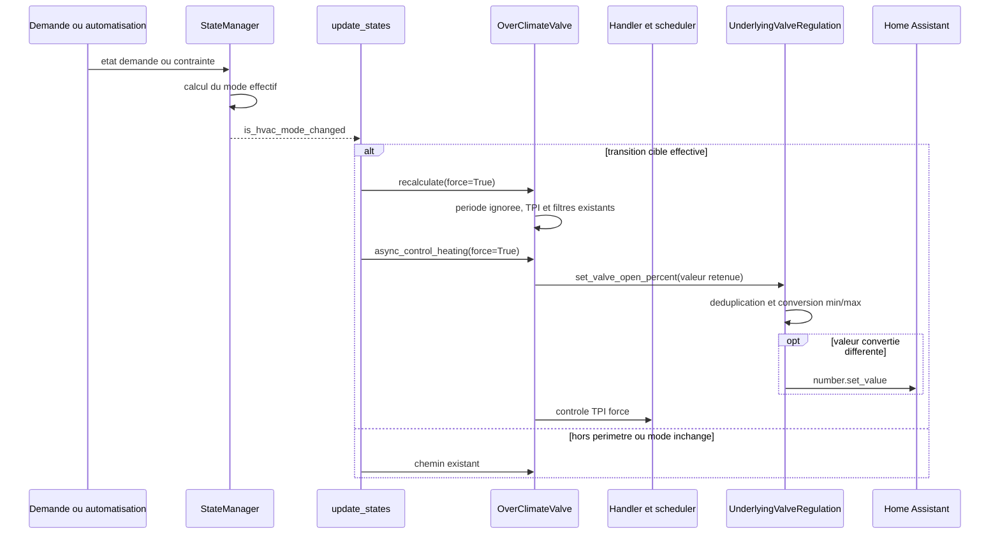
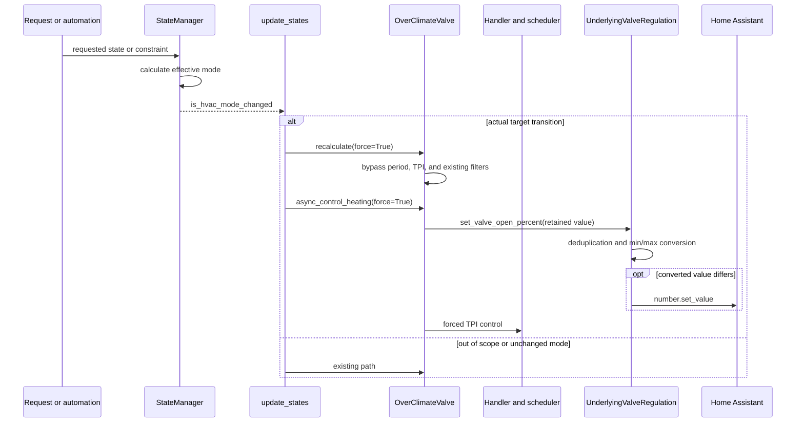

# Conception technique / Technical Design - Issue #2111

- **Statut / Status :** Convergence documentaire atteinte ; en attente de validation humaine avant developpement / Documentation convergence reached; awaiting human validation before development
- **Version / Version :** 1.0
- **Date / Date :** 2026-10-18
- **Proprietaire / Owner :** Projet Versatile Thermostat / Versatile Thermostat project
- **Livrable / Deliverable :** Documentation uniquement ; aucun code, test, configuration, dependance, environnement HA, commit ou publication n'a ete modifie / Documentation only; no code, test, configuration, dependency, HA environment, commit, or publication was changed
- **Sources normatives / Normative sources :** [rapport FR](issue-2111-review.md), [report EN](issue-2111-review-en.md), [specification bilingue](issue-2111-specification.md)
- **Code et tests inspectes / Inspected code and tests :** [base_thermostat.py](../../custom_components/versatile_thermostat/base_thermostat.py), [state_manager.py](../../custom_components/versatile_thermostat/state_manager.py), [thermostat_prop.py](../../custom_components/versatile_thermostat/thermostat_prop.py), [thermostat_climate.py](../../custom_components/versatile_thermostat/thermostat_climate.py), [thermostat_climate_valve.py](../../custom_components/versatile_thermostat/thermostat_climate_valve.py), [prop_handler_tpi.py](../../custom_components/versatile_thermostat/prop_handler_tpi.py), [cycle_scheduler.py](../../custom_components/versatile_thermostat/cycle_scheduler.py), [underlyings.py](../../custom_components/versatile_thermostat/underlyings.py), [test_overclimate_valve.py](../../tests/test_overclimate_valve.py), [test_cycle_scheduler.py](../../tests/test_cycle_scheduler.py), [test_inhibition.py](../../tests/test_inhibition.py), [test_valve.py](../../tests/test_valve.py)

---

## Francais

### 1. Objectif, perimetre et decision

Cette conception prepare uniquement le correctif #2111 : lors d'un changement reel du mode HVAC **effectif**, un `over_climate` avec regulation directe de vanne recalcule et tente d'appliquer immediatement sa valeur de vanne **retenue**. Elle couvre FR-001 a FR-015, BR-001 a BR-015 et AC-001 a AC-017 de la specification.

Le plus petit mecanisme coherent est de reutiliser, dans `BaseThermostat.update_states()`, le signal existant `current_state.is_hvac_mode_changed`. Il compose le `force` existant avec ce predicat local :

```text
transition_cible = (
    current_state.is_hvac_mode_changed
    and self.is_over_climate
    and self.have_valve_regulation
)
```

`ThermostatOverClimateValve` est la classe verifiee ayant les deux proprietes vraies. Les valeurs par defaut de `BaseThermostat` sont fausses, et `ThermostatOverClimate` n'active que `is_over_climate`; la double garde exclut donc `over_switch`, `over_valve` et les `over_climate` sans regulation directe.

Il n'est pas propose d'ajouter un dernier mode calcule/envoye, un cache remis a zero, une persistance, une configuration, une dependance ou un hook. Un hook distinguant le forcement d'envoi du forcement scheduler creerait une API et une semantique de concurrence sans preuve de besoin dans les sources inspectees.

Sont exclus : changement de TPI, `dpercent`, scheduler, min/max, deduplication, recalibrage, politique capteur absent, concurrence globale et autres types de thermostat.

### 2. Faits verifies et invariants

| Fait verifie                                                                                                                                                                        | Consequence de conception                                                                                                                          |
| ----------------------------------------------------------------------------------------------------------------------------------------------------------------------------------- | -------------------------------------------------------------------------------------------------------------------------------------------------- |
| `StateManager.calculate_current_hvac_mode()` applique inhibition, central, securite, fenetre et auto-start/stop avant de produire `current_state`.                                  | `is_hvac_mode_changed` est le signal du mode effectif, pour les transitions manuelles comme automatiques. Une demande masquee ne le declenche pas. |
| `BaseThermostat.update_states()` connait ce signal avant `recalculate(force=...)` puis `async_control_heating(force=...)`.                                                          | Un point d'integration local atteint les deux portes temporelles, sans etat supplementaire.                                                        |
| `ThermostatOverClimateValve.recalculate(force)` saute la periode minimale seulement quand `force=True`.                                                                             | Le forcement de transition ne change aucune autre branche de calcul.                                                                               |
| Le filtre `dpercent` ne depend pas de `force` : pour une valeur positive et une valeur precedente, `-threshold <= delta < threshold`.                                               | Les bornes asymetriques, la fermeture a 0 et le seuillage des petites ouvertures restent inchanges.                                                |
| En `sleep`, `recalculate` fixe 100 avant la branche TPI et son filtre de variation.                                                                                                 | Le chemin sleep existant est preserve; aucune exception nouvelle a la sortie de sleep.                                                             |
| `ThermostatOverClimate.async_control_heating()` appelle `_send_regulated_temperature(force)` avant le controle proportionnel; la surcharge vanne saute son delai avec `force=True`. | Le forcement atteint l'envoi regule, qui lit `valve_open_percent`, pas le TPI brut.                                                                |
| `UnderlyingValveRegulation.set_valve_open_percent()` dedoublonne; `send_percent_open()` convertit en degres ouverture/fermeture et appelle `number.set_value`.                      | Les conversions min/max et la deduplication restent les derniers filtres. Un service n'est pas un acquittement physique synchrone.                 |
| Le handler TPI transmet `force` a `CycleScheduler.start_cycle`; en mode vanne, il peut recreer une fenetre et appeler les callbacks.                                                | L'effet scheduler/learning doit etre teste mais n'est pas modifie par #2111.                                                                       |
| Avec `safe_on_percent is None`, le calcul conserve la position et le handler ne demarre pas de cycle.                                                                               | Aucune nouvelle fermeture automatique ou ouverture fraiche avec capteur absent/revenu.                                                             |

Invariants :

1. Une transition est celle de `current_state`, jamais une simple intention de `requested_state`.
2. La commande candidate est `_valve_open_percent` / `valve_open_percent` apres filtrage, jamais `on_percent` brut.
3. `dpercent`, y compris `-threshold <= delta < threshold`, demeure independant de `force`.
4. Le nouveau forcement existe seulement pendant une transition effective satisfaisant la double garde.
5. Les contraintes d'inhibition, securite, central et fenetre continuent de produire l'etat effectif avant ce point.

### 3. Composants et contrats

| Composant                                | Responsabilite                                                                                                | Evolution prevue            |
| ---------------------------------------- | ------------------------------------------------------------------------------------------------------------- | --------------------------- |
| `StateManager`                           | Determiner le mode HVAC effectif et son changement.                                                           | Aucune.                     |
| `BaseThermostat.update_states`           | Composer le forcement existant et le predicat de transition cible, puis appeler calcul et controle existants. | Oui, point unique envisage. |
| `ThermostatProp`                         | Executer l'algorithme proportionnel courant.                                                                  | Aucune.                     |
| `ThermostatOverClimateValve.recalculate` | Retenir seulement la valeur qui passe periode, TPI, sleep, zero, petites ouvertures et `dpercent`.            | Aucune.                     |
| `_send_regulated_temperature`            | Lever son delai lors de la transition cible et transmettre la valeur retenue.                                 | Aucune.                     |
| `TPIHandler` / `CycleScheduler`          | Conserver les cycles, callbacks et learning existants.                                                        | Aucune.                     |
| `UnderlyingValveRegulation`              | Dedoublonner, convertir et envoyer via les services existants.                                                | Aucune.                     |

| Entree                               | Precondition                                  | Sortie                                              | Erreur, idempotence et delai                                                         |
| ------------------------------------ | --------------------------------------------- | --------------------------------------------------- | ------------------------------------------------------------------------------------ |
| `is_hvac_mode_changed`               | Etat courant recalcule                        | Signal de transition effective                      | Faux pour demande identique/masquee; aucune memoire de mode.                         |
| `transition_force`                   | Double garde vraie                            | `force=True` pour les deux appels de la transaction | Ephemere, local, non persiste.                                                       |
| `recalculate(force)`                 | Thermostat pret                               | Valeur retenue mise a jour ou conservee             | `force` saute seulement la periode; donnees absentes et `dpercent` restent decisifs. |
| `_send_regulated_temperature(force)` | Temperature cible disponible                  | Proposition de valeur retenue aux sous-jacents      | `force` saute seulement le delai; la deduplication peut donner zero service.         |
| `number.set_value`                   | Valeur convertie differente, sous-jacent pret | Commande demandee                                   | Les helpers journalisent l'erreur; pas de retry ni d'acquittement physique infere.   |

### 4. Algorithme et flux proposes

Le pseudo-code decrit une implementation future, non realisee. Il se place dans le bloc `if changed` de `BaseThermostat.update_states()`, apres le calcul du `StateManager` et avant la remise a zero de ses flags :

```text
mode_effectif_a_change = current_state.is_hvac_mode_changed
transition_cible = (
    mode_effectif_a_change
    and self.is_over_climate
    and self.have_valve_regulation
)
force_transition = force or transition_cible

recalculate(force=force_transition)
reset_last_change_time_from_vtherm()
async_control_heating(force=force_transition or sub_need_control_heating)
```

La condition ne doit pas utiliser `changed`, car celui-ci peut correspondre au preset ou a la consigne. `force` et `sub_need_control_heating` gardent leur semantique existante.



Ordre obligatoire :

1. Les contraintes produisent le mode effectif.
2. La transition cible leve les deux portes temporelles, et rien d'autre.
3. Le calcul applique TPI, le seuil des petites ouvertures et `dpercent`; il ne modifie `_valve_open_percent` que si la valeur est admise.
4. L'envoi force transmet `valve_open_percent`; si le filtre a conserve 100, il transmet 100.
5. Le sous-jacent applique encore min/max, ouverture/fermeture et deduplication.
6. Le scheduler poursuit son chemin existant; il ne devient jamais une voie d'envoi du TPI brut aux `number`.

Exemple discriminant : `sleep` a retenu 100, `heat` propose 98 et le seuil vaut 5. La periode est ignoree, mais `delta=-2` satisfait `-5 <= -2 < 5`; le calcul conserve 100. L'envoi force propose donc 100, la deduplication evite toute commande 98, et aucun cache n'est remis artificiellement a zero.

#### Scheduler, learning et concurrence

Le `force` traverse le controle existant jusqu'a `CycleScheduler.start_cycle`. Apres l'envoi de la valeur retenue, une transition cible peut annuler/recreer la fenetre de cycle et declencher des callbacks de cycle. Les commandes de vanne restent dedoublonnees car elles lisent `valve_open_percent`; en revanche les callbacks et metriques peuvent observer une nouvelle fenetre meme sans service `number` effectif.

Cette consequence est bornee aux transitions reelles du perimetre. Hors transition, seuls les forcements existants s'appliquent et les autres thermostats gardent leurs cadences. Cette conception ne resout pas la concurrence globale entre une transition, un callback scheduler et un feedback de vanne : les commandes restent protegees par les deduplications existantes, sans promesse d'atomicite nouvelle.

### 5. Branches, erreurs et reprise

| Situation                                | Comportement attendu                                                                 | Interdit ou non promis                                           |
| ---------------------------------------- | ------------------------------------------------------------------------------------ | ---------------------------------------------------------------- |
| `heat -> sleep` effectif                 | Recalcul force; chemin sleep conserve 100; envoi force puis conversion existante.    | Ne pas appliquer `dpercent` au chemin sleep.                     |
| `sleep -> heat` admissible               | Calcul et tentative d'envoi sans attente de periode/delai, avec valeur retenue.      | Ne pas envoyer le TPI brut.                                      |
| `sleep 100 -> heat 98`, seuil 5          | 100 est conserve, aucune commande 98.                                                | Ne pas qualifier cette ouverture positive de retard a corriger.  |
| Zero et petite ouverture                 | Traitement actuel avant le filtre de variation.                                      | Ne pas changer l'arrondi ni l'exception de fermeture.            |
| `sleep -> off -> heat`                   | Chaque changement effectif est traite separement.                                    | Ne pas modifier le cache pour contourner le filtre.              |
| Mode identique ou demande masquee        | Aucun nouveau forcement.                                                             | Ne pas utiliser la demande comme preuve de transition.           |
| Inhibition, securite, central ou fenetre | Ces protections restent prioritaires via l'etat effectif et leurs portes existantes. | Ne pas les contourner ni envoyer une valeur brute.               |
| Capteur absent ou revenu                 | Politique actuelle : conservation de position et pas de cycle si donnee absente.     | Ni fermeture automatique ni ouverture fraiche ne sont garanties. |
| Erreur de service ou feedback retarde    | Log existant; commande et etat physique restent distincts.                           | Aucun retry ni acquittement synchrone infere.                    |
| Redemarrage                              | Aucun nouvel etat persiste; comportement d'initialisation actuel.                    | Aucune reprise artificielle n'est promise.                       |

### 6. Persistance, securite et observabilite

- **Persistance/migration :** aucune. Les attributs existants, dont `valve_open_percent` et `last_calculation_timestamp`, restent les sources d'observation.
- **Compatibilite :** aucun parametre, entite, service, evenement, dependance ou environnement HA nouveau; les types exclus restent exclus par la double garde.
- **Securite :** inhibition, securite, central, fenetre, min/max et calibration sont conserves. Aucune permission ou donnee nouvelle.
- **Observabilite :** observer separement mode effectif, valeur retenue, appel `number.set_value` eventuel et feedback d'etat. Ne jamais presenter l'etat physique comme acquittement de service.
- **Materiel :** la contrainte de calibration Sonoff TRVZB vient du mainteneur; aucune beta ni mesure batterie n'est executee ou pretendue ici.

### 7. Strategie de tests

Aucun test n'est execute dans cette conception. Les tests d'implementation doivent controler l'horloge et verifier a la fois la valeur retenue et les appels de service.

| ID        | Fichier cible                                                              | Scenario et assertions                                                                                                                                                    | Exigences                                       |
| --------- | -------------------------------------------------------------------------- | ------------------------------------------------------------------------------------------------------------------------------------------------------------------------- | ----------------------------------------------- |
| T-2111-01 | `tests/test_overclimate_valve.py`                                          | Reprendre le scenario sleep avec periode cinq minutes et transition avant expiration : `heat -> sleep -> heat` recalcule/tente l'envoi immediatement avec valeur retenue. | FR-001 a FR-006, AC-001, AC-002, AC-007         |
| T-2111-02 | `tests/test_overclimate_valve.py`                                          | Initialiser 100, seuil 5, puis proposer 98 a la sortie de sleep : valeur 100, zero service 98, aucun reset de cache.                                                      | FR-006 a FR-010, BR-005 a BR-008, AC-003        |
| T-2111-03 | `tests/test_overclimate_valve.py`                                          | Tester delta exactement -5 et +5 : le premier filtre, le second passe, toutes choses egales par ailleurs.                                                                 | FR-007, FR-008, BR-005, AC-004                  |
| T-2111-04 | `tests/test_overclimate_valve.py`                                          | Zero, petite ouverture, multi-vannes et min/max sous transition forcee; verifier degres et absence de TPI brut.                                                           | FR-006 a FR-009, BR-010, BR-013, AC-005, AC-014 |
| T-2111-05 | `tests/test_overclimate_valve.py`                                          | Mode identique et intention masquee : espionner calcul/controle, aucun nouveau `force=True`.                                                                              | FR-002, FR-013, BR-001, AC-006                  |
| T-2111-06 | Test adjacent `BaseThermostat` ou fixture dans `test_overclimate_valve.py` | Changement automatique effectif par central, fenetre, securite ou auto-start/stop, demande stable : meme forcement que le manuel.                                         | FR-003, BR-001, BR-009, AC-008, AC-011          |
| T-2111-07 | `tests/test_inhibition.py` plus scenario vanne                             | Transition sous inhibition puis resynchronisation : aucune valeur brute ne contourne la porte.                                                                            | FR-009, BR-009, AC-012                          |
| T-2111-08 | `tests/test_overclimate_valve.py`                                          | `safe_on_percent is None`, puis retour de donnee : politique courante conservee sans fermeture inventee.                                                                  | FR-011, BR-012, AC-010, AC-017                  |
| T-2111-09 | `tests/test_cycle_scheduler.py`                                            | Transition cible : effet documente de `force` sur fenetre/callbacks; commande dedoublonnee si valeur retenue inchangee; cas pres fin de cycle sans exiger atomicite.      | FR-005, FR-013, BR-003, AC-007                  |
| T-2111-10 | Tests de familles existants                                                | `over_valve`, `over_switch` et `over_climate` sans vanne directe : aucun nouveau forcement de transition. Tester COOL seulement quand supporte.                           | FR-001, FR-014, FR-015, BR-002, AC-013, AC-016  |
| T-2111-11 | `tests/test_overclimate_valve.py`                                          | `sleep -> off -> heat`, ouverture positive retenue et feedback retarde : distinguer commande HA et etat physique.                                                         | BR-006, BR-011, AC-009, AC-015, AC-017          |

Le minimum de livraison est T-2111-01 a T-2111-11, les tests cibles existants et la regression pertinente. Une beta ciblee reste recommandee avec traces Zigbee2MQTT, services, ouverture rapportee, HVAC action, chaudiere, cadence et calibration. Elle n'est pas executee ici.

### 8. Revue croisee, risques, questions et tracabilite

#### Bilan de convergence resolu sur les versions presentes

| Precision integree              | Constat dans les sources presentes                                                                                                                                                                     | Tracabilite dans la specification et la conception                |
| ------------------------------- | ------------------------------------------------------------------------------------------------------------------------------------------------------------------------------------------------------ | ----------------------------------------------------------------- |
| Application immediate           | La tentative passe par les chemins existants et franchit effectivement la periode minimale de recalcul et le delai d'envoi regule; elle reste soumise aux preconditions, protections et deduplication. | FR-005, BR-003, AC-001 et sections 2 a 4; T-2111-01 et T-2111-09. |
| Effets du `force`               | Le meme `force` conserve ses effets existants sur scheduler, fenetres de cycle, callbacks et learning; ils sont observes et testes, sans garantie de cadence inchangee pour la cible.                  | FR-013, BR-003, AC-007 et section 4; T-2111-09.                   |
| Telemetrie et commande physique | La telemetrie de cycle, un callback ou une trace scheduler ne prouvent ni une commande physique identique ni l'envoi du TPI brut; valeur retenue, service et feedback restent distincts.               | FR-012, AC-015, AC-017 et section 6; T-2111-11.                   |

Les rapports, la specification et la conception convergent sur ces precisions. Elles ne modifient ni le perimetre, ni les protections, ni les invariants `dpercent` : le seuil 5 conserve `sleep` a 100 lorsque `heat` propose 98, la fermeture a 0 et le chemin `sleep` preexistant restent inchanges, et la double garde `is_over_climate and have_valve_regulation` limite le nouveau forcement aux transitions reelles du perimetre.

| Risque ou question                                     | Traitement                                                                        |
| ------------------------------------------------------ | --------------------------------------------------------------------------------- |
| Calibration Sonoff TRVZB et ouverture positive retenue | Beta materielle requise; ne pas assimiler la retention `dpercent` a un defaut.    |
| Scheduler/learning                                     | T-2111-09 et beta; aucune refonte scheduler.                                      |
| Concurrence                                            | Tester pres d'une fin de cycle; ne pas promettre une atomicite nouvelle.          |
| Capteur absent                                         | T-2111-08; aucune politique nouvelle.                                             |
| COOL                                                   | Tester seulement sur une configuration qui le supporte; aucune capacite nouvelle. |

**Bilan documentaire :** aucune contradiction bloquante n'est identifiee dans les versions presentes. La validation humaine reste requise avant tout developpement; elle ne vaut ni validation d'implementation ni promesse d'execution. Question non bloquante : confirmer par test quel signal de callback/telemetrie scheduler est pertinent pour Auto TPI lors d'une transition forcee de vanne directe.

| Exigences                                                                         | Sections et tests                        |
| --------------------------------------------------------------------------------- | ---------------------------------------- |
| FR-001 a FR-004, BR-001 a BR-004, AC-001, AC-002, AC-006, AC-008, AC-016          | Sections 1, 3, 4; T-2111-01, 05, 06, 10. |
| FR-005, FR-013, BR-003, AC-007                                                    | Sections 2, 4, 7; T-2111-01, 09.         |
| FR-006 a FR-010, BR-005 a BR-008, BR-010, BR-011, AC-003 a AC-005, AC-009, AC-015 | Sections 2, 4, 5, 7; T-2111-02 a 04, 11. |
| FR-009, BR-009, BR-013, AC-011, AC-012, AC-014                                    | Sections 2, 5, 6, 7; T-2111-04, 06, 07.  |
| FR-011, FR-012, FR-015, BR-012, BR-014, BR-015, AC-010, AC-013, AC-017            | Sections 2, 5 a 7; T-2111-08, 10, 11.    |

**Confirmation explicite :** rapport, specification et conception ont le meme perimetre : `over_climate` a regulation directe de vanne, lors d'une transition HVAC effective seulement. Les exigences et AC sont couvertes par une decision, un flux et des tests concrets. Aucune contradiction bloquante n'est relevee. La solution est techniquement realisable et testable avec les interfaces inspectees. Les risques residuels et les tests a executer restent ceux du tableau ci-dessus et de la section 7; ils ne constituent pas une contradiction documentaire. Aucune implementation n'est validee ni executee par cette conception.

---

## English

### 1. Objective, scope, and decision

This design prepares only the #2111 fix: on an actual **effective** HVAC mode change, a direct-valve-regulation `over_climate` recalculates and attempts immediate application of its **retained** valve value. It covers FR-001 through FR-015, BR-001 through BR-015, and AC-001 through AC-017 in the specification.

The smallest coherent mechanism reuses `current_state.is_hvac_mode_changed` in `BaseThermostat.update_states()`. It composes existing `force` with this local predicate:

```text
target_transition = (
    current_state.is_hvac_mode_changed
    and self.is_over_climate
    and self.have_valve_regulation
)
```

`ThermostatOverClimateValve` is the verified class with both properties true. `BaseThermostat` defaults are false, and `ThermostatOverClimate` enables only `is_over_climate`; the double guard excludes `over_switch`, `over_valve`, and `over_climate` without direct regulation.

No last-calculated/last-sent mode, reset-to-zero cache, persistence, configuration, dependency, or hook is proposed. A hook separating regulated-send force from scheduler force would create an API and concurrency semantics without source evidence of need.

Changes to TPI, `dpercent`, scheduler, min/max, deduplication, recalibration, missing-sensor policy, global concurrency, and other thermostat types are excluded.

### 2. Verified facts and invariants

| Verified fact                                                                                                                                                                | Design consequence                                                                                                                   |
| ---------------------------------------------------------------------------------------------------------------------------------------------------------------------------- | ------------------------------------------------------------------------------------------------------------------------------------ |
| `StateManager.calculate_current_hvac_mode()` applies inhibition, central mode, safety, window, and auto-start/stop before producing `current_state`.                         | `is_hvac_mode_changed` is the effective-mode signal for both manual and automatic transitions. A masked request does not trigger it. |
| `BaseThermostat.update_states()` has that signal before `recalculate(force=...)` then `async_control_heating(force=...)`.                                                    | One local integration point reaches both timing gates without additional state.                                                      |
| `ThermostatOverClimateValve.recalculate(force)` bypasses minimum period only when `force=True`.                                                                              | Transition force changes no other calculation branch.                                                                                |
| `dpercent` does not depend on `force`: for a positive value and previous value, `-threshold <= delta < threshold`.                                                           | Asymmetric boundaries, closing to 0, and small-opening threshold remain unchanged.                                                   |
| In `sleep`, `recalculate` assigns 100 before TPI branch and its variation filter.                                                                                            | Existing sleep path is preserved; no new leaving-sleep exception.                                                                    |
| `ThermostatOverClimate.async_control_heating()` calls `_send_regulated_temperature(force)` before proportional control; valve override bypasses its delay with `force=True`. | Force reaches regulated sending, which reads `valve_open_percent`, not raw TPI.                                                      |
| `UnderlyingValveRegulation.set_valve_open_percent()` deduplicates; `send_percent_open()` converts opening/closing degrees and calls `number.set_value`.                      | Min/max conversion and deduplication remain final filters. A service is not synchronous physical acknowledgement.                    |
| TPI handler passes `force` to `CycleScheduler.start_cycle`; in valve mode it can recreate a window and invoke callbacks.                                                     | Scheduler/learning effect must be tested but is not changed by #2111.                                                                |
| With `safe_on_percent is None`, calculation retains position and handler does not start cycle.                                                                               | No new automatic closure or fresh opening for missing/returning sensor.                                                              |

Invariants:

1. A transition is a `current_state` transition, never merely `requested_state` intent.
2. Command candidate is `_valve_open_percent` / `valve_open_percent` after filtering, never raw `on_percent`.
3. `dpercent`, including `-threshold <= delta < threshold`, remains independent of `force`.
4. New force exists only during an effective transition satisfying the double guard.
5. Inhibition, safety, central, and window constraints still produce effective state before this point.

### 3. Components and contracts

| Component                                | Responsibility                                                                                       | Planned change                       |
| ---------------------------------------- | ---------------------------------------------------------------------------------------------------- | ------------------------------------ |
| `StateManager`                           | Determine effective HVAC mode and its change.                                                        | None.                                |
| `BaseThermostat.update_states`           | Compose existing force with target-transition predicate, then call existing calculation and control. | Yes, one proposed integration point. |
| `ThermostatProp`                         | Run current proportional algorithm.                                                                  | None.                                |
| `ThermostatOverClimateValve.recalculate` | Retain only value passing period, TPI, sleep, zero, small-opening, and `dpercent` rules.             | None.                                |
| `_send_regulated_temperature`            | Bypass its delay during target transition and pass retained value.                                   | None.                                |
| `TPIHandler` / `CycleScheduler`          | Keep current cycles, callbacks, and learning.                                                        | None.                                |
| `UnderlyingValveRegulation`              | Deduplicate, convert, and send through existing services.                                            | None.                                |

| Input                                | Precondition                              | Output                                  | Error, idempotence, and timing                                             |
| ------------------------------------ | ----------------------------------------- | --------------------------------------- | -------------------------------------------------------------------------- |
| `is_hvac_mode_changed`               | Current state calculated                  | Effective-transition signal             | False for identical/masked request; no mode memory.                        |
| `transition_force`                   | Double guard true                         | `force=True` for both transaction calls | Ephemeral, local, not persisted.                                           |
| `recalculate(force)`                 | Thermostat ready                          | Retained value updated or preserved     | `force` bypasses period only; missing data and `dpercent` remain decisive. |
| `_send_regulated_temperature(force)` | Target temperature available              | Retained value offered to underlyings   | `force` bypasses delay only; deduplication can result in zero service.     |
| `number.set_value`                   | Converted value differs, underlying ready | Requested command                       | Helpers log error; no retry or physical acknowledgement inferred.          |

### 4. Proposed algorithm and flow

The pseudocode describes a future, unimplemented change. It belongs in the `if changed` block of `BaseThermostat.update_states()`, after `StateManager` calculation and before flags reset:

```text
effective_mode_changed = current_state.is_hvac_mode_changed
target_transition = (
    effective_mode_changed
    and self.is_over_climate
    and self.have_valve_regulation
)
transition_force = force or target_transition

recalculate(force=transition_force)
reset_last_change_time_from_vtherm()
async_control_heating(force=transition_force or sub_need_control_heating)
```

The condition must not use `changed`, because that can represent preset or target-temperature change. `force` and `sub_need_control_heating` retain existing semantics.



Required order:

1. Constraints produce effective mode.
2. Target transition bypasses both timing gates and nothing else.
3. Calculation applies TPI, small-opening threshold, and `dpercent`; `_valve_open_percent` changes only if accepted.
4. Forced sending passes `valve_open_percent`; if filter retained 100, it passes 100.
5. Underlying still applies min/max, opening/closing conversion, and deduplication.
6. Scheduler follows existing path; it never becomes a raw-TPI path to `number` entities.

Discriminating example: sleep retained 100, heat proposes 98, threshold is 5. Period is bypassed, but `delta=-2` satisfies `-5 <= -2 < 5`; calculation retains 100. Forced sending therefore offers 100, deduplication prevents a 98 command, and no cache is artificially reset.

#### Scheduler, learning, and concurrency

`force` crosses existing control to `CycleScheduler.start_cycle`. After retained-value sending, a target transition may cancel/recreate the cycle window and trigger cycle callbacks. Valve commands remain deduplicated because they read `valve_open_percent`; callbacks and metrics can nevertheless observe a new window without an effective `number` service.

This consequence is limited to actual in-scope transitions. Outside transitions, only pre-existing force causes apply and other thermostat types keep their timing. The design does not solve global concurrency between transition, scheduler callback, and valve feedback: commands remain protected by existing deduplication, with no claim of new atomicity.

### 5. Branches, errors, and recovery

| Situation                           | Expected behavior                                                               | Prohibited or not promised                              |
| ----------------------------------- | ------------------------------------------------------------------------------- | ------------------------------------------------------- |
| Effective `heat -> sleep`           | Forced calculation; sleep retains 100; forced sending then existing conversion. | Do not apply `dpercent` to sleep path.                  |
| Admissible `sleep -> heat`          | Calculate and attempt sending without period/delay, using retained value.       | Do not send raw TPI.                                    |
| `sleep 100 -> heat 98`, threshold 5 | Retain 100; no 98 command.                                                      | Do not label retained positive opening as delay defect. |
| Zero and small opening              | Existing handling before variation filter.                                      | Do not change rounding or closing exception.            |
| `sleep -> off -> heat`              | Each effective change handled separately.                                       | Do not change cache to bypass filter.                   |
| Identical/masked request            | No new force.                                                                   | Do not use requested intent as transition proof.        |
| Inhibition, safety, central, window | Protections remain higher priority through effective state and gates.           | Do not bypass them or send raw value.                   |
| Missing/returning sensor            | Current policy: preserve position and no cycle for absent data.                 | No automatic closure or fresh opening is guaranteed.    |
| Service error/delayed feedback      | Existing log; HA command and physical state remain distinct.                    | No retry or synchronous acknowledgement inference.      |
| Restart                             | No new persistence; current initialization behavior.                            | No artificial recovery promise.                         |

### 6. Persistence, security, and observability

- **Persistence/migration:** none. Existing `valve_open_percent` and `last_calculation_timestamp` remain observation sources.
- **Compatibility:** no new setting, entity, service, event, dependency, or HA environment; excluded types remain excluded by double guard.
- **Safety:** inhibition, safety, central, window, min/max, and calibration protections remain. No new permission or data.
- **Observability:** observe effective mode, retained value, possible `number.set_value`, and reported feedback separately. Never represent physical state as service acknowledgement.
- **Hardware:** Sonoff TRVZB calibration constraint comes from maintainer; no beta or battery measurement is run or claimed here.

### 7. Test strategy

No test is executed by this design. Implementation tests must control time and verify both retained value and service calls.

| ID        | Target file                                                              | Scenario and assertions                                                                                                                                           | Requirements                                     |
| --------- | ------------------------------------------------------------------------ | ----------------------------------------------------------------------------------------------------------------------------------------------------------------- | ------------------------------------------------ |
| T-2111-01 | `tests/test_overclimate_valve.py`                                        | Reuse sleep scenario with five-minute period and transition before expiry: `heat -> sleep -> heat` recalculates/attempts sending immediately with retained value. | FR-001 to FR-006, AC-001, AC-002, AC-007         |
| T-2111-02 | `tests/test_overclimate_valve.py`                                        | Initialize 100, threshold 5, then propose 98 leaving sleep: retained 100, zero 98 service, no cache reset.                                                        | FR-006 to FR-010, BR-005 to BR-008, AC-003       |
| T-2111-03 | `tests/test_overclimate_valve.py`                                        | Test exact -5 and +5 deltas: first filters, second passes, all else equal.                                                                                        | FR-007, FR-008, BR-005, AC-004                   |
| T-2111-04 | `tests/test_overclimate_valve.py`                                        | Zero, small opening, multi-valves, min/max under forced transition; verify degrees and no raw TPI.                                                                | FR-006 to FR-009, BR-010, BR-013, AC-005, AC-014 |
| T-2111-05 | `tests/test_overclimate_valve.py`                                        | Identical mode and masked intent: spy calculation/control, no new `force=True`.                                                                                   | FR-002, FR-013, BR-001, AC-006                   |
| T-2111-06 | Adjacent `BaseThermostat` test or fixture in `test_overclimate_valve.py` | Actual automatic change through central, window, safety, or auto-start/stop while request remains stable: same force as manual.                                   | FR-003, BR-001, BR-009, AC-008, AC-011           |
| T-2111-07 | `tests/test_inhibition.py` plus valve scenario                           | Transition under inhibition then resync: no raw value bypasses gate.                                                                                              | FR-009, BR-009, AC-012                           |
| T-2111-08 | `tests/test_overclimate_valve.py`                                        | `safe_on_percent is None`, then data returns: preserve current policy without invented closure.                                                                   | FR-011, BR-012, AC-010, AC-017                   |
| T-2111-09 | `tests/test_cycle_scheduler.py`                                          | Target transition: documented `force` effect on window/callbacks; deduplicated command if retained value unchanged; near-end-cycle case without atomicity claim.  | FR-005, FR-013, BR-003, AC-007                   |
| T-2111-10 | Existing family tests                                                    | `over_valve`, `over_switch`, and non-direct-valve `over_climate`: no new transition force. Test COOL only when supported.                                         | FR-001, FR-014, FR-015, BR-002, AC-013, AC-016   |
| T-2111-11 | `tests/test_overclimate_valve.py`                                        | `sleep -> off -> heat`, retained positive opening, delayed feedback: distinguish HA command from physical state.                                                  | BR-006, BR-011, AC-009, AC-015, AC-017           |

Minimum delivery is T-2111-01 through T-2111-11, associated focused tests, and relevant regression. Targeted beta remains recommended with Zigbee2MQTT traces, services, reported opening, HVAC action, boiler, cadence, and calibration. It is not executed here.

### 8. Cross-review, risks, questions, and traceability

#### Resolved convergence assessment for the current versions

| Integrated clarification       | Finding in the current sources                                                                                                                                                                      | Traceability in the specification and design                          |
| ------------------------------ | --------------------------------------------------------------------------------------------------------------------------------------------------------------------------------------------------- | --------------------------------------------------------------------- |
| Immediate application          | The attempt follows existing paths and effectively bypasses both the minimum recalculation period and regulated-sending delay; it remains subject to preconditions, protections, and deduplication. | FR-005, BR-003, AC-001, and sections 2 to 4; T-2111-01 and T-2111-09. |
| `force` effects                | The same `force` retains its existing effects on scheduler, cycle windows, callbacks, and learning; these are observed and tested without a guarantee of unchanged target cadence.                  | FR-013, BR-003, AC-007, and section 4; T-2111-09.                     |
| Telemetry and physical command | Cycle telemetry, a callback, or a scheduler trace proves neither an identical physical command nor raw-TPI sending; retained value, service, and feedback remain distinct.                          | FR-012, AC-015, AC-017, and section 6; T-2111-11.                     |

Reports, specification, and design converge on these clarifications. They change neither scope, protections, nor `dpercent` invariants: threshold 5 retains sleep at 100 when heat proposes 98, the existing closing-to-0 and sleep paths remain unchanged, and the `is_over_climate and have_valve_regulation` double guard limits new force behavior to actual in-scope transitions.

| Risk or question                                       | Treatment                                                          |
| ------------------------------------------------------ | ------------------------------------------------------------------ |
| Sonoff TRVZB calibration and retained positive opening | Hardware beta required; do not call `dpercent` retention a defect. |
| Scheduler/learning                                     | T-2111-09 and beta; no scheduler redesign.                         |
| Concurrency                                            | Test near cycle end; no new atomicity claim.                       |
| Missing sensor                                         | T-2111-08; no new policy.                                          |
| COOL                                                   | Test only on supporting configuration; no new capability.          |

**Documentation assessment:** no blocking contradiction is identified in the current versions. Human validation remains required before any development; it is neither implementation validation nor a promise of execution. Non-blocking question: confirm by test which scheduler callback/telemetry signal is relevant to Auto TPI for a forced direct-valve transition.

| Requirements                                                                         | Sections and tests                        |
| ------------------------------------------------------------------------------------ | ----------------------------------------- |
| FR-001 to FR-004, BR-001 to BR-004, AC-001, AC-002, AC-006, AC-008, AC-016           | Sections 1, 3, 4; T-2111-01, 05, 06, 10.  |
| FR-005, FR-013, BR-003, AC-007                                                       | Sections 2, 4, 7; T-2111-01, 09.          |
| FR-006 to FR-010, BR-005 to BR-008, BR-010, BR-011, AC-003 to AC-005, AC-009, AC-015 | Sections 2, 4, 5, 7; T-2111-02 to 04, 11. |
| FR-009, BR-009, BR-013, AC-011, AC-012, AC-014                                       | Sections 2, 5, 6, 7; T-2111-04, 06, 07.   |
| FR-011, FR-012, FR-015, BR-012, BR-014, BR-015, AC-010, AC-013, AC-017               | Sections 2, 5 to 7; T-2111-08, 10, 11.    |

**Explicit confirmation:** report, specification, and design have the same scope: direct-valve-regulation `over_climate`, on actual effective HVAC transition only. Requirements and AC are covered by a decision, flow, and concrete tests. No blocking contradiction was found. The solution is technically feasible and testable through inspected interfaces. Residual risks and tests to execute remain those in the table above and section 7; they are not documentation contradictions. No implementation is validated or executed by this design.