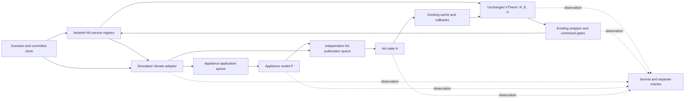

# Technical design — Issue #2135: isolated reproduction and conditional fixes

## 1. Metadata, sources and evidence level

| Field | Value |
| --- | --- |
| Version / date | 1.1 — first convergence cycle / 2026-10-31 |
| Status | Proposed documentary design; reproduction apparatus can be designed immediately, no fix selected; no development authorized |
| Owner | Versatile Thermostat project; decisions require maintainer/owner approval |
| Authorization | Report approved and specification/design only; only these design documents may be written |
| Contractual sources | [Validated report](issue-2135-review.md), [French specification v1.1](../specs/issue-2135_fr.md), [English specification v1.1](../specs/issue-2135_en.md), [issue consulted during initial drafting](https://github.com/jmcollin78/versatile_thermostat/issues/2135) |
| Equivalent version | [French design](issue-2135-design_fr.md); identical DT/T/EC identifiers and scope |
| Initial-drafting local baseline | HEAD `574d38774ff6286d548c22cb869de7350d41c1d1`, VTherm manifest 10.6.3; pre-existing modification of [base_thermostat.py](../../custom_components/versatile_thermostat/base_thermostat.py) preserved; baseline not reverified through commands during this documentary resumption |
| HA version limitation | Installed sources read only: [HA constants](../../.venv/lib/python3.14/site-packages/homeassistant/const.py#L24-L29) declare **2026.8.2**, not 2026.10.2; this establishes neither the active HA process version nor the VS Code interpreter |

**Legend:** V = verified by local reading; R = reported in sources, not reproduced; D = proposed design decision; H = hypothesis; Q = existing human decision. Reading a test is not executing it. No new runtime result is claimed.

The report keeps its historical “approval required” status; subsequent user approval authorizes these documents, not a fix. All 14 FR, 10 BR and 17 AC in both specifications were read in full. They remain proposed at their A/P/C levels; traceability below does not approve them.

**Version 1.1 convergence resumption:** the specification summary records the writer's explicit agreement on identical scope, documentary coverage and in-principle harness feasibility/testability. This design concurs; that agreement selects no fix, settles no Q decision and authorizes neither harness realization nor execution. V facts and code/test readings below belong to initial drafting, not a new repository or HA verification; this resumption compares only the report, both v1.1 specifications and both designs. References to unchanged v1.0 designs in specification S-10 describe their historical stage, not this revision.

## 2. Objective, scope and design decisions

**Objective:** discriminate paths from an HA request during auto-stop through commands, HA states and simulated effects, then enable evidence-based fix selection. Field cause and lasting reproduction remain unknown. The supplied trial shows `start` then `stop`, not a continuously maintained stop; no lost `off` is asserted.

| Decision | Proposed design and limitation |
| --- | --- |
| DT-01 | Two separate work packages: A, isolated characterization harness without product changes; B, conditional fix alternative after Q-01 to Q-07 and new authorization. A can be specified now, but is neither developed nor executed here. |
| DT-02 | Keep the real HA service path and VTherm logic in package A; replace only the remote appliance/integration with a controllable double. Do not patch `update_states`, the algorithm or the incoming service in the discriminating test. |
| DT-03 | Observe R/E/U/C/H/P separately; no new product entity, API, public attribute, notification, dependency or persistence decided. The proposed journal is a harness artifact. |
| DT-04 | Reuse existing priority calculation and mapping as reference; a possible fix must not introduce a second safety calculation or force `off`. |
| DT-05 | Select neither prevention, reconciliation, combination nor repair enablement without evidence. Section 6 conditional contracts constrain evaluation; they do not establish an already selected new manager. |
| DT-06 | Preserve services, options, repair default and existing restoration; no migration. Any new product telemetry or recovery policy requires separate approval. |

Primary scope: `over_climate` without valve regulation, `ac_mode`, `slow`, 5 min cycle, `off` stop, repair and tracking disabled for the baseline. The issue page confirms the latter two options in the **post-incident** capture; it does not prove unchanged configuration at every instant. Extend the matrix to `fast`, `cool`, alternate modes, repair/tracking, protections, multiple underlyings and other controllers. Other types and valve regulation are compatibility controls, not automatic extensions of the fix.

Out of scope: changing reset/thresholds/algorithm, Airzone/Daikin, real automations, general display, HA environment, application tests or dependencies during this phase. The designed apparatus is an HA test harness, not an AppDaemon application or workaround automation.

## 3. Verified baseline and dependencies

| Local source | V fact and design consequence |
| --- | --- |
| [Inputs and application](../../custom_components/versatile_thermostat/base_thermostat.py#L1619-L1855) | `async_set_hvac_mode` changes R; `async_set_temperature` reads temperature, not mode. `update_states` requires `is_ready`, calculates when R is marked changed, applies mode when E is marked changed, then calls control; flags reset at the end. `force=True` alone does not establish a mode emission. |
| [State container](../../custom_components/versatile_thermostat/vtherm_state.py#L70-L140) | Change flags accumulate; `force_changed()` marks mode, preset and temperature. An observed reset therefore does not prove a numerical change. Capture values **and** flags before/after calls. |
| [Priorities](../../custom_components/versatile_thermostat/state_manager.py#L118-L213) | Inhibition → central `STOPPED` → safety requiring shutdown → window mode action → auto-stop → other central constraints → request. Eco/frost window actions affect the setpoint separately; other central modes do not uniformly precede auto-stop. |
| [Auto-stop management](../../custom_components/versatile_thermostat/feature_auto_start_stop_manager.py#L99-L244) and [climate control](../../custom_components/versatile_thermostat/thermostat_climate.py#L1161-L1191) | A detection transition forces reassessment that may call control again. Disablement and stop-mode changes have their own paths; do not assume one serialized sequence. |
| [Algorithm](../../custom_components/versatile_thermostat/auto_start_stop_algorithm.py#L24-L190) and [reset](../../custom_components/versatile_thermostat/auto_start_stop_algorithm.py#L291-L307) | `slow`: threshold 10, anticipation/delay 30 min; `fast`: 2 and 7 min; weighting cycle 120 s, hysteresis 0.5 °C; close calculation ignored for elapsed time ≤24 s **unless reset**. Reset clears dates and decision, not accumulation. Do not confuse these numbers with an SLA or the 5 min HA cycle. |
| [Climate commands](../../custom_components/versatile_thermostat/underlyings.py#L644-L704) | Deduplication when H and mode cache both match; absent state: `False`; power check before activation; delayed resend cancellation occurs after these early returns, not unconditionally on entry. Setpoint resend 2 s after `heat`/`cool`. Test an already started callback and early exit before cancellation too. |
| [Service wrapper](../../custom_components/versatile_thermostat/underlyings.py#L199-L247) | Inhibition gate, `blocking=False` by default, exceptions logged and swallowed; last-command date updated after call return for any service through this wrapper. `set_hvac_mode` can still return `True` after a swallowed error/gate drop: neither that boolean nor “repaired” logs prove an executed call or compliant P. |
| [Cache and notifications](../../custom_components/versatile_thermostat/underlying_state_manager.py#L52-L120) and [climate feedback](../../custom_components/versatile_thermostat/underlyings.py#L793-L850) | H is cached before an asynchronous callback is scheduled. Notifications are not correlated acknowledgements. Cache implementation retains even `None`/`unknown`/`unavailable` despite a contrary docstring. Record HA H, cached H and callback delivery separately. |
| [Tracking](../../custom_components/versatile_thermostat/thermostat_climate.py#L754-L885) and [budget](../../custom_components/versatile_thermostat/thermostat_climate.py#L1120-L1160) | Mode adoption requires transition/alignment and budget conditions; temperature tracking delayed 5 s; cap 3 for adoptions/tagged tracking commands, rearmed by external command. This is neither the global command budget nor the repair budget. |
| [Repair](../../custom_components/versatile_thermostat/feature_repair_incorrect_state_manager.py#L77-L164), [climate comparison](../../custom_components/versatile_thermostat/underlyings.py#L1219-L1244), [constants](../../custom_components/versatile_thermostat/const.py#L532-L535) | Default `False`; 30 s since the manager's **first ready invocation**, reset if no longer ready; U compared with H, `<2 s` guard since last command; thermostat-wide counter incremented once if at least one underlying returns `True`. |
| [Repair invocation](../../custom_components/versatile_thermostat/base_thermostat.py#L1857-L1918) | Control may return before repair, including during `over_climate` safety; non-periodic controls can also reach it. A count of eligible controls is not a duration equal to that count ×5 min. |
| [Exposed modes](../../custom_components/versatile_thermostat/thermostat_climate.py#L1347-L1366), [selector](../../custom_components/versatile_thermostat/select.py#L178-L245) | List comes from the **first** underlying, not capability intersection; selector fallback only after initialization. Existing U is a thermostat mapping, not a new per-appliance fallback. Heterogeneity remains Q-04. |

### HA decomposition: additional verified limitation

The [installed HA temperature handler](../../.venv/lib/python3.14/site-packages/homeassistant/components/climate/__init__.py#L787-L856), declared version 2026.8.2, validates/converts temperatures and passes parameters to `entity.async_set_temperature(**kwargs)`; no preceding mode-call decomposition was read there. The local VTherm method itself ignores `hvac_mode`. **This static observation does not settle the incident's HA 2026.10.2 behavior**, nor a scheduler making several calls. The harness must record the incoming service, its actual internal calls and order on each version; it must not artificially add `async_set_hvac_mode` to obtain the symptom. If the combined service has no mode effect, preserve that characterization result (EC-05), rather than “fixing” a failed reproduction in the test.

Read test conventions: [fixtures](../../tests/conftest.py), [helpers and MockClimate](../../tests/commons.py#L244-L430), [pytest configuration](../../setup.cfg), [test dependencies](../../requirements_test.txt). `pytest_homeassistant_custom_component`, `MockConfigEntry`, entity creation/registration functions and asynchronous mocks exist. `MockClimate` couples mode and HA publication without an independent P: sufficient as an immediate-response control, insufficient as an asynchronous transport double. Do not use control-bypassing fixtures or globally replace the service registry in the discriminating integration test.

## 4. Isolated apparatus architecture and responsibilities

All “harness” components below are **proposed**, not present/implemented. Names are logical descriptions, not new product API names. Reuse existing test libraries; do not import real configuration or cloud credentials.



| Component | Inputs → outputs; responsibility |
| --- | --- |
| Scenario driver | Manifest/version, commands, temperatures and schedule → HA services and clock advancement; verifies preconditions without modifying VTherm decisions in natural reproduction. |
| Simulated climate adapter | Services targeting harness entities exclusively → reception, validation/explicit rejection or acceptance; may announce optimistic H independently of P. |
| Appliance model | Delivered command and capabilities → P.mode, P.action/simulated activity, setpoint; may apply out of order, ignore a command or restart on `set_temperature` under an explicitly enabled profile. The latter effect is not presumed for Airzone. |
| Fault scheduler | Deterministic scripts + suspension points → distinct reception/application/publication queues; losses and rejections at a named stage, duplicates and finite permutation. Explicit seed and order for replay. |
| Passive probes | Method entry, wrapper, registry, handler, cache, events and callbacks → immutable records; wrap/delegate, do not replace control; measure instrumentation effects with a no-fault control. |
| Oracle / exporter | Journal + approved Q conditions → R/E/U, service, H, P, loop and evidence-quality verdicts; no autonomous harness corrective action. |

**Isolation to prove before future execution:** fresh test `hass` instance, closed allowlist of fictitious `entity_id` values, no real HA endpoint, no cloud integration loaded, outbound networking denied; allow only local fixture needs. Existing host restrictions alone do not prove complete isolation. If this check fails, do not start the scenario. The already running HA task is neither used, stopped nor restarted.

## 5. Data, states, time and persistence

R denotes the accepted request, E the calculated effective mode, U the expected target mode, C the command stages, H the state published in HA and P the independent simulated appliance state. The letter R used as the “reported” evidence label in section 1 is not a request value.

### Proposed observation model

| Data | Representation contract |
| --- | --- |
| Trial manifest | `run_id`, VTherm revision and working-diff fingerprint, HA/Python/double version, complete non-sensitive options, capabilities per target, seed, time zone, fault profiles, other controllers; explicitly mark unknown values. |
| Decision state | R.mode/setpoint/preset, E.mode/setpoint/preset, U per target through existing mapping, reasons, detection, level, accumulation/slope, change flags, readiness and protections; copied snapshots, never mutable references. |
| Command C | Harness-local `command_id`, parent/actor where known, target, service/data, associated decision, stage `attempt`, `gate_drop`, `registry_enter`, `handler_enter`, `accepted`, `return`, `error`, `lost`, `device_apply`; keep stages distinct. |
| State H | Mode/attributes, availability, HA context if present, `last_changed`/`last_updated` and reception/publication time; separate HA H and cached H. Missing context stays unknown. |
| State P | Applied mode, setpoint and simulated activity independent of H, effect time, simulation cause; unavailable on hardware without an approved independent method. Mode `heat` alone is not measured thermal power. |
| Scheduling | Queue and event, task/callback, start/end, scheduling/cancellation/execution, `decision_epoch`, `startup_epoch`, monotonic reception sequence; certain correlation only inside the simulator. |

`decision_epoch` is a **harness label** incremented on a relevant intention/constraint change, including when U stays equal; it is not a new product field. Record reentrant substeps; do not assume atomic R/E/U snapshots across `await` boundaries. An HA context or value equality does not always attribute feedback to a command.

**Time:** UTC with offset for external correlation and monotonic/virtual time for durations; partial causal order and sequence number for events sharing a timestamp. Do not classify command age solely by its HA publication time. Record sending, service return, P effect, H publication, callback delivery and divergence start separately. Do not subtract unsynchronized clocks. The harness must jointly control `vtherm.now`, repair manager `datetime.now(timezone.utc)` and HA timers; `_set_now` alone does not advance all three. No real waits to reproduce hours.

**Parameterized measurements, not SLAs:** for each new stable-U period, record `t0` and invalidate previous-epoch convergence measurements. Measure `D_H` and `D_P` separately until durable compliance over the approved observation window; record transient activation count/duration and commands per origin/target/type. Bounds `L_apply`, `L_report`, `L_old`, `T_H`, `T_P`, budget `B`, window `W`, pause and tolerated loss count remain Q-02/Q-03/Q-05. Require bounded delivery/expiry of old commands and faithful bounded HA publication to promise both convergences; “reachable” alone is insufficient. If U changes before the bound: “measurement cancelled/superseded”, not success. Without approved parameters: measured result, indeterminate acceptance.

### Orthogonal states, not a new product state machine

| Dimension | Trial-record states / transitions |
| --- | --- |
| Decision | `manual_stop`, `protected`, `auto_stopped`, `running`, `not_ready`; reasons and U come from code, not priorities added by these labels. R=`off` excludes automatic restart; `fan_only`/`dry` can be auto-stopped without E=`off`. |
| Transport | `none`, `pending`, `returned`, `rejected`, `lost`, `applied`, `superseded`; return and effect are separate dimensions where needed, not a single success. An already delivered command cannot be cancelled by deleting a local timer. |
| Observation | H compliant/divergent/unknown and P compliant/divergent/unknown independently; global compliance only if every required target is established compliant at its evidence level. |
| Recovery | `disabled`, `warming_up`, `eligible`, `waiting`, `paused`, `unavailable`, `persistent_divergence`; describes existing repair or a clearly identified candidate policy, never implicit enablement. |

**Persistence and HA restart:** [auto-stop restoration](../../custom_components/versatile_thermostat/feature_auto_start_stop_manager.py#L246-L289) restores detection, accumulation, last switch and synchronized decision; enablement is initialized then may be overridden by the restored switch. The selector keeps its selection until capabilities are known. Repair count and wait reset at `post_init`. The harness retains its exported journal/manifest but destroys tasks/listeners/queues at trial end. After a simulated restart, change `startup_epoch`, reconstruct readiness and U, do not replay stale corrections; in-flight remote commands may survive and need separate tests. No new persistent command state or product migration is proposed. Distinguish HA restart from legitimate thermal restart.

## 6. Interfaces, contracts and conditional alternatives

### Existing interfaces to preserve

| Interface | Inputs / result / limitations |
| --- | --- |
| `climate.set_temperature` | Target VTherm `entity_id`; baseline temperature 20 °C, `hvac_mode: heat` for the combined service; temperature-only and boundary-value variants. Validate capabilities/unit/range under the actual tested HA version. Observe without assuming decomposition. Validation error ≠ lost appliance command. |
| `climate.set_hvac_mode` / `climate.set_preset_mode` | Supported mode/preset and target required; repeated requests distinct from numerical changes; preserve locking and central acceptance. A rejected request is not an accepted R intention (FR-003). |
| `update_states` / control | `force`, tracking cause and R changes; may call control again and produce multiple transitions. Return is neither asynchronous-chain completion nor hardware acknowledgement. |
| `UnderlyingClimate.set_hvac_mode` | E mode converted through `get_underlying_hvac_mode`, optional cause; `False` for some non-emissions, `True` for a traversed path without C/P guarantee; no guaranteed hardware idempotence. Record command and delayed cancellation separately. |
| `check_and_repair` | Option/readiness/delay/counter, U and H → possible mode call; does not see P. A control without a `True` result resets the counter even when divergence remains (2 s guard, for example). |
| Events and states | `AUTO_START_STOP_EVENT` carries `type: start/stop`, temperatures, error and threshold; existing HVAC/preset events and R/E attributes. Decision event ≠ service emission; H/`hvac_action` ≠ P evidence. |

Harness idempotence: identical manifest + schedule + seed + versions should reproduce controlled-point order and verdict independently of wall time. Do not guarantee every Python interleaving without explicit suspension points. A retry gets a new `command_id`; a transport duplicate retains its link to the original. Probes must not swallow exceptions or change return values; also record errors swallowed by the existing wrapper and late handler errors after non-blocking return.

### Alternatives, none selected

| Specified option | Eligibility condition / candidate location to examine | Contract and limitation |
| --- | --- | --- |
| O-01 prevention | Evidence of an activation path incompatible with U; examine calculation/application boundary in `update_states` and HA inputs | Revalidate intention/constraints before emission without blocking current legitimate restart; do not suppress a legitimate `start` simply because `stop` follows. Cannot alone cancel a remotely accepted or external command. |
| O-02 reconciliation | Evidence of drift not covered by prevention; examine repair, control and feedback without imposing a new location | Current U, approved availability, authority and budget; per-target deduplication/delay; do not bypass inhibition or silently adopt divergent mode into R. Optimistic H equal to U makes P drift invisible without additional evidence. |
| O-03 combination | Two distinct paths demonstrated and need for both established | One corrective-emission owner per target/epoch; explicit shared responsibility and budget; complexity and reentrancy need justification. |
| O-04 existing repair | Isolated characterization with option enabled then disabled | No default change. Can address **reported H** mismatch, not prove P. Does not presumptively meet FR-004 in the repair-disabled scenario. |
| O-05 external workaround | Documentation of reported use only | No deployment or product adoption; one-minute discrepancy is not an SLA; restart and sharing make systematic `off` dangerous. |

### Common contract for any eventually selected fix

Before a candidate delayed emission: reread R/E/U, priorities and inhibition gate, availability, capabilities, command authority and epoch; recheck after any `await` capable of changing them. Invalidate obsolete local work on request/protection/stop-mode/readiness/unload changes; cancelling a handle does not stop an already entered callback. A local label cannot cancel remote effects or reliably identify stale cloud feedback; those cases still require resolution through the approved option.

If reconciliation is selected, Q-05 must explicitly choose: reusing optional repair, distinct handling active even with repair disabled, or prevention only without reconciliation. None can be concealed under the name “repair”. Define aggregate mode/temperature/resend/tracking/repair counting, per target and thermostat, window, pause and rearm conditions; a new command caused solely by feedback must not indefinitely rearm its own budget. Do not arbitrarily apply tracking cap 3 or repair cap 5 to the entire product.

**Information limit and common conditional contract:** two executions with identical R/E/U/C/H may have different P if the integration optimistically announces `off`. A controller using only those inputs cannot distinguish the worlds. Every fix H/P target or recovery outcome, including catalogue P criteria, depends on all v1.1 specification H-02 preconditions and applicable Q decisions: stable U, availability/capabilities, nonconflicting authority, bounded delivery/application/faithful publication under separate bounds, losses compatible with budget and bounded delivery/expiry of old orders. Independent measurement verifies observed P without guaranteeing control of it or replacing these preconditions. Permanent refusal, losses exceeding budget, unbounded old orders or conflicting authority prevent unconditional promises; retain separate H/P divergence or insufficient-evidence verdicts. Cancelling a timer or invalidating a local epoch does not withdraw a remotely accepted order and guarantees neither absence of transients nor absence of cutoff; effect and recovery remain Q-02/Q-03/Q-04 as applicable.

## 7. Asynchronous flows, cancellation, errors and recovery

### Nominal characterization sequence (sub-event order to measure)

The diagram illustrates one possible interleaving, not a guaranteed return/handler/publication order or the incident's demonstrated sequence.

```mermaid
sequenceDiagram
    participant S as Scenario
    participant HA as HA service
    participant V as VTherm
    participant A as Simulated adapter
    participant P as Appliance P
    participant H as Publication H
    S->>V: Naturally establish auto-stop, record R/E/U
    S->>HA: set_temperature(mode heat, temperature 20)
    HA->>V: Actual processing in this HA version
    V->>V: Flags, possible reset, calculation, control
    opt Command actually emitted
        V->>HA: set_hvac_mode(U at this instant)
        HA-->>V: Possible non-blocking return
        HA->>A: Targeted handler
        A->>P: Immediate or delayed application
        A-->>H: Possible optimistic publication before P effect
        P-->>H: Possible faithful publication, separate delay
        H-->>V: Cache then asynchronous callback
    end
    S->>S: Separate service, H and P verdicts; no presumed cause
```

1. **Preparation:** F-01 baseline, temperatures/history/slope actually establishing the `slow` threshold, not merely `Troom >20`. Check R=`heat`, E=U=H=P=`off`, detection true; archive bootstrap events then reset only harness observation counters. Any forced internal initialization must be labelled “component test”, never natural reproduction.
2. **Repeated/changed request:** full service, temperature only, mode only and preset; observe flags/reset and maintained-stop, `start`/`stop` and authorized-restart branches without preselecting the result. Fast and slow trials remain separate records.
3. **Observation window:** before/during/after recalculation, handlers and callbacks; beyond 2 s, at least one full cycle and any remaining pause/remote command. With repair enabled, count eligible calls as well as minutes; stop at explicit test horizon, not merely `async_block_till_done` return, which does not drain every future timer.
4. **Classification:** no attempt; attempt without registry entry (deduplication/gate/absent state); registry-entry error; handler not received; accepted but not applied; applied late/out of order; late/optimistic publication; insufficient evidence. Injected loss must identify its stage; never infer “lost” from absence in an incomplete history.

### Interleavings and safe behavior to verify

| Situation | Proposed sequence and oracle |
| --- | --- |
| `start` then `stop` | Count `heat` and stop-mode commands separately, then P application and H publication; retain ~15 ms only as the report's R observation. Q-03, not the harness, decides transient acceptability. |
| Late command/feedback | Block handler or publication before/after recalculation; deliver old `heat` after stop and old stop after restart. Do not issue an obsolete local correction. An old remotely accepted order may nevertheless activate the appliance or cut off a restart; measure its effect then recovery under H-02 and applicable Q-02/Q-03/Q-04 policy, without claiming local cancellation. |
| Thermal / setpoint / disablement restart | Recalculate U from current R and protections; cancel old observation; test `heat` and `cool`. Subsequent manual stop: no automatic restart. Disabling auto-stop does not disable protections. |
| Alternate modes | `fan_only` and `dry`, selection change during detection and fallback only after capabilities are known. Check unregulated-temperature sends outside `heat`/`cool`: auto-stop implies neither no commands nor absence of physical activity. |
| Repair enabled | First ready invocation starts 30 s; exactly 30 s qualifies; climate guard at exactly 2 s lifted if no new command. Five controls returning at least one repair, four skipped eligible calls, then retry; a control without repair resets the count. Record reasons and actual commands. |
| Repair disabled | Zero action attributed to the manager without disabling normal processing. If injected drift persists, document persistence; do not use nonexistent recovery as a characterization oracle. |
| Errors / unavailability | Separate absence, `unknown`, `unavailable`, validation error, wrapper error and late handler error; no compliance assertion. On recovery, observe current U calculation; never reinsert old intent as an implicit policy. Future actions/deadlines: Q-04. |
| Multiple appliances | P/H/C per target and partial results; refusal does not justify bursts on the compliant device. Current counter is collective: one failing underlying may consume repair cycles available to others. No arbitrary migration to individual counters. |
| Shared appliance | Add an identified second simulated actor; explicitly observe intent conflict. Without Q-06 authority decision, global convergence is not enforceable and no “last command wins” policy is adopted. |
| Inhibition / safety / window / central | Preserve section 3 V priorities and command gates, not just E versus `off`; inhibition may withdraw control rather than authorize retries. Check reasons, eco/frost windows, manual stop and safety-short-circuited control. |
| Restart / unload | Restore existing state/selections, delayed readiness, invalid timestamp/missing old state as controls; cancel local tasks; independent old remote effect. No repeated rearming caused by the feedback loop. |

## 8. Safety, observability and operations

The harness is not a thermal safety system and its P evidence remains simulated. Later hardware validation requires separate approval, supervision, independent shutdown means and suitable evidence; no hardware command is authorized here. Use `entity_id`, not `device_id`, and a closed target allowlist. Consulted Home Assistant guidance comprises the main guide and device-control reference; no automation, template, helper or AppDaemon application is created.

The journal must distinguish `configured`, eligible invocation, guard/gate, attempt, observed emission, return/error and P effect. Detection `False` does not mean disabled option; repair `True` does not mean physical success. Expose counters per origin/target, pauses/resets, obsolete commands, H and P divergence, inconsistent `hvac_action`, missing correlation and temporal coverage. Do not turn existing logs into unproven success metrics.

Test artifacts: exportable sanitized ordered journal and manifest, assumption summary and per-AC verdict; no additional HA storage. Redact tokens, addresses, home names and occupancy habits; retain consistent pseudonyms for causality and relative timestamps where possible. Field-trace retention/sharing period needs agreement; no automatic transmission or new permission decided. Measure instrumentation cost and event volume in the harness; do not implicitly “fix” production by enabling unlimited logging.

Compatibility and migration: no new dependency, mandatory option, entity or persisted format. Compare VTherm 10.6.1/HA 2026.10.2 and local 10.6.3 revision in isolated environments after authorization; pin test versions then, because current dependencies do not identify a historical version. Future fix rollback: previous release with existing options preserved; a change requiring migration exceeds FR-013 and needs renewed specification. No checkout, installation, migration or restart performed now.

## 9. Test strategy, feasibility and traceability

### Existing tests actually read: supporting material, not #2135 evidence

| Support | Use / limitation |
| --- | --- |
| [Priority table](../../tests/test_state_manager.py#L401-L529) | Component oracle for modes/reasons; some unsupported branches are commented out, not covered; not a substitute for a full HA service. |
| [Auto-stop tests](../../tests/test_auto_start_stop.py#L967-L1127) | Preset through service and published state while stopped/inhibited; fast level and partly internal preparation, no independent P or cloud reproduction. |
| [Climate repair tests](../../tests/test_overclimate.py#L109-L223) | 2 s boundary, SLEEP mapping and `False` result; mocks prove neither real emission nor P effect. |
| [Pause/retry](../../tests/test_repair_incorrect_state_manager.py#L24-L69) | Five simulated repairs, four skipped calls then retry and logs; one mocked underlying, initial delay bypassed. |
| [Stop modes](../../tests/test_auto_start_stop_stop_mode.py#L80-L308) | Filtered choices, immediate change, restart and restoration; not evidence of heterogeneous capabilities across all appliances. |
| [Delayed work](../../tests/test_overclimate.py#L1715-L1815) | Effective setpoint and resend cancellation on `off`; mocked handle does not run an already entered callback. |
| [Multi-climate](../../tests/test_overclimate.py#L1543-L1700) and [tracking budget](../../tests/test_overclimate.py#L480-L540) | Setpoint fan-out and tracking limit/rearm; do not jointly cover loss, optimistic publication and aggregate budget. |
| [Restoration](../../tests/test_auto_start_stop_feature_manager.py#L138-L221) | Algorithm state and missing prior data; not a complete restart with in-flight cloud commands. |

### Proposed catalogue: no test file added, no test executed

T-01 to T-17 are **families to develop after authorization**, aligned one-to-one with ACs; parameterize the axes in section 7 of both specifications rather than claiming one example covers their Cartesian product. P/C criteria are future oracles, not assertions that the baseline already passes.

| Proposed test / criterion | FR covered | Oracle and required decision |
| --- | --- | --- |
| T-01 / AC-001 | FR-001, FR-002 | Natural slow baseline, combined service and R/E/U/C/H/P chronology; reproduced/not reproduced/indeterminate verdict immediately definable. |
| T-02 / AC-002 | FR-002, FR-003 | Three services, repeated request, setpoint and preset; flags/reset separate from numerical changes, accepted R preserved. |
| T-03 / AC-003 | FR-003, FR-004 | Actually stable U; separate H/P verdicts under H-02, approved bounds and durable window; Q-01/Q-02/Q-03/Q-04/Q-06. Without approved parameters: measurements, indeterminate acceptance. |
| T-04 / AC-004 | FR-005 | Natural `start`/`stop`, commands and delayed work; measure simulated duration/activity, acceptance Q-02/Q-03. |
| T-05 / AC-005 | FR-004, FR-005, FR-009 | Separate application/publication latency, permutations and duplicates; convergence under H-02 and approved budget; outside assumptions, divergence or insufficient evidence; Q-02/Q-04/Q-05/Q-06. |
| T-06 / AC-006 | FR-001, FR-004, FR-011 | Lost/rejected off and heat control, distinct-stage errors; permanent refusal = divergence; recovery Q-04/Q-05. |
| T-07 / AC-007 | FR-006 | Thermal, setpoint/preset and cool restarts; no obsolete local stop emission. Also deliver an old remotely accepted stop, measure possible cutoff then conditional recovery under H-02; no guaranteed remote cancellation; Q-02/Q-04. |
| T-08 / AC-008 | FR-006, FR-007 | Disablement then manual stop, no unauthorized restart; protections unchanged. |
| T-09 / AC-009 | FR-007 | Individual/combined priorities, mode/setpoint windows, inhibition and central; compare with existing calculation/gates. |
| T-10 / AC-010 | FR-008 | off/fan_only/dry, change and post-readiness fallback; no common-capability assumption. |
| T-11 / AC-011 | FR-001, FR-010 | Option off/on, before/at/after 30 s and 2 s; separate status/detection, attempt, reception, errors and P; enabling O-04 does not meet the disabled case; Q-01/Q-05. Supplementary 24 s and algorithm-reset tests. |
| T-12 / AC-012 | FR-009, FR-010 | Counts 1…5, then 6…9 without inspection, 10 reset to 0 then attempt; controls without repair, lost readiness, all-origin budget; Q-02/Q-05 and EC-01/EC-02. |
| T-13 / AC-013 | FR-011 | Absent/unknown/unavailable then recovery after new request; missing evidence is not compliance; Q-04. |
| T-14 / AC-014 | FR-012 | Two appliances, partial failure, second controller; individual verdict; heterogeneity and authority Q-04/Q-06. |
| T-15 / AC-015 | FR-005, FR-006, FR-009, FR-011, FR-013 | Compliant duplicates, still-cancellable timer, already entered callback, remotely accepted command; no obsolete local emission or corrective repetition solely from identical feedback; remote effects/recovery under H-02 and approved policy. Distinct thermal and HA restarts, tracking off/on, new R, no new persistence; Q-02/Q-03/Q-04/Q-05. |
| T-16 / AC-016 | FR-001, FR-014 | H off/P heat and inverse, inconsistent action; two verdicts; before/after regression only after a discriminating defect is established Q-01. |
| T-17 / AC-017 | FR-002, FR-013, FR-014 | Separately identified HA/VTherm pairs, actual service per version, other types, valve, tracking, locking and restoration; no local green test extrapolated to field; Q-07. |

All 14 FR and 17 AC are thus covered **by design**, not validated by execution. Coverage of the 10 rules: BR-001 → U/H/P model and T-01/T-16; BR-002 → priorities and T-09; BR-003 → flags/reset and T-02; BR-004 → epochs/delayed work and T-05/T-07/T-15; BR-005 → information limits and T-06/T-13; BR-006 → non-SLA measurements and T-03/T-04; BR-007 → repair and T-11/T-12; BR-008 → events/probes and T-11/T-16; BR-009 → deduplication/budget and T-12/T-15; BR-010 → isolation/privacy for all families.

**Feasibility/testability:** package A is feasible by extending the climate double and probes within the existing test infrastructure without new product dependencies; Airzone fidelity and exact field replay are unproven. Analysis ACs are testable once realization is authorized. Conditional ACs are measurable but cannot receive quantitative compliance verdicts before Q decisions. Guaranteeing real P using optimistic H alone is impossible; arbitrary losses with finite budget or two incompatible authorities also prevent convergence.

**Validation gates:** (G1) documentary agreement on the harness recorded in the v1.1 summary; establish isolation and obtain separate authorization to develop/execute the harness; (G2) produce evidence including negative results, qualify versions and cause; (G3) address remaining EC points and Q decisions according to scope, select O and separately authorize the fix; (G4) retain a genuinely red-before/green-after scenario without changing the fault script to favor the fix, plus protection/restart/loop/compatibility tests; (G5) authorized appropriate integration/hardware validation. An artificially injected fault may qualify robustness, not by itself establish the incident cause.

## 10. Bilingual discrepancies, open decisions and verification summary

### Version 1.1 alignment table and remaining points (report and specifications unchanged)

FR/EN quotations below are short excerpts from matching identifiers in [the French v1.1 specification](../specs/issue-2135_fr.md) and [the English v1.1 specification](../specs/issue-2135_en.md). No substantive discrepancy **between translations** was identified. Version 1.0 ambiguities are labelled historical rather than current discrepancies. Documentary agreement means neither approved policy nor selected fix.

| Gap / references | Version 1.1 quotations and convergence status | Remaining point / blocking effect |
| --- | --- | --- |
| EC-01 — BR-007, AC-012, Q-05; FR/EN docs | **Clarification integrated; code/documentation gap persists.** BR-007: “4 appels éligibles sont ignorés” / “4 eligible calls are skipped”, retry on the fifth; collective counter, reset without a `True` result, neither compliance evidence nor global cap. Ten cycles in user documentation ([FR](../fr/feature-advanced.md#L259), [EN](../en/feature-advanced.md#L259)) remain distinct from the initially read code/test oracle. | Characterize BR-007 without changing cadence. Q-05 for desired cadence; user documentation correction outside this intervention. No harness blocker. |
| EC-02 — FR-009, BR-007/AC-012, Q-02/Q-05 | **Version 1.0 ambiguity resolved, no current discrepancy.** FR-009: “Aucun nombre total fini de commandes n'est imposé ici” / “No finite total command count is imposed here”. Rate/burst bounds and retry policy are distinct from total count; BR-007 remains the characterization oracle. | Q-02/Q-05: aggregate origin/target/window budget, pause, rearming, periodic repetition or total stop. Blocks fix policy/acceptance, not the harness; no selection made. |
| EC-03 — FR-004, BR-005, AC-003/AC-005, H-02, Q-02/Q-04/Q-06 | **Overbroad version 1.0 promise corrected.** FR-004: “la seule joignabilité/capacité ne suffit pas” / “reachability/capability alone is insufficient”. H-02 and common AC contract specify stable U, availability/capabilities, authority, separate bounds and losses compatible with budget; separate H/P verdicts outside assumptions. Independent P measurement ≠ command guarantee. | Q-02/Q-04/Q-06: approve assumptions, bounds, P evidence and authority for quantitative fix acceptance. No remaining contradiction for analysis; no established Airzone guarantee. |
| EC-04 — FR-004/FR-010, AC-011, O-04, Q-01/Q-05 | **Clarification integrated; selection open.** AC-011: “Activer O-04 ne satisfait pas par présomption le cas désactivé” / “Enabling O-04 does not presumptively meet the disabled case”. Disabled manager and normal processing characterized separately; default preserved. | Q-01/Q-05: prevention, authorized distinct mechanism or explicit contract revision. O-04 alone does not demonstrate meeting the disabled case; no implicit enablement or selection here. No harness blocker. |
| EC-05 — FR-002, AC-001/AC-017, Q-07 | **Versions distinguished; historical evidence missing.** AC-001: “mode non traité par ce chemin/version” / “mode not handled by this path/version”. Installed sources 2026.8.2 ≠ incident 2026.10.2 ≠ proven active-process or supplied-trial version. | Q-07: confirm versions and historical service; manifest and real-path observation without artificial mode call. Blocks historical generalization, not harness; no environment changed. |
| EC-06 — FR-008/FR-012, AC-010/AC-014, Q-04/Q-06 | **Capability limit integrated; policy open.** FR-008: “ne prouve pas sa prise en charge par chaque cible” / “does not prove support by every target”. First-underlying list ≠ intersection; per-target results. | Q-04/Q-06: capabilities, homogeneity/intersection/fallback and shared authority. Blocks heterogeneous/shared fix guarantees, not characterization; no new fallback selected. |
| EC-07 — FR-005/FR-006, BR-004, AC-007/AC-015, Q-02/Q-04 | **Old no-cutoff promise withdrawn; conditional recovery.** FR-006: “sans émettre une correction locale d'arrêt devenue obsolète” / “without issuing an obsolete local stop correction” and “peut encore couper cette reprise” / “may still cut off this restart”. Cancellable timer, started callback and remotely accepted command are distinct; thermal restart ≠ HA restart. | Assess remote effect then recovery under H-02 and Q-02/Q-04 policy. Neither remote cancellation nor absolute absence of cutoff guaranteed; no new storage/migration. Blocks fix recovery contract, not harness. |
| EC-08 — FR-001, BR-008, AC-011/AC-016 | **Evidence contract clarified; collection still pending.** BR-008: “ni réception du service ni effet P” / “neither service reception nor P effect”. Enabled option ≠ detection; boolean/log ≠ reception, hardware success or unobserved stages. | Registry/handler/P probes, swallowed/late errors and explicit unknown stages. No public field mandated; evidence gap, not contradiction. Blocks unjustified success conclusions, not harness design. |
| EC-09 — Q-01 to Q-07; FR-014/AC-016 | **Explicit agreement on harness design; no fix selected.** Summary: “Le banc est faisable et testable en principe” / “The harness is feasible and testable in principle”. FR-014: “défaut avant et son absence après” / “defect before and its absence after” remains conditional on a discriminating defect. | Q-01 to Q-07 according to scope; harness realization/execution, fix and hardware validation require separate authorizations. Neither target-requirement approval, Q decision nor demonstrated cause. No harness documentary blocker. |

### Blocking questions and remaining hypotheses

- **Q-01:** collector logs, full history, service origins and evidence to select O; no presumed lost `off`.
- **Q-02:** H/P deadline origins, horizon, transport/publication/old-command bounds, tolerated losses and aggregate budget; EC-02/EC-03.
- **Q-03:** allow or prevent transients, duration and conditions; distinguish legitimate restart from incompatible activation.
- **Q-04:** absence/recovery, permanent refusal, P evidence and heterogeneous capabilities; recovery after thermal or HA restart, EC-03/EC-06/EC-07.
- **Q-05:** exact new-action role with repair disabled/enabled, tracking/repair coordination and reporting, pause policy; EC-01/EC-02/EC-04.
- **Q-06:** sharing and per-target authority; no implicit automatic arbitration, EC-06.
- **Q-07:** supplied trial versions/configuration, historical comparison, proposal approval and new authorization; EC-05/EC-09.

H-01 (implementable H/P double) remains an implementation hypothesis technically supported by initially read infrastructure, not proof of hardware fidelity. H-02 now includes explicit preconditions in v1.1 specifications as restated in section 6; quantitative approval remains Q-02/Q-04/Q-06, not a still-missing addition. H-03 (single controller) applies only to harness baseline. H-04 (trial according to transcription) supplies neither raw traces nor version. Historical 10.6.1 review and third-party CI are carried over from the report, not fully reverified; no evidence during field divergence, no physical acknowledgement.

**Explicit convergence declaration:** same scope as v1.1 specifications, no functional addition; design coverage confirmed for **14 FR, 10 BR and 17 AC**, not executed coverage. **No blocking contradiction or remaining substantive disagreement for the analysis harness**; EC-02/EC-03 clarified in documents without policy arbitration. **Harness feasible and testable in principle**, not realized or validated, Airzone fidelity unknown. The fix remains **unselected and conditional**: complete feasibility, acceptance and effectiveness cannot be confirmed before evidence and Q-01 to Q-07 decisions according to scope. These human decisions still block the relevant fix contracts, not delivery of this harness design.

**History and documentary verification:** v1.0, initial design and gaps identified then; v1.1, only these two designs updated to reflect EC-01 to EC-09 clarifications and the writer's documentary agreement. Check by rereading actual saved files: ten sections each, DT-01 to DT-06/T-01 to T-17/EC-01 to EC-09 parity, FR/BR/AC traceability, no duplication/truncation and document endings present. Existing source links preserved; no new target, Git fingerprint or application-diff verification claimed during this resumption. No command, test, simulation, HA command call, installation or environment change. Only [this document](issue-2135-design_en.md) and [its French counterpart](issue-2135-design_fr.md) modified; report and specifications not written. Pre-existing changes are neither developed, undone nor claimed.