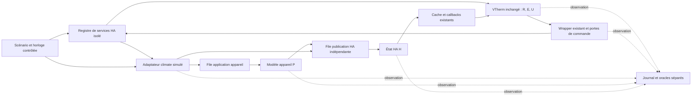

# Conception technique — Issue #2135 : reproduction isolée et corrections conditionnelles

## 1. Métadonnées, sources et niveau de preuve

| Champ                                     | Valeur                                                                                                                                                                                                                                                                             |
| ----------------------------------------- | ---------------------------------------------------------------------------------------------------------------------------------------------------------------------------------------------------------------------------------------------------------------------------------- |
| Version / date                            | 1.1 — premier cycle de convergence / 2026-10-31                                                                                                                                                                                                                                    |
| Statut                                    | Conception documentaire proposée ; dispositif de reproduction concevable immédiatement, correctif non choisi ; aucun développement autorisé                                                                                                                                        |
| Propriétaire                              | Projet Versatile Thermostat ; validation des arbitrages par le mainteneur/propriétaire                                                                                                                                                                                             |
| Autorisation                              | Rapport approuvé et spécification/conception seulement ; seuls les présents documents de conception peuvent être écrits                                                                                                                                                            |
| Sources contractuelles                    | [Rapport validé](issue-2135-review.md), [spécification française v1.1](../specs/issue-2135_fr.md), [spécification anglaise v1.1](../specs/issue-2135_en.md), [issue consultée lors de la rédaction initiale](https://github.com/jmcollin78/versatile_thermostat/issues/2135)       |
| Version équivalente                       | [Conception anglaise](issue-2135-design_en.md) ; mêmes identifiants DT/T/EC et même portée                                                                                                                                                                                         |
| Référence locale de la rédaction initiale | HEAD `574d38774ff6286d548c22cb869de7350d41c1d1`, manifeste VTherm 10.6.3 ; modification préexistante de [base_thermostat.py](../../custom_components/versatile_thermostat/base_thermostat.py) conservée ; référence non revérifiée par commande pendant cette reprise documentaire |
| Limite de version HA                      | Sources installées consultées en lecture seule : [constantes HA](../../.venv/lib/python3.14/site-packages/homeassistant/const.py#L24-L29) déclarant **2026.8.2**, pas 2026.10.2 ; ni version du processus HA actif ni interpréteur VS Code déduits de ce constat                   |

**Légende :** V = vérifié par lecture locale ; R = rapporté dans les sources, non reproduit ; D = décision de conception proposée ; H = hypothèse ; Q = arbitrage humain existant. Un test lu n'est pas un test exécuté. Aucun résultat de fonctionnement nouveau n'est revendiqué.

Le rapport conserve son statut historique « accord requis » ; l'accord utilisateur ultérieur autorise ces documents, pas un correctif. Les 14 FR, 10 BR et 17 AC des deux spécifications ont été lus intégralement. Ils restent proposés selon leur niveau A/P/C ; la traçabilité ci-dessous n'en vaut pas approbation.

**Reprise de convergence v1.1 :** le bilan des spécifications exprime l'accord explicite du rédacteur sur le même périmètre, la couverture documentaire et la faisabilité/testabilité de principe du banc. Cet accord est partagé ici ; il ne choisit aucun correctif, ne tranche aucun Q et n'autorise ni réalisation ni exécution du banc. Les faits V et lectures de code/tests ci-dessous sont ceux de la rédaction initiale, non une nouvelle vérification du dépôt ou de HA ; cette reprise compare le rapport, les deux spécifications v1.1 et les deux conceptions uniquement. Les mentions de conceptions v1.0 inchangées dans S-10 des spécifications décrivent leur étape historique, pas la présente révision.

## 2. Objectif, périmètre et décisions de conception

**Objectif :** rendre discriminants les chemins depuis une demande HA en auto-stop jusqu'aux commandes, états HA et effets simulés, puis permettre un choix de correction fondé sur les preuves. La cause terrain et la reproduction durable restent inconnues. L'essai fourni montre `start` puis `stop`, pas un arrêt continuellement maintenu ; aucun `off` perdu n'est affirmé.

| Décision | Conception proposée et limite                                                                                                                                                                                                                                  |
| -------- | -------------------------------------------------------------------------------------------------------------------------------------------------------------------------------------------------------------------------------------------------------------- |
| DT-01    | Deux lots séparés : A, banc isolé de caractérisation sans modification produit ; B, alternative de correction conditionnelle après Q-01 à Q-07 et nouvelle autorisation. A est spécifiable maintenant, mais ni développé ni exécuté ici.                       |
| DT-02    | Conserver le chemin réel des services HA et la logique VTherm dans le lot A ; remplacer seulement l'appareil/intégration distante par un double contrôlable. Aucun patch de `update_states`, de l'algorithme ou du service d'entrée dans le test discriminant. |
| DT-03    | Observer séparément R/E/U/C/H/P ; aucune nouvelle entité, API, attribut public, notification, dépendance ou persistance produit décidée. Le journal proposé est un artefact du banc.                                                                           |
| DT-04    | Réutiliser le calcul de priorité et la correspondance existants comme référence ; une correction éventuelle ne doit pas créer un second calcul de sécurité ni imposer `off`.                                                                                   |
| DT-05    | Ne sélectionner ni prévention, ni réconciliation, ni combinaison, ni activation de réparation sans preuve. Les contrats conditionnels de section 6 sont des contraintes d'évaluation, pas un nouveau gestionnaire déjà décidé.                                 |
| DT-06    | Conserver services, options, défaut de réparation et restauration existants ; aucune migration. Toute nouvelle télémétrie produit ou politique de reprise nécessite un accord distinct.                                                                        |

Périmètre principal : `over_climate` sans régulation par vanne, `ac_mode`, `slow`, cycle 5 min, arrêt `off`, réparation et suivi désactivés pour la base. La page de l'issue confirme ces deux dernières options dans la capture **postérieure** à l'incident ; elle ne prouve pas une configuration inchangée à tout instant. Étendre la matrice à `fast`, `cool`, modes alternatifs, réparation/suivi, protections, plusieurs sous-jacents et autres contrôleurs. Les autres types et la vanne sont des témoins de compatibilité, pas une extension automatique du correctif.

Hors périmètre : modifier reset/seuils/algorithme, Airzone/Daikin, automatisations réelles, affichage général, environnement HA, tests applicatifs ou dépendances pendant cette phase. Le dispositif conçu est un banc de tests HA, pas une application AppDaemon ni une automatisation de contournement.

## 3. Existant vérifié et dépendances

| Source locale                                                                                                                                                                                                                                                                                | Fait V et conséquence de conception                                                                                                                                                                                                                                                                                                                                |
| -------------------------------------------------------------------------------------------------------------------------------------------------------------------------------------------------------------------------------------------------------------------------------------------- | ------------------------------------------------------------------------------------------------------------------------------------------------------------------------------------------------------------------------------------------------------------------------------------------------------------------------------------------------------------------ |
| [Entrées et application](../../custom_components/versatile_thermostat/base_thermostat.py#L1619-L1855)                                                                                                                                                                                        | `async_set_hvac_mode` change R ; `async_set_temperature` lit la température, pas le mode. `update_states` exige `is_ready`, calcule si R est marqué changé, applique le mode si E est marqué changé, puis appelle le contrôle ; les marques sont remises à zéro à la fin. `force=True` seul ne prouve pas l'émission d'un mode.                                    |
| [Conteneur d'état](../../custom_components/versatile_thermostat/vtherm_state.py#L70-L140)                                                                                                                                                                                                    | Les marques de changement sont cumulatives ; `force_changed()` marque mode, preset et température. Un reset observé ne prouve donc pas un changement numérique. Capturer valeurs **et** marques avant/après les appels.                                                                                                                                            |
| [Priorités](../../custom_components/versatile_thermostat/state_manager.py#L118-L213)                                                                                                                                                                                                         | Inhibition → central `STOPPED` → sécurité imposant l'arrêt → fenêtre agissant sur mode → auto-stop → autres contraintes centrales → demande. Fenêtre eco/frost modifie la consigne séparément ; les autres modes centraux ne précèdent pas uniformément l'auto-stop.                                                                                               |
| [Gestion auto-stop](../../custom_components/versatile_thermostat/feature_auto_start_stop_manager.py#L99-L244) et [contrôle climate](../../custom_components/versatile_thermostat/thermostat_climate.py#L1161-L1191)                                                                          | Une transition de détection force une réévaluation, susceptible de rappeler le contrôle. Désactivation et changement du mode d'arrêt ont leurs propres voies ; ne pas supposer une seule séquence sérialisée.                                                                                                                                                      |
| [Algorithme](../../custom_components/versatile_thermostat/auto_start_stop_algorithm.py#L24-L190) et [reset](../../custom_components/versatile_thermostat/auto_start_stop_algorithm.py#L291-L307)                                                                                             | `slow` : seuil 10, anticipation/délai 30 min ; `fast` : 2 et 7 min ; cycle de pondération 120 s, hystérésis 0,5 °C ; calcul rapproché ignoré si écart ≤24 s **hors reset**. Reset efface dates et décision, pas l'accumulation. Ne pas confondre ces nombres avec un SLA ou le cycle HA de 5 min.                                                                  |
| [Commandes climate](../../custom_components/versatile_thermostat/underlyings.py#L644-L704)                                                                                                                                                                                                   | Déduplication si H et cache de mode correspondent tous deux ; état absent : retour `False` ; test de puissance avant activation ; annulation du renvoi différé après ces retours anticipés, pas inconditionnellement dès l'entrée. Renvoi de consigne à 2 s après `heat`/`cool`. Tester aussi callback déjà commencé et sortie anticipée avant annulation.         |
| [Wrapper de service](../../custom_components/versatile_thermostat/underlyings.py#L199-L247)                                                                                                                                                                                                  | Porte d'inhibition, `blocking=False` par défaut, exceptions journalisées et absorbées ; date de dernière commande mise à jour après retour de l'appel, pour tout service passant par ce wrapper. Le booléen de `set_hvac_mode` peut rester `True` après erreur absorbée/blocage : ni ce booléen ni le log « repaired » ne prouvent un appel exécuté ou P conforme. |
| [Cache et notifications](../../custom_components/versatile_thermostat/underlying_state_manager.py#L52-L120) et [retours climate](../../custom_components/versatile_thermostat/underlyings.py#L793-L850)                                                                                      | H est mis en cache avant planification d'un callback asynchrone. Les notifications ne sont pas un acquittement corrélé. Le corps du cache conserve même `None`/`unknown`/`unavailable` malgré une docstring contraire. Relever H HA, H cache et livraison du callback séparément.                                                                                  |
| [Suivi](../../custom_components/versatile_thermostat/thermostat_climate.py#L754-L885) et [budget](../../custom_components/versatile_thermostat/thermostat_climate.py#L1120-L1160)                                                                                                            | Adoption du mode sous conditions de transition/alignment et de budget ; suivi température différé de 5 s ; plafond 3 pour adoptions/commandes étiquetées suivi, réarmé par commande externe. Ce n'est pas le budget global de toutes les commandes, ni celui de réparation.                                                                                        |
| [Réparation](../../custom_components/versatile_thermostat/feature_repair_incorrect_state_manager.py#L77-L164), [comparaison climate](../../custom_components/versatile_thermostat/underlyings.py#L1219-L1244), [constantes](../../custom_components/versatile_thermostat/const.py#L532-L535) | Défaut `False` ; 30 s depuis le **premier appel prêt** au gestionnaire, réinitialisé s'il n'est plus prêt ; comparaison de U à H, garde `<2 s` depuis la dernière commande ; compteur global au thermostat, incrémenté une fois si au moins un sous-jacent retourne `True`.                                                                                        |
| [Invocation de réparation](../../custom_components/versatile_thermostat/base_thermostat.py#L1857-L1918)                                                                                                                                                                                      | Le contrôle peut sortir avant la réparation, notamment en sécurité `over_climate` ; des contrôles non périodiques peuvent aussi y parvenir. Un nombre de contrôles éligibles n'est pas une durée égale à ce nombre ×5 min.                                                                                                                                         |
| [Modes exposés](../../custom_components/versatile_thermostat/thermostat_climate.py#L1347-L1366), [sélecteur](../../custom_components/versatile_thermostat/select.py#L178-L245)                                                                                                               | Liste issue du **premier** sous-jacent, pas intersection des capacités ; repli du sélecteur après initialisation seulement. U existant est une correspondance thermostat, pas un nouveau repli par appareil. L'hétérogénéité reste Q-04.                                                                                                                           |

### Décomposition HA : limite supplémentaire vérifiée

Le [gestionnaire de température HA installé](../../.venv/lib/python3.14/site-packages/homeassistant/components/climate/__init__.py#L787-L856), version déclarée 2026.8.2, valide/convertit les températures puis transmet les paramètres à `entity.async_set_temperature(**kwargs)` ; aucune décomposition en appel préalable de mode n'y est lue. La méthode VTherm locale ignore elle-même `hvac_mode`. **Ce constat statique ne tranche pas le comportement HA 2026.10.2 de l'incident**, ni celui d'un programmateur faisant plusieurs appels. Le banc doit enregistrer le service entrant, ses appels internes réels et leur ordre sur chaque version ; il ne doit pas ajouter artificiellement `async_set_hvac_mode` pour obtenir le symptôme. Si le service complet n'a pas d'effet de mode, c'est un résultat de caractérisation à conserver (EC-05), pas une reproduction échouée à « réparer » dans le test.

Conventions de test lues : [fixtures](../../tests/conftest.py), [helpers et MockClimate](../../tests/commons.py#L244-L430), [configuration pytest](../../setup.cfg), [dépendances de test](../../requirements_test.txt). `pytest_homeassistant_custom_component`, `MockConfigEntry`, fonctions de création/enregistrement d'entités et mocks asynchrones existent. `MockClimate` lie mode et publication HA et ne possède pas de P indépendant : suffisant comme témoin immédiat, insuffisant comme double de transport asynchrone. Ne pas utiliser les fixtures qui court-circuitent le contrôle, ni remplacer globalement le registre de services dans le test d'intégration discriminant.

## 4. Architecture du dispositif isolé et responsabilités

Tous les composants « banc » ci-dessous sont **proposés**, non présents/implémentés. Les désignations sont logiques, pas de nouveaux noms d'API produit. Réutiliser les bibliothèques de test existantes ; ne pas importer de configuration réelle ni de credentials cloud.



| Composant                 | Entrées → sorties ; responsabilité                                                                                                                                                                                                                    |
| ------------------------- | ----------------------------------------------------------------------------------------------------------------------------------------------------------------------------------------------------------------------------------------------------- |
| Pilote de scénario        | Manifeste/version, commandes, températures et calendrier → services HA et avance du temps ; vérifie les préconditions, ne modifie pas les décisions VTherm pour la reproduction naturelle.                                                            |
| Adaptateur climate simulé | Services ciblés exclusivement sur les entités du banc → réception, validation/rejet explicite ou acceptation ; peut annoncer H optimiste indépendamment de P.                                                                                         |
| Modèle appareil           | Commande livrée et capacités → P.mode, P.action/activité simulée, consigne ; peut appliquer hors ordre, ignorer une commande ou redémarrer à `set_temperature` selon un profil explicitement activé. Ce dernier effet n'est pas supposé pour Airzone. |
| Ordonnanceur de fautes    | Scripts déterministes + points de suspension → files distinctes réception/application/publication ; pertes et rejets à une étape nommée, doublons et permutation finie. Graine et ordre explicites pour rejouer.                                      |
| Sondes passives           | Entrée de méthode, wrapper, registre, handler, cache, événements et callbacks → enregistrements immuables ; entourer/déléguer, ne pas remplacer le contrôle ; mesurer l'effet éventuel de l'instrumentation avec un témoin sans fautes.               |
| Oracle / exporteur        | Journal + conditions Q validées → verdicts R/E/U, service, H, P, boucle et qualité des preuves ; aucune action corrective autonome du banc.                                                                                                           |

**Isolation à prouver avant exécution future :** instance `hass` de test neuve, liste fermée d'`entity_id` fictifs, aucun endpoint HA réel, aucune intégration cloud chargée, réseau sortant interdit ; n'autoriser que les besoins locaux des fixtures. La restriction d'hôtes existante n'est pas, à elle seule, une preuve d'isolation complète. Échec de ce contrôle : ne pas lancer le scénario. La tâche HA déjà active n'est ni utilisée, ni arrêtée, ni redémarrée.

## 5. Données, états, temps et persistance

R désigne la demande acceptée, E le mode effectif calculé, U le mode attendu pour la cible, C les étapes de commande, H l'état publié dans HA et P l'état indépendant de l'appareil simulé. La lettre R comme marque de preuve « rapporté » dans la légende de section 1 n'est pas une valeur de demande.

### Modèle d'observation proposé

| Donnée            | Contrat de représentation                                                                                                                                                                                                                                     |
| ----------------- | ------------------------------------------------------------------------------------------------------------------------------------------------------------------------------------------------------------------------------------------------------------- |
| Manifeste d'essai | `run_id`, révision et empreinte du diff VTherm, version HA/Python et double, options complètes non sensibles, capacités par cible, graine, fuseau, profils de fautes, présence d'autres contrôleurs ; valeur inconnue explicitement marquée.                  |
| État de décision  | R.mode/consigne/preset, E.mode/consigne/preset, U par cible via correspondance existante, motifs, détection, niveau, accumulation/pente, marques changées, readiness et protections ; snapshots copiés, jamais références mutables.                           |
| Commande C        | `command_id` local au banc, parent/acteur s'ils sont connus, cible, service/données, décision associée, étape `attempt`, `gate_drop`, `registry_enter`, `handler_enter`, `accepted`, `return`, `error`, `lost`, `device_apply` ; ne pas confondre les étapes. |
| État H            | Mode/attributs, disponibilité, contexte HA si présent, `last_changed`/`last_updated` et instant de réception/publication ; H HA et H cache distincts. Un contexte manquant reste inconnu.                                                                     |
| État P            | Mode appliqué, consigne et activité simulée indépendants de H, instant d'effet, cause de simulation ; indisponible sur matériel sans moyen indépendant approuvé. Un mode `heat` n'est pas en soi une puissance thermique mesurée.                             |
| Ordonnancement    | File et événement, tâche/callback, début/fin, planification/annulation/exécution, `decision_epoch`, `startup_epoch`, numéro de réception monotone ; corrélation certaine seulement dans le simulateur.                                                        |

`decision_epoch` est une **étiquette du banc** incrémentée lors d'un changement d'intention ou de contraintes pertinent, y compris si U reste égal ; elle ne constitue pas un nouveau champ produit. Relever des sous-étapes réentrantes, ne pas supposer le snapshot R/E/U atomique entre deux `await`. Un contexte HA ou une égalité de valeur ne permet pas toujours d'attribuer un retour à une commande.

**Temps :** UTC avec offset pour corrélation externe et temps monotone/virtuel pour durées ; ordre causal partiel et numéro séquentiel pour événements de même date. Ne pas classer une commande ancienne selon sa seule heure de publication HA. Consigner séparément envoi, retour de service, effet P, publication H, livraison du callback et début de divergence. Pas de soustraction entre horloges non synchronisées. Le banc doit contrôler conjointement `vtherm.now`, `datetime.now(timezone.utc)` du gestionnaire de réparation et timers HA ; `_set_now` seul ne fait pas avancer ces trois horloges. Pas de vrais délais d'attente pour reproduire des heures.

**Mesures paramétrées, non SLA :** à chaque nouvelle période où U est stable, noter `t0` et invalider les mesures de convergence de l'époque précédente. Mesurer séparément `D_H` et `D_P` jusqu'à conformité durable sur la fenêtre d'observation validée ; relever nombre/durée d'activations transitoires et nombre de commandes par origine/cible/type. Les bornes `L_apply`, `L_report`, `L_old`, `T_H`, `T_P`, budget `B`, fenêtre `W`, pause et nombre de pertes tolérées restent Q-02/Q-03/Q-05. Exiger une borne de livraison/expiration des anciennes commandes et une publication HA fidèle sous délai pour promettre les deux convergences ; « joignable » seul ne suffit pas. Si U change avant la borne : « mesure annulée/remplacée », pas succès. Si les paramètres ne sont pas validés : résultat mesuré, acceptation indéterminée.

### États orthogonaux, non nouvelle machine produit

| Dimension    | États / transitions du dossier                                                                                                                                                                                                               |
| ------------ | -------------------------------------------------------------------------------------------------------------------------------------------------------------------------------------------------------------------------------------------- |
| Décision     | `manual_stop`, `protected`, `auto_stopped`, `running`, `not_ready` ; motifs et U issus du code, pas de priorité ajoutée par ces étiquettes. R=`off` exclut la reprise automatique ; `fan_only`/`dry` peuvent être auto-stoppés sans E=`off`. |
| Transport    | `none`, `pending`, `returned`, `rejected`, `lost`, `applied`, `superseded` ; retour et effet sont deux dimensions si nécessaire, pas un succès unique. Une commande déjà livrée n'est pas annulable par suppression d'un timer local.        |
| Observation  | H conforme/divergent/inconnu et P conforme/divergent/inconnu indépendamment ; synthèse globale conforme seulement si chaque cible requise est établie conforme à son niveau de preuve.                                                       |
| Récupération | `disabled`, `warming_up`, `eligible`, `waiting`, `paused`, `unavailable`, `persistent_divergence` ; décrit la réparation existante ou une politique candidate clairement identifiée, jamais une activation implicite.                        |

**Persistance et redémarrage HA :** [restauration auto-stop](../../custom_components/versatile_thermostat/feature_auto_start_stop_manager.py#L246-L289) restaure détection, accumulation, dernière commutation et décision synchronisée ; l'activation est initialisée puis peut être remplacée par le switch restauré. Le sélecteur conserve son choix jusqu'à capacités connues. Le compteur et l'attente de réparation sont remis à zéro à `post_init`. Le banc conserve son journal/manifeste exporté, mais détruit tâches/listeners/queues à la fin de chaque essai. Après redémarrage simulé, changer `startup_epoch`, reconstruire readiness et U, ne pas rejouer une correction périmée ; les commandes distantes encore en vol peuvent survivre et doivent être testées séparément. Aucun nouvel état de commande persistant ni migration produit n'est proposé. Distinguer ce redémarrage HA de la reprise thermique légitime.

## 6. Interfaces, contrats et alternatives conditionnelles

### Interfaces réellement existantes à préserver

| Interface                                           | Entrées / résultat / limites                                                                                                                                                                                                                                                                                          |
| --------------------------------------------------- | --------------------------------------------------------------------------------------------------------------------------------------------------------------------------------------------------------------------------------------------------------------------------------------------------------------------- |
| `climate.set_temperature`                           | Cible `entity_id` VTherm ; température 20 °C pour la base, `hvac_mode: heat` pour le service combiné ; variantes température seule et valeurs limites. Valider capacités/unité/plage selon la version HA réellement testée. Observer sans supposer la décomposition. Erreur de validation ≠ commande appareil perdue. |
| `climate.set_hvac_mode` / `climate.set_preset_mode` | Mode/preset supporté et cible obligatoires ; demandes répétées distinctes des changements numériques ; respecter verrouillage et acceptation centrale. Une demande rejetée n'est pas une intention R acceptée (FR-003).                                                                                               |
| `update_states` / contrôle                          | `force`, cause de suivi et changements R ; peuvent rappeler le contrôle et produire plusieurs transitions. Leur retour n'est ni une fin de chaîne asynchrone ni un acquittement matériel.                                                                                                                             |
| `UnderlyingClimate.set_hvac_mode`                   | Mode E converti par `get_underlying_hvac_mode`, cause optionnelle ; résultat `False` pour certains non-envois, `True` de chemin parcouru sans garantie C/P ; pas d'idempotence matérielle garantie. Relever commande et annulation différée séparément.                                                               |
| `check_and_repair`                                  | Option/readiness/délai/compteur, U et H → éventuel appel de mode ; ne voit pas P. Un cycle sans retour `True` remet le compteur à zéro, même si la divergence n'a pas disparu (garde 2 s, par exemple).                                                                                                               |
| Événements et états                                 | `AUTO_START_STOP_EVENT` porte `type: start/stop`, températures, erreur et seuil ; événements HVAC/preset et attributs R/E existants. Événement de décision ≠ émission de service ; H/`hvac_action` ≠ preuve P.                                                                                                        |

Idempotence du banc : même manifeste + calendrier + graine + versions doivent permettre le même ordre de points contrôlés et le même verdict, indépendamment du temps mural. Ne pas garantir toute l'interleaving Python sans points de suspension explicites. Un retry a un nouveau `command_id` ; un doublon de transport conserve le lien vers l'original. Les sondes ne doivent pas absorber une exception ou changer les valeurs retournées ; relever aussi les erreurs absorbées par le wrapper existant et les erreurs tardives du handler après retour non bloquant.

### Alternatives, aucune sélection

| Option spécifiée           | Condition d'éligibilité / point candidat à examiner                                                                                | Contrat et limite                                                                                                                                                                                                                                               |
| -------------------------- | ---------------------------------------------------------------------------------------------------------------------------------- | --------------------------------------------------------------------------------------------------------------------------------------------------------------------------------------------------------------------------------------------------------------- |
| O-01 prévention            | Preuve d'une voie d'activation incompatible avec U ; examiner frontière calcul/application de `update_states` et entrées HA        | Revalider intention/contraintes avant émission sans bloquer une reprise courante ; ne pas supprimer un `start` légitime simplement parce qu'un `stop` suit. Impossible d'annuler par ce seul moyen une commande déjà acceptée à distance ou externe.            |
| O-02 réconciliation        | Preuve d'une dérive que la prévention ne couvre pas ; examiner réparation, contrôle et retours, sans imposer un nouvel emplacement | U courant, disponibilité, autorité et budget validés ; déduplication et délai par cible ; ne pas contourner l'inhibition, ne pas adopter silencieusement le mode divergent dans R. H optimiste égal à U rend une dérive P invisible sans preuve supplémentaire. |
| O-03 combinaison           | Deux chemins distincts démontrés et nécessité des deux établie                                                                     | Un seul propriétaire d'émission corrective par cible/époque ; responsabilité et budget partagés explicités ; complexité et réentrance à justifier.                                                                                                              |
| O-04 réparation existante  | Caractérisation isolée option activée puis désactivée                                                                              | Aucun changement de défaut. Peut traiter un écart **rapporté H**, pas démontrer P. Ne satisfait pas par présomption FR-004 pour le scénario réparation désactivée.                                                                                              |
| O-05 contournement externe | Documentation d'un usage rapporté seulement                                                                                        | Pas de déploiement ni d'adoption produit ; minute de désaccord non transformée en SLA ; reprise et partage rendent un `off` systématique dangereux.                                                                                                             |

### Contrat commun à toute correction éventuellement retenue

Avant toute émission différée candidate : relire R/E/U, priorités et porte d'inhibition, disponibilité, capacités, autorité de commande et époque ; vérifier de nouveau après tout `await` susceptible de les changer. Invalider les travaux locaux devenus obsolètes lors de demande/protection/mode d'arrêt/readiness/unload ; annuler un handle n'arrête pas un callback déjà entré. Une étiquette locale ne permet ni d'annuler l'effet distant ni de reconnaître sûrement un retour cloud périmé ; ces cas restent à résoudre par l'option validée.

Si une réconciliation est retenue, Q-05 doit choisir explicitement : réutilisation de la réparation optionnelle, traitement distinct actif même quand elle est désactivée, ou simple prévention sans réconciliation. Aucun de ces choix ne peut être dissimulé sous le nom « réparation ». Définir comptage agrégé mode/température/renvoi/suivi/réparation, par cible et thermostat, fenêtre, pause et conditions de réarmement ; aucun nouvel ordre issu d'un retour seul ne doit réarmer indéfiniment son propre budget. Ne pas appliquer arbitrairement le plafond de suivi 3 ou celui de réparation 5 à tout le produit.

**Limite d'information et contrat conditionnel commun :** deux exécutions ayant R/E/U/C/H identiques peuvent avoir P différent si l'intégration annonce `off` de manière optimiste. Un contrôleur utilisant seulement ces entrées ne peut distinguer les mondes. Toute cible H/P ou récupération de correctif, y compris les critères P du catalogue, dépend de toutes les préconditions H-02 des spécifications v1.1 et des Q applicables : U stable, disponibilité/capacités, autorité non conflictuelle, livraison/application/publication fidèle sous bornes distinctes, pertes compatibles avec le budget et livraison/expiration bornée des anciens ordres. Une mesure indépendante vérifie P observé, sans garantir son pilotage ni remplacer ces préconditions. Refus permanent, pertes excédant le budget, ancien ordre sans borne ou conflit d'autorité interdisent une promesse inconditionnelle ; conserver des verdicts H/P séparés de divergence ou preuve insuffisante. Annuler un timer ou invalider une époque locale ne retire pas un ordre déjà accepté à distance et ne garantit pas l'absence de transitoire ou de coupure ; effet et récupération restent Q-02/Q-03/Q-04 selon le cas.

## 7. Flux asynchrones, annulations, erreurs et reprise

### Séquence nominale de caractérisation (ordre des sous-événements à mesurer)

Le diagramme illustre un entrelacement possible, pas un ordre de retour/handler/publication garanti ni la séquence démontrée de l'incident.

```mermaid
sequenceDiagram
    participant S as Scénario
    participant HA as Service HA
    participant V as VTherm
    participant A as Adaptateur simulé
    participant P as Appareil P
    participant H as Publication H
    S->>V: Établir naturellement auto-stop, enregistrer R/E/U
    S->>HA: set_temperature(mode heat, température 20)
    HA->>V: Traitement réel de cette version HA
    V->>V: Marques, reset éventuel, calcul, contrôle
    opt Commande réellement émise
        V->>HA: set_hvac_mode(U à cet instant)
        HA-->>V: Retour non bloquant possible
        HA->>A: Handler ciblé
        A->>P: Application immédiate ou différée
        A-->>H: Publication optimiste possible avant effet P
        P-->>H: Publication fidèle éventuelle, délai distinct
        H-->>V: Cache puis callback asynchrone
    end
    S->>S: Verdict séparé service, H et P ; aucune cause présumée
```

1. **Préparation :** base F-01, températures/historique/pente permettant réellement le seuil `slow`, pas seulement `Tpièce >20`. Contrôler R=`heat`, E=U=H=P=`off`, détection vraie ; archiver événements de bootstrap puis remettre seulement les compteurs d'observation du banc à zéro. Toute initialisation interne forcée doit être étiquetée « test de composant », jamais reproduction naturelle.
2. **Demande identique/modifiée :** service complet, température seule, mode seul et preset ; observer marquage/reset et branches arrêt maintenu, `start`/`stop` et reprise autorisée sans pré-orienter le résultat. Essai fast et essai slow restent deux dossiers distincts.
3. **Fenêtre d'observation :** avant/pendant/après recalculs, handlers et callbacks ; au-delà de 2 s, d'au moins un cycle complet et de toute pause/commande distante restante. En réparation activée, compter aussi les appels éligibles, pas seulement les minutes ; arrêter sur horizon explicite de test, pas sur simple retour de `async_block_till_done` qui ne vide pas tous les timers futurs.
4. **Classification :** absence de tentative ; tentative sans entrée registre (déduplication/porte/état absent) ; entrée registre en erreur ; handler non reçu ; accepté mais non appliqué ; appliqué tard/hors ordre ; publication tardive/optimiste ; preuves insuffisantes. Une perte injectée doit nommer son étage ; ne jamais déduire « perdu » d'une absence dans un historique incomplet.

### Entrelacements et comportement sûr à vérifier

| Situation                                    | Séquence et oracle proposés                                                                                                                                                                                                                                                                                                                                                                                                 |
| -------------------------------------------- | --------------------------------------------------------------------------------------------------------------------------------------------------------------------------------------------------------------------------------------------------------------------------------------------------------------------------------------------------------------------------------------------------------------------------- |
| `start` puis `stop`                          | Compter séparément `heat` et mode d'arrêt, puis application P et publication H ; retenir les ~15 ms seulement comme observation R du rapport. Q-03 décide l'acceptabilité transitoire, pas le banc.                                                                                                                                                                                                                         |
| Commande/retour tardif                       | Bloquer le handler ou la publication avant/après recalcul ; livrer un ancien `heat` après arrêt, et un ancien arrêt après reprise. Ne pas émettre de correction locale devenue obsolète. Un ancien ordre déjà accepté à distance peut néanmoins activer l'appareil ou couper une reprise ; mesurer son effet puis la récupération sous H-02 et la politique Q-02/Q-03/Q-04 applicable, sans prétendre l'annuler localement. |
| Reprise thermique / consigne / désactivation | Recalculer U à partir de R courant et protections ; annuler l'observation ancienne ; tester `heat` et `cool`. Arrêt manuel ensuite : pas de reprise automatique. Désactivation de l'auto-stop ne désactive pas les protections.                                                                                                                                                                                             |
| Modes alternatifs                            | `fan_only` et `dry`, changement pendant détection et repli seulement après capacités connues. Vérifier les envois de température non régulée hors `heat`/`cool` : arrêt auto n'implique pas aucune commande ni absence d'activité physique.                                                                                                                                                                                 |
| Réparation activée                           | Première invocation prête = origine des 30 s ; frontière exacte 30 s admise ; garde climate à exactement 2 s levée si aucune nouvelle commande. Cinq contrôles retournant au moins une réparation, quatre appels éligibles ignorés, puis reprise ; un contrôle sans réparation remet le compteur à zéro. Relever raisons et commandes réelles.                                                                              |
| Réparation désactivée                        | Zéro action attribuée au gestionnaire, sans désactiver le chemin normal. Si défaut injecté persiste, documenter sa persistance ; ne pas exiger une récupération non existante comme oracle de caractérisation.                                                                                                                                                                                                              |
| Erreurs / indisponibilité                    | Absence, `unknown`, `unavailable`, erreur de validation, erreur wrapper et erreur handler tardive séparées ; aucune conformité proclamée. Au retour, observer le calcul de U courant, jamais réinjecter l'ancienne demande comme politique implicite. Actions et délais futurs : Q-04.                                                                                                                                      |
| Plusieurs appareils                          | P/H/C par cible et résultats partiels ; un refus ne justifie pas une rafale sur le conforme. Le compteur actuel est collectif : un sous-jacent défaillant peut consommer des cycles de réparation des autres. Pas de migration arbitraire vers des compteurs individuels.                                                                                                                                                   |
| Appareil partagé                             | Ajouter un second acteur simulé identifié ; conflit d'intentions explicitement observé. Sans décision d'autorité Q-06, convergence globale non exigible et aucune politique « dernier ordre gagne » adoptée.                                                                                                                                                                                                                |
| Inhibition / sécurité / fenêtre / central    | Reprendre les priorités V de section 3 et les portes de commande, pas seulement comparer E à `off` ; en inhibition, une porte peut retirer le contrôle, pas autoriser des retries. Vérifier motifs, fenêtre eco/frost, arrêt manuel et contrôle court-circuité en sécurité.                                                                                                                                                 |
| Redémarrage / unload                         | Restaurer l'état existant et les sélections, readiness tardive, horodatage invalide/absence d'ancien état comme témoins ; annuler les tâches locales ; ancien effet distant indépendant. Pas de réarmement répété provoqué par la boucle de retours.                                                                                                                                                                        |

## 8. Sécurité, observabilité et exploitation

Le banc n'est pas un dispositif de sécurité thermique et sa preuve P reste simulée. La validation matérielle ultérieure exige accord distinct, supervision, moyen d'arrêt indépendant et preuve adaptée ; aucune commande de matériel n'est autorisée ici. Utiliser `entity_id`, pas `device_id`, et liste fermée de cibles. Les consignes Home Assistant consultées sont le guide général et sa référence de pilotage d'appareils ; aucune automatisation, template, helper ou application AppDaemon n'est créée.

Le journal doit distinguer `configured`, appel éligible, garde/porte, tentative, envoi observé, retour/erreur, et effet P. Un `False` de détection n'est pas l'option désactivée ; un `True` de réparation n'est pas un succès physique. Rendre visibles : compteurs par origine/cible, pauses et resets, commandes obsolètes, divergence H et P, désaccord `hvac_action`, manque de corrélation et couverture temporelle. Ne pas transformer les logs existants en métriques de succès non prouvées.

Artefacts de test : journal ordonné et manifeste expurgés exportables, résumé des hypothèses et verdict par AC ; pas de stockage HA supplémentaire. Masquer tokens, adresses, noms de logement et habitudes d'occupation ; conserver correspondance pseudonymisée cohérente pour causalité, timestamps relatifs si possible. Durée de conservation/diffusion des traces terrain à convenir ; aucune transmission automatique ni nouvelle permission décidée. Le coût d'instrumentation et le nombre d'événements doivent être mesurés dans le banc ; ne pas activer de logs illimités en production comme correction implicite.

Compatibilité et migration : aucune nouvelle dépendance, option obligatoire, entité ou format persisté. Comparer VTherm 10.6.1/HA 2026.10.2 et révision locale 10.6.3 sur environnements isolés après autorisation ; figer les versions de test alors, car les dépendances actuelles ne suffisent pas à identifier une version historique. Retour arrière d'une correction future : reprise de la version précédente et conservation des options existantes ; un changement qui exigerait une migration sort de FR-013 et doit être respécifié. Aucun checkout, installation, migration ou redémarrage effectué maintenant.

## 9. Stratégie de tests, faisabilité et traçabilité

### Tests existants effectivement lus : supports, pas preuve de #2135

| Support                                                                                                                   | Utilité / limite                                                                                                                                     |
| ------------------------------------------------------------------------------------------------------------------------- | ---------------------------------------------------------------------------------------------------------------------------------------------------- |
| [Table des priorités](../../tests/test_state_manager.py#L401-L529)                                                        | Oracle composant pour modes et motifs ; certaines branches non supportées sont commentées, pas couvertes ; ne remplace pas un service HA complet.    |
| [Tests d'auto-stop](../../tests/test_auto_start_stop.py#L967-L1127)                                                       | Preset via service et état publié pendant arrêt/inhibition ; niveau fast et préparation en partie interne, sans P indépendant ni reproduction cloud. |
| [Tests réparation climate](../../tests/test_overclimate.py#L109-L223)                                                     | Frontière 2 s, correspondance SLEEP et retour `False` ; mocks ne prouvent ni émission réelle ni effet P.                                             |
| [Pause/reprise](../../tests/test_repair_incorrect_state_manager.py#L24-L69)                                               | Cinq réparations simulées, quatre appels ignorés puis reprise et logs ; un seul sous-jacent mocké, délai initial contourné.                          |
| [Modes d'arrêt](../../tests/test_auto_start_stop_stop_mode.py#L80-L308)                                                   | Choix filtrés, changement immédiat, reprise et restauration ; pas preuve de capacités hétérogènes de tous les appareils.                             |
| [Différés](../../tests/test_overclimate.py#L1715-L1815)                                                                   | Consigne effective et annulation du renvoi à `off` ; le handle mocké n'exécute pas un callback déjà entré.                                           |
| [Multi-climate](../../tests/test_overclimate.py#L1543-L1700) et [budget suivi](../../tests/test_overclimate.py#L480-L540) | Diffusion de consigne et limite/réarmement suivi ; ne couvrent pas ensemble perte, publication optimiste et budget agrégé.                           |
| [Restauration](../../tests/test_auto_start_stop_feature_manager.py#L138-L221)                                             | État d'algorithme et cas sans ancienne donnée ; pas un redémarrage complet avec commandes cloud en vol.                                              |

### Catalogue proposé : aucun fichier de test ajouté, aucun test exécuté

T-01 à T-17 sont des **familles à développer après autorisation**, alignées une à une sur les AC ; paramétrer les axes de section 7 des deux spécifications plutôt que prétendre qu'un exemple couvre leur produit cartésien. Les critères P/C sont des oracles futurs, pas des assertions que l'existant devrait déjà réussir.

| Test proposé / critère | FR couverts                            | Oracle et décision nécessaire                                                                                                                                                                                                                                                                                                                                                   |
| ---------------------- | -------------------------------------- | ------------------------------------------------------------------------------------------------------------------------------------------------------------------------------------------------------------------------------------------------------------------------------------------------------------------------------------------------------------------------------- |
| T-01 / AC-001          | FR-001, FR-002                         | Base naturelle slow, service combiné et chronologie R/E/U/C/H/P ; verdict reproduit/non reproduit/indéterminé immédiatement définissable.                                                                                                                                                                                                                                       |
| T-02 / AC-002          | FR-002, FR-003                         | Trois services, répétition, consigne et preset ; marques/reset distincts des changements numériques et R accepté conservé.                                                                                                                                                                                                                                                      |
| T-03 / AC-003          | FR-003, FR-004                         | U effectivement stable ; verdicts H/P séparés sous H-02, bornes et fenêtre durable validées ; Q-01/Q-02/Q-03/Q-04/Q-06. Sans paramètres validés : mesures, acceptation indéterminée.                                                                                                                                                                                            |
| T-04 / AC-004          | FR-005                                 | `start`/`stop` naturel, commandes et différés ; mesurer durée/activité simulée, acceptation Q-02/Q-03.                                                                                                                                                                                                                                                                          |
| T-05 / AC-005          | FR-004, FR-005, FR-009                 | Latence application/publication séparées, permutations et doublons ; convergence sous H-02 et budget validé ; hors hypothèses, divergence ou preuve insuffisante ; Q-02/Q-04/Q-05/Q-06.                                                                                                                                                                                         |
| T-06 / AC-006          | FR-001, FR-004, FR-011                 | Perte/rejet off et contrôle heat, erreurs aux étages distincts ; refus permanent = divergence ; récupération Q-04/Q-05.                                                                                                                                                                                                                                                         |
| T-07 / AC-007          | FR-006                                 | Reprises thermiques, consigne/preset et cool ; aucune émission locale d'arrêt obsolète. Livrer aussi un ancien arrêt accepté à distance, mesurer coupure éventuelle puis récupération conditionnelle sous H-02 ; aucune annulation distante garantie ; Q-02/Q-04.                                                                                                               |
| T-08 / AC-008          | FR-006, FR-007                         | Désactivation puis arrêt manuel, aucune reprise non autorisée ; protections inchangées.                                                                                                                                                                                                                                                                                         |
| T-09 / AC-009          | FR-007                                 | Priorités simples et combinées, fenêtre mode/consigne, inhibition et central ; comparer au calcul et aux portes existants.                                                                                                                                                                                                                                                      |
| T-10 / AC-010          | FR-008                                 | off/fan_only/dry, changement et repli après readiness ; pas de supposition de capacités communes.                                                                                                                                                                                                                                                                               |
| T-11 / AC-011          | FR-001, FR-010                         | Option off/on, avant/à/après 30 s et 2 s ; statut/détection, tentative, réception, erreurs et P séparés ; O-04 ne satisfait pas par activation le cas désactivé ; Q-01/Q-05. Tests à 24 s et reset pour l'algorithme en complément.                                                                                                                                             |
| T-12 / AC-012          | FR-009, FR-010                         | Compteurs 1…5, puis 6…9 sans inspection, 10 ramené à 0 puis tentative ; contrôles sans réparation, readiness perdue, budget toutes origines ; Q-02/Q-05 et EC-01/EC-02.                                                                                                                                                                                                         |
| T-13 / AC-013          | FR-011                                 | Absent/unknown/unavailable puis retour après nouvelle demande ; preuve manquante non conforme ; Q-04.                                                                                                                                                                                                                                                                           |
| T-14 / AC-014          | FR-012                                 | Deux appareils, échec partiel, second contrôleur ; verdict individuel ; hétérogénéité et autorité Q-04/Q-06.                                                                                                                                                                                                                                                                    |
| T-15 / AC-015          | FR-005, FR-006, FR-009, FR-011, FR-013 | Doublons conformes, timer encore annulable, callback déjà entré, commande distante acceptée ; aucune émission locale obsolète ni répétition corrective due aux seuls retours identiques ; effets/récupération distants sous H-02 et politique validée. Reprise thermique et redémarrage HA distincts, suivi off/on, nouveau R, sans nouvelle persistance ; Q-02/Q-03/Q-04/Q-05. |
| T-16 / AC-016          | FR-001, FR-014                         | H off/P heat et inverse, action contradictoire ; deux verdicts ; non-régression avant/après uniquement une fois défaut discriminant établi Q-01.                                                                                                                                                                                                                                |
| T-17 / AC-017          | FR-002, FR-013, FR-014                 | Couples HA/VTherm identifiés séparément, service réel par version, autres types, vanne, suivi, verrouillage et restauration ; aucun test vert local extrapolé au terrain ; Q-07.                                                                                                                                                                                                |

Les 14 FR et 17 AC sont ainsi couverts **par conception**, pas validés par exécution. Couverture des 10 règles : BR-001 → modèle U/H/P et T-01/T-16 ; BR-002 → priorités et T-09 ; BR-003 → marques/reset et T-02 ; BR-004 → époques/différés et T-05/T-07/T-15 ; BR-005 → limites d'information et T-06/T-13 ; BR-006 → mesures sans SLA et T-03/T-04 ; BR-007 → réparation et T-11/T-12 ; BR-008 → événements/sondes et T-11/T-16 ; BR-009 → déduplication/budget et T-12/T-15 ; BR-010 → isolation et confidentialité pour toutes les familles.

**Faisabilité/testabilité :** lot A faisable avec extension du double climate et sondes dans l'infrastructure de tests existante, sans dépendance produit nouvelle ; fidélité Airzone et capacité de rejouer exactement le terrain non démontrées. Les AC d'analyse sont testables dès réalisation autorisée. Les AC conditionnels restent mesurables, mais aucun verdict de conformité chiffrée avant décisions Q. Garantir P réel avec H optimiste seul est impossible ; des pertes arbitraires avec un budget fini ou deux autorités incompatibles rendent la convergence impossible aussi.

**Passages de validation :** (G1) accord documentaire sur le banc acquis dans le bilan v1.1 ; établir l'isolation et obtenir séparément l'autorisation de développer/exécuter le banc ; (G2) produire preuves, résultats négatifs compris, qualifier les versions et la cause ; (G3) traiter les points EC persistants et Q selon leur portée, choisir O et autoriser séparément le correctif ; (G4) conserver un scénario réellement rouge avant/vert après sans changer le script de fautes pour favoriser le correctif, tests protections/reprise/boucles/compatibilité ; (G5) validation d'intégration/matérielle appropriée autorisée. Un défaut injecté artificiellement peut qualifier la robustesse, pas démontrer à lui seul la cause de l'incident.

## 10. Écarts bilingues, décisions ouvertes et bilan de vérification

### Tableau d'alignement v1.1 et points persistants (rapport et spécifications non modifiés)

Les citations FR/EN ci-dessous sont de courts extraits des mêmes identifiants dans [la spécification FR v1.1](../specs/issue-2135_fr.md) et [la spécification EN v1.1](../specs/issue-2135_en.md). Aucune divergence de fond **entre leurs traductions** n'a été relevée. Les ambiguïtés de la v1.0 sont signalées comme historiques ; elles ne sont plus présentées comme des divergences actuelles. Accord documentaire ne signifie ni politique approuvée ni correctif sélectionné.

| Écart / références                                          | Citations v1.1 et statut de convergence                                                                                                                                                                                                                                                                                                                                                                                                                  | Point persistant / effet bloquant                                                                                                                                                                                                                  |
| ----------------------------------------------------------- | -------------------------------------------------------------------------------------------------------------------------------------------------------------------------------------------------------------------------------------------------------------------------------------------------------------------------------------------------------------------------------------------------------------------------------------------------------- | -------------------------------------------------------------------------------------------------------------------------------------------------------------------------------------------------------------------------------------------------- |
| EC-01 — BR-007, AC-012, Q-05 ; docs FR/EN                   | **Clarification intégrée ; écart code/documentation persistant.** BR-007 : « 4 appels éligibles sont ignorés » / “4 eligible calls are skipped”, reprise au cinquième ; compteur collectif, reset sans retour `True`, non preuve de conformité ni plafond global. Les dix cycles de la documentation utilisateur ([FR](../fr/feature-advanced.md#L259), [EN](../en/feature-advanced.md#L259)) demeurent distincts de l'oracle code/test initialement lu. | Caractériser BR-007 sans changer la cadence. Q-05 pour cadence souhaitée ; correction de documentation utilisateur hors intervention. Aucun blocage du banc.                                                                                       |
| EC-02 — FR-009, BR-007/AC-012, Q-02/Q-05                    | **Ambiguïté v1.0 levée, pas de divergence actuelle.** FR-009 : « Aucun nombre total fini de commandes n'est imposé ici » / “No finite total command count is imposed here”. Bornes de débit/rafale et politique de reprise sont distinctes du nombre total ; BR-007 reste l'oracle de caractérisation.                                                                                                                                                   | Q-02/Q-05 : budget agrégé par origine/cible/fenêtre, pause, réarmement, répétition périodique ou arrêt total. Bloque la politique et l'acceptation du correctif, pas le banc ; aucun choix effectué.                                               |
| EC-03 — FR-004, BR-005, AC-003/AC-005, H-02, Q-02/Q-04/Q-06 | **Promesse v1.0 trop large corrigée.** FR-004 : « la seule joignabilité/capacité ne suffit pas » / “reachability/capability alone is insufficient”. H-02 et contrat commun des AC explicitent U stable, disponibilité/capacités, autorité, bornes distinctes et pertes compatibles avec budget ; verdicts H/P séparés hors hypothèses. Mesure P indépendante ≠ garantie de commande.                                                                     | Q-02/Q-04/Q-06 : approuver hypothèses, bornes, preuve P et autorité pour l'acceptation quantitative du correctif. Aucune contradiction résiduelle pour l'analyse ; aucune garantie Airzone établie.                                                |
| EC-04 — FR-004/FR-010, AC-011, O-04, Q-01/Q-05              | **Clarification intégrée ; choix ouvert.** AC-011 : « Activer O-04 ne satisfait pas par présomption le cas désactivé » / “Enabling O-04 does not presumptively meet the disabled case”. Gestionnaire désactivé et chemin normal sont caractérisés séparément ; défaut conservé.                                                                                                                                                                          | Q-01/Q-05 : prévention, mécanisme distinct autorisé ou révision explicite du contrat. O-04 seule ne démontre pas la satisfaction du cas désactivé ; ni activation implicite ni sélection ici. Aucun blocage du banc.                               |
| EC-05 — FR-002, AC-001/AC-017, Q-07                         | **Versions distinguées ; preuve historique manquante.** AC-001 : « mode non traité par ce chemin/version » / “mode not handled by this path/version”. Sources installées 2026.8.2 ≠ incident 2026.10.2 ≠ version prouvée du processus actif ou de l'essai fourni.                                                                                                                                                                                        | Q-07 : confirmer versions et service historique ; manifeste et observation du chemin réel sans appel artificiel de mode. Bloque la généralisation historique, pas le banc ; aucun environnement modifié.                                           |
| EC-06 — FR-008/FR-012, AC-010/AC-014, Q-04/Q-06             | **Limite de capacité intégrée ; politique ouverte.** FR-008 : « ne prouve pas sa prise en charge par chaque cible » / “does not prove support by every target”. Liste issue du premier sous-jacent ≠ intersection ; résultats par cible.                                                                                                                                                                                                                 | Q-04/Q-06 : capacités, homogénéité/intersection/repli et autorité partagée. Bloque les garanties hétérogènes/partagées du correctif, pas la caractérisation ; aucun nouveau repli choisi.                                                          |
| EC-07 — FR-005/FR-006, BR-004, AC-007/AC-015, Q-02/Q-04     | **Ancienne promesse d'absence de coupure retirée ; récupération conditionnelle.** FR-006 : « sans émettre une correction locale d'arrêt devenue obsolète » / “without issuing an obsolete local stop correction” et « peut encore couper cette reprise » / “may still cut off this restart”. Timer annulable, callback commencé et commande distante acceptée sont distincts ; reprise thermique ≠ redémarrage HA.                                       | Évaluer effet distant puis récupération sous H-02 et politique Q-02/Q-04. Aucune annulation distante ni absence absolue de coupure garantie ; aucun nouveau stockage/migration. Bloque le contrat de récupération du correctif, pas le banc.       |
| EC-08 — FR-001, BR-008, AC-011/AC-016                       | **Contrat de preuve clarifié ; collecte encore à réaliser.** BR-008 : « ni réception du service ni effet P » / “neither service reception nor P effect”. Option activée ≠ détection ; booléen/log ≠ réception, succès matériel ou étapes non observées.                                                                                                                                                                                                  | Sondes registre/handler/P, erreurs absorbées/tardives et étapes inconnues explicites. Aucun champ public imposé ; manque de preuve, pas contradiction. Bloque une conclusion de succès injustifiée, pas la conception du banc.                     |
| EC-09 — Q-01 à Q-07 ; FR-014/AC-016                         | **Accord explicite pour la conception du banc ; correctif non choisi.** Bilan : « Le banc est faisable et testable en principe » / “The harness is feasible and testable in principle”. FR-014 : « défaut avant et son absence après » / “defect before and its absence after” demeure conditionnel à un défaut discriminant.                                                                                                                            | Q-01 à Q-07 selon leur portée ; réalisation/exécution du banc, correctif et validation matérielle exigent des autorisations distinctes. Ni accord sur les exigences cibles, ni décision Q, ni cause démontrée. Aucun blocage documentaire du banc. |

### Questions bloquantes et hypothèses restantes

- **Q-01 :** logs collecteur, historique complet, origine des services et preuve permettant de choisir O ; aucune perte de `off` présumée.
- **Q-02 :** origine des délais H/P, horizon, bornes transport/publication/anciens ordres, pertes tolérées et budget agrégé ; EC-02/EC-03.
- **Q-03 :** autoriser ou prévenir un transitoire, durée et conditions ; distinguer un redémarrage légitime d'une activation incompatible.
- **Q-04 :** absence/retour, refus permanent, preuve P et capacités hétérogènes ; récupération après reprise ou redémarrage HA, EC-03/EC-06/EC-07.
- **Q-05 :** rôle exact d'une nouvelle action quand réparation désactivée/activée, articulation suivi/réparation et signalement, politique de pause ; EC-01/EC-02/EC-04.
- **Q-06 :** présence de partage et autorité par cible ; aucun arbitrage automatique implicite, EC-06.
- **Q-07 :** versions/configuration de l'essai fourni, comparaison historique, validation des propositions et nouvelle autorisation ; EC-05/EC-09.

H-01 (double H/P réalisable) reste une hypothèse de réalisation techniquement étayée par l'infrastructure initialement lue, pas sa fidélité matérielle. H-02 inclut désormais dans les spécifications v1.1 les préconditions explicites rappelées en section 6 ; leur validation quantitative reste Q-02/Q-04/Q-06, non un ajout encore manquant. H-03 (un seul contrôleur) ne vaut que pour la base du banc. H-04 (essai selon transcription) ne fournit pas traces brutes/version. La lecture historique 10.6.1 et la CI tierce sont reprises du rapport, pas intégralement revérifiées ; aucune preuve pendant divergence terrain, aucun acquittement physique.

**Déclaration explicite de convergence :** même périmètre que les spécifications v1.1, sans ajout fonctionnel ; couverture en conception confirmée des **14 FR, 10 BR et 17 AC**, pas couverture exécutée. **Aucune contradiction bloquante ni désaccord de fond résiduel pour le banc d'analyse** ; EC-02/EC-03 sont clarifiés documentairement, sans arbitrage de politique. **Banc faisable et testable en principe**, non réalisé ni validé, fidélité Airzone inconnue. Le correctif demeure **non choisi et conditionnel** : faisabilité complète, acceptation et efficacité ne sont pas confirmables avant preuves et décisions Q-01 à Q-07 selon leur portée. Ces décisions humaines restent bloquantes pour les contrats de correctif concernés, non pour livrer cette conception du banc.

**Historique et vérification documentaire :** v1.0, conception initiale et écarts alors identifiés ; v1.1, seules ces deux conceptions sont mises à jour pour refléter les clarifications EC-01 à EC-09 et l'accord documentaire du rédacteur. Contrôle par relecture des fichiers effectivement enregistrés : dix sections chacune, parité DT-01 à DT-06/T-01 à T-17/EC-01 à EC-09, traçabilité FR/BR/AC, absence de duplication/troncature et fin de document présentes. Les liens source existants sont conservés ; aucune nouvelle vérification de leur cible, empreinte Git ou du diff applicatif n'est revendiquée dans cette reprise. Aucune commande, aucun test, simulation, appel de commande HA, installation ni changement d'environnement. Seuls [ce document](issue-2135-design_fr.md) et [son équivalent anglais](issue-2135-design_en.md) sont modifiés ; rapport et spécifications ne sont pas écrits. Les modifications préexistantes ne sont ni développées, ni annulées, ni revendiquées.