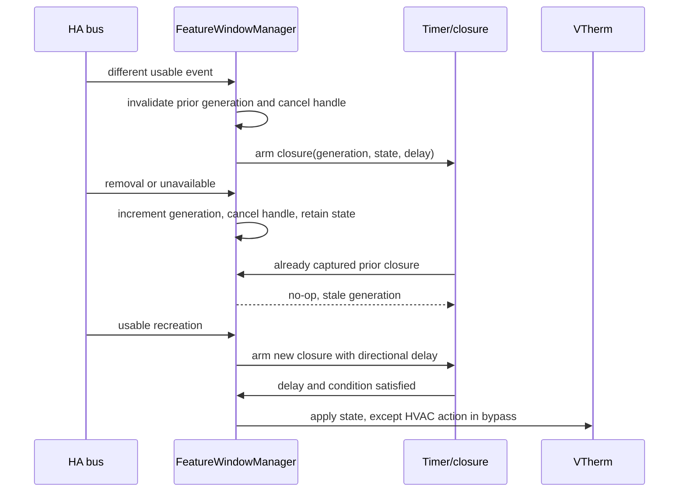

# Issue #2136 - Conception technique candidate / Candidate Technical Design

| Element      | Valeur                                                                                                                                                                                                                                                                                                                                                                                              |
| ------------ | --------------------------------------------------------------------------------------------------------------------------------------------------------------------------------------------------------------------------------------------------------------------------------------------------------------------------------------------------------------------------------------------------- |
| Statut       | Convergence technique candidate, validation humaine finale requise; developpement non autorise / Candidate technical convergence, final human approval required; development not authorized                                                                                                                                                                                                         |
| Cycle        | 2 sur 3 maximum / 2 of 3 maximum                                                                                                                                                                                                                                                                                                                                                                    |
| Version      | 0.2                                                                                                                                                                                                                                                                                                                                                                                                 |
| Date         | 2026-10-21                                                                                                                                                                                                                                                                                                                                                                                          |
| Proprietaire | Mainteneurs de Versatile Thermostat / Versatile Thermostat maintainers                                                                                                                                                                                                                                                                                                                              |
| Sources lues | [revue](issue-2136-review.md), [specification](issue-2136-specification.md), [gestionnaire](../../custom_components/versatile_thermostat/feature_window_manager.py), [tests manager](../../tests/test_window_feature_manager.py), [tests integration](../../tests/test_window.py), [aides](../../tests/commons.py), [cycle de vie](../../custom_components/versatile_thermostat/base_thermostat.py) |

## 1. Statut et perimetre / Status and Scope

Cette conception traite uniquement le cycle de vie du capteur explicite dans `FeatureWindowManager`: suppression, recreation, temporisations et listener. Elle ne constitue pas une autorisation de developper. / This design treats only the explicit-sensor lifecycle in `FeatureWindowManager`: removal, recreation, delays, and listener. It is not development authorization.

Hors perimetre / Out of scope: configuration, dependances, `template.reload`, refonte des managers, capteur auto par pente, politique d'indisponibilite durable, etude de `@callback` sur coroutine, et promesse de meilleures traces par retrait de ce decorateur / configuration, dependencies, `template.reload`, manager-wide refactoring, slope-based auto sensor, persistent-unavailability policy, review of `@callback` on a coroutine, and promised improved traces from removing that decorator.

| Controle / Check                                                      | Etat / Status                   | Justification / Rationale                                                                                                                                                                              |
| --------------------------------------------------------------------- | ------------------------------- | ------------------------------------------------------------------------------------------------------------------------------------------------------------------------------------------------------ |
| Meme perimetre / Same scope                                           | Oui / Yes                       | Capteur, timer et listener du gestionnaire partage seulement / Shared-manager sensor, timer, and listener only.                                                                                        |
| Couverture exigences et criteres / Requirements and criteria coverage | Oui / Yes                       | Matrice et scenarios couvrent FR-001 a FR-016, BR-001 a BR-010 et AC-001 a AC-014 / Matrix and scenarios cover FR-001 to FR-016, BR-001 to BR-010, and AC-001 to AC-014.                               |
| Absence de contradiction bloquante / No blocking contradiction        | Oui / Yes                       | La specification revisee borne le delai au flux evenementiel et conserve le refresh initial immediat / The revised specification bounds the delay to event flow and retains immediate initial refresh. |
| Faisabilite et testabilite / Feasibility and testability              | Oui / Yes                       | Listener, handle, closures et bus HA sont accessibles; tests de bus et de refresh distincts prevus / Listener, handle, closures, and HA bus are accessible; separate bus and refresh tests planned.    |
| Convergence declaree / Declared convergence                           | Oui, candidate / Yes, candidate | Accord technique avec la specification revisee; validation humaine finale non obtenue / Technical agreement with revised specification; final human approval not obtained.                             |

## 2. Faits, hypotheses et recommandations / Facts, Assumptions, Recommendations

### Faits verifies / Verified facts

- `post_init` appelle `dearm_window_timer`, puis remet `_window_state` a `unknown` si configure / `post_init` calls `dearm_window_timer`, then resets `_window_state` to `unknown` when configured.
- `start_listening` appelle `stop_listening` avant le listener; `stop_listening` annule le handle et desinscrit les listeners via `BaseFeatureManager` / `start_listening` calls `stop_listening` before its listener; `stop_listening` cancels the handle and unregisters listeners through `BaseFeatureManager`.
- `_window_sensor_changed` calcule `delay` avec `new_state.state` avant le garde contre `None`; la revue a reproduit l'exception / `_window_sensor_changed` computes `delay` from `new_state.state` before the `None` guard; the review reproduced the exception.
- La closure courante capture `new_state`, `old_state`, `delay`; les tests peuvent l'appeler apres `dearm_window_timer` / The current closure captures `new_state`, `old_state`, `delay`; tests can call it after `dearm_window_timer`.
- `dearm_window_timer` ne porte pas d'identite d'observation / `dearm_window_timer` has no observation identity.
- `refresh_state` ignore absence, `unknown`, `unavailable`, puis applique sans delai toute autre valeur; les tests verifies l'affirment / `refresh_state` ignores absence, `unknown`, `unavailable`, then immediately applies other values; verified tests assert it.
- Dans le code lu, le refresh des managers est appele a l'initialisation complete; le cycle interne ne refresh que les managers externes et celui de defaillance. Le callback fenetre n'appelle pas `refresh_state` / In code read, manager refresh runs at complete startup; the internal cycle refreshes only external and heating-failure managers. The window callback does not call `refresh_state`.
- Les tests actuels appellent directement callback et closure; aucun ne couvre encore `new_state=None` par bus HA / Existing tests call callback and closure directly; none yet cover `new_state=None` through the HA bus.

### Hypotheses limitees / Limited assumptions

- Une observation exploitable est un objet d'etat dont `state` n'est ni `unknown` ni `unavailable`. Cette conception ne cree pas de semantique pour les autres valeurs: seul `on` choisit le delai d'ouverture; les autres gardent le chemin existant de fermeture / A usable observation is a state object whose `state` is neither `unknown` nor `unavailable`. No semantics are invented for other values: only `on` chooses opening delay; other values keep the existing closing-delay path.
- La conservation vaut dans l'instance vivante. Elle ne peut etre promise a travers `post_init`, qui remet l'etat a `unknown` / Retention applies to the living instance and cannot be promised across `post_init`, which resets state to `unknown`.
- Le rechargement template ne semble pas appeler `refresh_state` dans le chemin statique lu. Le test de bus doit le confirmer pour ce flux, sans le generaliser a un redemarrage / Template reload does not appear to call `refresh_state` in the static path read. A bus test must confirm that flow without generalizing to a restart.

### Recommandations candidates / Candidate recommendations

1. Ajouter un compteur prive, volatil et non publie, `_window_observation_generation` / Add a private, volatile, unpublished `_window_observation_generation` counter.
2. Garder `dearm_window_timer` pour annuler seulement le handle: il ne doit pas incrementer le compteur, car `tests/commons.py` desarme le handle avant d'appeler volontairement la closure / Keep `dearm_window_timer` for handle cancellation only: it must not increment the counter because `tests/commons.py` disarms the handle before deliberately calling the closure.
3. Ajouter une operation interne d'invalidation: incrementer le compteur puis appeler `dearm_window_timer`. Elle vaut pour suppression, etat non exploitable, transition plus recente, `post_init` et `stop_listening` / Add an internal invalidation operation: increment counter then call `dearm_window_timer`. Use it for removal, unusable state, newer transition, `post_init`, and `stop_listening`.
4. Chaque closure planifiee capture sa generation et devient un no-op sans mutation si elle n'est plus courante / Every scheduled closure captures its generation and becomes a no-op without mutation when no longer current.
5. Retourner une closure async inoffensive sur les branches non planifiees. Cela preserve un contrat callable plus fort que FR-010 / Return a harmless async closure from non-scheduled branches. This preserves a callable contract stronger than FR-010.

## 3. Composants et donnees / Components and Data

| Composant / Component                    | Responsabilite / Responsibility                                                                                            | Exposition / Exposure                    |
| ---------------------------------------- | -------------------------------------------------------------------------------------------------------------------------- | ---------------------------------------- |
| Moteur HA / HA state engine              | Emet `EVENT_STATE_CHANGED`, avec etats eventuellement absents / Emits `EVENT_STATE_CHANGED`, with possibly missing states. | Externe / External                       |
| `FeatureWindowManager`                   | Valide, planifie, invalide et applique / Validates, schedules, invalidates, and applies.                                   | Instance vivante / Living instance       |
| `_window_state`                          | Dernier etat interne accepte; inchange pendant absence / Last accepted internal state; unchanged during absence.           | Attribut existant / Existing attribute   |
| `_window_call_cancel`                    | Annulateur du timer courant / Current timer canceller.                                                                     | Prive volatil / Private volatile         |
| `_window_observation_generation` propose | Identite monotone de closure / Monotonic closure identity.                                                                 | Prive, non publie / Private, unpublished |
| `update_window_state`                    | Chemin existant vers recalcul et HVAC hors bypass / Existing path to recalculation and HVAC outside bypass.                | Contrat conserve / Contract retained     |
| Bypass                                   | Enregistre l'etat valide sans action HVAC de fenetre / Records valid state without window HVAC action.                     | Attribut existant / Existing attribute   |

Le compteur ne doit etre ni persiste, ni restaure, ni ajoute aux attributs ou options / The counter must not be persisted, restored, exposed as an attribute, or made configurable.



## 4. Contrat evenementiel / Event Contract

Le handler doit definir sa closure avant toute branche de retour et ne lire un champ d'etat qu'apres verification de son objet / The handler must define its closure before every return branch and read a state field only after checking its object. La closure capture `expected_state`, `delay`, `generation`, non les etats eventuels / It captures `expected_state`, `delay`, `generation`, not optional event states. Apres les gardes d'absence et d'etat inexploitable, traiter d'abord les attributs seuls, puis comparer l'observation a `_window_state` / After missing and unusable-state guards, handle attributes-only events first, then compare the observation with `_window_state`.

| Entree / Input                                                                                                                                                                           | Mecanisme / Mechanism                                                                                                                                          | Effet attendu / Expected effect                                                                            |
| ---------------------------------------------------------------------------------------------------------------------------------------------------------------------------------------- | -------------------------------------------------------------------------------------------------------------------------------------------------------------- | ---------------------------------------------------------------------------------------------------------- |
| `new_state is None`, tout `old_state` / any `old_state`                                                                                                                                  | Invalider puis retourner no-op / Invalidate then return no-op.                                                                                                 | Etat conserve, handle annule, aucun attribut ou HVAC / Retain state, cancel handle, no attributes or HVAC. |
| `new_state` `unknown` ou `unavailable`                                                                                                                                                   | Meme invalidation sans fabriquer `off` / Same invalidation without manufacturing `off`.                                                                        | Aucun changement ni politique durable / No change and no persistent policy.                                |
| Retour exploitable egal a `_window_state`, avec ou sans `old_state`, hors attributs seuls / usable return equals `_window_state`, with or without `old_state`, excluding attributes-only | Reference = gestionnaire; invalider un timer contraire en attente, sinon no-op / Manager is baseline; invalidate a pending conflicting timer, otherwise no-op. | Ni nouveau timer, ni mutation d'etat ou HVAC / No new timer, state mutation, or HVAC.                      |
| Retour exploitable different de `_window_state`, avec ou sans `old_state` / usable return differs from `_window_state`, with or without `old_state`                                      | Allouer generation et armer / Allocate generation and arm.                                                                                                     | Reprise avec delai directionnel / Directional delayed resumption.                                          |
| Etats presents et egaux / states present and equal                                                                                                                                       | Attributs seuls: ni armer ni invalider / Attributes only: neither arm nor invalidate.                                                                          | Aucun effet induit / No induced effect.                                                                    |
| Etats HA presents, exploitables et differents, nouveau different de `_window_state` / HA states present, usable and different, new state differs from `_window_state`                    | Invalider precedent, allouer, armer / Invalidate prior, allocate, arm.                                                                                         | `on` -> delai on; autre -> chemin delai off / `on` -> on delay; other -> off-delay path.                   |

Contrat de la closure courante / Current-closure contract:

1. Verifier que sa generation est courante; sinon retourner sans mutation / Verify generation is current; otherwise return without mutation.
2. Appeler `condition.state` avec entite, etat et delai captures; `ConditionError` signifie faux / Call `condition.state` with captured entity, state, and delay; `ConditionError` means false.
3. Si faux, ne pas reecrire `_window_state` depuis `old_state` capture / If false, do not rewrite `_window_state` from captured `old_state`.
4. Si l'etat interne est deja celui capture, ne rien publier / If internal state already equals captured state, publish nothing.
5. Sinon, conserver bypass: memoriser et publier attributs sans HVAC; hors bypass, appeler `update_window_state` puis publier attributs / Otherwise, retain bypass semantics: record and publish attributes without HVAC; outside bypass, call `update_window_state` then publish attributes.

L'invalidation precede l'annulation. Une callback deja prete, y compris une closure capturee par un test, reste alors inerte / Invalidation precedes cancellation. A callback already ready, including a test-captured closure, therefore remains inert.

## 5. Cycle de vie et refresh / Lifecycle and Refresh

- `dearm_window_timer` conserve son contrat: appeler l'annulateur courant une fois puis remettre le handle a `None` / retains its contract: call the current canceller once then clear the handle.
- La suppression, `unknown`/`unavailable`, une transition plus recente, `post_init` et `stop_listening` utilisent l'invalidation ciblee, pas la seule annulation / Removal, `unknown`/`unavailable`, a newer transition, `post_init`, and `stop_listening` use targeted invalidation, not cancellation alone.
- `stop_listening` invalide avant desinscription; `post_init` invalide avant sa reinitialisation actuelle. `start_listening` reste responsable de l'unicite par stop puis ajout / `stop_listening` invalidates before unregistration; `post_init` before its current reset. `start_listening` remains responsible for uniqueness by stopping then adding.

### Contrat de `refresh_state` et flux evenementiel / `refresh_state` and event-flow contract

Le code et les tests verifies etablissent que `refresh_state` ignore absence, `unknown` et `unavailable`, et applique immediatement une valeur exploitable a l'initialisation complete. Il n'est appele ni dans le callback fenetre ni dans le cycle interne courant / Verified code and tests establish that `refresh_state` ignores absence, `unknown`, and `unavailable`, and immediately applies a usable value at complete startup. It is called neither from the window callback nor from the current internal cycle.

La specification revisee (FR-016, BR-007, BR-010, AC-012) borne la garantie de delai au flux evenementiel de retrait, etat inexploitable et recreation: ce flux ne doit pas appeler `refresh_state`; un retour exploitable different attend son delai directionnel. L'application immediate d'initialisation reste inchangee. Un test de bus espionne `refresh_state` (zero appel); les tests distincts du refresh initial verifient valeur exploitable immediate et absence/`unknown`/`unavailable` ignores / The revised specification (FR-016, BR-007, BR-010, AC-012) limits the delay guarantee to the removal, unusable-state, and recreation event flow: that flow must not call `refresh_state`; a different usable return waits for its directional delay. Immediate initialization application is unchanged. A bus test spies on `refresh_state` (zero calls); separate initial-refresh tests verify immediate usable value and ignored absence/`unknown`/`unavailable`.

## 6. Flux et erreurs / Flows and Errors

| Flux / Flow                                                                              | Resultat propose / Proposed result                                                                                                                                                                                                           |
| ---------------------------------------------------------------------------------------- | -------------------------------------------------------------------------------------------------------------------------------------------------------------------------------------------------------------------------------------------- |
| `off` confirme, suppression, recreation `on` / confirmed `off`, removal, `on` recreation | Suppression conserve `off`, invalide; recreation arme delai on; une application apres condition / Removal retains `off`, invalidates; recreation arms on delay; one application after condition.                                             |
| `on` confirme, suppression, recreation `off` / confirmed `on`, removal, `off` recreation | Symetrique avec delai off / Symmetric with off delay.                                                                                                                                                                                        |
| Recreation meme etat / same-state recreation                                             | Ni timer, ni HVAC / No timer or HVAC.                                                                                                                                                                                                        |
| Timer on/off puis suppression / on/off timer then removal                                | Handle annule et ancienne closure inerte / Handle cancelled and old closure inert.                                                                                                                                                           |
| Timer puis `unknown`/`unavailable` / timer then unknown/unavailable                      | Timer invalide, etat conserve; retour different temporise, retour identique sans effet meme avec `old_state` present / Timer invalid, state retained; different return delayed, matching return has no effect even with `old_state` present. |
| Transition plus recente / newer transition                                               | Seule la closure de generation courante agit / Only current-generation closure acts.                                                                                                                                                         |
| Attributs seuls / attributes only                                                        | Aucun nouveau timer; timer valide reste valable / No new timer; valid timer remains valid.                                                                                                                                                   |
| Bypass                                                                                   | Apres delai, etat et attributs, aucune action HVAC de fenetre / After delay, state and attributes, no window HVAC action.                                                                                                                    |
| `post_init` ou stop                                                                      | Toutes closures anterieures muettes; aucun listener apres stop / All prior closures silent; no listener after stop.                                                                                                                          |

`ConditionError` reste une condition fausse. Aucune nouvelle politique d'indisponibilite et aucune promesse liee a `@callback` ne sont introduites / `ConditionError` remains a false condition. No new unavailability policy or `@callback` promise is introduced.

## 7. Observabilite, securite et exploitation / Observability, Security, Operations

- Les interpolations de journal restent sures si `new_state` est absent / Log interpolation remains safe when `new_state` is absent.
- Aucun attribut diagnostic, secret, permission, service externe ou donnee personnelle ne sont ajoutes / No diagnostic attribute, secret, permission, external service, or personal data is added.
- Cette conception ne demarre pas HA et ne recharge pas de template / This design starts no HA instance and reloads no template.

## 8. Strategie de tests / Test Strategy

Les nouveaux tests privilegient le bus: apres `start_listening`, emettre `EVENT_STATE_CHANGED` avec `hass.bus`, puis attendre `hass.async_block_till_done()`. Un scheduler simule capture closures et annulateurs; `condition.state` est controle sans attente reelle / New tests prefer the bus: after `start_listening`, fire `EVENT_STATE_CHANGED` through `hass.bus`, then await `hass.async_block_till_done()`. A fake scheduler captures closures and cancellers; `condition.state` is controlled without real waiting.

| Fichier / File                         | Scenario                                                                                                                                                                                                                                   | Assertions                                                                                                                                                                                                                                                                                                                          |
| -------------------------------------- | ------------------------------------------------------------------------------------------------------------------------------------------------------------------------------------------------------------------------------------------ | ----------------------------------------------------------------------------------------------------------------------------------------------------------------------------------------------------------------------------------------------------------------------------------------------------------------------------------- |
| `tests/test_window_feature_manager.py` | `new_state=None`, `old_state` present puis absent / present then absent.                                                                                                                                                                   | Pas d'exception, etat conserve, annulateur appele, aucun update HVAC/attribut / No exception, retained state, canceller called, no HVAC/attribute update.                                                                                                                                                                           |
| Meme / Same                            | `unknown` et `unavailable` durant timer on et off, puis retour exploitable identique ou different, `old_state` present ou absent / during on and off timers, then matching or different usable return, with present or absent `old_state`. | Annulation et closure capturee inerte, etat conserve; retour identique sans mutation, different temporise / Cancellation and captured closure inert, state retained; matching return without mutation, different return delayed.                                                                                                    |
| Meme / Same                            | Recreation `old_state=None`, egale puis differente / same then different.                                                                                                                                                                  | Aucun timer puis timer et changement unique / No timer, then timer and single change.                                                                                                                                                                                                                                               |
| Meme / Same                            | Delais on et off distincts / distinct on and off delays.                                                                                                                                                                                   | `async_call_later` recoit les deux `timedelta` / receives both `timedelta` values.                                                                                                                                                                                                                                                  |
| Meme / Same                            | Transition, suppression ou stop apres capture / transition, removal, or stop after capture.                                                                                                                                                | Ancienne closure sans etat, attribut, HVAC; seule la courante agit / Old closure changes no state, attribute, HVAC; only current acts.                                                                                                                                                                                              |
| Meme / Same                            | Timer vers etat oppose, puis nouvel etat exploitable egal a l'etat confirme / Timer toward opposite state, then new usable state equals confirmed state.                                                                                   | Timer contraire invalide, closure inerte; pas de nouveau timer, changement d'etat ou HVAC / Conflicting timer invalidated, closure inert; no new timer, state change, or HVAC.                                                                                                                                                      |
| Meme / Same                            | Attributs seuls avec timer actif / attributes only with active timer.                                                                                                                                                                      | Aucun scheduler supplementaire; closure initiale encore valide / No extra scheduler; initial closure still valid.                                                                                                                                                                                                                   |
| Meme / Same                            | Bypass, puis transition valide / bypass, then valid transition.                                                                                                                                                                            | Etat/attributs apres delai, sans HVAC de `update_window_state`; reset des mocks apres activation / State/attributes after delay, no HVAC from `update_window_state`; reset mocks after enabling bypass.                                                                                                                             |
| Meme / Same                            | `post_init`, `start_listening` repete, stop / repeated start, stop.                                                                                                                                                                        | Une emission bus = une planification; zero apres stop; anciennes closures inertes / One bus emission = one schedule; zero after stop; old closures inert.                                                                                                                                                                           |
| Meme / Same                            | Flux bus et refresh initial distincts / separate bus flow and initial refresh.                                                                                                                                                             | Sequence bus = zero appel `refresh_state`, retour different temporise; refresh initial exploitable immediat et absence/`unknown`/`unavailable` ignores / Bus sequence = zero `refresh_state` calls, different return delayed; usable initial refresh immediate and absence/`unknown`/`unavailable` ignored.                         |
| `tests/test_window.py`                 | Thermostat reel, action fenetre, retrait/recreation et closure capturee / real thermostat, window action, removal/recreation, captured closure.                                                                                            | Aucune nouvelle commande HVAC injustifiee par retrait ou closure obsolete (sans forcer l'arret d'un chauffage en cours); une action attendue apres delai dans les deux sens / No new unjustified HVAC command from removal or stale closure (do not force ongoing heating off); one expected action after delay in both directions. |
| Meme / Same                            | Bypass et rechargements logiques repetes par bus / bypass and repeated logical bus reloads.                                                                                                                                                | Pas de HVAC bypassse, pas de double effet de listener / No bypassed HVAC, no duplicate listener effect.                                                                                                                                                                                                                             |

Validation prevue, non executee durant cette phase / Planned validation, not executed in this design phase:

```bash
pytest tests/test_window_feature_manager.py tests/test_window.py
```

## 9. Matrice exigences -> mecanismes -> tests / Requirements -> Mechanisms -> Tests

| Exigences / Requirements                          | Mecanisme / Mechanism                                                                                                                                                                                                                          | Tests                                                                                                                                                                                       |
| ------------------------------------------------- | ---------------------------------------------------------------------------------------------------------------------------------------------------------------------------------------------------------------------------------------------- | ------------------------------------------------------------------------------------------------------------------------------------------------------------------------------------------- |
| FR-001, AC-001                                    | Garde avant acces `state`, no-op / Guard before `state` access, no-op.                                                                                                                                                                         | Suppression bus avec `old_state` present/absent / Bus removal with present/absent `old_state`.                                                                                              |
| FR-002, BR-001 a BR-002, AC-001                   | Pas d'ecriture etat pendant absence / No state write during absence.                                                                                                                                                                           | Etat conserve, pas HVAC / Retained state, no HVAC.                                                                                                                                          |
| FR-003, FR-008 a FR-009, BR-003, AC-007 a AC-008  | Generation capturee, invalidation puis annulation / Captured generation, invalidation then cancellation.                                                                                                                                       | Invocation directe closure obsolete / Direct stale-closure invocation.                                                                                                                      |
| FR-004 a FR-007, BR-004 a BR-007, AC-002 a AC-006 | Baseline manager, reprise temporisee, delai directionnel / Manager baseline, delayed resumption, directional delay.                                                                                                                            | `old_state=None`, identique/different, on/off / same/different, on/off.                                                                                                                     |
| FR-010, AC-013                                    | Closure async callable et no-op callable / Callable async closure and callable no-op.                                                                                                                                                          | Appels directs voisins conserves / Neighboring direct calls retained.                                                                                                                       |
| FR-011, BR-008, AC-009                            | Bypass apres token et condition / Bypass after token and condition.                                                                                                                                                                            | Etat/attributs sans HVAC / State/attributes without HVAC.                                                                                                                                   |
| FR-012, AC-010                                    | Etats egaux n'arment ni invalident / Equal states neither arm nor invalidate.                                                                                                                                                                  | Attributs seuls avec/sans timer / Attributes only with/without timer.                                                                                                                       |
| FR-013 a FR-015, AC-011                           | Invalidation, stop/start, bus reel / Invalidation, stop/start, actual bus.                                                                                                                                                                     | Repetitions, une planification, aucune action injustifiee / Repetition, one schedule, no unjustified action.                                                                                |
| FR-003, FR-009, BR-003, BR-009, AC-014            | `unknown`/`unavailable` invalident timer et generation; retour compare a l'etat manager meme si `old_state` present / `unknown`/`unavailable` invalidate timer and generation; return compared with manager state even if `old_state` present. | Timers on/off, callbacks obsoletes, retour identique/different avec `old_state` present/absent / On/off timers, stale callbacks, matching/different return with present/absent `old_state`. |
| FR-016, BR-007, BR-010, AC-012                    | Aucun refresh depuis flux bus; contrat immediat initial conserve / No refresh from bus flow; immediate initial contract retained.                                                                                                              | Espion bus et tests de refresh initial / Bus spy and initial refresh tests.                                                                                                                 |

## 10. Questions, risques et decision / Questions, Risks, Decision

### Points resolus par la specification revisee / Resolved by revised specification

1. FR-016/BR-007/BR-010/AC-012 bornent le delai au bus et conservent le refresh immediat initial / FR-016/BR-007/BR-010/AC-012 limit the delay to the bus and retain immediate initial refresh.
2. `unknown` et `unavailable` invalident le timer sans modifier le dernier etat; AC-014 couvre le retour exploitable / `unknown` and `unavailable` invalidate the timer without changing the last state; AC-014 covers usable recovery.
3. FR-010/AC-013 imposent une closure async callable et no-op pour branches ignorees; FR-002 et FR-014 bornent conservation et unicite du listener / FR-010/AC-013 require a callable async closure and no-op for ignored branches; FR-002 and FR-014 bound retention and listener uniqueness.

### Choix techniques candidats soumis a validation finale / Candidate technical choices pending final approval

- Generation privee distincte de `dearm_window_timer`, invalidation avant annulation, no-op async sur branches ignorees, et comparaison au dernier etat du manager au retour exploitable, quel que soit `old_state` / Private generation separate from `dearm_window_timer`, invalidate before cancellation, async no-op on ignored branches, and compare usable return to the manager's last state regardless of `old_state`.
- Conservation limitee a l'instance vivante hors `post_init`; unicite du listener avec configuration deja appliquee; timer valide preserve sur attributs seuls / Retention limited to the living instance outside `post_init`; listener uniqueness with already-applied configuration; valid timer retained on attributes-only events.
- Aucune question technique bloquante identifiee dans ce perimetre; ces choix et les documents attendent la validation humaine explicite finale, non obtenue. Aucun developpement autorise / No blocking technical question identified in this scope; these choices and documents await explicit final human approval, not yet obtained. No development authorized.

### Risques controles / Controlled risks

- Incrementation dans `dearm_window_timer` seul: rejetee, car elle invalide la closure que les tests desarment avant appel / Incrementing only in `dearm_window_timer`: rejected because it invalidates closures tests disarm before calling.
- Annulation sans generation: insuffisante, car une closure capturee peut agir / Cancellation without generation: insufficient because a captured closure can still act.
- Absence transformee en `off`: rejetee, car HVAC pourrait agir sans mesure / Absence converted to `off`: rejected because HVAC could act without a measure.

### Risques residuels et limites des sources / Residual risks and source limits

- Le flux `template.reload` et la non-duplication du listener sont deduits du code lu, pas verifies par un test de bus ou un essai HA dans cette phase; la suite de tests et un essai autorise restent a faire apres validation / The `template.reload` flow and listener uniqueness are inferred from code read, not verified by a bus test or HA run in this phase; tests and an authorized trial remain after approval.
- Le rapport ne fournit ni journal complet ni version HA exacte; l'origine de la huitieme erreur et l'effet de `@callback` sur les traces ne sont pas etablis et restent hors perimetre / The report provides neither a full log nor an exact HA version; the eighth error's origin and `@callback`'s effect on traces are unverified and remain out of scope.
- Retrait de `@callback`: hors perimetre; aucune amelioration de trace promise / Removing `@callback`: out of scope; no tracing improvement promised.