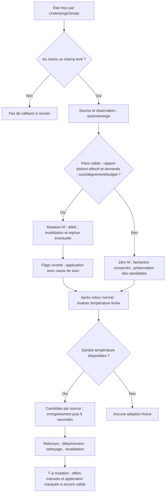

# Issue #2141 / correctif #2159 — Conception technique v3.6 / Technical design v3.6

## Français

### 1. Métadonnées, sources et statut

| Métadonnée               | Valeur                                                                                                                                                                   |
| ------------------------ | ------------------------------------------------------------------------------------------------------------------------------------------------------------------------ |
| Version / date           | **3.6 — 2026-10-31**, remplace la conception candidate v3.5 du 2026-10-29                                                                                                |
| Propriétaire             | Mainteneurs de Versatile Thermostat ; validation humaine distincte de cette analyse                                                                                      |
| Statut                   | **Conception alignée sur les spécifications v3.6 et l'implémentation actuelle lue**, sans certification applicative ou matérielle                                        |
| Référentiel fonctionnel  | [Spécification FR v3.6](issue-2141-specification_fr.md) et [EN v3.6](issue-2141-specification_en.md), lues intégralement : 17 FR, 15 BR, 40 AC, retraits/différés inclus |
| Sources historiques      | [Revue #2159](issue-2159-review.md), [rapport post-développement](issue-2159-post-dev-review.md), lus intégralement ; conception v3.5 d'entrée                           |
| État courant             | Dépôt à `458cbbc`, avec modifications préexistantes des deux spécifications conservées ; sources de production et deux fichiers de tests actuels lus en lecture seule    |
| Périmètre de cette passe | **Ce seul document**, bilingue à l'emplacement existant explicitement demandé ; aucun code, test, configuration, spécification, rapport, dépendance ou état HA modifié   |

**Autorité :** décision utilisateur E-1 et Q-05/Q-11/Q-12 → spécifications FR/EN v3.6 → conception → rapports historiques. **H** = attente historique maintenue, pas nécessairement satisfaite ; **E** = fait actuel vérifié en lecture ; **C** = exigence/conception d'origine #2159, **pas** synonyme d'absence actuelle d'implémentation ; **NR** = non-régression à vérifier ; **R** = retiré/différé. Une présence de test n'est pas une réussite. **Aucun test applicatif exécuté dans cette passe.** Les résultats anciens du rapport concernent son commit `98e5524`, pas le code courant.

Consignes Home Assistant consultées : guide général et contrôle des équipements ; identifiants d'entité et distinction commande/observation. Aucun helper, automation, AppDaemon ou modèle Jinja à créer. La version anglaise ci-dessous reprend la même structure, les mêmes décisions, correspondances et limites dans ce document unique.

### 2. Objectif, périmètre et exigences couvertes

Documenter le correctif local effectif : qualification de la transition HVAC livrée, source conservée, alignement, garde partagée, débits d'adoption et cause de suivi ; **E-1 ajoute explicitement le refus du mode égal à l'effectif, même si la demande diffère**. Un mode différent de l'effectif et de la demande reste admissible sous les autres gardes, y compris avec `new_hvac_mode=None` sur un callback effectivement livré. Aucun callback absent n'est recréé.

Le périmètre de production #2159 reste **strictement `ThermostatOverClimate`** dans [thermostat_climate.py](../../custom_components/versatile_thermostat/thermostat_climate.py). Le socle #2141 interclasses reste réutilisé sans rapatriement ni modification de contrat : base, underlyings, scheduler, priorités et gestionnaire temporisé. L'héritage de la variante vanne n'autorise pas sa réécriture. La lecture de ces dépendances n'élargit pas le périmètre de modification.

**Décisions conservées :** Q-01 consigne manuelle/`NONE`/override annulé sans restauration ni nouveau timer, y compris OFF ; Q-02 référence historique du dernier envoi par source, prudence, cinq secondes et réarmement externe ; Q-03 suivi admissible sans envoi préalable. Q-05 : **un seul compteur existant partagé par VTherm**, seuil 3, cumul de **M** (mutation mode demandée), **T** (mutation température demandée) et **S** (tentative `climate` marquée atteignant son débit). M/T/S sont des notations, pas trois compteurs. Q-12 : mode/application puis évaluation/enregistrement éventuel de température, cinq secondes depuis cet enregistrement. Q-11 : **aucune exigence OFF supplémentaire au seuil**, exemption, livraison garantie, blocage ou preuve d'arrêt matériel ; aucune acceptation générale du danger attribuée à l'utilisateur.

Pas de nouvelle politique de température/cache/pas/clamp/unités/déduplication, second budget, réservation, remboursement, timer, configuration, `TrackingChain`, E1/E2, propriétaire de pause ou garantie universelle de livraison/provenance/arrêt. O-01 et Q-07 à Q-09 restent retirés.

### 3. Existant vérifié et dépendances

| Source actuelle lue                                                                                                                                                           | Fait vérifié / frontière                                                                                                                                                                                                                                                                                                                         |
| ----------------------------------------------------------------------------------------------------------------------------------------------------------------------------- | ------------------------------------------------------------------------------------------------------------------------------------------------------------------------------------------------------------------------------------------------------------------------------------------------------------------------------------------------ |
| [Réception amont](../../custom_components/versatile_thermostat/underlyings.py#L793-L850)                                                                                      | `UnderlyingClimate._underlying_changed` appelle son parent puis filtre indépendamment mode, action, température et fan. Mode égal au mode HA VTherm : paramètre nul ; tous champs nuls : aucun callback. Température inchangée/hors plage filtrée. `new_state=None` intercepté en amont. Le retour du parent ne termine pas à lui seul l'enfant. |
| [Callback local](../../custom_components/versatile_thermostat/thermostat_climate.py#L753-L882)                                                                                | `under` reste la source ; boucle via `other_under`. Observation température avant application ; action/énergie, admission mode, fan ; finalisation marquée seulement si mode réellement adopté, puis température livrée. Comparaison explicite à l'effectif **et** à la demande.                                                                 |
| [Adoption commune](../../custom_components/versatile_thermostat/thermostat_climate.py#L884-L917)                                                                              | `_adopt_underlying_value` capture avant/après setter, compte la mutation retenue même si le setter assigne puis lève, conserve l'erreur primaire et invalide les anciennes candidates pour M.                                                                                                                                                    |
| [Candidates et nettoyage](../../custom_components/versatile_thermostat/thermostat_climate.py#L919-L1110)                                                                      | Qualification numérique/cache/pas, délai 5 s, version/snapshot, relecture HA ; détachement puis nettoyage/revalidation ; annulation override sans restauration et adoption T ; annulations bornées du lot détaché.                                                                                                                               |
| [Budget et réarmement](../../custom_components/versatile_thermostat/thermostat_climate.py#L1112-L1161)                                                                        | Garde : non suspendu **et** total < 3. Incrément, motif, suspension/annulation dès 3, diagnostic de débit ; réarmement existant après annulation des candidates.                                                                                                                                                                                 |
| [Setters](../../custom_components/versatile_thermostat/vtherm_state.py#L59-L104)                                                                                              | Affectations/flags synchrones ; `force_changed()` ne restaure aucune valeur. Les corps lus n'appellent ni service ni tâche ; l'absence de `await` seule ne prouverait pas cela.                                                                                                                                                                  |
| [Application](../../custom_components/versatile_thermostat/base_thermostat.py#L1781-L1855)                                                                                    | `update_states` conserve cause et option de préservation, calcule/publie l'effectif, appelle underlyings/contrôle puis remet les flags à zéro. Retour `False` possible si non prêt.                                                                                                                                                              |
| [Priorités](../../custom_components/versatile_thermostat/state_manager.py#L93-L210)                                                                                           | Inhibition, central, sécurité, fenêtre et auto-start/stop séparent demande/effectif ; une fenêtre OFF peut donner demande HEAT/effectif OFF. La branche frost ne justifie pas une fixture fenêtre demande OFF/effectif HEAT.                                                                                                                     |
| [Tentative HVAC](../../custom_components/versatile_thermostat/underlyings.py#L644-L702), [température](../../custom_components/versatile_thermostat/underlyings.py#L941-L994) | Gardes et débits S marqués restent indépendants de M/T ; no-op avant débit = zéro S. Débit avant service, sans remboursement si échec ; renvoi TRVZB à 2 s conserve la cause capturée.                                                                                                                                                           |
| [Gestionnaire temporisé](../../custom_components/versatile_thermostat/feature_timed_preset_manager.py#L279-L431)                                                              | Pause ; reprise à échéance future ou tâche d'expiration si échue ; restauration/reprise preset puis application non marquée. `cancel_without_revert()` reset sans restauration.                                                                                                                                                                  |
| [Variante vanne](../../custom_components/versatile_thermostat/thermostat_climate_valve.py#L457-L471)                                                                          | Délégation au callback hérité hors recalibrage ; services `number`/cycles non universellement couverts par ce budget.                                                                                                                                                                                                                            |

Les deux fichiers [test_issue_2159.py](../../tests/test_issue_2159.py) (255 lignes) et [test_issue_2159_additional.py](../../tests/test_issue_2159_additional.py) (777 lignes) ont été lus intégralement dans leur état actuel, sans écrasement des modifications utilisateur. Les autres constats historiques D-01/D-02/D-04/D-05/D-08/D-10 gardent leur provenance et leurs limites (§10) : pas d'audit complet des plugins, de HA installé, des caches, de la réparation ou du scheduler dans cette passe.

### 4. Vue d'ensemble et responsabilités

| Composant existant                                     | Responsabilité effective                                                                                                                |
| ------------------------------------------------------ | --------------------------------------------------------------------------------------------------------------------------------------- |
| `UnderlyingClimate._underlying_changed`                | Filtrage/livraison ; aucune garantie de livraison exhaustive                                                                            |
| `ThermostatOverClimate.underlying_changed`             | Source, observation, action/énergie, admission HVAC E-1, fan, cause et ordre mixte ; pas de retour global pour un simple refus mode     |
| `_adopt_underlying_value`                              | Mutation retenue, débit unique M/T et invalidation M, erreur primaire sans compensation                                                 |
| `_consider_underlying_temperature_candidate` / clôture | Qualification, enregistrement/5 s, état vivant et arbitrage, effets manuels y compris T-FALSE                                           |
| Garde / hook existants                                 | Total mixte M/T/S et suspension commune ; tentatives aval inchangées                                                                    |
| Annulations locales / gestionnaire temporisé           | Détachement/nettoyage du lot ; reprise immédiate existante si aucune candidate ne requiert la pause ; pas d'attente jusqu'à la fin HVAC |

Le fan est traité avant la finalisation dans les deux branches. « Préservation » concerne le seul refus HVAC : un autre motif propre à la température ou une intention plus récente peut légitimement annuler une candidate. Le diagramme n'est pas une transaction ; erreurs et annulations peuvent interrompre les suites, notamment F→H.

### 5. Modèle d'entités, données, états et persistance

Aucune nouvelle entité, option, migration ou persistance. Identité : objet `under` et `entity_id` configuré du climate source, jamais `device_id`. Distinguer demande (`requested_state`), effectif (`vtherm_hvac_mode`/état courant), publication HA et observation TRV ; aucune de ces valeurs ne prouve l'état physique.

Données locales existantes : `_underlying_temperature_observed`, statuts par source, candidates `{temperature, version, cancel, state_snapshot}`, version globale, `_underlying_tracking_attempts`, suspension/motif. Snapshot : mode/température/preset demandés puis effectifs. L'état du budget démarre à zéro/non suspendu sur nouvelle instance ; aucune nouvelle restauration du budget/candidates. Les mécanismes de restauration des presets existants ne sont pas redéfinis. Marqueur transitoire M/T : `{adoption, value, invalidation_started}` ; il n'est ni un compteur ni un journal durable.

| État livré                                                                   | Admission mode, sous gardes propres restantes                                                                |
| ---------------------------------------------------------------------------- | ------------------------------------------------------------------------------------------------------------ |
| New absent en amont, inconnu/indisponible en local                           | Pas d'adoption ; annulations existantes conservées                                                           |
| Old absent/invalide, identités non concordantes ou modes old/new identiques  | Zéro M ; pas de nouveau filtre global température                                                            |
| Transition valide même source, rapport = effectif, demande différente ou non | **Refus E-1**, zéro M et aucune invalidation due à ce seul refus, même paramètre non nul                     |
| Rapport ≠ effectif mais = demande                                            | No-op demandé, zéro M                                                                                        |
| Rapport ≠ effectif et ≠ demande, transition valide                           | Admissible si suivi, alignement et budget passent, premier callback compris ; paramètre nul non éliminatoire |
| Callback entièrement filtré                                                  | Aucun traitement local ; ne pas le synthétiser                                                               |

La configuration symétrique demande OFF/effectif HEAT est une fixture isolée de comparaison, pas un effet de fenêtre/frost revendiqué. Old/new permettent certaines distinctions d'initialisation/reprise, pas la provenance humaine ni toutes les restaurations ressemblant à une transition.

### 6. Interfaces, événements et contrats d'échange

#### 6.1 Callback et admission HVAC E-1

Signature inchangée : `underlying_changed(under, new_hvac_mode, new_hvac_action, new_target_temp, new_fan_mode, new_state, old_state)`. Paramètres de champ nuls = filtrés/non livrés ; `old_state` peut être absent malgré l'annotation, `new_state` est présent au point local sous le contrat amont. `new_hvac_mode` n'est pas la seule autorité : le code qualifie la paire livrée et convertit `new_state.state` après vérification des modes reconnus (`off`, `heat`, `cool`, `auto`, `dry`, `fan_only`, `heat_cool`, `sleep`). Pas de reconstruction de température filtrée depuis les attributs bruts.

**Conditions cumulatives :** identité old = source = new ; modes valides différents ; suivi actif ; autres TRV alignés sur l'**effectif actuel** (non sur le mode futur) ; rapport différent de l'effectif **et** de la demande ; `_can_send_underlying_tracking_command()` vrai. La comparaison à l'effectif utilise l'état vivant à l'admission. Ni délai HVAC ni commande antérieure exigée. Exiger seulement `new_hvac_mode is not None` serait **incorrect** : cela exclurait le sous-cas nul/différent autorisé par AC-019.

Admis : mutation M → débit → invalidation anciennes candidates/reprise immédiate → flags reposés → `update_states(_command_cause=COMMAND_CAUSE_UNDERLYING_TRACKING)`. Refus : aucun setter/débit M, aucune cause HVAC artificielle/invalidation due à ce seul motif ; action/fan/observation/température livrée gardent leurs propres règles. Si action/fan nécessitent application : `force_changed()` puis `update_states(_preserve_underlying_temperature_candidates=True)`. Aucun appel à une entrée publique réarmante pour une adoption.

#### 6.2 Mutation, comptage et idempotence locale

`_adopt_underlying_value(entity_id, kind, value)` interne utilise `kind="mode"` ou `"temperature"`. Il capture la valeur demandée avant setter et relit après succès **ou exception** : adopté seulement si `before != value` et valeur retenue = valeur qualifiée. Une mutation retenue débite une fois via `_record_underlying_tracking_command(entity_id, marker)`. Setter inchangé/échec avant assignation : zéro M/T ; assigne-puis-lève : +1, nettoyage engagé, erreur primaire relancée, pas de suite normale. Aucun rollback, remboursement, retry du hook ou réservation d'une S.

`invalidation_started` évite une seconde invalidation M lorsque le hook l'a déjà engagée au seuil ; avant le seuil, M invalide aussi les anciennes candidates après débit. Une panne de hook/nettoyage/log n'annule pas les faits déjà acquis. Le marqueur réel n'a pas de champ « entrée de débit atteinte » supplémentaire : l'ancien mécanisme de phases proposé en v3.5 ne doit pas être décrit comme une API implémentée. L'observation avant/après n'est pas une trace universelle des mutations cachées dans une substitution arbitraire du setter.

`_can_send_underlying_tracking_command()` = non suspendu **et** total < 3 ; suspension vraie avec total 2 et total 3 avec suspension fausse refusent tous deux. Le hook incrémente, fixe motif/suspension puis annule au seuil. **Troisième S déjà admise :** chemin service existant poursuivi si aucun échec ne l'interrompt. **Troisième M/T :** mutation retenue, suspension immédiate, S rencontrant ensuite la garde refusée ; aucun envoi garanti. Chaque destination/renvoi S réellement atteint compte séparément. Doublon mode sans mutation = zéro M, pas une garantie de zéro service global. T-FALSE reste volontairement un chemin manuel, pas un no-op global.

#### 6.3 Température et événement mixte

Observation source conservée avant l'attente de l'application. Si M est adoptée, retour **normal** de l'application d'abord, puis évaluation/enregistrement éventuel de la température **livrée** avec références/gardes résultantes. Retour normal `False` n'interdit pas à lui seul cet examen ; exception/annulation empêche la suite normale. Pas de `finally` garantissant T, de livraison indépendante ou FIFO universel. Le refus mode laisse cet examen possible mais ne contourne pas la suspension partagée.

Qualification E inchangée : numérique fini non booléen ; cache égal → écho ; écart non nul ≤ pas retourné → ambigu ; sans pas, distinct candidat (divergence historique D-02). Même valeur déjà candidate : pas de prolongation ; nouvelle valeur : version/snapshot, pause preset, callback à **enregistrement + 5 s**. À échéance : relecture HA `temperature`, référence/pas, snapshot, suivi, budget, absence de version plus récente.

Clôture : détacher la candidate ; nettoyer les autres sans reprise ; revalider état/version/collection avant d'annuler l'override sans restauration et revalider après ; mutation/débit T ; vérifier encore version/collection/snapshot attendu avant effets restants. Si encore valide : `NONE`, flags, statut `accepted`, application `force=True` marquée puis publication. À seuil, ne pas écraser le motif `attempt_limit_reached` par `candidate_adopted`. Une intention/candidate plus récente empêche de rejouer un ancien état demandé.

**T-FALSE :** candidate égale à la demande mais admissible vis-à-vis du cache/autres gardes : zéro T, **sans supprimer** annulation override sans restauration/nouveau timer, `NONE` et application marquée conservées. Aucun retour anticipé sur l'égalité. Chaque S réellement atteinte par cette application reste débitée, peut porter le total à 3 et suspendre. Rejet compatible/ambigu, candidate simplement en attente ou annulée et attribut seul : zéro adoption ; ils ne doivent pas être confondus avec ce chemin manuel admis.

| Total initial / suite conditionnelle sans réentrance | Oracle                                                              |
| ---------------------------------------------------- | ------------------------------------------------------------------- |
| 0 : M puis aucune S mode, T distincte                | 1 puis 2 ; une S température atteinte porterait à 3                 |
| 1 : M puis aucune S mode, T distincte                | 2 puis 3 ; T retenue, garde S suivante fermée                       |
| 2 : M                                                | 3 ; M retenue, nouvelle candidate T et S aval refusables            |
| 0 : M puis S vers B puis S vers C nécessaires        | 3 ; alignement partiel possible, T empêchée                         |
| 2 : T-FALSE puis S réellement atteinte               | Zéro T ; S 2→3, effets manuels conservés                            |
| 0/1/2 : rapport = effectif, aucun autre effet débité | Total inchangé, demande préservée ; autres champs sous leurs gardes |

Ces calculs sont des oracles conditionnels, **pas des exécutions** ni des promesses de services.

#### 6.4 Réentrance, événements et reprise — L-0R

Le choix L-0R de v3.5 est présent dans les chemins lus : conserver `resume_expiration()` immédiatement au nettoyage si aucune candidate actuelle ne nécessite la pause, **sans attendre** l'application HVAC. Candidate pausant un preset échu → reprise → tâche d'expiration → restauration/reprise preset et `update_states(force=True)` non marqué possibles avant finalisation. Le démarrage eager de HA 2026.8.2 est un constat antérieur ; les tests actuels contiennent des oracles eager/différé, **non exécutés ici**. L'absence de `await` dans l'appelant ne prouve pas l'atomicité.

M/débit précèdent la reprise ; après celle-ci, reposer les flags, appliquer l'état vivant, ne rejouer ni setter ni débit ni ancien preset. T admise annule normalement le manager sans restauration avant mutation ; revalidation locale couvre un remplacement réentrant. Les événements temporisés `end`/`start` et HVAC/preset de l'application restent ceux des contrats existants, sans nouveau schéma ni service. Une application d'expiration non marquée n'est pas une adoption suivie M/T ; ses services éventuels ne sont pas magiquement couverts par S.

Supprimer la reprise, la retarder après HVAC ou substituer une annulation sans restauration sur tout M pourrait perdre une échéance/restauration légitime ; ces alternatives ne sont pas retenues. Pas de verrou global, transaction, nouveau propriétaire de pause ou suppression de tâche commune. Deux applications en vol peuvent encore entrelacer publications/services ; préserver les setters locaux ne prouve pas leur sérialisation universelle.

### 7. Flux, erreurs, annulations et redémarrages

**AC-031 A :** demande HEAT/effectif OFF, source `heat→off`, consigne/action inchangées et fan égal au VTherm → filtre amont supprime tout ; aucun callback local, demande/total inchangés. **B :** action `heating→off` → callback livré avec paramètre HVAC nul ; le mode brut OFF = effectif est refusé, demande HEAT préservée/zéro M, action traitée. Fan/température livrés restent traités, candidate sur la bonne source, T seulement à échéance admissible. **Contrôle positif :** demande/effectif HEAT, source `heat→off` → OFF différent admissible, +1 M/cause de suivi sous gardes. Le sous-cas nul/différent AC-019 est testé directement, pas prouvé livrable par le filtre dans cette même configuration.

**Annulations locales :** retirer l'enregistrement avant handle ; annulation globale copie puis vide l'ancien lot avant appels réentrants. Tenter les handles suivants malgré erreur ; ne pas écraser le statut ou annuler un remplacement réentrant. Reprendre seulement si aucune candidate actuelle ne garde la pause. Ancien callback rejoué : absence/version différente le rend inerte. Erreur primaire conservée, secondaires journalisées, pas de boucle de retry. La reprise précoce en erreur est protégée contre un second essai dans le même chemin. Une panne du manager peut laisser un état partiel ; aucun reset malgré toute exception n'est garanti.

| Phase / panne                                         | Faits à observer et contrat limité                                                                    |
| ----------------------------------------------------- | ----------------------------------------------------------------------------------------------------- |
| Avant mutation / setter avant affectation             | Zéro adoption ; nettoyer seulement le préambule réellement engagé                                     |
| Setter affecte puis lève                              | Mutation retenue +1 ; erreur primaire, nettoyage local, pas d'application normale ni T mixte garantie |
| Hook après incrément / handle / reprise / log         | Débit acquis, pas de redébit/remboursement ; ancien lot détaché inerte, nouvelle candidate préservée  |
| Nettoyage T installe une nouvelle intention/candidate | Revalidation échoue ; zéro T obsolète, ne pas annuler le preset de la nouvelle candidate              |
| Application mode échoue/annulée                       | M et S déjà atteintes conservées ; pas de candidate fictive, publication/T ultérieure non garanties   |
| Réarmement réentrant                                  | Garder demande/budget vivants ; ne pas redébiter M dans le budget neuf                                |
| Tâche d'expiration échoue                             | Peut être journalisée par HA séparément d'une exception synchrone de reprise ; aucun rollback présumé |

Cycle de vie : désactivation annule les candidates enregistrées ; indisponibilité/retrait source via contrats existants ; `remove_thermostat()` nettoie sans reprise de destruction. Nouvelle instance : budget zéro. Pas de nouvelle garantie universelle sur continuations **avant** création de candidate ou tâches/services déjà engagés (D-05, AC-034/035 différés).

**OFF AC-039 inchangé :** demande/effectif/publié HEAT, A HEAT→OFF, B HEAT, total 2 : rapport OFF ≠ effectif, donc E-1 ne l'interdit pas. M peut porter à 3, publier OFF, tandis que S OFF vers B est refusée et B reste HEAT. Ne déduire ni arrêt matériel ni rattrapage de la publication ; réparation historique désactivée par défaut/conditionnelle, non garante. Q-11 ne demande pas de forcer OFF et n'ajoute pas d'arbitrage bloquant.

### 8. Sécurité, observabilité et contraintes opérationnelles

**Risque E-1 explicite :** un vrai geste physique égal à l'effectif peut être indiscernable d'un écho. Le même refus prudent s'applique, même si la demande diffère ; il peut perdre ce geste. Ni paire valide, égalité, délai, service réussi ni paramètre nul ne prouve l'origine. Préserver logiquement HEAT **ne prouve pas la reprise physique après fermeture d’une vraie fenêtre**. La perte antérieure de la demande pouvait empêcher une reprise aval ; ni l’impact utilisateur ni la suppression physique du défaut n’ont été reproduits de bout en bout ici.

Diagnostic E : journal de réception, motif de refus (alignement/budget/suspension), WARNING de débit avec source/total et marqueur M/T ou commande S ; attributs de suivi (total, suspension, motif, observation/candidate/statut par source). Pas de nouveau compteur télémétrique ou journal durable. Les comparaisons E-1 sont vérifiables en code/tests ; le log de refus ne fournit pas un motif spécialisé d'égalité à l'effectif. Enrichissement possible non décidé ici. Un débit, y compris motif historique `command_sent`, ne certifie pas une émission/acquittement physique. Motifs `mode_adopted`, `temperature_adopted`, `candidate_adopted`, `attempt_limit_reached` ont des rôles distincts.

M/T/S partagent le budget : gestes légitimes espacés consommés, moins de trois gestes parfois possibles, température bloquée après modes, temps/bascule sans réarmement. Entrées externes existantes acceptées au hook réarment, même valeur identique ; refus avant hook exclu. Écho, timer/adoption/régulation ne réarment pas ; automatisation externe réarmante sans borne globale. Services `number`, cycles, réconciliation directe, anciennes commandes/callbacks et suites non marquées non universellement arrêtés. Premier OFF, retour matériel HEAT et suppression de boucle TRVZB restent non attribués/non prouvés. Aucun secret, nouveau service externe ou nouvelle donnée personnelle requis ; aucune opération HA réelle effectuée.

### 9. Stratégie de tests, correspondance et critères

**Statut commun à toutes les tables : lecture statique uniquement ; aucun pytest, simulation applicative ou essai matériel exécuté ici.** T1 = callback/clôture isolés, application souvent neutralisée ; T2 = filtre amont et/ou application réels avec frontière service simulée ; T3 = installation/fenêtre/matériel réels, preuve absente. Appeler le filtre réel avec des `State` préparés n'est pas un cycle réel de fenêtre. La fixture avance explicitement l'effectif lorsque l'application est neutralisée : ce n'est pas une observation matérielle.

#### 9.1 Matrice ciblée v3.6 et tests présents

| Exigences / critères touchés ou préservés  | Test actuel et oracle présent                                                                                                                                                                                                                 | Limite                                                                  |
| ------------------------------------------ | --------------------------------------------------------------------------------------------------------------------------------------------------------------------------------------------------------------------------------------------- | ----------------------------------------------------------------------- |
| FR-013, BR-004 ; AC-019/031 B              | [test_effective_off_report_does_not_replace_heat_request](../../tests/test_issue_2159.py#L44-L69) : filtre réel, paramètre nul/action OFF, demande HEAT et total 0                                                                            | Application neutralisée ; pas de fenêtre réelle                         |
| FR-013/015 ; AC-031 A                      | [test_parent_suppresses_fully_filtered_effective_mode_report](../../tests/test_issue_2159.py#L72-L86) : zéro appel local, demande/total préservés                                                                                             | Ne démontre pas une livraison qui n'existe pas                          |
| FR-012/013/014 ; AC-019/020/031 positif    | [test_parent_tracks_transition_different_from_effective_mode](../../tests/test_issue_2159.py#L89-L107) : filtre réel, OFF distinct, +1/cause                                                                                                  | Application neutralisée                                                 |
| FR-013 ; AC-019 nul/différent              | [test_null_parameter_still_tracks_transition_different_from_effective_mode](../../tests/test_issue_2159.py#L110-L125) : paire valide, paramètre nul, +1/cause                                                                                 | Appel direct ; livraison amont non prouvée                              |
| BR-004, FR-013/015 ; AC-019/025/027        | [test_effective_mode_echo_preserves_pending_candidate](../../tests/test_issue_2159.py#L128-L162) : symétrie HEAT/OFF, totaux 0/1/2, paramètre non nul, fan/candidate préservés, pas de cause HVAC                                             | T1, garde de valeur et non provenance                                   |
| FR-008/009/015 ; BR-014 ; AC-015/031 mixte | [test_filtered_mode_keeps_action_fan_and_temperature_tracking](../../tests/test_issue_2159.py#L165-L200) : filtre réel, observation/fan/candidate source, zéro M puis T +1 au callback 5 s                                                    | Timer capturé/rejoué ; pas d'écoulement réel ni reprise fenêtre         |
| FR-010/014 ; AC-013/020/022                | [budget/cause](../../tests/test_issue_2159.py#L203-L223), [admission et seuil](../../tests/test_issue_2159_additional.py#L46-L59), [mélanges sans service](../../tests/test_issue_2159_additional.py#L259-L290)                               | MMT/MTM/TMM présents, pas toutes permutations possibles                 |
| FR-008/009/015 ; AC-008/009/015/025        | [ordre/source](../../tests/test_issue_2159_additional.py#L119-L210), [refus/erreurs application](../../tests/test_issue_2159_additional.py#L213-L237) : attente application, timer à 8+5, totaux 0/1/2, source permutée                       | Application simulée ; ce sont des oracles, pas résultats                |
| BR-012 ; AC-026/040                        | [setters/erreurs](../../tests/test_issue_2159_additional.py#L62-L116), [candidate annulée](../../tests/test_issue_2159_additional.py#L240-L256), [température/nettoyage](../../tests/test_issue_2159_additional.py#L426-L596)                 | Injections locales ciblées, pas tous chemins de panne                   |
| FR-005 ; AC-027 T-FALSE                    | [effets à demande identique](../../tests/test_issue_2159.py#L226-L255), [S réelle simulée en frontière](../../tests/test_issue_2159_additional.py#L599-L637) : zéro T, NONE/override/application, S 2→3                                       | Service mocké ; pas émission prouvée                                    |
| AC-026/040                                 | [réarmement/eager/application](../../tests/test_issue_2159_additional.py#L293-L424), [expiration différée](../../tests/test_issue_2159_additional.py#L640-L671) : ordre causes, flags vivants, preset restauré/repris, ancien callback inerte | Pas de comparaison nouvelle avant/après ni d'exécution dans cette passe |
| AC-021/024/039                             | [TRVZB/vanne/OFF](../../tests/test_issue_2159_additional.py#L674-L777) : M+S+renvoi, callback hérité, totaux OFF 0/1/2, services 1/1/0 vers B                                                                                                 | Frontières simulées ; pas borne number ou arrêt physique                |
| FR-016 ; AC-016                            | Présent document : décisions E-1/Q-05/Q-11/Q-12, statuts historiques/actuels, matrices FR/EN et limites                                                                                                                                       | Contrôle documentaire seulement                                         |

#### 9.2 Registre des 40 critères conservés

« Conçu » signifie décrit/traçable, pas testé avec succès. Les tests cités ci-dessus sont des exemples présents, pas une couverture exhaustive certifiée de chaque critère.

| AC     | Contrat ou limite maintenu ; preuve disponible dans cette passe                                             |
| ------ | ----------------------------------------------------------------------------------------------------------- |
| AC-001 | Suivi désactivé : pas de M/T ; autres champs/direct conservés ; NR non exécutée                             |
| AC-002 | Écho quantifié, demande/preset/observation ; D-01/D-02, pas conformité universelle                          |
| AC-003 | Candidate distincte, cinq secondes, manuel, T puis S ; lecture clôture, NR non exécutée                     |
| AC-004 | Geste indiscernable perdu possible ; limite, pas attribution                                                |
| AC-005 | Proche sans capacités : tension H/E D-02, pas nouvelle règle                                                |
| AC-006 | Ancien écho adopté possible ; borne physique globale non prouvée                                            |
| AC-007 | Dernière référence 21 après 7, remplacement rend ancien timer inerte ; NR non exécutée                      |
| AC-008 | Rafale/duplicata et horloge après application ; test d'ordre présent, pas toutes rafales certifiées         |
| AC-009 | Source/alignement et permutations ; tests présents, latence multi-TRV non prouvée globalement               |
| AC-010 | Demande/régulation/référence source distinctes ; D-01/D-02                                                  |
| AC-011 | Q-01, OFF/priorités et intentions plus récentes ; pas cycle fenêtre réel exécuté                            |
| AC-012 | Annulations enregistrées, retrait/nouvelle instance ; D-05, NR non exécutée                                 |
| AC-013 | Gardes suspension/total et S historiques conservées ; tests locaux présents                                 |
| AC-014 | Sans envoi préalable, consigne admissible ; pas nouveau rejet old absent                                    |
| AC-015 | Champs indépendants, ordre, erreurs/suspension commune ; tests présents                                     |
| AC-016 | Statuts/traçabilité bilingue et décisions ; correction documentaire courante                                |
| AC-017 | Old absent/new HEAT : pas M, direct séparé ; test initial HEAT dédié non établi ici                         |
| AC-018 | Old absent/reprise/invalide : pas M ; cas OFF/unknown/unavailable présents                                  |
| AC-019 | Rapport distinct effectif/demande admissible, nul possible ; égalité refusée symétriquement ; §9.1          |
| AC-020 | Cause locale et M/T + S sans fusion ni réarmement ; tests présents                                          |
| AC-021 | Renvoi TRVZB à 2 s conserve cause/garde/débit ; test présent                                                |
| AC-022 | Budget M/T/S unique et troisième débit immédiat ; sous-ensembles de mélanges présents                       |
| AC-023 | Réarmement externe existant, pas temps/écho ; hook lu, couverture de toutes entrées non certifiée           |
| AC-024 | Héritage vanne hors recalibrage ; test présent, number/cycles non bornés globalement                        |
| AC-025 | Identity, no-op, suivi/alignement ; tests présents sans nouveau filtre température                          |
| AC-026 | Mutation retenue/erreurs/rejeu/nettoyage ; injections ciblées présentes, pas transaction universelle        |
| AC-027 | T-FALSE et coût gestes/faux retours ; tests présents, zéro adoption ≠ zéro S                                |
| AC-028 | Restauration/provenance non entièrement détectables, direct indépendant                                     |
| AC-029 | R : nouvelle politique de pas retirée ; D-02 seulement                                                      |
| AC-030 | Cache non certifié : constat D-01, pas nouvelle règle                                                       |
| AC-031 | A filtré/B livré/mixte/positif ; §7/§9.1, aucune reprise fenêtre réelle prouvée                             |
| AC-032 | Évitement historique des envois inutiles non démontré partout ; D-04                                        |
| AC-033 | R : refus de paire étendu à toute température retiré                                                        |
| AC-034 | R : E1/E2 différé, pas nouvelle architecture                                                                |
| AC-035 | R : lifecycle universel pré-candidate différé ; AC-012 maintenu                                             |
| AC-036 | R : propriétaires de pause retirés, nettoyage local obligatoire                                             |
| AC-037 | R : nouvelle politique unités/numérique retirée                                                             |
| AC-038 | R : nouvelle autorité attributs/plages/déduplication retirée                                                |
| AC-039 | OFF logique sans S vers B au seuil possible ; tests 0/1/2 présents, pas garantie de réparation              |
| AC-040 | L-0R, eager/différé, flags/intentions/nettoyage ; tests locaux présents, robustesse universelle non prouvée |

Vérifications ultérieures possibles **sous exigences existantes, non exécutées** : T1 puis T2 avec old/new/source explicites, vrais points de garde/débit, observation HA actualisée, horloge depuis enregistrement, erreurs par phase, services par destination ; comparatifs avant/après pour attribuer une course/régression et compléter AC-026/040. T3 fenêtre/TRVZB réel nécessiterait un banc et des preuves supplémentaires ; il n'est ni réalisé ni ajouté comme nouveau périmètre de développement ou garantie de clôture.

### 10. Traçabilité, divergences, risques et bilan

#### 10.1 Correspondance FR/BR → conception / AC

| FR         | BR principalement associés | Sections / AC principaux                                         |
| ---------- | -------------------------- | ---------------------------------------------------------------- |
| FR-001     | BR-001/010                 | §2/6 ; AC-001/016/024                                            |
| FR-002     | BR-003/009                 | §3/8/10 ; AC-002/010/030                                         |
| FR-003     | BR-003/006                 | §6.3/10 ; AC-002/003/005/007                                     |
| FR-004     | BR-003/004/009             | §6.3/8 ; AC-002/004/032                                          |
| FR-005     | BR-002/012                 | §6.2/6.3 ; AC-003/011/020/027                                    |
| FR-006     | BR-004/006                 | §8/10 ; AC-004/005                                               |
| FR-007     | BR-005/008/015             | §6.2/8 ; AC-006/007/013/023                                      |
| FR-008     | BR-007/014                 | §6.3 ; AC-003/007/008/015                                        |
| FR-009     | BR-013/014                 | §3/6.1/6.3 ; AC-009/025/032                                      |
| FR-010     | BR-001/008/012/013         | §6.2/6.3/7 ; AC-013/020/022/026/027/039                          |
| FR-011     | BR-007/012/014             | §6.4/7 ; AC-011/012/026/040, AC-034 à 036 retirés/différés       |
| FR-012     | BR-010/011                 | §5/6.1 ; AC-014/017/018/019/028                                  |
| **FR-013** | **BR-004/010/011**         | **§5/6.1/7/9.1 ; AC-019/031 précisés**, AC-017/018/025 maintenus |
| FR-014     | BR-008/012/013             | §6 ; AC-020/021/024/026/039/040                                  |
| FR-015     | BR-004/014                 | §4/6/7 ; AC-001/008/015/025/027/031/033                          |
| FR-016     | BR-009/012/013             | §1/8/9/10 ; **AC-016**, AC-028/030/039/040                       |
| FR-017     | BR-015                     | §6.2/7/8 ; AC-013/021/023                                        |

#### 10.2 Divergences et actions restant distinctes

| Repère                          | État actuel / traitement documentaire, sans nouvelle décision de périmètre                                                                                                                                                                                                                                                                                                                                  |
| ------------------------------- | ----------------------------------------------------------------------------------------------------------------------------------------------------------------------------------------------------------------------------------------------------------------------------------------------------------------------------------------------------------------------------------------------------------- |
| DIV-01 — conception v3.5        | Admission incomplète sans garde explicite rapport ≠ effectif, et AC-031 action seule pouvait adopter OFF. **Corrigé ici** dans tous les contrats/flux/matrices ; nul ≠ interdiction générale.                                                                                                                                                                                                               |
| DIV-02 — E-1/M-1 historiques    | Le rapport à `98e5524` reproduisait la perte HEAT et manquait le test parent ciblé. Décision humaine v3.6 désormais fournie ; garde et tests ciblés présents actuellement. Rapport/verdict/actions laissés intacts, ni défaut actuel persistant ni réussite actuelle inférés de ses résultats.                                                                                                              |
| DIV-03 — statuts historiques    | « Non implémenté », convergence/relectures/autorisation avant développement de v3.5 ne sont plus un état courant démontré. Implémentation lue maintenant ; cette passe n'accorde ni approbation PR ni validation humaine nouvelle. AC-016 des specs demandait de signaler l'écart sans éditer la conception **dans la passe des specs** ; la présente demande autorise précisément cette mise en cohérence. |
| DIV-04 — D-03/D-07              | Ancien manque de garde/cause/débit et source écrasée : remplacé par faits actuels §3/6. Aucun changement de socle interclasses déduit.                                                                                                                                                                                                                                                                      |
| DIV-05 — D-01/D-02/D-04         | Cache avant service/resync non certifié ; prudence H versus cache/pas/sans pas E ; déduplication non démontrée partout. **Écarts historiques non résolus**, pas tâches implicites #2159.                                                                                                                                                                                                                    |
| DIV-06 — D-05/D-08/D-10/D-11    | Tâches en vol/provenance, number/cycles, réparation et réentrance restent limites. Traitement local L-0R et tests présents ne prouvent ni sérialisation, nettoyage universel, ni arrêt/rattrapage matériel. Pas de nouvelle comparaison avant/après ici.                                                                                                                                                    |
| DIV-07 — M-2/F-1/F-2 du rapport | Validation des anciens ajustements de tests, duplication des modes/conventions/logs, changement de publication : points historiques séparés. Pas d'audit nouveau de leurs effets, pas de correction ni validation silencieuse ; ils ne rouvrent pas E-1 ou les décisions Q-05/Q-11/Q-12.                                                                                                                    |

**Hypothèses bornées :** les contrats lus sont ceux à réutiliser ; états livrés et comparaisons suffisent à l'oracle local, pas à l'auteur du geste ; setters arbitraires/plugins futurs non réputés purs. **Questions de décision E-1 bloquantes : aucune identifiée.** Pour une validation applicative globale, résultats actuels, comparatifs de robustesse et preuves matérielles restent manquants ; leurs absences ne sont ni des échecs exécutés ni une décision d'élargissement. Tout échec futur devra nommer chemin/exigence/phase et être comparé avant attribution à #2159.

#### 10.3 Confirmation explicite et vérifications

1. **Même périmètre : oui.** Seule la conception documentaire est modifiée ; production strictement `ThermostatOverClimate`, contrats #2141 communs inchangés, pas de nouveau besoin.
2. **Critères couverts : oui au niveau conception/traçabilité.** FR-013/BR-004 et AC-016/019/031 alignés v3.6 ; champs indépendants, compteur partagé, ordre, limites OFF maintenus. Les 17 FR/15 BR/40 AC restent cartographiés, retraits/différés et lacunes de preuve explicites. **Pas de conformité applicative globale affirmée.**
3. **Contradiction bloquante : aucune nouvelle identifiée** entre décision E-1, spécifications bilingues, conception et chemins actuels lus. Les divergences historiques et réserves du rapport restent visibles ; elles interdisent une certification globale, pas cette clarification locale. Aucune réouverture de Q-11/Q-12.
4. **Faisabilité et testabilité : oui, localement et statiquement.** La garde d'effectif existe dans la classe autorisée ; demande, compteur, cause, champs et candidates fournissent des oracles observables, avec tests présents T1/T2. Cela ne prouve ni leur réussite actuelle, ni toutes les courses/pannes, ni reprise sur fenêtre réelle.

**Révision v3.6 :** remplace les affirmations v3.5 « proposé/non implémenté » par la solution effective vérifiée, explicite E-1 et la provenance historique, précise marqueur réel/erreurs/L-0R, ajoute matrice ciblée et correspondance complète, version anglaise équivalente. Pas de nouvelle règle fonctionnelle.

**Contrôle de non-écrasement :** empreinte initiale puis finale identique des 769 fichiers Git suivis ou non ignorés hors ce document (chemins triés et contenus séparés par un octet nul), SHA-256 `095424dbb319923998779aea5f7a7a1f93fff17054378c9d14c210fd601bc5b2`. Les modifications préexistantes des spécifications sont préservées. Les fichiers ignorés, l’environnement et les états HA ne sont pas couverts par cette empreinte.

**Limites des sources et contrôles :** lecture intégrale des cinq documents demandés et des deux fichiers de tests, lecture ciblée de production/dépendances ; pas d'audit complet du dépôt/plugins/HA, consultation en ligne, exécution pytest/lint/coverage, démarrage/service HA ou reproduction matérielle. Contrôles de liens, parité structurelle FR/EN, identifier, whitespace, et empreinte sont documentaires seulement ; ils ne valent pas tests applicatifs ni relectures indépendantes.

## English

### 1. Metadata, sources, and status

**Version 3.6 — 2026-10-31. Owner:** Versatile Thermostat maintainers. Current implementation read at `458cbbc`, not application/device certification. Both [FR](issue-2141-specification_fr.md) and [EN](issue-2141-specification_en.md) v3.6 specifications, incoming v3.5 design, [historical review](issue-2159-review.md), and [post-development report](issue-2159-post-dev-review.md) read in full. Authority: user E-1/Q-05/Q-11/Q-12, specifications, design, historical reports. H historical expectation not necessarily satisfied; E current reading fact; C #2159 origin, not necessarily unimplemented; NR non-regression; R removed/deferred. Historical results at `98e5524` are not current results. **No application tests executed here.**

Only this bilingual design is modified at its requested existing location. Code/tests/configuration/specifications/reports/dependencies/HA state untouched; pre-existing specification changes preserved. HA guidance consulted: entity identifiers, command/observation distinction; no automation/helper/AppDaemon/Jinja to create.

### 2. Objective, scope, and covered requirements

Document the effective local solution and E-1: refuse a reported mode equal to effective VTherm mode even if request differs; different effective/requested mode remains eligible under existing guards including null HVAC parameter on a delivered valid pair. Never recreate a missing callback. Production scope strictly `ThermostatOverClimate`; #2141 base/underlyings/scheduler/priorities/timed manager reused without contract changes or relocation; inherited valve behavior does not authorize rewriting the valve class.

Retain Q-01 manual/NONE/override cancellation without restoration/new timer including OFF; Q-02 historical last-send/conservative qualification/5 seconds/external rearming; Q-03 no prior send. Q-05 one existing shared counter, threshold3, M requested-mode mutations + T requested-temperature mutations + S tagged climate attempts, no second budget or coalescing. Q-12 mode/application then possible temperature registration, five seconds since registration. Q-11 no additional OFF transmission/exemption/blocking/device guarantee or general acceptance of danger. No new cache/step/unit/clamp/deduplication/architecture/pause ownership; withdrawn O-01/Q-07 through09 stay withdrawn.

### 3. Verified existing behavior and dependencies

The source table in French §3 is shared by this English version with identical links and evidence status. [Upstream](../../custom_components/versatile_thermostat/underlyings.py#L793-L850) independently filters mode/action/temperature/fan, nulls mode equal to VTherm HA mode, suppresses all-null callback, intercepts missing new state; parent's return alone does not terminate child. [Local callback/adoption/candidates/budget](../../custom_components/versatile_thermostat/thermostat_climate.py#L753-L1161) retain source using other_under, observe before application, compare report to effective/request, count retained mutations and handle cleanup/live revalidation. Setters, application, priorities, marked attempts, timed manager and valve dependencies read as detailed in §3, no modifications.

[test_issue_2159.py](../../tests/test_issue_2159.py) (255 lines) and [test_issue_2159_additional.py](../../tests/test_issue_2159_additional.py) (777 lines) read in full, user changes untouched. No full installed-HA/plugin/repair/scheduler audit; historical D-01/D-02/D-04/D-05/D-08/D-10 retain provenance.

### 4. Overview and responsibilities

Upstream filters/delivers; callback preserves source/observation/action-energy/fan and E-1 admission/cause/order. Adoption helper accounts retained M/T and M invalidation, preserving primary errors. Candidate manager handles qualification/registration/5s/live arbitration/manual effects. Existing guard/hook shares M/T/S suspension; local cleanup preserves immediate resumption when no current candidate needs pause. Shared flow diagram in French §4 has the same control flow: upstream delivery gate → qualify pair/effective/request/guards → M/debit/invalidate/resume/tagged application or refusal/independent fields → after normal return temperature evaluation → register5s/recheck/detach/cleanup/revalidate/T/manual effects. Fan precedes finalization, refusal alone does not cancel candidates, separate temperature reasons may. Not a transaction; errors/cancellations may interrupt.

### 5. Entity, data, state, and persistence model

No entity/option/migration/persistence added. Source object and configured entity_id, never device_id. Request/effective/publication/TRV observation distinct, none proves device state. Existing observations/statuses/candidates `{temperature, version, cancel, state_snapshot}`, version/attempts/suspension/reason; snapshot requested then effective mode/temperature/preset. New instance zero/not suspended, no extra restoration; preset persistence unchanged. Transient marker `{adoption, value, invalidation_started}` not counter/durable log.

Same decision table as French §5: absent/invalid/identity mismatch/unchanged pair no M, no global temperature filter; valid report=effective refused even with different request/non-null parameter, zero M/no cancellation from refusal alone; report=request no-op; distinct effective/request eligible under tracking/alignment/budget even first callback/null parameter; fully filtered callback not recreated. Symmetric requested OFF/effective HEAT isolated fixture, not window/frost claim; provenance/restoration not universally detectable.

### 6. Interfaces, events, and exchange contracts

#### 6.1 Callback and E-1 HVAC admission

Unchanged underlying_changed signature, nullable filtered fields/possibly absent old, new present under upstream contract. Qualify delivered same-source old/new valid different modes (off/heat/cool/auto/dry/fan_only/heat_cool/sleep); don't reconstruct filtered temperature. All cumulative guards: tracking, others aligned with current effective not future mode, report differs effective AND request, common guard. Null parameter alone cannot prohibit AC-019. Admission M/debit/invalidate/resume/refresh flags/tracked update; refusal zero M/no artificial cause/cancellation, independent fields retained. Auxiliary update preserves candidates, no public rearming entry for adoption.

#### 6.2 Mutation, accounting, and local idempotence

Adoption helper before/after setter on success or exception; retained iff before differs and final value equals qualified value. Before-assignment failure zero; assign-then-raise +1/primary error/cleanup, no normal continuation. Unique hook debit, no retry/refund/rollback/reservation; invalidation_started prevents duplicate M cancellation at threshold, M invalidates below threshold too. Actual marker has no extra debit-entry phase; arbitrary hidden mutations not universally traced. Guard not suspended AND total<3, both inconsistent combinations refuse. Third admitted S may proceed unless error; third M/T retains mutation but closes later S guards without send guarantee. Every reached destination/resend S due; duplicate mode zero M not zero global service; T-FALSE remains manual.

#### 6.3 Temperature and mixed events

Observation before await; adopted mode/application normal return then possible delivered-temperature registration under resulting guards/cache. False normal return doesn't alone prohibit examination; exception/cancellation no guaranteed T, no finally/FIFO/independent-delivery guarantee. Existing finite nonboolean/cache/step rules unchanged, distinct without step remains D-02. Duplicate candidate no extension, new version/snapshot/pause/timer registration+5s. Deadline rechecks HA temperature/reference/step/snapshot/tracking/budget/versions. Detach, cleanup without resume, revalidate before and after cancelling override without restoration, mutate/debit T, recheck live expected snapshot before NONE/flags/status/tagged force update/publication. Preserve threshold reason/newer intentions.

T-FALSE zero T but retains manual effects if still valid; S may suspend. Conditional oracles shared with French §6.3 are not executions: initial0 M/no modeS/T gives1/2; initial1 gives2/3/no later S guarantee; initial2 M gives3/new T/S refused;0 M+S(B)+S(C) gives3/partial alignment;2 T-FALSE+S gives3 through S only; report=effective without other debits preserves0/1/2.

#### 6.4 Reentrancy, events, and resumption — L-0R

Retain immediate resume if no current candidate needs pause, without awaiting HVAC. Overdue expiration may restore/resume preset and untagged application before finalization. HA2026.8.2 eager startup is prior evidence, current eager/deferred test oracles not executed here; no-await not atomicity. M/debit before resume; refresh flags/live state without replay setter/debit/old preset. T cancels without restoration then revalidates. Existing timed end/start and HVAC/preset event contracts unchanged; untagged application not M/T or automatically S-covered. No delayed/suppressed/substituted resumption, transaction/global lock/pause owner; in-flight applications still may interleave.

### 7. Flows, errors, cancellations, and restarts

AC-031 A requested HEAT/effective OFF/heat→off with unchanged fields: upstream suppresses, no local call/request-total change. B action heating→off: null HVAC delivery, raw OFF=effective refused, HEAT/zero M retained, action handled. Fan/temperature retain source/own guards; T only at eligible deadline. Positive requested/effective HEAT/heat→off: +1/cause under guards. Null/different AC-019 direct test does not prove upstream delivery in that configuration.

Error table in French §7 applies identically: before mutation zero; assign-then-raise counts once; post-increment errors no refund/redebit; cleanup new intention aborts stale T without cancelling its preset; failed/cancelled application completed M/S retained/no fictitious T/publication guarantee; reentrant rearm live budget/no redebit; task exception distinct from synchronous resume. Pop/copy-clear batch before handles, continue despite errors/protect replacements/status; resume only no current candidate; old missing/versioned callbacks inert; primary error retained/secondary logged, no retries or universal reset guarantee. Lifecycle preserves existing registered cancellation, destruction no resume/new instance zero; pre-candidate/in-flight universal guarantees deferred.

AC-039 unchanged: initial2, requested/effective HEAT, A→OFF/B HEAT report differs effective so E-1 allows guards; M→3 may publish OFF while S to B blocked/B stays HEAT. No physical recovery inferred/default-disabled conditional repair guarantee. No extra Q-11 OFF decision.

### 8. Safety, observability, and operational constraints

Physical gesture equal to effective mode may be indistinguishable from echo; same refusal can lose it even different request, no provenance promise. Logical HEAT preservation is **not proof of physical resumption after a real window closes**. Former request loss/downstream user impact and physical elimination not reproduced end-to-end.

Existing reception/refusal alignment-budget-suspension logs, debit WARNING/source/total/M-T marker or S, and tracking observation/candidate/status attributes; no dedicated effective-equality refusal reason/enrichment decision/new telemetry history. Debit/command_sent not physical emission/acknowledgement; adopted/candidate/threshold reasons distinct. Shared budget consumes legitimate spaced gestures, modes can block temperatures; accepted external existing hooks even same value rearm, rejected-before-hook excluded, time/toggle/echo/timer/adoption/regulation don't; external automation can repeatedly rearm. number/cycles/reconciliation/old or untagged activity not universally stopped; first OFF/physical HEAT/loop elimination unproven. No new secrets/service/personal data or real HA operation.

### 9. Test strategy, mapping, and criteria

**No pytest/application simulation/device test executed here.** T1 isolated/mocked application; T2 real filter/application with mocked boundaries; T3 real window/device missing. Prepared State via real filter is not real window cycle; fixture effective-state advancement under mocked application is not physical observation.

#### 9.1 Targeted v3.6 matrix and existing tests

The bilingual reference identifiers and test links in French §9.1 are shared with this version, with identical evidence status: E-1 B callback delivered through the real filter with `new_hvac_mode=None` and `hvac_action` changed from `heating` to `off` preserves HEAT/zero M; A no callback; positive distinct mode +1/cause; null/different direct-only; symmetric rejection at0/1/2/non-null with fan/pending candidate; mixed real filter observation/fan/temperature +1 at replayed5s. FR-013/BR-004/AC-019/031 and FR-016/AC-016 are the targeted changes, independent-field/order/budget guards preserved.

Also mapped there: qualification/admission, MMT/MTM/TMM budget subsets, application wait/8+5 timer/source permutations/totals0/1/2, failure/cancellation, setters/cleanup/replay, T-FALSE manual effects+S2→3, eager/deferred/rearm/live flags/preset, TRVZB resend/valve/OFF0/1/2 services1/1/0. Present oracles, not passing results, exhaustive permutations, all failure paths, before/after comparison, physical emission or window recovery evidence.

#### 9.2 Register of all 40 retained criteria

French §9.2 is the shared complete 40-item register; identifiers/statuses apply identically here. AC-001–015 historical/non-regression/source/order/budget criteria retained with D-01/D-02/D-05 limits; AC-016 documentary status/traceability; AC-017 absent-old/newHEAT dedicated test not established; AC-018 OFF/recovery cases present; AC-019 clarified effective equality/null distinction; AC-020–028 cause/shared debit/resend/rearm/valve/errors/T-FALSE/provenance mapped to present tests or explicit gaps. AC-029 step policy withdrawn; AC-030 uncertified cache observation; AC-031 filtered/delivered/mixed/positive no physical window proof; AC-032 unnecessary sends not globally proven; AC-033 extended temperature rejection withdrawn; AC-034 E1/E2 deferred; AC-035 stronger lifecycle deferred; AC-036 pause ownership withdrawn/local cleanup required; AC-037 numeric policy withdrawn; AC-038 attribute/range/deduplication withdrawn; AC-039 logical/physical OFF risk; AC-040 L-0R/eager/deferred/cleanup no universal robustness proof.

Future T1/T2 under existing requirements, not executed: explicit states/source/actual guard-debit points/HA observation/clock since registration/phase failures/destination services and before-after comparisons. Real-window/TRVZB T3 requires bench/evidence, not performed or added as new development scope/closure guarantee.

### 10. Traceability, discrepancies, risks, and assessment

#### 10.1 FR/BR to design / AC mapping

French §10.1 is the shared normative mapping of all17 FR/15BR/40AC, unchanged in this version. In particular FR-013→BR-004/010/011→§5/6.1/7/9.1→AC-019/031 clarified, AC-017/018/025 retained; FR-015/BR-014 independent fields/order remain; FR-010/BR-001/008/012/013 shared budget; FR-016→AC-016 documentation; Q-11/Q-12 unchanged. No identifier or scope added.

#### 10.2 Discrepancies and separate remaining actions

Same DIV-01–07 as French §10.2: v3.5 missing effective exclusion corrected; historical E-1/M-1 at98e5524 now has user decision/current guard/tests, report/verdict/actions untouched/no current success inferred. Historical unimplemented/predevelopment/convergence status not current proof, no PR/human approval here; specs AC-016 prohibited design edits in their own pass, this request authorizes synchronization. Old D-03/D-07 missing guard/cause/debit/source replaced with current facts. D-01/D-02/D-04 uncertified cache/qualification/deduplication unresolved historical gaps not implicit tasks. D-05/D-08/D-10/D-11 in-flight/number/cycles/repair/reentrancy limits remain, no universal cleanup/serialization/device guarantee or new comparison. M-2/F-1/F-2 older tests/conventions/log/publication effects separate, not audited/corrected/approved here.

Bounded assumptions: reuse bodies/contracts read; local states support local oracle, not action authorship; arbitrary setter/plugins not presumed pure. No blocking E-1 decision question identified. Missing current results/robustness/device evidence limits global validation, not an executed failure or scope expansion. Future failure must identify path/requirement/phase and comparison before attribution.

#### 10.3 Explicit confirmation and checks

1. **Same scope: yes**, only design changed, production strictly ThermostatOverClimate/shared #2141 contracts unchanged.
2. **Design/traceability coverage: yes**, FR-013/BR-004/AC-016/019/031 aligned v3.6, all17FR/15BR/40AC retained/mapped with removed/deferred/gaps distinguished; independent fields/budget/order/OFF limits unchanged. No global application compliance asserted.
3. **No new blocking contradiction identified** with E-1/specs/current paths; historical discrepancies/report reservations remain, no Q-11/Q-12 reopening.
4. **Locally/statically feasible and testable: yes**, effective guard exists and request/counter/cause/fields/candidates observable with T1/T2 tests present, not proof of current success/all races/failures/real-window resumption.

Revision replaces proposed/unimplemented status with current solution, E-1/provenance/actual marker/errors/L-0R/targeted/full mapping, equivalent English structure, no new functional rule. Initial and final identical fingerprint of 769 tracked/non-ignored files excluding this design: SHA-256 `095424dbb319923998779aea5f7a7a1f93fff17054378c9d14c210fd601bc5b2`, sorted paths/content null-separated, verified before and after this edit; ignored/environment/HA outside. Existing specification changes remain user changes. Five requested documents/two tests read in full, production/dependencies selectively; no full repo/plugin/HA audit, online/pytest/lint/coverage/HA startup-service/device reproduction. Link/structure/identifier/whitespace/fingerprint checks documentary only, not application tests/independent reviews.
