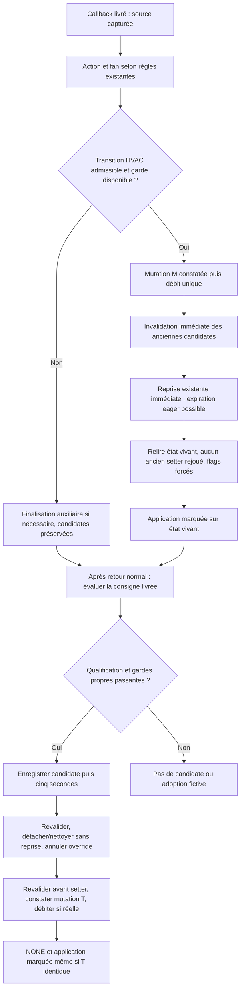

# Issue #2141 / correctif #2159 — Conception détaillée candidate v3.5

## 1. Métadonnées, sources et statut

| Métadonnée                            | Valeur                                                                                                                                                                                                                                            |
| ------------------------------------- | ------------------------------------------------------------------------------------------------------------------------------------------------------------------------------------------------------------------------------------------------- |
| Version / date                        | **3.5 candidate — 2026-10-29** ; remplace la conception v3.4, pas le socle développé #2141                                                                                                                                                        |
| Propriétaire                          | Mainteneurs de Versatile Thermostat ; validation finale humaine par l'utilisateur                                                                                                                                                                 |
| Statut                                | **Conception technique proposée, non implémentée. Q-05/Q-11/Q-12 fonctionnelles actées ; convergence indépendante et validation finale encore requises.** Aucune autorisation de développer déduite de ce document                                |
| Spécifications relues intégralement   | [FR v3.5 candidate](issue-2141-specification_fr.md), [EN v3.5 candidate](issue-2141-specification_en.md) : 17 FR, 15 BR, 40 AC, y compris les identifiants retirés/différés                                                                       |
| Revues relues intégralement           | [Revue historique #2141](issue-2141-review.md), [revue #2159 actualisée](issue-2159-review.md), alignée sur les décisions utilisateur et les spécifications v3.5                                                                                  |
| Code et tests lus                     | Réception/candidates/hooks, setters, application/priorités, expiration/reprise, envois climate, régulation, variante vanne, livraison et réparation ; sources précisées en §3. Tests existants ciblés en §9, lus seulement                        |
| Dépendance inspectée en lecture seule | HA installé **2026.8.2**, Python requis **3.14.2** ; création de tâches eager et préfixe de l'expiration. Ni audit de tous les plugins ni preuve d'exécution                                                                                      |
| Périmètre futur de production         | **Uniquement `ThermostatOverClimate`** dans [thermostat_climate.py](../../custom_components/versatile_thermostat/thermostat_climate.py). Le code #2141 interclasses reste en place et intact ; tests futurs possibles ailleurs après autorisation |
| Périmètre de cette opération          | **Ce seul document**, à l'emplacement explicitement demandé, sans fichier anglais supplémentaire. Aucun code, test, configuration, dépendance, revue, spécification ou état HA modifié                                                            |

**Convention : H** = exigence/décision historique #2141, maintenue mais non nécessairement satisfaite ; **E** = fait existant vérifié statiquement ; **C** = conception nouvelle #2159, non disponible ; **NR** = non-régression à vérifier ; **R** = ancien critère retiré/différé. Une couverture documentaire n'est pas un test réussi. Les résultats d'exécution rapportés par la revue ne sont pas réexécutés ici. Les deux relectures indépendantes antérieures sont celles communiquées par l'utilisateur ; les deux prochaines ne sont pas déclarées réalisées.

**Ordre d'autorité :** décisions utilisateur actuelles → spécifications FR/EN v3.5 → présente proposition technique → documents antérieurs. Q-11 : à une exigence de transmission OFF au seuil, « **non. Il n'a jamais été question de ça** ». Aucune exemption, garantie de transmission, obligation de blocage ou preuve d'arrêt matériel ajoutée ; ce n'est **pas** une acceptation générale du danger. Q-12 : mode/application puis évaluation et enregistrement éventuel de consigne, cinq secondes **depuis cet enregistrement**, sous gardes résultantes. Une application HVAC échouée/annulée peut empêcher la suite consigne. Ces décisions ne constituent pas une approbation globale de P-11 ni une preuve transactionnelle.

Consignes HA consultées : guide général, table des références et contrôle des équipements (identifiants d'entité, séparation commande/observation). Pas d'automation, helper, AppDaemon ou modèle Jinja à créer. L'autorisation historique #2141 et l'ancienne autorisation conditionnelle de #2159 **ne dispensent ni de convergence ni d'une demande de validation finale avant développement**.

## 2. Objectif, périmètre et exigences couvertes

### 2.1 Cible décidée #2159

Fermer le contournement HVAC : qualifier une transition réellement livrée du même TRV ; conserver sa source ; vérifier suivi, alignement, demande distincte et budget ; adopter et débiter le mode demandé ; invalider les anciennes candidates ; appliquer avec `COMMAND_CAUSE_UNDERLYING_TRACKING`. Étendre localement le **seul compteur existant partagé par VTherm** aux mutations réellement adoptées de mode **et** de consigne. Conserver chaque débit existant de tentative `climate` marquée, le seuil 3 et les entrées de réarmement existantes.

Notations documentaires, **pas de nouveaux compteurs** : **M** = mutation adoptée du mode demandé ; **T** = mutation adoptée de la consigne demandée ; **S** = tentative climate marquée ayant réellement atteint son point de débit. Chacun vaut une unité. M+S est un double débit voulu ; M+S+T ou M+deux S peut saturer lors d'une seule interaction. Zéro débit d'adoption ne signifie pas zéro débit total. Un faux retour rejeté compte zéro adoption ; un ancien écho mal attribué mais réellement adopté compte.

Seuls les ajustements nécessaires dans `ThermostatOverClimate` sont envisagés : callback, clôture température, garde d'admission, hook de débit/diagnostic et nettoyage local des candidates. Aucun rapatriement de `BaseThermostat`, des underlyings, du scheduler, des algorithmes ou du gestionnaire temporisé ; aucune modification de leurs contrats/signatures/MRO. Aucun deuxième budget, réservation, remboursement, nouveau timer/configuration, `TrackingChain`, système E1/E2 ou registre de propriétaires de pause.

### 2.2 Engagements historiques conservés, non redéfinis

| Référence H                  | Engagement maintenu et frontière C/NR                                                                                                                                                                                                                                                            |
| ---------------------------- | ------------------------------------------------------------------------------------------------------------------------------------------------------------------------------------------------------------------------------------------------------------------------------------------------ |
| Q-01                         | Geste température admissible stabilisé : demande manuelle, `NONE`, ancien override annulé sans restauration ni nouveau timer, y compris sous OFF. OFF manuel non rallumé ; OFF forcé et priorités inchangés. Nouvelle cause OFF invalide l'ancienne candidate, pas un geste admissible ultérieur |
| Q-02 — qualification         | Dernière commande **effectivement envoyée par TRV après limitation**, sans historique ; prudence sur proximité/quantification. Un pas seul ne prouve pas l'arrondi. Demande, référence d'envoi et observation distinctes ; succès de service ≠ acquittement                                      |
| Q-02 — temps                 | Cinq secondes glissantes après la dernière **nouvelle valeur candidate enregistrée** ; duplicata/action/fan ne prolongent pas. Aucun filtre global dix secondes ni debounce HVAC                                                                                                                 |
| Q-02 — protection            | Borne historique de trois tentatives physiques induites par suivi et réarmement externe. E couvre seulement certains points climate marqués. C ajoute M/T **sans rebaptiser rétroactivement Q-02** ; les tests isolés historiques de S gardent leur oracle, les résultats intégrés changent      |
| Q-03                         | Suivre un nouveau changement admissible sans commande préalable. Simple restauration sans changement exclue historiquement ; pas de nouveau rejet global température pour old absent/invalide                                                                                                    |
| Plusieurs TRV / cycle de vie | Références et attente par source, arbitrage existant, annulations sur intentions plus récentes, désactivation, perte de source et retrait. Aucun verrou global attendant un appareil lent ni garantie universelle sur continuations déjà en vol                                                  |

Les écarts H/E D-01/D-02/D-04/D-05 restent visibles et hors réparation #2159. Q-07/Q-08/Q-09 restent retirées : aucune nouvelle politique de cache, pas, unités, flottants, attributs, clamp ou déduplication. Pas de garantie de provenance humaine, de zéro geste perdu, de livraison exhaustive ou d'élimination de toute boucle matérielle.

## 3. Existant vérifié et dépendances intactes

### 3.1 Réception, qualification et état demandé

- [Livraison](../../custom_components/versatile_thermostat/underlying_state_manager.py#L48-L183) : mise à jour du cache puis création de tâche de notification ; initial valide livré avec old absent. Pas de FIFO garantissant la fin du callback précédent.
- [Enfant climate](../../custom_components/versatile_thermostat/underlyings.py#L793-L850) : le retour du parent ne termine pas l'enfant. Filtrage indépendant de mode, action, température et fan ; mode comparé au VTherm publié, pas à l'ancien mode TRV. Un callback peut arriver avec HVAC nul malgré une paire transitoire, ou ne pas arriver du tout. Retrait annule la candidate ; aucune reconstitution locale d'un champ filtré.
- [Callback actuel](../../custom_components/versatile_thermostat/thermostat_climate.py#L751-L862) : action/énergie, alignement/mode, fan, observation, application puis arbitre température. Mode sans garde de suspension ni cause ; boucle réaffectant `under`, donc risque de mauvaise source après boucle/break. Préservation des candidates fondée sur le paramètre HVAC plutôt que sur l'adoption effective.
- [Arbitre et hooks](../../custom_components/versatile_thermostat/thermostat_climate.py#L864-L1013) : validation numérique finie non booléenne ; égalité au cache rejetée, écart non nul ≤ pas retourné rejeté, distinct sans pas candidat. Une candidate par source, version globale, snapshot demande/effectif ; relecture HA à cinq secondes, référence/cache et arbitrage par version. Retrait des candidates et `cancel_without_revert()` avant mutation température, puis `NONE` et application marquée. Aucun débit d'adoption E.
- [Setters](../../custom_components/versatile_thermostat/vtherm_state.py#L59-L104) : assignations et flags synchrones, sans tâche/service/callback dans les corps lus. Le mode déjà typé évite la conversion ; température qualifiée assignée directement. `set_preset()` valide avant assignation ; `force_changed()` ne change aucune valeur demandée. La conversion [HVAC](../../custom_components/versatile_thermostat/vtherm_hvac_mode.py) est permissive : reconnaître explicitement les modes, exclure `unknown`/`unavailable`.

### 3.2 Application, expiration et tentatives

| Contrat E                                                                                                                                                                                                    | Effet vérifié et frontière                                                                                                                                                                                                                                                                                                                                                                          |
| ------------------------------------------------------------------------------------------------------------------------------------------------------------------------------------------------------------ | --------------------------------------------------------------------------------------------------------------------------------------------------------------------------------------------------------------------------------------------------------------------------------------------------------------------------------------------------------------------------------------------------- |
| [BaseThermostat.update_states](../../custom_components/versatile_thermostat/base_thermostat.py#L1781-L1878)                                                                                                  | Accepte cause et préservation de candidates. Cause suivie évite l'annulation automatique ; cause ordinaire peut annuler, donc reprendre un preset. Calcule l'effectif, transmet la cause aux modes/contrôle, publie, puis remet les flags à zéro. Transition HVAC/vanne force le recalcul. Une imbrication peut modifier ces flags avant retour                                                     |
| [StateManager](../../custom_components/versatile_thermostat/state_manager.py#L70-L210) et [température/preset effectifs](../../custom_components/versatile_thermostat/state_manager.py#L215-L338)            | Priorités inhibition, central, sécurité, fenêtre et auto-start/stop. Le calcul lu modifie l'effectif, pas le mode/consigne demandés pour restaurer un ancien snapshot                                                                                                                                                                                                                               |
| [Transmission proportionnelle](../../custom_components/versatile_thermostat/thermostat_prop.py#L241-L257)                                                                                                    | Propage déjà les arguments à la base, puis notifie le handler ; inchangée                                                                                                                                                                                                                                                                                                                           |
| [Mode climate](../../custom_components/versatile_thermostat/underlyings.py#L644-L702)                                                                                                                        | No-op/puissance/blocage avant garde de suivi ; après garde, cache puis débit avant service. Troisième S admise puis suspension, sans nouvelle garde après son débit. Renvoi TRVZB à deux secondes capturant déjà la cause                                                                                                                                                                           |
| [Température climate](../../custom_components/versatile_thermostat/underlyings.py#L941-L994)                                                                                                                 | Clamp/capacités/blocage, puis garde et débit marqués avant cache/service. Échec après débit non remboursé ; cache assigné avant service                                                                                                                                                                                                                                                             |
| [Régulation locale](../../custom_components/versatile_thermostat/thermostat_climate.py#L167-L308)                                                                                                            | Cause déjà transmise, anti-envoi avant clamp, période/dtemp inchangés ; report local capturant la cause. Pas de déduplication nouvelle                                                                                                                                                                                                                                                              |
| [Expiration/reprise/annulation](../../custom_components/versatile_thermostat/feature_timed_preset_manager.py#L232-L431)                                                                                      | Pause booléenne ; reprise non échue réarme l'échéance existante ; reprise échue crée une tâche. Expiration restaure le preset original ou réactive le preset interrompu encore valable, réinitialise le manager, émet les événements et appelle `update_states(force=True)` **sans cause de suivi**. `cancel_without_revert()` réinitialise avant événement, sans setter de demande ni restauration |
| [HA async_create_task](../../.venv/lib/python3.14/site-packages/homeassistant/core.py#L788-L834), [Task eager](../../.venv/lib/python3.14/site-packages/homeassistant/util/async_.py#L23-L42)                | `eager_start=True` par défaut. Le préfixe peut s'exécuter dans l'appel synchrone jusqu'au premier point **réellement suspensif**, voire se terminer. Un `await` sur une coroutine immédiatement terminée n'est pas une suspension assurée                                                                                                                                                           |
| [Variante vanne](../../custom_components/versatile_thermostat/thermostat_climate_valve.py#L235-L323), [callback hérité](../../custom_components/versatile_thermostat/thermostat_climate_valve.py#L457-L471)  | Hors recalibrage, délègue au callback local. Recalculs/envois remplacés, suites parfois non marquées ; `number`/cycles non bornés par le compteur                                                                                                                                                                                                                                                   |
| [Réparation](../../custom_components/versatile_thermostat/feature_repair_incorrect_state_manager.py#L79-L152), [réparation climate](../../custom_components/versatile_thermostat/underlyings.py#L1219-L1250) | Défaut `DEFAULT_REPAIR_INCORRECT_STATE=False` dans [const.py](../../custom_components/versatile_thermostat/const.py#L532-L535). Si activée : disponibilité, délai initial, cycles/pauses, modes/caches/délai depuis commande ; appel HVAC non marqué possible, aucun rattrapage garanti                                                                                                             |

### 3.3 Constats et divergences, identifiants des spécifications

| Repère | Fait / écart / portée                                                                                                                                                                                                                                                                                                                                    |
| ------ | -------------------------------------------------------------------------------------------------------------------------------------------------------------------------------------------------------------------------------------------------------------------------------------------------------------------------------------------------------- |
| D-01   | Cache `last_sent_temperature` avant service et resynchronisation depuis observation sous inhibition : ne certifie pas l'envoi H. Contradiction historique non résolue                                                                                                                                                                                    |
| D-02   | Qualification E par cache/pas non équivalente à prudence H ; `26.0` après `25.6` peut être rejeté avec pas `0.5`, proche sans pas candidat. [Accesseur](../../custom_components/versatile_thermostat/underlyings.py#L1108-L1199) lit `target_temperature_step` ; décalage documenté avec clé HA `target_temp_step`, autorité/numerique non redéfinis ici |
| D-03   | E compte S seulement ; C ajoute M/T. Troisième débit d'adoption ferme les gardes aval ; pas de place réservée pour un service                                                                                                                                                                                                                            |
| D-04   | Comparaisons avant clamp, références/cache et routes vanne/TRVZB ne prouvent pas tous les envois inutiles évités. Aucun nouveau post-clamp                                                                                                                                                                                                               |
| D-05   | Collection, versions et snapshots ne prouvent pas toutes les continuations avant candidate, pannes ou tâches en vol ; pas de refonte globale de lifecycle                                                                                                                                                                                                |
| D-06   | Cause, priorités et plusieurs entrées externes réarmantes déjà disponibles ; réutiliser sans déplacer ni modifier les classes communes                                                                                                                                                                                                                   |
| D-07   | Livraison filtrable, initial possible, source réaffectée dans callback E. Correction de source C, pas de nouveau contrat amont                                                                                                                                                                                                                           |
| D-08   | Services `number`, cycles et suites non marquées hors borne globale ; tests isolés actuels ne prouvent ni cumul C ni disparition matérielle de boucle                                                                                                                                                                                                    |
| D-09   | FR/EN v3.5 décident Q-11/Q-12. Ancienne conception et revue #2159 contenaient des blocages fonctionnels désormais périmés ; divergences documentaires §10.3                                                                                                                                                                                              |
| D-10   | Réparation conditionnelle et désactivée par défaut, pas de garantie suffisante d'arrêt physique                                                                                                                                                                                                                                                          |
| D-11   | Chemin réel possible : annulation → reprise échue → Task eager → restauration/reprise preset → application non marquée avant retour de l'annulation. Ni double débit ni service systématique prouvés. Traitement technique retenu §6.4, pas nouvel arbitrage utilisateur                                                                                 |

## 4. Vue d'ensemble et responsabilités proposées — C

| Élément local          | Responsabilité                                                                                                                                                                                                                                  |
| ---------------------- | ----------------------------------------------------------------------------------------------------------------------------------------------------------------------------------------------------------------------------------------------- |
| `underlying_changed()` | Capturer source immuable ; traiter action/fan ; qualifier old/new ; admettre, muter et comptabiliser M ; invalider/reprendre les anciennes candidates ; finaliser puis évaluer T après retour normal                                            |
| Qualification HVAC     | Même TRV dans old/new/source, modes reconnus différents, demande distincte ; pas de mémoire « ignorer toujours le premier », pas de nouveau filtre température                                                                                  |
| Finalisation           | `mode_adopted` séparé des changements auxiliaires ; cause suivie si adoption, sinon préservation explicite des candidates. Ne pas réécrire d'anciennes valeurs après reprise réentrante                                                         |
| Clôture température    | Gardes E + garde compteur/suspension ; détacher/nettoyer sans reprise, annuler override sans restauration, revalider avant mutation, observer le changement réel, débiter T si distincte, garder `NONE` et application même à demande identique |
| Hook de débit existant | Même signature, seul compteur/seuil/réarmement ; diagnostiquer M/T/S ; débits d'adoption enregistrés avant toute opération réentrante ; chemin S interclasses inchangé                                                                          |
| Annulations locales    | Retrait et invalidation avant reprise ; nettoyage borné des candidates visées malgré un handle défaillant ; reprise existante immédiate, sans attente de l'application et sans lever la pause d'une nouvelle candidate                          |
| Autres classes         | Strictement inchangées ; aucune interception/propagation universelle ajoutée                                                                                                                                                                    |

Le diagramme n'est pas une transaction et ne masque pas l'expiration non marquée dans R. Les erreurs peuvent interrompre les flèches ; §6.5 fixe les phases et le nettoyage. La suspension à 3 demeure immédiate ; aucune flèche ne promet un service OFF ni une application complète.

## 5. Entités, données, états et persistance

Aucune nouvelle entité, persistance, option ou migration. Utiliser les `entity_id` des TRV configurés, jamais une identité d'appareil inventée. Le cadre de callback conserve objet et identité `source_under`/`source_entity_id` ; la boucle d'alignement utilise un autre nom. Observation et candidate restent attachées à cette source, après boucle/break et après attente.

Les données E restent `_underlying_temperature_candidates`, version globale, observations/statuts, snapshot demande/effectif, `_underlying_tracking_attempts`, suspension et motif. **`attempts` garde son nom mais représente en C le total mixte M/T/S**, pas des émissions réseau prouvées. Nouvelle instance : zéro/non suspendue ; aucune restauration supplémentaire. Données de phase C transitoires : valeur avant/après setter, champ, mutation constatée, entrée du débit atteinte, invalidation engagée et erreur primaire. Ce ne sont ni compteurs de protection ni états persistés ni générations E1/E2.

| Paire HVAC livrée                                                | Décision C, indépendamment du classement température                                                                   |
| ---------------------------------------------------------------- | ---------------------------------------------------------------------------------------------------------------------- |
| New absent/invalide/inconnu/indisponible                         | Pas d'adoption mode ; annulations retrait/indisponibilité E conservées, new absent normalement intercepté par l'enfant |
| Old absent, `unknown`, `unavailable` ou non reconnu ; new valide | Initial/reprise identifiable : aucune adoption mode, sans interdire globalement une température livrée                 |
| Identités old/new différentes ou non concordantes avec source    | Refus mode ; pas de transfert de source, de filtre global température ni de refonte action/fan                         |
| Modes old/new valides identiques                                 | Pas de transition même si différent du VTherm ou paramètre HVAC non nul                                                |
| Modes old/new valides différents, même source                    | Examiner les gardes, y compris au premier callback et sans envoi préalable, même si paramètre HVAC nul                 |

Les états livrés permettent certaines distinctions, pas la provenance matérielle ni la détection de toute restauration ressemblant à une transition valide.

## 6. Interfaces et contrats locaux détaillés

### 6.1 P-11 retenue pour conception : admission, mutation constatée, débit, invalidation

**Choix technique C**, à valider avec ce document, et non décision fonctionnelle supplémentaire : conserver la reprise immédiate existante et rendre le préfixe explicitement réentrant (variante **L-0R**, §6.4). Aucun préfixe complet réputé atomique.

**Mode :** qualifier la paire → suivi actif → nouveau mode distinct de la demande → chaque autre TRV aligné avec le mode **effectif** VTherm, non avec le mode futur → `_can_send_underlying_tracking_command()` → setter qualifié → constat de mutation → une entrée du hook de débit → invalidation des anciennes candidates → reprise existante immédiate → finalisation/application suivie. Un refus seul ne fait ni setter, débit M, `force_changed()`, annulation de candidate ou retour global supprimant les autres champs. Suspension vraie/compteur <3 et compteur ≥3/suspension fausse refusent tous deux.

**Débit et phases :** conserver la signature `(entity_id, command: Any)`. Les deux appels d'adoption passent un marqueur local explicite (type M/T, valeur, phases), distinct des objets mode/valeur transmis aujourd'hui par les underlyings. Dans le hook, incrément/motif/suspension restent placés avant annulation/log ; le marqueur indique l'entrée de débit effectivement atteinte **avant toute reprise**. Ce marqueur ne compte rien et ne change aucun appelant externe. Après entrée du hook, ne jamais le réessayer pour réparer un log/nettoyage, même si le total a été réarmé pendant une imbrication. Le chemin S garde ses garde/débit/service existants.

**Mutation même en cas d'erreur du setter :** capturer valeur demandée juste avant, et la relire dans une sortie protégée du setter (succès ou exception). Setter inchangé ⇒ zéro débit d'adoption ; valeur qualifiée effectivement retenue et différente ⇒ entrée unique du hook avant toute opération auxiliaire. Cela couvre le setter simulé « assigne puis lève », au lieu de déclarer faussement zéro adoption ou de laisser le débit seulement après son retour normal. Conserver l'erreur primaire, journaliser une éventuelle erreur secondaire, terminer le nettoyage local engagé ; ne pas lancer d'application normale ni traiter la consigne mixte après cette erreur. Pas de rollback/remboursement.

La justification limitée est le **corps concret des setters lus**, pas l'absence de `await` : avec arguments qualifiés, leurs flags/assignations ne lancent ni tâche ni callback. L'entrée du hook pose ses faits de débit avant ses appels réentrants. Une substitution arbitraire du setter qui démarre elle-même d'autres intentions puis revient à la même valeur n'est pas observable comme historique de mutations avec ce seul avant/après ; elle est hors de cette preuve, pas un contrat interclasses à inventer. Les injections avant assignation et assigne-puis-lève, sans tâche cachée dans le setter, ont des oracles déterminés.

**Invalidation :** mode réellement muté ⇒ annuler les anciennes candidates à tous les compteurs. À 3, le hook l'engage immédiatement ; à 1/2, le callback l'engage après le débit, y compris si un log de débit lève. Une phase « invalidation engagée » posée avant l'appel évite de relancer une deuxième annulation/reprise après son erreur et de toucher une candidate née depuis. La méthode locale assure elle-même son nettoyage §6.5. Le mode refusé ou identique ne fait pas ce travail. La cause suivie de la base ne l'effectuera pas à la place du callback.

### 6.2 Température : clôture et effets manuels, y compris T-FALSE

Conserver qualification, cinq secondes, snapshot, relecture HA `temperature`, référence/pas source, suivi et arbitrage existants. Ajouter la garde complète compteur+suspension à la formation et à l'échéance ; une garde passée à l'enregistrement n'est pas un droit acquis.

1. Après validation à l'échéance, détacher la candidate source et conserver son enregistrement/version pour le traitement local. Annuler les autres **sans reprise**, comme E ; appeler `cancel_without_revert()`. Cette voie de consigne manuelle annule légitimement l'ancien override sans restauration ni nouveau timer, à la différence d'un simple changement HVAC.
2. Ces appels indirects ne sont pas réputés indivisibles : après ce préambule, **avant tout setter**, refaire les gardes/observations/snapshot et vérifier qu'aucune nouvelle candidate/intention n'a supplanté le traitement. Réutiliser la version globale existante capturée au détachement et les valeurs vivantes, sans nouvelle génération ni registre. Si une nouvelle version apparaît pendant le préambule, abandonner cette clôture ; ne pas la réinsérer ni annuler la nouvelle candidate. À défaut de mutation T : zéro débit T. Une modification manuelle du manager déjà accomplie reste un état partiel à tracer, pas à restaurer aveuglément.
3. Comparer à la **consigne demandée**, pas à l'effectif/régulé. Setter puis constat protégé/débit T selon §6.1. Si distincte, +1 même sans service. Le hook saturant ne peut annuler rétroactivement la candidate déjà détachée ; le manager annulé normalement rend sa reprise inerte. Si la mutation n'est pas atteinte ou si la candidate est abandonnée : aucune unité T.
4. Conserver `set_preset(NONE)`, flags, statut local et `update_states(force=True, _command_cause=COMMAND_CAUSE_UNDERLYING_TRACKING)`. Ne pas écraser le motif du seuil par `candidate_adopted`. Avant des effets manuels restants après une sortie réentrante, ne pas réutiliser un ancien snapshot pour écraser une intention plus récente ; terminer seulement les effets appartenant encore à cette clôture.

**T-FALSE explicite :** candidate égale à la demande mais distincte du cache et admissible sous gardes E : **zéro unité T**, mais retrait/nettoyage, annulation d'override sans restauration, `NONE`, flags et application marquée **conservés**. Aucun retour anticipé sur l'égalité. Chaque S réellement atteinte par cette application reste débitée, peut porter le total à 3 et suspendre. Rejet compatible/ambigu, candidate simplement en attente ou annulée et attribut seul : zéro adoption ; ils ne doivent pas être confondus avec ce chemin manuel admis.

### 6.3 Q-12 / P-12 : mode/application puis enregistrement éventuel de consigne

**Ordre fonctionnel décidé, non à redemander.** Capturer l'observation de la vraie source avant l'attente, comme E ; traiter M et sa finalisation/application ; **après retour normal**, évaluer la consigne effectivement livrée par l'enfant sous références/cache/budget résultants, puis l'enregistrer si admissible. L'échéance vaut enregistrement + cinq secondes, **pas réception + cinq secondes**. Ne pas reconstruire depuis le state brut un champ filtré.

Finalisation contenant M : `force_changed()` puis `update_states(_command_cause=COMMAND_CAUSE_UNDERLYING_TRACKING)`. Action/fan seuls : flags comme E, `update_states(_preserve_underlying_temperature_candidates=True)`, sans cause HVAC artificielle. Sans changement nécessitant application : passer à l'évaluation température. La préservation dépend de l'adoption réelle, pas de `new_hvac_mode is None`. Un refus mode ne supprime pas les champs ; leur indépendance ne contourne ni la suspension commune ni leurs gardes propres.

Après reprise eager, relire l'état vivant et **reposer les flags juste avant la finalisation prévue** : l'application imbriquée peut avoir remis les flags à zéro. Ne jamais rejouer le setter de M, une ancienne consigne/preset, ou le débit. Le callback applique l'état demandé courant, non un snapshot ancien. Après un await, aucune réassignation de l'ancien mode/preset pour « terminer » cette adoption. Le fait M déjà accompli et sa cause restent distincts des services effectivement atteints ; une expiration non marquée peut avoir déjà appliqué une partie de l'état.

Si application échoue ou est annulée, ne promettre ni publication complète ni enregistrement de T ; observer les phases atteintes. Si elle retourne normalement, y compris avec `False` parce que le thermostat n'est pas prêt, poursuivre l'examen de la consigne livrée sous ses gardes propres, sans garantir son admission. Pas de `finally` forçant la livraison de T, de réservation de deux unités, de debounce HVAC ou de FIFO universel. Les continuations avant création de candidate après une application en vol restent D-05/AC-034/AC-035 ; cette conception ne les transforme pas en garantie globale nouvelle.

| Total initial | Suite conditionnelle sans autre événement, expiration ou erreur | Conséquence                                                                          |
| ------------- | --------------------------------------------------------------- | ------------------------------------------------------------------------------------ |
| 0             | M 0→1 ; aucune S mode ; T admissible après cinq secondes 1→2    | Deux adoptions ; si S température atteinte ensuite, 2→3, troisième S admise          |
| 1             | M 1→2 ; aucune S mode ; T 2→3                                   | T retenue, suspension ; S suivante rencontrant garde refusée                         |
| 2             | M 2→3                                                           | M retenue, suspension/annulations ; S aval et nouvelle candidate T refusées, zéro T  |
| 0             | M 0→1 ; S mode vers B 1→2 ; T 2→3                               | Trois unités sur une interaction, T sans S ultérieure garantie                       |
| 1             | M 1→2 ; S mode 2→3                                              | S admise puis suspension ; T empêchée sans débit                                     |
| 0             | M 0→1 ; S vers B 1→2 ; S vers C 2→3                             | Deux tentatives admises, suivantes refusées, alignement partiel possible, T empêchée |
| 0/1/2         | M refusée/no-op sans suspension ; T seule distincte admissible  | Zéro M ; T porte le total à 1/2/3 ; S restent distinctes                             |
| 0/1/2         | T-FALSE admise, M non adoptée                                   | Zéro adoption ; effets manuels/application conservés ; seules S atteintes débitent   |

Ce sont des calculs d'oracles conditionnels, pas des mesures. Les reprises et tâches concurrentes peuvent changer la chronologie, les flags, le cache et le budget ; §6.4/§9 imposent de les tracer séparément.

### 6.4 AC-040 : choix L-0R, reprise immédiate conservée et réentrance assumée

**Chemin vérifié :** candidate → `pause_expiration()` → échéance dépassée → annulation globale → `resume_expiration()` → `hass.async_create_task()` eager → `_async_timed_preset_expired()` → `_end_timed_preset()` ou `_activate_timed_preset()` → `update_states(force=True)` non marqué. Il peut commencer **avant le retour de l'annulation**, y compris sans `await` explicite dans le callback. La possibilité n'établit ni service systématique ni double débit.

**Option retenue pour cette conception : L-0R.** Ne supprimer, décaler à après l'application, remplacer, annuler ou réattribuer **aucune reprise normale d'expiration**. Conserver son appel synchrone au point d'invalidation existant, à seuil atteint ou non ; considérer les effets imbriqués dans les invariants. Pour M : mutation et débit précèdent l'invalidation/reprise ; les anciens timers de candidates sont rendus inertes avant la reprise ; après celle-ci, aucune ancienne valeur demandée n'est réécrite, flags reposés sur l'état vivant avant application suivie. Pour T : nettoyage sans reprise et annulation sans restauration du manager précèdent le setter, comme Q-01/E ; revalidation après ce préambule et débit fondé sur mutation constatée.

**Pourquoi ce choix suffit au problème local lu, sans garantie universelle :**

- Dans les branches d'expiration lues, restauration/réactivation du preset et reset/réarmement du manager se font **avant l'appel à l'application asynchrone**. Elles ne réassignent ni le mode demandé ni la consigne demandée ; après retour de l'application, elles rafraîchissent les attributs, sans restaurer un ancien snapshot de demande. M n'est donc pas écrasée par une ancienne restauration de mode dans ce chemin ; la restauration légitime du preset échu reste disponible.
- Une expiration démarrée eager peut terminer ou se suspendre dans la base/underlyings. Si elle termine avant retour, les flags peuvent être remis à zéro ; le callback les repose et appelle son application marquée. Si elle est encore en vol, il ne restaure aucune ancienne valeur après ses propres awaits. Cela préserve l'intention demandée récente dans les setters locaux ; **cela ne sérialise pas** les publications/envois déjà engagés des deux applications.
- La candidate annulée ne peut être « adoptée » par la reprise : la collection n'en contient plus son enregistrement/version. La restauration d'un preset n'est pas une adoption suivie M/T, donc zéro débit d'adoption pour elle. Une M antérieurement mutée/débitée reste un fait unique ; ne pas la redébiter si l'expiration modifie preset, flags ou budget.
- Annuler sans restauration le manager est correct pour une **clôture manuelle température admise**, même T-FALSE, pas pour tout HVAC. L'expiration encore pausée ne lance normalement pas de tâche avant ce reset. Une tâche déjà en vol a pu appliquer auparavant ; ses effets existants sont comparés, pas effacés par une garantie fictive.

**Appels indirects vérifiés, pas seulement signatures :** [send_event](../../custom_components/versatile_thermostat/base_thermostat.py#L2234-L2236) délègue à [send_vtherm_event](../../custom_components/versatile_thermostat/const.py#L651-L658), qui lit les attributs puis appelle `hass.bus.fire`. Dans le [bus installé](../../.venv/lib/python3.14/site-packages/homeassistant/core.py#L1553-L1564), `fire` programme la distribution avec `loop.call_soon_threadsafe` ; il ne distribue pas lui-même les listeners dans ce préfixe. Cette vérification étaye l'ordre reset/preset/événements avant application pour les corps lus, sans supposer que toute lecture d'attribut ou tout plugin futur est pur. La frontière réellement réentrante établie reste la création de tâche eager dans `resume_expiration()` ; l'application et ses plugins peuvent ensuite en ajouter d'autres.

**Suppression/décalage : évaluation explicite de régression.** Supprimer la reprise après invalidation HVAC pourrait laisser un preset pausé indéfiniment, perdre sa restauration ou sa reprise interrompue ; remplacer par `cancel_without_revert()` sur M changerait Q-01 et la sémantique du mode seul. Reporter la reprise à après `await update_states()` retarderait l'expiration d'une durée non bornée, pourrait la perdre si erreur/annulation et changerait l'état preset/effectif utilisé par l'application. Un `finally` tardif ou `call_soon` ne rétablit pas l'ordre existant et peut lever une pause plus récente. **Ces pistes L-1/L-2 ne sont pas retenues.** L-0R évite cette régression en gardant la reprise immédiate, pas en affirmant qu'elle n'exécute rien.

**Frontière précise :** aucun verrou, override temporaire du manager, mutation de ses champs privés ou modification HA. D'autres plugins peuvent démarrer des intentions pendant l'application ; ne pas supposer leurs corps purs. Les flags/publications d'applications en vol, suites non marquées, services déjà admis et continuations pré-candidate ne sont pas universellement ordonnés. Aucun chemin lu ne démontre une impossibilité de satisfaire le contrat local ; **la non-régression effective n'est pas prouvée avant tests comparatifs**. Si ces tests montrent qu'une ancienne application restaure une demande récente ou que le nettoyage C aggrave un état E, nommer ce chemin avant validation ; pas de nouvel arbitrage de sécurité à inventer.

### 6.5 Erreurs, annulations et invariants de nettoyage local

Les méthodes d'annulation dans la classe autorisée conservent leur signature et leur effet normal. Pour les erreurs nouvelles/renforcées par les débits C, rendre leur sortie **bornée et explicite** : capturer les enregistrements visés ; détacher l'enregistrement/version avant d'appeler son handle ; tenter chaque annulation prévue malgré un handle défaillant ; poser son statut dans une sortie protégée ; ne pas enlever un remplacement installé réentrament sous la même clé. Pour une annulation globale, détacher le lot ancien avant les appels réentrants. Un handle en erreur ne doit pas rendre le callback capturé réadmissible : absence/version différente le rend inerte.

La reprise globale demandée est tentée dans la sortie protégée de ce nettoyage, **au même préfixe synchrone, sans attendre HVAC**, si aucune candidate actuellement enregistrée ne requiert encore la pause. La vérifier au moment de l'appel, pas avec un booléen ancien. Collection vide à l'entrée : garder la reprise E. Si une nouvelle candidate existe, conserver sa pause et ses mécanismes E de résolution ; ni nouveau propriétaire ni reprise tardive attachée à un override ancien. Ne pas refaire le nettoyage complet après erreur : éviter une seconde reprise ou l'annulation d'une nouvelle candidate. Lever l'erreur primaire après tentatives de nettoyage, journaliser les secondaires séparément ; aucune boucle de retry.

Si le préambule T échoue avant mutation : candidate détachée inerte, zéro T. Essayer de finir les annulations locales déjà engagées ; si le manager n'a pas été annulé et qu'aucune nouvelle candidate ne nécessite sa pause, tenter la reprise E en sortie d'erreur pour ne pas abandonner une pause sans propriétaire local. Si son reset a déjà réussi, cette reprise est normalement inerte ; ne pas rappeler `cancel_without_revert()` après une erreur d'événement susceptible de concerner désormais un autre override. Ne pas imposer `NONE` ou rétablir des valeurs si l'admission finale/mutation n'a pas eu lieu. Une panne du manager lui-même peut empêcher son nettoyage : exposer exactement cette limite, pas promettre un reset malgré son exception.

| Phase / injection                                        | Invariant et oracle déterminés pour la conception                                                                                                                                             |
| -------------------------------------------------------- | --------------------------------------------------------------------------------------------------------------------------------------------------------------------------------------------- |
| Refus/qualification ; erreur avant setter                | Zéro mutation/adoption du champ, zéro débit M/T ; aucune annulation due au seul refus HVAC                                                                                                    |
| Setter avant assignation puis exception                  | Valeur inchangée : zéro adoption ; nettoyer seulement le préambule effectivement engagé                                                                                                       |
| Setter assigne puis lève                                 | Constat protégé : mutation réelle comptée une fois ; erreur primaire conservée, nettoyage engagé, pas de suite normale ni rollback                                                            |
| Hook après incrément, pendant annulation/reprise ou log  | Débit acquis, suspension déjà fixée à 3 ; aucun réessai/redébit/remboursement. Terminer le nettoyage local selon ses phases ; ne pas déduire zéro adoption de l'exception                     |
| Expiration eager sans erreur                             | M/débit avant reprise ; preset/demande/effectif/flags/services observés ; ne rejouer ni setter ni débit après retour. Restaurer les flags, pas un ancien état demandé                         |
| Exception dans la Task d'expiration                      | Peut être portée par Task/journal HA sans remonter au hook ; distinguer d'une exception synchrone de reprise. Aucun rollback fictif                                                           |
| `NONE`, flags, statut ou application échoués/annulés     | Mutation et débits déjà atteints conservés ; effets partiels nommés. Pas de `NONE` ou publication prétendus s'ils ne sont pas atteints ; pas de consigne mixte garantie après erreur mode     |
| Échec d'une S après débit                                | Unité conservée même sans émission prouvée ; wrapper interceptant l'erreur distinct du mock qui la propage                                                                                    |
| Réarmement/intention récente réentrante ou pendant await | Garder l'état et budget vivants ; aucun ancien setter/snapshot restauré, aucun retry de débit dans le budget neuf. Les S anciennes peuvent utiliser ce budget selon E                         |
| Retrait/destruction                                      | Garder les annulations sans reprise de destruction E ; nettoyage local ne doit pas ajouter de reprise différée après retrait. Pas de garantie terminale globale sur toutes tâches antérieures |

Ce contrat ne garantit pas la terminaison malgré toute panne de handle, log ou manager ; il fixe ce qui est détaché, tenté, compté et propagé. Une erreur de nettoyage introduite/aggravée par C est un défaut à corriger localement, pas une régression acceptée sous prétexte d'AC-036 retiré.

### 6.6 Seuil, cause, réarmement et OFF — Q-11 résolue

Garde disponible ≠ réservation. Troisième **S** : débit puis chemin de service existant, sans promesse de succès matériel. Troisième **M/T** : mutation puis débit/suspension/annulations, les S rencontrant ensuite la garde sont refusées sans débit supplémentaire. No-op avant point S ne compte pas ; chaque destination/renvoi réellement atteint compte séparément, sans exemption du TRV source. Aucune modification des points de débit ou causes des underlyings, de la base, de la variante vanne ou du scheduler.

**AC-039, fixture isolée sans expiration concurrente :** total 2, demande/effectif/publié HEAT, A réellement HEAT→OFF, B HEAT, alignement/gardes passants. M OFF mutée, +1 → 3, suspension ; A peut faire no-op et B voir sa S OFF refusée par la garde. Le calcul/publication peut néanmoins produire demande/effectif/publié OFF alors que B reste HEAT, sans erreur nécessaire. Aucune application complète du OFF, diffusion globale, réparation ou délai d'arrêt ne sont promis. Comparer les totaux initiaux 0/1 et une S déjà admise ; mesurer les services, ne pas les déduire du compteur.

Q-11 **n'ajoute pas** d'exigence de transmission OFF au seuil, d'exemption, de blocage d'adoption ou de preuve d'état matériel. L'absence de S OFF ici n'est pas l'échec d'une exigence inexistante ; une mauvaise garde ou comptabilisation reste un défaut. Le risque logique/publié versus matériel demeure au diagnostic, **sans attribuer à l'utilisateur une acceptation générale du danger**. Les options anciennes « obtenir une acceptation explicite du danger » et « garantir OFF avant suspension » sont retirées des conditions de convergence ; elles ne sont ni à développer ni à redemander.

Réarmement : conserver les [entrées HVAC/température/preset existantes](../../custom_components/versatile_thermostat/base_thermostat.py#L1619-L1750) et le hook local ; valeur identique acceptée comprise, refus avant hook exclu. Écho, timer, adoption, régulation, temps et bascule du suivi ne réarment pas. L'expiration interne ne reçoit pas une cause suivie artificielle. Réparation/direct/`number`/cycles/suites déjà armées restent séparés ; une automatisation externe réarmante peut recharger sans borne entre réarmements, limite historique acceptée distincte d'AC-039.

## 7. Flux nominaux, annulations et reprise

1. **HVAC nominal :** A transitoire valide, autres TRV alignés, garde passante : M constatée/+1, anciennes candidates invalidées, reprise immédiate éventuelle, application suivie sur état vivant. À total initial 2 : M retenue, S aval non garantie. Mode seul ne supprime pas un preset actif ou sa restauration légitime.
2. **Refus/no-op :** suivi inactif, paire invalide, mode déjà demandé, autres TRV désalignés ou budget refusant : pas de M/cause artificielle/annulation de ce seul fait ; action/fan/observation/consigne suivent leurs règles. Suspension commune peut refuser aussi T.
3. **Premier/reprise identifiable :** old absent/invalide → aucune adoption mode ; premier callback déjà transitoire valide admissible sans ordre préalable. Aucune nouvelle interdiction générale de température.
4. **Mixte :** observation source → M/application → après retour normal, qualification/enregistrement T → cinq secondes → clôture. Chaque mutation réelle compte, aucune unité par simple réception ; mode/application peut épuiser le budget avant T.
5. **Température manuelle :** OFF/priorités inchangés ; annulation override sans restauration, pas de nouveau timer, `NONE`/application marquée conservés même T-FALSE. Ancien callback annulé rejoué : absence/version l'écarte.
6. **Erreur/annulation :** tracer phase, état demandé réel et débits ; nettoyage §6.5, pas de compensation ni retry automatique. Demande/effectif/publié et matériel restent distincts.
7. **Cycle de vie :** annulations E des candidates enregistrées à désactivation/perte de source/retrait/destruction, budget zéro nouvelle instance. Aucun callback universellement annulé, aucune nouvelle époque de commande.

**AC-031 :** demande HEAT, fenêtre configurée OFF, effectif **calculé/publié OFF**, source HEAT→OFF, consigne/action inchangées et fan égal au VTherm : enfant susceptible de supprimer tout le callback. Action seule changée : livraison possible avec HVAC nul, qualifier old/new sous gardes. Ne recréer ni callback ni consigne. La [branche frost](../../custom_components/versatile_thermostat/state_manager.py#L177-L196) n'autorise pas une fixture « demande OFF/effectif HEAT » justifiée par frost. Réconciliation directe initiale indépendante, pas zéro service global promis au démarrage.

## 8. Sécurité, observabilité et contraintes opérationnelles

Diagnostic local proposé : source, old/new, demande avant/après, effectif/publié si disponible, décision/motif, phase, M/T/S, total avant/après, suspension et cause. Le hook ne doit plus appeler « physical attempt » une adoption. Conserver les attributs/motifs existants et le motif de seuil ; aucun historique illimité, compteur télémétrique supplémentaire ou dispositif transversal. Logs/attributs peuvent être partiels après panne : pas de journal transactionnel ni de preuve réseau.

Priorités et protections directes inchangées. Aucun service externe ni nouvelle donnée personnelle. Trois M/T sans S saturent ; avec S, moins de trois gestes peuvent suffire. Gestes légitimes espacés consommés, temps/bascule sans réarmement ; modes et températures peuvent mutuellement épuiser le budget. Faux retour rejeté : zéro adoption, pas forcément zéro S produite par une autre activité. Origine du premier OFF, retour matériel HEAT et fin de boucle non prouvés.

Risques distincts : **AC-039**, OFF logique/publié avec B HEAT possible ; **AC-040**, application preset non marquée imbriquée ; D-05, continuations/application en vol ; `number`, cycles, réconciliation et anciennes commandes non universellement arrêtés. Une suspension n'est ni arrêt physique global ni interdiction de tout calcul. Réparation désactivée/conditionnelle ne sert jamais de garantie de rattrapage. Aucun essai sur installation sensible pendant cette conception.

## 9. Stratégie de tests et critères de vérification v3.5

**Aucun test applicatif exécuté ou modifié.** Tests futurs après validation/autorisation dans [test_overclimate.py](../../tests/test_overclimate.py), [test_overclimate_valve.py](../../tests/test_overclimate_valve.py), [test_manual_override.py](../../tests/test_manual_override.py), si pertinents. Lus : [budget/température](../../tests/test_overclimate.py#L480-L545), [mode marqué](../../tests/test_overclimate.py#L633-L680), [action/intention/source](../../tests/test_overclimate.py#L582-L826) et [manuel/OFF/override](../../tests/test_manual_override.py#L543-L607). L'assertion de valeur seule du test de désalignement ne prouve pas l'identité de l'objet source.

Niveaux : **T1**, callback isolé pour admission/source/cause/débit ; **T2**, enfant réel, états HA et propagation jusqu'aux services mockés à la frontière matérielle ; **T3**, matériel futur, indisponible ici. T1 ne vaut pas T2/T3. Horloge contrôlée depuis **enregistrement**, old/new/source explicites, observations HA actualisées, gardes init/inhibition/période/dtemp/cache/budget précisées. Instrumenter setter avant/après, incrément, suspension, présence/version des candidates, annulations, reprise/expiration et premier point réellement suspensif, cause, hook externe, effectif/publié et services climate/number par destination.

### 9.1 Couverture individuelle des 40 AC

| Critère | Oracle / vérification prévue ; non exécutée                                                                                                                                                                                                                            | Statut / références      |
| ------- | ---------------------------------------------------------------------------------------------------------------------------------------------------------------------------------------------------------------------------------------------------------------------- | ------------------------ |
| AC-001  | Suivi désactivé : pas de M/T, action/fan/direct conservés ; bascule sans reset                                                                                                                                                                                         | H/NR ; §6                |
| AC-002  | `25.6` envoyé/`25.5` compatible : demande/preset/observation conservés, pas de correction du seul écart ; confronter E/H                                                                                                                                               | H ; D-01/D-02/D-04       |
| AC-003  | Candidate admissible sans filtre dix secondes ; aucune adoption avant cinq secondes ; mutation T unique +1 puis S distinctes ; `NONE`/override Q-01                                                                                                                    | H/C/NR ; §6.2            |
| AC-004  | Geste réel indiscernable d'écho compatible peut être perdu, provenance non prouvée                                                                                                                                                                                     | H/limite                 |
| AC-005  | Proche sans quantification : prudence H confrontée au distinct sans pas E ; divergence pas nouvelle politique                                                                                                                                                          | H/divergence D-02        |
| AC-006  | Ancien écho distinct peut être adopté ; séparer S et autres services, aucune borne physique globale certifiée                                                                                                                                                          | H/limite D-03/D-08       |
| AC-007  | `7→21`, retour tardif `7` candidat possible ; `21` remplaçant avant échéance l'annule/requalifie, ancien timer inerte                                                                                                                                                  | H/NR                     |
| AC-008  | Rafale `26→26.5→27`, duplicata/action/fan sans prolongation ; retenir enregistrement +5 s. Bloquer/relâcher application M, aucun timer T avant retour normal                                                                                                           | H/NR ; §6.3              |
| AC-009  | Source A/B préservée avec alignement/désalignement, listes/rôles permutés, break/await ; références et arbitre par source, T1 puis T2 sans caches artificiellement figés                                                                                               | C/NR                     |
| AC-010  | Demande 22/envoi régulé 25.6/retour compatible 25.5 ; référence source, demande conservée ; cache après échec/resync caractérisé                                                                                                                                       | H/NR ; D-01/D-02         |
| AC-011  | Nouvelle intention invalide ancienne candidate ; geste ultérieur OFF admissible Q-01, OFF maintenu, ancienne échéance override inoffensive après annulation réussie                                                                                                    | H/NR                     |
| AC-012  | Candidate enregistrée puis désactivation/retrait/indisponibilité/destruction : pas d'adoption à ancienne échéance ; nouvelle instance zéro ; lacunes E distinguées                                                                                                     | H/NR ; D-05              |
| AC-013  | Sans M/T injectée : trois S, troisième admise, quatrième refusée, échec non remboursé ; HVAC ensuite refusé ; incohérences booléen/compteur refusent M/T                                                                                                               | H/E/C/NR                 |
| AC-014  | Sans envoi préalable, nouveau changement T admissible puis cinq secondes ; simple restauration reste attente H, pas nouveau rejet old absent                                                                                                                           | H/NR                     |
| AC-015  | M refusée/no-op n'annule pas/supprime pas les autres champs ; M/application avant T. Totaux 0/1/2, cache résultant, suspension, erreur/annulation application ; aucune T fictive ni livraison indépendante promise                                                     | C/NR ; §6.3/§6.5         |
| AC-016  | Q-05/Q-11/Q-12 actées, P-11 technique proposée, H/E/C/NR/R et retraits, compteur unique, 40 AC, divergences revue ; validation finale à demander, aucune réussite applicative                                                                                          | C ; §10                  |
| AC-017  | Via enfant quand livré, old absent/new HEAT : pas de M ; réconciliation séparée, température comparée à E sans filtre général                                                                                                                                          | C/NR/limite              |
| AC-018  | Idem OFF puis old unknown/unavailable ; new invalide sans M, annulations température E conservées                                                                                                                                                                      | C/NR                     |
| AC-019  | Premier callback déjà transition valide même source, demande distincte/gardes passantes : M immédiate sans ordre ; HVAC nul possible ; mode inchangé sans M                                                                                                            | C                        |
| AC-020  | Callback réel : M +1 puis cause suivie, sans hook externe ; S atteinte +1, donc total 2 depuis 0 ; no-op avant S seulement M. Répéter T ; action/fan sans cause M artificielle                                                                                         | C/NR                     |
| AC-021  | Renvoi TRVZB réellement armé à 2 s : cause/garde/débit E sans reset ; vieux callback après réarmement et activité non marquée séparés                                                                                                                                  | E/NR/limite              |
| AC-022  | Trois mutations M/T sans S sur A/B saturent, quatrième refusée. Intégré M+S vers B+S vers C, pas de S inventée pour no-op. Départ 2 : mutation puis débit, garde S suivante fermée                                                                                     | C ; §6.3/§6.6            |
| AC-023  | Commande externe acceptée au hook, même valeur : reset ; refus avant hook sans reset. Écho/timer/adoption/temps/bascule sans reset ; automation réarmante sans borne globale                                                                                           | H/E/NR                   |
| AC-024  | Variante vanne hors recalibrage, suspension/admission héritées ; mesurer demande/effectif, climate/number, timers/cycles séparément, aucune fermeture/plafond physique déduit                                                                                          | C/NR/limite              |
| AC-025  | Mode déjà demandé, attribut seul, suivi inactif, désalignement, old A/new B : pas de M/annulation du seul refus ; source correcte, pas de nouveau filtre T                                                                                                             | C/NR                     |
| AC-026  | À 0/1/2, injections avant/après mutation, setter assigne-puis-lève, après incrément, annulation/reprise/log/effets manuels/application ; dette exacte sans retry/remboursement, nettoyage et intention vivante ; callback annulé rejoué inerte                         | C ; §6.1/§6.5            |
| AC-027  | Gestes espacés consomment M/T/S ; faux retours non adoptés zéro adoption à 0/1/2 ; T-FALSE garde effets manuels/application, S possibles/saturation ; ancien écho adopté compte ; reset E                                                                              | C/NR ; §6.2              |
| AC-028  | États réellement livrés/réconciliation ; restauration ressemblant à transition valide non toujours détectable ; premier OFF/retour HEAT non attribués, pas zéro service startup                                                                                        | E/C/limite               |
| AC-029  | Ancienne politique pas/clé/types/unités/frontières retirée ; seulement D-02, pas nouvel oracle                                                                                                                                                                         | R/limite                 |
| AC-030  | Cache avant service/échec/resync sans envoi certifié : constater D-01, ancienne règle d'usage universel retirée                                                                                                                                                        | Constat/limite           |
| AC-031  | Fixture HEAT demandé/fenêtre OFF calculé/publié ; callback supprimable, ou HVAC nul si action seule ; ne recréer ni callback ni consigne                                                                                                                               | E/C/limite ; §7          |
| AC-032  | Évitement H des envois inutiles non démontré partout ; pré-clamp/vanne/TRVZB caractérisés, pas nouvelle déduplication                                                                                                                                                  | H/limite D-04            |
| AC-033  | Extension du refus de paire à toute T retirée ; identité HVAC AC-025 et température/champs mixtes NR                                                                                                                                                                   | R/NR                     |
| AC-034  | E1/E2 différé ; course E distincte d'une régression C, comparaison requise                                                                                                                                                                                             | R/limite D-05            |
| AC-035  | Invalidation universelle avant candidate différée ; AC-012 conservé, lacunes E signalées                                                                                                                                                                               | R/limite D-05            |
| AC-036  | Propriétaires de pause/refonte retirés ; ne dispense pas du nettoyage local AC-026/040 ni de NR                                                                                                                                                                        | R/NR ; §6.5              |
| AC-037  | Nouvelle politique numérique/unités retirée, aucune tolérance/décimal imposé                                                                                                                                                                                           | R/limite D-02            |
| AC-038  | Nouvelle autorité attributs/plages/déduplication ternaire retirée                                                                                                                                                                                                      | R/limite D-04            |
| AC-039  | M OFF 2→3, B HEAT possible avec OFF demandé/effectif/publié et sans S OFF ; comparer 0/1/S déjà admise et réparation défaut/conditionnelle. Aucune exigence OFF supplémentaire ni acceptation générale de danger                                                       | C/caractérisation ; §6.6 |
| AC-040  | Preset pausé échu, reprise eager avant retour annulation ; comparer E/C immédiat/différé, normal/erreur, variante vanne. L-0R conserve reprise, flags vivants et zéro adoption de candidate annulée, pas de setter/débit rejoué ; effets et services non prédéterminés | E/C/NR ; §6.4/§6.5       |

### 9.2 Matrice technique prioritaire et oracles comparatifs

| Série future  | Fixtures et contrôles                                                                                                                                                                                                                                                                                                                                                                                                                           |
| ------------- | ----------------------------------------------------------------------------------------------------------------------------------------------------------------------------------------------------------------------------------------------------------------------------------------------------------------------------------------------------------------------------------------------------------------------------------------------- |
| T-MIX-01/02   | Sans S : MMM/MMT/MTM/MTT/TMM/TMT/TTM/TTT, A/B permutés, totaux 1/2/3 puis refus. Mélanges avec S aux vrais points : MSS/SMS/SSM/TSS/STS/SST/MTS/MST/TMS/TSM/SMT/STM, seulement si gardes rendent la suite réalisable ; troisième S poursuit son chemin, troisième M/T ne réserve rien                                                                                                                                                           |
| T-MIX-03      | Même événement M+T à 0/1/2, 0/1/2 S mode réellement nécessaires ; application M suspendue puis normale/échouée/annulée ; vérifier origine des cinq secondes après enregistrement et cache/garde résultants                                                                                                                                                                                                                                      |
| T-FALSE-01/02 | Rejet compatible/ambigu, mode inchangé/initial/reprise/identité erronée, fan/action/attribut ; candidates remplacées/annulées, snapshot changé, nouvelle version ; rejouer deux fois callbacks capturés : zéro adoption fictive                                                                                                                                                                                                                 |
| T-FALSE-03    | T égale à demande, cache distinct hors ambiguïté, preset/override actifs, observations valides à 0/1/2. Application isolée puis S réelles : zéro T, `NONE`, annulation sans restauration/nouveau timer et application marquée conservées ; chaque S due. Comparer ancienne échéance, garde refusante, erreurs et expiration déjà en vol                                                                                                         |
| T-THR-01      | Total 2 : candidate A présente puis M de B ; A annulée zéro T. Autre cas : A détachée puis mutation T +1 ; pas d'annulation rétroactive, motif seuil conservé. Aucun OFF appliqué/service déduit du débit                                                                                                                                                                                                                                       |
| T-ERR-01      | Setter avant assignation vs assigne-puis-lève ; le second compte la mutation dans la sortie protégée. Hook après incrément, handle de chaque candidate, reprise, log/événement/`NONE` : primaire/secondaire, débit unique, lot ancien inerte, pause vivante correctement conservée ; pas de réannulation d'un remplacement                                                                                                                      |
| T-ERR-02      | Application non prête/erreur/annulation au vrai point suspensif et après première S ; wrapper réel interceptant vs mock propageant ; demande/effectif/publié et services par phase, pas de rollback ou T mixte garantie                                                                                                                                                                                                                         |
| T-EAGER-01    | Même fixture E/C : override actif pausé non échu/échu/déjà annulé ; annulation directe et troisième S E/C, puis troisième M C (sans inventer son équivalent E). HA eager réel vs démarrage différé contrôlé par fixture, sans modifier HA installé. Trace reprise→reset/restauration/réactivation→application non marquée→retour annulation→flags/finalisation suivie ; déterminer premier vrai point suspensif                                 |
| T-EAGER-02    | Override reprenant un preset interrompu, expiration finissant immédiatement ou restant en vol, erreur Task vs reprise synchrone, tentative saturante pendant application, nouvelle candidate/commande externe/retrait. Vérifier maintien de la reprise au préfixe même si application suspendue indéfiniment ; nouveau preset/demande jamais réécrits depuis un ancien snapshot ; pas de redébit, différenciation M/T/S et services non marqués |
| T-EAGER-03    | Anti-régression explicite L-0R : mode seul n'annule pas override ; échéance future identique, échue restaurée/reprise sans attendre fin HVAC ; T manuelle/T-FALSE annulent sans restauration comme E. Flags remis à zéro par expiration terminée : finalisation marquée appelée sans rejouer setter. Événements end/start et état manager comparés, pas effacés au nom de la protection                                                         |
| T-RACE-01/02  | Deux callbacks prêts au total 2 (M/M, M/clôture T, T/T), avec/sans reprise eager ; puis pause à un vrai await et nouvelle intention/retrait. Observer valeurs demandées vivantes et callbacks annulés, sans FIFO universel ni garantie sur continuation avant candidate. Réarmement imbriqué : aucun retry du débit déjà atteint dans le budget neuf                                                                                            |
| T-OFF-01      | AC-039 sans expiration pour isoler : total 2 puis 0/1 et S déjà admise, permutations source/destinations ; diagnostic OFF logique/publié/B HEAT possible, réparation désactivée puis conditions activées ; pas d'oracle d'OFF physique exigé                                                                                                                                                                                                    |
| T-NR-01       | OFF manuel/forcé, inhibition/fenêtre/central/sécurité, lifecycle, TRVZB 2 s, report 20 s, variante vanne/cycles ; seuils mixtes C séparés des écarts H préexistants, `number`/activité résiduelle mesurés sans borne globale                                                                                                                                                                                                                    |

Toute régression C observée sur intention récente, nettoyage, reprise ou effets manuels doit être traitée localement ou déclarée bloquante avec chemin précis ; ne pas l'attribuer automatiquement à E. Une divergence historique H/E ne devient ni réussite ni tâche C implicite. Aucun de ces scénarios n'est prétendu réussi par analyse statique.

## 10. Traçabilité, décisions, divergences et convergence

### 10.1 Matrices FR et BR

| Exigence | Contrat ou limite conçu                                             | Critères principaux                                    |
| -------- | ------------------------------------------------------------------- | ------------------------------------------------------ |
| FR-001   | Périmètre/suivi/direct, §1/2/6                                      | AC-001/016/024                                         |
| FR-002   | Trois valeurs H, cache non certifié D-01                            | AC-002/010/030                                         |
| FR-003   | Prudence H sans nouvelle formule D-01/D-02                          | AC-002/003/005/007                                     |
| FR-004   | Ambiguïté sans correction, observations/source                      | AC-002/004/032                                         |
| FR-005   | Manuel/OFF, T réelle +1, T-FALSE effets conservés, §6.2             | AC-003/011/015/020/027/040                             |
| FR-006   | Attribution indécidable, distinct sans pas divergence               | AC-004/005                                             |
| FR-007   | Ancien écho, sans historique/reset, couverture limitée              | AC-006/007/013/023                                     |
| FR-008   | Cinq secondes depuis enregistrement après application normale, §6.3 | AC-003/007/008/015                                     |
| FR-009   | Source/alignement/arbitre, pas nouveau post-clamp                   | AC-009/025/032                                         |
| FR-010   | Total unique M/T/S, seuil immédiat, mutation puis débit, §6         | AC-013/020/022/024/026/027/039/040                     |
| FR-011   | Annulations E et nettoyage local, limites D-05                      | AC-011/012/015/026/040 ; AC-034 à 036 retirés/différés |
| FR-012   | Sans ordre, initial/reprise mode seul                               | AC-014/017/018/019/028                                 |
| FR-013   | Paire valide même source, modes distincts                           | AC-017/018/019/025/031                                 |
| FR-014   | Cause adoption, débit réel sans exonérer S, expiration distincte    | AC-020/021/024/026/039/040                             |
| FR-015   | Champs indépendants, ordre décidé, suite après erreur non garantie  | AC-001/008/015/025/027/033/040                         |
| FR-016   | Diagnostics typés/limites/statuts/revues, §8/10                     | AC-016/020/026/027/028/030/031/039/040                 |
| FR-017   | Réarmement E inchangé, aucun interne                                | AC-013/021/023                                         |

| Règle  | Réalisation ou limite                                                                                                                                          | Critères principaux                                            |
| ------ | -------------------------------------------------------------------------------------------------------------------------------------------------------------- | -------------------------------------------------------------- |
| BR-001 | Suspension commune M/T/S, pas place réservée, §6.6                                                                                                             | AC-013/015/022/024/026/039/040                                 |
| BR-002 | Q-01, OFF/priorités/override sans restauration                                                                                                                 | AC-011/015/027                                                 |
| BR-003 | Dernier envoi/proximité H, écarts D-01/D-02                                                                                                                    | AC-002/003/010/032                                             |
| BR-004 | Origine indécidable et pertes possibles                                                                                                                        | AC-004/005                                                     |
| BR-005 | Pas d'historique, `7→21` et ancien timer                                                                                                                       | AC-006/007                                                     |
| BR-006 | Capacités inconnues prudence H, aucune politique C                                                                                                             | AC-005 ; AC-029/AC-037 retirés                                 |
| BR-007 | Stabilité/relecture E et attente H, non refondues, §6.2                                                                                                        | AC-003/007/008                                                 |
| BR-008 | Chaque S préservée en plus de M/T, pas remboursement/déduplication ni plafond `number`, application non marquée séparée (§6.4/§6.6)                            | AC-013/AC-020/AC-021/AC-022/AC-024/AC-026/AC-027/AC-039/AC-040 |
| BR-009 | Aucun acquittement déduit, direct conservé (§2/§8)                                                                                                             | AC-002/AC-010/AC-013                                           |
| BR-010 | Filtre initial/reprise **mode seul** (§5)                                                                                                                      | AC-017/AC-018/AC-028                                           |
| BR-011 | Sans envoi préalable, premier callback valide admissible (§5/§6)                                                                                               | AC-014/AC-019                                                  |
| BR-012 | +1 par mutation réelle M/T, zéro adoption pour abandon/égalité sans supprimer effets manuels ; erreurs et réentrance traitées localement (§6.1/§6.2/§6.4/§6.5) | AC-003/AC-020/AC-022/AC-026/AC-027/AC-039/AC-040               |
| BR-013 | Propagation/suites intactes, double débit normal adoption+S, alignement partiel, OFF et expiration distincts (§6.3 à §6.6)                                     | AC-020/AC-021/AC-022/AC-024/AC-032/AC-039/AC-040               |
| BR-014 | Événement mixte sans fusion ; Q-12 décidée, enregistrement après application normale, suspension et réentrance (§6.3/§6.4)                                     | AC-008/AC-009/AC-015/AC-022/AC-025/AC-026/AC-027/AC-040        |
| BR-015 | Réarmement externe E, nouvelle instance et automatisation (§6.6/§7)                                                                                            | AC-012/AC-023                                                  |

### 10.2 Décisions et hypothèses

| Point              | État exact                                                                                                                                                                                                                                                                 |
| ------------------ | -------------------------------------------------------------------------------------------------------------------------------------------------------------------------------------------------------------------------------------------------------------------------- |
| Q-01/Q-02/Q-03     | Historiques maintenues, aucune conformité universelle présumée ; D-01/D-02 et limites physiques distinctes                                                                                                                                                                 |
| Q-05               | **Actée** : compteur existant M/T/S, seuil/réarmement conservés, plusieurs unités par interaction, aucun nouveau compteur                                                                                                                                                  |
| Q-11               | **Résolue fonctionnellement** : aucune exigence OFF supplémentaire ; AC-039 diagnostic du risque, pas acceptation générale du danger. P-11 reste un choix technique à valider, pas une nouvelle question de politique OFF                                                  |
| Q-12               | **Résolue fonctionnellement** : mode/application puis évaluation/enregistrement T, cinq secondes depuis enregistrement sous gardes ; application échouée/annulée peut empêcher T                                                                                           |
| P-11 / D-11        | **Choix technique proposé L-0R** : mutation constatée y compris setter assigne-puis-lève, débit unique avant réentrance, invalidation/nettoyage/reprise immédiate, pas d'ancien setter rejoué, flags vivants. Tests comparatifs encore requis, pas transaction universelle |
| O-01 / Q-07 à Q-09 | Compteur séparé retiré ; cache/pas/déduplication hors correctif, pas de réouverture nécessaire                                                                                                                                                                             |
| Q-04/Q-06          | Affichage physique séparé hors périmètre ; origine premier OFF et retour HEAT matériels inconnus, aucune éradication de boucle certifiée                                                                                                                                   |
| Q-10/D-05          | Source/livraison conçues ; pas extension du refus de paire à toute température, E1/E2/propriétaires/lifecycle universel hors périmètre ; nettoyage local reste obligatoire                                                                                                 |

Hypothèses bornées : les corps des setters/manager lus sont ceux à réutiliser ; les états livrés suffisent à identifier certaines transitions seulement ; un retour de service n'est jamais un acquittement. L-0R est faisable au regard de ces corps et signatures, pas de toutes substitutions/plugins possibles. Les tests E/C permettront de distinguer écarts H, activité existante et régression C. Aucune absence de tâche cachée n'est inférée de la seule absence de `await`.

### 10.3 Divergences documentaires et historiques explicites

| Repère | Divergence et traitement dans cette seule conception                                                                                                                                                                                                                                                                  |
| ------ | --------------------------------------------------------------------------------------------------------------------------------------------------------------------------------------------------------------------------------------------------------------------------------------------------------------------- |
| DIV-01 | Ancienne conception v3.4 présentait Q-11/Q-12 comme arbitrages utilisateur bloquants : **corrigé selon v3.5**, sans modifier les spécifications                                                                                                                                                                       |
| DIV-02 | Revue #2159 actualisée : compteur partagé, ordre mixte et absence d'exigence OFF supplémentaire synchronisés ; risques résiduels conservés sans les présenter comme des décisions à reprendre                                                                                                                         |
| DIV-03 | FR/EN v3.5 qualifient D-11 de traitement technique non résolu **dans leur passe**, et ne valident pas P-11 : cette conception apporte L-0R et ses oracles, pas une modification normative ni une réussite de test. Leur provenance temporelle reste correcte ; pas de contradiction fonctionnelle nouvelle identifiée |
| DIV-04 | Preuve ancienne « sans await donc sans imbrication » : invalide et retirée. Chemin eager conservé explicitement ; L-0R ne promet pas absence d'application non marquée, double débit ou service systématique                                                                                                          |
| DIV-05 | Historique H exige dernier envoi certifié/prudence et ambition physique plus large que E : D-01/D-02/D-04/D-05 conservés, non résolus et non transformés en correctifs #2159. Les tests historiques isolés de S restent distincts des nouveaux totaux intégrés                                                        |
| DIV-06 | Ancien énoncé de conception dispensant de redemander validation parce qu'autorisation conditionnelle ancienne : **remplacé**. Convergence et validation finale humaine restent requises, puis autorisation explicite avant tout développement                                                                         |

### 10.4 Quatre points de convergence — bilan statique, pas approbation indépendante

| Point                                     | Conclusion et limites                                                                                                                                                                                                                                                                                                                                                                                                                                                   |
| ----------------------------------------- | ----------------------------------------------------------------------------------------------------------------------------------------------------------------------------------------------------------------------------------------------------------------------------------------------------------------------------------------------------------------------------------------------------------------------------------------------------------------------- |
| **1. Même périmètre**                     | **Oui, documentaire.** Un seul document édité ; seules nouveautés de production envisagées dans `ThermostatOverClimate`, contrats/classes #2141 interclasses intacts. Nettoyage et diagnostics restent locaux, pas nouvelle architecture                                                                                                                                                                                                                                |
| **2. Couverture exigences / AC**          | **17 FR, 15 BR, 40 AC couverts individuellement**, avec H/E/C/NR, retraits/différés distingués. AC-027 conserve T-FALSE, AC-039 sans exigence OFF, AC-040 reprise immédiate comparative. Couverture ≠ conformité applicative                                                                                                                                                                                                                                            |
| **3. Contradictions bloquantes**          | **Aucune contradiction fonctionnelle nouvelle identifiée avec v3.5. Q-11/Q-12 ne sont plus bloquantes comme choix utilisateur.** Divergences de statut de la revue explicites, non corrigées hors périmètre. H/E historiques restent non résolues et interdisent une déclaration de conformité totale #2141, pas le correctif local demandé. Si la clôture exigeait une garantie physique globale, elle serait hors périmètre et incompatible avec les gardes actuelles |
| **4. Faisabilité / testabilité statique** | **Approche locale choisie et testable, sans impossibilité locale démontrée.** Setter→constat→débit et effets eager analysés ; reprise ni supprimée ni retardée jusqu'à HVAC, erreurs/cleanups déterminés. T1/T2 et comparatifs E/C spécifiés. **Aucune non-régression, absence universelle de course, terminaison en toute panne ou résolution matérielle prouvée.** Tout échec comparatif sur une exigence locale nommera chemin/phase avant convergence               |

**Blocages de passage, distincts des décisions fonctionnelles :** deux nouvelles relectures indépendantes non réalisées ici ; cohérence de la revue restant à réviser seulement si autorisé ; validation finale humaine de cette conception encore attendue. Aucun développement tant que convergence et validation finale ne sont pas obtenues. Il n'est pas demandé à l'utilisateur de réarbitrer le compteur, OFF ou l'ordre mixte déjà décidés. Si une impossibilité technique apparaît, la rapporter précisément au lieu de rouvrir silencieusement le périmètre.

### 10.5 Révision, contrôles et limites de preuve

- **v3.4 antérieure :** compteur M/T/S acté, 40 AC, preuve d'atomicité déjà retirée mais Q-11/Q-12 encore ouvertes et L-1 non choisie. Cet état documentaire est remplacé, pas effacé de l'historique.
- **v3.5 présente :** lecture intégrale FR/EN v3.5, conception d'entrée et deux revues en état actuel ; relecture ciblée du code/tests et de HA installé. Q-11/Q-12 synchronisées, L-0R choisie pour la proposition technique ; setter assigne-puis-lève, flags après eager, nettoyage local, effets T-FALSE, seuil mutation puis débit et non-régression de reprise explicités. Aucun nouveau choix fonctionnel de transmission/sécurité.
- **Contrôle de périmètre effectué :** avant/après édition, **766 fichiers Git suivis ou non ignorés hors ce document**, chemins triés puis contenu : même SHA-256 `e024d02c3b0c8b7a3917893a9418228012017d99784e052cb5513ae841f0be5e`. Aucune modification hors conception dans cet ensemble ; les fichiers ignorés, l'environnement et les états HA ne sont pas couverts par cette empreinte.
- **Contrôles documentaires réussis :** 17 FR/15 BR/40 AC uniques/ordonnés dans les matrices et mêmes identifiants que FR/EN ; liens/lignes cités valides, dix sections, statuts v3.4 périmés retirés des décisions courantes, contrôle d'espaces sans erreur et aucun diagnostic éditeur. Ces contrôles ne sont pas des tests HA.

**Limites des sources :** lecture statique ciblée, pas audit complet de HA/CPython, des plugins ou de tous les hooks. Aucune nouvelle consultation d'issue en ligne, reproduction matérielle, mesure de charge/latence, exécution de pytest, simulation applicative, démarrage HA, appel de service ou changement de dépendance/configuration. Les exécutions anciennes restent uniquement rapportées par la revue. Modifications utilisateur préexistantes conservées ; spécifications/revues non éditées. Les garanties restent locales et conditionnelles aux chemins lus ; aucune émission, application OFF complète, absence universelle de réentrance ou élimination de boucle certifiée.

**Validation finale à demander après les relectures :** valider cette conception v3.5 et ses invariants/oracles locaux, puis autoriser explicitement le développement limité à `ThermostatOverClimate` et les tests associés. La présente mise à jour n'exécute ni n'autorise ce développement.
