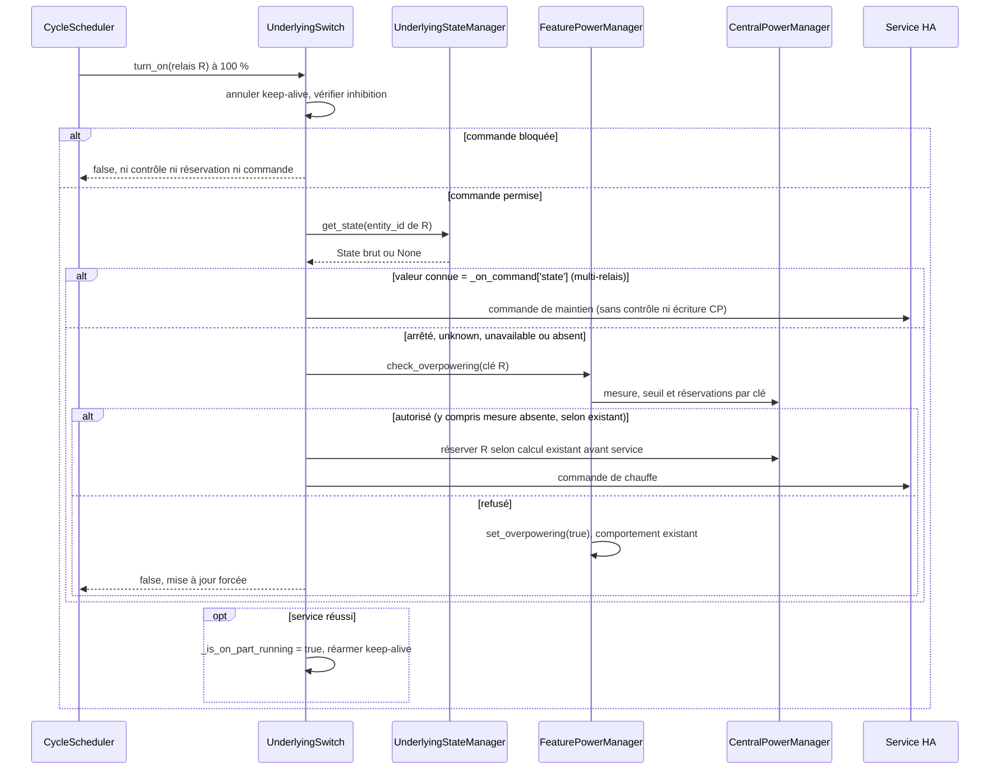

# Conception technique conditionnelle — Issue #2145 : renouvellement d'un cycle multi-relais

| Champ          | Valeur                                                                                                                                                                                                                                                                                                                                                                                                                                                                                                                                                                                                                                                                                                                |
| -------------- | --------------------------------------------------------------------------------------------------------------------------------------------------------------------------------------------------------------------------------------------------------------------------------------------------------------------------------------------------------------------------------------------------------------------------------------------------------------------------------------------------------------------------------------------------------------------------------------------------------------------------------------------------------------------------------------------------------------------- |
| Statut         | Proposition conditionnelle ; **seule la conception est autorisée** ; décision métier BR-005 préalable au développement                                                                                                                                                                                                                                                                                                                                                                                                                                                                                                                                                                                                |
| Version / date | 1.1 / 2026-10-26                                                                                                                                                                                                                                                                                                                                                                                                                                                                                                                                                                                                                                                                                                      |
| Propriétaire   | Projet Versatile Thermostat ; validation métier et technique à confirmer                                                                                                                                                                                                                                                                                                                                                                                                                                                                                                                                                                                                                                              |
| Sources        | [Revue approuvée](issue-2145-review.md), [spécification FR](../specs/issue-2145_fr.md), [spécification EN](../specs/issue-2145_en.md), [ordonnanceur](../../custom_components/versatile_thermostat/cycle_scheduler.py), [sous-jacents](../../custom_components/versatile_thermostat/underlyings.py), [gestionnaire de puissance](../../custom_components/versatile_thermostat/feature_power_manager.py), [gestionnaire central](../../custom_components/versatile_thermostat/feature_central_power_manager.py), [cache d'états](../../custom_components/versatile_thermostat/underlying_state_manager.py), [tests de puissance](../../tests/test_power.py), [tests multi-relais](../../tests/test_multiple_switch.py) |

## 1. Objectif et périmètre

Concevoir la correction la plus petite du recomptage potentiel au renouvellement d'un cycle `over_switch` multi-relais à 100 %, sans masquer le démarrage d'un autre relais. Couverture visée : FR-001 à FR-009, BR-001 à BR-007, AC-001 à AC-011 des spécifications FR/EN v1.1. Aucun changement de code, test, configuration, dépendance ou environnement HA n'est autorisé ici. L'exemption reste conditionnée à l'acceptation métier du risque BR-005.

Conserver les commandes de maintien, le seuil strict, le preset et le refus existants pour les nouveaux démarrages, la puissance totale et sa répartition uniforme, les clés de réservation par relais et la logique des autres taux de marche. Hors périmètre : délestage global par priorité, TPI, puissance configurée individuellement, conversion VA/W, fraîcheur de mesure, politique d'événement/effacement du capteur et protection électrique garantie. L'issue #2120 vise les vrais démarrages simultanés et ne justifie pas d'affaiblir leur contrôle.

## 2. Chemin et limites vérifiés

| Composant                            | Responsabilité et comportement actuel                                                                                                                                                                                                                                                                                                                                                                                                                                                                                                                                                           |
| ------------------------------------ | ----------------------------------------------------------------------------------------------------------------------------------------------------------------------------------------------------------------------------------------------------------------------------------------------------------------------------------------------------------------------------------------------------------------------------------------------------------------------------------------------------------------------------------------------------------------------------------------------- |
| `CycleScheduler._start_cycle_switch` | À `on_time_sec >= cycle_duration_sec`, appelle `turn_on()` sur **chaque** relais sans regarder son état, puis pose `_should_be_on`. Les ticks des cycles partiels suivent un autre chemin ; le premier tick peut aussi imposer une commande. Ne pas supprimer globalement ces appels.                                                                                                                                                                                                                                                                                                           |
| `UnderlyingSwitch.turn_on`           | Annule le keep-alive, vérifie la porte d'inhibition, appelle `check_overpowering`, puis, si autorisé, **réserve avant** l'appel au service HA. Un refus force la mise à jour et peut déclencher `set_overpowering(True)` (arrêt des sous-jacents et preset `power`). Après succès du service, réarme le keep-alive et marque `_is_on_part_running` ; `ServiceNotFound` est journalisé, les autres exceptions sont propagées après annulation du keep-alive. L'échec après réservation n'est pas une preuve de chauffe effective.                                                                |
| `UnderlyingSwitch.is_device_active`  | Lit le dernier état du `UnderlyingStateManager` et compare à `_on_command['state']` (donc `off` peut signifier chauffe en mode inversé). Renvoie `None` si non initialisé ou état absent, mais un `unknown`/`unavailable` **après initialisation** donne `False` par comparaison ; ne pas interpréter `False` seul comme arrêt physique certain. `_is_on_part_running` / `_should_be_on` expriment une commande ou intention, pas une mesure.                                                                                                                                                   |
| `FeaturePowerManager`                | `check_power_available(key)` évalue `current_power + total_reserve - reserve(key) + startup_power < current_max_power`. Si mesure ou seuil manque, renvoie `(True, 0)`. `calculate_underlying_startup_power()` retourne `device_power/n` pour un multi-relais sans consulter **le relais individuel** ; en mono-relais et `over_climate` elle s'appuie sur l'activité globale. `add_power_consumption_to_central_power_manager(key)` **recalcule** cette puissance après le contrôle ; une marginale nulle écrite via `set_started_vtherm_power(key, 0)` supprimerait une réservation pendante. |
| `FeatureCentralPowerManager`         | Réservations temporaires dans un dictionnaire par clé, remplacement idempotent, somme globale et suppression par valeur zéro ou `turn_off`. `_power_sensor_changed` vide le dictionnaire à **chaque événement**, avant `refresh_state()`. `refresh_state()` ne remplace `_current_power` que si la nouvelle valeur numérique diffère ; si elle est invalide, l'ancienne peut rester disponible. Un événement identique n'atteste pas l'inclusion de nouvelles charges.                                                                                                                          |
| `UnderlyingStateManager` / HA        | Cache le dernier `State` reçu, y compris `unknown`, `unavailable` ou `None`. Les timestamps et l'état HA rapportent ce que HA connaît, pas la consommation physique ni sa prise en compte par le capteur de puissance. `get_safe_float` distingue zéro numérique et valeur invalide lors d'une lecture, mais la valeur centrale précédemment mémorisée peut persister.                                                                                                                                                                                                                          |

Les tests actuels valident la clé individuelle, son remplacement et le refus d'un deuxième démarrage lorsque la marge est insuffisante ([test_power.py](../../tests/test_power.py)) ; le test multi-relais existant couvre surtout le délestage après dépassement du maximum. Ils ne prouvent ni la répétition à 100 % sur trois relais inversés déjà chauffants, ni la synchronisation état/mesure. La revue n'a pas pu vérifier le journal brut ou les horodatages physiques du site ; les 5 600 de mesure, 8 504 de seuil et 5 000 W déclarés illustrent le **calcul logiciel**, non une égalité physique VA/W.

## 3. Modèle d'état et contrats proposés

Ne créer aucune entité HA, paramètre public, persistance ou migration. L'état de décision est local à chaque appel `UnderlyingSwitch.turn_on` d'un `over_switch` **multi-relais** ; l'identifiant d'entité du relais reste sa clé de réservation. Lire une fois le `State` brut courant du `UnderlyingStateManager` pour cette entité, sans se limiter à `is_device_active` : après initialisation, `unknown` et `unavailable` y donnent `False` par simple comparaison. Comparer la valeur brute à `_on_command['state']` seulement si le `State` existe et que sa valeur est connue (ni `unknown` ni `unavailable`). Ainsi `off` connu peut être la chauffe d'un relais inversé, tandis que `on` connu est son arrêt.

| Décision locale      | Contrat de `turn_on` proposé                                                                                                                                                                                                                                                                                                                                                                                                                          |
| -------------------- | ----------------------------------------------------------------------------------------------------------------------------------------------------------------------------------------------------------------------------------------------------------------------------------------------------------------------------------------------------------------------------------------------------------------------------------------------------- |
| Chauffe reconnue     | État brut connu égal à `_on_command['state']` : puissance marginale conceptuelle nulle ; après la porte d'inhibition, **ne pas appeler** le contrôle incrémental ni l'écriture de réservation pour cette demande. Émettre tout de même la commande de maintien et conserver l'armement du keep-alive et les effets de succès habituels. Ne pas conditionner ce cas à la mesure ni au seuil.                                                           |
| Chauffe non reconnue | Valeur connue différente, `unknown`, `unavailable` ou `State` absent : chemin existant `check_overpowering` puis écriture de la réservation calculée sur la clé si autorisé, avant la commande. Pour un multi-relais, calcul `device_power/n` inchangé lorsque la puissance est déclarée ; seuil strict et refus/délestage inchangés. Une mesure ou un seuil manquant garde le résultat permissif actuel, sans prétendre qu'une marge a été vérifiée. |

La décision est prise pour le relais individuel et figée pour cet appel : le chemin de démarrage conserve le calcul et la réservation existants, sans changement des appels sans clé, du mono-relais ni de `over_climate`. La voie de maintien **n'écrit jamais zéro** via `set_started_vtherm_power` : cette écriture supprimerait une réservation de la même clé encore pendante, par exemple quand l'état HA passe à chauffe avant l'événement capteur. Elle ne passe pas non plus par `check_power_available` avec `startup_power=0` : sa formule soustrairait `current_started_power` comme si cette réservation était déjà incluse dans `current_power`, autorisant éventuellement un autre effet de bord incorrect ; le seuil strict pourrait même refuser ce maintien seul. Les autres relais non reconnus en chauffe sont contrôlés séparément, avec `started_vtherm_total_power` incluant **toutes** les réservations pendantes, y compris celle du relais maintenu. Un nouvel appel non reconnu sur la même clé reste soumis à la formule de remplacement existante ; `turn_off` et l'événement capteur continuent à libérer les réservations selon les règles actuelles.

Un redémarrage/rechargement perd le cache et les réservations temporaires selon le fonctionnement existant : classer à nouveau l'état brut observé, sans présumer qu'une charge est dans la mesure. L'état HA reconnu comme chauffe ne prouve ni le contact physique ni l'inclusion Linky ; le risque de sous-réservation sur état périmé ou mesure retardée relève exclusivement de BR-005.

## 4. Flux de contrôle proposé, conditionnel

Ne pas utiliser l'activité globale du VTherm, `on_percent` ni l'état d'intention de l'ordonnanceur comme critère de maintien. Le contournement est propre à l'appel du relais déjà reconnu en chauffe : un autre relais arrêté reste soumis à la marge stricte et aux réservations courantes, et le délestage central indépendant n'est pas neutralisé. L'événement du capteur efface toujours les réservations même si sa valeur est inchangée, sans confirmer l'inclusion de la charge.

Conserver l'ordre inhibition, vérification éventuelle, réservation éventuelle, service ; la voie de maintien conserve les exceptions et le réarmement du keep-alive du chemin de commande existant. Sur refus, l'arrêt/preset et la mise à jour restent ceux du chemin actuel ; sur porte fermée, ne ni commander ni réserver. Si le service échoue après réservation, `ServiceNotFound` reste journalisé et les autres exceptions remontent après annulation du keep-alive ; la réservation déjà posée peut subsister selon la convention actuelle. Un service réussi n'acquitte pas l'état physique. Aucun changement n'est proposé au traitement d'un événement capteur entre contrôle et commande ni à la reprise après redémarrage.

## 5. Risque métier et limites

**Décision préalable unique, BR-005 :** option A, le propriétaire métier accepte explicitement la sous-réservation possible si un état HA connu « chauffe » est périmé, si le contact réel est arrêté ou si la mesure n'intègre pas encore sa charge ; alors le critère observable de BR-002 autorise le maintien sans nouveau contrôle incrémental. Option B, ce risque est refusé : garder le contrôle prudent même pour ces états et renoncer à l'exemption locale, en attendant un autre périmètre. Le critère v1.1 ne demande ni preuve d'inclusion Linky ni politique de fraîcheur ; aucune source locale ne saurait démontrer une inclusion physique à partir de l'état HA ou d'un événement capteur. Cette absence est un **risque métier à accepter**, pas un blocage technique supplémentaire pour le périmètre proposé.

Pour `unknown`, `unavailable`, état absent ou connu comme arrêté, aucune exemption : le chemin existant s'applique même en cas de mesure absente. BR-006 maintient le contrôle permissif existant si mesure ou seuil manque ; `0` numérique exploitable suit le seuil strict. AC-007 conserve l'effacement à tout événement du capteur même à valeur identique, ce qui peut laisser une fenêtre de sous-réservation si la mesure est retardée ; le changer serait un autre périmètre. Les unités VA/W et les puissances physiques hétérogènes (`2 000 + 2 000 + 1 000 W` contre `5 000/3 W` par relais dans le modèle déclaré) ne constituent pas une garantie de protection du disjoncteur et ne sont pas modifiées.

## 6. Tests focaux et observabilité

Tests **proposés, non implémentés ni exécutés** : utiliser les fixtures HA simulées de [test_power.py](../../tests/test_power.py) et, pour le cycle complet, [test_multiple_switch.py](../../tests/test_multiple_switch.py) ou les tests existants de `CycleScheduler`. Vérifier l'état HA brut par relais et le sens de `_on_command['state']`, les clés et valeurs réservées, les appels au service, le refus et le preset. Un mock de l'activité globale ne valide pas FR-001/FR-006 ; ces tests vérifient des décisions logicielles, **pas** l'état physique ou l'inclusion Linky. Traces de site expurgées ; aucun essai sur installation réelle sans autorisation.

| Scénario / oracle                                                                                                                                                                                                                                                                                                                                                                                                                                                              | Traçabilité                                              |
| ------------------------------------------------------------------------------------------------------------------------------------------------------------------------------------------------------------------------------------------------------------------------------------------------------------------------------------------------------------------------------------------------------------------------------------------------------------------------------ | -------------------------------------------------------- |
| Trois relais à état HA connu « chauffe » au renouvellement réel du cycle à 100 %, mesure logicielle 5 600, seuil 8 504, puissance déclarée 5 000 ; répétitions avec et sans réservation pendante : trois commandes de maintien, aucune nouvelle réservation/refus/preset `power` dû à ces seuls appels. Refaire avec `off` = chauffe. Sans correction, le deuxième ajout de 1 666,67 donnerait `5 600 + 2 × 1 666,67 > 8 504`. Aucune inclusion dans la mesure n'est supposée. | FR-001/002/004/007 ; BR-001/002/005 ; AC-001/002/011     |
| Un relais reconnu en chauffe et un autre connu arrêté, y compris `on` inversé : sous le seuil strict, contrôler puis réserver `device_power/n` sur la seconde clé ; à égalité ou au-dessus, refus et délestage existants. Refaire avec 2 000, 2 000 et 1 000 W physiques et 5 000 W déclarés : la réservation logicielle reste 5 000/3, sans prétendre couvrir le pic physique.                                                                                                | FR-001/003/004/009 ; BR-001/003/007 ; AC-003/004/010/011 |
| Un relais démarre avec réservation R, son état HA devient « chauffe » avant événement : appels de maintien répétés, même avec mesure au seuil, sans contrôle qui soustrait R ni écriture zéro ; R reste dans le total. Un autre relais non reconnu en chauffe doit être refusé ou autorisé selon `current_power + total_reserve - reserve(autre clé) + device_power/n < max`, et réserver sa propre clé si autorisé.                                                           | FR-002/003/008 ; BR-002/003/004 ; AC-001/006             |
| Mono-relais actif puis arrêté : mêmes appels de contrôle et de réservation qu'avant la correction ; `over_climate` et appels sans clé inchangés.                                                                                                                                                                                                                                                                                                                               | FR-005 ; AC-005                                          |
| État brut arrêté, `unknown`, `unavailable` ou absent, en normal et inversé : contrôle/réservation conservateurs sans exemption même si `is_device_active=False`. Mesure `0` exploitable soumise au seuil strict ; mesure absente/invalide ou seuil absent : résultat permissif actuel sans prétention de contrôle effectif.                                                                                                                                                    | FR-006/007 ; BR-005/006 ; AC-008/009                     |
| Après plusieurs réservations, événement capteur même valeur, valeur modifiée ou invalide : effacement actuel ; vérifier le comportement de `_current_power` sans conclure à l'inclusion de la charge. Après redémarrage/rechargement, reclasser l'état brut sans preuve de mesure ni réservation conservée.                                                                                                                                                                    | FR-007/008 ; BR-004/006 ; AC-007/009                     |
| Porte d'inhibition sur les deux voies, refus du démarrage et erreur du service HA : aucune nouvelle réservation si bloqué/refusé ; une réservation préalablement posée peut subsister sur erreur de service selon l'existant. Vérifier l'annulation/réarmement du keep-alive et la propagation des exceptions hors `ServiceNotFound` sans transformer le retour de service en preuve physique.                                                                                 | FR-003/008 ; convention opérationnelle                   |

Critère de validation futur : scénarios de recomptage échouant avant correction puis réussissant après décision BR-005 et autorisation distincte de développement, sans affaiblir les tests de délestage existants. Des tests simulés ne prouvent ni l'état du contact physique ni l'inclusion de la charge dans la mesure Linky.

## 7. Décisions, traçabilité et passage au développement

- **Faits :** branche à 100 % inconditionnelle, calcul multi-relais non contextualisé, clés par sous-jacent, réservation avant service, cache HA susceptible de retard, effacement à l'événement même avec valeur invalide/identique. Sources liées ci-dessus ; aucune preuve physique de l'installation du rapporteur.
- **Proposition conditionnelle :** branche locale dans `UnderlyingSwitch.turn_on` sur l'état HA brut connu du relais multi-sortie : maintien sans contrôle incrémental ni nouvelle écriture de réservation ; sinon contrôle, réservation et commande existants. Aucune nouvelle API publique, aucune modification de l'ordonnanceur, du capteur ou du modèle de puissance. L'exception « état HA connu mais périmé » est le risque de BR-005, non une preuve d'inclusion.
- **Traçabilité :** AC-001, AC-002 et AC-011 couvrent FR-001, FR-002 et FR-004 avec BR-002 (maintien, inversion et chiffres) ; AC-003, AC-004, AC-010 et AC-011 couvrent FR-003 et FR-009 avec BR-001, BR-003 et BR-007 (démarrage distinct, seuil, répartition) ; AC-005 couvre FR-005 (mono-relais inchangé) ; AC-006 et AC-007 couvrent FR-008 et BR-004 (réservations et effacement) ; AC-008 et AC-009 couvrent FR-006, FR-007 et BR-006 (états non reconnus, mesure absente). Les limites de preuve de FR-007 et le risque de BR-005 sont explicités dans AC-001, AC-007, AC-009 et AC-011. **Aucun AC-001..011 n'est exclu** du périmètre de vérification logicielle ; démonstration d'inclusion Linky et protection physique restent hors périmètre.
- **Décision et conclusion :** périmètre, exigences, AC-001..011, faisabilité technique et testabilité logicielle **convergent sans contradiction bloquante** avec les spécifications FR/EN v1.1, sous réserve de BR-005. **Seule décision métier préalable au développement :** accepter explicitement l'option A et son risque de sous-réservation sur état HA périmé ou mesure non intégrée ; sinon option B sans exemption ni correction du recomptage dans ce périmètre. BR-006, l'effacement AC-007, les exceptions de service et les unités ne sont pas de nouveaux arbitrages requis : ils conservent leur convention actuelle. Aucune autorisation de développement n'a été donnée.