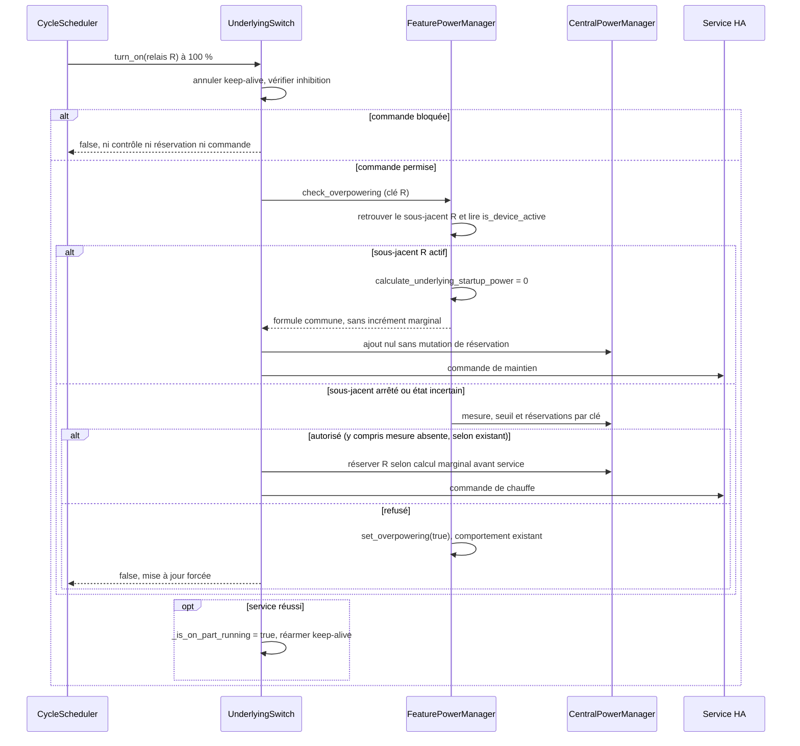

# Conception technique — Issue #2145 : renouvellement d'un cycle multi-relais

| Champ          | Valeur                                                                                                                                                                                                                                                                                                                                                                                                                                                                                                                                                                                                                                                                                                                |
| -------------- | --------------------------------------------------------------------------------------------------------------------------------------------------------------------------------------------------------------------------------------------------------------------------------------------------------------------------------------------------------------------------------------------------------------------------------------------------------------------------------------------------------------------------------------------------------------------------------------------------------------------------------------------------------------------------------------------------------------------- |
| Statut         | Option A de BR-005 acceptée par le propriétaire le 2026-10-26 ; développement autorisé dans le périmètre spécifié                                                                                                                                                                                                                                                                                                                                                                                                                                                                                                                                                                                                     |
| Version / date | 1.1 / 2026-10-26                                                                                                                                                                                                                                                                                                                                                                                                                                                                                                                                                                                                                                                                                                      |
| Propriétaire   | Projet Versatile Thermostat ; validation métier et technique à confirmer                                                                                                                                                                                                                                                                                                                                                                                                                                                                                                                                                                                                                                              |
| Sources        | [Revue approuvée](issue-2145-review.md), [spécification FR](../specs/issue-2145_fr.md), [spécification EN](../specs/issue-2145_en.md), [ordonnanceur](../../custom_components/versatile_thermostat/cycle_scheduler.py), [sous-jacents](../../custom_components/versatile_thermostat/underlyings.py), [gestionnaire de puissance](../../custom_components/versatile_thermostat/feature_power_manager.py), [gestionnaire central](../../custom_components/versatile_thermostat/feature_central_power_manager.py), [cache d'états](../../custom_components/versatile_thermostat/underlying_state_manager.py), [tests de puissance](../../tests/test_power.py), [tests multi-relais](../../tests/test_multiple_switch.py) |

## 1. Objectif et périmètre

Décrire la correction du recomptage potentiel au renouvellement d'un cycle `over_switch` multi-relais à 100 %, sans masquer le démarrage d'un autre relais. Couverture visée : FR-001 à FR-009, BR-001 à BR-007, AC-001 à AC-011 des spécifications FR/EN v1.1. Le propriétaire a accepté l'option A de BR-005 et autorisé le développement le 2026-10-26. Un relais déjà reporté en chauffe par HA n'est pas recompté ; si sa charge n'est pas encore incluse dans la mesure, le seuil configuré peut être temporairement dépassé. Cette fonction logicielle ne protège pas le disjoncteur.

Conserver les commandes de maintien, le seuil strict, le preset et le refus existants pour les nouveaux démarrages, la puissance totale et sa répartition uniforme, les clés de réservation par relais et la logique des autres taux de marche. Hors périmètre : délestage global par priorité, TPI, puissance configurée individuellement, conversion VA/W, fraîcheur de mesure, politique d'événement/effacement du capteur et protection électrique garantie. L'issue #2120 vise les vrais démarrages simultanés et ne justifie pas d'affaiblir leur contrôle.

## 2. Chemin et limites vérifiés

| Composant                            | Responsabilité et comportement actuel                                                                                                                                                                                                                                                                                                                                                                                                                                                                                                             |
| ------------------------------------ | ------------------------------------------------------------------------------------------------------------------------------------------------------------------------------------------------------------------------------------------------------------------------------------------------------------------------------------------------------------------------------------------------------------------------------------------------------------------------------------------------------------------------------------------------- |
| `CycleScheduler._start_cycle_switch` | À `on_time_sec >= cycle_duration_sec`, appelle `turn_on()` sur **chaque** relais sans regarder son état, puis pose `_should_be_on`. Les ticks des cycles partiels suivent un autre chemin ; le premier tick peut aussi imposer une commande. Ne pas supprimer globalement ces appels.                                                                                                                                                                                                                                                             |
| `UnderlyingSwitch.turn_on`           | Annule le keep-alive, vérifie la porte d'inhibition, appelle `check_overpowering`, puis, si autorisé, **réserve avant** l'appel au service HA. Un refus force la mise à jour et peut déclencher `set_overpowering(True)` (arrêt des sous-jacents et preset `power`). Après succès du service, réarme le keep-alive et marque `_is_on_part_running` ; `ServiceNotFound` est journalisé, les autres exceptions sont propagées après annulation du keep-alive. L'échec après réservation n'est pas une preuve de chauffe effective.                  |
| `UnderlyingSwitch.is_device_active`  | Lit le dernier état du `UnderlyingStateManager` et compare à `_on_command['state']` (donc `off` peut signifier chauffe en mode inversé). Renvoie `None` si non initialisé ou état absent, mais un `unknown`/`unavailable` **après initialisation** donne `False` par comparaison ; ne pas interpréter `False` seul comme arrêt physique certain. `_is_on_part_running` / `_should_be_on` expriment une commande ou intention, pas une mesure.                                                                                                     |
| `FeaturePowerManager`                | `check_power_available(key)` conserve la formule commune `current_power + total_reserve - reserve(key) + startup_power < current_max_power`. L'état du sous-jacent ciblé est passé à `calculate_underlying_startup_power`; un relais connu actif a une puissance marginale nulle, un relais à démarrer utilise `device_power/n` (ou `device_power` en mono-sortie). Si mesure ou seuil manque, le résultat permissif existant reste `(True, 0)`. L'ajout d'une puissance nulle ne réécrit pas la clé, afin de préserver une réservation pendante. |
| `FeatureCentralPowerManager`         | Réservations temporaires dans un dictionnaire par clé, remplacement idempotent, somme globale et suppression par valeur zéro ou `turn_off`. `_power_sensor_changed` vide le dictionnaire à **chaque événement**, avant `refresh_state()`. `refresh_state()` ne remplace `_current_power` que si la nouvelle valeur numérique diffère ; si elle est invalide, l'ancienne peut rester disponible. Un événement identique n'atteste pas l'inclusion de nouvelles charges.                                                                            |
| `UnderlyingStateManager` / HA        | Cache le dernier `State` reçu, y compris `unknown`, `unavailable` ou `None`. Les timestamps et l'état HA rapportent ce que HA connaît, pas la consommation physique ni sa prise en compte par le capteur de puissance. `get_safe_float` distingue zéro numérique et valeur invalide lors d'une lecture, mais la valeur centrale précédemment mémorisée peut persister.                                                                                                                                                                            |

Les tests actuels valident la clé individuelle, son remplacement et le refus d'un deuxième démarrage lorsque la marge est insuffisante ([test_power.py](../../tests/test_power.py)) ; le test multi-relais existant couvre surtout le délestage après dépassement du maximum. Ils ne prouvent ni la répétition à 100 % sur trois relais inversés déjà chauffants, ni la synchronisation état/mesure. La revue n'a pas pu vérifier le journal brut ou les horodatages physiques du site ; les 5 600 de mesure, 8 504 de seuil et 5 000 W déclarés illustrent le **calcul logiciel**, non une égalité physique VA/W.

## 3. Modèle d'état et contrats implémentés

Ne créer aucune entité HA, paramètre public, persistance ou migration. `UnderlyingSwitch.turn_on` transmet uniquement sa clé de réservation au contrôle commun. `calculate_underlying_startup_power(key)` retrouve le sous-jacent correspondant via `underlying_entities` et lit son `is_device_active`, qui tient déjà compte des commandes inversées. Un état actif donne une puissance marginale nulle ; un état arrêté, absent ou incertain conserve la puissance de démarrage. Sans clé correspondante, le calcul historique reste utilisé.

| Décision locale      | Contrat de `turn_on` implémenté                                                                                                                                                                                                                                                                                                                                                                                                                       |
| -------------------- | ----------------------------------------------------------------------------------------------------------------------------------------------------------------------------------------------------------------------------------------------------------------------------------------------------------------------------------------------------------------------------------------------------------------------------------------------------- |
| Chauffe reconnue     | Pour une clé correspondant à un sous-jacent actif (`is_device_active is True`), `calculate_underlying_startup_power(key)` retourne zéro. La formule habituelle reste appliquée sans incrément marginal. L'ajout de réservation recalcule via la même clé et n'écrit pas zéro, pour ne pas effacer une réservation pendante. Émettre tout de même la commande de maintien et conserver l'armement du keep-alive et les effets de succès habituels.     |
| Chauffe non reconnue | Valeur connue différente, `unknown`, `unavailable` ou `State` absent : chemin existant `check_overpowering` puis écriture de la réservation calculée sur la clé si autorisé, avant la commande. Pour un multi-relais, calcul `device_power/n` inchangé lorsque la puissance est déclarée ; seuil strict et refus/délestage inchangés. Une mesure ou un seuil manquant garde le résultat permissif actuel, sans prétendre qu'une marge a été vérifiée. |

La décision est calculée pour le relais désigné par la clé de réservation. Un relais actif donne une puissance marginale nulle ; un relais inactif ou d'état incertain reçoit la puissance complète en mono-sortie ou `device_power/n` en multi-sorties. Le contrôle utilise la formule commune de remplacement de réservation. L'ajout de zéro est un no-op, donc une réservation déjà présente sur la clé reste inscrite ; une demande ultérieure pour un autre relais la retrouve dans le total et doit encore passer le seuil strict. `turn_off` et l'événement capteur continuent à libérer les réservations selon les règles actuelles. Les appels sans clé et `over_climate` conservent leur chemin existant.

Un redémarrage/rechargement perd le cache et les réservations temporaires selon le fonctionnement existant : classer à nouveau l'état brut observé, sans présumer qu'une charge est dans la mesure. L'état HA reconnu comme chauffe ne prouve ni le contact physique ni l'inclusion Linky ; le risque de sous-réservation sur état périmé ou mesure retardée relève exclusivement de BR-005.

## 4. Flux de contrôle implémenté

Ne pas utiliser l'activité globale du VTherm, `on_percent` ni l'état d'intention de l'ordonnanceur comme critère de calcul d'un relais. Un autre relais arrêté reçoit sa propre puissance marginale et reste soumis à la marge stricte et aux réservations courantes. L'événement du capteur efface toujours les réservations même si sa valeur est inchangée, sans confirmer l'inclusion de la charge.

Conserver l'ordre inhibition, vérification éventuelle, réservation éventuelle, service ; la voie de maintien conserve les exceptions et le réarmement du keep-alive du chemin de commande existant. Sur refus, l'arrêt/preset et la mise à jour restent ceux du chemin actuel ; sur porte fermée, ne ni commander ni réserver. Si le service échoue après réservation, `ServiceNotFound` reste journalisé et les autres exceptions remontent après annulation du keep-alive ; la réservation déjà posée peut subsister selon la convention actuelle. Un service réussi n'acquitte pas l'état physique. Aucun changement n'est proposé au traitement d'un événement capteur entre contrôle et commande ni à la reprise après redémarrage.

## 5. Risque métier et limites

**Décision BR-005 acceptée le 2026-10-26 :** le propriétaire a retenu l'option A et autorisé le développement. Le risque de sous-réservation est accepté si un état HA connu « chauffe » est périmé, si le contact réel est arrêté ou si la mesure n'intègre pas encore sa charge ; le critère observable de BR-002 autorise donc le maintien sans nouveau contrôle incrémental. Un radiateur affiché en chauffe mais pas encore présent dans la mesure peut entraîner un dépassement temporaire du seuil configuré. Aucune source locale ne démontre l'inclusion physique à partir de l'état HA ou d'un événement capteur. Cette gestion logicielle n'est pas une protection du disjoncteur.

Pour `unknown`, `unavailable`, état absent ou connu comme arrêté, aucune exemption : le chemin existant s'applique même en cas de mesure absente. BR-006 maintient le contrôle permissif existant si mesure ou seuil manque ; `0` numérique exploitable suit le seuil strict. AC-007 conserve l'effacement à tout événement du capteur même à valeur identique, ce qui peut laisser une fenêtre de sous-réservation si la mesure est retardée ; le changer serait un autre périmètre. Les unités VA/W et les puissances physiques hétérogènes (`2 000 + 2 000 + 1 000 W` contre `5 000/3 W` par relais dans le modèle déclaré) ne constituent pas une garantie de protection du disjoncteur et ne sont pas modifiées.

## 6. Tests focaux et observabilité

Tests ciblés implémentés dans [test_power.py](../../tests/test_power.py) : maintien multi-relais normal et inversé, états arrêtés/`unknown`/`unavailable`/absents, relais actif et arrêté évalués séparément, réservation pendante conservée et comptée au contrôle strict suivant, et mono-relais inchangé. Ils vérifient des décisions logicielles, **pas** l'état physique ou l'inclusion Linky. Les suites puissance, multi-relais, inhibition et `over_climate` ont été exécutées avec succès (150 tests). Traces de site expurgées ; aucun essai sur installation réelle sans autorisation.

| Scénario / oracle                                                                                                                                                                                                                                                                                                                                                                                                                                                              | Traçabilité                                              |
| ------------------------------------------------------------------------------------------------------------------------------------------------------------------------------------------------------------------------------------------------------------------------------------------------------------------------------------------------------------------------------------------------------------------------------------------------------------------------------ | -------------------------------------------------------- |
| Trois relais à état HA connu « chauffe » au renouvellement réel du cycle à 100 %, mesure logicielle 5 600, seuil 8 504, puissance déclarée 5 000 ; répétitions avec et sans réservation pendante : trois commandes de maintien, aucune nouvelle réservation/refus/preset `power` dû à ces seuls appels. Refaire avec `off` = chauffe. Sans correction, le deuxième ajout de 1 666,67 donnerait `5 600 + 2 × 1 666,67 > 8 504`. Aucune inclusion dans la mesure n'est supposée. | FR-001/002/004/007 ; BR-001/002/005 ; AC-001/002/011     |
| Un relais reconnu en chauffe et un autre connu arrêté, y compris `on` inversé : sous le seuil strict, contrôler puis réserver `device_power/n` sur la seconde clé ; à égalité ou au-dessus, refus et délestage existants. Refaire avec 2 000, 2 000 et 1 000 W physiques et 5 000 W déclarés : la réservation logicielle reste 5 000/3, sans prétendre couvrir le pic physique.                                                                                                | FR-001/003/004/009 ; BR-001/003/007 ; AC-003/004/010/011 |
| Un relais démarre avec réservation R, son état HA devient « chauffe » avant événement : appels de maintien répétés donnent une marginale nulle, n'écrivent pas zéro et laissent R dans le registre. Le contrôle d'un autre relais non reconnu en chauffe applique `current_power + total_reserve - reserve(autre clé) + device_power/n < max` et réserve sa propre clé si autorisé.                                                                                            | FR-002/003/008 ; BR-002/003/004 ; AC-001/006             |
| Mono-relais actif puis arrêté : mêmes appels de contrôle et de réservation qu'avant la correction ; `over_climate` et appels sans clé inchangés.                                                                                                                                                                                                                                                                                                                               | FR-005 ; AC-005                                          |
| État brut arrêté, `unknown`, `unavailable` ou absent, en normal et inversé : contrôle/réservation conservateurs sans exemption même si `is_device_active=False`. Mesure `0` exploitable soumise au seuil strict ; mesure absente/invalide ou seuil absent : résultat permissif actuel sans prétention de contrôle effectif.                                                                                                                                                    | FR-006/007 ; BR-005/006 ; AC-008/009                     |
| Après plusieurs réservations, événement capteur même valeur, valeur modifiée ou invalide : effacement actuel ; vérifier le comportement de `_current_power` sans conclure à l'inclusion de la charge. Après redémarrage/rechargement, reclasser l'état brut sans preuve de mesure ni réservation conservée.                                                                                                                                                                    | FR-007/008 ; BR-004/006 ; AC-007/009                     |
| Porte d'inhibition sur les deux voies, refus du démarrage et erreur du service HA : aucune nouvelle réservation si bloqué/refusé ; une réservation préalablement posée peut subsister sur erreur de service selon l'existant. Vérifier l'annulation/réarmement du keep-alive et la propagation des exceptions hors `ServiceNotFound` sans transformer le retour de service en preuve physique.                                                                                 | FR-003/008 ; convention opérationnelle                   |

Critère de validation futur : scénarios de recomptage échouant avant correction puis réussissant après décision BR-005 et autorisation distincte de développement, sans affaiblir les tests de délestage existants. Des tests simulés ne prouvent ni l'état du contact physique ni l'inclusion de la charge dans la mesure Linky.

## 7. Décisions, traçabilité et passage au développement

- **Faits :** branche à 100 % inconditionnelle, calcul multi-relais non contextualisé, clés par sous-jacent, réservation avant service, cache HA susceptible de retard, effacement à l'événement même avec valeur invalide/identique. Sources liées ci-dessus ; aucune preuve physique de l'installation du rapporteur.
- **Implémentation :** `UnderlyingSwitch.turn_on` transmet sa clé de réservation au contrôle commun. `calculate_underlying_startup_power(key)` retrouve le sous-jacent et détermine sa puissance marginale via `is_device_active` ; l'ajout nul ne modifie pas une réservation pendante. Aucun booléen d'activité ne traverse les signatures et aucune lecture d'état n'est faite dans `turn_on`. Aucune modification de l'ordonnanceur, du capteur ou du modèle de puissance. L'exception « état HA connu mais périmé » est le risque accepté de BR-005, non une preuve d'inclusion.
- **Traçabilité :** AC-001, AC-002 et AC-011 couvrent FR-001, FR-002 et FR-004 avec BR-002 (maintien, inversion et chiffres) ; AC-003, AC-004, AC-010 et AC-011 couvrent FR-003 et FR-009 avec BR-001, BR-003 et BR-007 (démarrage distinct, seuil, répartition) ; AC-005 couvre FR-005 (mono-relais inchangé) ; AC-006 et AC-007 couvrent FR-008 et BR-004 (réservations et effacement) ; AC-008 et AC-009 couvrent FR-006, FR-007 et BR-006 (états non reconnus, mesure absente). Les limites de preuve de FR-007 et le risque de BR-005 sont explicités dans AC-001, AC-007, AC-009 et AC-011. **Aucun AC-001..011 n'est exclu** du périmètre de vérification logicielle ; démonstration d'inclusion Linky et protection physique restent hors périmètre.
- **Décision et conclusion :** périmètre, exigences, AC-001..011, faisabilité technique et testabilité logicielle **convergent sans contradiction bloquante** avec les spécifications FR/EN v1.1. Le propriétaire a accepté l'option A de BR-005 et son risque le 2026-10-26 ; le développement est autorisé et la correction est implémentée. BR-006, l'effacement AC-007, les exceptions de service et les unités conservent leur convention actuelle. Un relais reporté en chauffe mais dont la charge n'est pas encore mesurée peut temporairement dépasser le seuil ; la gestion logicielle ne protège pas le disjoncteur.