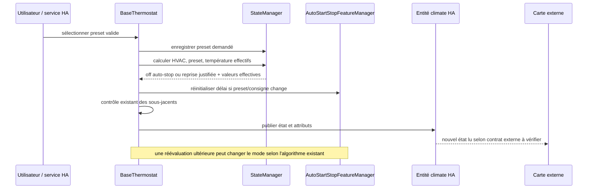

# Conception technique conditionnelle — Issue #2148 : preset pendant un auto-stop `off`

| Champ | Valeur |
| --- | --- |
| Statut | Conception candidate, diagnostic et autorisation de développement encore requis |
| Version / date | 1.0 / 2026-10-24 |
| Propriétaire | Projet Versatile Thermostat ; arbitrage final par le mainteneur |
| Sources | [Issue #2148](https://github.com/jmcollin78/versatile_thermostat/issues/2148), [revue validée](issue-2148-review.md), [spécification fonctionnelle](issue-2148-specification.md), [BaseThermostat](../../custom_components/versatile_thermostat/base_thermostat.py), [StateManager](../../custom_components/versatile_thermostat/state_manager.py), [VThermState](../../custom_components/versatile_thermostat/vtherm_state.py), [AutoStartStopFeatureManager](../../custom_components/versatile_thermostat/feature_auto_start_stop_manager.py), [tests auto-start/stop](../../tests/test_auto_start_stop.py) |

## 1. Objectif et limites

Concevoir la vérification et, **seulement après diagnostic**, la correction minimale de la visibilité du preset et de la consigne lors d'un auto-stop `off` d'un VTherm `over_climate`. Couverture : FR-001 à FR-007, BR-001 à BR-005 et AC-001 à AC-006 de la spécification. Le preset accepté doit rester l'intention utilisateur ; en l'absence d'autre priorité, preset effectif et consigne publiée doivent suivre cette intention même si le mode effectif reste `off`. Si le nouveau preset satisfait réellement les critères de reprise existants, la reprise reste permise, non imposée par la seule sélection.

Hors périmètre : modification des seuils, délais ou de l'algorithme auto-start/stop sans causalité démontrée ; redémarrage forcé, nouveaux attributs/services/configurations, migration, autres modes d'arrêt (`fan_only`, `dry`), autres causes d'arrêt et refonte de la carte. La carte VTherm UI est **externe à ce dépôt** : aucun correctif de son code n'est promis ici. Aucun code, configuration, dépendance ou état HA n'est modifié par cette conception.

## 2. Faits vérifiés et frontières

| Composant | Rôle et état constaté dans le code local | Frontière à vérifier en reproduction |
| --- | --- | --- |
| `BaseThermostat.async_set_preset_mode` | Passe par `check_lock`, convertit en `VThermPreset`, contrôle le mode central puis `_check_preset_mode`, annule le manual override admissible, enregistre le preset demandé et appelle `update_states(force=True)`. Un mode central bloquant retourne sans acceptation ; un preset invalide/non supporté est refusé selon le chemin existant. | Entrée utilisateur/service HA et acceptation ; distinguer rejet et commande acceptée. |
| `StateManager` et `VThermState` | `calculate_current_state` résout successivement HVAC, preset, température ; l'auto-stop peut mettre le HVAC effectif à `off` avec motif dédié sans changer le mode demandé. `requested_state` et `current_state` exposent `hvac_mode`, `preset`, `target_temperature` via `to_dict`. | Demande versus valeurs effectives après priorités. |
| `BaseThermostat.update_states` | Affecte `_attr_preset_mode` (sauf presets cachés), `_attr_target_temperature`, `_attr_hvac_mode` sur changement effectif, lance le contrôle de chauffe lorsque l'état change, met à jour les attributs personnalisés et appelle `async_write_ha_state` si la demande était marquée modifiée. | Vérifier calcul, contrôle, puis écriture HA, et non déduire la publication des seuls attributs Python. |
| `AutoStartStopFeatureManager` | `refresh_state` évalue mode demandé, consigne courante, température, pente et horloge via l'algorithme ; `refresh_and_update_if_changed` recalcule le VTherm si le résultat bascule. `set_auto_start_stop_enable` force la réévaluation. `update_states` réinitialise le délai de bascule lorsque preset ou consigne effectifs changent. | Ne pas confondre remise à zéro du délai et reprise garantie : mesurer la détection et le mode après stabilisation. |
| Entité HA / carte | `update_custom_attributes` inclut `requested_state`, `current_state`, `specific_states.hvac_off_reason`, `hvac_mode_reason` et `auto_start_stop_manager.is_auto_stop_detected`. La carte lit l'entité suivant un contrat **non vérifié** dans ce dépôt. | `hass.states.get(entity_id)` ou outils de développement HA versus rendu de la carte au même instant. |

Le test `test_auto_start_stop_medium_heat_vtherm_preset_change` passe de `eco` à `boost` et constate une reprise, mais ne vérifie pas un `off` persistant ni l'état brut HA. La copie locale et le signalement mentionnent 10.6.1 ; l'identité de l'installation rapportée, le type réel, la version HA et la version de la carte ne sont pas prouvés. Il n'existe ici aucune mesure de délai de propagation ni preuve d'une régression antérieure.

## 3. Modèle d'état et contrat d'échange

| Surface | Champs à relever, sans nouvelle API | Sens attendu |
| --- | --- | --- |
| Interne demandé | `requested_state.hvac_mode`, `.preset`, `.target_temperature` | Intention ; le preset choisi est retenu si accepté, le mode demandé ne devient pas `off` du seul auto-stop. La cible demandée peut rester distincte de la cible calculée pour un preset. |
| Interne effectif | `current_state.hvac_mode`, `.preset`, `.target_temperature` ; `hvac_off_reason`, `hvac_mode_reason` ; `is_auto_stop_detected` | Résultat des priorités et de l'algorithme, pas copie obligatoire de la demande. |
| Entité HA brute | État `climate` (`off` ou mode repris), attributs `preset_mode`, `temperature`, `requested_state`, `current_state`, `specific_states.hvac_off_reason`, `auto_start_stop_manager.is_auto_stop_detected` | Snapshot réellement publié **après** traitement de la commande et des tâches HA ; comparer les attributs publics au calcul effectif. |
| Carte externe | Preset, température cible et mode affichés avec version de la carte | Doivent refléter l'entité HA si FR-006 est approuvée pour ce dépôt externe ; pas de contrat d'implémentation carte présumé. |

Entrée nominale : sélection d'un preset valide pris en charge, via la même interaction que celle du rapporteur (ou `climate.set_preset_mode` pour le test HA), sur l'`entity_id` du VTherm. Sortie : demande acceptée, calcul des contraintes, publication HA sans attente d'une désactivation ni d'une reprise ; aucun SLA chiffré défini. Une sélection bloquée par mode central/lock ou invalide ne doit pas être annoncée comme succès ; préserver les retours/exceptions et la gestion de dérogation manuelle/preset temporisé existants. Une répétition du même preset ne doit pas produire une transition HVAC artificielle ; ne pas inventer de garantie de publication supplémentaire sur commande identique.

Les attributs HA existants constituent le seul snapshot diagnostic ; pas de stockage, événement, capteur ou journal permanent supplémentaire proposé. La restauration des états et de la détection auto-stop suit le cycle existant (`restore_state` dans le manager) : après redémarrage HA, réévaluer et comparer de nouveau demande/effectif/HA ; ne pas garantir la conservation d'un instant d'arrêt sans reproduction du cycle de restauration.

## 4. Diagnostic discriminant et décision de couche

1. Sur instance de test sans équipements réels, relever version intégration/HA/carte, type VTherm, mode d'arrêt configuré, presets et consignes, température ambiante/extérieure, pente, niveau de détection, contraintes actives et geste/service. Préparer deux presets valides à consignes distinctes qui laissent l'auto-stop `off` justifié après sélection ; confirmer au préalable mode demandé non `off`, motif auto-start/stop et `is_auto_stop_detected`.
2. Capturer **avant**, puis **après commande acceptée et stabilisation HA** (`hass.async_block_till_done()` dans les tests), l'interne demandé et effectif, `hass.states.get` de la même entité (état et attributs ci-dessus), puis le rendu de la carte sur la même séquence. Horodater les observations et noter d'éventuelles bascules intermédiaires : température, pente et horloge peuvent modifier la décision de reprise. Relever les commandes aux sous-jacents simulés pour distinguer publication et chauffe. Ne pas utiliser le seul rendu de carte comme oracle du core.
3. Classer le premier écart constaté :

| Résultat à état stable | Diagnostic à confirmer / prochaine action |
| --- | --- |
| Preset demandé inchangé après sélection censée acceptée | Vérifier validation, lock, mode central, entrée service et dérogation ; ne pas corriger la publication avant d'avoir établi l'acceptation. |
| Demande changée mais preset/consigne effectifs anciens, sans priorité explicative | Inspecter `StateManager.calculate_current_preset`, `calculate_current_target_temperature` et leur appel dans `update_states` ; test de calcul isolé puis test HA. |
| Effectif correct mais attributs publics `preset_mode`/`temperature` anciens | Inspecter les gardes `is_changed`/`is_*_changed`, affectations `_attr_*`, `update_custom_attributes`, `async_write_ha_state` et écritures ultérieures ; corriger uniquement le transfert effectif -> entité HA démontré fautif. |
| HA brut à jour mais carte ancienne en `off` | Défaut d'affichage ou de consommation d'état probable : documenter état brut et version de carte, ouvrir/faire approuver un travail dans le dépôt de la carte. **Aucun patch core par déduction.** |
| HA et carte à jour | Incident non reproduit : demander contexte/version/séquence supplémentaire ; aucun correctif justifié. |
| Mode ou motif bascule pendant la mesure | Rejouer en contrôlant consigne, pente, temps et priorités ; ne pas classer un arrêt non persistant comme AC-001. |

Une valeur effective différente de la demande sous priorité documentée n'est **pas** à classer comme valeur périmée ; confronter `temperature_reason`, preset temporisé, fenêtre, présence, mouvement, puissance, sécurité, mode central et inhibition avant d'attribuer le défaut. Si HA est ancien alors que l'effectif est correct, vérifier aussi une réécriture asynchrone après le premier `async_write_ha_state` ; le point exact reste une hypothèse, pas un bug établi.

## 5. Flux, priorités et comportement sûr

| Flux | Résultat à préserver / point de contrôle |
| --- | --- |
| Arrêt persistant (`off`, motif auto-start/stop) | Preset demandé et consigne effective changent sans changement de mode ni commande de chauffe injustifiée. Ne pas appeler `async_turn_on`, modifier la demande HVAC, ni falsifier `is_auto_stop_detected` pour rafraîchir l'affichage. Vérifier l'absence de transition HVAC provoquée par le correctif. |
| Reprise justifiée après sélection ou évolution de température | Conserver le calcul existant de l'algorithme et la réinitialisation du délai déjà prévue ; observer le changement de mode et les nouvelles valeurs sans neutraliser le test de reprise existant. |
| Désactivation ultérieure | `set_auto_start_stop_enable(False)` réévalue la dernière intention avec les priorités présentes ; ni ancien preset ni ancienne consigne, mais pas de marche forcée si mode demandé `off` ou autre arrêt prioritaire. |
| Priorités concurrentes | Inhibition, mode central stoppé, sécurité et fenêtre peuvent imposer un autre motif/mode ; puissance, sécurité, central hors-gel et preset temporisé peuvent changer le preset effectif ; fenêtre éco/hors-gel, présence et mouvement changent la consigne. Vérifier le motif **réel**, ne pas imposer celui de l'auto-stop lorsque supplanté. |
| Entrée refusée ou indisponibilité | Preset absent de la liste, mode central bloquant ou lock : aucun nouveau preset effectif ni reprise issue de cette tentative. Entité/sous-jacent indisponible, capteur invalide ou HA non prêt : ne pas affirmer succès de publication ; noter l'état, rejouer après retour à un état exploitable, conserver les protections existantes. |
| Redémarrage/rechargement | Comparer après restauration des états/manager ; vérifier qu'une dernière intention valide n'est pas remplacée par une ancienne valeur et qu'aucune action intempestive n'est introduite par une éventuelle correction. Ce contrôle n'étend pas les garanties de restauration existantes. |

La reprise reste régie par l'algorithme existant (FR-004, AC-002) ; les priorités concurrentes conservent leurs effets propres sur le demandé, l'effectif et le motif (BR-003, AC-004). Un refus de preset suit la validation existante sans effet de bord (BR-004, AC-005).

**Approche minimale conditionnelle :** en cas de calcul fautif démontré, corriger uniquement la branche de priorité ou de calcul en cause dans `StateManager` ; en cas de publication fautive, corriger uniquement l'affectation ou l'écriture dans `BaseThermostat`, avec test montrant l'écart avant et sa disparition après. Aucune création d'état parallèle ni écriture de présentation masquant un calcul faux. Si seule la carte diverge, arrêter le développement dans ce dépôt, documenter le snapshot HA et obtenir accord sur un dépôt/périmètre distinct avant toute proposition de correction UI. Revoir le périmètre si la reproduction ne concerne pas `over_climate`/`off`.

## 6. Sécurité, observabilité et exploitation

Employer uniquement une instance de développement et des sous-jacents simulés ; ne jamais tester une reprise sur un équipement réel sans autorisation distincte. Expurger `entity_id` privés, températures et journaux avant partage ; aucun secret, droit, télémétrie ou dépendance supplémentaire. Observabilité limitée aux attributs existants, événements de changement de mode/preset et traces temporaires nécessaires au diagnostic ; distinguer les événements de reprise légitime d'une simple écriture d'état. Les vérifications UI nécessitent accès à la carte et à ses versions : les tests de ce dépôt seuls ne certifient pas son rendu.

## 7. Tests prévus et critères de passage

Tests proposés **après autorisation de développement**, en réutilisant [test_auto_start_stop.py](../../tests/test_auto_start_stop.py), ses fixtures `over_climate` et sous-jacents simulés ; capturer l'entité via `hass.states.get` après traitement des tâches HA. Éviter la temporisation réelle en maîtrisant horloge et mesures du test voisin. Vérifier la publication finale et l'absence de commande de chauffe nouvelle en arrêt persistant, pas uniquement les champs internes. Aucun test ni essai de carte n'est revendiqué comme déjà exécuté.

| Test explicite / oracle | Traçabilité |
| --- | --- |
| Deux presets valides de consignes différentes, température/pente choisies pour conserver `off` ; avant/après, vérifier demande, effectif, attributs HA `preset_mode` et `temperature`, état `off`, `hvac_off_reason` et `is_auto_stop_detected`, et absence de nouvelle commande de chauffe. Comparer la carte sur la même séquence si périmètre externe approuvé. | FR-001, FR-002, FR-003 ; BR-001, BR-002 ; AC-001, AC-006 |
| Preset qui justifie la reprise, avec l'algorithme inchangé ; vérifier événement/mode, valeurs HA et non-régression de `test_auto_start_stop_medium_heat_vtherm_preset_change`. | FR-002, FR-004 ; BR-002 ; AC-002 |
| Après arrêt persistant, désactiver par le contrôle existant ; vérifier dernier preset/consigne et respect du mode demandé `off` ou d'un arrêt concurrent dans un cas séparé. | FR-001, FR-005 ; BR-005 ; AC-003 |
| Fenêtre avec action éco/hors-gel ou présence/mouvement : vérifier cible effective et HA différents de la valeur nominale si la priorité l'exige ; cas séparés inhibition, mode central stoppé et sécurité, plus puissance/preset temporisé selon couche affectée : vérifier motif et preset effectifs, sans les écraser. | FR-002, FR-003, FR-005 ; BR-003 ; AC-004 |
| Preset non supporté (`ValueError` existant), mode central bloquant (et verrou si activé) ; vérifier demande/effectif/HA inchangés et aucune relance induite. | FR-007 ; BR-004 ; AC-005 |
| Comparer les quatre surfaces à instant stable : si seul UI diverge, ticket externe ; si calcul diverge, test unitaire ciblé ; si HA diverge, test de publication et d'écriture différée ; si tout concorde, reproduction à préciser. | FR-002, FR-006 ; AC-001, AC-006 |
| Recharger/restaurer en environnement simulé après changement accepté et contrôler la cohérence demande/effectif/HA, sans imposer de nouvelle sémantique de restauration. Étendre aux autres types seulement sur preuve de chemin partagé défectueux. | FR-001, FR-005 ; BR-001, BR-005 ; AC-003 (risque de reprise) |

**Gates :** (1) reproduction instrumentée et branche de diagnostic tranchée ; (2) validation par le mainteneur de cette conception et de la couche retenue, autorisation **explicite** de développer et, pour la carte, approbation du dépôt/périmètre externe ; (3) seulement alors, test ciblé échouant sur le défaut confirmé, correction minimale puis tests ci-dessus et voisins des priorités impactées ; (4) vérification HA brute, et UI uniquement dans le périmètre autorisé. Le développement reste bloqué tant que (1) et (2) ne sont pas satisfaits.

## 8. Hypothèses, risques, décisions et convergence

- **Hypothèses ouvertes :** un scénario à consigne différente restant `off` est constructible ; l'installation du rapporteur passe par la même entrée que le test ; la carte pourrait garder une ancienne valeur, ou l'entité HA pourrait être réellement périmée. Aucune branche n'est confirmée.
- **Risques :** reset du délai de commutation lors du changement de preset/consigne et variations de pente/temps peuvent provoquer une reprise *légitime* pendant l'observation ; des priorités ou écritures ultérieures peuvent masquer le premier écart ; un correctif trop large pourrait démarrer le chauffage, perturber la restauration ou casser les autres VTherm. Mesures : contrôle de l'horloge, des contraintes, des sous-jacents et du snapshot après stabilisation, tests voisins selon la couche corrigée.
- **Décisions encore nécessaires :** environnement et séquence reproduisant #2148 (versions, type, presets, températures, pente, priorité, service/interaction), première frontière fautive, choix du dépôt si seule la carte diverge, et seconde autorisation humaine de développement. Aucun correctif n'est choisi avant ces décisions.
- **Convergence avec la spécification :** même périmètre `over_climate` + auto-stop `off` ; matrice couvrant FR-001 à FR-007, BR-001 à BR-005 et AC-001 à AC-006 ; aucune contradiction bloquante identifiée. La conception est **réalisable et testable comme protocole conditionnel**, mais la cible du correctif et la validation UI restent conditionnées au diagnostic et à l'accès/accord sur la carte externe. Aucune divergence fonctionnelle intentionnelle ; la non-garantie d'une conservation stricte après redémarrage évite d'inventer une exigence de persistance absente de la spécification.