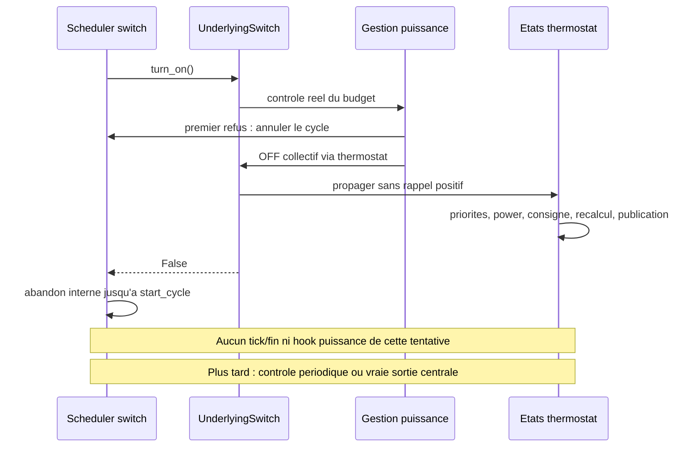
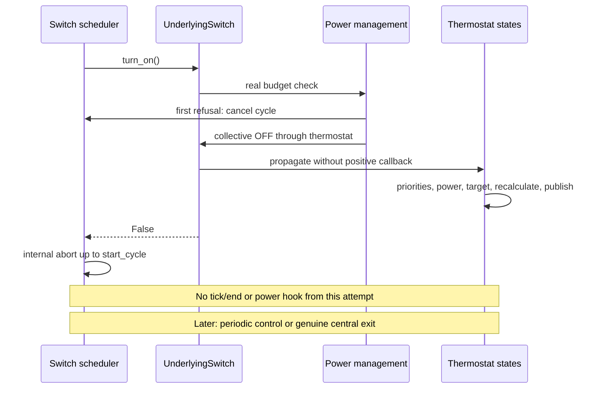

# Issue #2206 - Conception detaillee / Detailed Design

## Etat courant / Current Status - 2026-11-17

**FR - Faisant foi :** l'option A de `315bc37` n'a pas ete reimplementee ni modifiee en production. La reprise a ajoute dans `tests/test_power.py` une sequence reelle serialisee de refus, changements utilisateur, fenetre et securite, puis reprise ; le test existant des deux cycles 2 % a ete debloque de son attente avec horloge figee et son assertion a ete adaptee a l'arrondi public, sans toucher a la formule. AC-010 et erreur de nettoyage etaient deja presents dans `tests/test_cycle_scheduler.py` et ont ete executes.

Tests cibles : **44 reussites, 5 avertissements, 2,39 s** ; campagne exacte de 16 fichiers : **451 reussites, 5 avertissements, 25,09 s**. Voir la [passation courante du rapport](issue-2206-review.md) pour les commandes, la preuve par AC, les echecs intermediaires et diagnostics. Multi-relais partiel avec observation retardee dans le refus et parcours complet virtuel/inverse apres sortie centrale restent non prouves ; une campagne verte ne certifie pas tous les AC. Le montant P1, les courses generales et callbacks deja distribues restent exclus. Guide HA MCP depuis charge et consulte en lecture seule par le principal ; aucune reference supplementaire ne cible ces changements de tests Python et documentation. Comparaison diagnostique partielle, sans modification de la base signalee. Aucun HA reel, deploiement, redemarrage, commit, push, cloture ou revue postdeveloppement ; attendre validation utilisateur avant cette revue. Les sections et passations suivantes conservent l'historique et ne priment pas sur ce statut.

**EN - Authoritative:** option A in `315bc37` was neither reimplemented nor changed in production. This continuation adds a serialized real-path refusal, user-change, window, safety and recovery scenario in `tests/test_power.py`; the existing two-cycle 2% test was unblocked from its frozen-clock wait and corrected for rounded public output without changing the formula. AC-010 and cleanup-error cases already existed in `tests/test_cycle_scheduler.py` and were executed.

Focused tests: **44 passed, 5 warnings, 2.39 s**; exact 16-file campaign: **451 passed, 5 warnings, 25.09 s**. See the [current review handoff](issue-2206-review.md) for commands, evidence by AC, intermediate failures and diagnostics. Partial multi-relay refusal with delayed observation and complete virtual/inverted recovery after central exit are not proven; a green campaign does not certify every AC. P1 energy, general races and already-dispatched callbacks remain excluded. The principal has since loaded and read the HA MCP guide read-only; no additional reference targets these Python test and documentation changes. Diagnostics comparison is partial, with no change to the reported base file. No real HA, deployment, restart, commit, push, issue closure or post-development review; await user approval before review. Later handoffs and sections are historical and do not supersede this status.

## Point de reprise historique / Historical Handoff - 2026-11-17

**FR - Etat courant faisant foi :** option A autorisee puis implementee, six fonctions existantes et `_cleanup_refused_start` dans quatre fichiers de production. La conception 0.2 et ses exclusions restent inchangees ; les mentions de developpement encore interdit et d'analyse seulement statique ci-dessous sont historiques. Le [rapport](issue-2206-review.md) consigne les fichiers modifies, commandes, preuve rouge/vert, 447 tests verts dont 40 cibles inclus, diagnostics et limites. Pas de validation finale ni de revue postdeveloppement.

**Prochaine intervention : tests et preuves manquants, pas nouvelle conception.** Reprendre les vrais chemins existants et aides de timers dans les deux fichiers de tests deja modifies. Completer AC-007 (priorites/reprise stabilisees), AC-010 (interruption 30 s, annulation temps fige, OFF et ancienne echeance), AC-012 (deux cycles 2 % brut / 0 applique, montant actuel accepte). Chaque timer doit avoir son handle distinct ; ne pas masquer les chemins reels par des mocks complets de `turn_on` ou `update_states`. Aucun correctif de formule energetique P1 ni garantie generale de concurrence a ajouter.

Verifier egalement la couverture multi-relais/observations retardees et virtuel/inverse, puis relancer la campagne de 16 fichiers du rapport apres les derniers edits. Conserver le traitement distinct de `False`, `None` et des erreurs, les gates, OFF collectif et reprise periodique/centrale. Un echec qui exige une extension de production hors option A impose un arbitrage, pas un durcissement automatique. Comparer les diagnostics sans nettoyage gratuit et consigner exactement les nouveaux resultats.

L'utilisateur a annonce les outils manquants ajoutes, mais aucun controle de disponibilite ni test complementaire n'a suivi : cette verification est la premiere etape technique de la prochaine session. Ne pas repeter comme actuel l'ancien blocage MCP sans le verifier. Cette passation est documentaire uniquement. Apres verification, presenter le bilan et attendre l'accord utilisateur avant l'agent `Revue post-développement` ; aucun commit, push, deploiement ou cloture autorise.

**EN - Authoritative current status:** option A was authorized and implemented, touching six existing functions and `_cleanup_refused_start` in four production files. Design 0.2 and exclusions are unchanged; development-prohibition/static-only statements below are historical. The [review](issue-2206-review.md) records files, exact commands, red/green evidence, 447 passing tests including 40 focused cases, diagnostics and limitations. Final user approval and post-development review remain pending.

Next intervention is verification, not redesign: complete **AC-007** settled priorities/recovery, **AC-010** ordinary 30-second interruption/frozen-time cancellation/OFF through the old deadline, and **AC-012** two raw 2% / applied 0% cycles accepting the current energy amount. Reuse the two edited test files, real control paths and distinct timer handles. Do not implement P1 energy or general concurrency hardening. Clarify multi-relay/delayed-observation and virtual/inverted coverage, rerun focused checks immediately after edits and then the report's 16-file campaign. Preserve `False` versus `None`/error semantics, command gates, collective OFF and existing recovery. Escalate any required scope expansion rather than silently extending production code.

The user reported adding missing tools, but no availability check or further test followed. Verify this first next session; do not assume the previous MCP failure still applies. Qualify diagnostics without unrelated cleanup, record actual results, then request user approval before post-development review. Documentation-only handoff; no commit, push, deployment or issue closure authorized. The review handoff contains the ordered checklist.

## FR - Version francaise

### 1. Metadonnees, statut et sources

| Champ                    | Valeur                                                                                                                                                                                           |
| ------------------------ | ------------------------------------------------------------------------------------------------------------------------------------------------------------------------------------------------ |
| Version / date           | 0.2 / 2026-11-16                                                                                                                                                                                 |
| Statut                   | Convergence documentaire 3/3 avec specification 0.2 ; meme option A conditionnelle, validation utilisateur finale du perimetre requise ; analyse statique uniquement                             |
| Proprietaire             | Projet Versatile Thermostat ; decisions finales au mainteneur/utilisateur                                                                                                                        |
| Autorisation             | SPECIFICATION + CONCEPTION autorisees ce tour ; intervention presente limitee a ce document bilingue unique, emplacement explicitement demande ; aucun developpement                             |
| Entrees                  | [Specification 0.2](issue-2206-specification.md) et conception 0.2 relues integralement en FR/EN au cycle 3 ; [revue preservee](issue-2206-review.md), lecture du cycle precedent non renouvelee |
| Priorite directrice      | Plus petite cause et plus petite solution satisfaisant les invariants, risque de regression minimal                                                                                              |
| Passage au developpement | Interdit sans autorisation distincte ; D-01 de la specification reste ouvert                                                                                                                     |

Convention : **F** = fait lu dans le depot ; **D** = decision proposee ; **H** = hypothese non reproduite ; **V** = verification future. Les references de lignes designent l'etat local lu, pas un futur patch. La revue et la specification ne sont pas modifiees.

Les consignes HA ont ete demandees a nouveau via `ha_get_skill_guide` au cycle 3 : connexion MCP en echec ; contenu et references inaccessibles. Aucun controle HA, lancement HA, autre agent, test applicatif ou changement d'environnement. Les six fonctions de la section 4, l'annulation scheduler et l'OFF collectif existants ont ete relus statiquement pour verifier la faisabilite locale ; les autres faits F restent les lectures du cycle precedent, non un nouvel audit integral. Aucun export complet ni mesure physique n'a ete inspecte dans ce tour.

### 2. Objectif, perimetre et recommandation

**Correction de position historique :** la conception 0.1 n'etablissait pas sa minimalite. Capturer `_states` dans tous les rappels est une generation semantique, meme sans compteur ; la propager aux hooks et remanier annulation/retrait elargissait nettement le changement. Ses conclusions « sans nouvelle generation », « toutes les exigences P0 couvertes » et « aucune contradiction bloquante » restent retirees pour ce perimetre large. La couverture du perimetre borne de la specification 0.2 est examinee separement en section 10.

**D-01 - Recommander A, sous validation utilisateur d'une reduction fonctionnelle explicite :** propagation sans rappel positif depuis le refus natif TPI, puis abandon du chemin switch sur retour explicite `False` de `turn_on`, avec signal interne jusqu'a `start_cycle`. Le booleen public ne change pas.

| Choix                                             | Surface de conception, hors futurs tests                                                                         | Portee                                                                                                                                                               |
| ------------------------------------------------- | ---------------------------------------------------------------------------------------------------------------- | -------------------------------------------------------------------------------------------------------------------------------------------------------------------- |
| A - Minimal ticket, recommande conditionnellement | 4 fichiers ; 6 fonctions existantes + 1 petite auxiliaire privee, section 4                                      | Premier refus et refus stables sans recursion, ON suivant ni rearmement de la tentative ; pas de garantie generale sur les remplacements concurrents/hooks suspendus |
| B - Durcissement, non retenu par defaut           | La 0.1 touchait au moins 13 fonctions existantes dans les memes 4 fichiers : 3 de propagation et 10 du scheduler | Appartenance a propager a l'annulation, l'initialisation, aux rappels tick/fin, aux trois emetteurs de hooks et au retrait ; preuve/non-regressions plus larges      |

Comptes de zones, pas estimations de lignes/jours ni preuve de minimalite de B. A evite notamment les changements de `_init_cycle`, `_cancel_cycle_impl`, `_on_master_cycle_end`, `shutdown` et des trois emetteurs. B resterait a reconcevoir si les garanties larges etaient confirmees ; la 0.1 n'est pas validee.

**Scope A propose, identique a la specification 0.2 :** chemin natif `over_switch` TPI mono/multi, virtuel/inverse ; premier refus reel, refus deja actif/incoherent, reprise periodique/centrale serialisee, OFF rencontre pendant ce refus. Partir d'au plus un jeu de timers reference, sans timers deja orphelins, et laisser terminer les traitements bornes associes. Exclure de la certification A : commande positive remplacant le cycle pendant un await, hooks reentrants, double annulation imbriquee, rappel deja distribue avant annulation, retrait pendant operation suspendue, ON reussi croisant OFF. Ces exclusions integrees a la specification 0.2 requierent validation utilisateur finale ; elles ne rendent pas ces courses impossibles et ne dispensent jamais de OFF sur tentative effectivement refusee.

Le montant energetique selon chauffe appliquee reste P1 : A vise les rafales, pas les quelque 5,833 Wh par echeance normale du cas brut 2 %/applique 0 %. Les reductions par rapport a la specification 0.1 ET au rapport sont integrees a la specification 0.2 et tracees en section 10 ; elles restent une proposition soumise a validation utilisateur finale, sans autorisation de developper.

### 3. Existant verifie et dependances

| Ref. | Fait et ancrage local                                                                                                                                                                                                                                                                                | Consequence de conception                                                                                                                    |
| ---- | ---------------------------------------------------------------------------------------------------------------------------------------------------------------------------------------------------------------------------------------------------------------------------------------------------- | -------------------------------------------------------------------------------------------------------------------------------------------- |
| F-01 | [underlyings.py](../../custom_components/versatile_thermostat/underlyings.py#L282) : `check_overpowering()` appelle `set_overpowering(True)` puis retourne `False`                                                                                                                                   | Garder ce contrat et le controle reel, sans nouveau resultat public                                                                          |
| F-02 | [underlyings.py](../../custom_components/versatile_thermostat/underlyings.py#L599) : chaque refus force `requested_state`, attend `update_states(force=True)` puis retourne `False`                                                                                                                  | Point de suppression du rappel de chauffe, pas du refus                                                                                      |
| F-03 | [feature_power_manager.py](../../custom_components/versatile_thermostat/feature_power_manager.py#L148) : comparaison stricte, reservations par relais ; `set_overpowering()` est idempotent                                                                                                          | Ni seuil, ni reservation, ni gestionnaire central a modifier                                                                                 |
| F-04 | [base_thermostat.py](../../custom_components/versatile_thermostat/base_thermostat.py#L2144) : OFF collectif = annulation scheduler puis OFF de chaque sous-jacent                                                                                                                                    | Ce premier OFF demeure immediat ; il invalide le demarrage suspendu                                                                          |
| F-05 | [base_thermostat.py](../../custom_components/versatile_thermostat/base_thermostat.py#L1880) : priorites, effets d'etat, recalcul puis attente du controle, enfin remise a zero des indicateurs                                                                                                       | Separer seulement la propagation d'etat et le rappel positif de chauffe ; ne pas avancer globalement `reset_changed()`                       |
| F-06 | [vtherm_state.py](../../custom_components/versatile_thermostat/vtherm_state.py#L74) : indicateurs conserves par OU logique                                                                                                                                                                           | Des indicateurs encore vrais ne prouvent pas une nouvelle transition                                                                         |
| F-07 | [state_manager.py](../../custom_components/versatile_thermostat/state_manager.py#L95) : inhibition, arret central, securite, fenetre et autres regles calculent le mode ; `power` ne force pas HVAC OFF                                                                                              | Reutiliser ces calculs, sans les recopier dans le refus                                                                                      |
| F-08 | [thermostat_prop.py](../../custom_components/versatile_thermostat/thermostat_prop.py#L241) : seul override local de `update_states()` ; delegation puis `on_state_changed(changed)`                                                                                                                  | Une option privee de propagation doit traverser cet override ; TPI `on_state_changed` est sans action                                        |
| F-09 | [prop_handler_tpi.py](../../custom_components/versatile_thermostat/prop_handler_tpi.py#L285) : le controle positif appelle `start_cycle` ; le chemin OFF annule meme un cycle en phase OFF                                                                                                           | Conserver ce traitement d'arret et la signature du handler                                                                                   |
| F-10 | [cycle_scheduler.py](../../custom_components/versatile_thermostat/cycle_scheduler.py#L277) : `force=True` contourne les gardes ; `_is_starting` ne l'empeche pas                                                                                                                                     | `force=False` n'est pas une barriere de reentrance suffisante                                                                                |
| F-11 | [cycle_scheduler.py](../../custom_components/versatile_thermostat/cycle_scheduler.py#L604) : 100 % ignore le retour ON puis installe une fin ; partiel attend `_tick()` puis installe une fin ; `_tick()` ignore aussi le retour ON                                                                  | Consommer et remonter `False` dans les deux branches et leur appelant                                                                        |
| F-12 | [cycle_scheduler.py](../../custom_components/versatile_thermostat/cycle_scheduler.py#L837) : handles annules avant hooks, `_states` remplace et modes remis a `None` apres ; seules deux references de timers                                                                                        | Invalidation tardive ; le refus explicite borne la continuation, mais les courses d'annulation restent hors garantie A                       |
| F-13 | [cycle_scheduler.py](../../custom_components/versatile_thermostat/cycle_scheduler.py#L792) : energie par fin naturelle ; interruption notifiee seulement si duree > 1 s                                                                                                                              | Ne changer ni formule ni eligibilite ; annuler n'est pas crediter                                                                            |
| F-14 | [thermostat_switch.py](../../custom_components/versatile_thermostat/thermostat_switch.py#L108) : controle periodique tous les `cycle_min` ; [feature_central_power_manager.py](../../custom_components/versatile_thermostat/feature_central_power_manager.py#L178) : sortie, puis propagation forcee | Reprise sans nouveau mecanisme de retry et sans restart HA                                                                                   |
| F-15 | [feature_safety_manager.py](../../custom_components/versatile_thermostat/feature_safety_manager.py#L237) : precedent `async_create_task` pour eviter une recursion ; [base_thermostat.py](../../custom_components/versatile_thermostat/base_thermostat.py#L645) : annulation `recalculate_later`     | Le precedent n'est pas une preuve d'ordre ; les implementations de recalcul retarde sont celles des valves/climates, pas une barriere switch |
| F-16 | [cycle_scheduler.py](../../custom_components/versatile_thermostat/cycle_scheduler.py#L937) : hooks debut/recus avant ON, puissance apres demarrage ; [prop_handler_tpi.py](../../custom_components/versatile_thermostat/prop_handler_tpi.py#L255) : Auto TPI                                         | Ne pas retracter les hooks deja emis ; eviter le hook puissance post-refus sans retoucher son emetteur                                       |

**H-01 :** la recursion et les timers dont les references sont ecrasees expliquent les rafales rapportees. L'ordre des attentes et la vulnerabilite sont verifies statiquement ; le deroulement exact des exports, le nombre de timers survivants et une exception de recursion ne sont pas demontres.

Les tests lus donnent des bases, pas une reproduction : [test_cycle_scheduler.py](../../tests/test_cycle_scheduler.py#L79) emploie souvent un meme `mock_cancel` pour plusieurs timers ; [test_power.py](../../tests/test_power.py#L790) simule `turn_on()` pour delestage/reprise ; son aide [multi-relais](../../tests/test_power.py#L335) simule `update_states()` et OFF collectif. Ces doubles ne doivent pas etre l'unique preuve P0.

### 4. Composants et zones necessaires pour A

| Zone future                          | Responsabilite                                                                                                                                                                     | Contre-exemple concret justifiant le changement                                                                                              |
| ------------------------------------ | ---------------------------------------------------------------------------------------------------------------------------------------------------------------------------------- | -------------------------------------------------------------------------------------------------------------------------------------------- |
| `UnderlyingSwitch.turn_on`           | Au refus TPI natif, garder `force_changed`, propager sans controle positif                                                                                                         | 11,9 pour `power` 13 : demande positive, donc rappel immediat du demarrage refuse                                                            |
| `BaseThermostat.update_states`       | Option interne keyword-only `_control_heating=True` ; `False` conserve calcul, recalcul, publication et reset ; omet seulement le controle positif ; garde l'arret si OFF effectif | Sauter la propagation laisse preset/consigne faux ; rappeler le controle recree la boucle ; supprimer aussi OFF neutraliserait un vrai arret |
| `ThermostatProp.update_states`       | Accepter/transmettre cette option ; `on_state_changed(changed)` inchange                                                                                                           | L'appel reel traverse cet override : une option dans la seule base serait rejetee ou perdue                                                  |
| `CycleScheduler._tick`               | Capter la liste juste avant chaque ON ; sur retour explicite `False`, ne pas marquer ON, nettoyer si necessaire puis retourner `False` hors de toute la boucle, sans tick suivant  | Annulation remplace la liste, mais l'iterateur peut continuer l'ancienne ; actuellement le refus marque aussi `_should_be_on=True`           |
| `CycleScheduler._start_cycle_switch` | Meme borne a 100 % ; remonter `False` du tick initial avant d'armer la fin                                                                                                         | Sortir du seul tick laisse encore son appelant armer une fin ; 100 % n'emprunte pas le tick                                                  |
| `CycleScheduler.start_cycle`         | Sur `False` du demarrage switch, sortir avant offsets/hook puissance ; API et `finally` historiques conserves                                                                      | CYCLE_START puissance est actuellement emis meme apres annulation par le refus                                                               |
| Petite auxiliaire privee scheduler   | Mutualiser le nettoyage apres refus des deux routines switch ; reutiliser OFF collectif seulement pour le cycle encore courant, section 5                                          | Deja deleste, relais 1 ON et ON du relais 2 refuse : abandonner seulement les timers laisserait le premier allume sans OFF programme         |

Cette auxiliaire evite deux politiques de nettoyage divergentes ; aucun nouveau fichier. Tous les sites ON de `_tick`, y compris enforcement initial avec observation variable, doivent respecter la borne. Aucun changement de handlers, gestionnaires de puissance, machine d'etat, formule energetique ou schema persiste. Option de propagation reservee au TPI natif ; autres handlers non audites. Le traitement scheduler de `False` touche aussi le refus par gate : effet partage a verifier, pas a masquer.

### 5. Donnees, etats et invariants existants

**D-02 : signal interne d'abandon.** `turn_on()` garde son booleen public et ses erreurs. Seuls `_tick` et `_start_cycle_switch` rendent un `False` interne consomme par leurs appelants ; succes historique peut rester `None`, ignore des callbacks HA. Tester `result is False`, pas `not result` : `ServiceNotFound` peut actuellement finir sans booleen explicite.

- `_current_hvac_mode is None` indique une annulation terminee, pas une identite. Un remplacant peut avoir mode/temps identiques ; `is_cycle_running` reste vrai pendant les transitions. Ni ces booleens ni un timestamp n'est une preuve d'appartenance.
- L'annulation remplace deja `_states`, meme liste vide a 100 %. Capter cette reference juste avant ON (apres `_init_cycle` au partiel) permet une comparaison d'identite au retour, sans modifier l'initialisation ni l'enregistrement des timers.
- Sur `False`, identite differente = annulation/remplacement : ne pas nettoyer le nouveau cycle. Identite identique + mode non nul + pas de `_is_cancelling` = cycle encore present : appeler OFF collectif existant. `_is_cancelling=True` = ne pas reentrer l'annulation ; laisser celle en cours finir. Dans tous les cas, remonter l'abandon.

Cette comparaison est encore un indice d'epoque semantique, pas une pretendue absence de toute generation. Elle reste locale aux deux routines de commandes et a leur auxiliaire : aucun passage aux hooks, timers, fin, retrait ou API. Elle evite de nettoyer un remplacant, sans garantir son integrite globale. Les champs partages et les `finally` restent un probleme de B si cette garantie est requise.

| Etat au retour `False`                     | Traitement A                                                                            |
| ------------------------------------------ | --------------------------------------------------------------------------------------- |
| Premier delestage, OFF/annulation termines | Aucun second OFF collectif ni seconde annulation ; zero timer de cette tentative        |
| Deja deleste, cycle encore courant         | Annulation et OFF collectif, puis abandon ; pas de nouveau credit ni d'entree `power`   |
| Annulation externe en cours                | Pas de reentree ; aucun nouvel ON/timer par cette tentative ; compter apres terminaison |
| Liste remplacee                            | Ne pas annuler le remplacant depuis ce nettoyage ; integrite globale non certifiee      |

Pas de nouvelle donnee persistee, entite, helper, service, evenement HA ni migration. Intention preset/consigne demandee conservee par les mecanismes existants.

### 6. Interfaces et contrats

**C-01 - Propagation :** `update_states(force=True, _control_heating=False)` envisage pour le refus natif TPI ; option absente = historique. Calculer les priorites courantes, garder OFF normal, recalcul, publication et reset. Ne pas avancer globalement `reset_changed`, coder une cible `power` a la main ou ignorer un etat incoherent parce que deja deleste. `on_state_changed` TPI reste sans action.

**C-02 - Borne :** des `False`, aucun ON suivant, aucun marquage `_should_be_on=True`, aucun armement tick/master et aucun hook puissance de demarrage par la continuation appelante. Seuls les OFF necessaires au nettoyage d'un cycle encore courant peuvent suivre. Les hooks debut/recus deja emis avant ON ne sont ni retractes ni desactives. Pas de promesse universelle sur tous hooks apres toute annulation.

**C-03 - Deja deleste :** recommander l'abandon propre. Conserver un master deja arme et reprendre a son echeance est possible mais impose une politique differente selon tick courant/demarrage, relais deja ON et eligibilite du cycle partiellement refuse. Ce surcout n'est pas justifie pour ce ticket. A ajoute donc une interruption eligible eventuelle (> 1 s), aucun credit d'annulation et OFF collectif si necessaire. Changement fonctionnel visible a approuver, pas consequence automatique de l'idempotence actuelle.

**C-04 - Reprise :** zero timer scheduler temporairement admissible ; controle periodique existant tous les `cycle_min` ou vraie sortie centrale, sans retry, tache differee ni nouveau delai. La chauffe sous `power` reste possible mais doit repasser budget et protections. Pas de delai physique maximal garanti ; un controle deja en cours peut influer sur l'ordre des traitements.

**C-05 - Erreurs :** traiter le resultat `False` hors du `except Exception` des commandes dans `_tick` : une erreur de nettoyage doit quitter le demarrage, pas etre avalee puis suivie d'un armement. Ne pas convertir `None`/exception en refus de puissance ni changer les traitements existants des services. OFF physique non garanti si erreur ou gate bloquant ; aucun contournement du gate. Les branches valves restent inchangees.

### 7. Flux et limites des OFF concurrents

**PREMIER refus :** OFF collectif existant, evenement d'entree unique du manager, HEAT/`power`/13 si admissible, puis remontee de `False`. Meme avec indicateurs parent encore vrais, aucun controle positif depuis ce refus, aucun timer du tick ni de son appelant et aucun credit immediat. Des publications bornees peuvent encore refleter les indicateurs marques : pas de garantie d'une seule ecriture HA.

**Absence de timers multiples dans A :** au depart, au plus le jeu courant reference ; premier OFF annule ce jeu ; plus de demarrage imbrique depuis le refus ; les trois niveaux de retour n'arment rien. Deja deleste, le nettoyage annule le jeu encore courant. Par recurrence sur reprises legitimes serialisees et refus stables, aucun handle n'est ecrase par un autre issu du seul refus. Argument statique conditionnel a verifier, pas preuve executee ni reparation des orphelins anterieurs.

**Vrai OFF pendant les awaits du refus :** manuel/central/inhibition, la tentative rend toujours `False` ; sa pile ne peut donc plus envoyer ON au relais suivant ni reposer ses timers, sans proteger chaque hook. La propagation garde la decision OFF courante et son chemin normal d'arret. La liste remplacee tard ne suffit pas, seule, a cette conclusion.

**Limites atteignables :** deux annulations pendant un hook d'interruption > 1 s peuvent notifier deux fois avant effacement ; une annulation ancienne peut effacer les champs d'un cycle force remplacant ; le `finally` historique peut liberer son drapeau ; un ON autorise (`True`) croisant OFF n'est pas rendu atomique. OFF/remplacement depuis un hook debut avant la tentative peut laisser continuer le demarrage ; OFF pendant le hook puissance peut laisser notifier ses autres destinataires. Ces courses sont possibles aux awaits lus, non demontrees par les exports. A ne les resout pas : la lecture universelle historique de FR-006/007/008/009/011 est explicitement exclue de la specification 0.2, sans exclure OFF pendant le refus reel.

### 8. Securite, observabilite et alternatives

Budget strict conserve : 7 600 + 3 500 et 7 500 + 3 500 refuses a 11 000 ; 7 000 + 3 500 satisfait seulement ce controle. Ni moyenne TPI, interdiction generale sous `power`, changement de reservations/minimums, ni bypass des gates. OFF de nettoyage ajoute une coupure, pas une nouvelle politique de duree minimale. Diagnostics et hooks legitimes conserves ; aucune configuration privee/identifiant Linky a journaliser. OFF simule et mesures VA/W ne certifient pas la protection physique.

| Alternative                                      | Evaluation locale                                                                                                     |
| ------------------------------------------------ | --------------------------------------------------------------------------------------------------------------------- |
| Propagation sans controle seule                  | Necessaire, insuffisante : retours ignores, tick/fin encore armes                                                     |
| Consommer `False` seulement dans `_tick`         | Insuffisant : appelant arme la fin, 100 % non couvert                                                                 |
| Seulement `already_overpowering` / `force=False` | Premier refus/reconciliation non resolus ; ne borne pas les continuations                                             |
| Abandon des timers sans OFF deja deleste         | Rejete : autre relais ON potentiellement sans arret programme                                                         |
| Mode `None` seul pour nettoyage                  | Ne distingue pas remplacant/ancien cycle ; comparaison locale de liste moins intrusive que generation de tous rappels |
| Tache differee, verrou, coalescence              | Aucun besoin etabli ; suivi/ordre/nettoyage supplementaires, verrou reentrant potentiellement bloquant                |
| B, gardes de tous hooks/rappels/retrait          | Pour garanties larges a confirmer, pas necessaires a la borne du premier `False` ; arbitrage distinct                 |

### 9. Verification future et couverture conditionnelle

**Aucun test nouveau cree, aucun test applicatif execute.** Strategie future seulement, apres autorisation, en reutilisant [test_power.py](../../tests/test_power.py), [test_cycle_scheduler.py](../../tests/test_cycle_scheduler.py), [test_virtual_switch.py](../../tests/test_virtual_switch.py) et [test_inverted_switch.py](../../tests/test_inverted_switch.py).

| AC specification | Verification / statut de couverture A                                                                                                                                                                                                                               |
| ---------------- | ------------------------------------------------------------------------------------------------------------------------------------------------------------------------------------------------------------------------------------------------------------------- |
| AC-001           | Trois budgets, controles/reservations reels, services simules                                                                                                                                                                                                       |
| AC-002           | Gate obligatoire : premier refus reel partiel/100 %, 300 s, 11,9/13, 7 600/3 500/11 000, demande restant positive ; vrais ON/manager/etats/TPI/scheduler, variante indicateurs parent. Zero timer abandonne, zero credit immediat, pas de hook puissance post-refus |
| AC-003           | Trois tentatives successives, non imbriquees : aucun nouveau timer ni entree `power` apres chaque retour ; controle periodique toujours inscrit                                                                                                                     |
| AC-004           | Deja deleste incoherent mono/deux relais ; reconciliation puis abandon propre ; un relais deja ON : OFF collectif et annulation verifies                                                                                                                            |
| AC-005           | Sortie centrale et controles serialises, intention restauree, deux cycles complets ; remplacement positif pendant await non garanti                                                                                                                                 |
| AC-006           | OFF manuel/central/inhibition pendant refus rendant `False` : pas de ON suivant/rearmement ; double annulation dans hook et courses avec ON reussi non couvertes                                                                                                    |
| AC-007           | Priorites et reprise stabilisee ; derniere decision positive pendant remplacement suspendu non garantie : reduction integree a la specification 0.2, validation utilisateur finale requise                                                                          |
| AC-008           | Mono/multi, partiel/100 %, observations retardees/inconnues ; pas de relais suivant ON apres refus ; a 0 %, cycle normal sans ON artificiel pour provoquer refus                                                                                                    |
| AC-009           | Deux fenetres stables completes = deux credits/fins ; handles distincts references/annulables ; exclure rappels deja distribues/remplacements dans hooks, pas annulations ordinaires                                                                                |
| AC-010           | Interruption ordinaire 30 s, annulation temps fige, OFF puis ancienne echeance ; pas de garantie d'unicite sous annulations imbriquees                                                                                                                              |
| AC-011           | Refus/reprise virtuel et inverse ; contrat/gates inchanges                                                                                                                                                                                                          |
| AC-012           | Deux echeances 0,02 brut/0 applique ; montant actuel accepte, pas de rafale ; montant corrige P1                                                                                                                                                                    |
| AC-013           | Compter transitions/publications et hooks deja emis, aucun hook puissance post-refus ; pas de certificat universel d'ordre/cardinalite des hooks suspendus                                                                                                          |

Chaque enregistrement `async_call_later` futur doit avoir handle et etat actif/annule/execute distincts ; compter apres retour de tous les traitements bornes, hors keep-alive/controle periodique. Reproduction reelle obligatoire, pas `turn_on`/`update_states` entierement simules. Garde-fou borne avant emballement, pas preuve par exception de profondeur ; la sonde artificielle d'un redemarrage explique H-01, sans exiger de corriger toute reentrance de plugin.

Non-regressions futures proportionnees : suites existantes tick/scheduler (dont valves et retours `None`/erreurs), puissance multi-relais, etats, inhibition/gates, virtuel/inverse, Auto TPI/hooks externes. Signal prive sans changement de signatures externes ; `None` ne devient pas refus. Si le premier refus reel laisse un handle actif non reference, A est falsifie : revisiter le chemin fautif, pas ajouter automatiquement des generations partout.

### 10. Decisions, convergence, risques et bilan

| Tracabilite de la specification 0.2                                                                | Couverture conceptuelle A ; proposition soumise a validation utilisateur finale                                                                                                                                                                                                                                                                                                                      |
| -------------------------------------------------------------------------------------------------- | ---------------------------------------------------------------------------------------------------------------------------------------------------------------------------------------------------------------------------------------------------------------------------------------------------------------------------------------------------------------------------------------------------- |
| D-01 ; scope P0/P1                                                                                 | Reductions integrees a la specification 0.2 : exclusions de concurrence, montant P1 et abandon propre deja deleste avec OFF eventuel/reprise moins immediate ; approbation utilisateur finale toujours requise via le principal                                                                                                                                                                      |
| FR-003/004 ; BR-004 ; AC-002/003/004                                                               | Sections 5/7 : zero timer scheduler apres terminaison de l'abandon jusqu'au prochain controle legitime, meme demande positive sous `power` ; nettoyage OFF borne du cycle encore courant, refus coherent/incoherent stables ; pas d'abandon permanent                                                                                                                                                |
| FR-006 ; AC-005/007 ; UC-03/04                                                                     | C-04 et F-14 : controles periodiques et vraie sortie centrale conserves, changements positifs/reprise serialises selon donnees courantes ; aucun retry ni restart HA. Remplacement positif suspendu explicitement hors certification 0.2                                                                                                                                                             |
| FR-007/008 ; AC-006/008/009/010                                                                    | C-01/02/05 et sections 4/5/7 : OFF effectif garde son chemin normal ; apres `False`, abandon de toute la continuation avant ON suivant multi, marquage ON, rearmement et hook puissance ; nettoyage sans reentree ni annulation d'un remplacant identifie ; erreur de nettoyage sans poursuite du demarrage. Timers ordinaires non distribues references/annulables ; courses exclues non certifiees |
| FR-009/011 ; BR-007 ; AC-010/013 ; UC-05                                                           | F-13/16 et C-02/03 : une notification par fin/interruption ordinaire eligible, un credit par cycle complet eligible, pas de credit ajoute par refus/annulation ; hooks legitimes/deja emis conserves, aucune rafale issue du refus ni hook puissance post-refus. Pas d'unicite/ordre universels des hooks suspendus                                                                                  |
| FR-001/002/005/010/012 ; BR-001/002/003/005/006/008/009 ; AC-001/002/004/008/011/012 ; UC-01/02/06 | Sections 3 a 9 : budget strict/reservations par relais, premier OFF collectif sans second nettoyage de cette tentative, propagation immediate sans controle positif, reconciliation/priorites, mono/multi/virtuel/inverse, minimums/formule inchanges et preuve future du chemin reel. Indicateurs seuls ne valent pas nouvelle transition ; montant 5,833 Wh possible, P1 distinct                  |
| Q-01/02/04                                                                                         | H-01 a reproduire et gates futurs a satisfaire ; argument statique coherent, ni cause demontree ni correctif valide. Q-03 reste ouvert sur les autres declencheurs/restauration du signalement complet                                                                                                                                                                                               |

**Confirmation explicite de convergence :** meme scope A que la specification 0.2 FR/EN. Couverture conceptuelle exhaustive de ses **12 exigences FR-001 a FR-012, 9 regles BR-001 a BR-009 et 13 AC-001 a AC-013**, ainsi que des six UC, par les responsabilites, contrats et verifications ci-dessus. Aucune contradiction fonctionnelle bloquante ni exigence actuelle sans reponse conceptuelle identifiee dans ce perimetre borne. Cette confirmation ne rehabilite pas les garanties larges de la 0.1 et ne vaut ni accord utilisateur final ni couverture executee.

**Surface minimale justifiee, a verifier :** quatre fichiers, six fonctions existantes (`UnderlyingSwitch.turn_on`, `BaseThermostat.update_states`, `ThermostatProp.update_states`, `CycleScheduler._tick`, `CycleScheduler._start_cycle_switch`, `CycleScheduler.start_cycle`) et une auxiliaire privee de nettoyage encore a creer. L'identite `_states` reste locale au refus ; aucun remaniement de `_cancel_cycle_impl`, `_init_cycle`, `_on_master_cycle_end`, `shutdown` ou des emetteurs de hooks. Plus petite surface justifiee parmi les options documentees, pas minimum absolu ni moindre risque mesure.

**Gates futurs, non executes :** apres validation finale D-01 et autorisation distincte de developper, reproduction bornee AC-002 sur le chemin reel partiel/100 %, indicateurs parent et handles distincts ; AC-004/006/008 pour nettoyage deja coherent/incoherent, premier OFF, OFF pendant refus et aucun ON suivant ; AC-010 incluant erreur de nettoyage selon C-05 ; AC-003/005/007/009/011/012/013 et AC-001 pour stabilite, reprise, compatibilite, credits/hooks et budget. Ajouter les non-regressions proportionnees de section 9, notamment gates, `None`/erreurs et valves. Un timer actif non reference apres premier refus reel falsifie A : revisiter ce chemin avant toute extension, pas basculer automatiquement vers B.

Risques residuels : courses ci-dessus, erreurs OFF, reprise moins immediate apres abandon deja actif, retours `False` par gate/utilisateurs tiers du scheduler a verifier ; plugins hors depot non audites. Comparaison locale ne corrige ni effacement du remplacant par annulation historique ni drapeaux partages. Aucun correctif des timers deja orphelins, restauration ou statistiques historiques promis.

**Bilan :** convergence documentaire avec la specification 0.2, option A recommandee conditionnellement, realisable et testable au niveau statique ; ni implementation ni preuve d'execution. Seuls coherence documentaire, liens et equivalence structurelle FR/EN sont controles ce tour. Les deux documents bilingues ont ete relus integralement et les seuls chemins locaux cites en section 1 reverifies ; revue non relue ce tour, consignes HA inaccessibles, aucun audit integral des plugins/priorites, export complet ou mesure physique. Le principal mettra le rapport a jour et demandera la validation finale D-01 ; aucun code, autre document ou autre agent dans cette intervention. Si le perimetre large est redemande, arbitrage humain distinct, sans extension automatique.

## EN - English Version

### 1. Metadata, Status and Sources

| Field            | Value                                                                                                                                                                             |
| ---------------- | --------------------------------------------------------------------------------------------------------------------------------------------------------------------------------- |
| Version / date   | 0.2 / 2026-11-16                                                                                                                                                                  |
| Status           | Documentary convergence 3/3 with specification 0.2; same conditional option A, final user scope approval required; static analysis only                                           |
| Owner            | Versatile Thermostat project; final decisions belong to maintainer/user                                                                                                           |
| Authorization    | SPECIFICATION + DESIGN authorized this turn; this intervention limited to this single bilingual document at the explicitly requested location; no development                     |
| Inputs           | [Specification 0.2](issue-2206-specification.md) and design 0.2 reread in full in FR/EN at cycle 3; [preserved review](issue-2206-review.md), previous-cycle reading not repeated |
| Guiding priority | Smallest cause and smallest invariant-preserving solution, minimum regression risk                                                                                                |
| Development gate | Prohibited without separate authorization; specification D-01 remains open                                                                                                        |

Convention: **F** = fact read in the repository; **D** = proposed decision; **H** = unreproduced hypothesis; **V** = future verification. Line references describe the inspected local tree, not a future patch. Neither input document is modified.

HA guidance was requested again using `ha_get_skill_guide` at cycle 3: MCP connection failed; content and references unavailable. No HA control, startup, other agent, application test or environment change. Section 4 six functions, existing scheduler cancellation and collective OFF were reread statically to check local feasibility; other F facts remain previous-cycle readings, not a renewed full audit. No full exports or physical measurements were inspected this turn.

### 2. Objective, Scope and Recommendation

**Historical position correction:** design 0.1 did not establish minimality. Capturing `_states` in every callback is a semantic generation even without a counter; passing it through hooks and redesigning cancellation/removal substantially expanded the change. Its claims of "no new generation", "all P0 requirements covered" and "no blocking contradiction" remain withdrawn for that broad scope. Coverage of specification 0.2 bounded scope is assessed separately in section 10.

**D-01 - Recommend A, subject to user approval of an explicit functional reduction:** propagation without positive callback from native TPI refusal, then abandon the switch path on explicit `turn_on` return `False`, with an internal signal up to `start_cycle`. Public boolean unchanged.

| Choice                                        | Design surface, excluding future tests                                                                   | Scope                                                                                                                                         |
| --------------------------------------------- | -------------------------------------------------------------------------------------------------------- | --------------------------------------------------------------------------------------------------------------------------------------------- |
| A - Minimal ticket, conditionally recommended | 4 files; 6 existing functions + 1 small private helper, section 4                                        | First/stable refusals without recursion, next ON or refused-attempt rearming; no general guarantee for concurrent replacements/yielding hooks |
| B - Hardening, not the default                | 0.1 touched at least 13 existing functions in the same 4 files: 3 propagation and 10 scheduler functions | Ownership propagated through cancellation, initialization, tick/end callbacks, three hook emitters and removal; broader proof/regressions     |

Area counts, not line/day estimates or proof of B minimality. A notably avoids changes to `_init_cycle`, `_cancel_cycle_impl`, `_on_master_cycle_end`, `shutdown` and all three emitters. B still needs redesign if broad guarantees are confirmed; 0.1 is not validated.

**Proposed A scope, identical to specification 0.2:** native single/multi `over_switch` TPI, virtual/inverted; real first refusal, already active/inconsistent refusal, serialized periodic/central recovery, OFF encountered during that refusal. Start with at most one referenced timer set and no previously orphaned timers, and allow associated bounded processing to finish. Exclude from A certification: positive replacement during an await, reentrant hooks, nested double cancellation, callbacks already dispatched before cancellation, removal during a suspended operation, successful ON crossing OFF. These exclusions incorporated into specification 0.2 require final user approval; they do not make those races impossible or ever waive OFF on an actually refused attempt.

Energy amount based on applied heating remains P1: A addresses bursts, not approximately 5.833 Wh per regular deadline for raw 2%/applied 0%. Reductions against BOTH specification 0.1 and report are incorporated into specification 0.2 and traced in section 10; they remain a proposal subject to final user approval, without development authorization.

### 3. Verified Existing Behavior and Dependencies

| Ref. | Fact and local anchor                                                                                                                                                                                                                                                                           | Design consequence                                                                                                       |
| ---- | ----------------------------------------------------------------------------------------------------------------------------------------------------------------------------------------------------------------------------------------------------------------------------------------------- | ------------------------------------------------------------------------------------------------------------------------ |
| F-01 | [underlyings.py](../../custom_components/versatile_thermostat/underlyings.py#L282): `check_overpowering()` calls `set_overpowering(True)` then returns `False`                                                                                                                                  | Keep this contract and real check, without a new public result                                                           |
| F-02 | [underlyings.py](../../custom_components/versatile_thermostat/underlyings.py#L599): every refusal forces `requested_state`, awaits `update_states(force=True)` and returns `False`                                                                                                              | Remove the heating callback here, not the refusal                                                                        |
| F-03 | [feature_power_manager.py](../../custom_components/versatile_thermostat/feature_power_manager.py#L148): strict comparison, per-relay reservations; idempotent `set_overpowering()`                                                                                                              | No threshold, reservation or central-manager changes                                                                     |
| F-04 | [base_thermostat.py](../../custom_components/versatile_thermostat/base_thermostat.py#L2144): collective OFF cancels the scheduler then turns every underlying OFF                                                                                                                               | First OFF stays immediate and invalidates suspended startup                                                              |
| F-05 | [base_thermostat.py](../../custom_components/versatile_thermostat/base_thermostat.py#L1880): priorities, state effects, recalculation, awaited control, then flag reset                                                                                                                         | Separate state propagation only from the positive heating callback; do not globally move `reset_changed()` earlier       |
| F-06 | [vtherm_state.py](../../custom_components/versatile_thermostat/vtherm_state.py#L74): flags are retained using logical OR                                                                                                                                                                        | Sticky flags do not prove a new transition                                                                               |
| F-07 | [state_manager.py](../../custom_components/versatile_thermostat/state_manager.py#L95): inhibition, central stop, safety, window and other rules determine mode; `power` does not force HVAC OFF                                                                                                 | Reuse calculations rather than copying them into refusal handling                                                        |
| F-08 | [thermostat_prop.py](../../custom_components/versatile_thermostat/thermostat_prop.py#L241): only local `update_states()` override; delegation then `on_state_changed(changed)`                                                                                                                  | Private propagation option must cross this override; TPI `on_state_changed` does nothing                                 |
| F-09 | [prop_handler_tpi.py](../../custom_components/versatile_thermostat/prop_handler_tpi.py#L285): positive control calls `start_cycle`; OFF cancels even a cycle in its OFF phase                                                                                                                   | Retain stop processing and handler signature                                                                             |
| F-10 | [cycle_scheduler.py](../../custom_components/versatile_thermostat/cycle_scheduler.py#L277): `force=True` bypasses running guards; `_is_starting` does not stop it                                                                                                                               | `force=False` is not a sufficient reentrancy barrier                                                                     |
| F-11 | [cycle_scheduler.py](../../custom_components/versatile_thermostat/cycle_scheduler.py#L604): 100% ignores ON result then installs end; partial awaits `_tick()` then installs end; `_tick()` also ignores ON result                                                                              | Consume/propagate `False` in both branches and their caller                                                              |
| F-12 | [cycle_scheduler.py](../../custom_components/versatile_thermostat/cycle_scheduler.py#L837): handles cancelled before hooks, `_states` replaced and modes cleared to `None` afterwards; only two timer references                                                                                | Late invalidation; explicit refusal bounds continuation but cancellation races remain outside A guarantee                |
| F-13 | [cycle_scheduler.py](../../custom_components/versatile_thermostat/cycle_scheduler.py#L792): energy at natural end; interruption notification only for duration > 1 s                                                                                                                            | Change neither formula nor eligibility; cancellation is not a credit                                                     |
| F-14 | [thermostat_switch.py](../../custom_components/versatile_thermostat/thermostat_switch.py#L108): periodic control every `cycle_min`; [feature_central_power_manager.py](../../custom_components/versatile_thermostat/feature_central_power_manager.py#L178): exit followed by forced propagation | Recovery without a new retry mechanism or HA restart                                                                     |
| F-15 | [feature_safety_manager.py](../../custom_components/versatile_thermostat/feature_safety_manager.py#L237): `async_create_task` precedent avoiding recursion; [base_thermostat.py](../../custom_components/versatile_thermostat/base_thermostat.py#L645): `recalculate_later` cancellation        | Precedent does not prove ordering; delayed recalculation implementations belong to valves/climates, not a switch barrier |
| F-16 | [cycle_scheduler.py](../../custom_components/versatile_thermostat/cycle_scheduler.py#L937): start/receipt hooks before ON, power after startup; [prop_handler_tpi.py](../../custom_components/versatile_thermostat/prop_handler_tpi.py#L255): Auto TPI                                          | Do not retract emitted hooks; avoid post-refusal power hook without changing its emitter                                 |

**H-01:** recursion and overwritten timer references explain the reported bursts. Await order and vulnerability are statically verified; exact full-log behavior, surviving timer count and a recursion exception are not demonstrated.

Inspected tests provide foundations, not reproduction: [test_cycle_scheduler.py](../../tests/test_cycle_scheduler.py#L79) often shares one `mock_cancel` across timers; [test_power.py](../../tests/test_power.py#L790) mocks `turn_on()` for shedding/recovery; its [multi-relay helper](../../tests/test_power.py#L335) mocks `update_states()` and collective OFF. These doubles must not be the only P0 evidence.

### 4. Components and Required A Changes

| Future area                          | Responsibility                                                                                                                                                        | Concrete counterexample requiring the change                                                                            |
| ------------------------------------ | --------------------------------------------------------------------------------------------------------------------------------------------------------------------- | ----------------------------------------------------------------------------------------------------------------------- |
| `UnderlyingSwitch.turn_on`           | On native TPI refusal retain `force_changed`, propagate without positive control                                                                                      | 11.9 versus `power` 13: positive demand immediately calls refused startup back                                          |
| `BaseThermostat.update_states`       | Internal keyword-only `_control_heating=True`; `False` retains calculation, recalculation, publication/reset; skips positive control only, retains effective OFF stop | Skipping propagation leaves wrong preset/target; calling control recreates recursion; dropping OFF defeats genuine stop |
| `ThermostatProp.update_states`       | Accept/forward option; unchanged `on_state_changed(changed)`                                                                                                          | Real call crosses override: base-only option would be rejected or lost                                                  |
| `CycleScheduler._tick`               | Capture list immediately before every ON; explicit `False`: do not mark ON, clean up if necessary, return `False` from entire loop without next tick                  | Cancellation replaces list but iterator can continue old list; refusal currently also marks `_should_be_on=True`        |
| `CycleScheduler._start_cycle_switch` | Same boundary at 100%; propagate initial tick `False` before arming end                                                                                               | Returning only from tick still lets caller arm end; 100% bypasses tick                                                  |
| `CycleScheduler.start_cycle`         | On switch-startup `False`, exit before offsets/power hook; retain historical API/`finally`                                                                            | Power CYCLE_START currently emitted even after refusal cancellation                                                     |
| Small private scheduler helper       | Share post-refusal cleanup between both switch routines; reuse collective OFF only for still-current cycle, section 5                                                 | Already shedding, relay 1 ON and relay 2 ON refused: dropping timers alone leaves first ON without scheduled OFF        |

Helper avoids divergent cleanup policies; no new file. All `_tick` ON sites, including initial enforcement with changing observations, obey boundary. No handler, power-manager, state-machine, energy-formula or persisted-schema changes. Propagation option restricted to native TPI; other handlers unaudited. Scheduler `False` handling also covers gate refusal: shared effect to verify, not hide.

### 5. Data, States and Existing Invariants

**D-02: internal abort signal.** `turn_on()` retains public boolean/errors. Only `_tick` and `_start_cycle_switch` return internal `False` consumed by callers; historical success can remain `None`, ignored by HA callbacks. Check `result is False`, not `not result`: `ServiceNotFound` can currently finish without explicit boolean.

- `_current_hvac_mode is None` indicates completed cancellation, not identity. Replacement may have identical mode/timings; `is_cycle_running` remains true during transitions. Neither these booleans nor a timestamp proves ownership.
- Cancellation already replaces `_states`, even empty at 100%. Capture immediately before ON (after `_init_cycle` for partial) for return-time identity comparison, without modifying initialization or timer registration.
- On `False`, different identity means cancellation/replacement: do not clean new cycle. Same identity + non-null mode + no `_is_cancelling` means cycle remains: call existing collective OFF. `_is_cancelling=True`: do not reenter cancellation, let ongoing one finish. Propagate abort in every case.

This comparison remains a semantic epoch indicator, not supposed elimination of all generations. It stays local to both command routines and helper: no propagation through hooks, timers, end, removal or API. It avoids cleaning a replacement without ensuring global replacement integrity. Shared fields/`finally` remain a B issue if that guarantee is required.

| State on `False` return                    | A behavior                                                                  |
| ------------------------------------------ | --------------------------------------------------------------------------- |
| First shedding, OFF/cancellation completed | No second collective OFF or cancellation; zero timers from this attempt     |
| Already shedding, cycle still current      | Cancellation and collective OFF, then abort; no new credit or `power` entry |
| External cancellation in progress          | No reentry; no new ON/timer from attempt; count after completion            |
| List replaced                              | Do not cancel replacement from cleanup; global integrity uncertified        |

No new persisted data, entity, helper, service, HA event or migration. Existing mechanisms retain requested preset/target intent.

### 6. Interfaces and Contracts

**C-01 - Propagation:** proposed `update_states(force=True, _control_heating=False)` for native TPI refusal; missing option means historical behavior. Calculate current priorities, retain normal OFF, recalculation, publication/reset. No globally advanced `reset_changed`, hardcoded `power` target or ignoring inconsistency because already shedding. TPI `on_state_changed` remains inactive.

**C-02 - Boundary:** after `False`, no next ON, `_should_be_on=True`, tick/master arming or startup power hook from caller continuation. Only OFF needed for cleaning a still-current cycle may follow. Pre-ON start/receipt hooks are neither retracted nor disabled. No universal promise across all hooks after every cancellation.

**C-03 - Already shedding:** recommend clean abandonment. Keeping an armed master and retrying at deadline is possible but requires distinct running-tick/startup policy, previously ON relay handling and partially refused cycle eligibility. Added complexity is unjustified for this ticket. A therefore adds possible eligible interruption (> 1 s), no cancellation credit and collective OFF when needed. Visible functional change requiring approval, not automatic consequence of current idempotence.

**C-04 - Recovery:** temporarily zero scheduler timers; existing periodic control every `cycle_min` or genuine central exit, without retry/deferred task/new delay. Heating under `power` remains possible subject to budget/protections. No maximum physical-response guarantee; already running control can affect processing order.

**C-05 - Errors:** handle `False` outside `_tick` command `except Exception`: cleanup error must leave startup, not be swallowed followed by arming. Do not convert `None`/exceptions to power refusal or change existing service handling. Physical OFF unguaranteed on error/blocking gate; no gate bypass. Valve branches unchanged.

### 7. Flows and Concurrent OFF Limits

**FIRST refusal:** existing collective OFF, single manager entry event, HEAT/`power`/13 when applicable, then propagated `False`. Even with sticky parent flags, no positive control from refusal, no tick/caller timer and no immediate credit. Bounded publications may reflect marked flags: no single-HA-write guarantee.

**No multiple timers within A:** initially at most current referenced set; first OFF cancels it; no nested startup from refusal; all three return levels arm nothing. Already shedding cleanup cancels still-current set. Induction over serialized legitimate recovery/stable refusals leaves no handle overwritten by another originating solely from refusal. Conditional static argument to verify, not executed proof or repair of prior orphans.

**Real OFF during refusal awaits:** manual/central/inhibition, attempt still returns `False`; its stack cannot turn ON next relay or reinstall timers without checking each hook. Propagation retains current OFF and normal stop path. Late list replacement alone does not establish this.

**Reachable limits:** two cancellations during > 1 s interruption hook can notify twice before clearing; old cancellation can clear forced replacement fields; historical `finally` can release its flag; successful ON (`True`) crossing OFF is not made atomic. OFF/replacement from start hook before attempt can let startup continue; OFF during power hook can allow later recipients to receive notification. Inspected awaits permit these races, not demonstrated by exports. A does not fix them: the historical universal reading of FR-006/007/008/009/011 is explicitly excluded from specification 0.2, without excluding OFF during real refusal.

### 8. Safety, Observability and Alternatives

Strict budget retained: 7,600 + 3,500 and 7,500 + 3,500 refused at 11,000; 7,000 + 3,500 satisfies this check only. No TPI average, general ban under `power`, reservation/minimum changes or gate bypass. Cleanup OFF adds shutdown, not new minimum-duration policy. Legitimate diagnostics/hooks retained; no private configuration/Linky identifier logging. Simulated OFF and VA/W do not certify physical protection.

| Alternative                                   | Local assessment                                                                                                      |
| --------------------------------------------- | --------------------------------------------------------------------------------------------------------------------- |
| No-control propagation alone                  | Necessary, insufficient: ignored results still arm tick/end                                                           |
| Consume `False` only in `_tick`               | Insufficient: caller arms end, 100% uncovered                                                                         |
| Only `already_overpowering` / `force=False`   | First refusal/reconciliation unresolved; no continuation boundary                                                     |
| Drop timers without OFF when already shedding | Rejected: another ON relay potentially without scheduled shutdown                                                     |
| Mode `None` alone for cleanup                 | Does not distinguish replacement/old cycle; local list comparison less invasive than generations across all callbacks |
| Deferred task, lock, coalescing               | No established need; extra tracking/order/cleanup, reentrant lock may deadlock                                        |
| B, checks across hooks/callbacks/removal      | For broad guarantees requiring confirmation, unnecessary for first `False` boundary; separate arbitration             |

### 9. Future Verification and Conditional Coverage

**No new tests created, no application tests executed.** Future strategy only, after authorization, reusing [test_power.py](../../tests/test_power.py), [test_cycle_scheduler.py](../../tests/test_cycle_scheduler.py), [test_virtual_switch.py](../../tests/test_virtual_switch.py) and [test_inverted_switch.py](../../tests/test_inverted_switch.py).

| Specification AC | Verification / A coverage status                                                                                                                                                                                                                  |
| ---------------- | ------------------------------------------------------------------------------------------------------------------------------------------------------------------------------------------------------------------------------------------------- |
| AC-001           | Three budgets, real checks/reservations, mocked services                                                                                                                                                                                          |
| AC-002           | Mandatory gate: real first partial/100% refusal, 300 s, 11.9/13, 7,600/3,500/11,000, demand still positive; real ON/manager/states/TPI/scheduler, sticky-parent-flags variant. Zero abandoned timers/immediate credit, no post-refusal power hook |
| AC-003           | Three successive non-nested attempts: no new timer/`power` entry after each return; periodic control still registered                                                                                                                             |
| AC-004           | Already shedding/inconsistent single/two relays; reconcile then cleanly abandon; one already ON: verify collective OFF/cancellation                                                                                                               |
| AC-005           | Central exit/serialized controls, restored intent, two full cycles; positive replacement during await unguaranteed                                                                                                                                |
| AC-006           | Manual/central OFF/inhibition during refusal returning `False`: no next ON/rearming; double cancellation in hook/successful-ON races uncovered                                                                                                    |
| AC-007           | Priorities/settled recovery; latest positive decision during suspended replacement unguaranteed: reduction incorporated into specification 0.2, final user approval required                                                                      |
| AC-008           | Single/multi, partial/100%, delayed/unknown observations; no next relay ON after refusal; at 0%, normal cycle without artificial ON to trigger refusal                                                                                            |
| AC-009           | Two stable full windows = two credits/ends; distinct referenced/cancellable handles; exclude already dispatched callbacks/replacements within hooks, not ordinary cancellation                                                                    |
| AC-010           | Ordinary interruption 30 s, frozen-time cancellation, OFF then former deadline; no uniqueness guarantee under nested cancellation                                                                                                                 |
| AC-011           | Virtual/inverted refusal/recovery; unchanged contract/gates                                                                                                                                                                                       |
| AC-012           | Two raw 0.02/applied 0 deadlines; current amount accepted, no burst; amount correction P1                                                                                                                                                         |
| AC-013           | Count transitions/publications and emitted hooks, no post-refusal power hook; no universal yielding-hook order/cardinality certificate                                                                                                            |

Each future `async_call_later` registration needs distinct handle and active/cancelled/executed state; count after all bounded processing returns, excluding keep-alive/periodic control. Real reproduction mandatory, not fully mocked `turn_on`/`update_states`. Bounded guard before runaway, not proof by depth exception; single-restart artificial probe explains H-01 without requiring all plugin reentrancy fixed.

Proportional future regressions: existing tick/scheduler suites (including valves, `None`/error returns), multi-relay power, states, inhibition/gates, virtual/inverted, Auto TPI/external hooks. Private signal without external signature changes; `None` does not become refusal. Real first refusal leaving an active unreferenced handle falsifies A: revisit responsible path, not automatically add generations everywhere.

### 10. Decisions, Convergence, Risks and Assessment

| Specification 0.2 traceability                                                                  | Conceptual A coverage; proposal subject to final user approval                                                                                                                                                                                                                                                                                                                     |
| ----------------------------------------------------------------------------------------------- | ---------------------------------------------------------------------------------------------------------------------------------------------------------------------------------------------------------------------------------------------------------------------------------------------------------------------------------------------------------------------------------- |
| D-01; P0/P1 scope                                                                               | Reductions incorporated into specification 0.2: concurrency exclusions, P1 amount and clean already-shedding abandonment with possible OFF/slower recovery; final user approval still required through principal                                                                                                                                                                   |
| FR-003/004; BR-004; AC-002/003/004                                                              | Sections 5/7: zero scheduler timers after abandonment processing finishes until next legitimate control, even with positive `power` demand; bounded OFF cleanup of still-current cycle, stable coherent/inconsistent refusals; no permanent abandonment                                                                                                                            |
| FR-006; AC-005/007; UC-03/04                                                                    | C-04 and F-14: periodic controls and genuine central exit retained, serialized positive changes/recovery using current data; no retry or HA restart. Suspended positive replacement explicitly outside 0.2 certification                                                                                                                                                           |
| FR-007/008; AC-006/008/009/010                                                                  | C-01/02/05 and sections 4/5/7: effective OFF retains normal path; after `False`, abandon entire continuation before next multi-relay ON, ON marking, rearming and power hook; cleanup without reentry or cancellation of identified replacement; no startup continuation on cleanup error. Ordinary not-yet-dispatched timers referenced/cancellable; excluded races not certified |
| FR-009/011; BR-007; AC-010/013; UC-05                                                           | F-13/16 and C-02/03: one notification per eligible ordinary end/interruption, one credit per eligible complete cycle, no credit added by refusal/cancellation; legitimate/emitted hooks retained, no refusal-originated burst or post-refusal power hook. No universal yielding-hook uniqueness/order                                                                              |
| FR-001/002/005/010/012; BR-001/002/003/005/006/008/009; AC-001/002/004/008/011/012; UC-01/02/06 | Sections 3 through 9: strict budget/per-relay reservations, first collective OFF without second cleanup from this attempt, immediate propagation without positive control, reconciliation/priorities, single/multi/virtual/inverted, unchanged minimums/formula and future real-path evidence. Flags alone do not mean new transition; 5.833 Wh amount possible, separate P1       |
| Q-01/02/04                                                                                      | H-01 needs reproduction and future gates must pass; coherent static argument, neither demonstrated cause nor validated fix. Q-03 remains open on other triggers/restoration in full report                                                                                                                                                                                         |

**Explicit convergence confirmation:** same A scope as FR/EN specification 0.2. Exhaustive conceptual coverage of its **12 requirements FR-001 through FR-012, 9 rules BR-001 through BR-009 and 13 AC-001 through AC-013**, and six UCs, through the responsibilities, contracts and checks above. No blocking functional contradiction or current requirement without a conceptual answer identified within this bounded scope. This confirmation does not reinstate broad 0.1 guarantees or constitute final user approval or executed coverage.

**Smallest justified surface, to verify:** four files, six existing functions (`UnderlyingSwitch.turn_on`, `BaseThermostat.update_states`, `ThermostatProp.update_states`, `CycleScheduler._tick`, `CycleScheduler._start_cycle_switch`, `CycleScheduler.start_cycle`) and one private cleanup helper still to be created. `_states` identity stays local to refusal; no redesign of `_cancel_cycle_impl`, `_init_cycle`, `_on_master_cycle_end`, `shutdown` or hook emitters. Smallest justified surface among documented options, not absolute minimum or measured lower risk.

**Future gates, not executed:** after final D-01 approval and separate development authorization, bounded AC-002 reproduction on real partial/100% path, sticky parent flags and distinct handles; AC-004/006/008 for already-coherent/inconsistent cleanup, first OFF, OFF during refusal and no next ON; AC-010 including cleanup error under C-05; AC-003/005/007/009/011/012/013 and AC-001 for stability, recovery, compatibility, credits/hooks and budget. Add section 9 proportional regressions, especially gates, `None`/errors and valves. An active unreferenced timer after first real refusal falsifies A: revisit that path before any expansion, without automatically switching to B.

Residual risks: above races, OFF errors, less immediate recovery after already active abandonment, gate/third-party scheduler `False` semantics requiring verification; out-of-tree plugins unaudited. Local comparison fixes neither replacement clearing by historical cancellation nor shared flags. No promise to repair orphaned timers, restoration or historical statistics.

**Assessment:** documentary convergence with specification 0.2, option A conditionally recommended, statically feasible and testable; neither implementation nor execution evidence. Only documentary consistency, links and FR/EN structural equivalence checked this turn. Both bilingual documents reread in full and only local paths named in section 1 rechecked; review not reread this turn, HA guidance inaccessible, no full plugin/priority audit, full exports or physical measurements. Principal will update the report and request final D-01 approval; no code, other document or other agent in this intervention. If broad scope is requested again, separate human arbitration without automatic expansion.