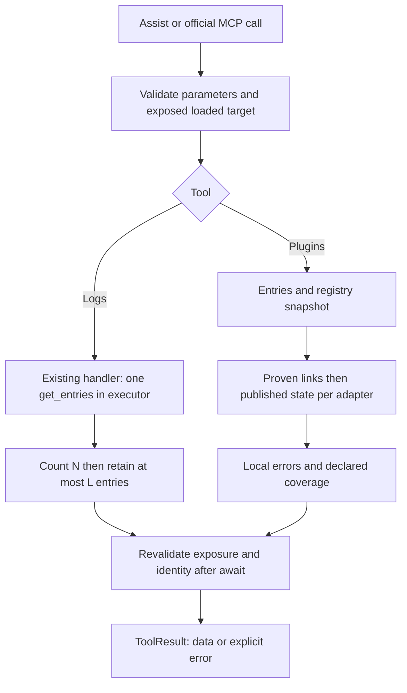

# Issue #2208: Technical Design for AI Diagnostic Tools

> **Status update, 2026-11-08:** the user explicitly approved specification and design v1.3, selection of the last 5,000 entries in collector order, and development and testing. This supersedes earlier statements in the current sections that approval or authorization is pending, without changing the archive. It does not certify compatibility or V-01/V-02; post-development review requires separate authorization.

## 1. Metadata, Authority, and Sources

| Field               | Value                                                                                                                                                                                                                             |
| ------------------- | --------------------------------------------------------------------------------------------------------------------------------------------------------------------------------------------------------------------------------- |
| Version / date      | 1.3 / 2026-11-08; convergence cycle 3                                                                                                                                                                                             |
| Status              | Updated design, final human approval not obtained; Q-01/Q-02/Q-04 resolved, Q-03 answered on proposed 5,000 ceiling, selection awaiting final-presentation approval; V-01/V-02 not executed; development not authorized           |
| Owner               | Versatile Thermostat project, maintainer @jmcollin78                                                                                                                                                                              |
| Local revision      | `e2ee3680f70c76b81684ee2b976c16ea358c7646` cited in cycle 1, not rechecked here; preexisting untracked documents preserved except both designs                                                                                    |
| Baseline            | [Updated report](issue-2208-review.md), [FR specification v1.3](../specs/issue-2208_fr.md), [EN specification v1.3](../specs/issue-2208_en.md), both v1.2 designs before editing, all read in full; user answers dated 2026-11-08 |
| Origin              | [Issue #2208](https://github.com/jmcollin78/versatile_thermostat/issues/2208); functional context taken from the report, without rechecking its GitHub timeline                                                                   |
| Equivalent version  | [issue-2208-design_fr.md](issue-2208-design_fr.md)                                                                                                                                                                                |
| Authorized delivery | Only these two documents in `documentation/tech-docs/`, the explicitly requested location                                                                                                                                         |

Authority: user decisions in the report/current request > specifications > design. **F** means a source-reading fact; **D** a candidate technical choice. P-01 approved for four families/seven examples; Q-02 accepts P-03 partial states when further information is unavailable, without field-by-field approval; Q-04 selects normalized ISO with explicit timezone. P-02 retains proposed 5,000 ceiling, but last-entry selection remains proposed. Q/DIV/V statuses distinguished in section 10. Documentary coverage means neither application acceptance, guaranteed completeness, nor implementation.

The writer's statement is checked against report/user answers. v1.3 specification references to v1.2 designs describe their review before this v1.3 update; preserved, not statements about current design. Only both designs updated in the same location. Same functional scope/exclusions; neither final human document/result approval nor development authorization inferred from received answers.

HA guidance: `SKILL.md`, `device-control` and `domain-docs` references from [homeassistant-ai/skills](https://github.com/homeassistant-ai/skills/tree/main/skills/home-assistant-best-practices) reread on their public pages during cycle 1. Deferred-tool loader `tool_search` is unavailable to load `ha_get_skill_guide`; bundled version unverified, no substitute HA call. Python fact-grounded guidance was consulted in v1.0; no type/interpreter certification or Python execution this cycle. No automation, helper, AppDaemon, dashboard, rename, or HA command requested.

**Cycle 2 guidance:** public `SKILL.md` reread; its table requires no further reference for these documentary contract corrections alone, with no new HA configuration or action. Deferred loader remains unavailable; no bundled version or installed-version recommendation certified.

**Cycle 3 guidance:** public `SKILL.md` reread through raw page; its table requires no further reference for this documentary update alone. Deferred loader/bundled version unavailable; no substitute HA access or dependency modification.

| Source | Relevant local reads and established facts                                                                                                                                                                                                                                                                                                                                                                                                                                                              |
| ------ | ------------------------------------------------------------------------------------------------------------------------------------------------------------------------------------------------------------------------------------------------------------------------------------------------------------------------------------------------------------------------------------------------------------------------------------------------------------------------------------------------------- |
| C-01   | [llm.py](../../custom_components/versatile_thermostat/llm.py): annotations, Probatio schemas, exposure selection, status/diagnose/Recorder tools, `async_get_tools`. Ten existing tools; no `get_logs`/`get_plugins`.                                                                                                                                                                                                                                                                                   |
| C-02   | [log_collector.py](../../custom_components/vtherm_api/src/vtherm_api/log_collector.py): whole file; locked snapshot then filtering, inclusive times/levels, conversion, buffer, and side-effecting export.                                                                                                                                                                                                                                                                                              |
| C-03   | [base_thermostat.py](../../custom_components/versatile_thermostat/base_thermostat.py), [thermostat_prop.py](../../custom_components/versatile_thermostat/thermostat_prop.py), [initialization](../../custom_components/versatile_thermostat/__init__.py): external creation/retry, merged configuration, published attributes, export by internal name, shared collector. `on_percent` can notify the algorithm: not a pure property.                                                                   |
| C-04   | [API](../../custom_components/vtherm_api/src/vtherm_api/vtherm_api.py), [interfaces](../../custom_components/vtherm_api/src/vtherm_api/interfaces.py): global registries, factory getters, singleton getter that creates it, registry-clearing reset; no universal inverse diagnostic contract.                                                                                                                                                                                                         |
| C-05   | [SmartPI handler](../../custom_components/vtherm_smartpi/handler.py), [sensor](../../custom_components/vtherm_smartpi/sensor.py), [compact diagnostics](../../custom_components/vtherm_smartpi/smartpi/diagnostics.py): dedicated/global selection, `smartpi_diag_{unique_id}` sensor, empty `update_attributes`, published blocks separate from `debug`.                                                                                                                                               |
| C-06   | [Hysteresis handler](../../custom_components/vtherm_hysteresis/handler.py), [controller](../../custom_components/vtherm_hysteresis/hysteresis/controller.py): dedicated/global configuration and `specific_states.hysteresis`, ten-field diagnostic.                                                                                                                                                                                                                                                    |
| C-07   | [Pellet handler](../../custom_components/vtherm_pellet_stove/handler.py), [sensor](../../custom_components/vtherm_pellet_stove/sensor.py), [controller](../../custom_components/vtherm_pellet_stove/pellet/controller.py): dedicated options do not inherit global values, `{domain}_{unique_id}_debug` sensor, state published after calculation.                                                                                                                                                      |
| C-08   | [Auto-fan manager](../../custom_components/vtherm_auto_fan_extended/manager.py), [constants](../../custom_components/vtherm_auto_fan_extended/const.py): targeted link, `auto_fan` section, operational booleans, refresh that creates entities/commands equipment.                                                                                                                                                                                                                                     |
| C-09   | [Failure models](../../custom_components/vtherm_heating_failure_detection/models.py), [manager](../../custom_components/vtherm_heating_failure_detection/manager.py), [constants](../../custom_components/vtherm_heating_failure_detection/const.py), [setup](../../custom_components/vtherm_heating_failure_detection/__init__.py): legacy/global/targeted configuration, loaded runtime entries, `MANAGER_ATTRIBUTES_KEY = heating_failure_detection_manager`, template evaluated during publication. |
| C-10   | [Replication setup](../../custom_components/vtherm_climate_replication/__init__.py), [controller](../../custom_components/vtherm_climate_replication/climate_replication.py), [constants](../../custom_components/vtherm_climate_replication/const.py): `target_climate`, `physical_climate`, runtime `enabled` dictionary, private `PluginClimate` object, side-effecting synchronization.                                                                                                             |
| C-11   | [Inhibition setup](../../custom_components/vtherm_inhibition/__init__.py), [entity](../../custom_components/vtherm_inhibition/entity.py), [binary sensor](../../custom_components/vtherm_inhibition/binary_sensor.py), [detector](../../custom_components/vtherm_inhibition/detector.py), [link](../../custom_components/vtherm_inhibition/link.py): target by unique ID, `{unique_id}_inhibition` sensor, diagnostics, inhibition retained on unloading.                                               |
| C-12   | [LLM tests](../../tests/test_llm_tpi.py), [external managers](../../tests/test_external_feature_manager.py), [collector](../../custom_components/vtherm_api/tests/test_log_collector.py), [failure](../../tests/test_heating_failure_detection.py), [core inhibition](../../tests/test_inhibition.py): neighboring tests read in full or targeted sections; no passing results inferred.                                                                                                                |
| C-13   | [VTherm manifest](../../custom_components/versatile_thermostat/manifest.json), [HACS](../../hacs.json), [dev requirements](../../requirements_dev.txt), [test requirements](../../requirements_test.txt), [CI](../../.github/workflows/pull.yml), [API package](../../custom_components/vtherm_api/pyproject.toml), [local API version](../../custom_components/vtherm_api/src/vtherm_api/__init__.py), seven local plugin manifests: declared, not installed versions.                                 |
| C-14   | [FR LLM documentation](../fr/feature-llm-mcp.md), [neighboring design convention](issue-2141-design.md): tools through Assist/official MCP, prefixed names, numbered sections, explicit evidence and deviations.                                                                                                                                                                                                                                                                                        |

Local plugin/API sources include Git-ignored directories. They are neither an audit of all their versions nor proof of availability on client installations.

**Independent cycle 1 reads:** C-02 (parser, emission, `get_entries`, purge), C-09 (complete precedence model/setup/unload; targeted manager publications), C-03 (native failure publication), C-08/C-05/C-10 (targeted publication/boolean/`update_attributes`/private-link searches), C-01/C-12/C-13 (LLM declarations, skips, core tests, declared versions). Other C-01 through C-14 details retain v1.0 reads, not exhaustive current rereading. A targeted search proves neither absence of every other public contract nor third-party suites.

**Independent cycle 2 reads:** approved report, FR/EN v1.2 specifications, and FR/EN v1.1 designs read in full; comparison of requirements, criteria, DIV statuses, and R-01/R-02 reservations. C-01 through C-14 remain inherited findings, not recertified: no code, test, manifest, or history reread this cycle.

**Independent cycle 3 reads:** updated report, FR/EN v1.3 specifications, FR/EN v1.2 designs read in full; comparison of decisions/contracts/conclusions. C-02 reread only for `_parse_to_utc`, `emit`, `get_entries`, adjacent context: aware datetimes, emission UTC, locked copy/filtering statically confirmed. Other C-01 through C-14 findings inherited, not recertified; no plugin/test/manifest rereading, runtime evidence, or new GitHub query.

## 2. Objective, Scope, and Invariants

Design exactly two queries for a loaded, exposed VTherm: collector logs and configured plugins with accessible state. No regulation, command, installation, configuration/dependency/entity change, or implementation in this delivery. No new server, HTTP endpoint, log file, or Recorder history.

**Approved invariants:** read-only; selection by VTherm and dates including unhinted messages; confusion accepted without special correction/masking; emitting integrations responsible for attribution fixes; Assist exposure retained without extra user, READ/CONTROL, or administrator checks; count ceiling with explicit exceedance/truncation; no period-duration cap or pagination; routine diagnosis about one hour; unchanged retention/purge; agent responsible for interpreting instructions in data.

**D-07, candidate technical choice, not a maintainer decision:** propose no application timeout added by these tools. The report approves no period-duration limit, not maximum-response-time prohibition. No guaranteed deadline/general timeout prohibition. Channel timeouts external/uncharacterized, removal not promised; future V-01/AC-011 characterization, not new blocking user question. No timeout added here; agreed-constraint changes require a separate decision.

Four families/seven examples **approved under Q-01**: SmartPI, Hysteresis, Pellet Regulation, Auto-fan, Heating Failure Detection, Climate Replication, Inhibition. Q-02 accepts gaps without better information; accessible states shall not be omitted. Mandatory `Z`/numeric-offset ISO 8601 and L = 5,000 retained; last entries proposed for final-presentation approval, one-hour objective unmeasured/unguaranteed. TPI/native managers excluded as external plugins; domain/factory/shared device/compatibility do not prove target configuration. Future plugins potentially undetectable, declare limitation without invented names/count/presence. Universal third-party inventory/#2191 fix excluded.

## 3. Existing Behavior, Compatibility, and Prerequisites

| Declared item                                                                                        | Limited conclusion and future check                                                                                                                                              |
| ---------------------------------------------------------------------------------------------------- | -------------------------------------------------------------------------------------------------------------------------------------------------------------------------------- |
| VTherm `10.6.3`, `vtherm_api>=0.7.0`                                                                 | Collector contract must be checked at the `0.7.0` floor; read API sources declare `0.8.0`, Python `>=3.13`. They do not establish the same contract in `0.7.0`.                  |
| HACS HA `2026.3.1`; dev HA `2026.8.2`; October 2026 LLM comment                                      | None proves the minimum version of `LLMTools`, `ToolResult`, `ToolAnnotations` platforms or MCP publication. No version increase decided.                                        |
| LLM tests skip their module without `ToolAnnotations`/`ToolResult`; CI Python `3.14`                 | A skip is not validation. The guard checks neither every capability nor Probatio/MCP round-trip. Require capability verification and a compatible test rig before certification. |
| SmartPI/Hysteresis `0.0.0`; Auto-fan/Failure `0.1.0`; Replication/Inhibition `0.2.0`; Pellet `2.0.0` | Local manifest versions, not a supported matrix. Explicit API dependencies: Failure `>=0.5.0`, Replication `>=0.2.0`, Inhibition `>=0.6.2`, Pellet `>=0.8.0`.                    |

**D-01:** integrate new tools into C-01 `async_get_tools`, only for `LLM_API_ASSIST` and a nonempty exposed selection. Reuse `READ_ONLY_ANNOTATIONS`; `idempotent=True` means no repeated business side effect, not identical responses at different times. Existing ten tools/schemas unchanged; no configuration/storage migration.

**D-02:** favor explicit internal adapters without dynamically importing plugin modules or calling their setup functions. Read HA entries, entity registry, and already published `State` objects. Check only required technical read capabilities, not extra permissions. An absent optional plugin must not prevent existing LLM tools from loading. Missing LLM APIs in older HA are a pre-existing limit to qualify, not a promise of automatic fallback.

V-01 covers Assist/MCP publication, read annotations, real Probatio validation, full delivery, userless/non-admin contexts, missing capabilities, API `0.7.0` floor. A selected: exact conversions to verify in actually supported new-tool paths without requiring a rig without HA helpers/new version. No V-01/V-02 result or compatibility/non-effect certification. Future certification prerequisites, not blocking design questions or HA-rig authorization.

## 4. Proposed Components and Responsibilities

| Candidate component                         | Responsibility / boundary                                                                                                                        |
| ------------------------------------------- | ------------------------------------------------------------------------------------------------------------------------------------------------ |
| `GetVThermLogsTool`, `GetVThermPluginsTool` | Two `llm.Tool` classes in the LLM surface; validation, target revalidation, `llm.ToolResult`, FR/EN descriptions.                                |
| Shared target resolver                      | Resolve `entity_id` to entry/unique ID/loaded instance/State; preserve `llm_context.assistant` exposure. Does not load or create the target.     |
| Collector reader                            | Read the existing handler in `hass.data[DOMAIN]["log_handler"]` using `.get`, call `get_entries` once, then count/project/truncate the snapshot. |
| Configured-link reader                      | Traverse retained domains' entries once, prove relationships/priorities, preserve disabled/unloaded entries and separate unproven observations.  |
| Per-integration state adapters              | Resolve entities using registry/stable identifiers; copy an allowlist of already published fields, qualify meaning and timestamps.               |
| Response assembler                          | Merge only links with proven identical identity, preserve local errors/coverage, produce deterministic JSON for the same snapshot.               |

A small internal diagnostic module is justified only to isolate these reads/projections and their tests; final location is a development decision. No discovery framework, durable cache, new manager, or contract imposed on every plugin.



## 5. Identification, Relationships, State, and Data

### 5.1 Target and Plugin Identity

**D-03:** accept only a climate `entity_id`, not a free-form name or `device_id`. The registry must tie the target to a `versatile_thermostat` entry, the climate component must contain its loaded instance, and `hass.states.get` must return its state. Use existing Assist selection, then check instance/entry to reject orphan restored state. State `unknown`/`unavailable` alone is not unloading. Do not require `is_ready`, a particular HVAC mode, or valid temperature.

Capture `entity_id`, `config_entry_id`, registry `unique_id`, and current internal instance `name`. Internal name drives log filtering like export `_name`; `friendly_name` may be a UI override and must not replace it. Entry ID is not assumed equal to unique ID. Recheck identity/source/exposure after awaits; replaced instance, rename, or name change during reading: `target_changed`, discard result without automatic retry. A mode change alone does not invalidate the snapshot.

A configured plugin is identified by `(domain, plugin_config_entry_id)` when an entry exists. Multiple proven roles attach to that identity; two distinct entries remain two records. **External-selection evidence is independent of resolving producer identity and associating it with an entry.** Without resolution, preserve evidence with `observation_id=selection:{target_unique_id}:{algorithm_name}`: a synthetic observation key, not an additional plugin identity. Domain/producer and entry remain unknown when unproved; an absent factory or handler never removes this selection.

If association with a configured identity is proved, attach the selected role to its single `plugins[]` record. Otherwise return selection in `unresolved_links[]` with `link_proof=proven`, known true `configured` and `selected`, target/evidence key/source, and unknown identity/association. This is not a relationship with unproven configuration: distinguish the latter using `link_proof=unproven`, without `configured=true`. Neither merge selection with a plausible entry nor count it as a second plugin. While proven selection lacks resolved identity/association, the consolidated configured count stays `null` under 6.4; visible evidence means neither absent plugin nor exact total. Shared name/device never authorizes merging. These delivery rules do not approve P-01/Q-01.

### 5.2 Relationships within Approved P-01 Scope

| Family / adapter   | Configuration evidence and selection                                                                                                                                                                                                                               | Limit / partial case                                                                                                                                                                                                                                                                                       |
| ------------------ | ------------------------------------------------------------------------------------------------------------------------------------------------------------------------------------------------------------------------------------------------------------------ | ---------------------------------------------------------------------------------------------------------------------------------------------------------------------------------------------------------------------------------------------------------------------------------------------------------- |
| CAT-01 SmartPI     | `configuration.proportional_function`/current merged configuration and targeted `target_vtherm_unique_id` entry. Dedicated first, otherwise global entry `unique_id == domain`. SmartPI overlays defaults, VTherm configuration, then retained entry data/options. | Selection proves algorithm role even without a factory; dedicated unselected entry remains configured, `selected=false`. A global entry does not apply to every VTherm.                                                                                                                                    |
| CAT-01 Hysteresis  | Same target key and dedicated-else-global selection; defaults then retained entry data/options, not dedicated + global overlay.                                                                                                                                    | Diagnostics on climate, no dedicated sensor required. Native TPI excluded.                                                                                                                                                                                                                                 |
| CAT-01 Pellet      | `pellet_regulation` and targeted entry; dedicated else global; `options or data`, with local `dry_contact`/`bistable_confirmed` rules.                                                                                                                             | Dedicated entry does not inherit global values; do not call `_resolve_options`, which logs. Adapt only keys needed for evidence, not private options.                                                                                                                                                      |
| CAT-02 Auto-fan    | Entry `target_vtherm_unique_id == target.unique_id`; this target's published state.                                                                                                                                                                                | `supports`/created manager does not prove configuration; missing modes do not erase a targeted entry. No inferred global Auto-fan configuration.                                                                                                                                                           |
| CAT-02 Failure     | `vtherm_unique_id` target in the plugin configuration view; defaults < VTherm legacy < global < targeted. C-09 stores **`options or data`**, not a universal merge.                                                                                                | Separate persisted entries, runtime-entry copy, and existing publication. Runtime entries describe model inputs available, not on their own configuration already applied to the manager; `configuration_applied` unknown without evidence. Preserve disabled/unloaded entries as declarations under Q-01. |
| CAT-03 Replication | `entry.data.target_climate == entity_id`, source `entry.data.physical_climate`. Preserve unloaded entry; read runtime `enabled` only from an already existing dictionary.                                                                                          | No universal inverse PluginClimate registry. Do not inspect private `_plugin.linked_vtherm` in the baseline option; `runtime_linked=unknown`.                                                                                                                                                              |
| CAT-04 Inhibition  | `vtherm_unique_id` authoritative when present; resolve through `(climate, versatile_thermostat, uid)` registry. Older `vtherm_entity_id` fallback only without uid, as in C-11.                                                                                    | Known unresolved UID must not be replaced by a name or recycled old ID. Core inhibition alone identifies no third-party emitter.                                                                                                                                                                           |

For every proven CAT-01 selection, apply 5.1 even if factory, handler, producer domain, or effective entry is unresolved. Return evidence without fictitious identity; identity/count uncertainty shall not become selection uncertainty or permit no-plugin success (FR-012, P-01, AC-015 v1.3). Q-01 approves scope, not runtime identity resolution; section 5.1 technical rules are not a new Q-01 decision.

For core inheritance, read public `entry_infos` of the already created instance without calling `post_init` or recalculating/merging full configuration. If central origin cannot be proved from the merged view, report `merged_target_configuration`, not an invented source entry. Multiple candidates/unknown schemas: locally partial evidence; never invent global precedence. Read versions have their own first/last-entry rules; generalize neither to unverified versions nor to collisions whose runtime application is unknown.

For Failure only, the candidate adapter may copy existing `hass.data[plugin_domain]["entries"]` through `.get`, without `setdefault`, plugin import, or model call. Qualify this source as `source_runtime_configuration`; no mutation or template evaluation. Setup may update the dictionary before a reload completes: contents prove neither a loaded handler nor current application. Publication remains qualified by source/producer even when values resemble entries. Essential linking/precedence keys are read internally, not raw configuration or template text in the response.

### 5.3 Independent State Dimensions

Each normalized fact: `{value, knowledge, source, scope, reason}`. `knowledge` is `known`, `unknown`, or `unavailable`; the last two use `value=null`. A published `null` remains known explicit absence where the source contract defines it, never zero. Preserve published `false`/`0`. Candidate fields: `configured` (proven declared link), `configuration_applied`, `selected`, `enabled`, `loaded`, `operational_ready`, `available`, `active`. `scope=integration_entry|runtime_component|state_source` required for every fact, not only `loaded`. Multiple differently scoped `loaded` facts must not overwrite one another; a LOADED entry never becomes handler presence. Persisted configuration, manager application, and State availability remain separate.

No public diagnostic accessor for algorithm-handler presence was verified: baseline reports unknown even with a registered factory. Auto-fan `is_configured`/`is_detected` bits are not published in `auto_fan`: return existing fields, mark readiness/detection unknown unless an explicit contract is approved. Failure raw `unknown`/`unavailable` states take precedence over booleans reducing them to `false`.

Source availability, discovery completeness, and diagnostic completeness are distinct. `discovery.status` and `diagnostics.status` are `complete`, `partial`, `unavailable`, or `not_supported`. Complete discovery applies only to named adapters/schemas; always `third_party_exhaustive=false`. Incomplete diagnostics do not necessarily make inventory incomplete.

**Q-02 resolved, acceptability distinct from truth/completeness:** `state_minimum_status=met|not_met` remains candidate technical field distinct from `diagnostics.status`, not a field-by-field approved list. In a future result, `met` means every reliable accessible fact in retained subset preserved with sources/gaps; partial/unknown/unavailable accepted without better information. `not_met` signals omitted accessible fact/lost required qualification, not merely unpublished state. No current `undecided` minimum/new field-by-field approval; this status never means a criterion was tested this cycle. No accessible state: proven link/`unavailable` diagnostics acceptable; identity alone replacing accessible state forbidden. Partial acceptance makes neither `unknown` known nor `diagnostics.status=partial` become `complete`. Completeness limited to retained fields/scopes, never guaranteed current physical state/third-party exhaustiveness.

### 5.4 Candidate P-03 Projections

Read only `State.state` and the following keys when present, without calling diagnostic-producing methods. Sensor resolution: registry `(entity domain, plugin platform, known unique_id)` and configured relation; never construct the visible sensor ID from its name.

| Published source                                    | Candidate allowlist / meaning                                                                                                                                                                                                                                                                                                                                                                                                                                                                                                   |
| --------------------------------------------------- | ------------------------------------------------------------------------------------------------------------------------------------------------------------------------------------------------------------------------------------------------------------------------------------------------------------------------------------------------------------------------------------------------------------------------------------------------------------------------------------------------------------------------------- |
| SmartPI `smartpi_diag_{uid}`                        | Sensor state and compact blocks `control`, `power`, `temperature`, `model`, `ab_learning`, `governance`, `feedforward`, `setpoint`, `autocalib`, `calibration`, limited to keys defined by C-05 `build_published_diagnostics`. Exclude `debug` and undeclared future keys. Controller phase, not physical activity or scientific certainty of `confidence`.                                                                                                                                                                     |
| Hysteresis climate `specific_states.hysteresis`     | `is_active`, `hvac_mode`, `on_percent`, `last_reason`, `activation_threshold`, `deactivation_threshold`, `hysteresis_on`, `hysteresis_off`, `max_on_percent`, `min_on_percent`. `is_active` means published logical controller state.                                                                                                                                                                                                                                                                                           |
| Pellet `{domain}_{uid}_debug`                       | State, `phase`, `available`, `is_heating`, `on_percent`, `current_level`, `current_level_index`, `observed_cycle`, `observed_phase`, `pending_command`, `command_error`, `last_reason`, `last_on_at`, `last_off_at`, `next_action_allowed_at`, `remaining_on_sec`, `remaining_off_sec`, `boost_active`, `boost_until`. Calculated/published data, not a forced physical read.                                                                                                                                                   |
| Auto-fan climate `auto_fan`                         | `enabled`, `current_gap`, `selected_fan_mode`, `sent_fan_mode`, `rest_mode`, `thresholds`. Sent mode is not guaranteed physical mode; do not synthesize `is_detected` by reimplementing its logic.                                                                                                                                                                                                                                                                                                                              |
| Failure climate `heating_failure_detection_manager` | `heating_failure_state`, `cooling_failure_state`, `heating_failure_threshold`, `cooling_failure_threshold`, `detection_delay_min`, `temperature_change_tolerance`, `is_detection_enabled_by_template`, `heating_tracking`/`cooling_tracking` restricted to `is_tracking`, `initial_temperature`, `current_temperature`, `remaining_time_min`, `elapsed_time_min`, `root_cause`, `root_cause_entity_id`. Exclude `failure_detection_enable_template`. Cause is published by the identified producer, not calculated by the Tool. |
| Replication                                         | Declared target/source and existing runtime `enabled`; entry status. No assumed replication success, sync history, or private link. Partial internal state accepted under Q-02 without better information.                                                                                                                                                                                                                                                                                                                      |
| Inhibition `{uid}_inhibition`                       | State, `status`, `raw_status`, `stop_underlyings`, `bypass`, `active_sources`, `pending_status`, `pending_until`, `last_change`, `unavailable_since`, `missing_sources`, `sources` restricted to `{state, contribution}`, `vtherm_entity_id`, `vtherm_available`, `last_api_call`, `last_api_call_at`, `last_error`, `retry_pending`, `waiting_for_vtherm_start`, `next_retry_at`.                                                                                                                                              |

C-05 defines the SmartPI subkeys below, not a controller-object export. Disabled/absent sensor, changed structure, or missing key: `source_not_published`, `source_schema_unsupported`, or `field_not_published`. Remaining attributes on an `unavailable` sensor may be returned as unavailable last publication, never current active state.

| SmartPI compact block | Candidate allowed subkeys                                                                                                                                                |
| --------------------- | ------------------------------------------------------------------------------------------------------------------------------------------------------------------------ |
| `control`             | `phase`, `mode`, `hysteresis_state`, `kp`, `ki`, `restart_reason`                                                                                                        |
| `power`               | `current_cycle_percent`, `next_cycle_percent`, `pi_percent`, `ff_percent`, `hold_percent`                                                                                |
| `temperature`         | `sensor`, `ext_sensor`, `error`, `integral_error`, `integral_mode`, `integral_hold_mode`, `integral_guard_source`                                                        |
| `model`               | `a`, `b`, `confidence`, `tau_reliable`, `deadtime_heat_s`, `deadtime_cool_s`                                                                                             |
| `ab_learning`         | `stage`, `bootstrap_progress_percent`, `bootstrap_status`, `accepted_samples_a`, `accepted_samples_b`, `target_samples`, `last_reason`, `a_drift_state`, `b_drift_state` |
| `governance`          | `regime`, `thermal_update_decision`, `thermal_update_reason`                                                                                                             |
| `feedforward`         | `ff3_status`, `ff3_twin_usable`, `twin_status`, `deadband_power_source`                                                                                                  |
| `setpoint`            | `filtered_setpoint`, `trajectory_active`, `trajectory_source`                                                                                                            |
| `autocalib`           | `state`, `model_degraded`, `last_trigger_ts`, `next_check_ts`, `snapshot_age_h`                                                                                          |
| `calibration`         | `state`, `retry_count`, `last_time`                                                                                                                                      |

Native Failure manager also publishes `heating_failure_detection_manager`: section presence or persisted configuration alone does not prove the runtime producer. If external origin is unproven, return VTherm publication with `producer=unknown`, `state_origin_unverifiable`, partial diagnostics; do not attribute its cause to the external plugin. C-01 `DIAGNOSTIC_SECTIONS` key `heating_failure_detection` is not this actual section; do not reuse that generic inventory for the new tool.

Each source carries `source_entity_id`, attribute path, `state_last_updated`, `state_last_changed`, `observed_at`, and source-supplied `measurement_at` when explicit, otherwise `null`. `last_updated` is HA publication/update time, not each field's measurement time; inhibition `last_change` and `last_api_call_at` keep their business timestamps. `restoration=unknown` without explicit evidence; no arbitrary freshness threshold. No new storage/restoration/cache; transient snapshots only.

Normalized response instants: ISO 8601 UTC with `Z`, through aware datetimes/exact conversion in 6.2. Source business dates: separately preserve raw value; convert aware datetime/explicit offset, epoch only if unit/origin demonstrated. Unprovable timezone: normalization `null`, knowledge `unknown`, reason `source_timezone_unknown`, no UTC/local assumption; other reliable values preserved. Publication/measurement/query do not replace each other; durations do not become instants.

### 5.5 In-Principle Read-Only Feasibility without HA Access

Documentary evaluation of inherited C-03 through C-11, not plugin rereading/runtime testing in cycle 3. Existing entries/registry/State/dictionaries support designing links/states without producer calls; each source depends on presence/schema/demonstrable link. Absence/unavailability qualified under Q-02, no new contract/dependency.

| Family / approved example          | Planned read and accessible state                                                                               | Bounded conclusion / future check                                                                                                            |
| ---------------------------------- | --------------------------------------------------------------------------------------------------------------- | -------------------------------------------------------------------------------------------------------------------------------------------- |
| CAT-01 / SmartPI                   | Selection/targeted or applicable global configuration; linked diagnostic sensor/published blocks in 5.4 (C-05). | In-principle feasible through reads; unknown handler, absent/unavailable sensor degraded. AC-015, V-02.                                      |
| CAT-01 / Hysteresis                | Selection/applicable configuration; published `specific_states.hysteresis` (C-06).                              | In-principle feasible without controller update; no physical-activity guarantee. AC-014, V-02.                                               |
| CAT-01 / Pellet Regulation         | Selection/own configuration; linked sensor phase/attributes (C-07).                                             | In-principle feasible without calculation or `_resolve_options`; publication differs from physical phase. AC-016, V-02.                      |
| CAT-02 / Auto-fan                  | Targeted entry, already published `auto_fan` section (C-08).                                                    | In-principle feasible; unpublished readiness/detection unknown, never recalculated/refreshed/created/commanded. AC-017, V-02.                |
| CAT-02 / Heating Failure Detection | Declared entries, available runtime copy, existing VTherm publication (C-09/C-03).                              | In-principle feasible with unknown application/producer without evidence; key alone not producer proof, no template execution. AC-018, V-02. |
| CAT-03 / Climate Replication       | Entry target/source, loading, `enabled` in existing dictionary (C-10).                                          | In-principle feasible for partial state; unknown linking/success, no private access/resync/reconnection. AC-019, V-02.                       |
| CAT-04 / Inhibition                | Configured target, linked sensor/already published diagnostics (C-11).                                          | In-principle feasible; status/API/reported retry without induced set/unset/retry or inference of all core emitters. AC-020, V-02.            |

Four families/seven examples therefore feasible/testable in principle within read scope with accepted partial states; effective access/versions/non-effects for V-01/V-02 evidence. Global factory/internal `PluginClimate` provide no universal reverse discovery. Declare future plugins/categories may be undetectable through supported sources even when names/count/presence unknown. No invented universal mechanism/dynamic import/private introspection/new registry/mandatory provider. Empty list limited to verified integrations/formats, never proof of all third-party absence.

## 6. Proposed API, Responses, and Errors

### 6.1 Inputs and Annotations

Candidate names: `versatile_thermostat__get_logs` and `versatile_thermostat__get_plugins`. C-14 describes MCP prefix `assist__`, to verify on the intended transport. FR/EN titles/descriptions, stable English machine keys. Reuse read annotations, not `get_history` Recorder checks/splitting.

| Tool          | Proposed parameters                                                                                                                                                                                                                                                  |
| ------------- | -------------------------------------------------------------------------------------------------------------------------------------------------------------------------------------------------------------------------------------------------------------------- |
| `get_logs`    | Required string `entity_id`; optional normalized ISO 8601 strings with explicit timezone `start_time`/`end_time` under BR-003; enum `min_level` `DEBUG/INFO/WARNING/ERROR`, default `DEBUG`. Fixed L = 5,000; no `limit`, `offset`, cursor, or pagination parameter. |
| `get_plugins` | Required string `entity_id`; no filter silently hiding uncovered categories.                                                                                                                                                                                         |

Probatio validates types, values, and unknown keys. For both new tools, `entity_id` is a strict string without a frozen enum: the call-time resolver distinguishes missing/unexposed targets from syntactically invalid parameters. Current selection gates publication and every query without changing existing tool schemas. No required user context or `hass.auth`/`check_entity` call.

### 6.2 Time, Snapshot, and Ceiling

**D-04:** inclusive start/end; omitted end = real UTC clock captured at query start; omitted start = effective end minus 60 minutes; equality allowed; start > end rejected. Accept old/future dates without shortening to retention. Regulation/test `thermostat.now` is not collector time.

**DIV-01, static finding confirmed in cycle 3:** `get_entries` expects datetimes/compares instants without `_parse_to_utc`. Export helper has string fallback `fromisoformat(...).replace(tzinfo=UTC)` relabelling offsets rather than converting instants. Path neither fixed nor reused: no private helper/export/raw string passed to `get_entries`. Collector, export compatibility, dependencies unchanged.

**Q-04 resolved / A selected, ISO 8601 contract matching BR-003 v1.3:** `YYYY-MM-DDTHH:MM:SS[.fraction]Z` or `YYYY-MM-DDTHH:MM:SS[.fraction]±HH:MM`, optional decimal fraction. `Z`, `+00:00`, valid explicit numeric offsets accepted. Date-only, naive datetime, named zone alone, out-of-grammar formats/invalid dates rejected without UTC/local assumption. Syntactic restriction, not duration/age.

Candidate technical chain without new dependency: validate types/BR-003 grammar, parse using standard-library `datetime.fromisoformat`, verify `utcoffset()` differs from `None` (zero valid), convert through `astimezone(timezone.utc)`, check start/end after conversion, pass aware datetimes to single `get_entries`. No `replace(tzinfo=...)` instant conversion, A→B fallback/export parser. Formats/precision and actually supported paths for AC-005/AC-006/V-01, not declared tested/new user question. Explicit failure, never silently altered instant.

Preserve requested strings/original offsets separately from effective UTC bounds. Serialize normalized instants as ISO 8601 UTC with `Z` after conversion, without changing stored timestamp/message. Candidate policy/path in `filters`: `normalization_policy=explicit_offset_to_utc`, `normalization_path=stdlib_aware_datetime`. Explicit offset disambiguates repeated daylight-saving hours, no extra named-zone consistency check. Documentary example: `2026-11-08T02:00:00+02:00` and `2026-11-08T00:00:00Z` represent same instant; identical local hours with different offsets potentially distinct. AC-005 shall verify identical pre-ceiling selection for equivalent instants on same buffer in every supported path, not identical responses from different buffers. A guarantees no historical completeness; B no longer current alternative/authorized fallback, defect finding authorizes no collector correction.

**D-05 / current P-02, selection still proposed:** fixed L = 5,000 entries per call. Single `get_entries(name, min_level, start, end)`, N = list length. At final presentation obtain approval for proposed `entries[-L:]` if N>L: last entries in collector order, not already obtained separate user answer. No timestamp sort, summary, error priority, pagination, byte ceiling/period limit. `selected_count=N`, `returned_count=min(N,L)`, `omitted_count=N-returned_count`, `limit_exceeded=truncated=(N>L)`; same list for all counts. N=0/4,999/5,000/5,001 yields 0/4,999/5,000/5,000 returned, 0/0/0/1 omitted. First/last entries distinct from temporal min/max for non-monotonic timestamps; no historical omission calculation.

`get_entries` copies the deque under lock then filters outside the lock; `queried_at` is not the exact copy timestamp. Report `read_started_at/read_finished_at` bracketing the read without inventing an atomic buffer timestamp/ID. Read entries are not modified. Later emitted logs are absent; another query may differ.

### 6.3 Common and Log Contracts

Candidate v1 contract: `llm.ToolResult(data=..., error=...)`. Required common fields: `schema_version=1`, `status`, `entity_id`, `target` (entry ID/unique ID/name), `queried_at`, `read_started_at`, `read_finished_at`, `warnings[]`, `errors[]`. `status=success|partial|error`; `error=True` only for total failure. Local errors stay in a partial response's `errors`. Before resolution/reading failures, `target` and read timestamps are `null`, `entity_id` is the received string or `null` if invalid; uncomputed tool-specific fields are omitted, never filled with fictitious zero counts. Warnings/errors use section 6.4 structured objects.

Logs add `filters` (request/original offset, effective UTC bounds, section 6.2 A policy/path, level, name), `limit=5000`, `selection_policy`, `order="collector_insertion"`, D-05 five indicators/counts, `history_completeness="not_guaranteed"`, `entries[]`. `returned_range` (first/last/min/max) only with returned entries, omitted if empty under FR-009 v1.3, no fictitious bounds/four `null`. Normalized common/bound/range/entry instants: UTC with `Z`. Each entry: `timestamp`, numeric `level`, level-derived `level_name`, full `logger_name`, unchanged `message`. Stored data, not reconstructed LogRecord/all its exceptions. JSON escaping does not change decoded text value.

**Synthetic** example, subject to final selection approval, not an HA result:

```json
{
  "schema_version": 1,
  "status": "success",
  "entity_id": "climate.exemple",
  "limit": 5000,
  "selection_policy": "last_entries_in_collector_order",
  "order": "collector_insertion",
  "selected_count": 5001,
  "returned_count": 5000,
  "omitted_count": 1,
  "limit_exceeded": true,
  "truncated": true,
  "history_completeness": "not_guaranteed"
}
```

Example shows truncation fields only; common fields/filters/entries remain required. Empty selection is `success`, zero counts, and a completeness warning; absent collector is not empty success. No `next_offset`, file, or download link.

### 6.4 Plugin Contract and Errors

Add `plugins[]`, `configured_plugin_count`, `identified_configured_plugin_count`, `proven_unresolved_selection_count`, `unresolved_links[]`, `coverage` (adapters, actually verified integrations/formats/versions, `discovery.status`, CAT-01 through CAT-04 statuses/reasons, `third_party_exhaustive=false`), `diagnostics_status`, `state_minimum_status`. Fields/counting rules remain candidate technical contracts, not a Q-01 decision. Global statuses/minimum also aggregate gaps in proven unresolved selections without hiding local errors. Each plugin: `plugin_id`, `domain`, nullable `config_entry_id`, `label`, `categories[]`, `links[]`, `facts` list with section 5.3 scopes, `diagnostics` (status, projection, known/unknown producer, timestamped sources), `state_minimum_status`. Each link: `relation=selected_algorithm|targeted_configuration|effective_global|legacy_merged`, resolved target, evidence source/key, known/unknown `applies_to_target`. Do not export remaining data/options.

`unresolved_links[]` carries `observation_id`, `link_proof`, target, relationship and sourced evidence, known/unknown facts, and section 5.1 unresolved-identity/association reasons. Selections with `link_proof=proven` remain visible with qualified `configured=true` and `selected=true`; `link_proof=unproven` relationships do not become configured. Selection producer and diagnostic-publication producer require separate evidence; no cause attributed through assumed association.

**R-01 counting:** `identified_configured_plugin_count` counts only proven distinct configured identities in `plugins[]`; `proven_unresolved_selection_count` counts distinct proven selection observations not yet associated, not additional plugins. Never add these numbers: overlap is unknown. Whenever such a selection remains, `configured_plugin_count=null`, reason `configured_identity_unresolved`, `discovery.status=partial`, and `status=partial`; no assumed merging or duplication. Without this ambiguity, `configured_plugin_count` counts returned configured identities; partial discovery still does not guarantee the actual total. No counter includes factories or unproven relationships. Uncomputable counts remain `null` on total discovery failure.

Documentary examples, not HA results: proven selection alone without factory/identity → `plugins=[]`, evidence in `unresolved_links`, identified count 0, proven observations 1, consolidated count `null`, partial response, never no plugins. One proven targeted entry and possibly associated selection → counts 1 and 1, consolidated `null`, neither 2 nor an assumed merge to 1. After association with that entry is proved → one plugin and its two links, counts 1 and 0, consolidated 1 for these identities without assuming exhaustiveness. Diagnostics/Q-02 minimum retain their own qualification.

Complete discovery in retained adapters with no configured identity and no proven unresolved selection: **qualified** empty success; partial internal state: `status=partial` even for complete inventory. Unreadable category: preserve other results, partial coverage. If no source permits reliable discovery: `status=error`, `error=True`, `plugin_discovery_unavailable`, and count `null`, not zero. Proven selection is already a reliable fact: unknown identity alone does not justify total failure. If only unavailable state sources remain, return proven configuration with unavailable diagnostics; not plugin absence.

Q-01 approves bounded scope; complete discovery only within verified integrations/formats, never all third parties. Q-02 accepts degraded delivery without better accessible information and with reliable facts/gaps preserved: `status=partial` neither automatic functional failure nor complete diagnostics. All states unavailable: preserve proven links/explain missing sources, acceptable. `state_minimum_status` follows 5.3 without current `undecided` branch/passed-test guarantee. Empty list/`met` do not prove no invisible future plugins. Add candidate `future_plugins_discovery="not_guaranteed"` to `coverage`: general limitation, no invented names/count/presence/additional discovery mechanism. Section 6.4 fields/counts technical candidates, not outstanding Q-01 functional decision.

| Candidate code                                                                                      | Scope / reaction                                                                                                                                                  |
| --------------------------------------------------------------------------------------------------- | ----------------------------------------------------------------------------------------------------------------------------------------------------------------- |
| `invalid_parameters`                                                                                | Invalid type, date, level, or key; identify field, no substitution.                                                                                               |
| `invalid_period`                                                                                    | Reversed normalized bounds; no clipping.                                                                                                                          |
| `target_not_vtherm`, `target_not_exposed`, `target_not_loaded`, `target_changed`                    | Target; no out-of-scope data or loading/repair.                                                                                                                   |
| `target_lookup_failed`                                                                              | Registry/component failure, distinct from missing target.                                                                                                         |
| `collector_unavailable`, `collector_incompatible`, `collector_read_failed`                          | Total log error; no replacement entries or fallback export.                                                                                                       |
| `plugin_discovery_unavailable`, `plugin_source_incompatible`, `plugin_read_failed`                  | Named source/category/plugin; preserve other reliable facts when possible.                                                                                        |
| `source_not_published`, `field_not_published`, `relation_unverifiable`, `state_origin_unverifiable` | Gap reasons, not necessarily exceptions or total errors.                                                                                                          |
| `configured_identity_unresolved`                                                                    | Proven configured selection with unresolved identity/association: preserve evidence and unknown consolidated count; neither absence nor an unproven relationship. |

Structured error: `{code, scope, plugin_id, source, field, message_fr, message_en}`, irrelevant values `null`. No raw configuration, traceback, or private object in errors. A plugin serialization exception stays local. Expect JSON types, converted datetimes, enums using public values; no arbitrary `str(object)` through `_json_safe`, no invented NaN/Infinity: qualify field as invalid and diagnostic partial.

## 7. Sequences, Errors, Cancellation, and Recovery

**Logs:** validate → capture target/time → read existing handler → delegate the single thread-safe call/projection to HA executor → revalidate target/exposure → return. Do not use `get_vtherm_logger`, `get_vtherm_api`, `async_export_logs`, download service, `purge`, or log-level changes. Do not log every returned entry, which would make querying grow the collector.

**Plugins:** on the HA loop capture targeted entry/registry copies → prove relationships → read resolved sources' State, known Replication runtime dictionary, and section 5.2 Failure copy when available → project without plugin `await`. Do not reevaluate precedence through producer functions or infer manager application. Synchronous steps do not intentionally lock state against other integrations. If later work needs an executor, pass only copies, not live HA objects; revalidate target on return. No atomic snapshot of all plugins and collector promised; no inter-source causality claim.

**Local errors:** failed adapter → isolate entry/category, preserve other facts, report reason/completeness. Unknown schema is not interpreted through permissive introspection. General collection error produces section 6 total error. Exposure removed during waiting prevents return of previously calculated data.

**Cancellation:** propagate coroutine cancellation without fictitious results or retry. Started executor work may finish; it only reads/projects and publishes nothing. No compensation or repair task. No added business timer or response-time guarantee; absence of an application timeout is only candidate D-07, not a user prohibition. If a deadline policy is later proposed, specify cancellation/errors and compatibility with unlimited period duration before separate authorization; none retained here. Agent may request a new query/new snapshot.

**Recovery:** each call rediscovers sources; no inter-call cache. Restart: previous logs lost under existing memory-buffer behavior; possibly restored plugin states qualified as publications. Plugin unload: configured link retained from entry, `loaded=false` when proved, diagnostics absent/unavailable or qualified last State. Late startup/factory loss: configuration still visible, runtime availability unknown/incomplete, no reload or #2191 fix. Unknown climate state with loaded instance: query permitted.

## 8. Safety, Observability, and Performance

General HA/Assist/MCP protections remain intact. Exposure/target revalidation enforces existing scope, not extra authentication/permissions. Linked diagnostic entities are internal sources for exposed VTherm; **do not require every sensor to be individually exposed**, which would change approved scope. Prove links; restrict fields to section 5.4 technical subset with Q-02-approved partial acceptability, not every P-03 field separately approved. No confidentiality audit guaranteed; non-sensitive-log assumption/accepted confusion retained.

Do not execute, causally analyze, filter, or neutralize instructions in logs; they remain agent data. No new permission policy, ambiguous-message masking, or AI analyzer. Forbidden: refresh, calculation, potentially mutating getters, templates, State publication, plugin creation/linking, set/unset inhibition, Replication synchronization, Store modification. Failure `add_custom_attributes` reevaluates its template: read the **existing State**, not that method.

Primary observability: status, provenance, errors, counts, and intervals in response. An optional single technical error message without payload follows existing conventions; no new persistent telemetry, notification, or response dump. Collector messages may already be ambiguous; limitation warnings do not change selection.

**D-06:** for B buffer entries, logs are O(B) time and O(B+N) temporary references; O(B) locked copy, filtering/projection outside lock. Executor recommended to avoid scanning on the HA loop; does not remove contention/GIL or transport serialization cost. Return O(min(N,L)) entries and O(message volume), with unbounded message length. No temporal index or streaming/pagination added.

L = 5,000 represents approximately 1.39 entries/s over one hour **for this VTherm's selection including unhinted messages**. Arithmetically, 1 KiB average message represents about 4.9 MiB text for 5,000 entries before JSON; neither benchmark, byte ceiling, nor measured actual rate. AC-011 assigns future tests selection/documentation of a representative one-hour example: provenance, installation/verbosity, selected count/rate, omissions, observed volume/delivery on tested channel. No prior user sample required, invented example/channel/result, or new blocking question. Q-03 ceiling answered, only selection awaits final-presentation approval; one-hour sufficiency/transport unmeasured/unguaranteed. If example exceeds L or is not delivered fully, record gap/submit ceiling-feasibility reassessment without claiming FR-008/AC-011 fulfilled. High verbosity: explicit truncation, no period cap/pagination/new byte ceiling/retention change. New timeout/constraint change requires separate decision.

Plugins: O(E+R+S) for entries, relevant registry, and projected fields instead of a full scan per plugin; HA reads on its loop, potential heavy transforms on copies. No approved plugin-count ceiling or hidden inventory truncation. Future rig measures capture/lock/scan time, memory, JSON bytes, and full MCP delivery; no numerical latency guarantee now.

## 9. Test Strategy and Traceability

**Current verification:** documents (FR/EN structure/tables/identifiers/literals/numbers, semantic v1.3 specification comparison, traceability/links/JSON, R-01/R-02, protected-source fingerprints at current state). Targeted static C-02 read, not parser/collector execution. Cases are proposed oracles, not executed tool tests. No pytest/application import/benchmark/HA call/measurement. Future V-01/V-02/AC-011, neither blocking user questions nor completed tests. Tests only after final human document/result approval and separate development/testing authorization.

Reuse C-12 helpers; existing LLM tests focus mostly on TPI/write permissions, not new tools. Read Failure tests cover the **native** manager and `heating_failure_detection_manager`, not C-09 external plugin. Core inhibition tests substitute the API facade for the plugin: neither proves plugin discovery/diagnostics. No root `tests` directory found in seven local plugins; plan targeted State/ConfigEntry fixtures in core LLM tests without claiming existing third-party suites. Collector tests live in the API subproject; verify discovery/fixtures separately.

| Criterion | Future oracle and anchor                                                                                                                                                                                                                                                                                                                                                                                                                                                                                                              | Conditions / requirements                                                                             |
| --------- | ------------------------------------------------------------------------------------------------------------------------------------------------------------------------------------------------------------------------------------------------------------------------------------------------------------------------------------------------------------------------------------------------------------------------------------------------------------------------------------------------------------------------------------- | ----------------------------------------------------------------------------------------------------- |
| AC-001    | Real `async_get_tools`, unchanged 10 tools + 2 reads; other API/no target; read-only MCP round-trip, FR/EN descriptions.                                                                                                                                                                                                                                                                                                                                                                                                              | FR-001, FR-002, FR-020; full LLM rig required.                                                        |
| AC-002    | Userless/non-admin contexts; spies prove no `hass.auth`/permission calls; permitted channel.                                                                                                                                                                                                                                                                                                                                                                                                                                          | FR-003, BR-001; no copied TPI permission policy.                                                      |
| AC-003    | Foreign/missing/unexposed target, orphan State, removal/rename/replacement during executor. No out-of-scope data.                                                                                                                                                                                                                                                                                                                                                                                                                     | FR-002, FR-019; resolver + HA fixtures.                                                               |
| AC-004    | Frozen clock: no bounds, historical end only, start only; exact effective response bounds.                                                                                                                                                                                                                                                                                                                                                                                                                                            | FR-004, BR-003.                                                                                       |
| AC-005    | Inclusive bounds/equality; equivalent instants with `Z`/numeric offset/fractions: same pre-ceiling selection on same buffer, UTC bounds with `Z`, request/offset preserved. Repeated DST hours with distinct offsets: distinct instants, order after conversion. Compare actually supplied aware datetimes in every supported path; no B fallback/collector change.                                                                                                                                                                   | FR-004, BR-003; DIV-01/Q-04 decided, future V-01 evidence.                                            |
| AC-006    | Types/invalid date/unknown level/key/reversed bounds after UTC: distinct codes/fields. Date-only/timezone-free/named zone alone rejected; `Z`, `+00:00`, numeric offset/BR-003 fraction accepted. No UTC/local relabelling, silent instant loss/service.                                                                                                                                                                                                                                                                              | FR-019, FR-004, BR-003; real Probatio/parser to test, Q-04 resolved.                                  |
| AC-007    | One month, old period, future end; no maximum period duration, temporal shortening/splitting, or pagination. Neither requires nor prohibits a response timeout: D-07 is candidate, not an approved report criterion.                                                                                                                                                                                                                                                                                                                  | FR-007, FR-010, BR-003; R-02 corrected.                                                               |
| AC-008    | Same list as `get_entries` before ceiling: names/case/prefixes/hyphens/collisions/unhinted; UI name different from internal name.                                                                                                                                                                                                                                                                                                                                                                                                     | FR-005, BR-002, BR-004; `TestVThermLogHandler`.                                                       |
| AC-009    | Inclusive levels including CRITICAL, multiline/Unicode text unchanged after JSON decode; full logger.                                                                                                                                                                                                                                                                                                                                                                                                                                 | FR-004, FR-006.                                                                                       |
| AC-010    | L=5,000, N=0/4,999/5,000/5,001; returned 0/4,999/5,000/5,000, omitted 0/0/0/1, exceedance/truncation only N>L. Last lines in collector order under P-02 if approved at final presentation, no sort/error priority. `returned_range` absent if empty, first/last distinct from min/max, UTC dates with `Z`, no page. Post-copy insertion no effect on N.                                                                                                                                                                               | FR-008, FR-009, BR-005; Q-03 ceiling answered, proposed selection.                                    |
| AC-011    | Future tests select/document representative one-hour example including unhinted messages: record provenance/installation/verbosity/count/rate/omissions/volume/delivery. High rate/identical/non-monotonic timestamps, lock/executor/MCP costs without new ceiling. Check example in L=5,000 and delivered fully; otherwise record gap/reassess, not objective deemed met.                                                                                                                                                            | FR-008, FR-009, BR-005; no current measurement/guarantee/prior user sample required, future V-02.     |
| AC-012    | Empty/missing collector, missing method, read exception, eviction/recreation: empty differs from error, losses not invented.                                                                                                                                                                                                                                                                                                                                                                                                          | FR-010, FR-019; collector fixtures.                                                                   |
| AC-013    | Spies for services/files/notifications/purge/singleton/plugin creation/refresh/calculation/template/Store/publication/timers/learning/lifecycle; identical business snapshot for induced effects before/after success/error/cancellation. Distinguish autonomous source changes.                                                                                                                                                                                                                                                      | FR-011, FR-018; targeted V-02, mocks + HA slice, no real command.                                     |
| AC-014    | Selected Hysteresis/published section; exclude factory-only SmartPI and native TPI.                                                                                                                                                                                                                                                                                                                                                                                                                                                   | FR-012, FR-015; P-01/P-03/Q-01/Q-02.                                                                  |
| AC-015    | External selection without resolved factory/handler/producer/association: visible evidence, known true `configured`/`selected`, never absence. Selection alone: identified/observations 0/1 and consolidated `null`; possibly associated entry: 1/1 and `null`, no merge/addition; proved association: one identity/two links, 1/0 and 1. Unselected entry; SmartPI sensor present then absent/disabled/unavailable, sensor phase/explicit unknown handler. Partial accepted without better information, accessible states preserved. | FR-012 through FR-015; P-01/Q-01 approved, Q-02/DIV-03 decided; R-01 corrected, future V-02 evidence. |
| AC-016    | Pellet dedicated/global under own rules; phase/last publication without `calculate` or physical reconstruction.                                                                                                                                                                                                                                                                                                                                                                                                                       | FR-014, FR-015; P-03/Q-02.                                                                            |
| AC-017    | Exclude compatible-only Auto-fan manager; retain disabled entry; absent modes; unknown readiness/detection without published evidence, not recalculated. Partial accepted without better information, accessible values retained, no refresh/creation/command.                                                                                                                                                                                                                                                                        | FR-012, FR-013; Q-02/DIV-03 decided, future V-02.                                                     |
| AC-018    | Failure legacy/global/targeted, nonempty options replace data; persisted differs from available runtime and manager application; no central origin invented from merged view. Shared native/external key: unknown producer without evidence, no template export/execution. Partial accepted without better information, reliable accessible states preserved.                                                                                                                                                                         | FR-013, FR-015, BR-009; DIV-02 clarified, Q-02 resolved, future V-02.                                 |
| AC-019    | Replication targets A/B, no plugin climate entity, unloaded/runtime enabled; unknown private link, zero resync. Partial accepted without better information, no new linking contract.                                                                                                                                                                                                                                                                                                                                                 | FR-012 through FR-015, FR-018; Q-02/DIV-03 decided, future V-02.                                      |
| AC-020    | Inhibition ACTIVE/INACTIVE/UNKNOWN, announced retry, renamed/recycled UID; core inhibited after unload, no set/unset/retry.                                                                                                                                                                                                                                                                                                                                                                                                           | FR-013, FR-015, FR-018.                                                                               |
| AC-021    | Qualified empty verified integrations/formats without proven unresolved selection; undetectable future plugins/categories: explicit general limitation, no invented names/count/presence. Partial/total discovery, null count if impossible/identity unresolved, non-additive subcounts. Preserve links even if all states unavailable, degraded accepted; distinct discovery/diagnostics/acceptability, no universal mechanism.                                                                                                      | FR-012, FR-016, FR-017, BR-011; Q-01/Q-02 resolved, R-01, future V-02.                                |
| AC-022    | Adapter fails/another intact; sourced/scoped facts, preserve known published false/zero/null; no invented measurement/restoration, unavailable last publication not current. Aware dates UTC with `Z`; unprovable source timezone: unknown normalization, raw value/other facts preserved without assumed timezone. Multiple roles/two entries/local serialization failure.                                                                                                                                                           | FR-013 through FR-017, BR-010; evidence/identity deduplication.                                       |
| AC-023    | Calls before/after startup/reload/registry loss analogous to #2191; no triggered setup/reset/reload/retry.                                                                                                                                                                                                                                                                                                                                                                                                                            | FR-017, FR-018, BR-013; external tests + snapshots.                                                   |
| AC-024    | Agreed HA/LLM/API/plugins/MCP matrix with API `0.7.0` floor, missing capabilities, userless contexts; record publication/validation/delivery. Unknown/unavailable State but loaded instance allowed; skips not treated as passes.                                                                                                                                                                                                                                                                                                     | FR-010, FR-017, BR-014; DIV-05 documentary resolution, V-01 not executed.                             |
| AC-025    | Instruction text/plugin cause: data only, no action or new mitigation; attributed cause.                                                                                                                                                                                                                                                                                                                                                                                                                                              | FR-006, FR-015, BR-012.                                                                               |

| Requirement | Design sections / criteria                                                      |
| ----------- | ------------------------------------------------------------------------------- |
| FR-001      | 3, 4, 6 / AC-001                                                                |
| FR-002      | 3, 5.1, 7 / AC-001, AC-003, AC-024                                              |
| FR-003      | 2, 6.1, 8 / AC-002                                                              |
| FR-004      | 6.1, 6.2 / AC-004, AC-005, AC-006, AC-009; DIV-01/Q-04                          |
| FR-005      | 5.1, 6.2 / AC-008                                                               |
| FR-006      | 6.3, 8 / AC-009, AC-025                                                         |
| FR-007      | 2, 6.2, 8 / AC-007                                                              |
| FR-008      | 6.2, 8 / AC-010, AC-011; Q-03                                                   |
| FR-009      | 6.2, 6.3 / AC-010, AC-011; Q-03                                                 |
| FR-010      | 6.3, 6.4, 7 / AC-007, AC-012, AC-024                                            |
| FR-011      | 2, 7, 8 / AC-013                                                                |
| FR-012      | 5.1, 5.2, 6.4 / AC-014 through AC-019; Q-01; R-01 visibility/counting           |
| FR-013      | 5.3, 6.4 / AC-015, AC-017 through AC-020, AC-022; Q-02                          |
| FR-014      | 5.4, 6.2 / AC-015, AC-016, AC-019, AC-022                                       |
| FR-015      | 5.3 through 5.5, 8 / AC-014 through AC-020, AC-021, AC-025; Q-02/DIV-03 decided |
| FR-016      | 5.3, 5.5, 6.4 / AC-021                                                          |
| FR-017      | 6.4, 7 / AC-021 through AC-024                                                  |
| FR-018      | 4, 7, 8 / AC-013, AC-019, AC-020, AC-023                                        |
| FR-019      | 6.4 / AC-003, AC-006, AC-012                                                    |
| FR-020      | 1, 6.1, 10 / AC-001, FR/EN documentation                                        |

All rules mapped: BR-001→2/6/8; BR-002→5.1/6.2; BR-003→6.2; BR-004→2/8; BR-005→6.2; BR-006→5.2; BR-007→5.2/7; BR-008→5.3; BR-009→5.2; BR-010→5.3/5.4; BR-011→6.4; BR-012→8; BR-013→7; BR-014→3/10. Conditional references remain conditional.

## 10. Decisions, Deviations, Convergence, and Conclusions

### 10.1 Received Decisions and Future Reservations

| ID   | Current status / consequence                                                                                                                                                                                                                                                                                    |
| ---- | --------------------------------------------------------------------------------------------------------------------------------------------------------------------------------------------------------------------------------------------------------------------------------------------------------------- |
| Q-01 | Resolved: four families/seven P-01 examples approved, demonstrable disabled/unselected/global/legacy configured links preserved. No factory catalogue/additional mandatory third-party naming to unblock design; undetectable future plugins explicitly declared.                                               |
| Q-02 | Resolved: partial state accepted when further information unavailable; preserve reliable accessible facts/sources/gaps in P-03 subset. Unknown handler/readiness/detection/linking/application/producer remain so; no undecided minimum/field-by-field approval/mandatory extra contract.                       |
| Q-03 | Proposed 5,000 ceiling answered; last entries in collector order still proposed for final-presentation approval. Explicit counts/truncation without pagination/period cap. AC-011 selects/documents/measures one-hour example in future tests; no prior user sample, sufficiency/volume/transport unguaranteed. |
| Q-04 | Resolved: A selected, BR-003 grammar with mandatory `Z`/numeric offset, aware-datetime instant conversion in new tool/UTC normalization with `Z`. B excluded from current alternatives/fallbacks; no collector/export fix/dependency change. Future supported-path verification, not acquired evidence.         |
| V-01 | Future check not executed: HA/LLM/API/plugins/MCP capabilities/versions, API `0.7.0` floor, publication/Probatio/delivery, A conversions AC-005/AC-006, userless/non-admin contexts. Declarations/skips not evidence; neither blocking user question nor HA-rig authorization.                                  |
| V-02 | Future check not executed: four families/seven example links/states, failure/cancellation/non-effects/regressions AC-013 through AC-024; AC-010 truncation/AC-011 measurement. Native tests not substitutes for externals; no completed test/#2191 fix.                                                         |

No blocking functional question identified. Present results for final human document/conclusion/proposed-selection approval; approval not obtained and does not constitute development authorization. Candidate D-07 is not a blocking decision; characterize channel limits later/submit constraint changes separately. Do not reask resolved decisions or require user sample.

Known risks: accepted log confusion, persisted/runtime divergence, restored/stale publications, lost registry (#2191 not fixed), uncertified versions/schemas, JSON volume/channel timeouts, invisible future plugins. None proves in-principle impossibility; future tests required before certification. No new authentication/permission checks or special unhinted-log handling. Optional voluntary diagnostic contract would only be separate enhancement if future needs exceed accepted partial states; no universal provider or `snapshot_for_target` required in baseline. No API/plugin change authorized by this document.

### 10.2 Deviations and FR/EN Comparison

| Deviation | Current status / documentary evidence                                                                                                                                                                       | Remaining verification                                                                                                                     |
| --------- | ----------------------------------------------------------------------------------------------------------------------------------------------------------------------------------------------------------- | ------------------------------------------------------------------------------------------------------------------------------------------ |
| DIV-01    | Decided under Q-04: A/BR-003 incorporated in 6.2 and AC-005/AC-006. String fallback defect statically confirmed C-02, neither fixed nor reused.                                                             | FR-004, BR-003, AC-005/AC-006; supported new-tool path conversion/equivalence through future V-01, no old-parser certification.            |
| DIV-02    | Documentary resolution: separate declared/runtime-available/applied/published, `options or data`, limited central origin/no inferred native-external producer. Q-02 accepts unknowns without better source. | P-01/P-03, FR-013/FR-015, BR-009, AC-018; future V-02, no new application evidence.                                                        |
| DIV-03    | Decided under Q-02: partial accepted without better information, accessible state preserved; undecided minimum/mandatory contract removed from current contract.                                            | FR-015, AC-015/AC-017/AC-018/AC-019/AC-021; partial diagnostics remain partial, future V-02.                                               |
| DIV-04    | Proposed 5,000 ceiling incorporated, counts/truncation/empty range aligned; last-entry selection awaiting final-presentation approval.                                                                      | FR-008/FR-009, BR-005, AC-010/AC-011; order/volume/example/channel for future tests, neither unanswered ceiling nor completed measurement. |
| DIV-05    | Documentary resolution: declarations/skips not equivalent to proven compatibility, V-01 retained.                                                                                                           | BR-014, AC-001/AC-002/AC-024; API `0.7.0`/HA/LLM/plugins/MCP untested; no new permissions/dependency increase.                             |
| DIV-06    | Documentary resolution: sourced/scoped facts, reliable values, UTC dates with `Z` or unknown normalization, unknown counting/distinct completeness/undetectable future plugins declared.                    | FR-002, FR-013 through FR-017, BR-010, AC-021/AC-022; Q-01/Q-02 resolved, future V-02, no invisible-category catalogue.                    |
| DIV-07    | Documentary resolution: external/new-tool evidence separate from core tests; V-02/targeted tests defined, not created/executed.                                                                             | AC-013 through AC-024; no presumed third-party suite/#2191 fix.                                                                            |

FR/EN v1.3 specification comparison: 96 concordant identified table rows (identifiers/literals/references/numbers), plus semantic reading of rules/P-01 through P-03/conclusions; no real functional disagreement between specifications/received decisions. Concordant evidence: FR-004/BR-003/AC-005/AC-006 select A; FR-008/P-02/Q-03 retain 5,000/proposed selection; FR-015/P-03/Q-02 accept partial without omitting accessible data; FR-016/BR-011/AC-021 state undetectable future plugins. No specification amendment requested on these points. Their v1.2 design references are review snapshots, not disagreement to amend in this delivery.

DOC-01 through DOC-03: versions/statuses/time/ceiling/acceptability/future measurements updated throughout current passages; configuration/runtime/producer distinctions retained. R-01/R-02 checked against v1.2 designs/corrections preserved: R-01 visible proven selection/separate identity/association/counting in 5.1/5.2/6.4 and AC-015/AC-021; R-02 no period cap distinct from timeout prohibition, candidate D-07. Documentary reservations resolved, V-01/V-02 application evidence not acquired.

### 10.3 Separate Steps and Authorizations

1. Present documents/results for human approval of conclusions/proposed last-entry selection. Do not reask Q-01/Q-02/Q-04 or sample; final approval not obtained.
2. Obtain separate development/testing authorization. Functional decisions/convergence alone authorize no code/configuration/dependency/rig/HA intervention.
3. Only after authorization characterize A parser/capabilities with fixtures/V-01 matrix; develop two tools/approved adapters/V-02 tests without implicit extra contract/dependency.
4. On authorized rig verify publication/parameters/delivery/non-effects/regressions, select/document/measure AC-011 one-hour example. Record results/limits; skip differs from pass. Real volume/compatibility gap: reassessment, not silent pagination/period cap.
5. Later report development/tests for human result approval, then request report-required post-development review authorization. Current document approval, future checks, implemented-result approval separate, none presumed.

### 10.4 Explicit Conclusions

| Requested point               | Cycle 3 confirmation / limitation                                                                                                                                                                                                                                                                                                                                              |
| ----------------------------- | ------------------------------------------------------------------------------------------------------------------------------------------------------------------------------------------------------------------------------------------------------------------------------------------------------------------------------------------------------------------------------ |
| Same scope                    | Confirmed against v1.3 specifications/answers: two read tools, four families/seven examples, partial states without better source, exclusions intact; no new API/plugin contract/permissions/dependency/HA change. Only two designs edited; selection/final approval not obtained.                                                                                             |
| Requirements/criteria covered | Documentary confirmation: 20 FR, 14 BR, 25 AC, seven examples/degraded/non-effect cases mapped. A/5,000/dates/partial aligned; selection oracle explicitly conditional on final approval. Passing criteria/certified effective coverage not acquired without V-01/V-02/AC-011.                                                                                                 |
| No blocking contradiction     | Confirmed for current documentary contract/received decisions; no FR/EN functional disagreement identified. Q-01/Q-02/Q-04 resolved, Q-03 ceiling answered; DIV-01/DIV-03 decided, DIV-04 future selection/measurements. No new V-01/V-02/volume/D-07 blocker; final approval/selection still required.                                                                        |
| Feasibility/testability       | Confirmed in principle through aware collector reads/existing links/sources/seven bounded adapters, accepted partial/observable scenarios. No runtime/compatibility/performance/non-effect/complete-hour certification: no application/HA test/measurement, future V-01/V-02/AC-011. Undetectable future plugins declared without invented universal mechanism/exhaustiveness. |

Limits: five documents read in full/public guidance/targeted static C-02/documentary checks; other C-01 through C-14 inherited, not recertified. No HA/MCP query/secrets/private logs/installed version/exhaustive third-party audit/pytest/application import/benchmark. Initial specification fingerprints changed between reads during session; current v1.3 state preserved/hash-checked since baseline preceding substantive edits. No report/specification/code/test/configuration/dependency/entity/HA-state editing by this delivery. Documentary check neither application evidence nor user approval.

## 11. Dated Noncontractual History

2026-11-08, convergence 3: chapter 10 above supersedes v1.2 decisions/handoff/conclusions. Review archive below dated **2026-11-08, convergence 2, v1.2 before receipt/incorporation of answers**; former blockers/10,000 ceiling/contract alternatives have no current force. Present status exclusively in chapters 1 through 10. Archive internal references refer to that former revision, not current contracts.

<details>
<summary>Superseded, noncontractual v1.2 archive dated 2026-11-08, cycle 2</summary>

### 11.1 Former Decisions and Risks

| ID   | Decision / proposal / consequence                                                                                                                                                                                                                                                            |
| ---- | -------------------------------------------------------------------------------------------------------------------------------------------------------------------------------------------------------------------------------------------------------------------------------------------- |
| Q-01 | Approve P-01: four families/seven named examples, disabled/unselected/global/legacy configured links; name mandatory third parties. Not approved yet.                                                                                                                                        |
| Q-02 | Approve P-03/5.4 projections; explicitly accept/reject unknown SmartPI handler, Auto-fan readiness/detection, Replication linking, unproven Failure application/producer, and partial/unavailable sources. Name other indispensable fields. Options/consequences below; no approved minimum. |
| Q-03 | Approve/adjust L=10,000, last entries, named representative one-hour sample including unhinted messages and agreed delivery channel. Value/order unapproved; sufficiency/volume unmeasured; future AC-011 mandatory.                                                                         |
| Q-04 | Select A or B in 6.2 and ISO grammar, timezone-free/daylight-saving dates, then finalize AC-005/AC-006. A restricts inputs but aims at exact instants; B preserves verified string paths without equivalent-instant guarantee. No implicit A→B fallback or collector fix.                    |
| V-01 | Future technical condition: HA/LLM/API/plugins/MCP matrix, API `0.7.0` floor, publication/Probatio/delivery, userless/non-admin contexts. Not executed; comments/manifests/skips not evidence. Dependency increase or rig outside authorization: separate request.                           |
| V-02 | Future technical condition: targeted link/state evidence per retained family, failure/cancellation/non-effects AC-013 through AC-024, existing-tool regressions. Not executed; native tests cannot replace external plugins, no #2191 fix.                                                   |

**Response policy needs separate confirmation:** D-07 only proposes no added application timeout. The maintainer decided neither its mandatory absence nor a maximum value; characterize channel limitations and submit any other choice before development. This does not replace, resolve, or renumber Q-01 through Q-04; no numeric deadline, timer, or new user criterion added.

| Candidate Q-02 choice                                            | Functional / compatibility consequence                                                                                                                                                                                                                                                                                |
| ---------------------------------------------------------------- | --------------------------------------------------------------------------------------------------------------------------------------------------------------------------------------------------------------------------------------------------------------------------------------------------------------------- |
| Explicitly accept published partial minimum                      | Baseline preserves known values and every named unknown; `status=partial`/unavailable diagnostics remain visible. Acceptance approves only listed minimum/gaps, not exhaustiveness or physical state. No new plugin contract or version increase approved; V-01/V-02 still required.                                  |
| Reject some gaps, require more state                             | Name required fields/evidence. If unreadable through verified publications/contracts, baseline does not fulfill FR-015; replace neither with identity alone nor reconstruction. Submit revised minimum or voluntary contract/prerequisites for separate authorization; neither adoption nor compatibility guaranteed. |
| Require guaranteed completeness despite absent sources/contracts | Incompatible with current sources: unpublished/unavailable state, unproven restoration, third parties without registry cannot be guaranteed by read-only retrieval. Keep blocking; no implicit private introspection, refresh, retry, repair, or scope change.                                                        |

Alternative **for approval**, not an existing contract: voluntary provider `snapshot_for_target(entity_id, unique_id)` returning version, link evidence, facts, and already calculated JSON projection without IO/refresh/template/creation/publication. Candidate pure synchronous contract, explicit missing state, isolated local error; no additional timeout is candidate under D-07, not a user invariant, and no retry proposed. It could publish Replication linking and handler presence. Requires cooperation and API/plugin versions to define, therefore **not part of the candidate baseline option**. No presumed universal third-party adoption. If Q-02 rejects unknowns, baseline is insufficient: request permission to design that contract further or revise the functional minimum, never claim FR-015 fulfilled by identity alone.

A future optional contract would identify its capability/version and keep clients/plugins without a provider explicitly partial when accepted, not falsely complete. Making it mandatory, increasing API versions, or requiring plugin migration changes prerequisites: separate decision, not an authorized consequence of this cycle. Even this contract guarantees neither current physical state nor nonparticipating third parties.

Remaining risks: accepted log confusion; persisted configuration diverging from runtime; restored/stale publications; registry loss (#2191 not fixed); unstable schemas/versions; large JSON and transport timeouts; no exhaustive third-party coverage. The first five are qualified, not repaired by querying; no user-rejected measure reintroduced.

### 11.2 Former Deviation Status and Writer Handoff

Cross-review of the report and FR/EN v1.2 specifications confirms previous-cycle DIV statuses. v1.2 corrections resolve R-01/R-02 in design, not user decisions or application evidence. No documentary resolution closes Q-01 through Q-04 or V-01/V-02.

| Deviation | Cycle 2 status / independent comparison                                                                                                                                                                                                                   | Remaining dependency / references                                                                                                                           |
| --------- | --------------------------------------------------------------------------------------------------------------------------------------------------------------------------------------------------------------------------------------------------------- | ----------------------------------------------------------------------------------------------------------------------------------------------------------- |
| DIV-01    | Unresolved contract choice. v1.2 specifications and design condition equivalence on Q-04; fallback finding inherited from C-02, not rechecked here. No effective disagreement on that finding or two opposing approved commitments.                       | Q-04; FR-004, BR-003, AC-005/AC-006. B incompatible with guaranteed equivalence; A restricts formats and remains untested.                                  |
| DIV-02    | Documentary resolution, writer clarification confirmed: declared/runtime/publication separated, `options or data`, limited central origin, no inferred native/external producer. 5.2 clarifies available runtime differs from proven manager application. | No retained blocking factual disagreement; Q-01/Q-02 and V-02 for minimum/evidence. P-01, FR-013/FR-015, BR-009, AC-018.                                    |
| DIV-03    | Unresolved minimum decision. v1.2 specifications and design expose unknowns and distinguish approved minimum from actual completeness. No effective disagreement on these limits; sufficiency not decided by writer/designer.                             | Q-02; FR-015, AC-015/AC-017/AC-019. Partial minimum versus extra state/unauthorized contract; no guaranteed completeness.                                   |
| DIV-04    | Partially clarified. Counts, insertion order, first/last versus min/max and AC-011 evidence aligned; empty `returned_range` omitted under FR-009.                                                                                                         | Q-03 still blocking: ceiling/order/sample/channel unapproved, no measurement or delivery test. FR-008/FR-009, BR-005, AC-010/AC-011.                        |
| DIV-05    | Documentary clarification resolved: versions/skips do not certify compatibility; V-01 retained, local declarations checked.                                                                                                                               | Technical compatibility not closed: API `0.7.0`, HA/LLM/Probatio/plugins/userless MCP and delivery untested. BR-014, AC-001/AC-002/AC-024.                  |
| DIV-06    | Documentary clarification resolved: scoped facts, preserved known values, separate publication/measurement/restoration, total error/unknown count, three completeness dimensions.                                                                         | Q-01/Q-02/V-02 remain; no third-party exhaustiveness or minimum fulfillment inferred from projection. FR-002, FR-013 through FR-017, BR-010, AC-021/AC-022. |
| DIV-07    | Documentary clarification resolved: core tests differ from external/new-tool evidence, V-02/non-effects strengthened. No test/fixture created or executed.                                                                                                | V-02 not closed; controlled cases required after authorization, no presumed third-party suite or #2191 correction. AC-013 through AC-024.                   |

**Precise writer handoff, without editing their documents:**

1. DIV-01/Q-04: no effective disagreement with v1.2 specifications on fallback defect/options, but no selected policy. Their AC-005/AC-006 already specify grammar/offset/naive dates/DST and branches to finalize after decision; no further writer correction required on this point. A and B cannot simultaneously guarantee full string compatibility and exact instants. `get_entries` always receives datetimes; keep requests/actual bounds separate.
2. DIV-03/Q-02: no agreement on projection sufficiency. Obtain field-by-field approval of gaps/partial/unavailable delivery, including unknown Failure producer/application; if rejected, name indispensable state and submit revised minimum/contract prerequisites. Identity alone or recalculated state does not fulfill FR-015.
3. DIV-04/Q-03: no agreement on 10,000/last entries/sample/channel. AC-011 must later produce agreed measurements/delivery; user decision and testing remain distinct. Entry ceiling guarantees neither bytes nor transport. Local empty-bound disagreement corrected in design without amending FR-009.
4. Q-01: families/examples/configured meaning remain candidates; request mandatory third parties and approval of disabled/unselected/global/legacy links. No universal inventory or inferred application of persisted configuration.
5. DIV-02: available runtime differs from applied configuration is now explicitly incorporated in v1.2 P-01/P-03/Q-02/AC-018, not a new blocking deviation. No public application/producer contract verified in baseline; inherited technical findings, not new certification.
6. DIV-05/DIV-07: documentary disagreements resolved, not V-01/V-02 conditions. Confirm compatibility/non-effects/global feasibility/passing criteria only with subsequent decisions/evidence. No implicit new permission, dependency, or production test requirement.

**Effective v1.2 specification cross-review:** FR-012/P-01/AC-015 expose proven selection independently of identity; section 6 distinguishes period from response deadline. R-01 is v1.1 design ambiguity, not demonstrated implementation omission; R-02 is report overattribution, not conflicting user decisions. Both documentary differences are corrected below. DOC-01 through DOC-03 are writer-incorporated updates/clarifications (historical references, runtime application, minimum, dates), not new functional deviations.

| Reservation | v1.2 design status                                                                                                                                                                                  | Limitation / references                                                                                                                                                                      |
| ----------- | --------------------------------------------------------------------------------------------------------------------------------------------------------------------------------------------------- | -------------------------------------------------------------------------------------------------------------------------------------------------------------------------------------------- |
| R-01        | Documentary resolution in 5.1/5.2/6.4 and AC-015/AC-021: proven selection always visible, identity/association separate, unknown consolidated count instead of assumed absence/merging/duplication. | Candidate response contract; no approved uncertain counting rule or runtime evidence. P-01/Q-01, Q-02 minimum, V-02 remain open. FR-012, BR-007, AC-015 v1.2.                                |
| R-02        | Documentary resolution in 2/7/9/10.1: response-deadline prohibition removed from invariants/AC-007; no-timeout D-07 requalified as candidate.                                                       | Only absence of period-duration cap approved. Response/channel policy needs separate confirmation; no timeout or guaranteed deadline decided. Specification section 6, FR-007/BR-003/AC-007. |

**Effective disagreements after correction: no established documentary disagreement with v1.2 specifications**, nor identified functional FR/EN difference. DIV-01/DIV-03 remain undecided contract/minimum choices; DIV-04 depends on Q-03, not contradictory requirements simultaneously approved. This local documentary agreement is neither final convergence nor absence of blockers: Q-01 through Q-04 and V-01/V-02 remain open. Specification R reservations remain snapshots of their v1.1 design review; only both design documents are modified.

### 11.3 Former Sequencing

1. Submit only remaining Q-01 through Q-04 decisions/disagreements to writer/user; converge both specifications and approve design/adjusted criteria. Documentary corrections do not authorize development.
2. With separate development authorization, characterize parser/API/LLM capabilities with fixtures; establish matrix/ceiling without production HA intervention.
3. Develop log reader/contracts/tests; verify collector-identical selection, exact truncation, and no effects.
4. Develop only approved adapters with link/state fixtures and missing/unloaded/partial/non-side-effect cases; no external contract without prior decision.
5. Publish two tools, FR/EN documentation, Assist/MCP tests on an agreed rig; run LLM/collector/manager regressions then review/approval. HA rig or dependency change requires its own authorization when outside agreed work.

### 11.4 Former Conclusions

| Requested point                   | Cycle 2 confirmation / refusal                                                                                                                                                                                                                                                                                                                          |
| --------------------------------- | ------------------------------------------------------------------------------------------------------------------------------------------------------------------------------------------------------------------------------------------------------------------------------------------------------------------------------------------------------- |
| Same scope                        | Same candidate scope confirmed with v1.2 specifications: exactly two tools, retained exclusions/report decisions, only both designs edited. R-01/R-02 correct evidence/counting/authority, not scope. Final approved-scope confirmation withheld before Q-01/Q-02; no approved additional family/extension/contract.                                    |
| Requirements and criteria covered | Documentary coverage confirmed: 20 FR, 14 BR, 25 AC mapped with explicit limits/conditions. Guaranteed complete coverage/acceptance withheld before Q-01 through Q-04 and V-01/V-02; conditional criteria not treated as passing.                                                                                                                       |
| No blocking contradiction         | Confirmation withheld: DIV-01/Q-04 and DIV-03/Q-02 unresolved, Q-01/Q-03 still blocking. No new contradiction identified with approved decisions; this reconciles neither incompatible options nor undecided minimum state.                                                                                                                             |
| Feasibility and testability       | Conditional documentary testability confirmed: observable scenarios/oracles including unresolved-selection/counting and period/response distinction. Finalized testability/overall feasibility withheld: minimum state, temporal grammar, ceiling/volume/transport, response policy, compatibility remain conditional/untested; V-01/V-02 not executed. |

**Source limits:** cycle 2 restricted to five documents read in full, public guidance, and documentary checks; C-01 through C-14 technical findings inherited, not recertified. No exhaustive third-party audit, all-history comparison, installed-version/secret/private-log inspection, HA/MCP access, pytest, application import, or benchmark. Code/test presence does not mean passing. Document checks do not validate functionality. Report/specification fingerprints checked; no code/test/configuration/dependency/entity/HA-state modification.

History: v1.0 established candidate contracts/evidence, seven deviations/four decisions. v1.1 independently checks writer corrections, clarifies Q-04/Q-02, corrects empty-result/fact/provenance contracts, aligns criteria/V-01/V-02, and distinguishes documentary resolution from unclosed decisions/tests. Only both designs revised; specifications/report preserved. No development or user agreement inferred from convergence.

**v1.2, cycle 2:** cross-review of v1.2 specifications and documentary resolution of R-01/R-02; separate proven selection/identity/counting, requalify timeout as candidate, confirm DIV statuses with effective disagreements and explicit conditional confirmations. Q-01 through Q-04 and V-01/V-02 not closed; only FR/EN designs revised, no decision made on the maintainer's behalf.

</details>
