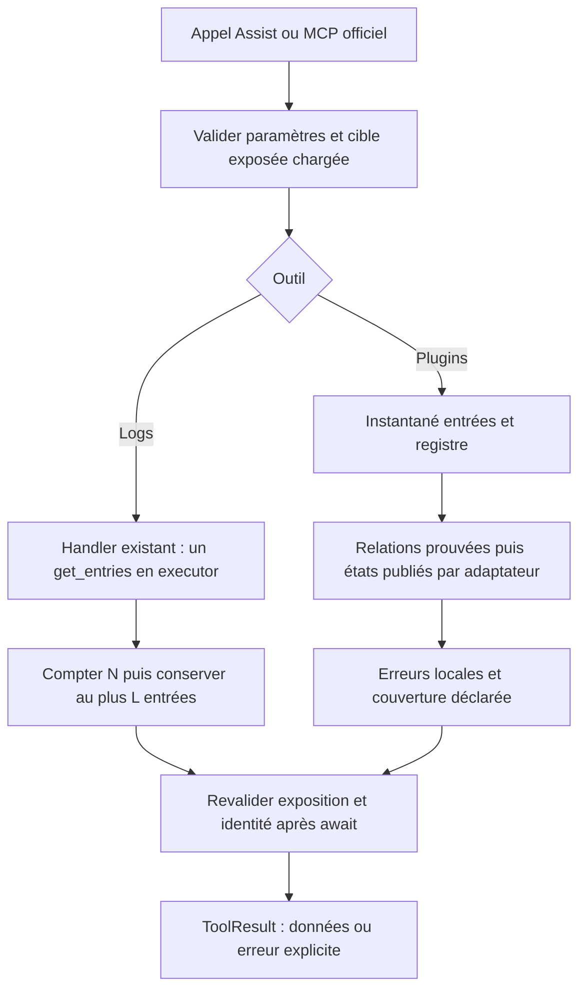

# Issue #2208 : conception technique des outils de diagnostic IA

## 1. Métadonnées, autorité et sources

| Champ               | Valeur                                                                                                                                                                                                                                                 |
| ------------------- | ------------------------------------------------------------------------------------------------------------------------------------------------------------------------------------------------------------------------------------------------------ |
| Version / date      | 1.3 / 2026-11-08 ; cycle de convergence 3                                                                                                                                                                                                              |
| Statut              | Conception actualisée, validation humaine finale non acquise ; Q-01/Q-02/Q-04 résolues, Q-03 répondue sur le plafond proposé de 5 000, sélection restant à valider à la présentation finale ; V-01/V-02 non exécutées ; développement non autorisé     |
| Propriétaire        | Projet Versatile Thermostat, mainteneur @jmcollin78                                                                                                                                                                                                    |
| Révision locale     | `e2ee3680f70c76b81684ee2b976c16ea358c7646` citée au cycle 1, non revérifiée ici ; documents préexistants non suivis préservés hors des deux conceptions                                                                                                |
| Référentiel         | [Rapport actualisé](issue-2208-review.md), [spécification FR v1.3](../specs/issue-2208_fr.md), [spécification EN v1.3](../specs/issue-2208_en.md), deux conceptions v1.2 avant correction, tous lus intégralement ; réponses utilisateur du 2026-11-08 |
| Origine             | [Issue #2208](https://github.com/jmcollin78/versatile_thermostat/issues/2208) ; informations fonctionnelles reprises du rapport, sans nouvelle vérification de sa chronologie GitHub                                                                   |
| Version équivalente | [issue-2208-design_en.md](issue-2208-design_en.md)                                                                                                                                                                                                     |
| Livraison autorisée | Uniquement ces deux documents dans `documentation/tech-docs/`, emplacement explicitement demandé                                                                                                                                                       |

Autorité : décisions utilisateur du rapport et de la demande courante > spécifications > conception. **F** désigne un fait lu ; **D** un choix technique candidat. P-01 est accepté pour quatre familles/sept exemples ; Q-02 accepte les états partiels de P-03 si davantage d'information n'est pas disponible, sans validation champ par champ ; Q-04 retient ISO normalisé avec fuseau explicite. P-02 retient le plafond proposé de 5 000, mais la sélection des dernières entrées reste proposée. Les statuts Q, DIV et V sont distingués en section 10. Couverture documentaire ne signifie ni acceptation applicative, ni complétude garantie, ni implémentation.

La déclaration du rédacteur est confrontée au rapport et aux réponses utilisateur. Les références aux conceptions v1.2 des spécifications v1.3 décrivent leur étape de revue avant cette actualisation v1.3 ; elles restent préservées, pas des affirmations sur la conception courante. Seules les deux conceptions sont révisées au même emplacement. Même périmètre fonctionnel/exclusions ; ni validation humaine finale des documents/résultats ni autorisation de développement déduites des réponses reçues.

Consignes HA : `SKILL.md`, références `device-control` et `domain-docs` de [homeassistant-ai/skills](https://github.com/homeassistant-ai/skills/tree/main/skills/home-assistant-best-practices) relues sur leurs pages publiques au cycle 1. L'outil de chargement différé `tool_search` n'est pas disponible pour charger `ha_get_skill_guide` ; version embarquée non vérifiée, sans appel HA de substitution. Les consignes Python fact-grounded étaient consultées en v1.0 ; aucune certification de types/interpréteur ni exécution Python dans ce cycle. Pas de demande d'automation, helper, AppDaemon, dashboard, renommage ou commande HA.

**Consignes du cycle 2 :** `SKILL.md` public relu ; sa table n'impose pas de référence supplémentaire pour ces seules corrections de contrats documentaires, sans nouvelle configuration ni action HA. Le chargeur différé reste indisponible ; aucune version embarquée ni recommandation de version installée n'est certifiée.

**Consignes du cycle 3 :** `SKILL.md` public relu via sa page brute ; sa table ne demande pas de référence supplémentaire pour cette actualisation documentaire seule. Chargeur différé/version embarquée indisponibles ; aucun accès HA de substitution ni modification de dépendance.

| Source | Lectures locales pertinentes et faits établis                                                                                                                                                                                                                                                                                                                                                                                                                                                |
| ------ | -------------------------------------------------------------------------------------------------------------------------------------------------------------------------------------------------------------------------------------------------------------------------------------------------------------------------------------------------------------------------------------------------------------------------------------------------------------------------------------------- |
| C-01   | [llm.py](../../custom_components/versatile_thermostat/llm.py) : annotations, schémas Probatio, sélection exposée, outils état/diagnostic/Recorder, `async_get_tools`. Dix outils existants ; aucun `get_logs`/`get_plugins`.                                                                                                                                                                                                                                                                 |
| C-02   | [log_collector.py](../../custom_components/vtherm_api/src/vtherm_api/log_collector.py) : fichier intégral ; instantané verrouillé puis filtre, dates/niveaux inclusifs, conversion, buffer et export à effets de bord.                                                                                                                                                                                                                                                                       |
| C-03   | [base_thermostat.py](../../custom_components/versatile_thermostat/base_thermostat.py), [thermostat_prop.py](../../custom_components/versatile_thermostat/thermostat_prop.py), [initialisation](../../custom_components/versatile_thermostat/__init__.py) : création/retry externes, configuration fusionnée, attributs publiés, export par nom interne, collecteur partagé. `on_percent` peut notifier l'algorithme : propriété non pure.                                                    |
| C-04   | [API](../../custom_components/vtherm_api/src/vtherm_api/vtherm_api.py), [interfaces](../../custom_components/vtherm_api/src/vtherm_api/interfaces.py) : registres globaux, getters de factories, getter de singleton créateur, reset destructeur du registre ; pas de contrat diagnostic inverse universel.                                                                                                                                                                                  |
| C-05   | [SmartPI handler](../../custom_components/vtherm_smartpi/handler.py), [capteur](../../custom_components/vtherm_smartpi/sensor.py), [diagnostic compact](../../custom_components/vtherm_smartpi/smartpi/diagnostics.py) : sélection dédiée/globale, capteur `smartpi_diag_{unique_id}`, `update_attributes` vide, blocs publiés distincts de `debug`.                                                                                                                                         |
| C-06   | [Hysteresis handler](../../custom_components/vtherm_hysteresis/handler.py), [contrôleur](../../custom_components/vtherm_hysteresis/hysteresis/controller.py) : configuration dédiée/globale et `specific_states.hysteresis`, diagnostic à dix champs.                                                                                                                                                                                                                                        |
| C-07   | [Pellet handler](../../custom_components/vtherm_pellet_stove/handler.py), [capteur](../../custom_components/vtherm_pellet_stove/sensor.py), [contrôleur](../../custom_components/vtherm_pellet_stove/pellet/controller.py) : options dédiées sans héritage global, capteur `{domain}_{unique_id}_debug`, état publié après calcul.                                                                                                                                                           |
| C-08   | [Auto-fan manager](../../custom_components/vtherm_auto_fan_extended/manager.py), [constantes](../../custom_components/vtherm_auto_fan_extended/const.py) : lien ciblé, section `auto_fan`, booléens opérationnels et refresh créateur/commandeur.                                                                                                                                                                                                                                            |
| C-09   | [Failure models](../../custom_components/vtherm_heating_failure_detection/models.py), [manager](../../custom_components/vtherm_heating_failure_detection/manager.py), [constantes](../../custom_components/vtherm_heating_failure_detection/const.py), [setup](../../custom_components/vtherm_heating_failure_detection/__init__.py) : héritage/global/ciblé, entrées runtime chargées, `MANAGER_ATTRIBUTES_KEY = heating_failure_detection_manager`, template évalué lors de publication.   |
| C-10   | [Replication setup](../../custom_components/vtherm_climate_replication/__init__.py), [contrôleur](../../custom_components/vtherm_climate_replication/climate_replication.py), [constantes](../../custom_components/vtherm_climate_replication/const.py) : `target_climate`, `physical_climate`, dictionnaire runtime `enabled`, objet `PluginClimate` privé, synchronisation à effets de bord.                                                                                               |
| C-11   | [Inhibition setup](../../custom_components/vtherm_inhibition/__init__.py), [entité](../../custom_components/vtherm_inhibition/entity.py), [binary sensor](../../custom_components/vtherm_inhibition/binary_sensor.py), [détecteur](../../custom_components/vtherm_inhibition/detector.py), [liaison](../../custom_components/vtherm_inhibition/link.py) : cible par unique ID, capteur `{unique_id}_inhibition`, diagnostics et inhibition conservée au déchargement.                        |
| C-12   | [Tests LLM](../../tests/test_llm_tpi.py), [gestionnaires externes](../../tests/test_external_feature_manager.py), [collecteur](../../custom_components/vtherm_api/tests/test_log_collector.py), [panne](../../tests/test_heating_failure_detection.py), [inhibition cœur](../../tests/test_inhibition.py) : tests voisins lus intégralement ou par sections ciblées ; aucune réussite déduite.                                                                                               |
| C-13   | [Manifeste VTherm](../../custom_components/versatile_thermostat/manifest.json), [HACS](../../hacs.json), [requirements dev](../../requirements_dev.txt), [requirements tests](../../requirements_test.txt), [CI](../../.github/workflows/pull.yml), [API package](../../custom_components/vtherm_api/pyproject.toml), [version API locale](../../custom_components/vtherm_api/src/vtherm_api/__init__.py), manifestes des sept plugins locaux : versions déclarées, pas versions installées. |
| C-14   | [Documentation LLM FR](../fr/feature-llm-mcp.md), [convention de conception voisine](issue-2141-design.md) : outils via Assist/MCP officiel, noms préfixés, sections numérotées, preuves et divergences explicites.                                                                                                                                                                                                                                                                          |

Les sources de plugins/API locales incluent des répertoires ignorés par Git. Elles ne sont ni un audit de toutes leurs versions ni une preuve de disponibilité sur les installations clientes.

**Lectures indépendantes du cycle 1 :** C-02 (parser, émission, `get_entries`, purge), C-09 (modèle de priorité et setup/unload complets ; publications ciblées du manager), C-03 (publication de panne native), C-08/C-05/C-10 (recherche ciblée des publications, booléens, `update_attributes` et liaison privée), C-01/C-12/C-13 (déclarations LLM, skips, tests du cœur et versions déclarées). Les autres détails C-01 à C-14 conservent les lectures v1.0, pas une relecture exhaustive actuelle. Une recherche ciblée ne prouve pas l'absence de tout autre contrat public ni de suites tiers.

**Lectures indépendantes du cycle 2 :** rapport validé, spécifications FR/EN v1.2 et conceptions FR/EN v1.1 lus intégralement ; comparaison des exigences, critères, statuts DIV et réserves R-01/R-02. C-01 à C-14 restent des constats hérités, non recertifiés : aucun code, test, manifeste ou historique relu dans ce cycle.

**Lectures indépendantes du cycle 3 :** rapport actualisé, spécifications FR/EN v1.3 et conceptions FR/EN v1.2 lus intégralement ; comparaison des décisions/contrats/conclusions. C-02 relu uniquement sur `_parse_to_utc`, `emit`, `get_entries` et contexte adjacent : datetimes aware, UTC à l'émission, copie verrouillée et filtrage confirmés statiquement. Autres constats C-01 à C-14 hérités, non recertifiés ; aucune relecture des plugins/tests/manifestes, preuve runtime ou nouvelle consultation GitHub.

## 2. Objectif, périmètre et invariants

Concevoir exactement deux consultations pour un VTherm chargé et exposé : logs du collecteur et plugins configurés avec état accessible. Aucune régulation, commande, installation, modification de configuration/dépendance/entité, ni implémentation dans cette livraison. Aucun nouveau serveur, endpoint HTTP, fichier de logs ou historique Recorder.

**Invariants validés :** lecture seule ; sélection par VTherm et dates incluant messages sans indice ; confusion acceptée sans correction/masquage spécial ; attribution à corriger par les intégrations émettrices ; exposition Assist conservée sans contrôle supplémentaire d'utilisateur, READ/CONTROL ou administrateur ; limite par nombre avec dépassement/troncature explicites ; ni plafond de durée de période ni pagination ; diagnostic courant environ une heure ; rétention/purge inchangées ; interprétation des instructions dans les données à la charge de l'agent.

**D-07, choix technique candidat, non décision du mainteneur :** proposer l'absence de timeout applicatif ajouté par ces outils. Le rapport valide l'absence de limite de durée de période, pas une interdiction de délai maximal de réponse. Aucun délai garanti ni prohibition générale de timeout. Timeouts du canal extérieurs/non caractérisés, suppression non promise ; caractérisation future V-01/AC-011, pas nouvelle question utilisateur bloquante. Aucun timeout ajouté ici ; toute modification des contraintes convenues exige une décision distincte.

Les quatre familles/sept exemples sont **acceptés par Q-01** : SmartPI, Hysteresis, Pellet Regulation, Auto-fan, Heating Failure Detection, Climate Replication et Inhibition. Q-02 accepte les lacunes sans meilleure information ; les états accessibles ne doivent pas être omis. ISO 8601 à `Z` ou offset numérique obligatoire et L = 5 000 retenus ; dernières entrées proposées à valider à la présentation finale, objectif d'une heure non mesuré/non garanti. TPI/gestionnaires natifs exclus des plugins externes ; domaine/factory/device partagé/compatibilité ne prouvent pas une configuration cible. Futurs plugins potentiellement non détectables, limite à annoncer sans noms/nombre/présence inventés. Inventaire universel tiers et correctif #2191 exclus.

## 3. Existant, compatibilité et prérequis

| Élément déclaré                                                                                         | Conclusion limitée et vérification future                                                                                                                                                      |
| ------------------------------------------------------------------------------------------------------- | ---------------------------------------------------------------------------------------------------------------------------------------------------------------------------------------------- |
| VTherm `10.6.3`, `vtherm_api>=0.7.0`                                                                    | Contrat collecteur à vérifier à la borne `0.7.0` ; les sources API lues déclarent `0.8.0`, Python `>=3.13`. Elles ne prouvent pas l'identité du contrat en `0.7.0`.                            |
| HACS HA `2026.3.1` ; dev HA `2026.8.2` ; commentaire LLM octobre 2026                                   | Aucune de ces valeurs ne prouve la version minimale des plateformes `LLMTools`, `ToolResult`, `ToolAnnotations` et de leur publication MCP. Pas de relèvement de version décidé.               |
| Tests LLM : skip de module si `ToolAnnotations`/`ToolResult` absents ; CI Python `3.14`                 | Un skip n'est pas une validation. Le garde ne vérifie pas toutes les capacités ni le round-trip Probatio/MCP. Ajouter une vérification de capacités et un banc compatible avant certification. |
| SmartPI/Hysteresis `0.0.0` ; Auto-fan/Failure `0.1.0` ; Replication/Inhibition `0.2.0` ; Pellet `2.0.0` | Versions de manifestes locaux, pas matrice supportée. Dépendances API explicites : Failure `>=0.5.0`, Replication `>=0.2.0`, Inhibition `>=0.6.2`, Pellet `>=0.8.0`.                           |

**D-01 :** intégrer les nouveaux outils à `async_get_tools` de C-01, seulement pour `LLM_API_ASSIST` et lorsque la sélection exposée n'est pas vide. Réutiliser `READ_ONLY_ANNOTATIONS` ; `idempotent=True` signifie aucun effet métier répété, pas identité des réponses à des instants différents. Les dix outils actuels et leurs schémas restent inchangés ; aucune migration de configuration ni de stockage.

**D-02 :** privilégier des adaptateurs internes explicites, sans import dynamique de modules de plugins ni appel à leurs fonctions de setup. Lire les entrées HA, le registre d'entités et les `State` déjà publiés. Vérifier seulement les capacités techniques de lecture requises, pas des droits supplémentaires. L'absence d'un plugin optionnel ne doit pas rendre les outils LLM existants impossibles à charger. L'absence de l'API LLM dans une version HA ancienne est une limite préexistante à qualifier, pas une promesse de fallback automatique.

V-01 couvre publication Assist/MCP, annotations de lecture, validation Probatio réelle, restitution complète, contextes sans utilisateur/non administrateur, capacités manquantes et borne API `0.7.0`. A retenue : conversions exactes à vérifier dans les chemins réellement supportés du nouvel outil, sans imposer un banc sans helper HA ni une nouvelle version. Aucun résultat V-01/V-02 disponible, ni compatibilité/non-effets certifiés. Prérequis futurs à la certification, pas questions bloquantes pour la conception ni autorisation de banc HA.

## 4. Composants et responsabilités proposés

| Composant candidat                          | Responsabilité / frontière                                                                                                                                                     |
| ------------------------------------------- | ------------------------------------------------------------------------------------------------------------------------------------------------------------------------------ |
| `GetVThermLogsTool`, `GetVThermPluginsTool` | Deux classes `llm.Tool` dans la surface LLM ; validation, revalidation de cible, résultat `llm.ToolResult`, description FR/EN.                                                 |
| Résolveur partagé de cible                  | Résoudre `entity_id` → entrée/unique ID/instance chargée/State ; préserver l'exposition du `llm_context.assistant`. Ne charge ni ne crée la cible.                             |
| Lecteur collecteur                          | Lire le handler présent dans `hass.data[DOMAIN]["log_handler"]` avec `.get`, appeler une seule fois `get_entries`, puis compter/projeter/tronquer l'instantané.                |
| Lecteur de liens configurés                 | Parcourir une fois les entrées des domaines retenus, prouver les relations et leurs priorités, conserver entrées désactivées/déchargées et observations non prouvées séparées. |
| Adaptateurs d'état par intégration          | Résoudre les entités par registre et identifiants stables ; copier une liste blanche de champs déjà publiés, qualifier le sens et la date des valeurs.                         |
| Assembleur de réponse                       | Fusionner les seuls liens de même identité démontrée, conserver erreurs locales et couverture, produire du JSON déterministe pour le même instantané.                          |

Un petit module interne de diagnostic ne se justifie que pour isoler ces lectures/projections et leurs tests ; emplacement final à choisir au développement. Aucun framework de découverte, cache durable, nouveau manager ou contrat imposé à tous les plugins.



## 5. Identification, relations, états et données

### 5.1 Cible et identité des plugins

**D-03 :** seul `entity_id` climate est accepté en entrée, pas un nom libre ni `device_id`. Le registre doit rattacher la cible à une entrée `versatile_thermostat`, le composant climate doit contenir son instance chargée, et `hass.states.get` doit fournir son état. Utiliser la sélection Assist existante, puis vérifier instance/entrée pour écarter un état restauré orphelin. Un State `unknown`/`unavailable` n'est pas, seul, un déchargement. Ne pas exiger `is_ready`, un mode HVAC ou une température valide.

Capturer `entity_id`, `config_entry_id`, `unique_id` du registre et `name` interne courant de l'instance. Le nom interne alimente le filtre logs comme `_name` dans l'export ; `friendly_name` peut être une surcharge UI et ne doit pas le remplacer. L'ID d'entrée n'est pas supposé égal au unique ID. Identité/source/exposition doivent être relues après les awaits ; remplacement d'instance, renommage ou changement de nom pendant la lecture : `target_changed`, résultat abandonné sans retry automatique. Un changement de mode seul n'invalide pas l'instantané.

Un plugin configuré est identifié par `(domain, plugin_config_entry_id)` lorsqu'une entrée existe. Plusieurs rôles vérifiés se rattachent à cette même identité ; deux entrées distinctes restent deux enregistrements. **La preuve de sélection externe est indépendante de la résolution de l'identité producteur et de son rattachement à une entrée.** Sans résolution, conserver cette preuve avec `observation_id=selection:{target_unique_id}:{algorithm_name}` : clé synthétique d'observation, pas identité supplémentaire de plugin. Le domaine/producteur et l'entrée restent inconnus lorsqu'ils ne sont pas démontrés ; une factory ou un handler absent ne retire jamais cette sélection.

Si le rattachement à une identité configurée est prouvé, ajouter le rôle sélectionné à son unique enregistrement dans `plugins[]`. Sinon, rendre la sélection dans `unresolved_links[]` avec `link_proof=proven`, `configured` et `selected` connus vrais, cible/clé/source de preuve et identité/rattachement inconnus. Ce n'est pas un lien dont la configuration serait non prouvée : distinguer ce dernier par `link_proof=unproven`, sans `configured=true`. Ne ni fusionner la sélection avec une entrée plausible ni la compter comme un second plugin. Tant qu'une sélection prouvée demeure sans identité/rattachement résolus, le compte configuré consolidé reste `null` selon 6.4 ; preuve visible ne signifie ni plugin absent ni total exact. Une correspondance de nom/device n'autorise aucune fusion. Ces règles de restitution ne valident pas P-01/Q-01.

### 5.2 Relations du périmètre accepté de P-01

| Famille / adaptateur | Preuve et sélection de configuration                                                                                                                                                                                                                                   | Limite / cas partiel                                                                                                                                                                                                                                                                                                                 |
| -------------------- | ---------------------------------------------------------------------------------------------------------------------------------------------------------------------------------------------------------------------------------------------------------------------- | ------------------------------------------------------------------------------------------------------------------------------------------------------------------------------------------------------------------------------------------------------------------------------------------------------------------------------------ |
| CAT-01 SmartPI       | `configuration.proportional_function`/configuration fusionnée courante et entrée ciblée `target_vtherm_unique_id`. Dédiée d'abord, sinon entrée globale `unique_id == domain`. SmartPI superpose défauts, configuration VTherm, puis data/options de l'entrée retenue. | La sélection prouve le rôle algorithmique même sans factory ; une entrée dédiée non sélectionnée reste configurée, `selected=false`. Une entrée globale ne s'applique pas à tous les VTherm.                                                                                                                                         |
| CAT-01 Hysteresis    | Même clé de cible et choix dédié sinon global ; défauts puis data/options de l'entrée retenue, pas superposition dédiée + globale.                                                                                                                                     | Diagnostic sur climate, pas besoin de capteur dédié. TPI natif exclu.                                                                                                                                                                                                                                                                |
| CAT-01 Pellet        | `pellet_regulation` et entrée ciblée ; dédié sinon global ; `options or data`, avec règles locales pour `dry_contact`/`bistable_confirmed`.                                                                                                                            | Pas d'héritage global dans l'entrée dédiée ; ne pas appeler `_resolve_options`, qui journalise. Adapter seulement les clés nécessaires à la preuve, pas les options privées.                                                                                                                                                         |
| CAT-02 Auto-fan      | Entrée `target_vtherm_unique_id == target.unique_id` ; états publiés de cette cible.                                                                                                                                                                                   | `supports`/manager créé ne prouvent pas la configuration ; absence de modes n'efface pas une entrée ciblée. Pas de configuration globale Auto-fan déduite.                                                                                                                                                                           |
| CAT-02 Failure       | Cible `vtherm_unique_id` dans la vue de configuration du plugin ; défauts < héritage VTherm < global < ciblé. C-09 stocke **`options or data`**, pas une fusion universelle.                                                                                           | Séparer entrées persistées, copie des entrées runtime et publication existante. Les entrées runtime renseignent les entrées disponibles au modèle, pas à elles seules la configuration déjà appliquée au manager ; `configuration_applied` inconnue sans preuve. Entrée désactivée/déchargée conservée comme déclaration selon Q-01. |
| CAT-03 Replication   | `entry.data.target_climate == entity_id`, source `entry.data.physical_climate`. Entrée conservée si déchargée ; état runtime `enabled` lu uniquement dans le dictionnaire déjà présent.                                                                                | Aucun registre inverse PluginClimate universel. `_plugin.linked_vtherm` privé ne doit pas être inspecté dans l'option de base ; `runtime_linked=unknown`.                                                                                                                                                                            |
| CAT-04 Inhibition    | `vtherm_unique_id` est l'autorité si présent ; résoudre via registre `(climate, versatile_thermostat, uid)`. Ancien `vtherm_entity_id` sert de repli seulement sans uid, comme C-11.                                                                                   | UID connu non résolu ne doit pas être remplacé par un nom ou un ancien ID recyclé. Inhibition du cœur seule n'identifie aucun émetteur tiers.                                                                                                                                                                                        |

Pour toute sélection CAT-01 prouvée, appliquer 5.1 même si factory, handler, domaine producteur ou entrée effective ne sont pas résolus. La preuve reste restituée sans identité fictive ; l'incertitude d'identité/comptage ne doit pas devenir une incertitude de sélection ni autoriser un succès « aucun plugin » (FR-012, P-01, AC-015 v1.3). Q-01 accepte le périmètre, pas une preuve de résolution runtime des identités ; les règles techniques de 5.1 ne sont pas un nouvel arbitrage Q-01.

Pour héritage du cœur, lire `entry_infos` public de l'instance déjà créée, sans appeler `post_init` ni recalculer/fusionner toute la configuration. Pour provenance centrale impossible à démontrer depuis la vue fusionnée, indiquer `merged_target_configuration`, pas inventer l'entrée d'origine. Plusieurs entrées candidates ou schémas inconnus : preuve locale partielle ; ne pas inventer une priorité globale. Les versions lues ont leurs propres règles de première/dernière entrée ; ne les généraliser ni à des versions non vérifiées ni à une collision dont l'application runtime n'est pas connue.

Pour Failure seulement, l'adaptateur candidat peut copier le dictionnaire déjà présent `hass.data[plugin_domain]["entries"]` via `.get`, sans `setdefault`, import du plugin ou appel au modèle. Qualifier cette source `source_runtime_configuration` ; aucune mutation ni évaluation du template. Le setup peut mettre à jour ce dictionnaire avant la fin d'un rechargement : son contenu ne prouve ni un handler chargé ni son application actuelle. Une publication reste qualifiée par sa source et son producteur, même si ses valeurs ressemblent aux entrées. Les clés indispensables de liaison/priorité sont lues en interne, pas la configuration brute ni le texte du template dans la réponse.

### 5.3 Dimensions d'état indépendantes

Chaque fait normalisé : `{value, knowledge, source, scope, reason}`. `knowledge` vaut `known`, `unknown` ou `unavailable` ; `value=null` pour les deux derniers. Le `null` publié reste une valeur connue explicitement absente si le contrat source le dit, sans conversion en zéro. Les valeurs `false`/`0` publiées restent préservées. Champs candidats : `configured` (lien déclaré prouvé), `configuration_applied`, `selected`, `enabled`, `loaded`, `operational_ready`, `available`, `active`. `scope=integration_entry|runtime_component|state_source` obligatoire pour chaque fait, pas seulement `loaded`. Plusieurs faits `loaded` de périmètres différents ne s'écrasent pas ; LOADED d'une entrée ne devient jamais « handler présent ». Configuration persistée, application au manager et disponibilité d'un State restent séparées.

La présence d'un handler algorithmique n'a pas d'accesseur diagnostic public vérifié : elle reste inconnue dans l'option de base, même si une factory est enregistrée. Les bits Auto-fan `is_configured`/`is_detected` ne sont pas publiés dans `auto_fan` : restituer les champs existants, marquer aptitude/détection inconnues sauf contrat explicitement validé. Pour Failure, les états bruts `unknown`/`unavailable` priment sur les booléens qui les réduiraient à `false`.

Disponibilité de la source, complétude de la découverte et complétude du diagnostic sont trois notions différentes. `discovery.status` et `diagnostics.status` valent `complete`, `partial`, `unavailable` ou `not_supported`. Une recherche complète s'entend uniquement pour les adaptateurs et schémas nommés ; `third_party_exhaustive=false` toujours. Un diagnostic incomplet ne rend pas nécessairement l'inventaire incomplet.

**Q-02 résolue, acceptabilité distincte de vérité/complétude :** `state_minimum_status=met|not_met` reste un champ technique candidat distinct de `diagnostics.status`, pas une liste validée champ par champ. Dans le futur résultat, `met` signifie que tous les faits fiables accessibles du sous-ensemble retenu ont été conservés avec sources/lacunes ; partiel/inconnu/indisponible accepté si aucune meilleure information. `not_met` signale un fait accessible omis ou une qualification exigée perdue, pas la seule absence d'un état non publié. Aucun minimum courant `undecided`, aucune nouvelle validation champ par champ exigée ; ce statut ne dit jamais qu'un critère a été testé dans ce cycle. Aucun état accessible : lien prouvé et diagnostic `unavailable` acceptables ; identité seule remplaçant un état accessible interdite. Acceptation partielle ne transforme ni `unknown` en connu ni `diagnostics.status=partial` en `complete`. Complétude limitée aux champs/périmètres retenus, jamais état physique actuel ou exhaustivité tiers garantis.

### 5.4 Projections candidates de P-03

Ne lire que `State.state` et les clés suivantes si présentes, sans appeler les méthodes productrices de diagnostic. Résolution des capteurs : registre `(domain d'entité, platform du plugin, unique_id connu)` et rattachement configuré ; l'ID visible du capteur n'est jamais construit depuis le nom.

| Source publiée                                      | Liste blanche candidate / sémantique                                                                                                                                                                                                                                                                                                                                                                                                                                                                                          |
| --------------------------------------------------- | ----------------------------------------------------------------------------------------------------------------------------------------------------------------------------------------------------------------------------------------------------------------------------------------------------------------------------------------------------------------------------------------------------------------------------------------------------------------------------------------------------------------------------- |
| SmartPI `smartpi_diag_{uid}`                        | État du capteur et blocs compacts `control`, `power`, `temperature`, `model`, `ab_learning`, `governance`, `feedforward`, `setpoint`, `autocalib`, `calibration`, limités aux clés définies par `build_published_diagnostics` de C-05. Exclure `debug` et toute clé future non déclarée. Phase du contrôleur, pas activité physique ni certitude scientifique de `confidence`.                                                                                                                                                |
| Hysteresis climate `specific_states.hysteresis`     | `is_active`, `hvac_mode`, `on_percent`, `last_reason`, `activation_threshold`, `deactivation_threshold`, `hysteresis_on`, `hysteresis_off`, `max_on_percent`, `min_on_percent`. `is_active` = état logique publié du contrôleur.                                                                                                                                                                                                                                                                                              |
| Pellet `{domain}_{uid}_debug`                       | État, `phase`, `available`, `is_heating`, `on_percent`, `current_level`, `current_level_index`, `observed_cycle`, `observed_phase`, `pending_command`, `command_error`, `last_reason`, `last_on_at`, `last_off_at`, `next_action_allowed_at`, `remaining_on_sec`, `remaining_off_sec`, `boost_active`, `boost_until`. Données calculées/publiées, pas lecture physique forcée.                                                                                                                                                |
| Auto-fan climate `auto_fan`                         | `enabled`, `current_gap`, `selected_fan_mode`, `sent_fan_mode`, `rest_mode`, `thresholds`. Mode envoyé ≠ mode physique garanti ; ne pas synthétiser `is_detected` en refaisant sa logique.                                                                                                                                                                                                                                                                                                                                    |
| Failure climate `heating_failure_detection_manager` | `heating_failure_state`, `cooling_failure_state`, `heating_failure_threshold`, `cooling_failure_threshold`, `detection_delay_min`, `temperature_change_tolerance`, `is_detection_enabled_by_template`, `heating_tracking`/`cooling_tracking` limités à `is_tracking`, `initial_temperature`, `current_temperature`, `remaining_time_min`, `elapsed_time_min`, `root_cause`, `root_cause_entity_id`. Exclure `failure_detection_enable_template`. La cause est une publication du producteur identifié, pas un calcul du Tool. |
| Replication                                         | Cible/source déclarées et runtime `enabled` si existant ; statut de l'entrée. Pas de succès de réplication, historique de synchronisation ou liaison privée supposée. État interne partiel accepté par Q-02 si aucune meilleure information disponible.                                                                                                                                                                                                                                                                       |
| Inhibition `{uid}_inhibition`                       | État, `status`, `raw_status`, `stop_underlyings`, `bypass`, `active_sources`, `pending_status`, `pending_until`, `last_change`, `unavailable_since`, `missing_sources`, `sources` limité à `{state, contribution}`, `vtherm_entity_id`, `vtherm_available`, `last_api_call`, `last_api_call_at`, `last_error`, `retry_pending`, `waiting_for_vtherm_start`, `next_retry_at`.                                                                                                                                                  |

C-05 définit les sous-clés SmartPI ci-dessous, pas un export de l'objet contrôleur. Capteur désactivé/absent, structure différente ou clé manquante : raisons `source_not_published`, `source_schema_unsupported` ou `field_not_published`. Des attributs restants d'un capteur `unavailable` peuvent être rendus comme dernière publication indisponible, jamais comme état actif courant.

| Bloc compact SmartPI | Sous-clés autorisées candidates                                                                                                                                          |
| -------------------- | ------------------------------------------------------------------------------------------------------------------------------------------------------------------------ |
| `control`            | `phase`, `mode`, `hysteresis_state`, `kp`, `ki`, `restart_reason`                                                                                                        |
| `power`              | `current_cycle_percent`, `next_cycle_percent`, `pi_percent`, `ff_percent`, `hold_percent`                                                                                |
| `temperature`        | `sensor`, `ext_sensor`, `error`, `integral_error`, `integral_mode`, `integral_hold_mode`, `integral_guard_source`                                                        |
| `model`              | `a`, `b`, `confidence`, `tau_reliable`, `deadtime_heat_s`, `deadtime_cool_s`                                                                                             |
| `ab_learning`        | `stage`, `bootstrap_progress_percent`, `bootstrap_status`, `accepted_samples_a`, `accepted_samples_b`, `target_samples`, `last_reason`, `a_drift_state`, `b_drift_state` |
| `governance`         | `regime`, `thermal_update_decision`, `thermal_update_reason`                                                                                                             |
| `feedforward`        | `ff3_status`, `ff3_twin_usable`, `twin_status`, `deadband_power_source`                                                                                                  |
| `setpoint`           | `filtered_setpoint`, `trajectory_active`, `trajectory_source`                                                                                                            |
| `autocalib`          | `state`, `model_degraded`, `last_trigger_ts`, `next_check_ts`, `snapshot_age_h`                                                                                          |
| `calibration`        | `state`, `retry_count`, `last_time`                                                                                                                                      |

Le gestionnaire Failure natif publie aussi `heating_failure_detection_manager` : section seule ou configuration persistée seule ne prouvent pas le producteur runtime. Si son origine externe n'est pas démontrée, rendre la publication comme source VTherm avec `producer=unknown`, `state_origin_unverifiable`, diagnostic partiel ; ne pas attribuer sa cause au plugin externe. La clé `heating_failure_detection` de `DIAGNOSTIC_SECTIONS` dans C-01 n'est pas cette section réelle ; ne pas réutiliser cet inventaire générique pour le nouvel outil.

Chaque source porte `source_entity_id`, chemin d'attribut, `state_last_updated`, `state_last_changed`, `observed_at` et `measurement_at` si explicitement fourni par la source, sinon `null`. `last_updated` est l'heure HA de publication/mise à jour, pas la date de mesure de chaque champ ; `last_change` d'inhibition et `last_api_call_at` restent leurs dates métier. `restoration=unknown` sauf preuve explicite ; pas de seuil arbitraire de fraîcheur. Aucun stockage/restauration/cache nouveau ; instantanés transitoires seulement.

Instants normalisés de réponse : ISO 8601 UTC avec `Z`, via datetimes aware et conversion exacte de 6.2. Dates métier sources : préserver séparément la valeur brute ; convertir datetime aware/offset explicite, epoch seulement si unité/origine démontrées. Fuseau non démontrable : normalisation `null`, connaissance `unknown`, raison `source_timezone_unknown`, sans supposer UTC/local ; autres valeurs fiables conservées. Publication, mesure et consultation ne se remplacent pas ; les durées ne deviennent pas des instants.

### 5.5 Faisabilité de principe en lecture seule, sans accès HA

Évaluation documentaire de C-03 à C-11 hérités, pas relecture des plugins ni essai runtime au cycle 3. Les entrées/registre/State/dictionnaires existants permettent de concevoir les liens et états sans appel producteur ; chaque source dépend de présence, schéma et liaison démontrable. Absence/indisponibilité qualifiées selon Q-02, pas nouveau contrat/dépendance.

| Famille / exemple accepté          | Lecture prévue et état accessible                                                                             | Conclusion bornée / vérification future                                                                                                              |
| ---------------------------------- | ------------------------------------------------------------------------------------------------------------- | ---------------------------------------------------------------------------------------------------------------------------------------------------- |
| CAT-01 / SmartPI                   | Sélection/configuration ciblée ou globale applicable ; capteur diagnostic lié et blocs publiés de 5.4 (C-05). | Réalisable de principe par lectures ; handler inconnu, capteur absent/indisponible dégradé. AC-015, V-02.                                            |
| CAT-01 / Hysteresis                | Sélection/configuration applicable ; `specific_states.hysteresis` publié (C-06).                              | Réalisable de principe sans actualiser le contrôleur ; aucune garantie d'activité physique. AC-014, V-02.                                            |
| CAT-01 / Pellet Regulation         | Sélection/configuration propre ; phase/attributs du capteur lié (C-07).                                       | Réalisable de principe sans calcul ni `_resolve_options` ; publication et phase physique distinctes. AC-016, V-02.                                   |
| CAT-02 / Auto-fan                  | Entrée ciblée, section `auto_fan` déjà publiée (C-08).                                                        | Réalisable de principe ; aptitude/détection non publiées inconnues, jamais recalculées ni refresh/création/commande. AC-017, V-02.                   |
| CAT-02 / Heating Failure Detection | Entrées déclarées, copie runtime disponible, publication VTherm existante (C-09/C-03).                        | Réalisable de principe avec application/producteur inconnus sans preuve ; clé seule ne prouve pas le producteur, template non exécuté. AC-018, V-02. |
| CAT-03 / Climate Replication       | Cible/source de l'entrée, chargement, `enabled` dans dictionnaire existant (C-10).                            | Réalisable de principe pour cet état partiel ; liaison/succès inconnus, sans accès privé/resync/reconnexion. AC-019, V-02.                           |
| CAT-04 / Inhibition                | Cible configurée, capteur lié/diagnostics déjà publiés (C-11).                                                | Réalisable de principe ; statut/API/retry annoncé sans set/unset/retry induit ni inférence de tous les émetteurs du cœur. AC-020, V-02.              |

Quatre familles/sept exemples donc faisables/testables de principe dans ce périmètre de lecture avec états partiels acceptés ; accès effectif/versions/non-effets à démontrer par V-01/V-02. Factory globale ou `PluginClimate` interne ne fournissent pas de découverte inverse universelle. Annoncer que des futurs plugins/catégories peuvent ne pas être détectables par les sources prises en charge, même si nom/nombre/présence inconnus. Aucun mécanisme universel, import dynamique, introspection privée, nouveau registre ou fournisseur obligatoire inventé. Liste vide limitée aux intégrations/formats vérifiés, jamais preuve d'absence de tous les tiers.

## 6. API, réponses et erreurs proposées

### 6.1 Entrées et annotations

Noms candidats : `versatile_thermostat__get_logs` et `versatile_thermostat__get_plugins`. Le préfixe MCP `assist__` est décrit par C-14, à vérifier sur le transport cible. Titres/descriptions FR/EN et clés machine stables en anglais. Réutiliser les annotations de lecture, pas les contrôles ni le découpage Recorder de `get_history`.

| Outil         | Paramètres proposés                                                                                                                                                                                                                                                                  |
| ------------- | ------------------------------------------------------------------------------------------------------------------------------------------------------------------------------------------------------------------------------------------------------------------------------------ |
| `get_logs`    | `entity_id` string obligatoire ; `start_time`/`end_time` strings ISO 8601 normalisées à fuseau explicite optionnelles selon BR-003 ; `min_level` enum `DEBUG/INFO/WARNING/ERROR`, défaut `DEBUG`. Plafond fixe L = 5 000, pas de paramètre `limit`, `offset`, curseur ou pagination. |
| `get_plugins` | `entity_id` string obligatoire ; pas de filtre permettant de masquer implicitement une catégorie non couverte.                                                                                                                                                                       |

Probatio valide types, valeurs et clés inconnues. Pour les deux nouveaux outils, `entity_id` est une string stricte, sans enum figée : le résolveur à l'appel distingue une cible absente/non exposée des paramètres syntaxiquement invalides. La sélection courante conditionne la publication puis chaque consultation, sans changer les schémas des outils existants. Aucun contexte utilisateur obligatoire ni appel à `hass.auth`/`check_entity`.

### 6.2 Temps, instantané et plafond

**D-04 :** début/fin inclusifs ; fin omise = horloge UTC réelle capturée au début de consultation ; début omis = fin effective moins 60 minutes ; égalité permise ; début > fin refusé. Dates anciennes ou futures acceptées sans raccourcir à la rétention. L'horloge de test/régulation `thermostat.now` n'est pas l'horloge du collecteur.

**DIV-01, constat statique confirmé au cycle 3 :** `get_entries` attend des datetimes et compare les instants sans `_parse_to_utc`. Le helper de l'export possède un repli string `fromisoformat(...).replace(tzinfo=UTC)` qui réétiquette l'offset au lieu de convertir l'instant. Ce chemin n'est ni corrigé ni repris : pas de helper privé/export ni string brute passée à `get_entries`. Collecteur, compatibilité de l'export et dépendances inchangés.

**Q-04 résolue / A retenue, contrat ISO 8601 conforme à BR-003 v1.3 :** `YYYY-MM-DDTHH:MM:SS[.fraction]Z` ou `YYYY-MM-DDTHH:MM:SS[.fraction]±HH:MM`, fraction décimale optionnelle. `Z`, `+00:00` et offsets numériques explicites valides acceptés. Dates seules, datetimes naïves, zone nommée seule, formats hors grammaire ou dates invalides refusés sans supposer UTC/local. Restriction syntaxique, pas durée/ancienneté.

Chaîne technique candidate sans nouvelle dépendance : valider types/grammaire BR-003, parser par `datetime.fromisoformat` de la bibliothèque standard, vérifier `utcoffset()` différent de `None` (zéro valide), convertir avec `astimezone(timezone.utc)`, contrôler début/fin après conversion et fournir ces datetimes aware à l'unique `get_entries`. Aucun `replace(tzinfo=...)` pour convertir un instant, repli A→B ou parser de l'export. Formats/précision et chemins réellement supportés à vérifier par AC-005/AC-006/V-01, pas déclarés testés ni nouvelle question utilisateur. Échec explicite, jamais altération silencieuse d'instant.

Conserver les strings demandées/offsets originaux séparément des bornes effectives UTC. Sérialiser les instants normalisés en ISO 8601 UTC avec suffixe `Z` après conversion, sans toucher au timestamp stocké/message. Politique/chemin candidats dans `filters` : `normalization_policy=explicit_offset_to_utc`, `normalization_path=stdlib_aware_datetime`. Offset explicite désambiguïsant les heures répétées des changements d'heure, sans cohérence supplémentaire avec une zone nommée. Exemple documentaire : `2026-11-08T02:00:00+02:00` et `2026-11-08T00:00:00Z` représentent le même instant ; heures locales identiques à offsets différents potentiellement distinctes. AC-005 doit vérifier sélection avant plafond identique pour instants équivalents sur le même buffer dans chaque chemin supporté, pas réponses identiques de buffers différents. A ne garantit pas la complétude historique ; B n'est plus alternative courante ni repli autorisé, le défaut constaté n'autorise aucune correction du collecteur.

**D-05 / P-02 courant, sélection encore proposée :** L = 5 000 entrées fixes par appel. Un seul `get_entries(name, min_level, start, end)`, N = longueur de sa liste. Faire valider à la présentation finale la proposition `entries[-L:]` si N>L : dernières entrées dans l'ordre du collecteur, pas une réponse utilisateur distincte déjà acquise. Aucun tri par timestamp, résumé, priorité aux erreurs, pagination, plafond en octets ou limite de période. `selected_count=N`, `returned_count=min(N,L)`, `omitted_count=N-returned_count`, `limit_exceeded=truncated=(N>L)` ; même liste pour tous les comptes. N=0/4 999/5 000/5 001 donne 0/4 999/5 000/5 000 retournées et 0/0/0/1 omises. Première/dernière entrée distinctes de min/max temporels si timestamps non monotones ; aucune omission historique calculée.

`get_entries` copie le deque sous lock puis filtre hors lock ; `queried_at` n'est pas l'heure exacte de cette copie. Rapporter `read_started_at/read_finished_at` pour encadrer la lecture, sans inventer un timestamp ou ID atomique du buffer. Les entrées lues ne sont pas modifiées. Logs émis ensuite absents de cette réponse ; une seconde consultation peut différer.

### 6.3 Contrat commun et logs

Contrat candidat v1 : `llm.ToolResult(data=..., error=...)`. Champs communs obligatoires : `schema_version=1`, `status`, `entity_id`, `target` (ID d'entrée/unique ID/nom), `queried_at`, `read_started_at`, `read_finished_at`, `warnings[]`, `errors[]`. `status=success|partial|error` ; `error=True` uniquement sur erreur totale. Les erreurs locales restent dans `errors` d'une réponse partielle. En erreur avant résolution/lecture, `target` et les dates de lecture valent `null`, `entity_id` vaut la string reçue ou `null` si elle était invalide ; les champs spécifiques non calculés sont omis, jamais remplis de comptes zéro fictifs. Warnings et errors utilisent les objets structurés de section 6.4.

Pour les logs, ajouter `filters` (demande/offset original, bornes effectives UTC, politique/chemin A de 6.2, niveau, nom), `limit=5000`, `selection_policy`, `order="collector_insertion"`, les cinq indicateurs/comptes D-05, `history_completeness="not_guaranteed"`, `entries[]`. `returned_range` (première/dernière/min/max) seulement si entrées retournées, omis si vide selon FR-009 v1.3, sans bornes fictives/quatre `null`. Instants normalisés communs/bornes/plages/entrées : UTC avec `Z`. Chaque entrée : `timestamp`, `level` numérique, `level_name` issu du niveau, `logger_name` complet, `message` inchangé. Données stockées, pas reconstitution d'un LogRecord/toutes ses exceptions. Échappement JSON ne modifie pas la valeur du texte après décodage.

Exemple **synthétique**, sous réserve de validation finale de la sélection, pas résultat HA :

```json
{
  "schema_version": 1,
  "status": "success",
  "entity_id": "climate.exemple",
  "limit": 5000,
  "selection_policy": "last_entries_in_collector_order",
  "order": "collector_insertion",
  "selected_count": 5001,
  "returned_count": 5000,
  "omitted_count": 1,
  "limit_exceeded": true,
  "truncated": true,
  "history_completeness": "not_guaranteed"
}
```

L'exemple ne montre que les champs de troncature ; les champs communs/filtres/entrées restent obligatoires. Une sélection vide est `success`, compte zéro et avertissement de complétude ; un collecteur absent n'est pas ce succès vide. Pas de `next_offset`, de fichier ni de lien de téléchargement.

### 6.4 Contrat plugins et erreurs

Ajouter `plugins[]`, `configured_plugin_count`, `identified_configured_plugin_count`, `proven_unresolved_selection_count`, `unresolved_links[]`, `coverage` (adaptateurs, intégrations/formats et versions effectivement vérifiés, `discovery.status`, CAT-01 à CAT-04 avec status/reasons, `third_party_exhaustive=false`), `diagnostics_status`, `state_minimum_status`. Champs et règles de comptage restent des contrats techniques candidats, pas un arbitrage Q-01. Les statuts et le minimum global agrègent aussi les lacunes des sélections prouvées non résolues, sans masquer une erreur locale. Chaque plugin : `plugin_id`, `domain`, `config_entry_id` nullable, `label`, `categories[]`, `links[]`, liste `facts` avec périmètres de section 5.3, `diagnostics` (status, projection, producteur connu/inconnu, sources horodatées), `state_minimum_status`. Chaque lien : `relation=selected_algorithm|targeted_configuration|effective_global|legacy_merged`, cible résolue, source/clé de preuve, `applies_to_target` connu ou inconnu. Ne pas exporter le reste de data/options.

`unresolved_links[]` porte `observation_id`, `link_proof`, cible, relation et preuve sourcée, facts connus/inconnus et raisons d'identité/rattachement non résolus de 5.1. Les sélections à `link_proof=proven` restent visibles avec `configured=true` et `selected=true` qualifiés ; les relations à `link_proof=unproven` ne deviennent pas configurées. Le producteur de sélection et celui d'une publication diagnostic sont des preuves distinctes ; aucune cause n'est attribuée par rapprochement supposé.

**Comptage R-01 :** `identified_configured_plugin_count` compte les seules identités configurées distinctes prouvées dans `plugins[]` ; `proven_unresolved_selection_count` compte les observations distinctes de sélection prouvée encore non rattachées, pas des plugins supplémentaires. Ne jamais additionner ces deux nombres : leur recouvrement est inconnu. Dès qu'une telle sélection subsiste, `configured_plugin_count=null`, raison `configured_identity_unresolved`, `discovery.status=partial` et `status=partial` ; ni fusion ni doublage supposés. Sans cette ambiguïté, `configured_plugin_count` compte les identités configurées retournées ; une découverte partielle ne garantit toujours pas le total réel. Aucun compteur ne compte les factories ou les relations non prouvées. En échec total de découverte, les comptes non calculables restent `null`.

Exemples documentaires, pas résultats HA : sélection seule prouvée sans factory/identité → `plugins=[]`, preuve dans `unresolved_links`, compte identifié 0, observations prouvées 1, compte consolidé `null`, réponse partielle, jamais « aucun plugin ». Une entrée ciblée prouvée et une sélection possiblement liée → comptes 1 et 1, consolidé `null`, pas 2 ni fusion à 1. Après preuve du rattachement à cette entrée → un seul plugin et ses deux liens, comptes 1 et 0, consolidé 1 pour ces identités, sans présumer l'exhaustivité. Le diagnostic/minimum Q-02 conserve sa propre qualification.

Discovery complète dans les seuls adaptateurs retenus, aucune identité configurée et aucune sélection prouvée non résolue : succès vide **qualifié** ; états internes partiels : `status=partial`, même si inventaire complet. Catégorie illisible : autres résultats conservés, couverture partielle. Si aucune source ne permet une découverte fiable : `status=error`, `error=True`, `plugin_discovery_unavailable` et compte `null`, pas zéro. Une sélection prouvée est déjà un fait fiable : son identité inconnue seule ne justifie pas cette erreur totale. Si seules des sources d'état indisponibles subsistent, les faits de configuration prouvés restent rendus avec diagnostic indisponible ; ce n'est pas une absence de plugins.

Q-01 accepte le périmètre borné ; découverte complète seulement dans les intégrations/formats vérifiés, jamais chez tous les tiers. Q-02 accepte la restitution dégradée sans meilleure information accessible et avec faits fiables/lacunes préservés : `status=partial` ni échec fonctionnel automatique ni diagnostic complet. Tous états indisponibles : liens prouvés préservés et sources manquantes expliquées, acceptable. `state_minimum_status` suit 5.3 sans branche courante `undecided` ni garantie d'essais passés. Liste vide/`met` ne prouvent pas absence de futurs plugins invisibles. Ajouter à `coverage` le marqueur candidat `future_plugins_discovery="not_guaranteed"` : limitation générale, aucun nom/nombre/présence inventés, aucun mécanisme de découverte supplémentaire. Champs/comptage de 6.4 techniques candidats, pas arbitrage fonctionnel Q-01 encore attendu.

| Code candidat                                                                                       | Portée / réaction                                                                                                                                   |
| --------------------------------------------------------------------------------------------------- | --------------------------------------------------------------------------------------------------------------------------------------------------- |
| `invalid_parameters`                                                                                | Type, date, niveau ou clé invalide ; champ indiqué, pas de valeur substituée.                                                                       |
| `invalid_period`                                                                                    | Bornes inversées après normalisation ; pas de clipping.                                                                                             |
| `target_not_vtherm`, `target_not_exposed`, `target_not_loaded`, `target_changed`                    | Cible ; aucun résultat hors périmètre ni chargement/réparation.                                                                                     |
| `target_lookup_failed`                                                                              | Défaillance de registre/composant ; distincte d'une cible inexistante.                                                                              |
| `collector_unavailable`, `collector_incompatible`, `collector_read_failed`                          | Erreur logs totale ; aucune entrée de remplacement, pas d'export de secours.                                                                        |
| `plugin_discovery_unavailable`, `plugin_source_incompatible`, `plugin_read_failed`                  | Source/catégorie/plugin nommé ; autres faits fiables conservés lorsque possible.                                                                    |
| `source_not_published`, `field_not_published`, `relation_unverifiable`, `state_origin_unverifiable` | Raisons de lacune, pas nécessairement exceptions ni erreurs totales.                                                                                |
| `configured_identity_unresolved`                                                                    | Sélection configurée prouvée, identité/rattachement non résolus : preuve conservée, compte consolidé inconnu ; pas absence ni relation non prouvée. |

Chaque erreur structurée : `{code, scope, plugin_id, source, field, message_fr, message_en}`, valeurs non pertinentes `null`. Ne pas inclure configuration brute, traceback ou objet privé pour décrire une erreur. Une exception de sérialisation d'un plugin reste locale. Types attendus JSON, datetimes convertis, enums selon valeur publique ; pas de `str(objet)` arbitraire via `_json_safe`, pas de NaN/Infinity inventé : champ qualifié invalide et diagnostic partiel.

## 7. Séquences, erreurs, annulation et reprise

**Logs :** valider → capturer cible/temps → lire le handler déjà présent → déléguer le seul appel thread-safe et sa projection à l'executor HA → revalider cible/exposition → retourner. Ne pas utiliser `get_vtherm_logger`, `get_vtherm_api`, `async_export_logs`, le service download, `purge` ou une modification de niveau. Ne pas écrire un log par entrée de résultat ; cela ferait croître le collecteur à cause de sa consultation.

**Plugins :** capturer sur la boucle HA les copies ciblées des entrées et du registre → démontrer les relations → lire les State des sources résolues, le dictionnaire runtime Replication connu et la copie Failure de section 5.2 si disponible → projeter sans `await` de plugin. Ne pas réévaluer la priorité avec des fonctions productrices ou en conclure l'application au manager. Les étapes synchrones ne bloquent pas volontairement l'état pour les autres intégrations. Si une étape exige ensuite un executor, transmettre uniquement ces copies, pas des objets HA vivants ; revalider la cible au retour. Aucun instantané atomique de tous les plugins et du collecteur n'est promis ; ne pas prétendre à une causalité inter-sources.

**Erreurs locales :** un adaptateur échoue → isoler l'entrée/catégorie, conserver les autres faits, rendre raison/complétude. Un schema non connu n'est pas interprété par introspection permissive. Une erreur générale de collecte donne l'erreur totale de section 6. Une cible retirée de l'exposition pendant l'attente ne reçoit pas les données calculées précédemment.

**Annulation :** propager l'annulation de la coroutine, sans résultat fictif et sans retry. Un travail executor déjà commencé peut se terminer ; il ne fait que lire/projeter et ne publie rien. Pas de compensation ni de tâche de réparation. Aucun timer métier ajouté ni délai de réponse garanti ; l'absence de timeout applicatif relève seulement de D-07 candidat, non d'une interdiction utilisateur. Si une politique de délai est ultérieurement proposée, préciser annulation/erreur et compatibilité avec période sans limite avant autorisation distincte ; aucune retenue ici. L'agent peut demander une nouvelle consultation, avec un nouvel instantané.

**Reprise :** chaque appel redécouvre les sources ; aucun cache inter-appels. Redémarrage : logs précédents perdus selon buffer mémoire existant ; états plugins éventuellement restaurés, qualifiés comme publications. Déchargement d'un plugin : lien configuré conservé depuis l'entrée, `loaded=false` si démontré, diagnostic absent/indisponible ou dernier State qualifié. Démarrage tardif/perte de factories : configuration encore visible, disponibilité runtime inconnue/incomplète, aucun rechargement ni correctif #2191. État climate inconnu mais instance chargée : consultation permise.

## 8. Sécurité, observabilité et performances

Les protections générales HA/Assist/MCP restent intactes. La revalidation d'exposition et de cible applique le périmètre existant, pas un nouveau contrôle d'authentification/droits. Les entités diagnostic liées sont des sources internes du VTherm exposé ; **ne pas ajouter une exigence d'exposition individuelle de chaque capteur**, qui modifierait le périmètre validé. Leur lien doit être prouvé ; champs limités au sous-ensemble technique de 5.4, dont l'acceptabilité partielle est validée par Q-02, pas chaque champ de P-03 approuvé séparément. Aucun audit de confidentialité garanti ; hypothèse de logs non sensibles et confusion acceptée préservées.

Ne pas exécuter, analyser causalement, filtrer ou neutraliser les instructions contenues dans les logs ; elles restent des données pour l'agent. Ne pas ajouter de politique de droits, masquage des messages ambigus, ou analyseur d'IA. Interdits : refresh, calcul, getters potentiellement mutateurs, templates, publication State, création/liaison de plugin, set/unset inhibition, sync Replication, modification Store. Failure `add_custom_attributes` réévalue le template : lire son **State existant**, pas rappeler cette méthode.

Observabilité principale : statut, provenance, erreurs, compteurs et intervalles dans la réponse. Un éventuel message technique d'erreur unique sans payload relève des conventions existantes ; pas de nouvelle télémétrie persistée, notification ou dump de réponse. Les messages du collecteur peuvent déjà inclure des informations ambiguës ; les avertissements de limites ne changent pas la sélection.

**D-06 :** pour B entrées du buffer, lecture logs O(B) en temps et O(B+N) références temporaires ; copie sous lock O(B), filtre/projection hors lock. Executor recommandé pour ne pas effectuer tout le scan sur la boucle HA ; il n'élimine pas contention/GIL ni coût de sérialisation transport. Retour O(min(N,L)) entrées et O(volume de leurs messages), taille de message non bornée. Ni index temporel ni streaming/pagination ajouté.

L = 5 000 représente environ 1,39 entrée/s sur une heure **pour la sélection de ce VTherm incluant les messages sans indice**. À titre arithmétique, 1 Kio de message moyen représente environ 4,9 Mio de texte pour 5 000 entrées, hors JSON ; ni benchmark, plafond en octets ou débit réel mesuré. AC-011 confie aux tests futurs le choix/documentation d'un exemple représentatif d'une heure : provenance, installation/verbosité, nombre/débit sélectionné, omissions, volume observé et restitution sur le canal testé. Aucun échantillon utilisateur préalable exigé, exemple/canal/résultat inventé ou nouvelle question bloquante. Q-03 répondue sur plafond, sélection seule à valider à la présentation finale ; suffisance d'une heure et transport non mesurés/non garantis. Si l'exemple dépasse L ou n'est pas transporté intégralement, consigner l'écart et soumettre plafond/faisabilité à réexamen sans proclamer FR-008/AC-011 satisfaits. Haute verbosité : troncature explicite, pas de limite de période, pagination, nouvelle limite en octets ou modification de rétention. Tout nouveau timeout/changement des contraintes exige décision distincte.

Plugins : O(E+R+S) pour entrées, registre pertinent et champs projetés, plutôt qu'un scan complet par plugin ; lecture HA sur sa boucle, transformations lourdes éventuelles sur copies. Pas de plafond de nombre de plugins décidé ni de troncature cachée de l'inventaire. Mesurer dans le banc futur temps de capture, lock, scan, mémoire, octets JSON et restitution complète par MCP ; aucune valeur chiffrée de latence garantie aujourd'hui.

## 9. Stratégie de tests et traçabilité

**Vérification actuelle :** contrôle documentaire (structure FR/EN, tables/identifiants/littéraux/nombres, comparaison sémantique des spécifications v1.3, traçabilité/liens/JSON, R-01/R-02 et empreintes des sources protégées dans leur état courant). Lecture statique ciblée C-02, pas exécution parser/collecteur. Les cas sont des oracles proposés, pas tests d'outil exécutés. Aucun pytest/import applicatif/benchmark/appel HA/mesure. V-01/V-02/AC-011 futures, ni questions utilisateur bloquantes ni tests accomplis. Tests après validation humaine finale des documents/résultats et autorisation distincte de développement/essais seulement.

Réutiliser les helpers de C-12 ; les tests LLM actuels visent surtout TPI et droits d'écriture, pas les nouveaux outils. Le test Failure lu vise le gestionnaire **natif** et la clé `heating_failure_detection_manager`, pas le plugin externe de C-09. Les tests inhibition cœur remplacent le plugin par la façade API : ni l'un ni l'autre ne prouve la découverte/diagnostic des plugins. Aucun dossier `tests` dédié trouvé à la racine des sept plugins locaux ; prévoir fixtures de State/ConfigEntry dans les tests LLM du cœur, sans prétendre à une suite tiers existante. Les tests collecteur sont dans le sous-projet API, leur découverte/fixture doit être vérifiée séparément.

| Critère | Oracle futur et ancrage                                                                                                                                                                                                                                                                                                                                                                                                                                                                                                                              | Conditions / exigences                                                                                            |
| ------- | ---------------------------------------------------------------------------------------------------------------------------------------------------------------------------------------------------------------------------------------------------------------------------------------------------------------------------------------------------------------------------------------------------------------------------------------------------------------------------------------------------------------------------------------------------- | ----------------------------------------------------------------------------------------------------------------- |
| AC-001  | Appel réel `async_get_tools`, 10 outils inchangés + 2 lectures ; API autre/aucune cible ; round-trip MCP lecture seule, descriptions FR/EN.                                                                                                                                                                                                                                                                                                                                                                                                          | FR-001, FR-002, FR-020 ; banc LLM complet requis.                                                                 |
| AC-002  | Contextes sans utilisateur/non-admin ; spies `hass.auth` et droits jamais appelés ; canal autorisé.                                                                                                                                                                                                                                                                                                                                                                                                                                                  | FR-003, BR-001 ; tests TPI non copiés comme politique.                                                            |
| AC-003  | Cibles étrangère/absente/non exposée, State orphelin, retrait/renommage/remplacement pendant executor. Aucune donnée hors périmètre.                                                                                                                                                                                                                                                                                                                                                                                                                 | FR-002, FR-019 ; résolveur + fixtures HA.                                                                         |
| AC-004  | Horloge figée : sans bornes, fin seule historique, début seul ; réponses aux bornes effectives exactes.                                                                                                                                                                                                                                                                                                                                                                                                                                              | FR-004, BR-003.                                                                                                   |
| AC-005  | Bornes inclusives/égalité ; instants équivalents avec `Z`/offset numérique/fractions : même sélection avant plafond sur même buffer, bornes UTC avec `Z`, demande/offset préservés. Heures répétées DST à offsets distincts : instants distincts, ordre après conversion. Comparer datetimes aware réellement transmis dans chaque chemin supporté ; aucun repli B/collecteur modifié.                                                                                                                                                               | FR-004, BR-003 ; DIV-01/Q-04 arbitrées, preuve V-01 future.                                                       |
| AC-006  | Types/date malformée/niveau/clé inconnus/bornes inversées après UTC : codes/fields distincts. Date seule/sans fuseau/zone nommée seule refusées ; `Z`, `+00:00`, offset numérique et fraction BR-003 acceptés. Aucun réétiquetage UTC/local, perte silencieuse d'instant ou service.                                                                                                                                                                                                                                                                 | FR-019, FR-004, BR-003 ; Probatio/parser réels à tester, Q-04 résolue.                                            |
| AC-007  | Un mois, ancienne période, fin future ; aucune durée maximale de période, réduction/découpage temporel ou pagination. N'impose ni ne prohibe un timeout de réponse : D-07 est candidat, pas un critère validé du rapport.                                                                                                                                                                                                                                                                                                                            | FR-007, FR-010, BR-003 ; R-02 corrigée.                                                                           |
| AC-008  | Même liste que `get_entries` avant plafond : noms/casse/préfixes/tirets/collisions/sans indice ; nom UI différent du nom interne.                                                                                                                                                                                                                                                                                                                                                                                                                    | FR-005, BR-002, BR-004 ; `TestVThermLogHandler`.                                                                  |
| AC-009  | Niveaux inclusifs y compris CRITICAL, multiligne/Unicode et texte inchangés au décodage JSON ; logger complet.                                                                                                                                                                                                                                                                                                                                                                                                                                       | FR-004, FR-006.                                                                                                   |
| AC-010  | L=5 000, N=0/4 999/5 000/5 001 ; retours 0/4 999/5 000/5 000, omissions 0/0/0/1, dépassement/troncature seulement N>L. Dernières lignes en ordre collecteur selon P-02 si validé à présentation finale, pas tri/priorité erreurs. `returned_range` absent si vide, premier/dernier distincts de min/max, dates UTC avec `Z`, aucune page. Insertion post-copie sans effet sur N.                                                                                                                                                                     | FR-008, FR-009, BR-005 ; Q-03 répondue sur plafond, sélection proposée.                                           |
| AC-011  | Tests futurs choisissant/documentant exemple représentatif d'une heure incluant messages sans indice : provenance, installation/verbosité, nombre/débit, omissions, volume et restitution consignés. Débit fort/timestamps identiques/non monotones, coûts lock/executor/MCP sans nouveau plafond. Vérifier exemple dans L=5 000 et rendu entier ; sinon écart à consigner/réexamen, pas objectif réputé atteint.                                                                                                                                    | FR-008, FR-009, BR-005 ; aucune mesure/garantie actuelle ni échantillon utilisateur préalable exigé, V-02 future. |
| AC-012  | Collecteur vide/absent, méthode manquante, lecture en erreur, éviction et recréation : vide ≠ erreur, pertes non inventées.                                                                                                                                                                                                                                                                                                                                                                                                                          | FR-010, FR-019 ; fixtures du collecteur.                                                                          |
| AC-013  | Spies services, fichiers, notifications, purge, création singleton/plugin, refresh, calcul/template/Store/publication/timers/apprentissage/cycle de vie ; empreinte métier identique pour les effets induits avant/après succès/erreur/annulation. Distinguer les évolutions autonomes des sources.                                                                                                                                                                                                                                                  | FR-011, FR-018 ; V-02 ciblée, mocks + slice HA, pas vraie commande.                                               |
| AC-014  | Hysteresis sélectionné et section publiée ; SmartPI factory seule exclue ; TPI natif exclu.                                                                                                                                                                                                                                                                                                                                                                                                                                                          | FR-012, FR-015 ; P-01/P-03/Q-01/Q-02.                                                                             |
| AC-015  | Sélection externe sans factory/handler/producteur/rattachement résolus : preuve visible, `configured`/`selected` connus vrais, jamais absence. Sélection seule : identifié/observations 0/1 et consolidé `null` ; entrée possiblement liée : 1/1 et `null`, sans fusion/addition ; rattachement prouvé : une identité/deux liens, 1/0 et 1. Entrée non sélectionnée ; SmartPI capteur présent puis absent/disabled/unavailable, phase du capteur/handler inconnu explicite. Partiel accepté sans meilleure information, états accessibles conservés. | FR-012 à FR-015 ; P-01/Q-01 acceptés, Q-02/DIV-03 arbitrées ; R-01 corrigée, preuve V-02 future.                  |
| AC-016  | Pellet dédié/global selon ses règles ; phase/dernière publication sans `calculate` ou reconstruction physique.                                                                                                                                                                                                                                                                                                                                                                                                                                       | FR-014, FR-015 ; P-03/Q-02.                                                                                       |
| AC-017  | Auto-fan manager compatible seul exclu ; entrée désactivée conservée ; modes absents ; aptitude/détection inconnues sans preuve publiée, pas recalculées. Partiel accepté sans meilleure information, valeurs accessibles conservées, aucun refresh/création/commande.                                                                                                                                                                                                                                                                               | FR-012, FR-013 ; Q-02/DIV-03 arbitrées, V-02 future.                                                              |
| AC-018  | Failure héritage/global/ciblé, options non vides remplaçant data ; persisté ≠ runtime disponible ≠ appliqué au manager ; origine centrale non inventée depuis vue fusionnée. Clé native/externe partagée : producteur inconnu sans preuve, template ni exporté ni exécuté. Partiel accepté sans meilleure information, états fiables accessibles conservés.                                                                                                                                                                                          | FR-013, FR-015, BR-009 ; DIV-02 précisée, Q-02 résolue, V-02 future.                                              |
| AC-019  | Replication cibles A/B, sans entité climate plugin, non chargée/runtime enabled ; liaison privée inconnue, zéro resync. Partiel accepté sans meilleure information, pas nouveau contrat de liaison.                                                                                                                                                                                                                                                                                                                                                  | FR-012 à FR-015, FR-018 ; Q-02/DIV-03 arbitrées, V-02 future.                                                     |
| AC-020  | Inhibition ACTIVE/INACTIVE/UNKNOWN, retry annoncé, UID renommé/recyclé ; cœur inhibé après déchargement, aucun set/unset/retry.                                                                                                                                                                                                                                                                                                                                                                                                                      | FR-013, FR-015, FR-018.                                                                                           |
| AC-021  | Vide qualifié sur intégrations/formats vérifiés sans sélection prouvée non résolue ; futurs plugins/catégories non détectables : limite générale explicite, pas nom/nombre/présence inventés. Découverte partielle/totale, compte null si impossible/identité non résolue, sous-comptes non additionnables. Liens conservés même si tous états indisponibles, dégradé accepté ; découverte/diagnostic/acceptabilité distincts, aucun mécanisme universel.                                                                                            | FR-012, FR-016, FR-017, BR-011 ; Q-01/Q-02 résolues, R-01, V-02 future.                                           |
| AC-022  | Adaptateur échoue/autre intact ; facts sourcés/scopés, faux/zéro/null publié connu préservés ; mesure/restauration non inventées, dernière publication indisponible non actuelle. Dates aware UTC avec `Z` ; fuseau source non démontrable : normalisation inconnue, valeur brute/autres faits préservés sans supposition de fuseau. Plusieurs rôles/deux entrées/erreur locale de sérialisation.                                                                                                                                                    | FR-013 à FR-017, BR-010 ; preuves/déduplication par identité.                                                     |
| AC-023  | Appels avant/après démarrage/reload/perte de registres analogue #2191 ; aucun setup/reset/reload/retry provoqué.                                                                                                                                                                                                                                                                                                                                                                                                                                     | FR-017, FR-018, BR-013 ; tests externes + snapshots.                                                              |
| AC-024  | Matrice HA/LLM/API/plugins/MCP convenue avec borne API `0.7.0`, capacités manquantes et contextes sans utilisateur ; publication/validation/restitution consignées. State unknown/unavailable mais instance chargée admise ; skips non assimilés à passages.                                                                                                                                                                                                                                                                                         | FR-010, FR-017, BR-014 ; DIV-05 documentaire résolue, V-01 non exécutée.                                          |
| AC-025  | Message instruction et cause plugin : restitution uniquement, aucune action ni mitigation nouvelle ; attribution de la cause.                                                                                                                                                                                                                                                                                                                                                                                                                        | FR-006, FR-015, BR-012.                                                                                           |

| Exigence | Sections de conception / critères                                      |
| -------- | ---------------------------------------------------------------------- |
| FR-001   | 3, 4, 6 / AC-001                                                       |
| FR-002   | 3, 5.1, 7 / AC-001, AC-003, AC-024                                     |
| FR-003   | 2, 6.1, 8 / AC-002                                                     |
| FR-004   | 6.1, 6.2 / AC-004, AC-005, AC-006, AC-009 ; DIV-01/Q-04                |
| FR-005   | 5.1, 6.2 / AC-008                                                      |
| FR-006   | 6.3, 8 / AC-009, AC-025                                                |
| FR-007   | 2, 6.2, 8 / AC-007                                                     |
| FR-008   | 6.2, 8 / AC-010, AC-011 ; Q-03                                         |
| FR-009   | 6.2, 6.3 / AC-010, AC-011 ; Q-03                                       |
| FR-010   | 6.3, 6.4, 7 / AC-007, AC-012, AC-024                                   |
| FR-011   | 2, 7, 8 / AC-013                                                       |
| FR-012   | 5.1, 5.2, 6.4 / AC-014 à AC-019 ; Q-01 ; visibilité/comptage R-01      |
| FR-013   | 5.3, 6.4 / AC-015, AC-017 à AC-020, AC-022 ; Q-02                      |
| FR-014   | 5.4, 6.2 / AC-015, AC-016, AC-019, AC-022                              |
| FR-015   | 5.3 à 5.5, 8 / AC-014 à AC-020, AC-021, AC-025 ; Q-02/DIV-03 arbitrées |
| FR-016   | 5.3, 5.5, 6.4 / AC-021                                                 |
| FR-017   | 6.4, 7 / AC-021 à AC-024                                               |
| FR-018   | 4, 7, 8 / AC-013, AC-019, AC-020, AC-023                               |
| FR-019   | 6.4 / AC-003, AC-006, AC-012                                           |
| FR-020   | 1, 6.1, 10 / AC-001, documentation FR/EN                               |

Toutes les règles sont cartographiées : BR-001→2/6/8 ; BR-002→5.1/6.2 ; BR-003→6.2 ; BR-004→2/8 ; BR-005→6.2 ; BR-006→5.2 ; BR-007→5.2/7 ; BR-008→5.3 ; BR-009→5.2 ; BR-010→5.3/5.4 ; BR-011→6.4 ; BR-012→8 ; BR-013→7 ; BR-014→3/10. Une référence conditionnelle reste conditionnelle.

## 10. Décisions, divergences, convergence et conclusions

### 10.1 Décisions reçues et réserves futures

| ID   | Statut courant / conséquence                                                                                                                                                                                                                                                                                                                                               |
| ---- | -------------------------------------------------------------------------------------------------------------------------------------------------------------------------------------------------------------------------------------------------------------------------------------------------------------------------------------------------------------------------- |
| Q-01 | Résolue : quatre familles/sept exemples de P-01 acceptés, liens configurés démontrables désactivés/non sélectionnés/globaux/hérités conservés. Pas de catalogue de factories ni tiers supplémentaire à faire nommer pour débloquer la conception ; futurs plugins non détectables explicitement signalés.                                                                  |
| Q-02 | Résolue : état partiel accepté si davantage d'information indisponible ; faits accessibles fiables, sources et lacunes du sous-ensemble P-03 conservés. Handler/aptitude/détection/liaison/application/producteur inconnus restent tels ; aucun minimum indécis, validation champ par champ ou contrat supplémentaire obligatoire.                                         |
| Q-03 | Répondue sur le plafond proposé de 5 000 ; dernières entrées en ordre collecteur toujours proposées à valider à la présentation finale. Comptes/troncature explicites sans pagination/limite de période. AC-011 choisit/documente/mesure un exemple d'une heure dans les tests futurs ; aucun échantillon utilisateur préalable, suffisance/volume/transport non garantis. |
| Q-04 | Résolue : A retenue, grammaire BR-003 à `Z` ou offset numérique obligatoire, conversion d'instants par datetimes aware dans le nouvel outil et normalisation UTC avec `Z`. B exclue des alternatives/replis courants ; aucun correctif collecteur/export ni changement de dépendance. Vérification des chemins supportés future, pas acquise.                              |
| V-01 | Vérification future non exécutée : capacités/versions HA/LLM/API/plugins/MCP, borne API `0.7.0`, publication/Probatio/restitution, conversions A AC-005/AC-006, contextes sans utilisateur/non-admin. Déclarations/skips non probants ; ni question utilisateur bloquante ni autorisation de banc HA.                                                                      |
| V-02 | Vérification future non exécutée : liens/états des quatre familles/sept exemples, erreurs/annulation/non-effets/régressions AC-013 à AC-024 ; troncature AC-010/mesure AC-011. Tests natifs non substituables aux externes ; aucun test accompli ni correctif #2191.                                                                                                       |

Aucune question fonctionnelle bloquante identifiée. Présenter les résultats pour validation humaine finale des documents/conclusions et de la sélection proposée ; cette validation reste non acquise et ne constitue pas une autorisation de développement. D-07 est candidat, pas un arbitrage bloquant ; caractériser ultérieurement les limites du canal et soumettre séparément tout changement des contraintes. Ne pas redemander les décisions résolues ou exiger un échantillon utilisateur.

Risques connus : confusion de logs acceptée, persisté décalé du runtime, publications restaurées/périmées, registre perdu (#2191 non corrigée), versions/schémas non certifiés, volume JSON/timeouts du canal, futurs plugins invisibles. Aucun ne prouve une impossibilité de principe ; tests futurs requis avant certification. Aucun nouveau contrôle d'authentification/droits ni traitement spécial des logs non attribués. Un éventuel contrat volontaire de diagnostic ne serait qu'une évolution séparée si un besoin futur dépassait les états partiels acceptés ; aucun fournisseur universel ou `snapshot_for_target` requis dans l'option de base. Aucun changement API/plugins autorisé par ce document.

### 10.2 Divergences et comparaison FR/EN

| Écart  | Statut courant / preuve documentaire                                                                                                                                                                                 | Vérification restante                                                                                                                                         |
| ------ | -------------------------------------------------------------------------------------------------------------------------------------------------------------------------------------------------------------------- | ------------------------------------------------------------------------------------------------------------------------------------------------------------- |
| DIV-01 | Arbitrée par Q-04 : A/BR-003 intégrées en 6.2 et AC-005/AC-006. Défaut du repli string confirmé statiquement C-02, ni corrigé ni repris.                                                                             | FR-004, BR-003, AC-005/AC-006 ; conversions/équivalence dans les chemins supportés du nouvel outil par V-01 future, pas anciens parsers certifiés.            |
| DIV-02 | Résolue documentairement : déclaré/runtime disponible/appliqué/publié distincts, `options or data`, origine centrale limitée, producteur natif/externe non déduit. Q-02 accepte les inconnues sans meilleure source. | P-01/P-03, FR-013/FR-015, BR-009, AC-018 ; V-02 future, pas nouvelle preuve d'application.                                                                    |
| DIV-03 | Arbitrée par Q-02 : partiel admis sans meilleure information, état accessible conservé ; minimum indécis/contrat obligatoire supprimés du contrat courant.                                                           | FR-015, AC-015/AC-017/AC-018/AC-019/AC-021 ; diagnostic partiel reste partiel, V-02 future.                                                                   |
| DIV-04 | Plafond proposé 5 000 intégré, comptes/troncature/plage vide alignés ; sélection des dernières entrées restant à valider à la présentation finale.                                                                   | FR-008/FR-009, BR-005, AC-010/AC-011 ; ordre/volume/exemple/canal à vérifier dans les tests futurs, pas question de plafond sans réponse ni mesure accomplie. |
| DIV-05 | Résolue documentairement : déclarations/skips non équivalents à compatibilité prouvée, V-01 conservée.                                                                                                               | BR-014, AC-001/AC-002/AC-024 ; API `0.7.0` et HA/LLM/plugins/MCP non testés ; aucun nouveau droit ou relèvement de dépendance.                                |
| DIV-06 | Résolue documentairement : facts sourcés/scopés, valeurs fiables, dates UTC avec `Z` ou normalisation inconnue, comptage inconnu et complétudes distinctes, futurs plugins non détectables signalés.                 | FR-002, FR-013 à FR-017, BR-010, AC-021/AC-022 ; Q-01/Q-02 résolues, V-02 future, aucun catalogue de catégories invisibles.                                   |
| DIV-07 | Résolue documentairement : preuves externes/nouveaux outils distinctes des tests du cœur ; V-02/tests ciblés définis, ni créés ni exécutés.                                                                          | AC-013 à AC-024 ; pas de suite tiers/correctif #2191 présumés.                                                                                                |

Comparaison des spécifications FR/EN v1.3 : 96 lignes identifiées des tables concordantes (identifiants, littéraux, références, valeurs numériques), complétées par lecture sémantique des règles/P-01 à P-03/conclusions ; aucun désaccord fonctionnel réel relevé entre spécifications ou avec les décisions reçues. Preuves concordantes : FR-004/BR-003/AC-005/AC-006 retiennent A ; FR-008/P-02/Q-03 retiennent 5 000 avec sélection proposée ; FR-015/P-03/Q-02 acceptent partiel sans omettre accessible ; FR-016/BR-011/AC-021 signalent futurs plugins non détectables. Aucun amendement des spécifications demandé sur ces points. Leurs références aux conceptions v1.2 sont une photographie de revue, pas un désaccord à modifier dans cette livraison.

DOC-01 à DOC-03 : versions/statuts/temps/plafond/acceptabilité/mesures futurs actualisés dans tous les passages courants ; configuration/runtime/producteur distincts conservés. R-01/R-02 confrontées aux conceptions v1.2, corrections conservées : R-01 sélection prouvée visible, identité/rattachement/comptage séparés en 5.1/5.2/6.4 et AC-015/AC-021 ; R-02 absence de limite de période distincte d'une prohibition de timeout, D-07 candidat. Réserves levées documentairement, preuve applicative V-01/V-02 non acquise.

### 10.3 Étapes et autorisations distinctes

1. Présenter ces documents/résultats et faire valider humainement les conclusions et la sélection des dernières entrées proposée. Ne pas redemander Q-01/Q-02/Q-04 ni un échantillon ; validation finale non acquise.
2. Obtenir séparément l'autorisation de développement/essais. Décisions fonctionnelles/convergence seules n'autorisent code, configuration, dépendance, banc ou intervention HA.
3. Après autorisation seulement, caractériser parser A/capacités avec fixtures et matrice V-01 ; développer les deux outils/adaptateurs acceptés et tests V-02, sans contrat supplémentaire ou dépendance implicites.
4. Sur banc autorisé, vérifier publication/paramètres/restitution/non-effets/régressions, choisir/documenter/mesurer l'exemple d'une heure AC-011. Consigner résultats/limites ; skip ≠ passage. Écart réel volume/compatibilité : réexamen, pas ajout silencieux de pagination/limite de période.
5. Restituer ultérieurement développement/essais pour validation humaine des résultats, puis demander l'autorisation de revue post-développement du rapport. Validation documentaire présente, vérifications futures et approbation des résultats implémentés distinctes, aucune présumée.

### 10.4 Conclusions explicites

| Point demandé                      | Confirmation / limite du cycle 3                                                                                                                                                                                                                                                                                                                                                      |
| ---------------------------------- | ------------------------------------------------------------------------------------------------------------------------------------------------------------------------------------------------------------------------------------------------------------------------------------------------------------------------------------------------------------------------------------- |
| Même périmètre                     | Confirmé avec spécifications v1.3/réponses : deux outils en lecture, quatre familles/sept exemples, états partiels sans meilleure source, exclusions intactes ; aucun nouveau contrat API/plugin, droit, dépendance ou changement HA. Seules deux conceptions modifiées ; sélection/validation finale non acquises.                                                                   |
| Couverture exigences/critères      | Confirmée documentairement : 20 FR, 14 BR, 25 AC, sept exemples et cas dégradés/non-effets cartographiés. A/5 000/dates/partiel alignés ; oracle de sélection conditionnel à validation finale explicite. Critères passés/couverture effective certifiée non acquis sans V-01/V-02/AC-011.                                                                                            |
| Absence de contradiction bloquante | Confirmée sur contrat documentaire courant/décisions reçues ; aucun désaccord fonctionnel FR/EN identifié. Q-01/Q-02/Q-04 résolues, Q-03 plafond répondu ; DIV-01/DIV-03 arbitrées, DIV-04 sélection/mesures futures. Pas de nouveau blocage V-01/V-02/volume/D-07 ; validation finale/sélection encore nécessaires.                                                                  |
| Faisabilité/testabilité            | Confirmées de principe par lecture collecteur aware, liens/sources disponibles et sept adaptateurs bornés, partiel accepté et scénarios observables. Aucun runtime/compatibilité/performance/non-effet/heure complète certifié : aucun essai applicatif/HA/mesure, V-01/V-02/AC-011 futurs. Futurs plugins non détectables signalés, aucun mécanisme universel/exhaustivité inventés. |

Limites : cinq documents lus intégralement, consignes publiques, C-02 ciblé statique et contrôles documentaires ; autres C-01 à C-14 hérités, non recertifiés. Aucune consultation HA/MCP, secrets/logs privés, version installée, audit tiers exhaustif, pytest/import applicatif/benchmark. Les empreintes initiales des spécifications ont changé entre lectures pendant la session ; état courant v1.3 préservé et contrôlé par empreintes depuis le relevé précédant les éditions de fond. Aucune édition du rapport/spécifications ni code/test/configuration/dépendance/entité/état HA par cette livraison. Contrôle documentaire ≠ preuve applicative ni approbation utilisateur.

## 11. Historique daté non contractuel

2026-11-08, convergence 3 : le chapitre 10 ci-dessus remplace les décisions/retours/conclusions de v1.2. Archive de revue ci-dessous datée **2026-11-08, convergence 2, v1.2 avant réception/intégration des réponses** ; les anciens blocages, plafond de 10 000 et alternatives de contrat n'ont aucune portée courante. Le statut présent est exclusivement celui des chapitres 1 à 10. Les références internes de l'archive renvoient à cette ancienne révision, pas aux contrats présents.

<details>
<summary>Archive v1.2 du 2026-11-08, cycle 2, remplacée et non contractuelle</summary>

### 11.1 Anciens arbitrages et risques

| ID   | Décision / proposition / conséquence                                                                                                                                                                                                                                                                                                           |
| ---- | ---------------------------------------------------------------------------------------------------------------------------------------------------------------------------------------------------------------------------------------------------------------------------------------------------------------------------------------------- |
| Q-01 | Valider P-01 : quatre familles et sept exemples nommés, lien configuré désactivé/non sélectionné/global/hérité ; préciser les tiers impératifs. Acceptation non acquise.                                                                                                                                                                       |
| Q-02 | Valider P-03 et les projections 5.4 ; accepter/refuser explicitement les inconnues de handler SmartPI, aptitude/détection Auto-fan, liaison Replication, application/producteur Failure non prouvés et sources partielles/indisponibles. Nommer les autres champs indispensables. Options et conséquences ci-dessous ; aucun minimum approuvé. |
| Q-03 | Valider/ajuster L=10 000, dernières entrées et échantillon représentatif nommé d'une heure incluant messages sans indice, avec canal de restitution convenu. Valeur/ordre non approuvés ; suffisance/volume non mesurés ; AC-011 obligatoire futur.                                                                                            |
| Q-04 | Choisir A ou B de 6.2 et la grammaire ISO, les dates sans fuseau/changements d'heure, puis finaliser AC-005/AC-006. A restreint les entrées mais vise des instants exacts ; B préserve les branches string vérifiées sans garantie d'équivalence. Aucun fallback implicite A→B ni correctif collecteur.                                        |
| V-01 | Condition technique future : matrice HA/LLM/API/plugins/MCP, borne API `0.7.0`, publication/Probatio/restitution et contextes sans utilisateur/non administrateur. Non exécutée ; commentaires/manifestes/skips non probants. Relèvement de dépendance ou banc hors autorisation : demande distincte.                                          |
| V-02 | Condition technique future : preuves ciblées des liens/états par famille retenue, erreurs/annulation/non-effets AC-013 à AC-024 et régressions des outils existants. Non exécutée ; tests natifs non substituables aux plugins externes, aucun correctif #2191.                                                                                |

**Politique de réponse à confirmer séparément :** D-07 propose seulement de ne pas ajouter de timeout applicatif. Le mainteneur n'a décidé ni son absence obligatoire ni une valeur maximale ; caractériser les limites du canal et soumettre tout autre choix avant développement. Ce point ne remplace, ne résout ni ne renumérote Q-01 à Q-04 ; aucun délai chiffré, timer ou nouveau critère utilisateur ajouté.

| Choix Q-02 candidat                                           | Conséquence fonctionnelle / compatibilité                                                                                                                                                                                                                                                                                                                 |
| ------------------------------------------------------------- | --------------------------------------------------------------------------------------------------------------------------------------------------------------------------------------------------------------------------------------------------------------------------------------------------------------------------------------------------------- |
| Accepter explicitement le minimum partiel publié              | L'option de base conserve les valeurs connues et chaque inconnue nommée ; `status=partial`/diagnostics indisponibles restent visibles. L'acceptation valide seulement le minimum listé et ses lacunes, pas l'exhaustivité ou l'état physique. Pas de nouveau contrat plugin ni relèvement de version acquis ; V-01/V-02 restent nécessaires.              |
| Refuser une ou plusieurs lacunes, exiger plus d'état          | Nommer les champs et preuves requis. S'ils ne sont pas lisibles dans les publications/contrats vérifiés, l'option de base ne satisfait pas FR-015 ; ne pas la remplacer par l'identité seule ou une reconstruction. Soumettre minimum révisé ou contrat volontaire et ses prérequis pour autorisation distincte ; ni adoption ni compatibilité garanties. |
| Exiger complétude garantie malgré l'absence de source/contrat | Incompatible avec les sources actuelles : état non publié, indisponible, restauré non prouvé et tiers sans registre ne peuvent être garantis par la lecture seule. Maintenir blocage ; aucune introspection privée, refresh, retry, réparation ou modification de périmètre implicite.                                                                    |

Alternative **à soumettre**, pas contrat existant : fournisseur volontaire `snapshot_for_target(entity_id, unique_id)` retournant version, preuves de lien, facts et projection JSON déjà calculée, sans IO, refresh, template, création ou publication. Contrat synchrone pur candidat, état manquant explicite, erreur locale isolée ; absence de timeout supplémentaire candidate selon D-07, pas invariant utilisateur, et aucun retry proposé. Il permettrait notamment de publier la liaison Replication et la présence de handler. Il exige coopération et versions API/plugins à définir, donc **ne fait pas partie de l'option de base candidate**. Une adoption universelle tiers n'est pas présumée. Si Q-02 refuse les inconnues, l'option de base est insuffisante : demander l'autorisation de concevoir ce contrat plus précisément ou réviser le minimum fonctionnel, jamais annoncer FR-015 satisfait par l'identité seule.

Un futur contrat optionnel devrait identifier sa capacité/version et conserver les clients/plugins sans fournisseur en état partiel explicitement accepté, non en faux succès complet. Le rendre obligatoire, relever l'API ou exiger la migration des plugins change les prérequis : décision distincte, pas une conséquence autorisée de ce cycle. Même ce contrat ne garantit ni état physique présent ni tiers non participants.

Risques restants : confusion de logs acceptée ; configuration persistée décalée du runtime ; publications restaurées/périmées ; perte de registres (#2191 non corrigée) ; schémas/versions non stabilisés ; JSON volumineux et timeouts du transport ; pas d'exhaustivité tiers. Les cinq premiers sont qualifiés, pas « réparés » par la consultation ; aucun dispositif refusé par l'utilisateur n'est réintroduit.

### 11.2 Ancien statut des divergences et retour au rédacteur

La revue croisée du rapport et des spécifications FR/EN v1.2 confirme les statuts DIV du cycle précédent. Les corrections v1.2 lèvent R-01/R-02 dans la conception ; elles ne résolvent ni les choix utilisateur ni les preuves applicatives. Aucun statut « résolu documentairement » ne ferme Q-01 à Q-04 ou V-01/V-02.

| Écart  | Statut au cycle 2 / comparaison indépendante                                                                                                                                                                                                                  | Dépendance restante / références                                                                                                                        |
| ------ | ------------------------------------------------------------------------------------------------------------------------------------------------------------------------------------------------------------------------------------------------------------- | ------------------------------------------------------------------------------------------------------------------------------------------------------- |
| DIV-01 | Non résolue comme choix de contrat. Spécifications v1.2 et conception conditionnent l'équivalence à Q-04 ; défaut du repli hérité de C-02, non revérifié ici. Aucun désaccord effectif sur ce constat ni deux engagements opposés validés.                    | Q-04 ; FR-004, BR-003, AC-005/AC-006. B incompatible avec équivalence garantie ; A restreint le format et reste à tester.                               |
| DIV-02 | Résolue documentairement, précision du rédacteur confirmée : déclaré/runtime/publication séparés, `options or data`, origine centrale limitée, producteur natif/externe non déduit. 5.2 précise que runtime disponible ≠ application prouvée au manager.      | Aucun désaccord factuel bloquant conservé ; Q-01/Q-02 et V-02 pour minimum/preuves. P-01, FR-013/FR-015, BR-009, AC-018.                                |
| DIV-03 | Non résolue comme minimum non arbitré. Spécifications v1.2 et conception rendent les inconnues explicites et distinguent minimum accepté de complétude réelle. Aucun désaccord effectif sur ces limites ; suffisance non décidée par le rédacteur/concepteur. | Q-02 ; FR-015, AC-015/AC-017/AC-019. Minimum partiel versus état supplémentaire/contrat non autorisé ; pas de complétude garantie.                      |
| DIV-04 | Partiellement clarifiée. Comptes, ordre d'insertion, premier/dernier versus min/max et preuve AC-011 alignés ; `returned_range` omis si vide comme FR-009.                                                                                                    | Q-03 reste bloquante : plafond/ordre/échantillon/canal non validés, aucune mesure ni restitution testée. FR-008/FR-009, BR-005, AC-010/AC-011.          |
| DIV-05 | Clarification documentaire résolue : versions/skips ne certifient pas la compatibilité ; V-01 reprise, déclarations locales vérifiées.                                                                                                                        | Compatibilité technique non close : API `0.7.0`, HA/LLM/Probatio/plugins/MCP sans utilisateur et restitution non testés. BR-014, AC-001/AC-002/AC-024.  |
| DIV-06 | Clarification documentaire résolue : facts avec périmètre, valeurs connues préservées, publication/mesure/restauration séparées, erreur totale/compte inconnu et trois dimensions de complétude.                                                              | Q-01/Q-02/V-02 restent ; aucune exhaustivité tiers ni satisfaction du minimum déduite d'une projection. FR-002, FR-013 à FR-017, BR-010, AC-021/AC-022. |
| DIV-07 | Clarification documentaire résolue : tests du cœur ≠ preuve des externes/nouveaux outils, V-02 et non-effets renforcés. Aucun test/fixture créé ou exécuté.                                                                                                   | V-02 non close ; cas contrôlés requis après autorisation, aucune suite tiers ni correction #2191 présumée. AC-013 à AC-024.                             |

**Retour précis au rédacteur, sans modifier ses documents :**

1. DIV-01/Q-04 : aucun désaccord effectif avec les spécifications v1.2 sur le défaut du repli ou les options, mais aucune politique choisie. AC-005/AC-006 y précisent déjà grammaire/offset/dates naïves/DST et branches à finaliser après décision ; aucune correction supplémentaire du rédacteur requise à ce titre. A et B ne peuvent simultanément garantir compatibilité string intégrale et instants exacts. `get_entries` reçoit toujours des datetimes ; préserver demande et bornes réelles séparées.
2. DIV-03/Q-02 : aucun accord sur la suffisance des projections. Faire valider champ par champ les lacunes et la restitution partielle/indisponible, dont producteur/application Failure inconnus ; si refus, nommer l'état indispensable et soumettre les prérequis d'un minimum/contrat révisé. Identité seule ou état recalculé ne satisfait pas FR-015.
3. DIV-04/Q-03 : aucun accord sur 10 000, dernières entrées, échantillon ou canal. AC-011 doit produire les mesures et la restitution convenues ultérieurement ; choix utilisateur et essai restent distincts. Une limite en entrées ne garantit pas les octets/transport. Le désaccord local sur les bornes vides est corrigé dans la conception, sans amendement de FR-009.
4. Q-01 : familles/exemples et sens de configuré restent candidats ; demander les tiers impératifs et l'acceptation des liens désactivés/non sélectionnés/globaux/hérités. Aucun inventaire universel ni application d'une configuration persistée déduite.
5. DIV-02 : runtime disponible ≠ appliqué est désormais explicitement intégré dans P-01/P-03/Q-02/AC-018 v1.2, sans nouvelle divergence bloquante. Aucun contrat public d'application/production vérifié dans l'option de base ; constats techniques hérités, pas nouvelle certification.
6. DIV-05/DIV-07 : les désaccords documentaires sont levés, pas les conditions V-01/V-02. Ne confirmer compatibilité, non-effets, faisabilité globale ou critères passés qu'avec décisions et preuves ultérieures. Aucune nouvelle exigence de droit, dépendance ou test de production implicite.

**Revue croisée effective des spécifications v1.2 :** FR-012/P-01/AC-015 exposent la sélection prouvée indépendamment de son identité ; section 6 distingue période et délai de réponse. R-01 est une ambiguïté de la conception v1.1, pas une omission d'implémentation démontrée ; R-02 est une surattribution au rapport, pas un conflit entre décisions utilisateur. Ces deux écarts documentaires sont corrigés ci-dessous. DOC-01 à DOC-03 sont des actualisations/précisions déjà intégrées par le rédacteur (références historiques, application runtime, minimum et dates), pas des divergences fonctionnelles nouvelles.

| Réserve | Statut de conception v1.2                                                                                                                                                                            | Limite / références                                                                                                                                                                                       |
| ------- | ---------------------------------------------------------------------------------------------------------------------------------------------------------------------------------------------------- | --------------------------------------------------------------------------------------------------------------------------------------------------------------------------------------------------------- |
| R-01    | Levée documentairement dans 5.1/5.2/6.4 et AC-015/AC-021 : sélection prouvée toujours visible, identité/rattachement distincts, compte consolidé inconnu plutôt qu'absence/fusion/doublage supposés. | Contrat de réponse candidat ; aucune règle de comptabilité incertaine validée ni preuve runtime. P-01/Q-01, minimum Q-02 et V-02 restent ouverts. FR-012, BR-007, AC-015 v1.2.                            |
| R-02    | Levée documentairement dans 2/7/9/10.1 : interdiction de délai de réponse retirée des invariants et d'AC-007 ; absence de timeout D-07 requalifiée candidate.                                        | Seule l'absence de limite de durée de période est validée. Politique de réponse/canal à confirmer séparément ; aucun timeout ni délai garanti décidé. Section 6 des spécifications, FR-007/BR-003/AC-007. |

**Désaccords effectifs après correction : aucun désaccord documentaire établi avec les spécifications v1.2**, ni différence fonctionnelle FR/EN identifiée. DIV-01/DIV-03 restent des choix/minimum non arbitrés, DIV-04 dépend de Q-03 ; ce ne sont pas des exigences contradictoires simultanément validées. Cet accord documentaire local ne vaut ni convergence finale ni absence de blocage : Q-01 à Q-04 et V-01/V-02 restent ouverts. Les réserves R des spécifications restent la photographie de leur revue de la conception v1.1 ; seuls les deux documents de conception sont modifiés.

### 11.3 Ancien séquencement

1. Soumettre les seuls arbitrages/désaccords restants Q-01 à Q-04 au rédacteur/utilisateur ; faire converger les deux spécifications et valider conception/critères ajustés. Les corrections documentaires ne permettent pas de commencer le développement.
2. Sur autorisation de développement séparée, caractériser parser/capacités API/LLM avec fixtures ; fixer la matrice et le plafond retenu, sans intervention sur HA de production.
3. Développer le lecteur logs et son contrat/tests ; vérifier sélection identique au collecteur, troncature exacte et zéro effet.
4. Développer uniquement les adaptateurs acceptés avec fixtures de liens/états, cas absents/déchargés/partiels et non-effets ; aucun contrat externe ajouté sans décision préalable.
5. Publier les deux outils, documentation FR/EN et essais Assist/MCP sur banc convenu ; exécuter régressions LLM/collecteur/gestionnaires, puis revue/validation. Un banc HA ou changement de dépendance demande son autorisation propre si hors travaux convenus.

### 11.4 Anciennes conclusions

| Point demandé                        | Confirmation / refus du cycle 2                                                                                                                                                                                                                                                                                                                                                  |
| ------------------------------------ | -------------------------------------------------------------------------------------------------------------------------------------------------------------------------------------------------------------------------------------------------------------------------------------------------------------------------------------------------------------------------------- |
| Même périmètre                       | Même périmètre candidat confirmé avec les spécifications v1.2 : exactement deux outils, exclusions et décisions du rapport préservées, seules deux conceptions modifiées. R-01/R-02 rectifient preuve/comptage et autorité, pas le périmètre. Confirmation définitive d'un périmètre accepté refusée avant Q-01/Q-02 ; aucune famille/extension/contrat supplémentaire validé.   |
| Couverture des exigences et critères | Couverture documentaire confirmée : 20 FR, 14 BR, 25 AC cartographiés et limites/conditions explicites. Couverture complète garantie et acceptation refusées avant Q-01 à Q-04 et V-01/V-02 ; critères conditionnels non assimilés à passages.                                                                                                                                   |
| Absence de contradiction bloquante   | Confirmation refusée : DIV-01/Q-04 et DIV-03/Q-02 non résolues, Q-01/Q-03 toujours bloquantes. Pas de nouvelle contradiction identifiée avec les décisions validées ; cela ne réconcilie pas les options incompatibles ni le minimum d'état indécis.                                                                                                                             |
| Faisabilité et testabilité           | Testabilité documentaire conditionnelle confirmée : scénarios/oracles observables, dont sélection non résolue/comptage et distinction période/réponse. Testabilité finalisée et faisabilité globale refusées : minimum d'état, grammaire temporelle, plafond/volume/transport, politique de réponse et compatibilité restent conditionnels/non testés ; V-01/V-02 non exécutées. |

**Limites des sources :** cycle 2 limité à cinq documents lus intégralement, consignes publiques et contrôles documentaires ; constats techniques C-01 à C-14 hérités, non recertifiés. Pas d'audit exhaustif tiers, comparaison de tous les historiques, inspection de versions installées/secrets/logs privés, accès HA/MCP, pytest, import applicatif ou benchmark. Présence de code/test ≠ réussite. Contrôles documentaires ≠ validation fonctionnelle. Empreintes du rapport/deux spécifications contrôlées ; aucune modification de code, test, configuration, dépendance, entité ou état HA.

Historique : v1.0 établissait contrats candidats, preuves, sept divergences et quatre arbitrages. v1.1 confronte indépendamment les corrections du rédacteur, clarifie Q-04 et Q-02, corrige le contrat vide/les faits/provenances, aligne critères et V-01/V-02, et distingue résolutions documentaires d'arbitrages et essais non clos. Seulement les deux conceptions révisées ; spécifications/rapport préservés. Aucun développement ni accord utilisateur déduit de la convergence.

**v1.2, cycle 2 :** revue croisée des spécifications v1.2 et levée documentaire de R-01/R-02 ; sélection prouvée/identité/comptage séparés, timeout requalifié candidat, statuts DIV confirmés avec désaccords effectifs et confirmations conditionnelles explicites. Q-01 à Q-04 et V-01/V-02 non clos ; seules conceptions FR/EN révisées, aucune décision prise à la place du mainteneur.

</details>
