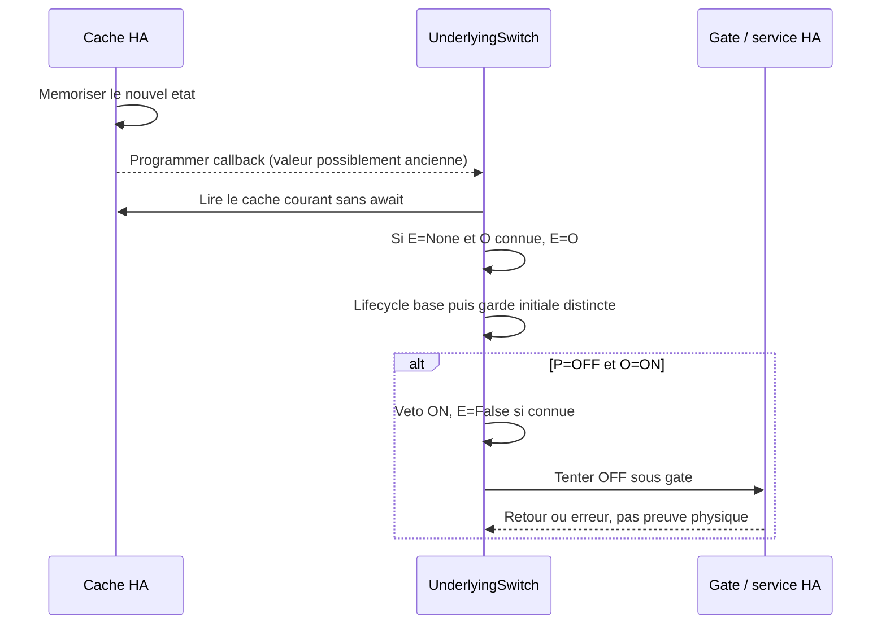

# Conception commune #2219 / #2223 : attente initiale et commandes sures

## 1. Statut, mandat et sources

**Jalon actualise, 2026-11-10 :** le mainteneur valide la specification v0.3 et cette conception v0.2 convergentes, demande une nouvelle branche et le commit des trois documents, et autorise le developpement commun #2219/#2223 avec tests automatises simules. La resolution V6 et les quatre points de passage sont confirmes. Aucune nouvelle API, modification de `vtherm_api`/plugin/dependance, intervention HA reelle, commande d'equipement ou publication distante n'est autorisee. Les statuts et restrictions de phase documentaire conserves ci-dessous sont historiques et remplaces par cet accord, sans changement des arbitrages techniques.

| Metadonnee              | Valeur                                                                                                                                                                                                             |
| ----------------------- | ------------------------------------------------------------------------------------------------------------------------------------------------------------------------------------------------------------------ |
| Version / date          | 0.2 / 2026-11-10                                                                                                                                                                                                   |
| Statut                  | Convergence documentaire cycle 1 avec la specification v0.3 FR/EN ; V6 corrigee cote conception, dernier controle redacteur attendu ; developpement NON autorise                                                   |
| Proprietaire            | Projet Versatile Thermostat ; decisions a valider par le mainteneur et le redacteur                                                                                                                                |
| Mandat                  | « Go pour spec » ; une demande, une implementation, UNE campagne finale commune, controles cibles intermediaires                                                                                                   |
| Ecriture de cette phase | Ce seul document ; ni rapport, ni specification, ni produit, ni test executable modifies                                                                                                                           |
| Base consultee          | Revision historique de la v0.1 : `5151bfef2fa5daa0bdd53007030f1d578a5362b3` ; relecture statique ciblee des chemins C4/C5/C14 pour V6 en v0.2                                                                      |
| Entrees                 | [Specification FR/EN v0.3](issue-2219-2223-specification.md), conception v0.1 relue avant correction, [rapport commun](issue-2223-review.md) comme source historique, retour du redacteur et demande du mainteneur |

Specification et rapport sont non suivis dans l'arbre de travail et preserves ; seul ce document est corrige.
Cette revision relit integralement les deux langues de la specification v0.3 et le design v0.1 ; elle ne re-audite pas le rapport.
#2221 est fermee car incomplete : aucune approche validee, dependance ou validation future n'en est reprise.
Le choix directeur est celui du mainteneur : E initialement `None`, premiere commande ou premier etat connu, repair inactif sur `None`.
Les paragraphes « Fait » decrivent du code lu ; les paragraphes « Decision » decrivent la cible, pas une fonctionnalite disponible.
Aucun test HA, aucune sonde produit, aucune commande d'equipement ni inspection d'une instance active n'a ete effectue ici.
La sonde historique `outcome_unknown` n'est pas une preuve. Les tests cites ci-dessous sont lus, non executes.
Les consignes HA `SKILL.md` et `references/device-control.md` ont ete consultees dans leur depot public `homeassistant-ai/skills` ; acces par outil differe indisponible dans cette session.
Elles confortent le ciblage par `entity_id` ; aucune nouvelle automation, configuration, entite ni application AppDaemon n'est necessaire.

## 2. Perimetre et faits verifiables

Objectif : reconnaitre passivement un relais deja ON/OFF sans fabriquer de transition (#2223), sans permettre un ON issu d'une attente perimee (#2219).
Le comportement de demarrage change pour TOUS les `over_switch`, avec/sans plugin, inverses, virtuels, multi-relais et instances recreees.
Pas de nouvelle API d'adoption, de modification `vtherm_api`, de plugin a republier, de dependance, de schema persistant ni de migration.
L'analyse du scheduler est limitee aux contrats de commande utiles ; elle ne vaut pas audit complet de ses algorithmes ni des plugins.

| Ref. | Sources et positions a la revision consultee                                                                                                                                                                                                  | Fait determinant                                                                                                                                                           |
| ---- | --------------------------------------------------------------------------------------------------------------------------------------------------------------------------------------------------------------------------------------------- | -------------------------------------------------------------------------------------------------------------------------------------------------------------------------- |
| C1   | [underlyings.py](../../custom_components/versatile_thermostat/underlyings.py#L148), `UnderlyingEntity.startup`, `_underlying_changed` L158                                                                                                    | Cache branche au startup ; initialisation disponible, puis `await check_initial_state()`, puis notification parent ; un etat hors paire termine aussi cette initialisation |
| C2   | [underlying_state_manager.py](../../custom_components/versatile_thermostat/underlying_state_manager.py#L52), `_state_changed`, `_set_state` L94, `get_state` L77, `add_underlying_entities` L137                                              | Cache mis a jour avant `async_create_task` ; conserve None/unknown/unavailable ; docstring de `_set_state` obsolete ; disponibilite != connaissance logique                |
| C3   | [underlyings.py](../../custom_components/versatile_thermostat/underlyings.py#L379), `UnderlyingSwitch.__init__`, `is_device_active` L454, `build_command` L505                                                                                | E=False ; lecture compare seulement ON ; inversion et valeurs virtuelles definissent les deux valeurs logiques                                                             |
| C4   | [underlyings.py](../../custom_components/versatile_thermostat/underlyings.py#L534), `turn_off`, `turn_on` L564, `check_overpowering` L277                                                                                                     | Gate avant puissance ; E apres retour service ; reservation ON avant appel ; retrait OFF avant appel ; ServiceNotFound absorbe, autre exception propagee                   |
| C5   | [underlyings.py](../../custom_components/versatile_thermostat/underlyings.py#L621), `check_and_repair`, `check_initial_state` L465, `_keep_alive_callback` L479                                                                               | Repair compare E/O sans P ; garde initiale distincte ; ternaire keep-alive assimile None a OFF et filtre seulement absent/unavailable                                      |
| C6   | [underlyings.py](../../custom_components/versatile_thermostat/underlyings.py#L603), `async_inhibition_resync`, `on_inhibition_gate_opened` L609, `remove_entity` L596                                                                         | Resync recopie `is_device_active is True`, puis rearme ; suppression annule timer et ecoute                                                                                |
| C7   | [feature_repair_incorrect_state_manager.py](../../custom_components/versatile_thermostat/feature_repair_incorrect_state_manager.py#L77), `check_and_repair` ; [const.py](../../custom_components/versatile_thermostat/const.py#L533)          | Option False par defaut ; 30 s depuis readiness, 5 cycles positifs, 4 cycles sautes, reprise ; journal actuel « was repaired » trop affirmatif                             |
| C8   | [feature_power_manager.py](../../custom_components/versatile_thermostat/feature_power_manager.py#L143), `check_power_available`, `calculate_underlying_startup_power` L205, `add/sub_power_consumption...` L262/L281, `set_overpowering` L297 | Check sans reservation ; O=True donne increment nul ; cles par relais ; refus peut declencher un OFF reentrant avant retour                                                |
| C9   | [feature_central_power_manager.py](../../custom_components/versatile_thermostat/feature_central_power_manager.py#L109), `_power_sensor_changed`, `get/set_started_vtherm_power` L321/L325                                                     | Nouvelle mesure vide le dictionnaire ; set remplace une cle, ce n'est pas une addition cumulative                                                                          |
| C10  | [inhibition_manager.py](../../custom_components/versatile_thermostat/inhibition_manager.py#L177), `blocks_command`, `_async_exit_reconcile` L391                                                                                              | OPEN ou transaction autorisee liee a la tache ; trois marches maximum, resync avant update_states ; ne pas recreer la transaction dans une autre tache                     |
| C11  | [keep_alive.py](../../custom_components/versatile_thermostat/keep_alive.py#L107), `IntervalCaller.cancel`, `set_async_action`                                                                                                                 | Annule les futurs rappels, pas la coroutine deja en cours ; exception du callback annule les rappels suivants                                                              |
| C12  | [base_thermostat.py](../../custom_components/versatile_thermostat/base_thermostat.py#L651), `async_startup`, `init_underlyings_completed` L735, `update_states` L1880, `async_control_heating` L1959                                          | Restauration inhibition avant startup relais ; controle specifique puis managers externes puis repair L2020 ; attente plugin possible avant propagation de mode            |
| C13  | [state_manager.py](../../custom_components/versatile_thermostat/state_manager.py#L89), `calculate_current_hvac_mode` ; [vtherm_state.py](../../custom_components/versatile_thermostat/vtherm_state.py#L59), `set_hvac_mode`                   | P effectif est current_state, pas requested_state ; resolution inhibition/central/securite/fenetre ; fonction de resolution du mode sans await interne                     |
| C14  | [cycle_scheduler.py](../../custom_components/versatile_thermostat/cycle_scheduler.py#L604), `_start_cycle_switch`, `_tick` L676 ; [thermostat_switch.py](../../custom_components/versatile_thermostat/thermostat_switch.py#L65), `post_init`  | U et durees affectes par scheduler ; minimums examines dans tick ; `_should_be_on` ecrit apres appel, et non oracle d'autorisation avant celui-ci                          |

## 3. Composants et modele local

Decision : concentrer observation, amorcage, attente et emission dans `UnderlyingSwitch` ; garder le cache generique et les autres familles fonctionnellement inchanges.
Le gestionnaire repair garde son eligibilite et son compteur ; seuls ses diagnostics doivent cesser d'annoncer un resultat physique.
La resolution du mode parent notifie synchroniquement le veto aux seuls switches, avant toute suspension aval (section 6).
Le scheduler reste producteur de commandes et de phases ; une notification privee de phase OFF sans service est necessaire (section 7), sans nouvel algorithme, verrou ni annulation globale.

| Donnee                     | Definition / duree de vie                                                                                                               |
| -------------------------- | --------------------------------------------------------------------------------------------------------------------------------------- |
| O : bool ou None           | Observation decodee du CACHE COURANT ; None = absente, indisponible, inconnue ou hors paire                                             |
| E : bool ou None           | `_is_on_part_running`, attente logique ; None = jamais etablie ; pas un acquittement ni un droit ON                                     |
| P / U                      | `thermostat.vtherm_hvac_mode` effectif / `underlying.hvac_mode` local ; seuls HEAT/COOL compatibles autorisent ON                       |
| I                          | Direction effective pour CET examen : E sous contraintes, ou OFF impose par P=OFF ; jamais persistee                                    |
| Contexte prive de commande | Identite unique par tentative, direction, phase preparation/emission/terminee ; comparaison par identite, sans compteur de generations  |
| Veto ON prive              | Booleen d'autorisation retiree ; survit au retour HEAT/COOL ; efface uniquement par un nouveau ON effectivement admissible a l'emission |

Le contexte permet aussi de savoir qu'une commande est en cours ; aucun historique ni file de commandes n'est conserve.
`bool | None` suffit a l'amorcage, PAS a l'ordre des coroutines : deux ON encadrant un OFF donnent la meme valeur booleenne (ABA).
L'ordre des tentatives et la memoire du retrait ON sont requis ; jeton local et veto memorise sont les choix techniques prives proposes, pas des exigences fonctionnelles ni une nouvelle interface.
Pas de framework public, verrou general, generation complexe ni changement d'algorithme scheduler ; seul le raccordement prive de phase OFF de la section 7 est prevu.
Toutes ces donnees sont volatiles ; une nouvelle instance repart E=None, sans chronologie physique restauree.
Le veto initial depend de P : P inconnu/non autorisant ne doit pas transformer une adoption ON en permission future automatique.
On ne substitue ni `_should_be_on` ni `should_device_be_active` a E : ils ne representent pas la phase attendue par repair (C14).

## 4. Observation et amorcage automatique

Decision : un decodeur prive sans effet lit `state_manager.get_state(entity_id)` et les valeurs `state` des commandes ON/OFF construites.
Priorite aux inconnus HA reserves, puis correspondance exacte ON, puis OFF ; toute autre valeur donne None, jamais `bool(state)`.
Si les deux valeurs configurees sont identiques, la connaissance est ambigue : O=None et diagnostic borne ; aucune nouvelle validation de configuration n'est introduite ici.
`is_device_active` conserve son contrat public bool/None et son garde d'initialisation ; le decodeur interne peut lire avant ce garde pour ordonner le startup.
Ne pas modifier `build_command` ni la semantique d'inversion : utiliser sa paire deja calculee, notamment pour le virtuel.

Ajouter une surcharge switch de `_underlying_changed` : avant son premier await, relire O et faire `si E is None et O connue : E=O`.
Lecture de O, verification E et affectation forment une seule section sans await ; ne jamais adopter `new_state` capture par le callback.
Un callback ancien peut ainsi seulement provoquer une relecture recente, pas revenir a sa propre valeur historique (C2).
La meme verification atomique precede la garde initiale du switch ; elle est idempotente et ne fait rien apres connaissance de E.
Aucune commande, notification/receipt, date, duree, reservation ni mise a jour de mode/consigne dans cette operation d'adoption.
Une derive ulterieure ou une indisponibilite ne remet jamais E a None. L'exception de resync d'inhibition est bornee en section 8.

### Ordre startup, y compris disponibilite tardive (Q-03)

1. Constructeur E=None ; startup enregistre cache et keep-alive, sans commande deduite de E.
2. Callback switch : decodeur courant, amorcage atomique si possible ; puis delegation a la base pour le lifecycle HA existant.
3. La base marque l'initialisation disponible, appelle `check_initial_state`, puis notifie le parent suivant C1.
4. `check_initial_state` relit P et O ; P=OFF/O=ON impose le chemin OFF distinct, sans appeler repair et sans attendre ses 30 s.
5. Si un etat hors paire a deja termine l'initialisation HA, le callback switch repasse cette garde au premier O logique connu, meme si une commande a deja etabli E.
6. Eviter le double OFF du meme callback : si la base vient d'executer la garde initiale, ne pas la rejouer ; si deja initialise, la jouer apres amorcage tardif.

Un marqueur prive « premiere connaissance logique traitee », distinct de E et de l'initialisation HA, borne cette garde a une seule premiere connaissance ; le fixer avant await.
Il est necessaire lorsque E a deja ete etablie par commande : E seule ne permet plus de detecter ce premier etat connu tardif.

Avant le premier await de la garde : retirer l'autorisation ON, invalider une preparation ON et, si E connue, ramener E a False.
Cette mutation est une decision de securite distincte de l'adoption et de l'emission ; elle ne prouve aucun arret.
Si gate ferme : OFF supprime, O reste ON, journal explicite ; ne pas ouvrir la gate ni memoriser un succes.
La reconciliation d'inhibition, les prochains controles repair eligibles ou keep-alive configures reutiliseront les chemins existants.
Sans voie de retry active, aucun delai ni arret garanti n'est promis ; on preserve la tentative initiale, pas une boucle de securite nouvelle.
Avec O inconnue, attendre la connaissance : ni adoption OFF, ni arret acquitte. Parent inconnu : pas de commande ON, pas d'OFF initial invente.

## 5. Contrat de commande et politique E (Q-01 / Q-02)

Conserver signatures et retours publics existants : ON True apres retour service normal, False si suppression/refus, None sur ServiceNotFound absorbe ; OFF sans nouveau resultat public.
Un petit chemin PRIVE partage retourne a repair un resultat interne (supprime/refuse/tente/accepte/erreur), sans modifier `vtherm_api` ni les appelants externes.
Le resultat est local a l'appel : ne pas relire un « dernier resultat » global qui pourrait appartenir a une autre coroutine.
Repair ne passe pas par un contournement : ce chemin prive porte exactement les memes gates, puissance et controles que `turn_on/off`.

| Etape ou resultat                                            | E apres cette tentative                                        | Adoption et effets                                                                                         |
| ------------------------------------------------------------ | -------------------------------------------------------------- | ---------------------------------------------------------------------------------------------------------- |
| Entree / preparation ON avant puissance                      | E precedente, eventuellement None                              | Nouveau contexte ; observation courante encore adoptable si None                                           |
| Gate bloquee avant emission                                  | E precedente ; veto de securite traite separement              | Pas d'emission, pas de reservation ON ; None reste amorcable                                               |
| Puissance refusee                                            | E precedente SAUF OFF reentrant valide declenche par puissance | Pas d'ON ; effets existants set_overpowering/update_states conserves ; aucun rollback d'un OFF plus recent |
| Juste avant appel de service ON/OFF                          | E=direction de la commande admissible                          | Section sans await apres derniere revalidation ; a partir d'ici aucun callback ne readopte                 |
| Service retourne normalement                                 | E deja etablie, aucune reecriture tardive                      | Appel accepte par HA, non acquitte physiquement ; rearmement seulement si contexte toujours courant        |
| ServiceNotFound, autre exception ou annulation pendant appel | E de l'emission conservee, sauf autorite ulterieure            | Attente non confirmee, pas succes ; nettoyage propre a la tentative ; pas de retour a None                 |
| Nouvelle commande pendant ancienne attente                   | Ancienne E jusqu'a emission admissible de la nouvelle          | Nouveau jeton invalide l'ancienne continuation, meme si direction identique ; pas de verrou                |

E est donc une attente emise, non un etat applique ; conserver E apres exception permet une correction bornee, sans readoption de derives.
Une exception de service peut survenir apres un effet : ne jamais pretendre qu'elle prouve l'absence de commande physique.
En revanche gate/refus AVANT appel n'etablissent pas E : ce n'est pas la politique « toute invocation initialise ».
Commandes bloquee/refusee terminent leur contexte ; si None et cache connu, faire une relecture d'amorcage et garde initiale en sortie, sans attendre un nouvel evenement HA.
Ne pas faire cette sortie en boucle si la garde OFF est elle-meme bloquee ; une seule garde par traitement logique.

### Ordre et suspensions

1. Chaque demande explicite ON/OFF remplace le contexte courant avant son premier await ; annuler les futurs keep-alive comme aujourd'hui.
2. Repair/keep-alive n'ecrasent pas une preparation/emission en cours : suppression « commande en cours », pas nouvelle demande concurrente d'entretien.
3. ON : gates et autorite initiales, puis `await check_overpowering()` ; apres CHAQUE await pre-emission, verifier jeton, retrait, P/U, gate et contraintes exposees.
4. Si refus puissance : preserver `force_changed` et `update_states(force=True)` actuels, sans reprendre ON ensuite ; un OFF reentrant gagne.
5. Dernier bloc sans await : revalidation complete, reservation eventuelle, E=direction, entree dans `services.async_call` ; ne placer aucun hook await entre garde et appel.
6. Pendant l'await service, callbacks voient deja E connue ; une demande OFF ulterieure peut emettre sans attendre le retour ON.
7. Au retour ancien : aucune reecriture E, aucun rearmement, aucun nettoyage d'une reservation plus recente ; finaliser uniquement si proprietaire courant.

Une repetition de service reste possible (repair/keep-alive), pas une garantie d'idempotence de tout service virtuel configure.
Un ON deja remis a HA ne peut etre rappele : OFF subsequent et observations font la reconciliation, sans garantie d'ordre physique du reseau.
Pas de nouvelle tache pour emettre : la transaction d'inhibition est liee a la tache courante (C10).

## 6. Autorite parent, veto et absence de resurrection (Q-04)

Decision : P est le mode EFFECTIF ; ne pas utiliser le mode demande ni seulement U. ON exige P et U dans HEAT/COOL compatibles.
Dans la resolution `StateManager.calculate_current_hvac_mode`, apres choix de P mais avant retour et sans await, notifier les switches si P n'autorise plus ON.
Notification strictement privee, reservee aux `over_switch` ; aucune modification des objets API ni du conteneur generique `VThermState`.
Justification de cette petite modification hors `underlyings` : `BaseThermostat.update_states` peut attendre un plugin avant `under.set_hvac_mode` (C12).
Un OFF puis HEAT pendant cet await ne doit pas echapper a une simple relecture finale HEAT : le veto memorise le retrait au point de resolution.
`UnderlyingSwitch.set_hvac_mode` applique aussi le veto U avant son eventuel await OFF, y compris si O=OFF et donc sans service.
Les restaurations avant startup n'ont pas de preparation en cours ; les ecritures privees arbitraires de mode par tiers ne sont pas un contrat audite.

| Cause                                              | Mutation logique sans await                                                   | Emission                                                                     |
| -------------------------------------------------- | ----------------------------------------------------------------------------- | ---------------------------------------------------------------------------- |
| P=OFF ou U=OFF                                     | Invalider preparation ON, veto=True ; E connue devient False, None reste None | Aucune par invalidation seule ; garde startup/mode/repair decide ensuite OFF |
| P inconnu/non autorisant ou U incompatible/inconnu | Invalider preparation ON, veto=True ; conserver E (dont None)                 | Jamais ON ; ne pas inventer OFF sur la seule inconnue                        |
| Retour P/U autorisants                             | Ne pas effacer le veto, ne pas restaurer E=ON                                 | Aucun ON automatique depuis ancienne attente retiree                         |
| Nouveau ON explicite admissible apres controles    | Nouveau contexte ; lever veto seulement au bloc d'emission ; E=True           | ON sous gates et puissance                                                   |

Veto=False au startup autorisant ; un amorcage sous P inconnu garde le veto jusqu'a un nouveau ON valide, meme si O=ON.
Le veto bloque la reutilisation automatique de E par repair/keep-alive, pas une nouvelle demande explicite `turn_on` dont P/U, gate et puissance autorisent maintenant l'emission.
Sur P=OFF, E connue doit etre invalidee AVANT egalite et AVANT retour pour O inconnue : E=ON/O=OFF ne doit jamais rallumer plus tard.
Repair sur E=None retourne d'abord False sans mutation ni service, meme P=OFF ; la garde startup et la resolution de mode sont des chemins distincts.
Sur E connue/P inconnu/E=ON : pas d'emission repair ; E reste ON mais veto empeche son usage au seul retour HEAT.
Sur E connue/P inconnu/E=OFF : OFF reste admissible si O=ON et gates ouvertes ; O inconnue attend.
Sur P actif : comparer O a I seulement apres contraintes ; E=False reste OFF meme si parent chauffe. Un veto ne doit pas etre leve par repair/keep-alive.

## 7. Puissance, durees et resultat repair

Fait : la verification de puissance ne reserve pas ; l'ajout est synchrone juste avant service (C4/C8), et peut deja etre nul pour O=ON.
Decision : aucune reservation lors d'adoption, de preparation ou de veto avant emission. La revalidation finale precede donc tout ajout.
Conserver les cles `power_reservation_key`, les calculs existants et l'exemption d'increment nul sur relais deja connu ON ; aucune reservation par E adoptee.
Si service ON echoue/est annule, retirer uniquement l'increment cree par CET appel, pas une reservation preexistante ni celle d'un appel ulterieur.
Implementation locale proposee : capturer presence/valeur avant ajout et dictionnaire central courant ; nettoyer seulement si jeton courant, meme dictionnaire et valeur toujours celle ajoutee.
La mesure centrale remplace le dictionnaire (C9) : si elle a eu lieu pendant await, ne pas restaurer une ancienne reservation effacee par cette mesure.
Utiliser les operations centrales existantes ; acces interne borne pour cette garde d'identite, sans nouveau protocole, transaction globale ou changement du calcul central.
OFF conserve le retrait actuel avant appel ; OFF bloque gate CLOSED conserve son retrait actuel, EXIT_RECONCILING conserve sa reservation (C4).
Ce retrait comptable ne prouve pas l'arret physique ; conserver cette limite dans les journaux et la documentation.
Une ancienne coroutine ne touche plus la comptabilite des suivantes ; les appels n'ajoutent pas deux fois une meme cle (C9).

Minimums : le scheduler reste proprietaire du choix et du report des phases ; ne pas le rappeler depuis repair et ne pas recalculer une phase depuis P.
Cas verifie C14 : `_tick` en cible OFF avec O deja OFF/inconnue, et `_start_cycle_switch` a 0 %, peuvent ne pas appeler `turn_off` ; une ancienne E=ON reste alors intacte.
Ajouter a CES branches une notification privee de phase OFF : invalider la preparation ON, ramener E connue a False sans service, laisser E=None et les reservations intactes.
Si O=ON et le minimum ON reporte l'arret, ne notifier qu'une fois l'arret effectivement decide, via le chemin `turn_off` existant ; ne pas court-circuiter ce report.
Ce changement de raccordement est justifie par ce chemin sans commande observable ; ni calcul des ticks, ni durees, ni penalites, ni annulation globale ne changent.
**V6 corrigee : preservation uniquement (FR-011, BR-003/009, AC-008 v0.3).** Retirer de la cible v0.1 le calcul de minimums dans repair/keep-alive a partir de `last_change`, ainsi que le report automatique pour historique absent/inexploitable.
Fait relu : ces chemins et `turn_on/off` ne calculent pas de minimums ; `_tick` utilise `evaluate_need_on/off` et `last_change`, avec sa propre branche sans historique (C4/C5/C14). Cette politique reste dans son proprietaire, sans reproduction ni modification ici.
Repair et keep-alive reutilisent les chemins de commande existants, leurs gates et protections de puissance applicables ; aucun nouveau filtre de duree, appel au scheduler, historique, timer ou resultat de report n'y est ajoute.
Les minimums ordinaires restent appliques la ou le scheduler les applique deja : conserver evaluations, echeances, reports et branches existantes ; ne pas transformer un arret encore reporte en phase OFF decidee.
Adoption, examen et invalidation logique ne reinitialisent aucun horodatage ni aucune duree ; historique absent ne declenche aucune nouvelle decision de report et ne permet pas d'inventer une heure physique.
OFF de securite parent/startup et arret d'inhibition conservent leur priorite existante ; ne pas leur ajouter un report de minimum ON ni contourner leurs gates.
Cette preservation ne promet pas que toute transition issue de repair/keep-alive est protegee par les minimums du scheduler : ils ne constituent pas une gate universelle de ces chemins dans l'existant relu. Une telle extension demanderait un besoin et un arbitrage distincts ; elle n'est pas necessaire au contrat v0.3 de preservation des protections applicables.
Les cooldowns/protections prives de plugins non audites ne sont ni controles ni garantis ; aucune modification de plugin ou nouvelle API ne les rend implicitement exposes.
Le controle final apres puissance relit aussi les contraintes exposees (notamment overpowering et gate), pas seulement P.

Repair garde `bool` : True signifie ici tentative de service de correction, y compris appel en erreur ; False signifie attente, concordance ou suppression avant appel.
Cette semantique preserve la cadence : erreurs comptees comme tentatives, pas cinq « succes physiques » ; gate/refus puissance ne comptent pas comme emission.
Absorber et journaliser localement l'exception dans le chemin repair, tout en conservant la propagation historique des commandes ordinaires (hors ServiceNotFound).
Le gestionnaire compte toujours au plus un cycle positif, quel que soit le nombre de relais ; conserver reset sur cycle sans tentative et perte readiness.
Pas de retry recursif immediat : cadence 5/4 existante ; une emission en erreur ne doit pas fabriquer de boucle de commande dans le callback.
Keep-alive conserve intervalle et backoff ; apres exception, conserver son annulation historique, sans nouveau retry rapide implicite.

## 8. Keep-alive, inhibition et audit du drapeau

Keep-alive : branches explicites `E is None`, `E is True`, `E is False` ; None retourne sans ordre, meme si timer arme.
Relire O via decodeur/cache ; unknown et hors paire rejoignent l'attente de disponibilite, pas la branche service actuelle.
E connue : appliquer veto P/U, puis direction effective ; OFF prioritaire sous P=OFF, ON interdit sous P inconnu ; memes controles finaux apres puissance.
Conserver le backoff de disponibilite et ne pas reinitialiser les durees ; un simple rearmement n'est jamais permission d'emettre.
Resync inhibition : si O=None, ne modifier ni E ni son incertitude ; ne pas utiliser `is True` pour construire False.
Si O connue, conserver la reconciliation connue existante comme operation BORNEE a la sortie, puis appliquer veto parent/U ; ce n'est pas de la readoption permanente.
Si commande explicite plus recente en cours, ne pas ecraser son attente par cette resync ; la marche de reconciliation et les gates restent souveraines.
`on_inhibition_gate_opened` peut reinstaller le timer sur instance vivante, meme E=None, car callback devient inerte ; ne leve ni veto ni gate.
Suppression : invalider le contexte avant d'annuler timer/ecoute ; une reprise ancienne ne rearme plus et n'emet pas sur instance retiree.

Audit exhaustif textuel du champ dans `custom_components` : SIX occurrences, toutes dans le coeur ci-dessous ; ce n'est pas un audit de consommateurs externes.

| Acces actuel                                        | Evolution future apres autorisation                                                                      |
| --------------------------------------------------- | -------------------------------------------------------------------------------------------------------- |
| `__init__` L409 : ecriture False                    | Annotation bool/None, initialisation None ; contexte et veto locaux                                      |
| `_keep_alive_callback` L503 : lecture ternaire      | Branches tri-etat + autorite + gates/protections existantes applicables, sans nouveau calcul de minimums |
| `turn_off` L556 : ecriture apres await              | E=False avant service admissible ; aucun overwrite/rearmement tardif                                     |
| `turn_on` L586 : ecriture apres await               | E=True au bloc final, jeton et revalidation ; echec non acquitte                                         |
| `async_inhibition_resync` L605 : ecriture `is True` | Inconnu conserve, connu reconcilie sous autorite et ordre                                                |
| `check_and_repair` L624 : lecture                   | None d'abord, veto OFF avant egalite, resultat tentative                                                 |

Nouveaux acces strictement internes : amorcage atomique, invalidation de mode, diagnostic ; pas d'accesseur/API public d'adoption.

## 9. Plan de modification futur et exploitation

| Module / symboles                                                                                                                                        | Modification necessaire, non realisee ici                                                                                                  |
| -------------------------------------------------------------------------------------------------------------------------------------------------------- | ------------------------------------------------------------------------------------------------------------------------------------------ |
| [underlyings.py](../../custom_components/versatile_thermostat/underlyings.py) / `UnderlyingSwitch` symboles sections 4-8                                 | Decodeur, surcharge callback, amorcage, garde startup, jeton/veto, chemin prive d'emission, repair, keep-alive, resync et retrait          |
| [state_manager.py](../../custom_components/versatile_thermostat/state_manager.py) / `calculate_current_hvac_mode`                                        | Notification privee de retrait ON aux switches au point de resolution sans await ; autres familles ignorees                                |
| [cycle_scheduler.py](../../custom_components/versatile_thermostat/cycle_scheduler.py) / `_start_cycle_switch`, `_tick`                                   | Notification privee OFF dans les branches sans commande ci-dessus ; preserve phase OFF et invalide ON suspendu, sans modifier l'algorithme |
| [feature_repair_incorrect_state_manager.py](../../custom_components/versatile_thermostat/feature_repair_incorrect_state_manager.py) / `check_and_repair` | Formulation « tentative de correction », pas « was repaired » ; pas de changement cadence/option                                           |
| [underlying_state_manager.py](../../custom_components/versatile_thermostat/underlying_state_manager.py) / `_set_state`                                   | Corriger seulement sa docstring mensongere si inclus dans livraison ; comportement cache inchange                                          |
| [underlyings.md](underlyings.md), documentation utilisateur/release                                                                                      | Lifecycle general, version de livraison a renseigner, limites physiques et compatibilite sans API supplementaire                           |

`UnderlyingEntity._underlying_changed`, `hass_services_async_call`, `check_overpowering`, `FeaturePowerManager`, `InhibitionManager`, `IntervalCaller` : contrats reutilises, pas de modification fonctionnelle proposee.
Ne pas acheminer les switches par le wrapper generique actuel : il absorbe les exceptions et confond gate/retour None (C4), insuffisant pour resultat interne fiable.
Securite : aucune nouvelle permission HA, entite, persistance, donnees sensibles ou commande distante ; conserver entity_id et services configures.
Diagnostic par controle : identites parent/relais, P/U/E/I/O, direction, motif, statut attente/suppression/tentative/accepte/erreur/concordance.
Au plus une synthese decisionnelle par relais/controle ; repetitions identiques en debug, avertissement au changement de motif, erreurs selon cadence existante.
Le gestionnaire peut fournir sa synthese de cycle, sans dupliquer tous les details du relais ; ne jamais annoncer un arret physique confirme.
Pas de delai de service nouveau : appel non bloquant explicite inchange ; le retour HA n'attend pas necessairement l'effet ni le rapport d'etat.

## 10. Verification future et tracabilite

Une seule campagne finale #2219/#2223, dans les fichiers EXISTANTS ci-dessous ; pas de nouveau fichier executable pendant cette phase.
Pendant developpement autorise : controles cibles apres chaque changement, puis un bilan commun des scenarios S-01 a S-16 et regressions.
Utiliser fixtures HA simulees et services espions ; aucune instance ni equipement reel. Les attendus ci-dessous sont futurs, non verifies par execution.
Le test gestionnaire actuel `test_repair_manager_pause_and_retry_logs` ne delegue qu'a un mock ; il ne prouve pas l'integration E/O/P (C7).
Les tests inhibition lus couvrent transactions/reconciliation ; les tests puissance lus couvrent increment nul, reservation par cle et exceptions, pas le nouvel amorcage.

| Exigences / regles                                      | AC / scenario | Symboles cibles et fichier existant ; verification discriminante                                                                                                                                                                                                                                                                                                                                                                                                                                                                                                                                                                                                                   |
| ------------------------------------------------------- | ------------- | ---------------------------------------------------------------------------------------------------------------------------------------------------------------------------------------------------------------------------------------------------------------------------------------------------------------------------------------------------------------------------------------------------------------------------------------------------------------------------------------------------------------------------------------------------------------------------------------------------------------------------------------------------------------------------------- |
| FR-001, FR-005, FR-006 ; BR-004, BR-005, BR-009         | AC-001 / S-01 | Callback/decodeur/E ; [test_check_initial_state.py](../../tests/test_check_initial_state.py) : instances separees ON puis OFF, zero service/receipt/date/reservation par adoption                                                                                                                                                                                                                                                                                                                                                                                                                                                                                                  |
| FR-002, FR-007, FR-008 ; BR-002, BR-005                 | AC-002 / S-02 | Cache/is_device_active ; [test_underlying_unavailable.py](../../tests/test_underlying_unavailable.py) : absent, unknown, unavailable, hors paire avant/apres E connue                                                                                                                                                                                                                                                                                                                                                                                                                                                                                                              |
| FR-008, FR-009 ; BR-007                                 | AC-003 / S-03 | Emission puis repair ; [test_repair_incorrect_state_manager.py](../../tests/test_repair_incorrect_state_manager.py) : commande remplace adoption, derive ne remplace jamais commande                                                                                                                                                                                                                                                                                                                                                                                                                                                                                               |
| FR-005, FR-009 ; BR-004, BR-007, BR-008                 | AC-004 / S-04 | Jeton/commande/callback ; meme fichier : suspendre puissance puis service, cache courant != ancien callback, ON/OFF/ON et retours inverses                                                                                                                                                                                                                                                                                                                                                                                                                                                                                                                                         |
| FR-003, FR-004 ; BR-001, BR-002, BR-003                 | AC-005 / S-05 | Garde startup + repair ; test_check_initial_state et test_repair_incorrect_state_manager : P OFF, E/O matrice, hors paire initiale puis ON, gate bloquee                                                                                                                                                                                                                                                                                                                                                                                                                                                                                                                           |
| FR-004, FR-008 ; BR-001, BR-002, BR-004, BR-008         | AC-006 / S-06 | Resolution mode/veto ; test_repair_incorrect_state_manager : E=None/ON/OFF, O trois etats, P inconnu puis HEAT, aucun ON sans commande valide                                                                                                                                                                                                                                                                                                                                                                                                                                                                                                                                      |
| FR-004, FR-011 ; BR-008, BR-009                         | AC-007 / S-07 | turn_on/puissance/mode ; [test_power.py](../../tests/test_power.py) : pause avant emission, OFF ou inconnu puis HEAT, gate fermee, suppression sans reservation residuelle                                                                                                                                                                                                                                                                                                                                                                                                                                                                                                         |
| FR-001, FR-008, FR-011 ; BR-001, BR-003, BR-008, BR-009 | AC-008 / S-08 | Phase OFF sans service, E=ON/None, O=OFF/inconnue, ON prepare : invalidation sans emission/reservation, entretien sans resurrection ; O=ON/arret encore reporte : pas de phase OFF declaree. Dans test_repair_incorrect_state_manager, [test_cycle_tick_logic.py](../../tests/test_cycle_tick_logic.py) et [test_switch_keep_alive.py](../../tests/test_switch_keep_alive.py), comparer les decisions scheduler avant/apres echeance et sans historique a l'existant, dates/durees intactes par adoption, gates/puissance preservees ; OFF securite parent/startup/inhibition prioritaire comme avant. Aucun nouveau calcul/report repair/keep-alive ni garantie de cooldown prive |
| FR-002, FR-010 ; BR-004, BR-005                         | AC-009 / S-09 | build_command/decodeur/garde ; [test_virtual_switch.py](../../tests/test_virtual_switch.py) : normal, inverse, paire virtuelle non litterale, hors paire, services logiques                                                                                                                                                                                                                                                                                                                                                                                                                                                                                                        |
| FR-010, FR-011 ; BR-005, BR-009                         | AC-010 / S-10 | Contextes/reservations par relais ; [test_multiple_switch.py](../../tests/test_multiple_switch.py), test_power : valeurs distinctes et un inconnu, aucun effet croise                                                                                                                                                                                                                                                                                                                                                                                                                                                                                                              |
| FR-004, FR-007, FR-008 ; BR-001, BR-006, BR-008         | AC-011 / S-11 | Keep-alive/rearmement/veto ; test_switch_keep_alive : None n'emet pas, ON/OFF connus, OFF->HEAT sans resurrection, commande en cours non preemptee                                                                                                                                                                                                                                                                                                                                                                                                                                                                                                                                 |
| FR-008, FR-011 ; BR-006, BR-008                         | AC-012 / S-12 | resync/gate ; [test_inhibition.py](../../tests/test_inhibition.py) : unknown avec E=None/connue, sortie HEAT/OFF, stop optionnel, transaction et tache etrangere                                                                                                                                                                                                                                                                                                                                                                                                                                                                                                                   |
| FR-005, FR-009, FR-012 ; BR-007, BR-009, BR-010         | AC-013 / S-13 | Resultats commande/cleanup ; test_power, test_inhibition, test_repair_incorrect_state_manager : gate/refus/ServiceNotFound/RuntimeError/annulation, E exacte selon section 5                                                                                                                                                                                                                                                                                                                                                                                                                                                                                                       |
| FR-012 ; BR-003, BR-010                                 | AC-014 / S-14 | Gestionnaire reel ; test_repair_incorrect_state_manager : off/non ready/30 s/5 tentatives/4 pauses/retry, perte readiness ; None sans tentative                                                                                                                                                                                                                                                                                                                                                                                                                                                                                                                                    |
| FR-013 ; BR-010                                         | AC-015 / S-15 | Logs relais + gestionnaire ; meme fichier et test_switch_keep_alive : statuts et identites, borne de repetition, aucune affirmation physique                                                                                                                                                                                                                                                                                                                                                                                                                                                                                                                                       |
| FR-010, FR-014 ; BR-005, BR-006                         | AC-016 / S-16 | Startup/remove/recreation/docs ; test_check_initial_state, test_inhibition, [test_underlying_hooks.py](../../tests/test_underlying_hooks.py) : avec/sans manager externe, reload, autres familles et aucun nouveau contrat                                                                                                                                                                                                                                                                                                                                                                                                                                                         |

Pour S-01/03/04/05/06/14 : rendre le vrai gestionnaire configure et ready, etablir sa premiere date ready, avancer l'horloge de plus de 30 s, puis verifier delegation REELLE aux switches.
Passer aussi par startup, cache/event et controle parent ; un appel direct avec E assignee dans un mock ne suffit pas a ces scenarios.
Bloquer deterministement les awaits avec evenements de test, pas une course aleatoire ; verifier E AVANT, PENDANT et APRES chaque suspension.
Ajouter aux variantes : panne service apres callback ON, OFF ulterieur avant retour ON, annulation/retrait pendant service, gate changeant pendant puissance.
Pour puissance : reservation preexistante, increment nouveau, mesure centrale remplacant le dictionnaire pendant await, nouvelle commande proprietaire de la meme cle.
Conserver les tests de minimums du scheduler et les non-regressions climate/valve ; aucune garantie de plugin prive n'est deduite d'un mock de plugin.
Pour S-08, l'oracle des minimums est la decision du proprietaire existant a entrees identiques, y compris sans historique : ne pas attendre un nouveau report par repair/keep-alive. Verifier separement absence de mutation par adoption et invalidation OFF seulement une fois la phase decidee.

## 11. Convergence precise avec v0.3 et correction V6

Meme perimetre fonctionnel et memes identifiants FR/BR/AC ; les 14 FR, 10 BR et 16 AC de la specification v0.3 FR/EN sont traces en section 10, sans exigence retiree et dans UNE campagne finale commune.
V1-V5, V7 et V8 sont integres aux deux langues de v0.3 ; Q-01 a Q-04 sont resolues fonctionnellement entre agents. Le mainteneur a valide ces arbitrages et autorise le developpement le 10 novembre 2026. Le tableau remplace les demandes d'integration de v0.1 par leur statut courant.

| Point                        | Statut, references v0.3 et traduction dans cette conception                                                                                                                                                                                                                                                                                                                                                                 |
| ---------------------------- | --------------------------------------------------------------------------------------------------------------------------------------------------------------------------------------------------------------------------------------------------------------------------------------------------------------------------------------------------------------------------------------------------------------------------- |
| V1 : moment E et echec       | INTEGRE ; Q-01/Q-02, FR-005/009, BR-007/010, AC-004/013 ; section 5 : preparation conserve E, emission admissible l'etablit juste avant appel, erreur conserve attente NON CONFIRMEE, aucun retour ne reecrit E                                                                                                                                                                                                             |
| V2 : veto sans emission      | INTEGRE ; FR-004/008, BR-001/008, AC-005/006/011 ; sections 4/6 : E connue=False sous P/U OFF sans service, None conserve, P inconnu conserve E et retire droit ON ; retour actif seul insuffisant                                                                                                                                                                                                                          |
| V3 : ordre reel              | GARANTIE INTEGREE ; FR-004/009, BR-007/008, AC-004/007/013 ; sections 3/5/6 : ordre ON/OFF/ON, retrait avant await, entretien non preemptif. Jeton et notification prives proposes, non prescrits au fonctionnel                                                                                                                                                                                                            |
| V4 : premier etat hors paire | INTEGRE ; BR-003/004/005, Q-03, AC-005/009 ; section 4 : garde unique au premier O logique connu, meme apres initialisation HA hors paire ou E deja emise ; readiness inchangee                                                                                                                                                                                                                                             |
| V5 : comptage, pas succes    | INTEGRE ; FR-012, BR-010, AC-013/014/015 ; sections 5/7 : positif=service tente meme en erreur, negatif=sans appel ; cadence 5/4 et retours publics conserves                                                                                                                                                                                                                                                               |
| V6 : minimums applicables    | RESOLUE COTE CONCEPTION par retrait de l'extension v0.1 ; FR-011, BR-003/009, AC-008 ; section 7 : aucun calcul repair/keep-alive via `last_change`, aucun nouveau report sur historique absent. Minimums/decisions du scheduler et gates/protections exposees existantes preserves dans leurs proprietaires ; priorite OFF securite existante, aucun cooldown prive garanti. S-08 section 10 et limites section 12 alignes |
| V7 : lecture AC-001          | INTEGRE ; AC-001, FR-008, BR-005 ; S-01 section 10 : deux instances/variantes independantes ON et OFF ; seconde derive non adoptable, couverte S-03                                                                                                                                                                                                                                                                         |
| V8 : phase OFF sans commande | INTEGRE, MEME PERIMETRE ; FR-001/008/011, BR-008, AC-008/011 ; sections 6/7 et S-08 : phase OFF effectivement decidee sans service invalide ON prepare/E ON perimee, laisse None et reservations ; raccordement prive, pas refonte scheduler ni anticipation d'un arret encore reporte                                                                                                                                      |

**Impact precis de V6 :** seule la nouvelle politique de duree/historique de v0.1 est abandonnee ; ni les protections existantes, ni la priorite OFF, ni les garanties d'amorcage, d'ordre et de phase OFF ne sont retirees. Aucun nouveau composant, gate de minimums, API ou contrat de plugin n'est necessaire.
Le nettoyage de reservation par identite de tentative/dictionnaire en section 7 reste un choix technique prive a verifier ; BR-009/AC-013 exigent ses effets, pas ce mecanisme.
La reserve V6 conservait la trace de l'ecart avec le design v0.1 : cette v0.2 apporte la correction demandee. Le redacteur a ensuite confirme independamment sa resolution, sans changement des sections normatives de la specification ; aucune autre question fonctionnelle bloquante identifiee.

## 12. Risques residuels et conclusion

Q-01 a Q-04 sont RESOLUES par v0.3 : etablissement de E a l'emission, retention NON CONFIRMEE en erreur, amorcage courant puis garde initiale distincte, autorite P/U et retrait ON avant attente aval. Sections 3-8 en proposent la realisation interne ; jetons et nettoyage par identite ne sont pas de nouvelles exigences fonctionnelles.

| Point de passage vis-a-vis de v0.3 FR/EN | Confirmation du concepteur en v0.2                                                                                                                                                                                                                                                |
| ---------------------------------------- | --------------------------------------------------------------------------------------------------------------------------------------------------------------------------------------------------------------------------------------------------------------------------------- |
| 1. Meme perimetre                        | CONFIRME : #2219/#2223 uniquement, sans #2221, nouvelle API, modification de `vtherm_api` ou plugin                                                                                                                                                                               |
| 2. Couverture des exigences et criteres  | CONFIRMEE documentairement : 14 FR, 10 BR, 16 AC ; tracabilite section 10, S-08 corrige ; UNE campagne finale commune, controles cibles intermediaires apres autorisation                                                                                                         |
| 3. Absence de contradiction bloquante    | CONFIRMEE par le concepteur puis par le dernier controle independant du redacteur apres retrait V6 section 7 et alignement sections 10/11 ; preservation applicable, pas garantie universelle de minimums repair/keep-alive. Convergence documentaire, pas validation utilisateur |
| 4. Faisabilite et testabilite            | CONFIRMEES sous reserve de verification d'implementation : evolution locale du coeur, raccordements prives mode/phase OFF, matrice deterministe et gestionnaire reel eligible ; aucune preuve runtime                                                                             |

Risques residuels : effet service deja remis a HA non annulable, aucun delai physique garanti, identite/valeur de reservation et ordre des reprises a verifier, services virtuels potentiellement non idempotents. Les minimums du scheduler ne sont pas une protection universelle de repair/keep-alive ; leurs chemins existants restent sans nouvelle politique de duree, et les cooldowns prives de tiers non audites ne sont pas garantis. Ce sont des limites explicites, pas une autorisation d'etendre V6.
Si une future verification revele qu'une garantie v0.3 exige une protection absente, decrire le chemin concret et soumettre une proposition etroite au mainteneur/redacteur avant tout elargissement ; ne pas ajouter unilateralement filtre de duree ou abstraction fonctionnelle.
Version de livraison a fixer lors de livraison, non bloquante pour cette convergence ; documentation utilisateur et notes devront annoncer le changement general de startup.

Limites des sources : specification v0.3 FR/EN et design v0.1 relus ; C4/C5/C14 relus statiquement pour V6. Autres faits C1-C14 et references de tests repris de l'analyse v0.1, sans nouvel audit exhaustif ; rapport non re-audite, aucun audit des tiers, du scheduler complet ou des equipements. Consignes HA consultees comme documentation, sans acces a une instance.
Validation de cette revision strictement documentaire : controle cible immediat apres premier edit de la version, des references, du retrait V6, de S-08 et de la couverture FR/BR/AC ; aucune execution de tests HA, validation runtime, modification produit/configuration/dependance/etat HA/equipement ni commit.
Dernier controle du redacteur recu : meme perimetre, couverture, absence de contradiction bloquante et faisabilite/testabilite sous reserve d'implementation confirmes. Documents convergents presentes et valides ; developpement autorise par le mainteneur le 10 novembre 2026 dans ce perimetre, sans validation runtime acquise ni autorisation de deploiement.